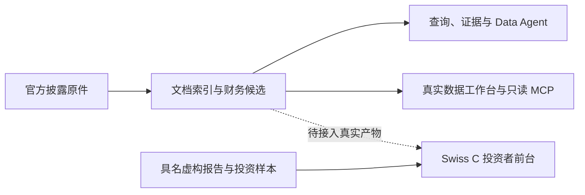

# Uteki 核心功能与启动记录

阅读日期：2026-10-06。代码基线：`6e22cbf`。本记录根据实际入口、数据服务、Agent 与前端代码整理；不把历史实验通过数当作本次验证结果。

Uteki 的核心是：以公司为单位，把披露材料转成带原文出处的数据与研究候选，供研究者查询、核验和采纳。当前真实数据工作台与 Swiss C 投资者前台分别运行；Swiss C 的研究、持仓、决策和风险内容使用具名虚构样本。

## 已启动的入口

| 入口 | 地址 | 当前用途 |
| --- | --- | --- |
| Swiss C | <http://127.0.0.1:8769/docs/design/company-workspace-swiss-c/> | 当前前台基线；机构、公司、Manager、报告、组合决策与风险体验 |
| Agent 运行结果 | <http://127.0.0.1:8765/agent-results> | 真实产物、模型/推理档位、双结果对照和独立人工评分；Trace ID 跳转过程 |
| Agent 运行过程 | <http://127.0.0.1:8765/agent-runs> | 已登记历史、单次模型实验与启用观测的新 Data 执行；步骤、日志、用量和配置 |

旧注意力首页已移除，`http://127.0.0.1:8765/` 以 HTTP 303 跳转至 `/agent-results`。公司目录和无选择的数据工作台同样转到结果页；显式财务数据、原文证据与报告明细作为结果下钻工具保留。

以上是本次本机启动记录，服务停止后需要重新运行。静态前台无需 npm 构建；根目录 npm 脚本主要服务项目进度与 OpenSpec。

从仓库根目录重启，在两个终端分别运行：

```sh
python3 -m http.server 8769 --bind 127.0.0.1
```

```sh
PYTHONPATH=src:. .venv/bin/python -m apps.review_workbench.app --host 127.0.0.1 --port 8765 \
  --observation-root data/agent_observability/local --observation-output-root experiments
```

本次已执行 `uv sync --locked --extra analysis --extra data --extra mcp`，建立 Python 3.13.3 的 `.venv`，未改变依赖锁。后端启动前可用同一命令的 `--check` 参数检查资料而不启动服务。

## 功能地图

下图表示当前数据职责与连接状态。实线表示已有数据处理或读取能力；虚线表示尚待接入的前台数据连接。它不表示整份年报已经能由一个父 Agent 自动完成处理和研究。



| 核心功能 | 代码已实现的行为 | 主要代码 |
| --- | --- | --- |
| 材料获取与保留原件 | 按公司、截止日和来源配置获取 SEC / 指定官网材料；保留原始字节、哈希、请求记录、失败缺口，支持刷新与复用 | [company_acquisition.py](../src/uteki/infrastructure/document_sources/company_acquisition.py) |
| 文档索引与阅读 | HTML 目录、段落、表格和资产索引；PDF 文字及坐标提取；原文搜索、上下文阅读、续读定位 | [company_materialization.py](../src/uteki/infrastructure/research_data/company_materialization.py)、[document_reader.py](../src/uteki/agents/reading/document_reader.py) |
| 财务候选提取 | Inline XBRL 规则提取及多种模型提取策略；保留金额、单位、期间、口径、归因与证据；结果保持候选身份 | [direct.py](../src/uteki/agents/data_extraction/direct.py)、[company_materialization.py](../src/uteki/infrastructure/research_data/company_materialization.py) |
| 数据查询与计算 | 只读 DuckDB 查询、注册财务公式和证据读取；校验公司、来源、截止日、期间及候选访问范围；缺失和冲突显式返回 | [query_service.py](../src/uteki/infrastructure/research_data/query_service.py)、[query_contract.py](../src/uteki/domain/research_data/query_contract.py) |
| Data Agent 与任务编排 | 自然语言查询、规划、原文读取、子任务委派，以及从登记任务中选择财务提取批次；保存工具产物、轨迹、证据包和预算消耗 | [autonomous.py](../src/uteki/agents/data_query/autonomous.py)、[coordinator.py](../src/uteki/agents/data_query/coordinator.py) |
| Agent 运行观察 | 已登记两条 AMD 父运行；显式启用的新 query / extract / extract-batch 可记录步骤、调用与产物事件，页面轮询更新，费用按唯一调用去重 | [运行页](../apps/review_workbench/pages/agent_runs.py)、[观测写入器](../src/uteki/agents/runtime/observation.py) |
| 报告与人工审核 | 历史业务结构、年报叙述实验；报告引用及数值校验；报告归档、人工修订、标注、审核、采纳与替换 | [narrative_runner.py](../src/uteki/agents/analysis/narrative_runner.py)、[research_archive.py](../src/uteki/agents/archive/research_archive.py)、[app.py](../apps/review_workbench/app.py) |
| 外部工具与评测 | `uteki-data` CLI；只读 MCP 的 discover_data、get_data_schema、query_facts、read_source；指标评测及 Data Agent benchmark | [query_cli.py](../src/uteki/infrastructure/research_data/query_cli.py)、[server.py](../src/uteki/interfaces/data_mcp/server.py)、[evaluator.py](../src/uteki_eval/evaluator.py) |
| 投资者前台 | 机构总览、公司与 Manager、报告版本/证据、组合决策、风险跟踪、主题及中英界面；当前使用具名模拟数据 | [model.mjs](design/company-workspace-swiss-c/model.mjs)、[render.mjs](design/company-workspace-swiss-c/render.mjs) |

## Agent 清单与工程后台定位 · 2026-10-06

用户明确后台面向工程侧，核心是观察各 Agent 的运行过程与产物。数据工作台是其中一个模块。优先让工程人员看懂任务、步骤、工具输入输出、父子运行、失败、费用及内容缺口；外观可以朴素。本文盘点当前源码、执行入口和选定的历史产物，不以目录名称或测试数量判断成熟度。

| 能力或角色 | 当前实际状态 | 后台应该如何呈现 | 证据 |
| --- | --- | --- | --- |
| Data Agent | 当前工程链路最完整；已有规划、阅读、查询、委派、选择登记提取批次及真实多公司运行。全年报覆盖和语义完成仍有缺口 | 主运行及其计划、动作、缺口、结束原因 | [协调器](../src/uteki/agents/data_query/coordinator.py)、[AMD / TSMC 实验](../experiments/architecture_baseline/2026-10-04-amd-tsmc-annual-v1/README.md) |
| Data Worker、财务 Extractor | 已有执行代码及实际子任务/提取记录；Worker 是主 Agent 的受限角色，Extractor 是单批模型任务 | 在父运行内呈现子运行，也支持按任务类型筛选；不把每个内部阶段算成独立产品 Agent | [委派](../src/uteki/agents/data_query/autonomous.py)、[提取批次](../src/uteki/infrastructure/research_data/extraction_batches.py) |
| Data 内容核验 | 已有独立模型核验、范围和引用门槛；核验通过只允许本题限定消费，不代表全局采纳 | 关联被审数据、逐项判定与退回原因 | [交接及真实结果](../experiments/architecture_baseline/2026-09-30-data-handoff-v1/README.md) |
| Analysis | 已有读取经过核验的数据并生成解释的限定消费者；另有 Single / Team、年度叙述、Cloud 等真实历史实验。完整研究、正式 Reviewer 修订复审和报告发布闭环未接通 | 标明“限定原型”或“历史实验”，保留任务范围及具体阶段；不把 reviewer / revision 阶段都列成独立 Agent | [限定消费者](../src/uteki/agents/analysis/data_consumer.py)、[直接读文分析](../src/uteki/agents/analysis/analysis_comparison.py)、[年度叙述](../src/uteki/agents/analysis/narrative_runner.py) |
| BusinessMapAgent | 有可注入模型的候选生成组件和离线契约测试；本轮未找到该组件的实际模型运行入口或证据 | 工程组件 / 尚未验证真实运行 | [组件](../src/uteki/agents/business_map/pipeline.py) |
| Risk Agent | 当前检查范围内未找到可执行后端 Agent；有职责设计、假设合同和前台虚构风险样本 | 明确标为尚未实现，不展示虚构运行或实时健康状态 | [风险样本边界](design/company-workspace-swiss-c/risk-register.mjs)、[假设合同](../src/uteki/agents/archive/hypothesis_contract.py) |
| Portfolio / Capital Agent | 当前检查范围内未找到完整后端执行链；前台组合、目标权重及 PM 回应是预先编写的模拟样本 | 明确标为尚未实现；前台演示与后端运行分开 | [组合样本边界](design/company-workspace-swiss-c/portfolio-decisions.mjs) |

DocumentReader、SQL、公式计算、MCP 属于工具或服务。OpenAI Agents SDK 属于执行基础设施。它们都可被观察，但不因此成为独立投研 Agent。

已核对的具体结果：AMD 主运行是 `candidate_ready`，语义完整性仍为 `not_evaluated`；现金流运行是 `limited / no_progress_limit`；TSMC 三表运行是 `partial`。限定 Analysis 的 `e2e-02` 保存了 7 条解释，但仍为 `candidate_pending_content_review / not_published`。这些状态不能合成一个“成功”标志。

### 后台已有的基础与缺口

- `/extractions` 可检查提取任务的输入、有效 Prompt、输出、规范化和问题；`/evaluation` 可回看已登记 Data 运行的步骤、反馈及内容核验。当前登记有 4 个数据集，但查询及内容核验回放只登记 1 条运行，不能据此代表全部实际运行。[登记表](../data/evaluation_views/data-agent-v1.json)
- 公司下的查询页面保存了历史 SQL 与结果回放；`/analysis` 和报告归档可以查看部分历史分析流程。全局导航现已新增 Agent 运行页；Data 可用，Analysis 尚未接入此页，Risk / Portfolio 标为后端未实现。[导航](../apps/review_workbench/components/visual_system.py)、[路由](../apps/review_workbench/app.py)
- Data 主循环已经保存逐轮输入、决策、工具回执、反馈、完整产物引用和结束原因；新的运行页已用显式适配连接两条 AMD 父任务与提取子任务；既有提取页可返回经过验证的父运行。其他历史格式仍需具名登记，不能自动推断父子关系。[主循环](../src/uteki/agents/data_query/autonomous.py)、[提取页](../apps/review_workbench/pages/direct_extractions.py)
- 目前工作台写接口主要处理旧报告归档、标注和展示状态，Agent 运行页可观察启用记录的运行中状态，但没有统一的启动、取消、重试或调度接口。部分执行器能处理取消，不等于后台已有可用取消操作。[写接口](../apps/review_workbench/app.py)
- 运行完成、内容核验、人工采纳、正式发布分别呈现。真实模型、脚本模拟及前台样本必须区分；缺失记录显示缺失。`ToolReceipt` 未保存工具起止时间，不能伪造精确耗时图；父子费用不得重复累加。[回执](../src/uteki/domain/research_data/run_artifacts.py)

### 当前交付：历史回看与新 Data 运行监控

[技术方案](DATA_AGENT_OBSERVABILITY_PLAN.zh-CN.md)经 review 并获得“开始”指令后，已完成 A + B。`/agent-runs` 包含 Agent 目录、运行列表和过程／产物／用量／配置四栏。没有选择运行时不预选公司或任务。

真实 AMD 主运行已验证：6 个父步骤，第 1、3 步拒绝，第 5 步包含提取子运行；共 7 次唯一模型调用，输入 105,812、输出 17,512 Token，实际账单未知。另一条现金流运行保留 `limited / no_progress_limit`。只展示保存的应用输入、计划、决定、可见模型输出与回执，不构造缺失的内部思考或工具耗时。

新 query / extract / extract-batch 通过显式 `--observation-root` 开启观测；工作台指定同一目录及允许的业务输出根。准备、材料获取、建库、模型调用、动作、Worker 和提取子任务关联在同一运行树内。事件原子发布，前端每 2 秒轮询，心跳失联与任务结束分开。单个执行树暂限单进程，尚未验证超大运行性能。

离线脚本、SDK 假传输、页面状态测试和本机 HTTP 验收已覆盖 writer → reader → 接口链路；没有发起真实模型请求，也没有做浏览器视觉验收。下一步是用户查看页面，再接已有 Data → 独立内容核验 → 限定 Analysis 的执行记录。人工问题、运行对比及控制操作仍待实现。

## 当前边界

- **Swiss C 尚未接入真实研究和投资数据。** 模型层直接导入 Uteki Zero 目录及组合、决策、风险样本。真实 PM / Risk Agent、交易执行、账户服务和自动监控均未接入。Uteki Zero 旧阅读页面已退役；当前依赖的报告样本与品牌资源保留。
- **新数据审核闭环尚未完成。** 真实工作台能查看财务候选、冲突、缺口和版本。它的展示状态保存不代表事实已采纳。旧报告归档已有标注、审核和采纳；新运行页已呈现已登记父任务的轨迹，但持久人工问题处理尚未接通。
- **自主处理与语义质量仍有缺口。** query 已能按显式公司配置自动 prepare，也能从登记任务中选择单批提取；从新准备的数据自动建立全年报提取任务、跨运行批次合并、全文覆盖核验及完整年报交付尚未形成自动闭环。自主 Agent 结果仍明确标记 `candidate_only` 和 `semantic_completeness: not_evaluated`。历史 `agents/analysis/` 不代表新的独立 Analysis Agent 已完成。
- **通用化有明确范围。** 当前通用获取入口限美国 SEC 发行人市场；Inline XBRL 适配器支持的 taxonomy、指标、币种和期间有限。存在显式命名的 Alphabet 适配器；旧工作台仍有 Alphabet 试点路径。不能据此宣称任意公司均已支持。
- **PDF 仍有解析边界。** 文字与坐标读取已有实现；OCR、图片理解和 PDF 表格结构未完成验证。HTML 表格解析成功也不代表财务语义已核验。
- **MCP 只读。** 它读取显式登记的冻结目录，不执行下载、提取、模型请求或 SQL 写入。冻结文件身份与财务事实已获人工采纳是两个不同状态。

当前研发优先级及历史运行证据见 [TODO.md](../TODO.md)；旧记录中的完成状态仅适用于其指定范围。

## 本次实际验证

| 检查 | 结果与范围 |
| --- | --- |
| 锁定依赖安装 | 成功；Python analysis、data、mcp 扩展已安装 |
| 工作台 `--check` | 基础输入就绪；同时报告 Alphabet 摘录第 90 段的文本指纹不一致 |
| 本地 HTTP | Swiss C 入口及主模块、工作台首页、公司列表、数据工作区均返回 200，并核对响应包含预期内容 |
| 离线研究流程 smoke | 通过指定的 `alphabet-definition → e-overview → paragraph 55` 证据链和临时归档编辑/审核/采纳流程；全部摘录指纹检查仍报告第 90 段失败 |
| 未执行范围 | 未运行真实模型、实时材料下载、全量回归或浏览器视觉检查；未真实采纳研究候选 |

入口收敛更新（2026-10-06）：表中的“工作台首页返回 200”是移除旧首页之前的检查记录，予以保留。当前根路径改为上述 303 跳转；历史结果不代表当前根路径仍返回旧页面。

第 90 段是既有资料完整性缺口。本次保留原文件与指纹；上述局部检查通过不代表全部候选链、语义准确性或研究完整性通过。

## 建议的下一步

页面收敛已完成：保留 Swiss C 与 `/data-workspace`，移除旧独立原型和 8765 的注意力首页。真实工作台的资料、证据、检查、提取和报告审核子功能仍然保留。

1. 用户查看已运行的 `/agent-runs`，按 AMD 主任务 → 拒绝步骤 → 提取子任务 → 产物与用量逐项 review；视觉反馈再单独调整。
2. 接入已有 Data → 内容核验 → 限定 Analysis 的交接，逐步补齐人工问题与复核、实验对比；运行控制在真实生命周期可追踪后接入。
3. 数据能力继续按 TODO 推进原文定位、口径映射、批次合并及覆盖，保留第 90 段等历史缺口。真实报告和证据满足交付条件后再接到 Swiss C；Risk / Portfolio 的后端能力另按明确任务实施。

## 前后端如何分工 · 2026-10-06

建议在同一仓库内明确两套界面和共享后端的职责。Swiss C 是投资者界面；工程工作台也是界面，服务各 Agent 的运行观察、产物检查、调试和质量评估，数据工作台是其子模块；真正的后端是 Python 的采集、提取、查询、Agent 与归档服务。

| 层次 | 负责 | 当前情况 |
| --- | --- | --- |
| Swiss C | 展示研究、证据、组合及风险，管理阅读交互 | 独立静态前端，读取具名模拟样本 |
| 真实工作台 | 查看材料与处理记录，核验候选，执行已实现的人工审核动作 | Python 生成页面，直接复用后端模块 |
| 共享后端 | 范围校验、原件、候选版本、查询、执行与采纳规则 | 已有模块和部分 HTTP / CLI / MCP 入口；尚无统一的前台发布接口 |

两个界面可以分工开发，继续共用后端契约。依据最新反馈，近期先补工程后台的运行与产物观察入口。后续给 Swiss C 定义只读的已发布报告与证据接口，逐项接入真实数据；工作台的内部候选、运行和审核能力保持独立。当前工作台写接口检查本机及同源，不能将它原样暴露为跨域生产接口。

本轮未拆仓库、替换框架或拆分部署。接口与发布权限边界明确后，再按实际访问者和运行需求决定部署方式。读取真实报告不触发采集、模型运行或采纳；候选与发布状态不能因前端接入而混合。
