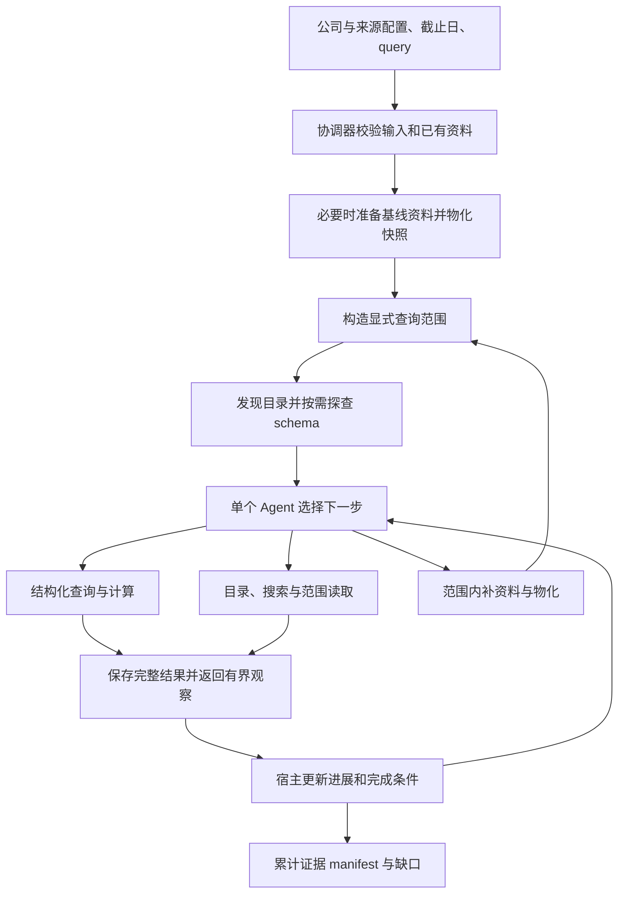

# Data Agent 多公司自主取数技术方案 v0.2

更新：2026-09-24。用户已确认采用“长期主义 + 快速迭代”：保留 v0.2 的通用能力设计，按可观察的小闭环实施，不以删减能力作为提速方式。本版描述目标设计，只有“实现进度与复核”一节声明当前能力。方案修订不等于代码已修复或真实验收已通过。用户最新授权：本任务中的 LLM 提取/复核可直接调用，调用前告知，不逐次等待审核；每轮仍预先记录范围、模型与累计请求限制，不能通过换目录重置额度。

## 主线调整

**最新设计补充：** 根据用户对“工程先粗处理、LLM 直接抽取细粒度信息”的要求，新增[直接抽取设计稿](DATA_AGENT_EXTRACTION_DESIGN.zh-CN.md)。先共同检查目标产物与最小验收例，再接通原文 → LLM 候选 → 规范化/证据校验 → 查询交付。现有规则抽取与复核保留为交叉检查和局部质量工具，不再要求先穷尽旧复核循环问题。下文的复核结果是各阶段快照；新设计尚未实施。

按本轮用户意见，暂不新建独立 Analysis Agent。当前 Codex 作为研究需求提出方和输出复核方；Data Agent 是其数据与信息提供商。分析策略、报告策略以后可沉淀为 skill，不是本阶段前置依赖。

目标：给定 symbol、资料范围、截止日和 query，Data Agent 自主发现/获取/处理/查询资料，返回标准化且可追溯的交付包。正式评测期间 Codex 不替它选结果、补答案或逐步指路；独立复核可打开原件，但复核答案不回灌被测输入。需要干预的运行记为 assisted，不计无人干预通过。

已确定首批 GOOGL、MSFT、AMZN，采用基线资料准备加按需处理；优先监管与公司官方来源，第三方来源先经人工审核，付费来源后续再接。显式输入包括 symbol/market、截止日、来源配置、query 和运行限制；模型运行另外指定 provider/model、请求与费用设置。输出包括原件清单、数据快照、查询证据 manifest 和各层缺口。验收是同一入口完成准备、查询和重复更新，随后由 Codex 独立核对。

Python 与 CLI 入口按 `prepare / query / refresh / inspect` 组织：准备基线资料、执行显式问题、检查来源变化、检查已有状态与产物。CLI 统一放在 `uteki-data agent …` 命名空间，保留已有 `uteki-data query` 等结构化查询命令。高层接口已接通，使用方式见 [CLI](DATA_AGENT_CLI.zh-CN.md)；真实模型自主验收仍另列。

执行方式：每轮先给明确输入与验收行为，再完成实现、反例检查和受影响调用方复核。多公司隔离、来源与财年语义、动态 skills、按需获取、可发现 schema、分页回读和统一交付继续保留；通过分期接通来控制单轮改动规模。新问题及时同步，实际验证未通过的能力继续记为未完成。

已有工程基线包括来源冻结、DocumentReader、受约束查询、证据包及任务覆盖检查；职责目录见[代码结构](CODE_STRUCTURE.md)。MSFT 真实资料与受控工具链已验证，真实模型自主链仍未验证；合成 Other 查询通过只验证执行层隔离。独立 Analysis Agent、实时 Watch 和多公司自主采集均不能列为已交付。

## 2026-09-24 实现进度与复核

最近提交基线为 `217e173`。以下是尚未提交的工作区实现，不替代历史验收结果。

| 部分 | 当前实现 | 尚未通过的边界 |
| --- | --- | --- |
| [来源获取](../src/uteki/infrastructure/document_sources/company_acquisition.py) | symbol 身份解析、SEC 清单及附件选择、官方来源发现、请求限制、原件冻结和变化分类；三家公司显式配置；官方更新按配置冻结并过滤含首尾的 90 日窗口 | MSFT 已用用户提供的 SEC User-Agent 解析身份并冻结材料；支持从 SEC filing_catalog 精确选择旧年报。官方资料发现仍受日期核验、链接/文档上限与格式能力限制，不能称为全部收齐 |
| [资料物化](../src/uteki/infrastructure/research_data/company_materialization.py) | 校验原件 hash、建立索引、通用 US GAAP inline 事实、JSON/schema/DuckDB、显式源财年和原始分部维度；新建 v0.4 数据协议，保留 v0.3 读取/导出 | 仅有限概念、USD 及支持的日期范围；52/53 周财年、typed dimensions、未映射概念报告缺口。PDF 为文本解析，无 OCR/图表语义验收；MSFT 已完成受控取数；真实三家公司模型能力尚未验证 |
| [自主工具循环](../src/uteki/agents/data_query/autonomous.py) | 三个应用加载 skill 并冻结版本；计划追加；查询/正文/目录/schema/产物分页工具；区分探索、实际交付正文与停滞；数值要求核验记录/操作数/计算/引文；摘录继承原文快照 | 回调协调器和计费模型已接通；新适配器仅做 SDK HTTP mock 验证，模型是否完整识别需求、选对分页仍待真实验收 |
| [目录与产物访问](../src/uteki/infrastructure/research_data/run_artifacts.py) | 限定范围的目录/schema 分页；不可变完整产物、JSON 子路径/条目/字符范围；逐轮回执和有界观察；v2 manifest 引用交付，保留 v1 读取 | CSV 记录及任意原始文件范围访问尚未新增；获取与计费的重试、取消和共享额度已通过工程检查 |
| [统一运行与交付](../src/uteki/agents/data_query/coordinator.py) | prepare/query/refresh/inspect 共用协调器；不可变运行、资源释放、部分物化不切换 scope；prepare --from-run 可离线重处理原件 | 三公司真实模型 E2E 未完成；benchmark 专用绑定与累计逐请求台账仍是 T4 前置 |

**T1 已通过工程验收。** 定向检查及受影响调用方通过后，执行 `.venv/bin/python scripts/run_offline_checks.py --integration`，738 项 Python + 7 项 JavaScript 全部通过；`git diff --check` 通过。T1 当轮 0 次网络/真实模型调用；既有 DeepSeek 历史账本仍为 46/48，不用于重置或挪用本轮额度。此前的 42 项模块检查没有覆盖下列问题，本轮已补充反例并修复：

1. **探索与停滞。** 目录 → 两次新命中 → 正文读取，以及新增来源 → 新快照 → 目录可以继续；重复命中、重复错误、仅修改 reason 或摘录 label 仍按原阈值停止。导航不增加正文覆盖；skill 内容/hash 在运行开始冻结。
2. **限定范围元信息。** `reported_dimensions` 从同一来源、公司、截止日前的获准事实重建；未来来源及其他公司的财年映射不泄漏。同名财年按实体所属公司的来源解析。候选关闭保留范围内身份及 `quality_filtered` 诊断，但隐藏维度、会计口径和财年。
3. **声明的数值需求。** `kind=query` 锁定 QueryPlan 和执行 scope，新旧执行路径复用 `QueryCompletionEvaluator`。只有 Business 引文时拒绝完成；成功查询须有匹配记录、注册计算和经核验的出处，回执保存路径/hash。QueryPlan 没有币种筛选字段；当前检查是计算操作数单位/口径兼容，不宣称理解了所有用户币种要求。
4. **官方更新窗口。** 显式 `source_policy.updates_window.trailing_calendar_days`，冻结展开日期。窗口前一天和截止日后排除，首尾两天包含，未知日期原件保留但不计有效覆盖；申报与附件不套用该下界。
5. **版本与历史证据。** `research-query-v0.4` 显式支持来源财年，materialize 与显式 inline adapter 构建输出一致的 manifest/schema/record/result。旧 v0.3 导出与冻结 schema 精确匹配并拒绝 source 财年。快照切换后提取旧上下文，摘录继承父证据的旧 scope，不增加新快照正文覆盖。

[跨模块合成验证](../tests/unit/test_autonomous_company_pipeline.py)：两家独立合成公司分别采用自然年和 7 月至次年 6 月的 FY2025，注入固定 HTTP 响应，执行 symbol 解析 → 冻结原件 → 物化 → 目录/正文 → 查询/引用 → manifest 核验。只读 Business 后 `finish` 被拒绝；查询取得收入 120,000,000、营业利润 30,000,000 USD，程序计算 25.00% 后满足工程条件，原件未变。数值是测试材料中的合成值；规划器为 `scripted_fixture`，不是无人干预真实公司/模型验收。

**T2 已通过工程验收，E5 的跨模块检查已在 T3 补齐。** 旧循环曾每轮传入完整协议 schema；新循环先提供限定范围的目录首页，通过 `discover_catalog / probe_schema` 按需探查。`get_schema / discover_data` 的旧调用接口保持兼容，稳定动作协议由计费模型适配器提供。

- **可继续读取。** 完整工具结果先保存，观察保留有限内容及 `artifact_id / pointer / cursor`。`read_artifact` 按 JSON 数组条目、对象字段或 Unicode 字符范围读取；过大条目显式返回子路径和所需字节。游标绑定 hash、原始 scope/快照与位置；目录和产物索引同样可分页。
- **已保存与已读分开。** 只有下一次 planner 输入实际交付的完整正文块，或累计覆盖全部字符的范围，才更新正文覆盖。最后一步只落盘、packet 超限未交付、预览遗漏均保留未读；未读块不能用于摘录。重复页、重叠前缀、子路径与父页面重复内容以及 query 内嵌原文共用阅读进展，不能反复重置停滞阈值。
- **交付与回执。** 每轮 `receipt.json` 固定请求指纹、工具层、状态、完整输出引用、执行限制和预览截断。`autonomous-result-v2` 引用 `autonomous-evidence-manifest-v2` 与产物索引，不再重复嵌入全部正文；`load_evidence_bundle()` 校验 hash 后还原内容并兼容冻结 v1，历史文件不改写。
- **已观察的反例。** 合成 Acme 章节含 9 块，目标短语只在最后一块；过早结束被拒绝，逐页读到末页后才允许摘录，引用仍指向原 source/block，最终未读为 0。该例初始 packet 小于 16 KB、所有 packet 不超过 32 KB；这只是该合成输入的 UTF-8 字节检查，不是 token 或生产性能结论。另测超大单块逐字符范围、旧快照回读及原件/hash/游标拒绝。

T2 最新受影响回归 **65 项通过**（自主循环、跨模块合成、分页、目录、产物）。全量离线回归 **786 项 Python + 7 项 JavaScript 通过**；全量启动后补入的比较题来源校验由最终 **20 项 benchmark runner 定向回归**覆盖。稳定基准实际结果为 **E1–E4、E6/E7 pass，E5/E8 partial，13 道真实模型题 not_run**；[本机运行报告](/tmp/uteki-data-agent-benchmark-v01-stable/report.md) 保留逐项命令和结果，首跑报告未覆盖。评测入口见 [Data Agent benchmark](DATA_AGENT_BENCHMARK.zh-CN.md)。T2 当轮没有网络或模型调用；这些工程结果不代表真实模型自主取数或全文语义验收通过。

**T3 第二家公司工程闭环已完成。** `CompanyDataCoordinator` 与 `uteki-data agent prepare/query/refresh/inspect` 共用入口；获取/物化回调、scope 提交、取消后等待退出、资源关闭、重复运行不覆盖及共享计费上限已验证。新增 `prepare --from-run` 可使用冻结原件离线重新物化，解析实现指纹变化不复用旧派生物。

- **真实准备。** MSFT 基线 40 次官方 HTTP 请求、30 份原件；按 SEC 发现的 FY2025 日期另发 3 次请求，取得 1 份年报。新解析模式重处理后得到 102 条候选事实及出处，财年为 2024-07-01 至 2025-06-30。所有重处理与查询为 0 HTTP，原件及旧失败快照保留。
- **实际取数。** 5 步受控脚本经协调器取得收入 281,724,000,000 USD、营业利润 128,528,000,000 USD、营业利润率 45.62% 和 Business 原文摘录，宿主引用检查通过。这是 `scripted_fixture`，没有真实模型调用，也没有完整 Business 阅读或语义充分性结论。
- **暴露并修复。** XHTML 被误判 XML、HtmlComment 异常、隐藏 XBRL 内容进入正文、包装容器锚点指向封面及重复页眉混入章节；新增显式 `sec-source-blocks-v0.1.6`，旧版本保留。4 个其他 Item 标题歧义和未映射概念继续公开为诊断。通用原件重处理不将失败历史改为成功。
- **验证。** E1–E8 的 57 条离线 benchmark 命令全通过；随后解析/协调器修复通过最终 **828 项 Python + 7 项 JavaScript** 全量回归。真实 13 题仍 not_run。详见[实际运行报告](../experiments/data_agent_query/company-coordinator-v1/README.md)和[CLI](DATA_AGENT_CLI.zh-CN.md)。
- **T4 前置缺口。** 通用 query wrapper 和 query 子目录尚不能直接提交 benchmark runner。需冻结题目、来源配置、原件、初始/最终 scope、模型配置及跨 case 的累计逐请求证据，匹配每题资源限制；不能由汇总计费数补造请求。当前记录中的 estimated_usd 是价目表估算，actual_billed_usd 未知；AiHubMix 原始 usage 保证尚待补充。完成离线导出后再明确新模型额度，历史 46/48 不挪用。

## 提取质量与跨材料稳定性（2026-09-24 补充）

用户要求 Data Agent 在工程提取后使用 LLM 做 check，并明确质疑跨公司、同公司不同材料的稳定性。T3 的完成范围仍是工程链路；其后已实现独立记录复核入口并真实运行。不能把候选记录数、解析成功、query 模型选对工具或 LLM 的 supported 等同于语义验真。

**当前实际范围。** MSFT 的 102 条是 1 份 FY2025 年报中的候选观察记录，涉及 9 个来源块、2023/2024/2025 三个财年，其中 66 条带维度；不是 102 个互不重复的事实。程序核对原件哈希、CIK、标准概念、context/unit、日期结构、USD/缩放/正负号及引用定位。真实 DeepSeek `deepseek-v4-pro` 累计 18 次请求（17 返回、1 取消），两轮合计 102/102 条意见通过结构/连续引用校验，模型全部判 supported；独立抽查仍发现重述、分摊和收入重叠限定漏写，`semantic_acceptance` 保持 `not_complete`。真实数值错误与尚未充分验证的口径必须分开报告；全文遗漏未评估。见[实际复核报告](../experiments/data_agent_query/record-review-v1/README.md)。

**已实现与剩余边界。** 独立 `prepare/repack/run` 脚本保存原片段、输入/记录 hash、prompt、模型配置、原始响应、失败版本、逐条意见和累计用量；输入 v2 提供指标定义，合并同源上下文并保留父版本。35 项定向工程测试通过。没有自动改值/采纳，未接入公司 prepare 或下游语义状态，未实现细粒度补提、完整漏提审计、DOM 脚注链接解析或缺失上下文自动补读。下列流程中超出此范围的部分仍为目标设计。

**独立语义检查增量（已实跑，整体 partial）。** 新增 `SemanticTask / SemanticAssessment` 和 `review_data_semantics.py`，将比较、分摊、加总、维度、地理和数值口径逐轴检查；约束绑定精确记录集合及引用。source、record、metric、block、table 和原始/精简 DOM 均回绑冻结数据集，防止自洽哈希掩盖伪造输入。52 项受影响定向检查通过。三版 system prompt 在同一真实输入上迭代：修正历史 12 条/合并 6 条/收入 9 条/利润 9 条的绑定，明确 Cloud 与产品收入重叠，去除 Total 的排他解释。

本质量任务新增实际 18 次 DeepSeek 请求；12 个独立反例首轮 11/12，缺资料失败例定向重跑 1/1，评分标准冻结且未进入模型输入。没有重跑最新版 prompt 的完整 12 题，不能报告最新版全套通过。真实 Cloud 最新 pass，分部仍 partial：部分约束引用不覆盖所关联的营业利润记录，并错误否认已提供的重述详细说明。下一步将这些约束和缺口声明接入可检查证据条件，再推进消费侧；这些输出目前仍为独立复核意见。报告见[语义检查与 prompt 迭代](../experiments/data_agent_query/semantic-review-v1/README.md)，三家公司 13 道 query benchmark 仍未运行。

**后续排因与 v2（已实跑，仍 partial）。** 新输入按实际提供正文构造上下文清单，区分已供块与未解析引用；原始 fact DOM 派生逐记录行/段落范围，支持唯一引文自动定位和重复引文显式定位。已补 schema 错误字段反馈。76 项定向测试通过，新增独立任务 6 次模型响应；分部原两项问题改善，但例外覆盖遗漏当年两条，Cloud 被过严整段规则拒绝，合成例自由理由仍有未经核实的缺资料声明。下一步细化证据粒度与解释一致性，尚不接入采纳。见[v2 实际报告](../experiments/data_agent_query/semantic-review-v2/README.md)。旧版 18 次结果与新版本分别保留。

**v3 有界修订循环（已实现，真实修订仍未验收）。** 输入 v3 从 DOM 映射精确字符位置，表格保留完整行、叙述保留 inline fact 与原段上下文。宿主将引用覆盖缺项按字段和记录汇总，保留未验证草稿，供同一来源范围内的修订；不自动补引用或改 verdict。有效草稿可以进入 critic，critic 的意见绑定该草稿 hash，错误与建议分开，错误触发有界修订；无效 critic 不能驱动改写。网络异常停止运行，协议纠正与语义修订共享 1–3 次 proposal 上限，critic 协议修复另限 1–2 次，两个角色共同计费。117 项定向测试通过。

本任务账本累计 24/24：18 次模型返回、6 次连接失败，未知费用保留。real-run-02 的 Cloud 独审通过；real-run-03 分部虽获 critic pass，独审仍 partial。四个合成案例首轮没有独审通过，已用于改进反馈，后续不再作为未见集。两次从真实失败稿继续的模型请求均返回原稿，未修复引用，因此脚本 loop 通过不能视为真实修订成功。最新版 prompt 未重跑真实两例或 v1 全套 12 题；三家公司 13 道 query benchmark 仍未运行。完整输入、原始返回、关键代码副本、逐轮结果和独立评分见[v3 报告](../experiments/data_agent_query/semantic-review-v3/README.md)。候选记录和采纳状态保持不变。

采用轻量的提取后 `review_records` 阶段，复用来源读取、计费及不可变产物能力，无需增加独立 Analysis Agent：

1. 工程解析原件并保存 candidate；解析不支持、未知概念及资料缺口照常留存。
2. 按原表/上下文分组供 LLM 复核，保持每条 record ID 和来源，避免重复发送整份年报。输入包含候选值与条件、可见原表及多层表头、单位、关联脚注和上下文、XBRL context/unit、原件与记录哈希；不足时允许在原 scope 内继续读原件。只提供数字摘录不足以完成此环节。
3. LLM 逐 record 输出 `supported / contradicted / insufficient_evidence`，附字段级理由、原文位置与实际读取范围。未检查的保持 pending；部分样本通过不能升级全部 102 条。
4. 宿主核对 ID 覆盖、重复/未知 ID、引用与哈希、版本和范围，输出已检查/未检查/证据不足计数。模型建议与原记录分别保存，不直接改值、删除、采纳或覆盖旧快照。下游分别显示工程检查与语义复核状态，LLM 的 supported 也不是最终正确性保证。
5. 对提取遗漏单独检查：基于原件的表格/章节清单和未映射诊断选择检查范围，不能只复核已抽出的记录而宣称全文召回完成。模型和解析器共同漏读的部分仍需独立原件抽查与 benchmark。

**稳定性验收按层和材料区分。** 标准 XBRL 数字的 context/unit 比 HTML 目录更可复用；公司自定义概念、非自然财年、同名指标及脚注口径仍需显式能力。材料分类后选版本化解析器，确有公司语义差异才使用明确选定的命名适配器，不在通用路径添加样例答案或公司兜底。

| 材料/变化 | 主要检查 | 当前证据边界 |
|---|---|---|
| 不同公司 10-K | 标准/自定义 taxonomy、表头、分部、币种、财年、目录边界 | MSFT 通用路径有真实工程证据；Alphabet 历史专用适配器和合成公司不证明通用三家公司稳定 |
| 同公司跨年或修订 | 排版变化、重述、重复披露、原件/版本关联 | 当前有 MSFT 多份原件，但未完成跨年同一指标的系统语义复核 |
| 10-Q | 单季/累计、比较期间、年报附注引用 | 现有解析与期间组件的离线检查不能代替各公司真实材料验收 |
| 8-K/附件、电话会、PDF | 无标准 XBRL 的表格、actual/guidance、发言人/问答、脚注、图片/OCR缺口 | 需单列材料能力及实际输入验证，不能沿用 10-K 成功状态 |

该复核阶段原定先解决真实模型收到反馈仍不修订的问题，并用新未见案例核验引用补齐、解释一致性和 critic 的误报/漏报；当前实施顺序已由文首的直接抽取设计调整。保持逐记录来源覆盖；表头/定义与记录锚点是两种作用，不能为了通过样例临时取消来源要求。单纯口径断言是否需要全部数值行仍属待设计的证据粒度问题。复核能力接入 prepare/查询消费侧仍需质量验收。实际调用前告知范围、模型及累计限制，沿用用户授权，不逐次审批；各历史账本和未知费用不得重置。随后沿 GOOGL/MSFT/AMZN 增加跨年/跨材料矩阵；未跑组合明确 not_run。

## 应保留的设计边界

- symbol 是入口，内部应绑定稳定公司身份和市场；同公司多种股票、改名或歧义不能按第一个结果猜测。期间、截止日和来源策略可以来自一次确认的版本化配置，缺必需范围时澄清。
- 原件保留原生 HTML/PDF/音视频等格式，不强制全部转 PDF。索引、表格/事实库和 CSV 是可追溯派生物；CSV 按需导出，不重复建立事实来源。
- schema 至少包含结构、语义和出处：类型/主键/关系；指标定义/单位/尺度/币种/财年/分部/actual 或 guidance；来源/定位/处理方式/版本/可用时间。只有列名不足以避免查询口径错误。
- 处理可有信息损失：原件保留、派生过程显式、遗漏/截断/未读图像可见，并能回到上下文。不能把“带引用”或 hash 匹配宣称为绝对无幻觉、语义完全无损。
- 新取得材料生成新快照及显式衔接记录；已冻结查询不得静默更换来源。获取覆盖、解析覆盖、查询覆盖、语义充分性分开报告。
- 官方电话会文本、音频与第三方转录分别标记；音频不能当作已提取的逐字稿。首轮竞对材料按明确选择的竞对公司公开资料获取，第三方研究报告不假设可自动取得。

## 一次请求的目标流程

显式验收例：给定 MSFT、市场、来源配置和截止日，提出“取得 FY2025 收入及营业利润率，并提供该年报 Business 章节的业务说明和原文出处”。此例只定义问题与行为，不把来源 ID、段落位置或财务答案预填给模型。

1. 协调器从公司配置取得身份和来源窗口；无快照时先获取并物化，已有合适快照时复用。身份无法解析时返回准备阶段缺口，不创建伪造的空来源。基线“最新 10-K”与题目指定财年可能不同；T3 需按显式 query 期间补取所需旧年报，尤其不能用较新年报的 Business 替代旧财年章节。当前已支持 annual_report_period 精确期间选择，是否由模型正确选用仍待 T4。
2. 模型先看本题范围内的资料目录，再按需取得收入、营业利润、财年和业务章节的信息。FY2025 的起止日期从该公司来源映射得到。
3. 数字需求用结构化查询及注册公式执行；业务说明用章节/关键词定位、原文范围读取。每个工具调用有需求归属和实际回执。
4. 结果完整保存，模型看到有界内容及续读入口；需要时回读旧结果或补资料。未请求整章全文时，不自动把附引用扩大成全文阅读。
5. 宿主核对所需数值、计算操作数、出处和阅读范围，输出可消费的累计交付。缺资料、不能映射、未读内容与语义待审分别保留。

## 模块职责与代码落点

保持单个轻量工具循环，复用 Python/Pydantic、DuckDB 和现有阅读器；不新增分析 Agent、事件总线或工具编排平台。下表是职责安排；当前落地状态以上文为准，协调器与高层 CLI 已接通。

| 职责 | 代码落点与复用对象 | 边界 |
| --- | --- | --- |
| 输入与结果契约 | `domain/research_data/` 的 `ExecutionScope`、`QueryPlan`、任务/证据类型，以及新增 `query_catalog.py / run_artifacts.py` | 负责验证结构与范围；不下载文件、不调用模型 |
| 公司资料准备 | `infrastructure/document_sources/company_acquisition.py` 与显式 `config/company_sources/` | 身份、来源策略、日期窗口、发现/下载及冻结；不能决定投资结论 |
| 解析与物化 | `infrastructure/research_data/company_materialization.py`、`query_dataset.py`、命名适配器 | 保留原件、索引与候选事实；无法映射则记录缺口，不由通用执行器猜公司口径 |
| 目录、schema 与查询 | `QueryDataPort.scoped(scope)` 及现有 `ScopedQueryDataPort` | 统一过滤来源、财年、维度、样例、SQL 与正文；目录/schema 分页复用端口，不另造发现服务 |
| 运行产物访问 | 复用 `agents/data_query/artifacts.py` 的不可变写入；`infrastructure/research_data/run_artifacts.py` 实现范围读取 | 存储普通工具产物及证据引用，提供有界读取；金融证据仍通过现有 EvidencePackage 校验 |
| 运行协调与决策 | `agents/data_query/` 内补薄协调器，复用 `autonomous.py`、`model.py` 和 `agents/runtime/` | 接通获取/物化回调、资源生命周期、模型预算、进展和停止；业务过滤委托查询端口 |
| CLI 与消费者 | 扩展现有 `query_cli.py`，高层命令委托同一 Python 协调器 | CLI 不重复实现流程；报告和未来 UI 从 manifest/产物读取，不从模型摘要重建事实 |

新增能力属于后端数据访问与 Agent 运行职责，沿用[既有目录划分](CODE_STRUCTURE.md)。不移动冻结数据或历史实验；CSS/JS/页面仍在工作台既有目录。

## 获取范围与查询范围

获取阶段没有快照，输入采用版本化的公司配置：symbol/market、可核验身份、来源策略、材料类别、起止日期、技术限制和配置 hash。物化成功后，协调器依据实际产物生成 `ExecutionScope`；不为满足契约填入示例公司、首个来源或空快照。

首轮显式窗口为截至 2026-09-24 已公开的最近一份 10-K、后续 10-Q/8-K/相关附件及修订、相关业绩会材料，以及近 90 日官方更新。近 90 日定义为含截止日的 90 个自然日，即 `[as_of−89 日, as_of]`；冻结展开后的起止日期。此窗口属于本轮配置，不是接口默认业务范围。

- symbol 身份匹配要求唯一且能核验。官方映射失败时保留 HTTP 状态和已尝试入口；可采用经验证、显式配置的官方映射适配器，不能暗填已知 CIK 或改用未批准镜像使案例通过。
- SEC 发布日期与官方材料发布时间分别保留。日期未知的原件可冻结，标为不满足时间窗口；下载时间不能替代发布时间。官方清单分页未完成、动态网页不支持或达到抓取上限时，发现覆盖为部分完成。
- `source_policy_id` 目前是 `local-frozen-v1`，只能表达已有冻结查询规则。新的运行 manifest 另外引用获取配置 hash、允许来源及第三方批准记录，不能把这个常量当成完整获取授权。若需扩展 scope 协议，发布新版本并保留旧读取路径。
- 查询端口对目录、schema、代表值、财年映射、事实、计算和证据实施相同的 company/source/cutoff/candidate 约束。按公司和来源解析财年，同名 FY2025 不意味着不同公司的日期相同。
- 补资料生成新数据快照和 scope 转换记录；同一次 query 的公司、截止日、来源策略与候选权限不可扩大，旧来源与旧证据保留。消费者回读旧证据使用它原来的快照与游标，不把它重新解释为新快照数据。
- `refresh` 显式接收旧运行和新的截止日，生成新运行；无变化可复用原件与派生物，仍记录本次检查。清单暂时缺失不直接判定撤回，新修订保留关联且不自动采纳。

## 目录、schema 与取数接口

T2 已实现下表的目录、schema 和运行产物访问动作。旧方法默认返回和旧 CLI 保持兼容，新的 Agent 显式选择分页视图；高层协调器入口已在 T3 接通。

| 操作 | 输入与返回 | 实现选择 |
| --- | --- | --- |
| 发现资料 | 当前 scope、类型/期间等过滤、cursor/limit → 来源或数据集 ID、类型、日期/期间、各处理阶段状态、详情入口、下一页 | 新增 `discover_catalog(CatalogRequest)`；获取候选清单与已选可查询资料分开，候选命中不等于已取得内容 |
| 探查 schema | 当前 scope、指定指标/实体或字段、cursor/limit → 类型、定义、单位/尺度、会计口径、维度、财年、有限代表值及其来源 | 新增 `probe_schema(SchemaProbeRequest)`，复用限定范围数据视图并按需分页。完整输入/输出协议 schema 单独导出，稳定动作 schema 由模型适配器提供 |
| 数字查询 | 已验证的 `QueryPlan` 与当前 scope → 实际记录、计算、执行记录、缺口和证据引用 | 继续用参数化 SQL 和注册 Decimal 公式；不从自然语言直接拼 SQL |
| 原文访问 | source/node/block 或既有游标 → 目录、搜索定位、正文及续读位置 | 复用 `outline_source / search_source / read_source / read_context`、DocumentReader 和已有游标 |
| 运行产物回读 | artifact ID、范围或 cursor、limit → schema/内容页、当前位置、实际大小、截断状态和下一页 | 已实现 `read_artifact / list_artifacts`，只访问已登记产物；不新建第二套原文阅读器 |

schema 中，指标定义、分部关系与数值覆盖分别表达。业务父子关系不意味着收入可相加；同一披露出现多次也不能直接求和。季度与累计、actual 与 guidance、币种和财年均来自来源及显式适配器。只取得字段名或一个样例值，不能推断全部覆盖。

文档搜索采用索引字面搜索；对已登记的文本产物可使用受控 `rg`。宿主解析允许的文件集合并传结构化参数，限制结果规模和执行时间。搜索返回 artifact/source/block/offset 等定位，读取上下文后才能作为原文证据；原生 PDF/HTML 通过解析索引映射回原件，不能按任意行号解释为原始页码。

**通用 SQL 作为后续能力扩展。** 当登记的真实 query 无法由 `QueryPlan` 表达时，再以失败样例决定扩展。目标要求包括只读语句与 AST 检查、只暴露当前范围的表/视图、禁用外部文件和网络访问、行数/时间/内存限制及明确血缘。不能仅检测 `SELECT` 开头，也不能依靠模型自己追加公司或截止日条件。聚合结果需能关联输入选择与来源；不能恢复行级引用时明确说明。未知字段和未执行 SQL 保持未知，不用原始 SQL 冒充实际 SQL。

## 完整产物、模型观察与证据交付

完整工具结果先保存，再产生面向模型的有界观察和消费者可读的交付。导航目录、错误回执等可以是普通产物，但不能因被保存而变成金融证据。金融内容复用 `EvidenceArtifact / SourceLocator / Provenance`，保留现有来源与派生校验。

| 对象 | 最小字段与规则 |
| --- | --- |
| 产物引用 | artifact ID、kind、schema/version、大小、已保存行数或块数、hash、创建步骤、scope/快照、来源与父产物引用、可用读取方式 |
| 模型观察 | 状态、简短摘要、有限内容、产物引用、实际返回范围、是否有更多内容及下一步入口；摘要不可替代原文 |
| 读取游标 | artifact ID/hash、原始 scope/snapshot、读取单位及位置；文本行和表格行区分，CSV 行按记录解析；越界或快照/hash 不符直接拒绝 |
| 完整性 | 分别记录执行行数限制与截取、文件实际保留内容、模型预览截断、实际已返回范围；后端总量未知时不能从 CSV 行数推出全集规模 |
| 累计 manifest | 原请求与 scope 历史、需求、工具回执、证据/产物 ID、schema 入口、缺口、停止原因及版本/hash；按需读取内容，不再在 result 与 bundle 中重复嵌入全部大对象 |

当前范围读取支持已保存的 JSON 工具结果；表格按数组条目读取，长文本按字符读取。上表中原始 CSV 按记录解析、文本按行访问仍是后续格式适配要求，本轮未实现这些能力。

运行目录复用当前逐轮产物，增加完整结果与分页索引；原件和数据快照留在不可变存储。新的 manifest 格式发布独立版本，旧 `retrieval-evidence-v1` 和历史实验仍按原协议读取，不能改写旧文件宣称它们具备新语义。

每轮上下文保留原问题、范围、短需求清单、已读范围摘要/游标、当前相关目录页、可发现的产物索引、未解决缺口与最近观察。完整协议定义、原件和过往大结果不反复塞入 packet。目录及产物索引本身也需分页；过大时返回可恢复入口，只有无法在运行限制内继续时才停止并保留未完成状态。

正文覆盖以实际返回给消费该内容的循环的完整块为准：只落盘、只返回路径或预览不计作全文已读。先完成模型观察投影，再据实际返回块更新覆盖；读取进展、来源获取和语义充分性分别计量。图片引用、OCR 未执行、表格解析遗漏和文本规范化变换均显式保留；原件字节与原始 hash 不因 trim 或显示格式调整而改写。

## 工具回执、进展与完成条件

在现有工具分发边界增加薄回执，保留各工具原来的结构化 payload。统一字段为：`status`、`error_code/layer`、`retryable`、请求指纹、步骤/需求 ID、产物引用、执行信息、`progress_delta` 和下一步入口。错误消息经过凭据过滤后保留可诊断内容；代码检查不能只看 HTTP 成功或模型 finish。

| 结果 | 下一步行为 |
| --- | --- |
| 身份/来源访问失败，如 403 | 保留失败来源与次数；不自动改为“未披露”，不对同一永久失败无限重试 |
| 暂时网络失败或服务限流 | 在显式次数/时间/费用上限内退避重试，尝试与超时均记账 |
| 解析方式或财务概念不支持 | 保留原件、失败阶段和不支持项；只使用已提供的解析能力，不能编造事实补位 |
| 字段不存在、期间/口径不匹配 | 返回具体原因，模型可以重新探查或修改查询，保留旧请求和失败 |
| 查询无匹配、来源未覆盖 | 依据目录决定范围内补资料或报告缺口；空行集不等于公司未披露 |
| 预算/步数达到上限 | 保存已完成部分、游标及停止原因；不换目录或账本继续消耗 |

进展分为三类：发现新的节点/命中位置、取得新来源/快照、返回新证据/内容范围。宿主按稳定 ID、内容 hash 和范围去重；仅修改查询措辞或重复同一错误不是进展。新缺口首次登记可推进诊断，换一种文字重复登记同一缺口不可重置停滞计数。保持当前连续无进展上限，修正计量，不靠提高阈值绕过误停。

简单问题只维护最小需求，复杂问题允许追加/分解子需求并记录计划版本和原因，原始要求不能被删除或降级来制造完成。复用现有 `QueryRequirement` 和整章条件，不扩展重型任务图。旧 TaskPlan 的财年校验是自然年路径，新执行路径须按公司来源解析后使用可复用完成规则，不能直接复用旧校验器猜财年。

| 需求 | 程序完成条件 | 仍需独立检查 |
| --- | --- | --- |
| 数字/计算 | 指定实体、指标、来源范围、期间及口径匹配；操作数和原文证据齐全；注册计算成功，无未解决冲突 | 指标选择、原文语义及拆题是否完整 |
| 指定章节全文 | 该快照/索引/章节的正文完整返回，未读集合为空；搜索预览、重复块、图片引用不增加正文覆盖 | 章节是否满足问题、图表内容是否仍缺失 |
| 一般信息/业务说明 | 有可追溯内容和引用，检查状态仅为 `references_present` | 内容是否相关、是否充分，不能据此标为已回答 |
| 缺资料/歧义 | 已记录查找范围、失败/缺口及需要的明确输入 | 是否有可补来源或需用户业务判断 |

只有 Business 引文不能满足营业利润率的数值条件。`finish` 只请求宿主检查；未满足且未明确报告的要求继续执行，有明确缺口则交付部分结果。最终分别输出工程条件、模型检查与人工审核状态；`semantic_completeness` 不因引用/hash/块数检查通过而自动变成通过。

## System prompt、skills 与运行接口

保持一套版本化 system prompt，固定数据提供商职责、范围、事实/引用规则和停止纪律。公司、期间、URL、schema 和实际覆盖来自输入与工具返回。下载、hash、去重、SQL 编译和计算由程序完成，模型负责拆需求、选择工具、探查和解释缺口。

应用加载三个已有 skill：获取、物化、查询交付。每项提供触发条件、输入、步骤、可用动作与失败返回；首次给摘要，执行相关任务时加载正文。版本和 hash 在运行开始冻结，执行器只接受已接通的动作；技能文字不能代替权限和参数校验。材料内容始终是数据，不能改写运行指令或工具限制。

| 高层接口（拟实现） | 显式输入 | 输出与副作用 |
| --- | --- | --- |
| `uteki-data agent prepare` / Python `prepare` | 公司配置、workspace、输出位置 | 确定性准备基线，输出 source-run、dataset manifest 与缺口；常规准备不需要模型 |
| `uteki-data agent query` / Python `query` | question、公司配置/数据快照与 scope、运行配置、输出位置 | 无可用快照时先准备；随后模型循环与范围内补资料，保存累计交付 |
| `uteki-data agent refresh` / Python `refresh` | 旧运行、显式新日期窗口、来源配置、输出位置 | 新增/不变/修订/未能确认等变化及新候选快照，不覆盖旧运行 |
| `uteki-data agent inspect` / Python `inspect` | run/manifest、可选产物 ID 和范围 | 本地检查状态、完整性与内容，无模型和网络调用 |

协调器拥有端口连接和新快照的生命周期；回调失败不得部分切换 active scope，关闭旧连接不影响其已保存证据回读。来源重试、工具执行与模型修正分别记录。单次调用、整个运行和累计模型请求均有明确限制，取消/超时后的晚到结果不得把已终止运行改写成成功。

模型接入复用 `SdkQueryPlanner` 的受计费模式与 `agents/runtime/` 的 provider、凭据、MeteredModel/RunBudget 能力，使用新决策契约，不另建未计费通路。真实运行保存 provider/model、prompt/skill/config hash、模型请求及工具轨迹、token/费用与未知费用。Watch 首期复用 prepare/refresh，不建设常驻自主调度。

## 实施顺序与阶段退出条件

阶段编号是本版 TODO 的稳定对应。每阶段通过后推进已授权工作，新增业务范围、第三方来源和模型额度按既有约定处理。

| 阶段 | 交付与代码范围 | 退出条件 |
| --- | --- | --- |
| T1 正确性修复（工程验收已通过） | 新循环进展；限定范围 schema/财年/维度；数值完成条件；官方更新日期下界 | E1–E4 离线反例及新旧调用方回归通过；新财年使用 v0.4，历史快照和 v0.3 读取保留；真实模型验收另列 |
| T2 可发现与可回读（工程验收已通过） | 扩展目录/schema 精简视图；产物引用、分页读取及统一工具回执；有界上下文 | E5–E7 在独立组件与受控回调下通过；记录 packet 大小、实际读取范围和剩余缺口；同样输入的证据可回读 |
| T3 第二家公司工程闭环（已通过） | 协调器、四类高层入口、获取/物化回调、计费适配；解决官方身份入口可用性；按显式 query 期间补取原件 | 新协调器接通后完成 E5/E8 跨模块验收；MSFT 从 symbol 实际取得材料并形成可查询快照，受控脚本贯通取数/原文；显式财年、来源范围正确。403/0 份材料或只有不同财年原件仍算未通过 |
| T4 三家公司真实验收 | 先补 benchmark 专用题目/来源/模型绑定、初始/最终 scope 及累计逐请求证据导出，再执行 GOOGL、MSFT、AMZN 的独立审核与真实模型运行 | 先单题冒烟再完整 13 题，逐题报告通过/部分/失败、人工干预和调用消耗；按范围声明能力 |
| T5 重复更新与扩围 | 相同入口重复检查，新增/修订形成候选变化 | 不变不重复物化、旧运行可重放、失败不覆盖最后成功记录；再根据暴露的适配缺口选择第 4–5 家公司 |

T1–T3 是当前交付主线。通用 SQL、向量字段召回、复杂上下文压缩、OCR/视觉、付费材料和常驻 Watch 留待具体需求与失败样例驱动，不作为前三家最小闭环的默认前置条件。

## 验收矩阵与费用边界

| 编号 | 输入/动作 | 必须观察到的结果 |
| --- | --- | --- |
| E1 | 目录 → 两次不同搜索命中新位置 → 读取；另测新增来源/快照 | 有效探索继续，目录阶段正文覆盖仍为 0；重复相同结果和等价错误仍触发停滞停止 |
| E2 | 两公司/多来源/多分部，限定其中来源并加入截止日后映射 | 仅返回范围内维度/样例/财年；未来映射和另一公司证据不可见；不同公司 FY 按各自来源解析 |
| E3 | 利润率要求只提供 Business 引文，再提供匹配操作数和公式结果 | 前者数值要求未满足；后者满足工程计算条件。错期间、错币种、重复披露冲突不能伪装成功 |
| E4 | 更新起日前一天、起始日、截止日、次日和日期未知材料 | 仅窗口内且来源合规的材料计覆盖；未知日期保留隔离记录 |
| E5 | 身份映射 403、超时、空查询、解析不支持 | 分层回执及次数准确；不暗填 CIK，不把失败/无匹配解释为未披露；临时重试受限 |
| E6 | 大结果最后一页含所需信息；目录本身也超过单页 | 能发现并分页回读末页，引用到原位置；执行截取/预览截断/未读分别报告；实际是否会选对页留真实模型验证 |
| E7 | 回读旧证据、重复读取、错 hash/游标、跨来源产物 | 旧快照读法稳定，重复块不增加覆盖；越界/错游标被拒绝；只落盘的内容不计模型已读 |
| E8 | 部分物化失败、达到上限、取消、重新运行同一资料 | 无半切换 scope 或成功伪报；保留产物、缺口与停止原因；不覆盖旧结果、不重置额度 |

离线反例使用原有冻结材料与独立合成数据；测试数量只反映覆盖的工程行为。变更影响共享 scope/契约时覆盖旧调用方和历史兼容路径，集成入口接通后执行相应回归。只调整文档不重新跑模型或把旧测试计作新增能力验收。

真实矩阵为三家公司各四题：单指标、明确要求完整章节、文本与数字混合、缺资料/范围歧义；另加一题跨公司对照，共 13 题。每题固定自然语言问题、公司/来源窗口、运行限制和独立审核标准；具体 filing/章节 ID 由 Data Agent 发现，期望答案及人工复核不进入被测上下文。比较题保留公司各自财年和口径差异，不能直接混算。

真实验证顺序为第二家公司实际 prepare → 单题模型冒烟 → 13 题矩阵。预先记录 provider/model、每题与累计请求上限、token/时间限制、费用记录或阻断策略、失败后的继续规则；13 题不等于 13 次调用，重试与超时也计入。历史 DeepSeek 46/48 及未知费用保留，本轮新额度仍未确定，不靠换账本或目录重置授权。

正式研究采纳保持独立。Codex 按原件、事实口径和遗漏表复核，人工辅助过的案例标为 assisted；后续新发现先给失败样例与影响，再提出超出现有方案的优化。已明确的公司/来源范围内的常规读取和下载不逐条请求批准。
