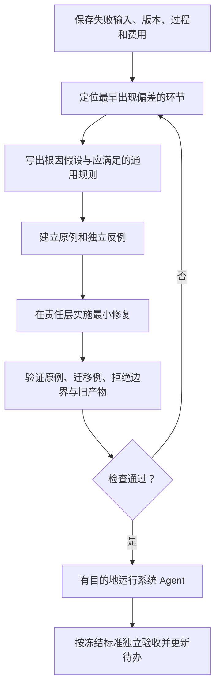

# Data Agent：从失败到通用修复

2026-10-10。用于当前 E5 及后续 Data 迭代。已有范围、来源、答案隔离和预算约定继续适用。本文件规定工作方法，不声称泛化或稳定性已经验收。

目标：修复导致失败的机制，并证明相同机制在不同输入下成立。单个公司样例重新成功只是其中一项证据。

全局原则见 [根因优先共享规则](COLLABORATION_FOCUS.zh-CN.md#根因优先从现象追到系统机制)。修复前明确因果假设及它对原案例的预测；修复后先回到同一失败验证，再检查独立反例。原问题仍存在时，应修订根因判断或排查多重原因；单次通过不足以单独证明根因判断正确。

## 每个问题先回答六件事

1. **现象与预期**：哪一项必要信息遗漏、哪一条多余、哪一个字段或步骤被拒绝？以实际原件和冻结标准为准。
2. **最早偏差**：原件获取、解析、目录/Schema、计划、查询编译、工具读取、证据选择、审核协议、下游消费，哪一步先偏离？后续报错可能只是结果。
3. **原因与证据**：区分代码缺陷、契约缺口、能力未实现、材料缺失、模型决策失误和临时外部错误。记录可复现输入，不把猜测写成根因。
4. **更深层问题**：相同规则是否在提示、Schema、验证器和消费端有不同版本？数据身份是否遗漏公司、来源、期间或修订口径？工具返回是否真实可读、可分页、可恢复？是否要求模型完成工具不具备的动作？
5. **修复归属**：确定性校验/编译/分页问题修工程；任务理解方法修版本化 Skill 或提示；材料不足通过系统补取或返回缺口。一次尽量只改变一个主要变量。不能把重试、加 token 或换模型当作已经找到根因。
6. **证伪方法**：怎样的独立输入会使这个修复暴露为样本特例？至少验证一个不同主体/来源及相关不同期间，并验证缺失、冲突、越界输入仍拒绝。输入维度与问题相关，不机械叠加无关测试。

## 不把样本答案变成运行能力

- 公司、期间、材料类型、来源集合由调用者显式指定或由系统核验的来源元数据确定。允许范围配置；不允许配置里藏答案、预选语义章节、期望金额或公司特定补丁。
- 测试和独立评测可以使用具体公司、原文片段、期望金额。它们不得流入运行配置、Prompt、Skill、查询排序或补查反馈。
- 行业或财历适配必须有具名、显式选择的适配器和支持范围；不能将未支持输入猜成某家样例公司的口径。
- 修复应能用独立合成数据解释并验证。只在微软或谷歌成立的变化，不能据此宣布可泛化。
- 保留原失败和旧产物。新代码/提示/Schema 用新运行验证；不修改历史证据使其重新通过，不放宽语义标准掩盖遗漏。

## 实际问题如何抽象

| 已观察问题 | 表面处理容易遗漏什么 | 应修复的机制与反向检查 |
|---|---|---|
| 完整表格超出单次读取容量 | 增大窗口不能保证下一张表可读 | 无损表示与分页；验证所有单元格保留，未读不能记作已读，仍超限则明确缺口 |
| 审核模型漏字段 | 反复要求“认真输出 JSON”不能保证契约一致 | Schema、提示、验证器使用一致义务；缺字段仍拒绝，修订反馈只含机械诊断 |
| 新增查询计划被判定删除旧要求 | 将某次计划特殊放行会丢失状态 | 明确增量/替换语义；追加后旧证据保留，旧 ID 冲突和重复继续拒绝 |
| 相同财年在两家公司对应不同日期 | 为公司硬写财年终点不能扩展 | 每家公司的来源与财历绑定；缺映射报缺口，不借用另一家公司 |
| 恢复后旧审核包不能消费 | 放松 hash 校验会破坏溯源 | 显式版本兼容；旧成功可读、旧失败仍拒绝、未知版本不猜测修复 |

## 稳定性的证据分层

- **工程稳定性**：确定性工具对相同冻结输入行为一致，身份/范围不泄漏，分页完整，旧产物按版本规则消费。
- **案例质量**：系统真实执行后，必要覆盖、范围/真实性/出处、聚焦分别通过；可选信息不能抵消遗漏。
- **模型运行稳定性**：在冻结输入和配置下进行预先规划的重复运行，报告成功率、失败类型与成本。一次恢复成功不能证明稳定性，不能承诺逐字相同。
- **迁移能力**：新问题、新公司、多公司、不同期间及材料规模分别验收。用来调试的案例不能继续叫未见保留题。

提交/交付记录至少写明：失败证据、根因与责任层、改动版本、原例与独立反例、拒绝边界、真实运行是否执行、剩余限制和费用。没有模型复跑时，只报工程验证完成。
