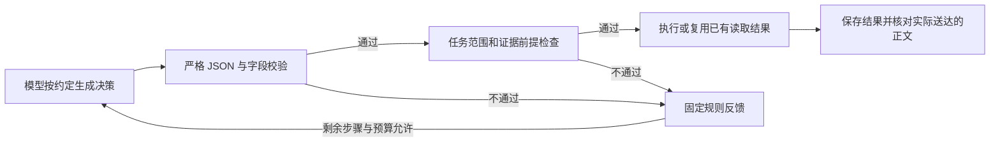

# 公司 Data Agent CLI

> 2026-10-23 起，`agent acquire` 改为新核心的 `uteki-data acquire`（参数不变）；本页其余命令属于旧 CLI，入口改名为 `uteki-data-legacy`，随 S4 处理。下文的 `uteki-data agent …` 写法均按此对应。

## 系统自主取材并提取业务（2026-10-09）

新增 `agent business`：从公司/报告范围和问题进入已有自主查询器，系统选择目录节点、读原文并冻结材料，再调用业务提取器。无调用者章节/block/摘录参数。共享模型预算和规则快照，保留选材与内容质量未评估状态。当前支持单份 SEC inline HTML 10-K / 10-K/A；请求格式、产物与验收边界（已归档：`docs/DATA_AGENT_RUNTIME_MATERIALS.zh-CN.md`，恢复方法见[归档说明](REPOSITORY_RETENTION.zh-CN.md)）。旧 `--packet` 提取脚本仍用于实验重放，不能当作全程自主入口。

## 只获取官方原件（2026-10-04）

新增 `agent acquire --config <公司来源配置> --workspace <原件库>`，直接调用已有获取组件，不调用模型、不要求模型凭据、不启动解析。支持显式 CIK 与 10-K / 20-F 年报区间；真实配置见 `config/company_sources/amd-annual-v1.json` 和 `tsmc-annual-v1.json`。联系身份按 `--sec-user-agent`、环境 `UTEKI_SEC_USER_AGENT`、非空公司配置、私有 `.env` 顺序读取；`--settings-root` 默认为工作目录，可显式指定。逐份状态保存在返回的 `manifest_path`，有缺口退出 2。本机既有 SEC 联系身份已持久保存，后续无需重复输入。

完整范围、恢复规则及真实验收状态见[自动获取说明](design/UTEKI_REPORT_ACQUISITION_v1.zh-CN.md)。旧历史配置没有 `filing_selection` 时现在会明确报错；应另建明确范围的新版本。

四个入口共用 `CompanyDataCoordinator`，执行结果保存在新目录。原件、数据集和旧运行不可覆盖；所有候选事实仍需复核，不会自动采纳。

## 准备和检查

本机的 SEC 联系身份已配置，运行时会自动读取；服务器需提供自己的私有配置。原始配置与有效运行配置分别保存在运行目录；有效配置包含 SEC 联系身份，分享产物前需检查。

已登记的公司可以通过名称或代码选择，资料范围取自显式目录绑定的配置。目前目录为 AMD / 台积电、FY2023 起、截止 2026-10-04。未知名称、缺少目录、身份冲突或配置 hash 变化直接报错，不回退到示例公司。

```bash
PYTHONPATH=src:. .venv/bin/python -m uteki.infrastructure.research_data.query_cli agent prepare \
  --company AMD --company-catalog config/company_sources/annual-pilot-catalog-v1.json \
  --workspace /tmp/uteki-source-store --output /tmp/amd-prepare-001

PYTHONPATH=src:. .venv/bin/python -m uteki.infrastructure.research_data.query_cli agent prepare \
  --company 台积电 --company-catalog config/company_sources/annual-pilot-catalog-v1.json \
  --workspace /tmp/uteki-source-store --output /tmp/tsmc-prepare-001

PYTHONPATH=src:. .venv/bin/python -m uteki.infrastructure.research_data.query_cli agent inspect \
  --run /tmp/amd-prepare-001
```

`acquire / prepare / refresh` 同时保留 `--config` 入口，与 `--company` 互斥。`prepare` 不调用模型：发现并冻结官方原件，生成正文/表格索引、受当前适配器支持的候选事实及 DuckDB。输出的 `stage_coverage` 区分原件、正文、表格结构、候选数值和未进行的财务语义核验。

`prepared_with_gaps` 表示有可查询来源且仍有缺口；既不表示全部资料收齐，也不表示核心财务包完整。0 records 时正文仍可查看；不能因此把财务提取标为完成。`inspect` 校验运行文件与引用数据集的哈希，不判断金融语义。

解析器修复后，可用 `agent prepare --from-run /tmp/amd-prepare-001 --workspace /tmp/uteki-source-store --output /tmp/amd-reprocessed-001` 从核验过的冻结原件重新入库。此路径不发 HTTP 请求。`refresh` 则重新查询官方披露清单；内容和实现均未变时复用已核验数据集，同时保留它原有的解析缺口。输出目录须为新目录。

旧基线的“最新 10-K 及后续申报”需要显式配置 `filing_selection.mode=latest_10k_and_subsequent_filings`，不再是默认行为。指定旧年报时，在**新配置文件**中显式增加下列字段，日期须来自 SEC 发现清单，不能由自然年猜财年：

```json
{"filing_selection":{"mode":"annual_report_period","report_period_end":"2025-06-30"}}
```

该模式只取得对应年报和修订；其他官方材料仍由基线准备管理。未发现该期间则返回缺口，不替换为最新年报。获取产物的 `filing_catalog` 保留已发现年份及未遍历的范围。

2026-10-09 新增按类型与报告期选择：`filing_period` 必须显式给出 `form_type`
（支持 `10-Q`、`10-K`、`20-F`）和 `report_period_end`，以及公司与 `as_of`。
只取得该期间、截止日前可得的原报告及修订，不附带其他季度、年报或8-K。
只有修订而未发现原报告时返回缺口，不把修订当成原报告，也不替换为最新材料。
例如，已明确选择截至2025-03-31的季报时，新配置可写：

```json
{"filing_selection":{"mode":"filing_period","form_type":"10-Q","report_period_end":"2025-03-31"}}
```

`agent acquire` 支持该配置；其冻结产物可由 `agent prepare --from-acquisition`
按原 manifest hash 和明确 source IDs 无网络重放。新 scope 使用 `form_type`，
与嵌套选择和报告期必须一致。季度获取和身份核验不证明季度解析、模型自主获取
或内容评测已通过；这几项分别验收。

## 查询

数值问题支持显式日历年/季度、已验证的来源财年映射，以及**期间类型加完整起止日**。
例如 `单季度 2034-02-01 至 2034-04-30；累计期间 2033-11-01 至 2034-04-30`，
或 `quarter from 2034-02-01 to 2034-04-30; ytd from 2033-11-01 to 2034-04-30`。
这两种期间可以同末日而不同起点；类型和日期保持原样，不从申报日补出观察期间。
日期范围仍受所选数据集协议约束：v0.3只支持日历期间，v0.4支持完整月份边界，
v0.5支持有序的精确来源日期。裸YTD、缺类型/起止日、无效日期和相对期间仍需澄清。
v4支持中文动词紧邻的“提供全年/单季度”。日期范围附FY标签时，仅所选来源给出唯一财年/财季映射、且kind/start/end/basis与已写日期范围完全一致才接受；未知、冲突或不一致仍需澄清。日历标签与日期范围混用仍不解释同义关系。
资料截止日与观察期间分开校验；另一公司、另一期间或最新资料不能替补缺口。

### 年报按表提取：Uteki 实际加载 Skill

`agent extract-batch` 从明确的任务配置选择默认或允许的方法，校验其 Prompt/Skill 文件版本后执行一个指定批次。此路径使用 Uteki 自己的运行模块，不要求运行中的 Codex 阅读 Skill 或手动生成提取答案。

```bash
PYTHONPATH=src:. .venv/bin/python -m uteki.infrastructure.research_data.query_cli agent extract-batch \
  --dataset /path/to/frozen-dataset \
  --job /path/to/explicit-extraction-job.json \
  --task-profile config/data_tasks/annual-financial-v1.json \
  --method-root "$PWD" \
  --batch-index 0 \
  --model-config /path/to/extractor-model-config.json \
  --credentials-root "$PWD" \
  --output /path/to/new-batch-run
```

任务 JSON 必须显式声明 `task_type`，与 profile 一致；还需给出公司、来源快照、信息截止、任务、原文块及所需目录。不得再提供竞争的 inline `prompt`。当前 profile 的任务类型为 `annual_financial_extraction`，默认并仅允许 `annual-financial-v2`；这是年报财务提取能力配置，不携带默认公司、年份或金额。

`--method-id` 可以显式选择 profile 允许的方法；未知任务/方法、缺少输入、来源不适用、文件版本不匹配均拒绝，不自动猜另一套方法。未来新增 Skill 先由 Codex 编写和独立评估，再以新配置明确启用。此 CLI 的批次由调用方指定；主 query Planner 自主选批使用下文的登记任务入口。

`method-snapshot.json` 保存方法资产及实际加载内容；最终带输出 schema 的系统指令位于 `extraction-01/system-prompt-effective.json`。`batch-catalog.json`、`coverage.json` 和结果保留已执行、失败、未执行批次及正文缺口。单批结束不能视为整份财报完成，候选也不会自动采纳。

模型配置必须显式提供 `provider`、`model`、共享 `budget_ledger`、`budget_usd`、`max_requests_total`；无金额或次数上限时使用显式 `null`。换 Skill 不隐式换模型或重置账本。输出目录必须新建且位于冻结数据集之外；旧 `agent extract --strategy ...` 仍保留通用直接提取功能，但它不是受此任务 profile 约束的入口。

### 按研究问题查询

查询 JSON 选择一种输入：

- `prepared_run` + 显式 `include_candidates`：复用已核验准备结果，可按题目补取旧年报。
- `company_config` + 显式 `include_candidates`：同一次查询先准备，再查询。
- `dataset` + 完整 `scope`：查询冻结数据集；此模式不提供获取回调。

例如 `request.json`：

```json
{
  "question": "提供 Microsoft FY2025 收入、营业利润率和 Business 业务说明的原文出处。",
  "prepared_run": "/tmp/msft-prepare-001",
  "include_candidates": true,
  "limits": {"max_steps": 24, "observation_bytes": 12000, "max_packet_bytes": 300000}
}
```

```bash
.venv/bin/python -m uteki.infrastructure.research_data.query_cli agent query \
  --request /tmp/request.json --model-config /tmp/model-config.json \
  --workspace /tmp/uteki-source-store --output /tmp/msft-query-001
```

`model-config.json` 必须明确 `provider`、`model`、`budget_ledger`、`budget_usd`、`budget_policy`（`record_only` 或 `enforced`）、`max_requests_total`，可选 `max_tokens`、`request_timeout`、`max_retries`。模型须已登记价格与凭据支持；没有默认模型。`record_only` 中的 `budget_usd` 为预算参考，费用不阻断；累计请求上限仍强制执行。SDK 隐式重试关闭，显式重试/超时逐次计入共享账本。账本必须放在冻结产物之外，重复运行沿用同一账本，不能用新目录重置额度。

用户已授权本任务的 LLM 提取/复核直接执行，调用前告知范围、模型与请求限制，无需逐次等待审核。历史 DeepSeek 46/48 账本不挪用；真实 query benchmark 的配置和累计限制仍单独准备。Python 可注入 planner 做离线验证，强制标为 `scripted_fixture`，不能作为模型验收。

查询输出包含 `query/` 下的请求、计划、逐轮输入/决策/回执、证据 manifest 与完整产物；真实适配器另保存 `model/` 配置、逐请求记录及使用量快照。结果 `evidence_ready` 仅表示宿主引用/声明需求检查满足；`semantic_completeness` 仍为 `not_evaluated`。缺资料保持 `partial`，不会把搜索无匹配解释为未披露。

### 主 Agent 自主选择已登记的财务提取批次

`agent query` 可在 `CompanyQueryInput.financial_tasks` 中登记财务提取任务，并提供 `--extractor-model-config` 和 `--method-root`。宿主先校验已有选材 job、来源和任务方法，冻结允许的 Prompt/Skill；主 Planner 根据表格目录的原文片段选择相关批次，声明 `kind=financial_extract` 需求，再调用正式 `financial_extract` 动作。调用方无需指定 `--batch-index`。

以下为请求结构模板，所有尖括号占位值及日期须替换为所选冻结数据集的实际值，不能直接运行。`job` 是嵌入的完整提取输入对象，沿用已有选材与目录；它不是 job 文件路径，也不得含 inline `prompt`。

```json
{
  "question": "从登记的年度财报范围选择现金流相关表格，生成一个批次的候选财务记录，列出尚未覆盖的部分。",
  "dataset": "/path/to/frozen-dataset",
  "scope": {
    "snapshot_id": "<dataset snapshot_id>",
    "company_ids": ["<company_id>"],
    "source_snapshot_ids": ["<source_snapshot_id>"],
    "source_policy_id": "local-frozen-v1",
    "knowledge_cutoff": "YYYY-MM-DD",
    "include_candidates": true
  },
  "limits": {
    "max_steps": 12,
    "turn_timeout": 300,
    "max_packet_bytes": 300000,
    "observation_bytes": 12000
  },
  "financial_tasks": [{
    "task_id": "annual-financial-task-01",
    "task_profile": "config/data_tasks/annual-financial-v1.json",
    "task_profile_sha256": "<SHA256 of the exact task profile bytes>",
    "max_new_batches": 1,
    "job": {
      "task_type": "annual_financial_extraction",
      "company_id": "<company_id>",
      "source_snapshot_id": "<source_snapshot_id>",
      "dataset_manifest_sha256": "<SHA256 of the exact dataset manifest bytes>",
      "as_of": "YYYY-MM-DD",
      "task": "从显式选定的原文提取财务候选，保留来源、期间、单位及未解决项。",
      "block_ids": ["<selected source block_id>"]
    }
  }]
}
```

正式 job 还应保留该选材任务已有的 `entity_catalog`、`period_catalog`、`record_schema_version` 和显式归一化配置等字段。期间目录须绑定同一公司与来源，实际财年日期来自原材料；不能从题目中的年份补出日历年或用另一家公司的映射填空。示例省略这些目录的内容，并不授权清空或猜测它们。

每项登记必须具备唯一 `task_id`、显式 `job`、相对 `method-root` 的 `task_profile`、对应文件 SHA256 和正整数 `max_new_batches`。job 的公司与来源须在 scope 内，`as_of` 必须等于 scope 截止日，数据集 manifest hash 必须匹配。宿主生成的目录保留 `catalog_id`、各批次的原文片段和允许方法；模型只能提交 `task_id`、`batch_index` 及可选的允许 `method_id`，不能更换文件路径、来源、期间目录或模型设置。

```bash
PYTHONPATH=src:. .venv/bin/python -m uteki.infrastructure.research_data.query_cli agent query \
  --request /path/to/financial-query-request.json \
  --model-config /path/to/planner-model-config.json \
  --extractor-model-config /path/to/extractor-model-config.json \
  --method-root "$PWD" \
  --credentials-root "$PWD" \
  --workspace /path/to/source-store \
  --output /path/to/new-financial-query-run
```

Planner 与 Extractor 的配置分别选择模型，但必须使用**同一个** `budget_ledger`、`budget_usd`、`budget_policy` 和 `max_requests_total`。任一值冲突会在模型调用前拒绝；更换任务、Skill、输出目录或角色不重置共享累计账本。登记任务时必须同时提供 Extractor 配置及 method-root；没有登记任务时不得携带这些金融执行配置。

当前 DeepSeek 角色配置示例如下，账本路径须替换为当前任务既有账本。`null` 表示显式无金额/累计请求上限；`max_steps` 与 `max_new_batches` 仍分别控制本轮决策数和批次启动数。

Planner 配置：

```json
{
  "provider": "deepseek",
  "model": "deepseek-v4-pro",
  "reasoning_effort": "high",
  "budget_ledger": "/path/to/shared-budget.sqlite",
  "budget_usd": null,
  "budget_policy": "record_only",
  "max_requests_total": null,
  "max_tokens": 8192,
  "request_timeout": 300,
  "max_retries": 0
}
```

Extractor 配置：

```json
{
  "provider": "deepseek",
  "model": "deepseek-flash",
  "reasoning_effort": "low",
  "budget_ledger": "/path/to/shared-budget.sqlite",
  "budget_usd": null,
  "budget_policy": "record_only",
  "max_requests_total": null,
  "max_tokens": 16384,
  "request_timeout": 300,
  "max_retries": 0
}
```

主 Planner 的 `max_tokens` 支持 256–8192，不能沿用 Extractor 的 16384；超范围配置会在请求发送前拒绝。首次较长财表提取可将请求中的 `limits.turn_timeout` 与两个角色的 `request_timeout` 均明确设为 300 秒，避免外层默认 120 秒提前结束提取。当前金融提取固定不做 SDK 自动重试，Extractor 的 `max_retries` 应明确为 `0`；登记网关明确拒绝非零或非整数重试值，避免配置被静默忽略。失败需保留版本并检查原因；本例 `max_new_batches=1` 的额度已消耗时，需要另建明确输入的新运行。

纯财务提取需求得到匹配的成功回执后，结果为 `candidate_ready`：仅表示候选批次已生成。0 条归一化记录仍可能伴随原始草稿与映射缺口，不能据此宣布财务包完整。回执中的 `gaps`、数量和覆盖范围必须一并检查；`semantic_acceptance=not_evaluated`、`adoption=unchanged_candidate` 保持不变。混合查询仍按各需求分别检查；财务生成回执不能代替数值查询结果或主 Agent 的原文阅读记录。

本次运行的登记资料位于 `registered-financial/`，其中保留冻结 job、scope、目录和方法资产；Agent 的逐轮决策与提取位于 `query/turn-*/financial_extract/`，成功回执另存 `financial-receipts/`。`query/result.json` 的 `financial_extractions` 指向候选产物，主运行 `result.dataset` 继续指向查询 baseline，不会悄悄切到新候选 DB。

成功复用只在**同一次运行内**生效：同任务、批次与方法文件版本的重复调用先校验已有产物，再返回原成功回执，不再次调用模型。真正启动一次批次即消耗 `max_new_batches`；模型失败也计入，失败不会进入成功缓存。未知任务/批次、非法方法等启动前拒绝不消耗该批次额度。新运行不会自动加载上一轮成功批次，跨运行恢复尚未实现。

此入口的自主性限于**已登记选材范围内的选批、执行和反馈处理**。登记 job 可以来自此前的模型选材，系统会冻结其输入；当前入口不会自动重做全文选材、补建期间目录或覆盖未选中的原文。未分配正文、未运行表格、漏提与内容复核仍是独立缺口，不能把一个候选批次称作整份年报闭环。

## 更新和产物回读

```bash
.venv/bin/python -m uteki.infrastructure.research_data.query_cli agent refresh \
  --config /tmp/msft-new-cutoff.json --previous /tmp/msft-prepare-001 \
  --workspace /tmp/uteki-source-store --output /tmp/msft-refresh-001

.venv/bin/python -m uteki.infrastructure.research_data.query_cli agent inspect \
  --run /tmp/msft-query-001 --artifact-request /tmp/artifact-read.json
```

`refresh` 保持公司和来源选择策略，允许截止日向前推进；数据和解析实现未变时复用数据集。新解析版本重新物化，不修改原件或旧快照。获取/物化取消时等待正在执行的工作退出，保存取消状态；部分新增资料无法入库时，查询保持原 scope。

`artifact-read.json` 使用 `artifact_id`、可选 JSON `pointer`、`cursor` 和 `limit`。ID 来自查询 `artifact-index.json`；游标绑定原 scope 和 hash，不能拿另一运行的游标续读。

当前完整性边界与真实验证见技术方案（已归档：`docs/DATA_AGENT_AUTONOMY_PLAN.zh-CN.md`，恢复方法见[归档说明](REPOSITORY_RETENTION.zh-CN.md)）和benchmark（已归档：`docs/DATA_AGENT_BENCHMARK.zh-CN.md`，恢复方法见[归档说明](REPOSITORY_RETENTION.zh-CN.md)）。查询运行尚需 T4 专用导出，才能满足 benchmark 的题目/来源绑定及累计逐请求证据接口。

## 执行监控与历史导入（2026-10-06）

[Agent 运行页](http://127.0.0.1:8765/agent-runs) 可查看步骤、子任务、输入输出、已保存的模型返回和逐请求用量。它只观察执行；启动仍走 CLI，页面不提供启动、取消、重试或采纳操作。

`agent query`、`agent extract` 和 `agent extract-batch` 均支持可选参数 `--observation-root`。其余必需参数不变。以下 query 命令是**真实模型执行模板**：请求、公司/来源范围、模型、共享账本和请求限制需先在显式配置中准备好；若请求登记了财务任务，还需加原有 `--extractor-model-config` 和 `--method-root`。

```bash
PYTHONPATH=src:. .venv/bin/python -m uteki.infrastructure.research_data.query_cli agent query \
  --request /absolute/path/query-request.json \
  --model-config /absolute/path/planner-model-config.json \
  --workspace /absolute/path/source-store \
  --output "$HOME/.local/state/uteki/runs/query-001" \
  --observation-root "$HOME/.local/state/uteki/observations"
```

在另一终端启动工作台读取同一观测目录，并明确允许业务输出所在的父目录：

```bash
PYTHONPATH=src:. .venv/bin/python -m apps.review_workbench.app \
  --host 127.0.0.1 --port 8765 \
  --observation-root "$HOME/.local/state/uteki/observations" \
  --observation-output-root "$HOME/.local/state/uteki/runs"
```

工作台的两个观测参数必须成对提供；`--observation-output-root` 可重复指定多个允许的输出父目录。运行目录必须位于其中一个父目录内，观测目录不能与业务输出或冻结数据互相包含。路径含符号链接会拒绝；每次执行仍需全新的 `--output`。单独 `acquire / prepare / refresh` 当前没有此 CLI 观测参数；query 内触发的准备、获取和物化按已记录阶段显示。

每棵执行树由单个本机进程发布事件和心跳。页面可见时每 2 秒读取增量；隐藏时暂停，根运行结束且尾页读完后停止。超过 15 秒未收到未结束运行的心跳，显示“监控更新中断，执行状态未知”，不自动判失败、取消请求或释放预算。当前没有跨进程续写、多机调度和中断续跑。观测未开启的旧入口仍能执行，但不自动出现在实时列表。

当前登记了两次 AMD 真实历史运行，普通工作台启动即可读取，无需观测目录或新模型调用：

| 登记 ID | 查看路径与计量范围 |
| --- | --- |
| `amd-fy2023-main-agent-v2-parent` | 6 个父步骤；第 1、3 步拒绝，第 5 步展开一个提取任务。父运行自身 6 次调用，含子任务 7 次；输入 105,812、输出 17,512 Token，保存估算 0.17045820 USD。 |
| `amd-fy2023-cash-flow-main-agent-v2-parent` | 7 个父步骤和一个提取任务；8 次调用，以 `no_progress_limit` 停止。已生成候选和未完成部分均保留。 |

子任务在同一根运行上下文展开。`candidate_ready` 只表示候选生成；执行、交付、质量与采纳分开显示。缓存 Token 已包含于输入，reasoning Token 已包含于输出，不再相加。仅有调用开始记录时，用量保留未知；历史 SDK 记录为零但供应商未确认时，也不称为已确认零消耗。父子和累计 usage 不重复计费；保存的费用估算不是实际账单，且上述 AMD 数字不包含此前材料选择及其他实验。

另一个历史运行需由调用者准备完整登记 spec，再显式导入：

```bash
./.venv/bin/python scripts/import_agent_run.py \
  --root "$PWD" --spec /absolute/path/new-run-spec.json
```

`--root` 默认为脚本所在仓库，`--spec` 必需。spec 是一个完整条目，可参考 [`agent-runs-v1.json`](../data/evaluation_views/agent-runs-v1.json) 中不含 `summary` 的结构，填写该次运行的实际值：

- `id / title / adapter`，当前历史适配器为 `company-autonomous-financial-v1`。
- 父运行 `path / manifest_sha256`、`query`、绑定的 `dataset`、完整 `scope` 和每个来源的 hash。
- `children` 中明确子 ID、父步骤、batch/direct 两层路径与 manifest hash；如已有旧查看页，再提供 `extraction_view_id`。

该历史适配器读取 company query、autonomous query 及其可选 batch/direct 提取层；不能把任意独立提取或其他 Agent 文件套用此格式。登记读取地址必须是仓库中明确的 `experiments/` 或 `data/` 相对路径；旧机器绝对路径只作历史声明，经 hash 和 scope 映射后读取本地文件。导入校验全部登记层并新增安全摘要，不覆盖原产物、不重跑模型、不替换已有根或子 ID。

工程页登记不会自动改变 `/data-workspace` 的版本选择、采纳状态或旧财务页登记。未建立且核验旧页映射的新运行，仍可在工程页查看受控产物，但没有财务页链接。大内容按需展开与续读；私密配置只显示安全投影。完整约定见执行监控方案（已归档：`docs/DATA_AGENT_OBSERVABILITY_PLAN.zh-CN.md`，恢复方法见[归档说明](REPOSITORY_RETENTION.zh-CN.md)）。

## 冻结获取记录重放与标准解析包（2026-10-07）

当已获取的原件仍在指定工作区内，可从明确选择的获取记录重建新数据集。这个入口不请求网页，也不调用模型。必须提供获取 manifest 的字节 SHA256 和至少一个准确的 source ID；不默认选择首份或最新报告。

```bash
.venv/bin/uteki-data agent prepare \
  --workspace /path/to/original-source-workspace \
  --from-acquisition /path/to/source-run/manifest.json \
  --acquisition-sha256 <64-character-sha256> \
  --source-id <selected-source-id> \
  --output /path/to/new-prepared-run
```

程序核对原件哈希、公司、日期、来源角色及已记录的 SEC 身份收据，再重建只含所选材料的 source-run。原获取记录和旧解析结果保持冻结。新输出目录必须不存在。这个入口仅接受 `company-source-run-v1` 获取记录；不能用任意文档路径代替。

HTML 原件会生成 `uteki-parsed-document-v1` 包：材料身份、正文块与表格单元格、层级目录、片段锚点、资源说明、七份 JSON Schema、标准 `document.html` 和校验 manifest。`sources.json.parsed_package` 登记包及哈希。原有索引、正文读取和查询接口继续使用同一来源块。标准 HTML 保留片段和单元格链接，不执行原网页脚本、不加载外部资源；图片目前只有资源说明。PDF 继续使用原有路径，此次未新增 PDF 标准包。

包的字节稳定性以原件、材料身份、解析器/导出器版本及运行环境一致为前提。模型生成的精编、数值归一化和业务结论不属于这个确定性承诺。目录错误、未知页码、未覆盖指标与财年仍作为缺口保留。

新准备结果可作为 `CompanyQueryInput.prepared_run`，并显式设置 `include_candidates`。查询从已验证产物取得来源范围及截止日；获取记录重放生成的运行没有网络配置，所以该查询不提供在线 acquire/materialize 动作。`prepare --from-run` 可再次离线重建。刷新需要有明确公司获取配置的运行。

## 系统 Agent 的 Claude 原生决策调用（2026-10-07）

`agent query` 的 planner/worker 支持 AIHubMix `claude-sonnet-5-5`、`claude-opus-5-5` 原生 Messages 接口。Uteki 继续管理步骤、工具、证据、范围和预算；模型每次提交一个下一步决策。此接入不表示所有独立提取器或记录复核器已迁移到 Claude。

模型配置显式提供 `provider=aihubmix`、模型 ID、`reasoning_effort=low|medium|high`、`max_tokens`、`request_timeout`、`max_retries=0`，以及原有共享预算字段。当前固定发送 `thinking.type=adaptive` 和 `stream=false`。不发送 temperature、top_p、top_k、seed，也未设置 `between_tools`。

每次调用留存请求配置及指纹、可见输出、响应 ID、实际返回模型、停止原因和原始用量。隐藏思考正文不留存。JSON 决策通过本地契约检查后，宿主才执行动作；格式错误进入有界纠正流程，不能当作成功。HTTP/SDK 隐式重试关闭。截断或格式错误有用量时仍计费；未知用量保留未知预算占用，不能按零处理。价格估算不是供应商账单。

真实验证及失败记录见 [标准包与系统 Agent 试运行](../experiments/agent_design/2026-10-07-parser-runtime-v1/README.zh-CN.md)。

### 决策格式与执行校验

`data-agent-decision-v1` 将动作要求集中在 `decision_protocol.py`。system prompt 的动作表、输出 JSON Schema 的条件约束和本地动作校验共同使用这份规则。运行配置保存协议版本、prompt 及 hash、schema；旧运行和旧结果保持不变。



- `plan` 必须带非空 `requirements` 和 `reason`。读取、提取、查询等动作必须带非空 `requirement_ids`，且引用现有任务。重复 ID、空白 ID、多个动作载荷均不接受。
- Claude 原生与 DeepSeek 自主决策路径检查原始可见 JSON。重复键、NaN/Infinity、溢出数值、Markdown 围栏、多个对象、非对象根节点均拒绝。不会截取文本、猜测缺失字段或静默修正动作。错误反馈只包含固定规则；原始可见输出仍单独归档。
- 字段合法后仍检查公司、来源、快照、任务及证据范围。格式正确不等于事实正确。候选产物继续保留原文引用与缺口；语义完整性仍需独立评价。
- 同一角色、同一次运行内，相同范围、动作参数和任务引用的成功无缺口 `outline/search/read` 请求可复用。反馈标注 `cache_hit`。重复调用不会成为新进展，也不会把“已存盘”算成“已读完”。未送达正文仍通过 `pending_body_reads` 继续分页。不同来源、参数、任务引用或快照不共用；新运行不继承缓存。
- 格式纠正使用现有步骤、连续无进展和费用上限；没有新增隐式 API 重试。每次仍保留调用与失败记录。当前没有启用供应商原生严格输出模式（`strict_provider_schema=false`）。

离线回放见 [协议回放记录](../experiments/agent_design/2026-10-07-decision-protocol-v1/replay.json)：32 份历史输出中，13 份在执行前被格式校验拒绝，19 份通过格式校验；与历史状态相符。新增重复键和非有限数值检查、缓存边界另用合成/模拟传输测试验证。本次没有新增真实模型调用，不能据此声称模型格式错误率、成本或事实质量已改善。

## 本地连续 Claude 对话

`scripts/claude_dialogue.py` 是独立 CLI，没有接入产品 HTTP 或 UI。会话保存在调用者明确指定的本地目录；**每次 `turn` 仍会向 AIHubMix 发送系统指令、此前完整的用户/可见助手文本和本次消息**。隐藏思考与签名不会保存或回传。目前模型明确选择 `claude-opus-5-5`，固定 adaptive/high、非流式、240 秒超时，无工具或自动重试。

系统指令和价格文件须先准备在会话目录之外；新会话目录不得已存在。价格 JSON 明确提供 `model`、`input_per_million`、`output_per_million`、`cache_read_per_million`、`source_url`、`checked_date`，由调用者核验。以下仅为通用路径模板：

```bash
.venv/bin/python -B scripts/claude_dialogue.py init \
  --session /path/to/new-session --system-file /path/to/system.txt \
  --model claude-opus-5-5 --price-file /path/to/verified-price.json \
  --budget-usd 1.5 --max-calls 3 --max-tokens 8192

.venv/bin/python -B scripts/claude_dialogue.py turn \
  --session /path/to/new-session --message-file /path/to/round-01.md \
  --credentials-root /path/to/private-credentials

.venv/bin/python -B scripts/claude_dialogue.py inspect \
  --session /path/to/new-session --history
```

下一轮沿用相同 `--session`，将 `--message-file` 换成本次消息。只有以 `end_turn` 返回非空可见文本、费用已知且模型声明匹配的完成轮次进入后续历史。失败、截断、中断或未知费用保留原记录并阻止续接；不清洗回答、不隐式重试，也不通过删除失败轮次继续。

初始化后，脚本只读已封存的系统指令、价格、`max_calls` 和预算配置；每轮只追加 `turns/NNNN/`，不改旧轮。达到限制后保留会话供 `inspect` 回读，不能用修改配置或另建会话重置已授权额度。请求按完整 UTF-8 字节加 16,000 的输入余量及输出上限预留费用；已知用量结算，未知费用继续占用。金额是公开价格估算，非供应商账单。

会话目录权限为 700、文件为 600，并用锁拒绝并发写入。每轮保存 `user.md`、完整 `request.json` 及 SHA256、原文 `answer.md`、配置和安全回执；回执记录该轮 `runner_sha256`。`inspect` 默认显示状态与费用，`--history` 显示已完成的原文往返；命令不保存密钥或原始错误正文。

## 提取后的 LLM 记录复核

`scripts/review_data_records.py` 是独立复核入口，目前尚未自动挂入 `prepare`。输入 JSON 必须显式提供冻结 `dataset` 路径、完整 `ExecutionScope` 和非空、唯一的 `record_ids`；实体及期间由这些记录固定，不能传入额外字段后静默忽略。仅支持一条记录对应一个已定位 inline fact 的输入。

```bash
.venv/bin/python scripts/review_data_records.py prepare \
  --request /path/to/review-request.json --output /path/to/review-inputs-001

.venv/bin/python scripts/review_data_records.py run \
  --inputs /path/to/review-inputs-001 --output /path/to/review-run-001 \
  --provider deepseek --model deepseek-v4-pro \
  --budget-ledger /path/to/review-budget.sqlite \
  --max-requests-total 18 --budget-usd 5 --budget-policy record_only \
  --max-attempts-per-packet 2
```

示例的 18 次是该任务的累计限制，`budget_usd=5` 为费用参考，并非实际账单。SDK 隐式重试关闭，每包最多两次尝试；全部失败、取消与纠正计入同一账本。只有 DeepSeek 路径目前具备该复核器所需的原始响应留档保证。

失败后可从结果中明确选取 `unreviewed_record_ids`，保存为 JSON 数组，通过 `repack --inputs /path/to/old-inputs --record-ids /path/to/ids.json --output /path/to/new-inputs` 生成新版本。它按同一来源去重上下文，每包最多 24 条，保留父输入 manifest 和原片段哈希。新输入 v2 从已验证的数据集读取所选指标定义，与原文证据分开提供。后续 `run` 必须沿用账本；`--max-attempts-per-packet 1` 可关闭纠正重试，`--max-output-tokens` 的允许范围为 256–16384，默认 8192。

每轮保存：原件/数据集引用及哈希、记录和输入包哈希、原 HTML 片段、完整表格单元格与有界上下文、prompt 与模型配置、原始响应、宿主拒绝原因、逐记录意见、逐请求用量及结果 manifest。新输出目录不可已存在；失败版本继续保留。表格压缩只消除重复字段名，保留空单元格、顺序与跨度；原件字节和旧文本指纹不随格式调整改写。

结果的 `reviewed` 只表示所有指定记录都有通过结构、范围和逐字引用校验的 LLM 意见。意见分别为 `supported / contradicted / insufficient_evidence`，仍不等于正确性或完整性验收。所有原事实继续为 candidate，不改值、不自动采纳；全文漏提审计、链接脚注完整解析、自动补读缺失上下文和下游语义状态联动尚未实现。

## 独立语义检查与 system prompt

`scripts/review_data_semantics.py` 对明确选定的记录检查重述/可比性、分摊、可加总性、维度、地理和数值口径。它复用冻结数据、原文和计费模型，另存语义约束，不覆盖原数值复核意见。当前 system prompt 在 `infrastructure/research_data/semantic_review.py` 的 `SEMANTIC_PROMPT` 中；每次运行保存实际文本和哈希，历史版本保持不变。

`--tasks` 是 `SemanticTask` 数组。每项必须显式提供 `task_id`、1–24 个 `record_ids` 和 `axes`，可以提供 `additional_block_ids` 补读同一冻结来源中的跨注释段落，以及待核验的 `assertions`（每条包含 `assertion_id / record_ids / text`）。不同来源须拆成不同任务，字段 `expected` 或评分答案不能作为任务输入。

```bash
.venv/bin/python scripts/review_data_semantics.py prepare \
  --inputs /path/to/frozen-record-review-inputs \
  --tasks /path/to/semantic-tasks.json --output /path/to/semantic-inputs-001

.venv/bin/python scripts/review_data_semantics.py run \
  --inputs /path/to/semantic-inputs-001 --output /path/to/semantic-run-001 \
  --provider deepseek --model deepseek-v4-pro \
  --budget-ledger /path/to/semantic-budget.sqlite \
  --max-requests-total 24 --budget-usd 5 --budget-policy record_only \
  --semantic-audit --max-attempts-per-packet 3 --max-audit-attempts 2
```

每个请求轴必须分别返回 `constraints_found / none_found_in_context / insufficient_evidence`，附约束、精确受影响记录、原文引用及未解决问题。`none_found_in_context` 只描述本次提供的上下文；相关证据不足时不能当作“未披露”。断言逐条返回支持、矛盾或证据不足。宿主验证字段、覆盖、来源和连续引用；真实输入还逐一回绑冻结原件、记录、指标定义、正文块、表格和原始/精简 DOM。语义内容仍需独立判分。

默认每包一次尝试；`--max-attempts-per-packet` 允许 1–3，协议纠正和语义修订共用这个上限。`--semantic-audit` 启用第二个模型复核意见；`--max-audit-attempts` 允许 1–2，专门修复 critic 的格式或引用错误。两个角色及全部重试计入同一账本、同一个累计请求限制。示例 24 次不是额外授权；既有任务不得通过新账本重置额度。费用策略 `record_only` 保留失败及未知费用。

循环为：生成草稿 → 宿主校验 → critic → 带引用的修订要求 → 新草稿 → 再校验。critic 绑定实际意见 hash，问题须指向现有字段和所选记录；`error` 阻止接受，`suggestion` 只留档。无效 critic 只修复自身协议，不能驱动生成器改结论。网络或运行异常停止整个 run 并归档；只有协议错误可在限额内重试。取消、预算耗尽、未完成包均明确记录。

可选 `--input-format review_turns_v1` 将修订请求组织成原始资料（user）、上一版草稿（assistant）、宿主反馈（user）。字段内容不删减、不补答案；未提供草稿时不伪造 assistant 消息。critic 意见保留为待核验意见，协议修复只要求改写同一 assessment 的 critique。默认仍为 `packet_json_v1`；首次请求的原 JSON 保持不变。每次归档原始 packet、实际 Runner 输入和各自 hash，格式写入模型配置；Runner 输入不等于完整 HTTP 报文。

输出 `assessed` 表示所有请求都有协议合格的意见；启用 critic 时还须通过其复核，但 `semantic_acceptance` 仍为 `model_audited_requires_independent_evaluation`。critic 是另一份模型意见，必须独立评分；其约束尚未自动接入公司 prepare、查询结果或采纳流程。

新 prepare 输出 `semantic-review-input-v3`，旧 v1/v2 仍可读取和验证，v3 沿用 `SemanticAssessmentV2` 输出结构。输入提供实际正文块/引用对象的 `context_inventory` 和原 DOM 派生的 `record_anchors`。表格事实锚定完整行；段落事实锚定实际 inline fact 字符范围，并保留完整上下文，避免强制引用无关整段。dimensions/value 每条约束，以及任务含这些轴时的每条 supported 断言，仍须分别覆盖其所关联记录；表头/定义可作为语义限定引用，但不能代替记录的来源定位。

`source_start` 是字符偏移，唯一逐字文本可省略，由宿主确定；重复文本必须指定位置。明确错误的位置不会被静默修正。缺少来源覆盖时，反馈包含原始未验证草稿、精确字段路径、同组全部缺失 anchors，以及其他组的缺项；宿主不自动补引用或改 verdict。未定位的 anchor 明确报告 unavailable，不能要求模型猜测。`context_claims` 须匹配清单；`context_requests` 和未解决问题只是未核实请求，自由理由仍需独审。

每版保存输入、原始/归一化意见、生成和 critic 的实际 prompt/模型配置、逐次反馈、调用及费用、关键实现源码副本和 manifest。历史意见、数据及失败运行保持不变。源码副本用于对照，尚非完整依赖环境归档。实际质量与版本差异见[v3 报告](../experiments/data_agent_query/semantic-review-v3/README.md)。

独立合成 benchmark 的输入与答案分开保存在 `benchmarks/data_agent/semantic_review/v1/`；准备/评分入口见该目录 README。它与三家公司 13 道 query benchmark 是不同测试，不能相互代替。

### 完整表超限后的读取恢复（R11）

`read_context` 与 `read_source` 均可显式选择 `representation=compact`。紧凑编码保留完整正文、全部单元格、空单元格及行列/跨度；tuple字段由`cell_fields`标明。默认full请求的历史序列化保持兼容。读取上限仍为80000，超限反馈给出两种表达的必要字节、上限及同一原子范围的可执行重读参数；不截断、不换范围、不推进阅读覆盖。两种表达都超限时返回明确容量缺口。成功存入artifact仍不等于正文送达Agent，须按`pending_body_reads`完成续读。临时容量失败保留原始回执，成功恢复后不永久污染任务缺口；未恢复仍不能通过必需正文验收。

### 共享问题句的审核身份（R12）

问题审核可用`requested_scope_quotes`分别记录原问题中的连续期间/主体等限定；`requested_subject`仍是连续原文指标。限定按无序集合参与检查身份，排列不产生新身份；未知、拼接、重复限定与错引原文/事实字段继续拒绝。可选字段缺省保留旧响应兼容。这是协议表达及程序验证，不替代独立内容验收。

### 增量计划追加（R13）

`action=plan`可只提交新`requirement_id`，或提交包含原项的完整union。省略原项不会删除它；同ID必须与原要求逐字一致。全部新项通过原公司/来源/期间/purpose/schema校验后才原子追加，已有coverage/evidence/gaps、记录及原文选择不重置。累计最多32项；重复ID、改写原ID、越界及无进展循环仍拒绝。

### 表组导航投影一致性（R14）

交接从冻结reader与所选表确定预期表组，再按reader原有规则省略parser标记的重复导航`block_ids`；完整冻结组仍记录为溯源元数据。单位/脚注附件、正文、单元格、位置/跨度及其他组字段保持严格比对。候选组改kind/table_id/group_id或删掉整个组不能跳过验证。该修复不修改原件/索引，也不把部分材料变成业务完成。

### 审核历史兼容与财年token · R15/R16

新问题审核修订输入使用question-review-protocol-repair-v2。加载历史v1仅接受原始、scope、定位三个已知生成器的完整重建结果；字段及规范JSON hash精确比较，未知版本或篡改拒绝。嵌套合成保留可选requested_scope_quotes缺省；不修改旧输入、响应、manifest或费用。期间解析v5仅将季度token作为FY后缀校验，普通quality/question等词不再误触发，Q5等非法季度及缺失/冲突财年映射继续拒绝。该修复为工程兼容与离线/真实历史消费验证，不是新模型评测。
