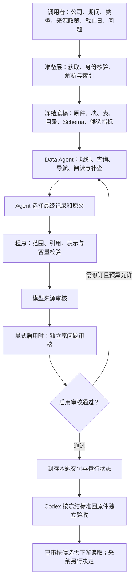

# Data Agent：统一流程与验收标准

2026-10-10 **E6-V3九次实验已完成，稳定性未达**：原三档各3次从零真实执行，首稿效果7/9、最终内容/合格交付8/9、无恢复3/9。八份终稿均4/4、7块2表、无缺失/业务冗余；R3-S1输出length截断，0/4无交付，失败保留不替换。151请求/$2.0438718全部计入原账本，0新unknown；323文件/21历史引用保持。**当前位置：V3实验闭合；下一E6-R4先定位输出额度/length失败处置，E6-R5保留要求归属误用；E7后置。** [逐题结果与费用](../experiments/agent_design/2026-10-10-e6-repeatability-v3/PUBLIC_DELIVERY.zh-CN.md)。

2026-10-10 E6-R3 已完成：`selected-originals-v4` 使正文选择、原子上下文预览和最终组装一致；`source-only-revision-v1` 恢复合法负面来源反馈，完整双审门禁保持。原失败受控恢复＋S1/S3各一次从零均按原标准通过，最终每例4/4、7块2表，无缺失或多余业务正文；从零无恢复1/2。新增37请求/$0.4988421，原账本和旧失败保留。**R3完成时点：当时下一E6-V3；该实验现已闭合，当前见顶部E6-R4。** 旧V2仍8/9、无恢复0/9，长期稳定性未证明。[本轮交付](../experiments/agent_design/2026-10-10-e6-delivery-boundary-v1/PUBLIC_DELIVERY.zh-CN.md)。

历史修复验收时点（2026-10-09）：R15/R16均完成。新修订使用v2，旧v1按固定已知生成器完整重建，保留历史可选字段缺省；7份旧修订和5份真实成功产物加载通过，2份失败仍拒绝。R16按季度token识别FY后缀，普通q开头英文可解析，非法季度/缺失或冲突映射仍拒绝，解析版本为v5。冻结文件未改、API新增0，共享176请求/$2.0569908、未知/在途0。下一项E5先冻结多公司问题与独立范围/覆盖；下方未修描述为review发现时点，不是当前状态。[验收证据](../experiments/agent_design/2026-10-09-e4-heldout-v1/evaluation-only/R15-R16-verification-v1/result.json)。

交付后review发现时点：原件及逐题历史验收保持，但R15/P1使两份E3旧审核产物无法通过当前消费门禁；E4两题当前加载通过。R16/P2另误拒FY后q开头英文。两项未修、零API复现，当前先R15，状态见[TODO](../TODO.md)。

2026-10-09 · 当前唯一标准入口。**G0–G4 是通用关口，E1–E7 是扩展场景。每个场景先检查准备与工具，再独立评判逐题内容。** 历史计划不覆盖当前状态和费用授权。

2026-10-10 用户确认：**效果 > 成功率 >> 费用**。效果以是否足以支持原问题、必需覆盖、真实性、范围/口径/出处与聚焦独立判断；成功率以内容合格且完整交付为分子，首次通过与恢复后通过分列，不以格式或程序成功替代。费用在效果与可靠性成立后比较，不因便宜降低质量或削减必要证据；费用波动本身不使内容失败。后续实验运行前冻结此评价顺序，原冻结标准、失败与分母不追溯改写；预算授权和硬上限保持。

2026-10-10 E6-V2完成时点历史：[E6-V2九次真实结果](../experiments/agent_design/2026-10-10-e6-repeatability-v2/PUBLIC_DELIVERY.zh-CN.md)按原标准验收，终稿必要四项9/9、完整效果/合格交付8/9、无恢复0/9；当时下一E6-R3；该机制现已修并回归通过，V3实验现已闭合、下一E6-R4，保持Analysis双审门禁。下方E4/E5等带日期描述为历史时点，当前状态以TODO/交接为准；本条仅更新执行状态，不改冻结内容标准。

验收终点是 Data 提供足以回答问题、可回原件、范围正确且聚焦的材料。Analysis 负责报告、判断和图。Data 通过不代表 Analysis 已消费、人工已采纳或整份材料已完整提取。

历史准备时点（2026-10-10）：E5 已开始准备双公司完整语料及独立标准，尚未执行模型。当前实验见 [E5 计划](../experiments/agent_design/2026-10-10-e5-multi-company-v1/PLAN.zh-CN.md)。排错按[通用修复约定](DATA_AGENT_BUGFIX_PROTOCOL.zh-CN.md)定位最早偏差、检查契约根因、用独立反例与范围拒绝验证；不注入公司答案。

## 实际流程

例：用户指定 Microsoft、FY2024/FY2025、SEC 10-K，并问分部口径变化。系统准备显式范围内的原件；Agent 自主查目录、读原文和查询候选记录，选择两份报告的证据。交付显示重列前后值、口径说明和精确出处。Codex 按运行前冻结的必需信息逐项回原件核验；只查到数值或只通过 JSON 都不足以验收。

| 环节 | 实际入口与执行重点 |
|---|---|
| 获取、准备 | CompanyDataCoordinator.prepare → prepare_sources → materialize_sources，确定性 HTML/XBRL 准备。缺范围报错，不以样本、最新年或其他公司兜底 |
| Query 输入 | Coordinator._query 可用冻结 dataset；也可先用 company_config/prepared_run 准备。仅后者提供获取/物化回调 |
| 当前评测闭环 | scripts/run_data_retrieval.py → run_retrieval_cycle 要求冻结 dataset、scope 和 analysis_evidence，禁止 registered financial_tasks；不是财务全量提取入口 |
| 模型执行 | AutonomousDataAgent._run 由主机循环派发工具；SdkAutonomousPlanner.decide 每次调用 Runner.run(max_turns=1) 返回决策 |
| 阅读与选择 | outline/search/read/context、query、artifact 翻页、select_records/select_evidence；探索与最终交付分开。完整落盘不代表模型实际读完 |
| 交接审核 | prepare_review_packet → review_data_answer：先来源审核，再可选问题审核；后者须成对配置 question_reviewer/question_review_policy |
| 修订封存 | 最多三个取材 attempt，反馈绑定前轮 hash。恢复、失败和未知费用保留在同一账本，不因新尝试重置预算 |
| 下游消费 | load_reviewed_data 重验冻结输入和审核状态，仍为 unchanged_candidate。当前 cycle 记录 analysis_called=False |

源码：[Coordinator](../src/uteki/agents/data_query/coordinator.py)、[工具循环](../src/uteki/agents/data_query/autonomous.py)、[单步规划](../src/uteki/agents/data_query/autonomous_model.py)、[取材闭环](../src/uteki/agents/data_query/retrieval_cycle.py)、[交接审核](../src/uteki/agents/data_query/answer_handoff.py)。

Codex 负责工程、原件精读、标准冻结和独立验收。生产运行中不代选语义章节或块，不填事实缺口。参考答案、必需块及评测批评不传入 Agent。模型审核是运行反馈，不能替代独立验收。

## G0–G4：准备与工具关口

| 关口 | 必须核验 | 不能替代 |
|---|---|---|
| G0 获取、身份、版本 | 官方应收—实收清单；公司、期间、可得日期、来源政策、hash、修订关系；质量记录绑定实际底稿 | 下载成功、文件名相同、旧样本复用 |
| G1 解析忠实度 | 正文、列表、表格、单位、脚注、定位和必要上下文；未支持内容明确列缺口 | JSON 合法、DOM 文字数量一致 |
| G2 目录、数据说明 | 已支持来源/财历内所有可查询期间；指标定义、单位、口径、主体、工具能力和限制 | 有值、字段名存在、未经验证的格式能力 |
| G3 工具正确性 | 范围、参数化查询、分页/容量、表格脚注、完整 artifact 与模型预览分开、回放一致 | SQL 成功、非空返回、落盘成功 |
| G4 交接一致性 | 合法读取结果按同一协议进入包；原值、引用、范围准确；超限明确失败 | 单独读取器或交接单测通过 |

按明确格式和问题类型验收。当前 HTML 10-K 的结果不自动覆盖 10-Q、图片/OCR、任意格式或 AMD 周制财年的结构化适配。一题通过不能证明整份材料解析完整。

重复下载、解析重复、原文不同位置的重述和跨报告重复披露分别记录。不能仅凭文字相同删除原件；期间、口径、修订状态和来源关系保留。hash 去重不等于语义去重或修订覆盖。

## 运行前冻结标准，运行后分别判定

Codex 先精读原件并冻结：问题/范围、必需信息、允许的等价出处组、必要上下文、可选证据、排除项及原件/底稿 hash。允许多个等价出处，不用唯一块 ID 或最少字符代替语义覆盖。标准修订另记版本、原因和受影响结果，不在看到答案后静默放宽。

| 独立判定 | 通过标准 |
|---|---|
| 必要覆盖 | 每项必需信息都有充分证据。可选材料和其他高分不能抵消遗漏 |
| 范围、真实性、出处 | 公司、期间、来源政策、可得日期一致；数值、单位、符号、口径、限定和位置忠实；派生值声明算法与输入 |
| 聚焦 | 无用全文、额外公司/期间和重复材料不进入交付；引导句、表头、单位、脚注可为必要上下文。删去而不伤必需信息的内容须说明保留理由 |

“最小充分”不是最短文本或最少块数。先做硬判定，再比较重复、无关内容、输入量和费用；不虚设统一冗余百分比。另一公司在原文中的出现是否相关由题意决定。简单问题交付整份报告判失败。缺件、未结构化、不支持和未披露须区分。

矩阵包含同公司不同问题、同题不同公司、多公司、不同期间、早于披露日截止时间、大表/分页/列表/脚注、来源与能力缺口。冻结调试题只验收该案例；另留新公司/新问题检查迁移。

逐题交付固定回答：**问题是什么；Agent 提供什么；足以支持什么；漏什么；多什么及原因；精确出处；费用。** 分列真实执行、程序校验、来源审核、问题审核、独立原件验收和人工采纳。保留失败、修订、截断、unknown 和未运行；引文存在、模型一致、内容正确分别核验。

## 当前有限基线与扩展路线

既有 Microsoft/Alphabet FY2025 HTML 10-K 六题及微软目录分页针对性复跑通过独立原件验收。准备层 2,739 块、270 表、213 条五类指标映射，不等于完整三张主表或 213 个新发现事实。

E1 Microsoft FY2024/FY2025 两份 SEC 10-K 的七题都有通过的阶段独立内容验收。部分题含恢复、补审或补查，不能称同一版本七题从零一次通过。Sonnet/Qwen/DeepSeek 单题内容均 3/3；Qwen 自动审核仍失败。每配置一次，不构成排名或稳定性。整块/整表冗余和严格聚焦仍有缺口。

[六题结果](design/data-agent-acceptance/data-agent-evidence-v1/) · [E1 七题](design/data-agent-acceptance/e1-evidence-benchmark-v3/) · [模型对照](design/data-agent-acceptance/e1-model-comparison-v1/) · [E1 冻结交付](../experiments/agent_design/2026-10-09-e1-benchmark-v1/DELIVERY.zh-CN.md)。

| ID | 场景 | 状态/依赖 |
|---|---|---|
| E1 | 双年度独立 10-K | 受限阶段完成；聚焦、审核误拒绝、稳定性未关闭 |
| E2 | 同公司加入 10-Q | 指定季度收入题r3独立4/4、上下文/真实性/聚焦及双审通过；失败历史保留，整份季度财务包仍未完成 |
| E3 | 多类型、多年、版本 | 混合收入题及V1原列报/后续重列题各自独立验收和最终双审通过；失败与修复历史保留，完整解析及全部修订类型未验收 |
| E4 | 混合库单公司与新公司保留题 | H1/H2标准提前冻结且答案隔离；H1四金额/上下文/原件/聚焦/实际读取独立通过，r3仅恢复双审成功、两次失败保留；H2-r2必要5/5、完整归属规则及实际等价原文读取/原件/范围/聚焦独立通过，最终双审通过，r1失败保留；指定三题目标闭合 |
| E5 | 多公司查询 | 指定双公司四收入题已完成；任意公司/完整财务未验收 |
| E6 | 材料增长下质量/成本 | B1/V1/R1/R2阶段完成；V2九次原标准真实实验已完成，完整效果8/9、无恢复0/9，稳定性未达；下一R3最终正文契约待修 |
| E7 | 公司 relations | 后置；关系类型与来源独立验收 |

原 01–16 状态见[当前待办](DATA_AGENT_EXTRACTION_TODO.zh-CN.md)。07 完整财务、08 精编、09 业务图未完成，06 暂缓。路线不自动启动付费任务。

E1 及小步模型对照新增 API 总上限 $100，使用原受约束总账，包含失败、unknown 和顾问；分批释放，不新建账本绕过上限，不使用 MiniMax。本次梳理、清理和启动不调用模型。历史不限额计划保留为历史授权。

## 本次代码 review 状态

| ID | 已发现缺口 | 影响 |
|---|---|---|
| R1 · P1 | 原缺陷为 coverage recovery 复制预算 | 新恢复链已共享原账本，49项定向离线检查通过；旧复制链继续调用前须对账，不自动迁移。不是 retrieval_cycle 已复现的预算分叉 |
| R2 · P2 | 交接先验全部探索来源，再过滤最终选择 | 已弃探索可能阻断正确交付 |
| R3 · P2 | 问题审核拒绝合法 source_period_end=None | 8-K/官方更新扩展前须处理 |
| R4 · P2 | 重试漏 HTTP529、rate_limit_error/timeout_error | 临时故障可能提前失败 |
| R5 · P2 | filing_brief 同模型复核忽略 review_max_tokens | 显式复核输出预算未生效 |
| R6 · P2 | business_map 发布前未重验原件 hash | 请求期间原件变化可进入候选 |
| R7 · P2 | reading_groups 升级破坏旧版本回放 | 历史版本兼容未修 |
| R8 · P2 | max_packet_bytes高配额与ArtifactReadRequest字节上限冲突 | 已修：state/index预算受同一100000协议上限约束；56项定向检查通过，合法1000000和>200000状态续读/原件不变成立。原失败保留，无模型质量复跑 |
| R9 · P2 | 来源审核两次漏掉逐块相关性检查 | 已修：精确交付v2/v3的输出Schema要求body_checks必填且完整数量；原身份/引用/语义校验继续生效、v1兼容。49项离线检查及真实恢复双审通过；原失败保留，未重跑取材 |
| R10 · P2 | 中文紧邻期间类型与冗余财年标签被误拒绝 | 已修v4：ASCII词界识别中文紧邻；仅显式来源唯一映射与typed期间kind/start/end/basis相同才允许FY同义标签，未知/冲突仍拒绝。59项相关离线检查、原冻结E3-V1题真实取材及双审通过；独立内容单列 |

R11在H1-r2实跑中从超限经显式无损compact和artifact正文续读恢复，独立实际读取/选择通过，94项离线边界检查。R12新增可选原问题scope身份及精确机械字段定位反馈，59项相关检查；H1-r3只恢复双审通过且未触发协议修订，不声称定向反馈在该轮实测。旧失败与冻结标准保留，不用审核包自动补入的正文证明Agent已读。

R13增量计划新ID原子追加、旧要求/证据保留，7项新合成及89项受影响检查通过，H2-r2真实增量追加成立。R14只统一冻结reader的导航省略投影，其他正文/cells/元数据仍严格；定向检查及H2-r2原件交接通过。H2实际读取/选择3块，最终7块另含4块record原始引用自动补入，按提前冻结的等价出处标准分别验阅读与交付，不把自动补入当作Agent已读。E3→E4新增113请求估算$1.3504302，共享ledger最终176/$2.0569908、未知/在途0，$3硬上限不变。

Qwen E1-04 正文期间额外要求仍未修。当前交接不支持 scope transition 或含 calculations 的事实包。本文整理不等于修复；核心离线通过不代表完整历史集成或业务验收通过。
