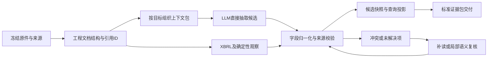

# Data Agent：工程结构化与 LLM 直接抽取设计

日期：2026-09-24。状态：**设计稿，未实施、未做新模型验证**。本轮依据现有代码和官方公开源码制定方案；不修改历史数据、评分答案或采纳状态。

## 1. 先确定我们要交付什么

目标是把公司原始材料处理为**可查询、可解释、可追溯的候选研究数据**，供当前 Codex 或后续 Analysis Agent 使用。内容包括数字，也包括业务说明、管理层预期、限定条件和关系。摘要是展示视图，不能成为唯一留存内容。

建议保留以下五种产物，复用现有存储与查询组件，不为每种产物另建服务：

| 产物 | 必须保存的内容 | 用途与存储 |
| --- | --- | --- |
| 原件与来源 | 原生 HTML/PDF/文本、公司身份、材料类型、报告期/发布日期、获取时间、URL、原件 hash | 证据根；不可变文件与 source manifest |
| 文档结构 | 章节树、原文块、表格单元格/合并跨度/表头、脚注链接、发言人、页码/DOM/位置、解析诊断 | 定位、读取、模型输入；结构化 JSON/JSONL，Markdown 只是视图 |
| 候选观察 | 数值事实、guidance、归属明确的文本陈述；原始表述与规范化字段分别保留 | JSONL 为可复查记录，DuckDB 为查询投影，CSV 按需导出 |
| 限定与关系 | 适用主体/指标/期间、重述、合并例外、包含/重叠、分摊、定义、条件、问答关联 | 关联候选记录与原文；先用 JSON/关系表，无需图数据库 |
| 抽取运行与覆盖 | job/scope、实际输入块、产物、跳过/未解决项、代码/schema/prompt/model 版本、费用、审核与后续版本关系 | 复现、增量处理、遗漏评估及对外交付状态 |

**数值候选**至少区分：主体、原文指标名、规范指标 ID、原文值、规范数值/范围/近似关系、原文单位与规范单位、报告期间及解析状态、actual/guidance、会计口径、报告分部/产品维度、证据与限定证据。

**文本候选**保存原句、简洁命题、陈述主体/发言人、适用时间、主题和相关记录。管理层解释保存为归属陈述；分析师问题保留为问题，不变成公司事实。业务对象可以先保留原文名称及所属公司，不要求先证明它是“独立业务”。

**限定关系**是数据的一部分。例如，分部历史数据按新口径重述、但合并报表不受该次变化影响，应分别关联适用记录及期间；不能只放在报告尾部的一句免责声明里。关系可以未解析；不强行构造完整商业本体。

对 Analysis Agent 的一次交付包含 `content/records + evidence + qualifiers/relations + scope + gaps + validation + artifact_refs`。SQL、文档读取和查询结果共用这些身份与版本。数值、原文、计算、模型抽取和模型解释保持类型区分。

例如，以下只是说明输出形态的**虚构材料**，不作为生产默认值或评测答案：来源元数据明确公司与本期日期，原文写“本期 A 部门收入为 12 亿美元，其中包括 B 产品收入。B 产品收入未单独披露。上期部门数据已按本期口径重述。”应形成：

- 一条 A 部门收入候选，分别保留原文值、规范值、主体、期间、单位和数值出处；实体映射不明确时先保留原名。
- 一条 B 产品收入包含于 A 部门收入的关系候选，带适用范围和独立出处；不能把二者相加。
- B 产品收入金额保持未知，保留“未单独披露”的依据，不生成 0，也不借用 A 部门金额。
- 一条关联上期部门记录的重述限定；不能把它扩展到原文未提及的合并报表。

这比只存一个数字或一段摘要更适合下游查询、比较与复核。

## 2. 当前真正的问题

代码中已有四种行为，不能混为一个已完成的提取器：

| 现有路径 | 已有能力 | 限制 |
| --- | --- | --- |
| [materialize_sources / extract_inline_records](../src/uteki/infrastructure/research_data/company_materialization.py:135) | iXBRL 标准概念、context/unit、期间、维度、证据 → ResearchRecord → DuckDB | 当前主要面向已映射的标准概念；非标准概念、未标记表格及细粒度文本不能由此完整抽出 |
| [autonomous extract](../src/uteki/agents/data_query/autonomous.py:441) | 模型选择已经读到的原文，保存 quote、label、block 与来源 | 是候选摘录，未形成可直接入事实查询表的结构化记录 |
| [直接抽取实验](../scripts/run_extraction_prompt_comparison.py:139)及[其 schema/prompt](../src/uteki/infrastructure/research_data/extraction_prompts.py:13) | LLM 从原文生成 financial/guidance/statement、qualifiers、question refs | 已有可复用雏形；未接入主数据管线，主体目录、单位、期间和位置协议仍有限 |
| review / critic | 对已有记录检查引用、口径和解释 | 输入记录集限制了可发现范围；不能靠只复核已有记录衡量全文召回 |

主要问题是：

1. **事实发现被规则输出限制。** 工程没有识别出来的指标或业务陈述，后续逐条复核通常看不到。
2. **抽取、归一化、复核没有连成统一产物链。** 已有直接抽取实验尚未成为主流程；摘录与 ResearchRecord 之间仍有缺口。
3. **模型承担了不适合的机械工作。** 重复抄写记录、引用、长标识和字符偏移，增加输出成本及格式错误；这部分应尽量交给工程。
4. **语义与来源位置被混在一次验收中。** 整行覆盖能验证记录来源，却不能证明每条解释正确；表头、定义和限定语有自己的证据作用。
5. **重复整稿复核成本高。** 当前实跑有原样返回失败稿、局部修复但仍有语义问题，以及 critic 漏报。不能假定增加一轮 reviewer 必然改善结果。
6. **缺少抽取覆盖账本。** 已读全部块、成功解析若干记录和召回全部重要事实，是三个不同指标。

所以主线应调整为：**LLM 直接从原文发现并抽取细粒度候选，工程记录独立作为交叉检查信号，复核集中处理需要判断的部分。** 保留已有复核器作为评测与局部质量工具，不要求先让全部旧复核案例通过，才能开始直接抽取。

## 3. 工程与模型的职责

“工程负责粗处理、模型负责细粒度理解”适合作为分工。正确性仍要分层验收：工程解析可能漏掉表格或脚注，模型也可能误解口径。两者的结果都不能直接标成已采纳事实。

| 工作 | 工程负责 | LLM 负责 |
| --- | --- | --- |
| 原件和身份 | 获取、去重、hash、issuer/source/cutoff 校验 | 提出所需材料或补读请求 |
| 结构和定位 | DOM/布局、章节、表格、单元格、稳定引用 ID、读取范围、位置映射 | 必要时提出结构修正候选，由工程验证 |
| 标准数字 | 解析可确定的 XBRL/单元格数值、精度、缩放、日期；保留原文 | 识别指标语义、报告主体、期间角色与限定关系 |
| 非标准与文本信息 | 提供完整局部上下文、schema、工具 | 直接提取未标记指标、定义、guidance、业务陈述、条件、关系 |
| 归一化 | Decimal/单位换算、明确日期映射、注册指标映射与数据约束 | 提议语义映射；不能确定的保留原文和 unresolved |
| 校验 | 字段/来源/范围/引用/重复/显式算术一致性 | 检查解释、限定适用对象、遗漏与冲突；按需复核 |
| 采纳 | 保存候选与审核状态，遵守既有采纳流程 | 提供意见，不自动替研究者采纳 |

工程 XBRL 观察和 LLM 观察分别保留。先让 LLM 面对原文，再做两路结果的比对，避免只在规则列出的答案中挑选。规则与模型相同也不证明两者没有共同遗漏。

## 4. 建议处理流程

### 4.1 工程生成可读结构

HTML 优先保留 DOM、表格与 iXBRL，不为统一格式先转 PDF。PDF 保留页图/文本/版面；确有需要时才启用 OCR/VLM。现有 DocumentReader、source manifest 和索引校验继续复用。

文本 trim/空白规范化保留处理版本及原文映射；原件不变，旧 hash 不重写。章节摘要只能用于导航，抽取必须回到真实正文或表格。页码、block、cell 和 span 的 ID/位置由工程生成，模型不计算 hash 或手数偏移。

### 4.2 按抽取目标组织上下文

`ExtractionJob` 明确公司/来源/cutoff、选定材料、目标事实类型、schema 版本、范围与资源限制。支持两种工作方式：

- **准备基线资料：** 遍历目标范围中的结构单元，建立可复用候选数据。目标范围由显式 profile/job 定义，不能把某家公司的章节或年份变成默认值。
- **回答 query：** 先查已有候选和原文覆盖；缺口对应到章节、表格或问答后，再按需抽取并发布新版本。

一个输入单元通常是“表格 + 完整表头/单位 + 相关脚注”，或“章节小节”，或“同一发言人及相关完整问答”。避免纯按固定 token 数截断限定语；过大时沿结构边界拆分，并显式记录跨包引用和未读部分。

每个 job 的目标单元记录实际处理状态：未处理、已交付模型、抽取已返回、失败/截断、待补读；保存对应输入和尝试版本。空结果只表示该次抽取没有返回候选，不能自动认定原文没有相关事实。流程覆盖与独立标注范围内的召回完整性分别报告。

### 4.3 模型直接输出 RecordDraft

沿用已有 financial/guidance/statement 三类抽取雏形，增加必要的原文与解析状态；先不设计一个包容所有未来知识的 ontology。

| 草稿字段组 | 模型提供 | 宿主提供/补全 |
| --- | --- | --- |
| 身份 | 包内临时 ID、原文主体/指标名称、已提供目录中的明确映射 | job/run/source 身份与最终记录 ID；歧义映射保持 unresolved |
| 值与时间 | 原文数值/范围/近似、原文单位、期间文本及角色 | Decimal、受支持单位换算、明确财年映射；保留原始值 |
| 内容与限定 | 归属陈述、guidance、限定条件及适用对象、关系候选 | 关系引用校验与持久化 |
| 证据 | 选取已提供的 block/cell/span ID；必要时提供短逐字引用 | 从原文解析位置、渲染引用、绑定 hash、记录歧义或无法定位 |
| 缺口 | 未解决字段、需补读的引用或问题 | 区分未读取、未找到、不支持、冲突、未知等实际状态 |

当现有结构没有足够细的 span 时，可暂用 block ID + 短逐字引用；唯一匹配由宿主定位。重复文本由宿主列出带上下文的 occurrence/span ID，供模型选择真实出现位置；仍有歧义则保持 unresolved，不退回让模型手算字符偏移。不存在的引用拒绝。限定证据与数值来源分别关联，模型不必在每段解释里重新抄完整数值表。

语义新词或未知指标不能因为规范指标目录里没有而丢弃：原始候选进入 raw draft/信息索引；映射明确后才能生成规范化数值查询记录。新发现的业务名称也先保留 source-scoped 原名，不冒充已有规范 entity。

### 4.4 校验、局部补读与持久化

所有候选执行确定性检查：来源和公司范围、schema、引文/位置、数值可解析性、单位/期间状态、ID、重复、与已提供表格/XBRL 的显式冲突。这里只验证可证明的条件，不用关键词规则猜测财务语义。

以下情况进入局部补读/复核：多层或跨页表头有歧义、规则与模型冲突、非标准定义/调整项、重述/范围例外、关键字段未知、缺口阻止目标交付，或抽样质量检查。模型自报 confidence 不能单独决定是否跳过复核。

反馈应携带具体问题、相关来源和最小待修字段；不要求每次重写全部文档结果。没有新证据或草稿没有进展时停止，保留候选与原因。日常运行可以按风险触发复核，但开发验收必须有独立抽样，避免“未触发复核”隐藏错误。

校验合格的规范记录复用 [ResearchRecord](../src/uteki/domain/research_data/query_contract.py:93)；未映射候选不丢失。schema 扩展用新版本，旧查询和快照保持可读。归一化状态、证据状态、语义评估状态与 candidate/adoption 分开记录。

**规范数值 SQL 的准入条件**是该类记录适用的主体、指标、单位、期间及会计口径等字段满足受支持契约，且来源校验通过；不能用默认 entity/metric、币种、财年或会计口径填补未知。未解决的草稿仍可通过候选目录和原文读取取得，但不能混入已归一化的数值投影。规范候选可被 SQL 查询，也不表示其语义已通过独立验收或研究者已采纳。

同一事实在多个来源出现，保留多个 source occurrence；相同数字不能作为去重键。修订与重述保留关联和可见时间；不能以“最后写入”为准覆盖历史金额。计算结果引用操作数和公式，不伪装为原文抽取值。

## 5. System prompt 的设计

应有一个正式的 **直接抽取 system prompt**，复用现有实验的有效约束，职责是从原文发现和输出候选。reviewer/critic 使用各自独立 prompt。

固定部分包含：任务角色、资料不可信指令边界、抽取类型、原值/规范值区分、未知处理、来源要求、归属/实际值/预期区分、输出 schema、工具与停止条件。公司、期间、来源及任务范围放在经过验证的 job/input 中，不能写死在 system prompt。

抽取顺序为：检查输入范围与单元清单 → 阅读原文和限定 → 输出相关候选 → 列出未解决项及补读请求 → 做一次自身一致性检查。自检不是再启动一个完整 reviewer，也不证明结果正确。

建议 prompt 作为独立版本资产管理，配合共享约束与 schema 生成实际调用文本；运行保存**最终渲染的 prompt、内容 hash、输入、模型设置、原始返回和实现版本**。Skill 描述工具使用流程，system prompt 约束模型职责，schema 约束输出结构，宿主校验执行可证明规则；四者互补。

这部分在本设计中提出，尚未移动当前 Python 常量或改变实际模型调用。

## 6. PageIndex 与类似技术如何使用

本次阅读官方 README 与核心源码，固定版本见文末。没有安装运行这些项目、上传资料或复现其 benchmark。

| 技术 | 本次核实的能力 | 建议利用 | 不能替代的部分 |
| --- | --- | --- | --- |
| PageIndex | 长文档树导航与 agentic 检索；当前 Flash 可先按 PDF 布局/书签建粗树，摘要与细化可用 LLM | 借鉴工程粗树、可选摘要、按结构补读、模型候选节点的出处校验；与现有 outline/search/read 比较 | 财务事实 schema、记录级证据、指标/单位/期间归一化、全文抽取召回 |
| LangExtract | 文本分块后直接 LLM 抽取，保留 class/text/attributes 和来源对齐；可多轮合并 | 借鉴 typed extraction、短原文抽取、来源对齐与有界并行；作为直接抽取基线候选 | 属性/关系的财务语义、严格证据验收、可靠的错误纠正 |
| Docling | 多格式文档结构化，表格行列/跨度/表头、阅读顺序、页码/bbox；另有页级 VLM 模板抽取 | PDF 结构处理候选，保留结构化 JSON；只在现有解析有实际困难的材料上比较 | 跨页财务语义、字段级证据绑定、输出业务 schema 完整验证 |

**PageIndex 的具体边界。** 本次版本的 local API 只接 PDF，local 引用主要到页；Cloud 宣称块级引用和 OCR/图像能力，本轮未验证。Uteki 的 SEC HTML/iXBRL 已有更细的 DOM 证据，不能为了接它而丢掉。其“无 chunking”仍有节点/页范围/分页和预算限制。树覆盖所有页也不等于全文已读或事实抽取完整；候选标题出现在指定页只验证位置，不证明财务事实的语义。

Flash 在 `summary=False, optimize=False` 时可不调用 LLM；默认摘要/细化及检索 agent 会调用模型。官方内部 helper 有多次尝试及较高并发，采用时必须接入统一模型网关、共享账本、并发和停止条件；不能当作一个免费无重试的工具。官方 FinanceBench/查找题成绩不能转写为 Uteki 抽取准确率。

**LangExtract 的具体边界。** 默认允许 fuzzy/partial 对齐；必须保留 alignment status，不能以“有字符区间”代替精确证据。多轮主要重复抽取并按区间合并，重叠部分先到者优先，并不是 critic 修正循环。财务事实可能共享同一句话，不能直接以区间重叠决定重复或正确版本。

**Docling 的具体边界。** 文档转换本身也可能出现布局/OCR错误。当前 VLM 抽取路径逐页生成 JSON，结果有 page_no/raw_text/errors；本次读取路径未提供逐字段来源 span 或跨页语义合并。模板被放入提示，不等同输出通过财务协议校验。其模型权重许可证也需与代码许可证分开看待。

建议第一步**复用 Uteki 的 HTML/iXBRL/DocumentReader 与现有直接抽取实验**，吸收 LangExtract 的来源对齐思路；Docling 和 PageIndex 作为有明确输入困难时的可替换对照，不同时更换解析、检索、抽取三层。

## 7. 效率优化

1. 原件/文档结构按 hash 缓存；抽取按 source hash + scope + schema + prompt + model/config 缓存。相同输入不重复提取。
2. 原文按结构和任务打包；同一表的表头/脚注发送一次，多个记录引用共享 evidence，减少复写。
3. LLM 选引用 ID，宿主算位置、hash、Decimal、单位换算及注册公式；不消耗模型做机械序列化。
4. 已有规范数据可直接查；新 query 只补未覆盖需求。资料更新只重抽变化单元，同时使相关跨页脚注/关系失效，不能只盯单一块 hash。
5. 首轮直接抽取，按需补读和复核。持续抽样验证未触发复核的结果，衡量选择策略有无漏检。
6. 并行按独立来源/单元进行，统一预算；禁止库内隐藏重试。相同失败不无限重试，unknown 成本不重置。

衡量“每条独立验收正确的事实”的费用与耗时、新增召回、关键限定保留率，而不只看调用次数、token 减少或 JSON 成功率。

## 8. 最小验证与验收

先用 8–12 个冻结材料单元、约 30–50 个独立标注的事实/限定做小规模验证；这是建议规模，不是已完成数据集。首轮取既定公司范围中的至少两家公司，覆盖表格与注释、纯文本、同值不同指标、重述、非标准定义、guidance 范围/条件、问答归属和材料不足。不能把人工答案放入抽取输入。

按相同任务、资料、输出契约比较：

- A：现有规则抽取 + 复核。计算其遗漏，不能只评分已抽出的记录。
- B：工程结构 + 一次直接 LLM 抽取 + 确定性校验。
- C：B + 按需补读/局部复核。分别报告新增正确事实、被修复和被错误改写的内容及成本。

先固定模型、schema 和材料表示；LangExtract、Docling、PageIndex 的对照分别在对应层做，避免同时换多项后无法解释收益。

首个可观察验收例：一个含表格及限定注释的来源单元，LLM 直接输出规则未覆盖的候选信息和适用限定；明确映射的数值进入规范查询，未映射信息可通过原文/候选目录取得；交付有原文证据和未解决项。先保证该范围关键字段和限定全部对上，再扩大材料。

验收分别记录：

| 层 | 判定与指标 |
| --- | --- |
| 身份/范围 | 公司、来源、cutoff、期间隔离；跨公司污染和未知补值为硬失败 |
| 结构/证据 | 原件及映射可验证；实际单元格/行列与引用位置正确；导航命中不算证据交付 |
| 抽取 | gold 范围内 precision/recall、字段准确率、重复/冲突、限定与关系保留率 |
| 语义 | 原文支持归属、期间、口径和解释；不存在的资料缺失事实不得通过；独立评判 critic 漏报/误报 |
| 效率 | 总调用/输入输出 tokens、未知费用、单元与正确事实成本、端到端耗时、缓存复用收益 |
| 泛化 | 按公司/材料/期间分别报告；开发样例与未见测试分开，不用合成通过替代真实材料验收 |

在运行前冻结检查表和门槛；看到结果后不改答案迁就实现。gold 只能代表标注范围，不能因此宣称全文没有遗漏。候选状态保持，正式来源采纳沿既有规则。

## 9. 建议实施顺序与本次 review 点

1. **先确认信息契约与一个端到端样例。** 确认数值/文本候选、限定关系、证据和覆盖记录的最小字段；明确哪些结果可进规范 SQL，哪些保留 unresolved。
2. **接入直接抽取。** 把已有实验中可复用的 schema/prompt/引用校验接到显式 ExtractionJob，使用现有读取、预算与不可变产物。先不引入新数据库、图平台或独立 Analysis Agent。
3. **完成来源绑定与局部质量闭环。** 宿主生成位置与派生值，规则结果交叉检查，冲突/缺口局部补读；保留独立评测与抽样。
4. **再验证工具收益和扩围。** 先评估两个公司的真实材料，再推进既定三家公司、多期、不同材料与 query。只有实测证明收益的 Docling/PageIndex/LangExtract 组件才成为生产依赖。

本次需要 review 的核心是：**交付数据是否完整表达研究所需信息、直接抽取与规范化的边界是否正确、哪些语义情况需要复核、最小验收例是否有代表性。** 本设计不要求用户提供专业财务规则；细则应通过原文、公开口径和独立模型/人工评测共同校准。

本轮只形成设计和调研；没有新增模型调用、安装第三方框架或实施上述主线变更。此前修订实验保留为证据，不作为新设计已交付的声明。

## 官方来源与固定版本

以下为 2026-09-24 读取的官方仓库版本：

- PageIndex，MIT，[`037a7db`](https://github.com/VectifyAI/PageIndex/tree/037a7dbacfb9a19f38b354ce60cee5094b3f854c)。[README](https://github.com/VectifyAI/PageIndex/blob/037a7dbacfb9a19f38b354ce60cee5094b3f854c/README.md)、[Flash 粗结构](https://github.com/VectifyAI/PageIndex/blob/037a7dbacfb9a19f38b354ce60cee5094b3f854c/pageindex/flash/main.py#L124)、[阶段划分](https://github.com/VectifyAI/PageIndex/blob/037a7dbacfb9a19f38b354ce60cee5094b3f854c/pageindex/flash/api.py#L165)、[候选标题定位校验](https://github.com/VectifyAI/PageIndex/blob/037a7dbacfb9a19f38b354ce60cee5094b3f854c/pageindex/tree_optimize.py#L627)、[local PDF 入口](https://github.com/VectifyAI/PageIndex/blob/037a7dbacfb9a19f38b354ce60cee5094b3f854c/pageindex/local_api.py#L69)、[模型调用与重试](https://github.com/VectifyAI/PageIndex/blob/037a7dbacfb9a19f38b354ce60cee5094b3f854c/pageindex/utils.py#L168)。
- LangExtract，Apache-2.0，[`62b933a`](https://github.com/google/langextract/tree/62b933a2c757fd2bbb100498571b8d1692db4344)。[README](https://github.com/google/langextract/blob/62b933a2c757fd2bbb100498571b8d1692db4344/README.md)、[抽取数据结构](https://github.com/google/langextract/blob/62b933a2c757fd2bbb100498571b8d1692db4344/langextract/core/data.py)、[多轮与合并](https://github.com/google/langextract/blob/62b933a2c757fd2bbb100498571b8d1692db4344/langextract/annotation.py)、[来源对齐](https://github.com/google/langextract/blob/62b933a2c757fd2bbb100498571b8d1692db4344/langextract/resolver.py)。
- Docling，MIT，[`54a6ca4`](https://github.com/docling-project/docling/tree/54a6ca42fb950682c92a1ab834a96411eb26bbe6)。[README](https://github.com/docling-project/docling/blob/54a6ca42fb950682c92a1ab834a96411eb26bbe6/README.md)、[文档结构](https://github.com/docling-project/docling/blob/54a6ca42fb950682c92a1ab834a96411eb26bbe6/docs/concepts/docling_document.md)、[DocumentExtractor](https://github.com/docling-project/docling/blob/54a6ca42fb950682c92a1ab834a96411eb26bbe6/docling/document_extractor.py)、[页级抽取结果](https://github.com/docling-project/docling/blob/54a6ca42fb950682c92a1ab834a96411eb26bbe6/docling/datamodel/extraction.py)、[VLM 流程](https://github.com/docling-project/docling/blob/54a6ca42fb950682c92a1ab834a96411eb26bbe6/docling/pipeline/extraction_vlm_pipeline.py)。
- docling-core，MIT，[`9aa4a53`](https://github.com/docling-project/docling-core/tree/9aa4a535800879f3e922251cc647fb58bf16cda0)。[表格 schema](https://github.com/docling-project/docling-core/blob/9aa4a535800879f3e922251cc647fb58bf16cda0/docling_core/types/doc/items/table/table_data.py)、[provenance schema](https://github.com/docling-project/docling-core/blob/9aa4a535800879f3e922251cc647fb58bf16cda0/docling_core/types/doc/common/reference.py)。

上述许可证说明仅针对相应代码仓库；模型权重、模型 API 与托管服务分别适用其自身条件。
