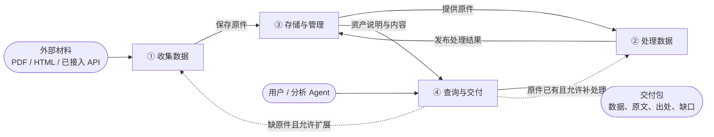

# Data Agent 核心设计

日期：2026-10-23 · 版本：v2.1（当前状态重写；第 11 节路线定稿待 review）· 上一版：v1.30，原文见[设计历史](DATA_AGENT_DESIGN_HISTORY_2026-10-23.zh-CN.md)

本文是 Uteki Data Agent 唯一的顶层设计，只写**当前有效**的职责、契约、架构、技术方案和路线。过程记录、分批验收明细、真实运行和费用都在设计历史里，本文只留结论和证据入口。

- 当前要做的那一个动作看 [TODO.md](../TODO.md)；协作规则看 [AGENTS.md](../AGENTS.md)。
- 接口字段以[接口契约](DATA_AGENT_API.zh-CN.md)为准，本文不重复字段定义。
- 本机命令、环境和复验步骤看 [LOCAL_DEVELOPMENT.md](LOCAL_DEVELOPMENT.md)。
- 其他文档里的“核心设计 14.x”等旧章节号，都指设计历史里的同号章节，不指本文。

**状态用语。** 本文用四种状态描述能力，不混用：

| 状态 | 含义 |
|---|---|
| 已实现·已业务验收 | 有代码，并在写明的真实案例上通过了对照原件的业务核对；只对写明的范围成立 |
| 已实现·工程验证 | 有代码，确定性测试或合成链路通过；还没有真实业务验收 |
| 已确认设计 | 用户已确认的设计，还没实现或只实现了一部分 |
| 待决 | 需要用户取舍，或需要证据才能决定 |

## 1. 目标与范围

**目标。** 让用户和分析 Agent 通过同一套 Data 能力，拿到足够、聚焦、可追溯的数据。每个数字和每句原文都能回到冻结原件的具体位置；数据缺了有补充路径，数据错了能定位到来源、处理、查询或分析的哪一层。

**首期范围（已确认）：**

| 维度 | 范围 | 不在首期 |
|---|---|---|
| 市场 | 美股为主；一家公司可对应多只证券（如 GOOG/GOOGL） | 跨市场换算、存托凭证比例 |
| 来源 | 官方来源：SEC EDGAR 申报、SEC XBRL 接口、公司官网、调用方显式提供且可核验的官方原件 | 第三方研报、商业数据 API（以后按需接入） |
| 格式 | PDF（含扫描页和内嵌图片）、HTML/iXBRL、明确接入的 API 数据 | PPT/PPTX、独立图片、任意 CSV/Markdown 导入、音频 |
| 运行形态 | 单机、单用户、Python 进程内库；外部宿主经 MCP | HTTP 服务、多租户、分布式 |
| 缓存 | 复用原件、处理结果、索引和已有证据包 | 语义答案缓存（向量相似问题直接返回旧答案） |

**业务完成的定义。** 在上述范围内，用户或分析 Agent 提出数据需求后，Data Agent 能建设并维护可复用的资产，自主查找、阅读、提取、计算、补缺口，交付可核对的数据和明确的限制。“六个工具能调用”“SDK 接通”“某一条财务链路成功”都不等于完成。完整的业务验收案例见第 9 节。

## 2. 职责边界

| 角色 | 负责 | 交付 |
|---|---|---|
| 分析 Agent | 拆解研究问题、提出证据需求；解读研报、比较公司与观点；形成解释、假设和结论 | 带引用的分析、比较结果、补数请求 |
| Data Agent | 发现和获取数据、组织处理、生成和维护资产说明、选择查询方式、判断材料是否满足需求、补查与交付 | 数据、原文片段、必要上下文、精确出处、覆盖说明与缺口 |
| 程序执行层（属于 Data Agent） | 下载、解析、检索与查询执行、计算、版本保存、边界校验、预算与调度 | 可复核的工具结果和运行记录 |
| Codex | 实现与测试系统，独立对照原件验收 | 工程修复和验收判断；不替运行中的 Agent 选材料或填答案 |

Data Agent 可以做口径明确的计算、格式整理和来源表述抽取；投资解释和结论归分析 Agent。管理层说法要保留说话者，不能变成已证实的因果。

**模型判断与程序执行的分工：**

| 由模型判断 | 由程序保证 |
|---|---|
| 把问题拆成数据需求；选候选材料；选目录、全文、概念或记录哪条路径；决定读多少上下文；识别冲突；判断是否足够、下一步做什么 | 身份、版本、引用合法；来源和权限范围；数值计算；发布完整性；预算、取消和停止；工具实际输出的登记 |

程序检查能证明格式和引用合法，证明不了语义正确或没有遗漏；后者靠独立业务验收（第 9 节）。

**分析侧两个方向（已确认方向，未设计实现）：**
- 研报解读：清晰易读、区分观点归属、可追问、每个观点能回到原文。
- 持仓风险：按行业、公司、宏观三层说明风险如何影响具体持仓。是否设独立风险 Agent、持仓输入和提醒规则仍待设计；不做自动交易。

## 3. 功能与系统架构

**四类一级功能（已确认）：** ① 收集数据 → ③ 存储与管理 → ② 处理数据 → ③；④ 查询与交付消费 ③。缺原件时 ④ 触发 ①，原件已有但不可用时 ④ 触发 ②。更新时效、质量冲突、追溯纠错是各功能的补充要求，不是独立功能。



系统关系图与组件图见 [draw.io 源文件](design/diagrams/data-agent-architecture.drawio)（[系统关系](design/diagrams/data-agent-system-context.drawio.svg)、[组件架构](design/diagrams/data-agent-components.drawio.svg)）。

**架构决定（已确认，原 A1–A9）：**

1. **一条建设管线。** 预先准备数据和查询中补缺口走同一条“发现 → 获取 → 冻结 → 解析 → 标注 → 校验 → 派生 → 说明 → 发布”管线。模型只在需要理解的阶段受限参与，费用记到发起任务。
2. **权威层与派生层分开。** 原件、处理产物（本地文件）和元数据（SQLite）是权威层，不可由其他层重建；全文索引和 DuckDB 记录视图是派生层，按 build 引用为键，可删可重建。主数据只在 SQLite 维护。
3. **唯一可见性开关。** SQLite 里 build 的 `published` 状态决定查询能否看见；派生层失败只让对应能力降级，不影响原件和其他能力。
4. **检索分两级。** 资产级发现走 SQLite 过滤加标题/名称文本匹配；资产内检索是统一接口（目录/全文/概念），外部检索后端只能替换这一层，命中必须能映射回本系统的块和原文位置才算证据。
5. **单进程库加 MCP。** 分析 Agent 和用户页面进程内调用；外部宿主经 MCP；不建 HTTP 服务。
6. **规则与配置版本化。** 来源策略、材料 profile、概念表、模型 profile 都是显式选择、带版本的输入，由 build manifest 和运行记录引用；不能由公司名触发隐藏特例。
7. **运行记录与交付是内容。** 运行记录和冻结交付包写入本地文件，SQLite 只登记引用和状态；同一任务的费用记在同一账本。
8. **模块 ID 对应关系。** DA-01 = 发现、获取、原件快照；DA-02 = 解析、标注、校验、派生；DA-03 = 目录、检索、结构化查询与交付。元数据目录和发布协议是三者共用的基础。

## 4. 数据模型

### 4.1 资产、原件版本与处理版本

一篇 PDF/HTML 材料是一个**资产**；API 数据以显式声明的资源范围作为一个 dataset 资产，不把每页响应当成独立资产。版本分三层，查询结果同时绑定选用的原件版本和处理版本，新版本发布不改变旧引用。

| 层次 | 引用 | 回答的问题 |
|---|---|---|
| 资产 | `asset_id` | 是哪份逻辑材料或哪项数据资源 |
| 原件快照 / 表现形式 | `snapshot_id` / `representation_id` | 冻结了哪次原始内容；PDF、HTML、API 哪种形式 |
| 处理版本 | `build_id` | 基于哪个原件、用什么处理器和配置生成的结果 |

完整引用 `AssetRef = {asset_id, snapshot_id, representation_id, build_id}`；块、表格、记录的 ID 只在 build 内唯一，全局引用总是“AssetRef + 内部 ID”。

| 变化 | 处理 |
|---|---|
| 下一年度的新报告，或无法证明是同一份材料 | 新资产；标题相似或字节 hash 相同都不足以合并身份 |
| 同一报告发布修订版（同一来源替换文件） | 同一资产，新增快照，记录修订依据；旧快照保留 |
| SEC 修订申报（如 10-K/A） | 独立资产，用 `amends` 关系指向原资产；修订申报可能只含部分内容 |
| 同份材料有 PDF 和 HTML | 核对身份后可归同一资产，各自保留原件和定位，不认定逐块等价 |
| API 在声明范围内补页或返回更新数据 | 同一资产，新增快照；补页齐全不证明各页来自同一来源版本 |
| API 换资源、换口径或超出声明范围 | 新资产，记录关系 |
| 原件不变，只改解析器、OCR 或规则 | 新 build；不同 build 的块 ID 不保证一致 |

**build 身份。** `build_key` 是对规范化的 `asset_id / snapshot_id / representation_id / input_manifest_sha256 / processor_version / config_sha256 / profile_ref / taxonomy_ref` 取 hash。输入清单含主对象和全部附属资源（例如 HTML 图片）及缺失原因，所以主文件不变、图片变了也能识别。同 key 的 published 直接复用；failed 只有显式重试才新建，失败历史保留。

### 4.2 公司、证券与关联

- 公司身份（`co_`）与证券映射（`sec_`，交易所 MIC + 代码 + 有效期）分开维护；多股类是同一公司的多条证券映射。名称或代码不能单独确认公司，首期以 SEC CIK 为身份依据，没有依据只能 pending。
- 资产与公司的关联带角色（发行主体 / 研究对象 / 提及）、依据和适用快照；发布方记在来源上，不当成研究对象。
- 行业、竞争关系、摘要等派生信息：值和依据一起保存（来源、原件版本、精确位置、生成方式、核对状态）。同一字段可以有多条候选或冲突，不按时间先后静默覆盖；修订追加，不改旧值。
- 竞争关系是有向陈述（“A 在某材料中称 B 为竞争对手”），保留业务范围、地区、时间、说话者；同业不等于竞争，供应商、客户、竞争分开表达。
- 业务字段分阶段必填：登记时只要求身份；业务属性可以缺，但要区分“未知 / 未处理 / 不适用 / 冲突”，不能把“未处理”说成“未披露”。

表结构以 [0001_catalog.sql](../src/uteki/data_platform/catalog/migrations/0001_catalog.sql) 为准（公司、证券、别名、行业、竞争、资产、资产关联、来源、获取记录、快照、表现形式、build、派生索引、修订、修订依据、运行等）。

### 4.3 时间与期间

- **业务时间 `TemporalValue`**：值加精度（datetime 必带时区 / date / month），未知为 null 并说明原因。比较时按保守区间：区间跨过截止日就是 unresolved，不算满足。
- **报告期间 `FiscalPeriod`**：标签、财年、季度、起止日期和依据；不把 FY 默认换算成自然年，52/53 周不年化。
- 下列时间各自独立，不能互相替代：报告所属期间、内容覆盖期间、发布时间、来源修订时间、历史可得时间、获取时间、处理时间、关系适用期间、记录核对时间。尤其**下载时间不能冒充发布时间或历史可得时间**。

### 4.4 证据地址与结果引用

**Locator** 是类型化对象，每种都必须能由 `read_evidence` 读回，并绑定外层 AssetRef：

| 类型 | 主要字段 |
|---|---|
| `html_node` | 块 ID、冻结快照上的 DOM 路径、文本区间；区分可见文本与原始节点文本两种投影 |
| `pdf_region` | 块 ID、物理页（1 起）、印刷页码（可空）、bbox（PDF 点，左上原点）、字符区间（可空） |
| `table_cell` | 表格 ID、行列（0 起）、跨度，及其底层 html/pdf 位置 |
| `image_region` | 图片 ID、像素区域 |
| `record_field` | 记录 ID、字段、API 分片、JSON pointer；iXBRL 记录另附原文节点 |

位置未知（如字符区间为空）时如实返回，不制造精确位置。文档库后端的块/目录/passage 引用另见第 4.6 节。

**ResultRef** = `{run_id, operation_id, kind: evidence | record | calculation, item_id}`，由宿主为**实际展示给模型**的工具结果分配；模型侧使用短句柄 `rr_…`。计算带 `operand_refs`，证据带 `dependency_refs`（表头、单位、脚注等）。只有命中位置或摘要、程序侧未展示的内容都不能被交付引用。

### 4.5 存储布局与发布协议

`data_root` 由配置显式给出，代码不设默认路径；运行数据不放进 `src/`、示例或测试夹具。

```text
<data_root>/
  catalog.sqlite              元数据目录（HTML/iXBRL 后端）
  catalog-head.json           目录 revision 与提交 token
  documents.sqlite            文档库查询投影（PDF 后端，第 4.6 节）
  objects/sha256/…            原始字节与冻结对象，内容寻址、只写一次
  assets/<asset_id>/
    snapshots/<snapshot_id>/  冻结快照清单
    builds/<build_id>/        manifest、sections/blocks/tables/records/images、quality、asset-schema
  derived/<build_id>/<gen>/   FTS5 与 DuckDB 派生索引（可重建）
  staging/<job_id>/           未发布工作区
  runs/<run_id>/              运行控制记录（指向不可变对象）
```

**写入与发布（已实现·工程验证）：**

- 原始对象：同目录临时文件写完并 fsync → 硬链接无覆盖创建 → 同步目录；同 hash 已存在时完整校验后复用。
- 快照：所有表现形式写入并校验后，一个事务把 `collecting` 置为 `frozen`；冻结后不能追加内容。
- build：staging 生成并校验引用闭包 → 构建派生层 → 生成最终说明（区分 `content_readiness` 与 `published_readiness`）→ 复验后整体移动 → 一个 `BEGIN IMMEDIATE` 事务置为 published。中途失败不会出现“说明宣称 ready、内容却缺”的版本。
- 目录：WAL、外键、`synchronous=FULL`；迁移文件带 hash，不一致拒绝打开。一个 Catalog 持有排他 flock，第二个实例打开返回 `CATALOG_BUSY`。恢复入口显式调用，只补完能证明的提交，不自动重跑或删除孤儿 staging。
- **实时能力**：资产说明里的冻结能力与当前派生索引状态合成实际可用能力；索引缺失或损坏只让依赖它的能力变为 not_ready，原文读取不受影响。
- **版本呈现**：系统没有隐式默认版本。`find_assets` 对每个（资产、快照、表现形式）返回最新 published build 并给出其他 build 计数；查询过程中固定 AssetRef。

适用边界：本地 POSIX 文件系统；网络文件系统、真实断电、恶意并发替换路径未验证。

### 4.6 文档库后端（PDF）

PDF 解析结果另有一个查询存储 `documents.sqlite`（`contracts/documents.py`、`documents/`），与 HTML/iXBRL 的 catalog 后端并存：

- 对象：材料（Material）→ 原件版本（SourceVersion）→ 解析版本（ParseVersion）→ 内容块（文本 / 表格 / 图片，含位置、阅读顺序、OCR 与描述来源）、目录节点（原生书签，保留父子、重复标题和页内纵坐标）、passages（按目录组织的连续正文）、标签。
- 解析包是冻结的恢复输入，存为不可变对象；SQLite 是一次事务生成的查询投影，可由冻结包显式 reindex 重建，不重新解析原文。同 parse_id 同包幂等，冲突拒绝。
- 查询：材料筛选 → 指定版本 schema → 目录路径/子树、标签、类型、关键词组合 → 块与明确上下文 → 原件读回。只读查询不会初始化库、重新解析或调用模型。
- 解析器：Docling 2.139.0（本地布局模型、TableFormer 表格、RapidOCR），权重预下载、转换时禁止联网；文字层优先，OCR 可强制。

两个后端由请求上下文选择（`context.request.documents` 是否存在），共用同一个 DataService、六个工具、证据登记和交付。**协议规则（证券过滤、发现后才能读、交付规则、增量状态）在共同层实现，两个后端行为一致**；后端只投影自身能力（例如 PDF 交付由代码生成分页覆盖说明）。

## 5. 材料建设管线

| 阶段 | 执行方 | 输出 | 失败或不足时 |
|---|---|---|---|
| discover | connector 规则；官网候选可受限调用模型 | 候选来源记录 | 无候选记为缺口 |
| acquire | 程序 | 原始对象、获取记录 | `failed` 或 `denied_by_policy`，保留错误页 |
| freeze | 程序 | 资产身份、冻结快照 | 身份不确定就 pending，不合并 |
| parse / outline | 程序 | 块、表格、图片、记录、原始目录 | 局部失败记入 quality，能力降级；推断章节标 inferred |
| annotate | 规则和 XBRL 标签优先，模型受限补充 | 规范章节映射、概念标注 | 不匹配保留 unclassified |
| validate | 程序 | 格式与引用闭包检查 | 不合格产物不进入可用能力 |
| derive / describe / publish | 程序 | 派生索引、资产说明、已发布 build | 见第 4.5 节 |

**抓取策略。** 每次请求（含重定向目标、页面附件链接）发出前按版本化的允许/禁止清单重新检查，禁止优先；有下载数、字节、时长上限，默认不自动重试。SEC 请求复用 `prepare_sources` 和 `resolve_sec_contact`，从私密配置读取联系信息并声明 User-Agent；不用临时下载脚本或通用 UA 绕过（2026-10-14 的 403 即由此引起）。

**各格式：**

- **HTML（已实现·已业务验收，限两份年报）**：lxml 解析冻结字节，不执行脚本、不取在线 DOM；排除隐藏和导航内容并逐项记录；表格保留全部单元格、跨度、表头和脚注链接；章节来自实际标题和目录锚点。
- **iXBRL（已实现·工程验证）**：枚举全部 `ix:nonFraction`，保留 QName、context、unit、精确期间、维度、scale/sign，用 Decimal 计算；只支持已核对的转换登记表，其他逐条标 unsupported；nil 不变成 0，重复事实不合并。
- **PDF（已实现·工程验证，部分业务验收）**：见第 4.6 节。目录目前来自原生书签；正文小标题层级、跨页表格合并、图片语义描述、正式标签词表尚未完成。
- **API / SEC companyfacts（已确认设计，未实现）**：作为每家公司一个 dataset 资产，事实保留 accession、form、filed；与申报内 iXBRL 记录不一致时并列返回。
- **图片**：登记区域和图题；需要理解时按需处理，模型描述作为派生产物，不冒充原件事实。

**标注。** 材料 profile 按类型版本化（如 `sec_10k`），定义规范章节类别和匹配规则；概念表以 US-GAAP 为锚，先覆盖收入、利润、现金流、资本开支、分部等小集合。正式概念表和词表尚未冻结（待决 §12）。

## 6. 查询与交付

### 6.1 主流程

**理解问题 → 查找资产 → 读取资产说明 → 定位与读取 → 判断 → 交付。** 这是 ReAct 的主路径，不是只走一次的流水线：证据不够就继续查，资产不合适就换资产，缺资产就按第 6.5 节补，最后一次整体充分性检查后交付。

- 用户和分析 Agent 用**同一套请求和结果包**，取材、补查和交付标准一致；是否允许扩展由请求策略决定，与调用方是谁无关。
- 请求上下文固定：问题、主体（含调用方要求的证券）、期间/截止日、来源与扩展策略、资源上限。相对时间绑定请求时钟；影响取数的关键歧义先澄清，不替用户默认选口径。
- 渐进加载：候选摘要 → 资产说明 → 相关目录/索引 → 正文，不一次把所有资产塞进上下文。
- 定位和读取是两个逻辑动作，但不固定为两次调用：搜索已返回足够的原文和上下文就直接判断，只有位置或残缺片段时再读。

### 6.2 工具契约

六个业务工具加两个控制工具，字段以[接口契约](DATA_AGENT_API.zh-CN.md)为准：

| 工具 | 作用 |
|---|---|
| `find_assets` | 按主体、材料类型、期间、截止日等硬条件和文本筛选候选资产；**调用方要求了证券时必须显式按证券过滤**；不触发获取或解析 |
| `get_asset_schema` | 返回资产说明：标题、版本、来源、类型、关联公司、时间、内容覆盖、可用能力与缺口、目录或字段概览 |
| `search_asset` | 资产内定位：`outline`（目录子树）/ `text`（短语、全词、任一词、有界 RE2 正则）/ `concept`（已标注概念）；返回命中、依据和继续入口 |
| `read_evidence` | 按精确目标读原文，附表头、单位、脚注等依赖；超限显式分段 |
| `query_records` | 类型化筛选结构化记录，并做确定性计算（差额、比率、增长、有界求和） |
| `request_asset_update` | 内部补获取或补处理，继承原策略和预算，不对外部宿主开放 |
| `deliver` / `clarify` | 终止：提交交付，或返回需要澄清的问题 |

**共同约定：**

- 读取的资产必须来自本次运行中某次 `find_assets` 实际返回的结果（违反返回 `ASSET_DISCOVERY_REQUIRED`）；缺证券过滤返回 `SECURITY_FILTER_REQUIRED`。
- 返回信封统一含版本、`ok/partial/error`、条目、游标、截断标记、覆盖与问题、实际资源用量。空列表不是错误，也不是“不存在”的证明。
- 游标绑定上下文、工具、全部业务参数和目录视图或索引代次；视图变了返回 `CURSOR_EXPIRED`，改参数返回 `CURSOR_MISMATCH`。
- 条件分三类，不能混用：**硬边界**（主体、来源、截止日、版本，不能放宽，未知不冒充满足）、**内容匹配**（概念、期间、单位；元数据未知的候选单列 unresolved，不在后台丢弃）、**排序偏好**（只影响顺序）。
- 计算：Decimal 精度 50、`ROUND_HALF_EVEN`；单位必须一致，零分母返回 null 和限制；增长率要求同概念、主体、单位、维度，期间差异须显式声明依据。不换汇、不年化、不替用户选重述口径。
- 单位与币种（文档后端登记记录时）：记录的单位必须有原文明确的代码或完整名称支撑，不从 `$` 这类含糊符号推断币种（`UNIT_EVIDENCE_REQUIRED`）。iXBRL 记录的单位来自原件中的 unit 定义。
- 文档后端的记录查询省略输出预算时用 200,000 字节硬上限，超限报告所需字节；显式的小预算不放宽，记录和依赖不截断。其他读取和搜索的默认页预算为 24,000 字节。

### 6.3 任务状态与停止

- **需求计划**：首次业务调用登记非空需求；已有需求的描述和必需性不能改、不能删，只能新增。
- **增量状态（当前协议）**：模型每次只提交 `reason`、新增需求 `add_needs`，以及有变化的 `satisfied` / `gaps`；宿主维护完整状态、计划版本和 `next_action`。省略的需求沿用原状态，新需求一律未核验。重复、未知需求或引用未观察的结果会被拒绝，错误返回里附当前已提交状态，防止模型把被拒的更新当成已生效。
- **停止**：最大轮数、费用上限、连续无新增有效信息的轮数、墙钟、调用方取消。阈值由请求的运行策略显式给出，共享代码不设隐藏默认值。触发后宿主用最近已校验的状态强制组装部分交付，不再调用模型。**新返回的元数据（新目录页、新概念）算进展；重复读取同一内容、换一个 ID 不算。**
- **澄清**：返回 `needs_clarification`；调用方用 `revises_context_ref` 加回答建新上下文继续。根账本、计划历史、轮数、无进展计数沿用，人工等待不计执行时间；旧结果须在新运行中重新读取才能交付。

### 6.4 交付

- `deliver` 对每个计划需求恰好给出一次判断（supported / partial / unresolved）、`result_refs`、缺口、冲突和限制。宿主从登记结果递归复制原文、数值、公式及依赖，拒绝悬空、循环、跨运行、未展示或伪造的引用。
- **不接受自由文字 note**。需要说明原文含义时用 `source_claims`：每条陈述附 `{result_ref, quote}`，quote 必须逐字出现在已观察的原文里。代码只验证摘录存在，不认证解释的语义正确。
- 限制（limitations）只写缺口和来源限制；分页覆盖范围等由代码生成。
- 交付对象不可修改；JSON 是主对象，Markdown、记录 CSV、计算 CSV 都从同一对象确定性导出，带 hash 清单。
- 交付包含 `business_sufficiency_evaluated=false`：程序闭包通过不代表业务上充分。

### 6.5 缺口、扩展与补数

两种业务方式（已确认）：**禁止扩展**（只用指定范围，记缺口不联网）和**受控自主扩展**（白名单内获取，黑名单优先；页面链接、重定向、附件都不自动继承授权）。两种方式都不能编造，取不到就返回明确缺口。

| 诊断 | 动作 | 交付时的说法 |
|---|---|---|
| 已有数据，本次没命中 | 换定位方式、补上下文 | 本次未命中，不推断未披露 |
| 原件已有，未处理或处理失败 | `request_asset_update(process)`，发布后重新读说明 | 原件存在，尚不可直接用 |
| 本地没有，来源可能有 | 允许扩展时 `request_asset_update(acquire)`；否则记缺口 | 补到了什么，或具体失败原因 |
| 来源冲突 | 核对主体、期间、口径、修订关系，并列保留 | 未解冲突与可支持的有限结论 |
| 无权限、访问受阻、能力不支持 | 记录诊断，尝试已允许的替代来源 | 阻塞或不支持，不是材料不存在 |

补来的数据走同一条建设管线、同等校验；下载成功不等于需求满足。补数费用计入原任务账本，新材料不改变原问题、期间或截止日。

### 6.6 校验、复用、时效与纠错

- **校验分两层（已确认）**：工程层按材料类型校验格式和引用；Data Agent 在 ReAct 中聚合判断完整性、重复、冲突和口径。不设独立审核模型。格式通过不证明事实正确。
- **复用**：工程层判断能否复用（版本、权限、范围），Data Agent 判断是否足够；已有证据包是可用材料，不因问题相似就自动成为答案。
- **时效（已确认）**：指定版本固定使用该版本。“最新”请求先检查获准的官方来源；检查失败但有满足硬边界的旧材料时，可以返回旧版本，必须展示材料日期和“未确认最新”，并把时效列为缺口。
- **错误定位**：按“来源 vs 真实披露 → 原件 vs 处理结果 → 索引 vs 查询条件 → 查询结果 vs 交付 → 交付 vs 分析结论”逐层对照，不凭错误消息直接定根因。
- **修复边界（已确认）**：Data Agent 可在现有工具和授权内修订查询、换材料、补处理；不能修改工具代码、校验规则或补造数据。工程缺陷保留复现、标记受影响结果，交开发修复后用原输入重放。纠错生成新 build 或修订，不改写原件和历史交付。

## 7. Agent 运行时

### 7.1 双 SDK 架构

两套官方 SDK 各自承担完整的 Agent 循环，共用同一个业务核心；不自建通用 Agent 框架，不复制 SDK 已有的机制。

| 层 | 共用 | 各自负责 |
|---|---|---|
| 业务核心 | DataService、六工具业务函数与契约、ResultRef、交付规则、根账本 | — |
| 工具注册 | 由 `ToolBinding` 统一校验、串行执行、登记可见结果、投影模型 schema | OpenAI：`FunctionTool`；Claude：进程内 MCP 工具 |
| Agent 循环 | 同一任务与交付契约、预算与取消 | OpenAI：`Agent` + `Runner`；Claude：`ClaudeSDKClient` + Claude Code 子进程 |
| 会话与恢复 | run/root/context 到原生 session 的映射 | 各自的 session 和恢复；跨内核不翻译原生会话，新建运行并重新读证据 |
| Skills | 业务指导正文 | 各用原生加载机制（OpenAI 能力列表 + 只读命令；Claude 项目 Skills） |
| 观测 | 业务事件口径、证据审计 | 原生 hooks/trace/usage 保留原始含义 |

`ToolBinding`（`agent/binding.py`）是 SDK 边界：只承认在 SDK 实际输入中出现过的结果；向模型投影增量状态和 `rr_` 短句柄；交付状态由宿主从 deliver 声明派生；SDK 按发布的 inputSchema 做 jsonschema 校验，因此 schema 只暴露可达定义。

### 7.2 模型接入与配置

- **配置身份 = 模型 ID × SDK × 角色**：`config/data_platform/model-profiles/<kernel>/<model_key>/<role>.json` 记录精确模型 ID、SDK 版本、路由（provider、协议、上游、禁止 fallback）、推理参数、输出上限、prompt 路径/版本/hash 和 Skills。缺 profile 就拒绝装配，不静默回落到别的模型。
- **不同模型独立维护 system prompt**（已确认）：业务规则共用，最终正文按模型分别维护、调优和冻结；只改模型名不能沿用旧验证结论。
- **网关**（`agent/providers/`）：两套 SDK 的原生 HTTP 都经同一个计量网关（`gateway_http.py`）；记录原始请求与响应字节、generation 身份和账单证据，冻结 provider 路由参数，拒绝超出冻结约束的请求。
- **当前路由（已确认）**：DeepSeek 走官网直连（OpenAI 兼容入口和 `/anthropic` 入口）；GPT、Sonnet 走 OpenRouter（固定供应商、禁 fallback）。不使用 MiniMax。
- **按任务选模型（已确认原则，未产品化）**：简单提取用性价比模型，开放拆解、口径冲突、充分性判断可用强模型；升级是显式记录的决策，不能用错误 fallback 代替。目前只在实验中由宿主按冻结条件启动新会话，产品内自动切换未实现。
- **可选能力**：供应商不支持的托管工具、强制结构化输出、缓存控制或部分推理参数可以显式跳过并记录；function call、tool result、可校验交付是核心能力，不能跳过。

### 7.3 计费、预算与恢复

- **唯一账本**：`RunBudget`（`application/run_budget.py`，2026-10-23 从旧 `infrastructure/` 迁入）以根运行为单位做事务化的预留、结算和未知费用记录。补数、澄清、重试都记到同一根账本，不拆账本绕过限制。
- **调用前预留**：每次物理请求先按保守上限预留；拿到可核对的账单才结算。没有 generation 身份或账单时保留全额未知预留，**不记为零**；存在未知费用时新的付费调用先对账。
- **恢复**：请求已发出、结果未知时，原运行进入 `recovery_required`，不重发请求、不重置预算。响应已落盘但身份或账单无法核实，两套 SDK 都归为 `RECOVERY_REQUIRED`。工具操作有持久幂等键，已接受但无持久响应的操作不盲目重放。
- **执行时钟**：执行段和恢复段分开计时（`execution_clock.py`、`recovery_clock.py`），恢复宿主不冒记原 worker 的时间。
- **扩额**：只能通过显式授权记录修订原账本的金额或次数，旧请求、预留、停止状态和规范序列化不变。
- 当前根账本：上限 $40 / 787 次，详细余额以账本只读快照为准（`examples/data_platform/live_function.py inspect`）。

### 7.4 隔离与权限

- 运行中的模型只能看到正常业务输入、获准的材料范围和工具；验收答案、gold、预选语义块不得进入 prompt、Skill、Memory 或可读文件范围。仅靠 prompt 写“不要看答案”不算隔离。
- Claude 运行目录位于仓库之外的私有目录；入口拒绝祖先目录的 AGENTS.md / CLAUDE.md / 项目 settings，使用私有 `CLAUDE_CONFIG_DIR`，只加载项目 Skill。
- Skill 读取是只读的受限命令；加载 Skill 不增加任何业务权限。权限、来源、预算由程序检查，不靠 prompt。

## 8. 代码组织

新 Data 核心在 `src/uteki/data_platform/`，不依赖旧 `research_data` / `data_query` 的业务编排。依赖方向：contracts 被所有模块引用；catalog/content 不导入 Agent SDK；connectors/build/retrieval/structured/documents 提供数据能力；application 编排业务工具、不导入任何 SDK；agent 只装配 application 的工具和原生能力；DataService 是统一入口。

```text
src/uteki/data_platform/
  contracts/      pydantic v2（extra=forbid）契约：common、content、assets、evidence、query、run、documents、document_query
  catalog/        SQLite 目录：database（迁移、锁、head）、repository（登记、修订、运行身份）、migrations/0001_catalog.sql
  content/        对象存储 store、发布 publication、恢复 recovery
  connectors/     company_acquisition（prepare_sources：SEC/官网受限获取与冻结）、official_discovery、filing_integrity、
                  sec_settings（resolve_sec_contact）、company_registry、official（HTML 获取适配）、updates、recovery
  build/          dom、html、sec_index / sec / document_models（HTML 解析算法与块模型）、xbrl、pipeline、validate
  documents/      PDF 文档库：pdf（Docling 适配）、store、schema、query、directory、passages、CLI 入口
  retrieval/      assets（资产发现）、index（FTS5/DuckDB 派生索引）、content（HTML 读回）、cursors
  structured/     records、calculations（Decimal）、document_records
  application/    tools / document_tools（六工具两个后端）、evidence、reading、delivery / delivery_checks、exports、run_budget（根账本）、
                  clarification、session、runtime（RuntimeJournal）、run_completion、operation_recovery、
                  execution_clock / recovery_clock、gateway_batch / gateway_extension / gateway_supervisor、
                  limits、update_resolution、runtime_initialization
  agent/          binding（ToolBinding）、document_contracts、openai_runtime / openai_state、
                  claude_runtime / claude_state、profiles、skills / skill_runtime、metering、
                  providers/（gateway_http、gateway_openai、gateway_claude、claude_transport、
                             openrouter*、deepseek_evidence、live_policy）
  service.py      DataService：create_context、六工具、deliver/clarify、运行检查与收尾
  cli.py          uteki-data 命令行（acquire）
config/data_platform/  model-profiles、prompts、skills（document-data-query、financial-data-query）、gateway-contract
tests/{unit,integration}/data_platform[_agent]/、tests/fixtures/data_platform/  新核心测试与合成夹具
examples/data_platform/、scripts/data_agent/      可复制入口与验收脚本
```

**入口：**

| 入口 | 状态 |
|---|---|
| Python `DataService` + `openai_runtime.run_gateway / claude_runtime.run_gateway` | 已实现；真实运行经 `examples/data_platform/live_function.py` |
| 文档库 CLI `python -m uteki.data_platform.documents` | 已实现 |
| `uteki-data acquire` | 已实现（`data_platform/cli.py`），参数与原 `agent acquire` 相同；旧 CLI 已在 S4 归档 |
| MCP | 当前没有：旧 v1（`interfaces/data_mcp`）已在 S4 归档，v2 未实现（路线阶段 B） |
| `DataService.run_query` | 未实现；当前由调用方直接调用 runtime |

**旧代码依赖：** 2026-10-23（S3）起 `data_platform` 不再导入 `uteki.infrastructure`、`uteki.agents`、`uteki.domain`（含函数内的延迟导入，AST 扫描为零）。账本、SEC 取数、官网发现和 HTML 解析算法（`sec_index` 及其块模型）已迁入。S4 归档旧代码时，旧路径的兼容别名一并删除；`src/uteki/` 下现在只有 `data_platform`。

## 9. 验收方法

### 9.1 分层与判定

- 分开报告：**接线/存储测试**、**真实运行**、**业务验收**（对照原件），三者不能互相替代。Mock 和合成响应只验证接线，不算功能验收。
- 每个阶段只用三种结论：**通过**（冻结范围内必需产物和验收都有证据）、**有条件通过**（剩余项不影响下一步，写明可做与不可做）、**不通过**（回到根因责任层修正，重放原失败）。不能换样本、放宽标准或反复重跑直到成功一次。
- **硬门槛，不用平均分抵消**：事实或引用错配、越权读写、原件或历史被破坏、未读材料冒充证据、未知费用记零、恢复导致预算重置、无效结果伪装成功。
- 质量指标（召回、充分性、时延、费用）在看到结果前冻结分母、阈值和重复数。
- 测试环境：agent 相关测试必须在装了 `agent` extra 的**非 editable 安装**环境里跑（见 LOCAL_DEVELOPMENT）；`test_content_processes` 要求没有 agent SDK 的环境。

### 9.2 业务验收案例（v0.1 建议稿，阈值未冻结）

十四组案例家族，每组都有正例和必须拒绝的反例；正式运行用独立核对的官方原件替换虚构材料，答案只在验收侧。

| 编号 | 检验什么 |
|---|---|
| BC01 | 从空目录为一家公司准备两年材料；身份核验、不重复建设 |
| BC02 | 公司做什么、产品属于谁；区分同名产品和未来计划 |
| BC03 | 收入涨、利润降：两项数值、代码计算和对应期间的披露说明都要交付 |
| BC04 | 问题有歧义时一次聚焦澄清，明确问法不重复澄清 |
| BC05 | 缺基期材料：允许时补到并计算，禁止时不联网并说明 |
| BC06 | 扫描页、跨页表、图中明确标签可见；无精确标签时诚实留缺口 |
| BC07 | API 空值、重复、覆盖不全：null 不当 0，不重复累计 |
| BC08 | 同数多出处不重复计数，口径相近的数不混用 |
| BC09 | 最新检查失败、指定旧版、历史截止日三种分支 |
| BC10 | 重述与冲突：说明采用哪个口径，无依据时并列冲突 |
| BC11 | 行业相同不等于竞争；竞争陈述保留说话者和范围 |
| BC12 | 纠错后新查询变正确，旧交付可追溯不被改写 |
| BC13 | 取消、恢复、复用与记忆：不重置预算、不重复副作用 |
| BC14 | 用户直接可读，分析 Agent 能接住结构化包并补数 |

建议初验规模：2 家开发公司加 1 家独立公司，每个必过案例独立运行 3 次。具体公司、阈值、重复数和总额度运行前冻结（待决 §12）。真实材料与候选事实的准备记录见设计历史 7.7–7.8。

## 10. 当前实现状态（2026-10-23）

| 能力 | 状态 | 证据入口（设计历史章节） |
|---|---|---|
| 原件对象存储与输入清单 | 已实现·工程验证 | 14.3.1、14.12.9 |
| 目录、快照冻结、发布与恢复 | 已实现·工程验证 | 14.5.1、14.12.10 |
| 官方 HTML/iXBRL 获取→解析→发布→读回 | 已实现·已业务验收（Apple FY2024 10-K、Microsoft FY2025 年报） | 14.6.1、14.12.11 |
| 六工具与可追溯交付（HTML 后端，确定性） | 已实现·工程验证 | 14.7.1、14.12.12、14.12.14 |
| 双 SDK 绑定、运行控制、恢复 | 已实现·工程验证（125 项 agent 集成测试，SDK 环境） | 14.12.15–14.12.16 |
| 计量网关与根账本、扩额 | 已实现；根账本累计 546 次真实请求（截至 2026-10-20） | 14.12.17–14.12.18、14.19–14.21 |
| PDF 文档库（Docling、原生书签目录、passages） | 已实现·工程验证 | 14.18、14.18.1–14.18.2 |
| 文档库接入 Agent：Apple 风险项、Apple 两年营收+代码增长率、Alphabet Google Cloud 说明 | 已实现·已业务验收（限这些题和 DeepSeek Flash/OpenAI SDK 等写明的路线） | 14.19–14.21.9 |
| 共享协议规则（证券过滤、发现后读、禁 note、增量状态）在两个后端一致 | 已实现·工程验证（未真实复验 HTML 路径） | TODO 2026-10-21/23 |
| 自主发现来源（从公司输入找到官方材料） | 未实现：当前真实链依赖调用方指定、已入库的材料 | 14.1.8 P5.1 |
| SEC companyfacts dataset、API 资产 | 未实现 | 14.6 |
| OCR 质量、跨页表合并、图片理解、正式词表与自动打标 | 未实现或仅工程接入 | 14.18.1–14.18.2 |
| MCP v2、`run_query`、CLI 统一入口、旧调用者迁移 | 未实现 | 14.10 |
| 检索后端 A/B（PageIndex、OpenAI File Search） | 未开展；File Search 需 OpenAI 官方 Responses 凭据 | 12.1、14.8 |
| BC01–BC14 完整业务验收 | 未开展；只覆盖了少数题 | 7.7–7.8 |
| 仓库瘦身 S1–S5 | 已完成（2026-10-23）：设计与开发文档改写为当前状态，历史文档、旧代码与实验材料按清单归档，新核心不再依赖旧代码 | `docs/REPOSITORY_RETENTION.zh-CN.md` |

## 11. 技术方案与路线

### 11.1 技术选型

| 领域 | 选定 | 状态与备注 |
|---|---|---|
| 语言与环境 | Python 3.13（≥3.11），uv 管理，根 `uv.lock`；setuptools，`src/` 布局 | 已定。主环境 `analysis` + `data`；agent 测试和真实运行用非 editable 的 `data` + `agent` 环境 |
| 契约 | pydantic v2，`extra=forbid`；工具 schema、MCP schema 由契约导出 | 已定 |
| 元数据 | SQLite（WAL、版本化迁移、排他锁） | 已定；单机单写者 |
| 结构化查询 | DuckDB 1.5.5（参数化查询，RE2 正则） | 已定 |
| 全文检索 | SQLite FTS5：unicode61+porter 与 trigram 两种分词，RRF 合并排序 | 已定为基线；外部后端在阶段 E 比较 |
| HTML | lxml，冻结字节解析 | 已定 |
| PDF | Docling 2.139.0（Heron 布局、TableFormer、RapidOCR），`pdf` extra | 功能接入已定；与 PyMuPDF 的比较在阶段 C 决定是否需要 |
| Agent SDK | OpenAI Agents SDK 0.24.0（openai 3.31.0）；Claude Agent SDK 0.2.167 / CLI 2.1.300 | 已定；升级先核对官方发布再同步锁和 profile |
| 模型 | DeepSeek V4.1 Flash/Pro（官网直连）；GPT-5.6 Luna/Terra/Sol、Claude Sonnet 5.5（OpenRouter） | Flash 为功能验证主力；生产模型在阶段 D 之后决定 |
| 计费 | 计量网关 + RunBudget 根账本 | 已定；DeepSeek 直连没有逐请求账单，见阶段 0 |

### 11.2 已知问题与技术债

| 问题 | 影响 | 处理位置 |
|---|---|---|
| SEC HTML 每次响应在 `</body>` 前注入一个随机路径的 `<script src>`（2026-10-23 重放发现，证据 `output/data-agent-acquire-replay-20261023/check.json`） | 同一份申报每次下载的整文件 SHA256 都不同；`reuse_verified` 复用、变化检测、快照和 build 身份会把未变化的申报当成新内容 | 阶段 0（需用户决定处理方式） |
| DeepSeek 直连拿不到逐请求账单；预留按“请求每字节 1 个 token + 16,384 token 余量 + 满额输出上限”计算，响应后整笔保留（`retain_usage_estimate`，状态 `bounded`） | 预留是实际用量的数倍且从不释放：根账本 $40 中 $25.06 是未核账预留，实际已报告收费只有 $6.15；后续任何批次都会先被预留卡住 | 阶段 0.2 |
| 预算与网关的外围机制偏重：批次 / 业务根 / scope / 会话尝试四层授权与扩额，跨进程墙钟核验，多阶段初始化认领；新核心约 2 万行中这部分连同核心账本约 4,800 行，相关测试约 7,000 行 | 维护与阅读负担大；四项历史偶发事件中有两项出在计时与初始化观察 | 阶段 A2 |
| 两个后端（catalog/HTML 与 documents/PDF）在数据模型和读取上仍是两套 | 同一能力维护两次 | 协议规则已在共同层；是否合并在阶段 C 结束后评估，之前不动 |
| 没有 `run_query`、MCP v2、统一 CLI 和新核心的结果查看页（研究工作台、MCP v1 已在 S4 归档） | 只能通过示例脚本调用；分析 Agent 没有正式入口；结果只能用 Datasette 和导出文件查看 | 阶段 B |
| 自主发现来源未实现 | 真实验收依赖预先入库的材料 | 阶段 C |
| 工具 schema 与后端能力、返回体预算之间仍有摩擦（`CAPABILITY_UNSUPPORTED`、`OUTPUT_LIMIT` 在真实运行中反复出现） | 轮次和费用增加 | 每次真实运行后按根因收敛 |
| 四项历史偶发事件（收尾恢复、初始化观察归属、澄清 worker 超时、恢复时钟失败）没有原现场因果证明 | 可能复发 | 在受影响链路上保留诊断，有证据再修 |
| 只有单题单次真实运行，没有稳定性数据；“始终找不到证据 / 证据冲突”时的停止行为没验证 | 不能宣称泛化 | 阶段 D |

### 11.3 路线（2026-10-23 定稿，待用户 review）

**共同规则：**

- 阶段按 0 → A → A2 → B → C → D → E 顺序推进，每个阶段内一次只做一个小任务；完成后按第 9.1 节判定（通过 / 有条件通过 / 不通过），再核对下一阶段的前置条件。前端是独立轨道（11.3.8），可以和 B 之后的阶段并行。
- **授权**：凡是调用模型或访问外部来源的步骤，都要在执行前由用户批准具体的金额上限、请求次数上限和路线（模型 × SDK × 题目）；没写授权的步骤都是本地离线工作。授权只对写明的批次有效，不能挪用到其他批次，也不因换 manifest 或换会话而重置。
- **费用口径**：下文“预计实际花费”按历史会话的报告收费或 token 估算推算；“授权上限”含全额未核账预留，是停止线，不是预计支出。所有调用都记在根账本上（现在：$40 / 787 次，已用 546 次，剩余 $8.79，以 `inspect` 为准）。
- **每个阶段结束**都把结论写回本节和第 10 节，状态写进 TODO；不另建报告。

**参考数据（历史真实会话，单题单会话）：**

| 路线 | 物理请求 | 费用 | 来源 |
|---|---:|---|---|
| DeepSeek Flash / OpenAI SDK | 11–21 | token 估算约 $0.17；全额预留 $0.6–1.9（无账单） | 设计历史 14.20、14.21.8–14.21.9 |
| GPT-5.6 Luna / OpenAI SDK | 23 | 报告收费 $0.08 | 14.20 |
| GPT-5.6 Terra / OpenAI SDK | 17 | 报告收费 $0.50 | 14.20 |
| GPT-5.6 Sol / OpenAI SDK | 12 | 报告收费 $0.94 | 14.20 |
| DeepSeek Pro / OpenAI SDK | 21 | token 估算 $1.57；全额预留 $5.85 | 14.20 |

#### 11.3.1 阶段 0：前置修正（离线为主）

| 项 | 内容 | 验收 | 授权 | 费用 |
|---|---|---|---|---|
| 0.1 SEC 注入脚本 | 按用户选定方案处理：(a) 维持“完整原始字节为准”，只在文档中说明；或 (b) 原始字节照常保存，另外计算“剥离已识别注入标签后的内容 hash”，供复用、变化检测和 build 身份使用。剥离规则只认可与 2026-10-23 证据同形的单个尾部标签，其他差异仍按内容变化处理 | 用 2026-10-14 与 10-23 两份原件做回放：(b) 时两者判为同一内容、原始字节和原 hash 不变；构造一个正文改动 1 字节的反例，仍判为变化 | 用户选方案；实现与回放不需要网络 | 0 |
| 0.2 DeepSeek 预留与结算 | **预留**：输入 token 按 UTF-8 请求字节数除以一个系数估算，另加固定协议余量，输出仍按本次 `max_tokens`；系数与余量用根账本里已有 DeepSeek 请求的“请求字节数 / 报告输入 token”标定，取能覆盖全部历史请求（一次都不低估）的保守值。**结算**：响应完整、模型与冻结配置一致时，按报告 token × 冻结峰值单价结算为新状态 `estimated`（标明 `provider_billing_verified=false`），释放预留与估算之间的差额；响应不完整或结果未知时，仍按原规则全额保留并阻断后续调用。**校正**：每批结束后（或按月）用 DeepSeek 控制台账单核对估算总额：账单高于估算时补记差额，低于估算时保留估算、只记录差值，不回调。**历史请求**：已整笔保留的 DeepSeek 请求（`bounded`）按各自已保存的 `usage_estimate` 一次性转为 `estimated`，原记录与哈希不变、只追加转换记录 | 用历史请求回放标定：新系数下每次预留都 ≥ 报告用量；新运行的剩余额度 = 上限 − 已报告收费 − 估算结算 − 仍未知的预留；不完整/未知响应仍阻断；历史转换前后逐请求可追溯，转换总额与已保存估算一致；控制台账单校正有记录 | 用户批准三件事：① 改为按估算结算（2026-10-19 曾选择“维持全额预留”，见设计历史 14.19，本项需要重新授权）；② 历史 `bounded` 预留的一次性转换；③ 账单校正的方式与频率 | 0；预计释放约 $20 的虚占额度（以转换时按已保存估算计算的实际数为准） |
| 0.3 小修 | Swiss C 过时测试 `institution-view.test.mjs:149` 同步 10-21 的按钮改动 | Swiss C 测试全部通过 | 无 | 0 |

**完成标志**：0.1、0.2 有结论并落地；根账本的剩余额度接近真实花费（估算部分有明确标记和校正记录）。

#### 11.3.2 阶段 A：HTML 后端复验共享协议

| 内容 | 验收 | 授权 | 费用 |
|---|---|---|---|
| 用已发布的 Apple FY2024 10-K（HTML/iXBRL 资产）真实运行一题：两年合并营收、期间、单位与代码增长率，调用方要求 `AAPL/XNAS`。验证 2026-10-21 上移到共同层的规则在 HTML 后端真实生效：证券过滤、发现后才能读、禁 note、增量状态 | 独立对照原件核对数值、期间、单位、合并口径和计算；运行记录显示 `find_assets` 带证券过滤、没有未发现即读、交付没有自由 note；工具错误按根因复盘 | 一条路线：Flash / OpenAI SDK，1 个会话，≤24 次请求，上限 $3（含全额预留） | 预计实际约 $0.2 |

**完成标志**：这一题业务通过；失败时先定位根因，修复后用原输入重放一次（同一授权内）。

#### 11.3.3 阶段 A2：预算与网关简化（离线）

阶段 A 用现有机制完成一次真实复验后再做，这样简化前后有一条可对照的真实运行；阶段 B 的 `run_query` 直接接在简化后的结构上，不再适配四层授权。

**不变的语义（简化后必须继续成立，测试断言不得放宽）：** 调用前先预留，到上限即停；结果未知不记零、不重发；恢复、澄清、新会话都不重置累计；网关是唯一物理出口，路由参数冻结；原始响应收据保留；OpenRouter 账单核对；每批调用都有用户授权记录。

| 项 | 现状 | 简化后 | 取舍 | 估计收益 |
|---|---|---|---|---|
| A2.1 授权与扩额（S2） | 批次、业务根、scope、会话尝试四层结构，各有上限和继承规则：`extend_root`（约 100 行）、`gateway_extension`（约 250 行）、`gateway_batch`（约 340 行）、`prepare_gateway_attempt` | 一个账本 + 若干条“授权记录”（金额上限、请求上限、路线、题目范围、用户确认）。每次运行引用一条授权记录；扩额只追加一条新记录，不改旧记录。`live_function` 的子命令收敛为 `authorize / prepare / run / inspect / reconcile / export` | 不再支持按 scope 细粒度继承上限、重开已停止状态（只在历史扩额时用过）。旧账本不迁移结构，见下文 | 约 600 行代码、约 800 行测试 |
| A2.2 墙钟计时（S3） | `execution_clock` 与 `recovery_clock` 约 400 行：用系统启动 ID 判断时钟域、观察进程组、核验退出记录，为崩溃后精确补记耗时 | 每个进程用单调时钟管理自己的截止时间；会话累计时间只加已记录的时段；崩溃那一段按“最后检查点到恢复开始”的保守上界计入并标记为估计 | 崩溃后的耗时统计变粗；墙钟只是运行限制，与费用无关。历史偶发事件中的“恢复时钟失败”“初始化观察归属”出在这块，简化会减少故障点 | 约 400 行代码、约 440 行测试 |
| A2.3 初始化认领（S4） | `runtime_initialization` 与 `run_completion` 的部分：写入意图 → 发布 → 认领的多阶段协议，防并发 worker | 单机单用户、请求串行：用一个 SQLite 事务完成运行与授权记录的绑定；初始化中途失败直接标记重来（此时尚未发请求，不花钱） | 放弃“初始化中断后从断点续接”；**结果提交的幂等性保留**（同一运行重复提交只返回原结果） | 约 200 行 |

**旧账本的处理：**

1. 现有根账本和 `output/` 下各批次的 manifest、会话、收据**冻结为只读证据**，不转换结构、不改写。阶段 A2 保留一个只读读取器，旧 manifest 的 `inspect` 输出与迁移前逐项一致。
2. 新账本创建时写入一条**承接记录**：旧根累计请求次数、已报告收费、（阶段 0.2 之后的）估算结算金额、仍未核账的预留、未知或在途笔数，以及旧账本文件的 SHA256。这些数全部计入新账本的“已用”，不清零。
3. 旧账本里如有结果未知或在途的请求，必须先对账，不能承接为零（截至 2026-10-20 为 0 笔）。
4. 旧根上限（$40 / 787 次）是否作为新账本的第一条授权记录、剩余额度如何延续，由用户决定。

| 验收 | 授权 | 费用 |
|---|---|---|
| “不变的语义”逐条有回放测试：未知不记零、恢复不重置、超限即停、扩额只追加；现有 agent 集成测试按新结构改写，断言语义不放宽；旧 manifest 只读 `inspect` 与迁移前一致；承接记录的数字与旧账本逐项一致；阶段 B5 的真实运行顺带验证新结构 | 用户批准承接记录和旧上限的处理；不调用模型 | 0 |

**完成标志**：预算与网关外围代码明显减少；不变的语义全部有测试覆盖；旧账本作为只读证据可查。

#### 11.3.4 阶段 B：统一入口与结果查看

| 项 | 内容 | 验收 | 授权 | 费用 |
|---|---|---|---|---|
| B1 `DataService.run_query` | 按 context 选择 runtime 与 profile，复用现有 `run_gateway` / 恢复 / 账本；返回 `delivery` 或 `needs_clarification`；重复调用返回同一执行 | 合成网关下的正常、澄清继续、取消、恢复四条链；与 `live_function.py` 现有路径结果一致 | 无 | 0 |
| B2 CLI | `uteki-data` 增加 `query`、`inspect`、`export`（复用 live_function 的批次与账本机制，不另建一套） | 同一输入经 Python 与 CLI 得到相同交付 hash | 无 | 0 |
| B3 MCP v2 | stdio 服务对外开放 `create_context`、五个读取工具与 `run_query`；`request_asset_update` 不开放；外部直接读取的结果不称为 Data Agent 交付 | 同一输入经 Python / CLI / MCP 得到一致结果；MCP schema 由契约导出 | 无 | 0 |
| B4 结果查看页 | 替代已归档研究工作台的最小只读页：运行列表、交付（JSON/Markdown 同源）、工具调用轨迹、费用；只读，不触发运行 | 用 `output/` 下已有的真实运行记录渲染，字段与 call-trace 一致；视觉由用户 review | 无 | 0 |
| B5 端到端真实验证 | 用 `run_query` 重跑阶段 A 的题 | 与阶段 A 结果业务一致 | 1 个会话，≤24 次，上限 $3 | 预计约 $0.2 |

**完成标志**：分析 Agent 和外部宿主有正式入口；新核心的运行可以在页面上查看。

#### 11.3.5 阶段 C：补齐建设能力

| 项 | 内容 | 验收 | 授权 | 费用 |
|---|---|---|---|---|
| C1 从公司输入自主发现 SEC 申报 | 输入公司或证券，经 SEC submissions 解析 CIK、列出申报、按 form 与期间选择，再走 `uteki-data acquire` 与建设管线；不调用模型 | BC01：从空目录为一家公司准备两年 10-K，身份核验、不重复建设；反例：同名公司、代码歧义 | SEC 访问：每次批量前写明公司、请求次数和字节上限 | 0（网络） |
| C2 SEC companyfacts dataset | 每家公司一个 dataset 资产，事实保留 accession/form/filed，接入 `query_records`；与申报内 iXBRL 不一致时并列返回 | BC07：null 不当 0、重复不累计、覆盖不全留缺口；与 Apple 已核对的 8 条事实一致 | 同 C1 | 0（网络） |
| C3 PDF 质量 | 目录层级（正文小标题）、跨页表格关联、扫描页 OCR 质量；按真实样本冻结阈值后再实现 | BC06：表头/单位/脚注可读回，图中无精确标签时如实留缺口；扫描正例需要用户指定或批准样本 | 样本选择由用户确认；解析为本地运行 | 0 |
| C4 概念表 v1 与材料 profile | 收入、利润、现金流、资本开支、分部等小集合，US-GAAP 锚定；`sec_10k` 等 profile | 冻结后用 BC03、BC08 的正反例检查口径不混用 | 口径由用户确认 | 0 |
| C5 补数链路真实验证 | BC05：缺基期材料时，允许扩展则自主补到并计算，禁止扩展则不联网并说明 | 两个变体各 1 个会话，独立原件核对 | 2 个会话，≤48 次，上限 $6 | 预计约 $0.4 |

**完成标志**：BC01、BC05、BC06、BC07 的正例和必要反例可以运行并通过。阶段结束后评估两个后端是否合并。

#### 11.3.6 阶段 D：业务验收

| 内容 | 验收 | 授权 | 费用 |
|---|---|---|---|
| 冻结 2 家开发公司 + 1 家独立公司的官方材料、BC01–BC14 的具体题目与变体、通过阈值和重复数。先在共同模型（Flash）上分别跑两套 SDK，每个必过任务独立重复 3 次；再按需要用强模型（Terra 或 Sonnet）补跑失败的复杂题 | 第 9.1 节硬门槛逐次满足；必过案例 3/3；失败全部保留并定位，不删失败重算 | 公司清单、题目、阈值、总金额与总次数一次性冻结后由用户批准；超过现有根账本额度需要扩额授权 | 规模约 20 个任务变体 × 3 次 × 2 套 SDK ≈ 120 个会话、约 2,400 次请求（超过现有剩余 241 次）。Flash 预计实际约 $18–25；若阶段 0.2 未落地，按旧的全额预留约 $120 会先触顶。强模型补跑另计（Terra 约 $0.5/会话） |

**完成标志**：用户根据结果决定生产采用的模型与 SDK（双实现长期保留，还是收敛到一套）。

#### 11.3.7 阶段 E：检索选型与收尾

| 项 | 内容 | 验收 | 授权 | 费用 |
|---|---|---|---|---|
| E1 检索后端 A/B | FTS5 基线 vs PageIndex vs OpenAI File Search，同材料、同问题、同评价口径；外部命中必须能映射回本系统的块与原文位置 | 必要块召回、定位映射成功率、读回正确率、延迟与费用；阈值在看到结果前冻结 | OpenAI 官方 Responses 凭据（当前没有）；File Search 每千次工具调用 $2.50 加 token，另需向量存储；额度单独批准 | 视规模，预计 $5–20 |
| E2 证据保留与删除策略 | 交付引用的原件与 build 的保留期限、缓存淘汰规则 | 规则写入本文并有对应检查 | 用户决定 | 0 |
| E3 生产配置定稿 | 采用的 SDK、模型、检索后端、运行限制写入 profile 与本文 | 原业务案例在定稿配置上重放通过 | 1–3 个会话 | 预计 < $1 |

#### 11.3.8 前端轨道（与 B 之后的阶段并行）

不调用模型，由用户做视觉 review：B4 结果查看页的视觉方向；Swiss C 的报告、Manager、公司页迁移到整屏布局；夜间配色确认；Swiss C 接入真实已发布研究数据（依赖 B 的入口）。具体待办见 [FRONTEND_DESIGN](FRONTEND_DESIGN.md) 第 8 节。

## 12. 待决事项

| 事项 | 由谁决定 | 何时需要 |
|---|---|---|
| SEC 注入脚本的处理方式（11.3.1 的 a 或 b） | 用户 | 阶段 0 |
| DeepSeek 改为按估算结算、历史全额预留的一次性转换、账单校正方式（11.3.1 的 0.2） | 用户 | 阶段 0 |
| 新账本的承接记录，以及旧根上限 $40 / 787 次是否延续（11.3.3） | 用户 | 阶段 A2 |
| 正式概念表、材料 profile 和标签词表 | Codex 提方案，用户确认口径 | 阶段 C |
| PDF 质量样本（含扫描页正例）与解析选型 | 用户 | 阶段 C |
| 业务验收的公司清单、题目变体、阈值、重复数和总额度 | 用户 | 阶段 D 之前 |
| 生产使用的模型和 SDK（双实现长期保留还是收敛） | 用户，依据阶段 D 证据 | 阶段 D 之后 |
| 是否接入 OpenAI 官方 Responses 以比较 File Search，以及检索 A/B 额度 | 用户 | 阶段 E |
| 证据保留期限与删除策略 | 用户 | 阶段 E |
| 首个非 SEC API 数据源（是否需要、选哪家） | 用户 | 首期之后 |
| 风险 Agent 的形态、持仓数据来源与提醒规则 | 用户 | 分析侧另行启动时 |

## 13. 文档与证据入口

| 内容 | 位置 |
|---|---|
| 接口字段、错误码、工具 schema | [DATA_AGENT_API.zh-CN.md](DATA_AGENT_API.zh-CN.md) |
| 本机环境、复验与查看命令 | [LOCAL_DEVELOPMENT.md](LOCAL_DEVELOPMENT.md)、[OFFLINE_TESTS.md](OFFLINE_TESTS.md) |
| 设计讨论、分批验收、真实运行、费用的完整记录 | [设计历史（v1.30 原文）](DATA_AGENT_DESIGN_HISTORY_2026-10-23.zh-CN.md) |
| 真实运行冻结证据（本地，不随 Git） | `output/data-agent-*/`（各批 review.json、call-trace、deliveries）；只读，不修改 |
| 仓库保留与归档规则 | [REPOSITORY_RETENTION.zh-CN.md](REPOSITORY_RETENTION.zh-CN.md) |
| 多模型协作与独立评测协议 | [MODEL_COLLABORATION_PROTOCOL.zh-CN.md](MODEL_COLLABORATION_PROTOCOL.zh-CN.md) |
