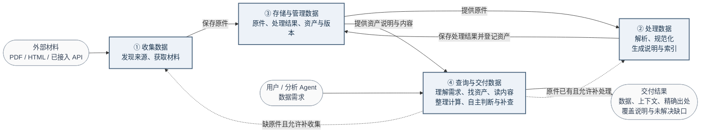
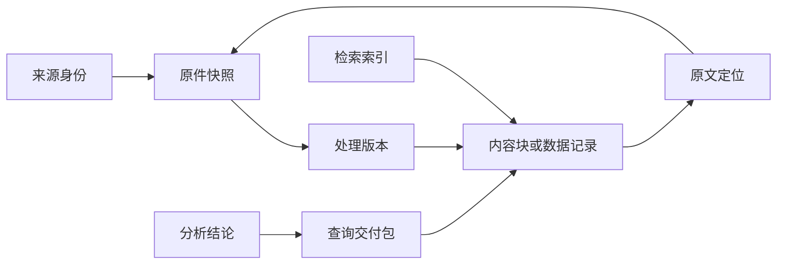
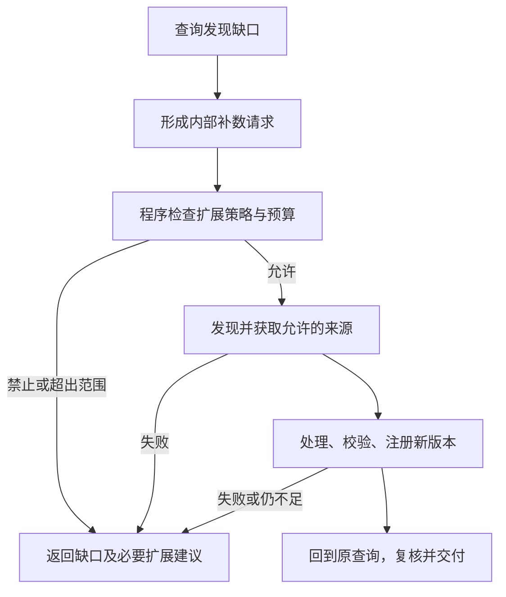

# Data Agent 与分析 Agent：数据能力框架设计

日期：2026-10-13 · 版本：设计稿 v1.3 · **状态：第 3 节四类一级功能及关系图、首期输入范围、材料资产与查询主流程、第 7.2.1 节找资产流程、第 7.2.2 节获取资产的输出边界、说明信息含义与内部职责、第 7.2.3 节定位与读取的衔接原则，以及第 8–11 节的执行边界（含第 9.2 节自主判断与状态更新机制）已确认；当前进入具体技术实现的设计讨论，其余字段、工具与验收细化仍待 review，功能开发暂停**。

本文整理已讨论的职责与建议设计，不新增业务范围授权，不宣称目标框架全部实现。公司、年份和单次实验属于验收案例，不成为通用规则。DA-01 获取与储存、DA-02 解析与索引、DA-03 查询与材料交付作为模块 ID 保留。当前唯一任务是核对本文的方案与设计，其他文档暂不读取。

## 1. 这份设计要回答什么

目标：让用户与分析 Agent 通过同一套 Data 能力取得足够、聚焦且可追溯的数据。数据缺失时有补充路径，数据错误时能定位到来源、处理、查询或分析环节。

开工前必须回答：

1. 获取、解析、存储、索引和查询各负责什么，如何交接？
2. 不同输入处理成什么，哪些不需要文档解析？
3. 原件、处理结果、索引、交付与分析引用怎样关联？
4. 多个子问题如何选择不同数据与执行方式？
5. 没有数据、存在冲突或来源不可访问时怎么办？
6. 谁审核、谁缓存，什么时候复用、更新或停止？

**状态约定：**“已有”沿用原稿记录的局部机制，本轮未重新核验源码；“有限验收”仅指指定案例；“建议设计”等待本轮 review；“待设计/验证”表示没有完整实现或证据。旧文档中的历史方案和旧运行结果不能自动升级为当前能力。

**参考流程的适配原则（2026-10-13 确认）：**用户贴出的流程可能是对其他项目的总结，先作为参考输入；后续每个流程都需判断是否适配雨滴，再讨论采用。已确认的职责保留，参考项目的具体实现不能自动成为雨滴的实现事实或技术选型。

- 先看解决的问题和前提：是否适用于雨滴的 PDF、HTML、已注册 API 等材料，是否依赖现成资产库、特定业务系统或已生成的元数据。
- 再映射雨滴的职责和契约：先明确分析 Agent 与 Data Agent 的业务归属，再区分模型判断、工具程序与检索后端的具体执行工作；能否保留指定版本、原文定位、处理状态、覆盖与缺口。涉及现有能力时按需核对源码和产物，没有证据的部分明确待验证。
- 说明哪些保留、哪些调整、哪些不采用及原因，确认后写入设计。优先复用已有机制；Function 与执行层的分离不意味着必须新建独立 HTTP 服务，通信方式和部署位置按雨滴实际需要另定。

## 2. 第一层：职责边界

**职责层级（2026-10-13 确认）：**资产接入、处理、生成和维护说明均属于 Data Agent 的整体职责；其中模型负责判断，工具程序承担具体执行。下表“程序执行层”在这些流程中承接 Data Agent 的工具工作，业务归属与执行方式分别描述；生成时机与内部职责见第 7.2.2 节。

| 角色 | 负责什么 | 交付什么 |
|---|---|---|
| 分析 Agent | 拆解研究问题，提出证据需求；解读研报，比较公司、竞对及不同报告观点；形成解释、假设、结论和观察建议；关注与持仓相关的风险（是否交给独立风险 Agent 待设计） | 清晰易读、可交互且可追溯的研报解读，带引用的报告、图表、比较结果，持仓风险观察及补充数据请求 |
| Data Agent | 发现/获取数据；组织处理；生成和维护资产说明；选择数据源与查询方法；核对材料是否满足数据请求；补查与交付 | 资产说明、数据、原文片段、必要上下文、精确出处、覆盖说明与缺口 |
| 程序执行层 | 下载、解析、SQL/检索执行、计算、版本保存、边界校验、资源控制与任务调度 | 可复核的工具结果和运行记录 |
| Codex | 实现与测试系统，独立核验原件、过程与交付 | 工程修复及验收判断；不代替运行 Agent 选材料、填答案 |

Data Agent 可以做明确口径的计算、格式整理及来源表述抽取；投资解释、研究假设与结论归分析 Agent。管理层解释要保留说话者，不能自动变成已证实的因果关系。

**监控的分工：**分析 Agent 提出观察对象与意义；Data Agent 按要求更新、记录观测值与变化；程序负责定时、失败恢复和通知。产品价格/库存是观测信号，不能直接等同产品好坏或需求强弱。端到端持续监控目前待设计/验证。

### 2.1 分析功能：解读研报

**已确认的功能方向（2026-10-13）：**将研报变得清晰、易读、简单、可交互、可 ref（可引用并回到原文）。以下交付方式为建议设计，未实现或验收。

- **清晰易读：**先讲报告的核心观点、依据、关键假设与风险，再按需展开术语、图表和估值逻辑；简化表达时保留限制条件、不确定性和反面证据。
- **区分观点归属：**明确哪些是报告作者的观点或预测、哪些是可核验事实、哪些是分析 Agent 的解释或判断，不把研报结论直接当作事实。
- **可交互：**用户可围绕某个结论追问“为什么”“假设是什么”“哪里可能不成立”，并展开相关证据；需要新材料时，通过同一套 Data 能力补查。情景计算应显式标注用户或 Agent 新设的假设，不改写原报告预测。
- **可 ref：**关键观点、数字和图表关联报告版本及具体页码、段落或表格位置，用户能从解读回到原文；补充来源分别引用，定位不可用时明确缺口。

建议交付结构：核心观点 → 推理与依据 → 关键假设及风险 → 可展开的解释与原文引用。验收关注用户能否读懂论点、追问依据并核对原文，不能只检查摘要长度或引用格式。

### 2.2 分析功能：关注持仓风险

**已确认的功能方向（2026-10-13）：**关注持仓对应的行业风险、公司风险和宏观风险；可以由风险 Agent 完成，但当前职责、工作流及独立 Agent 形态尚不清晰，保持待设计，不据此启动开发或持续监控。

建议从“风险如何影响当前持仓”组织内容，而非只罗列风险新闻：

| 层次 | 关注内容示例 | 与持仓的关联 |
|---|---|---|
| 行业风险 | 供需、竞争、技术替代、行业监管变化 | 影响哪些持仓的需求、价格、利润率或竞争位置 |
| 公司风险 | 经营执行、财务、客户集中、治理及公司特定事件 | 哪项原投资假设受到影响，依据是什么 |
| 宏观风险 | 利率、汇率、经济周期及政策变化 | 经由融资成本、收入、成本或估值等路径影响哪些持仓 |

**建议的最小风险交付：**发生了什么变化 → 影响哪些持仓、通过什么路径 → 支持证据与不确定性 → 后续观察信号及证伪条件。同一风险可能同时影响多个持仓，应展示共同暴露；缺少仓位权重或必要数据时，说明无法量化组合影响，不编造风险分数或损失估计。持仓及其时点来自用户明确提供或授权的数据，不从对话猜测。

**责任边界提案：**分析 Agent 解释风险对研究结论和投资假设的影响；若设风险 Agent，由其聚合跨持仓风险、跟踪变化并反馈分析 Agent；两者共用 Data 能力取证，程序负责调度与通知。是否拆分独立 Agent、持仓输入、风险优先级、观察频率与提醒触发规则仍需 review；现阶段不承诺自动交易或仓位调整。

## 3. 能力关系：建设数据与使用数据分开

**四类一级功能已确认（2026-10-13）：**收集数据、处理数据、存储与管理数据、查询与交付数据。更新与时效、质量与冲突、追溯与问题定位属于各功能的补充要求；自主判断、状态更新和工具调用属于运行机制，不与四类一级功能并列。

下面是这四类功能的目标关系图，表达数据建设、使用及按需补充的关系；用户已认可本图（2026-10-13），不代表当前代码已完整实现这些能力。



**图例：**①–④ 为四类一级功能，外部材料、数据需求和交付结果是输入/输出；编号不表示固定执行顺序。实线表示正常的数据或请求流，虚线表示缺口触发的有条件补充。两条补充路径均遵守第 8 节的来源、权限及资源边界。

- **数据建设路径：**收集 → 保存并冻结原件 → 按类型解析、规范化与校验 → 保存处理结果，注册资产、说明与索引；可独立完成数据准备任务。
- **数据使用路径：**理解需求 → 查找已有资产 → 读取资产说明及相关内容 → 整理或计算 → 判断是否满足需求 → 交付。用户与分析 Agent 使用同一套查询能力和结果包，用户页面可按需展示查询过程。
- **按需补充：**缺原件时补收集，原件已有但不可用时补处理；新结果保存并登记后回到查询。已有可用数据时直接复用，内容不足时在查询内部补查、补读。
- **交付边界：**满足需求后交付；因权限、资源或其他限制无法继续时，交付已确认部分及明确缺口和停止原因，按第 9.2 节在交付前进行整体充分性检查。
- **功能与执行机制：**四类功能均属于 Data Agent；模型负责选择、理解与判断，工具程序负责具体执行。更新、质量、追溯等要求贯穿各功能，不另增一级功能节点。
- **与模块 ID 的关系：**既有 DA-01 获取与储存、DA-02 解析与索引、DA-03 查询与材料交付继续保留为模块 ID。四类功能是本节的业务职责划分，不要求对应四个 Agent 或部署服务，也不新增并行开发任务；存储、版本、身份和出处仍贯穿三个模块。

## 4. 第二层：获取哪些类别的数据

| 类别 | 例子 | 来源选择原则 | 当前边界 |
|---|---|---|---|
| 官方披露 | 财报、公告、业绩材料、电话会材料 | 官方披露系统或确认归属的官方渠道；区分原版和修订版 | SEC 与有限官网获取已有；全部类别取齐未验 |
| 专业接口数据 | 财务、估值、股价、K 线、成交量 | 适配任务的专业供应商；保留供应商、口径与版本，必要时对照披露 | FMP/行情没有已验收的统一接入 |
| 公司官方网页 | 产品、定价、技术文档、博客、发布动态 | 确认官方归属，保存时间和网页版本 | 有限 HTML 发现已有；全面覆盖未验 |
| 产品与经营观测 | 价格、库存、销量、交付时间、性能评测 | 可验证来源；保留型号、地区、渠道、采样方法等条件 | 通用接入与持续监控待设计 |
| 第三方观点材料 | 研究报告、行业评论、独立测试 | 保留作者、范围与方法；观点和事实分开 | 本轮仅定义边界，不承诺接入 |

来源不是一条绝对可信的排名。官方适合证明自身披露，专业接口适合标准化查询，其他一手观测可能适合价格等问题。分别记录来源适用性、处理质量与当前问题适配性，不用一个“可信”标签替代全部判断。

公司、证券、产品、业务分部是不同对象；需要明确身份及映射。来源规则、适配器和使用权限应版本化并显式选择，不因某个公司名称触发隐藏特例。公开可访问也不等于可无限抓取或再分发。

## 5. 首期输入与材料资产

**已确认（2026-10-13）：首期支持 PDF（含扫描页和内嵌图片）、HTML 和明确接入的 API 数据；PPT/PPTX 不在本期范围。** 独立图片、任意 Markdown/CSV 导入与音频转录不因内部使用这些格式而自动成为本期输入能力。

| 输入 | 处理产物 | 定位与质量要求 |
|---|---|---|
| PDF | 文字、章节、表格、扫描页 OCR、图片区域及必要视觉读取结果 | 绑定原件版本、页码、区域及坐标定义；保留表头、单位、脚注和跨页关系。无法可靠识别的内容留缺口 |
| HTML | 页面快照、原始目录、段落、列表、表格和必要图片 | 绑定冻结页面版本、元素/文本区间或单元格；复杂交互导致获取不全时留缺口 |
| API 数据 | 原始响应、规范化记录及字段说明 | 保存来源、请求参数（凭据除外）、时间、分页/覆盖状态、主体/期间/单位/空值口径和原始字段定位；不承诺任意接口自动接入 |

PDF 先提取文字和版面并建立图片区域索引；扫描页或文字层不足时使用 OCR，需要理解图表时再视觉读取。图片须进入可发现范围；原图、OCR 和模型描述分别保存。明确披露的数字与坐标估读结果分开，不将估读冒充精确披露。跨页表格保留原始片段，能确认连续关系时再关联，不强行拼接。

### 5.1 一篇材料作为一个资产

**已确认：PDF/HTML 以一篇材料作为一个可浏览、可搜索、可引用的资产。** 资产同时组织原文、目录和提取内容；目录与内容建立索引，提供稳定定位能力。API 数据通过显式定义的资源/快照范围提供资产说明，具体粒度待定，不强套章节结构。

| 组成 | 内容 |
|---|---|
| 身份与来源 | 公司身份、symbol 映射、材料类型、报告期间、发布时间、来源及版本；发布时间与报告期间分开，未知值显式 |
| 原文 | PDF/HTML 原始字节、页面快照及必要图片资源 |
| 原始目录 | 实际章节标题、父子层级、顺序和定位；推断的结构注明推断状态 |
| 提取内容 | 段落、列表、表格、图片等内容块，包含所属原始章节、顺序、原文定位及质量状态 |
| 资产说明（schema） | 目录、内容类型、语义覆盖、定位方式、支持的查询操作及已知缺口；API 另含字段、单位、时间口径等说明 |
| 索引 | 目录索引、受约束的语义索引、全文索引；共同指向同一份内容与原文 |

表格保存行列、单元格、表头关系、单位、脚注与原始区域；图片保存原图或裁剪图、图题、提取文字、派生描述及不确定性。转成 Markdown 可方便阅读，但不能替代这些结构与原文映射。

### 5.2 原始目录、规范目录与语义索引

目录回答“内容在哪里”，语义索引回答“哪些内容与问题有关”。每个内容块保留原始章节归属，同时可关联多个语义概念；通过引用关联，不为多个标签复制原文内容。

解析后建立受约束的语义标注，允许规则或模型参与，受两种 scope 限制：

- **材料范围：**只基于当前资产及明确的内容范围标注，不借其他材料补造本资产没有的信息。
- **分类范围：**使用显式选择、版本化的材料适配器与分类规则，限定合法章节类别、内容类型和概念；不随意创建标签或强填分类。

10-K 等材料使用对应适配器，将原始章节映射到规范目录。保留原始标题与层级，不假设所有公司的子目录相同；映射记录明确、推断或未匹配状态。逻辑路径如“公司 / 报告期间 / 10-K / business / overview”是导航入口，不是唯一证据 ID，也不保证每份材料都存在该子章节。

语义概念应有统一定义，并保留原文名称与具体口径。例如将某行 Net sales 关联收入概念时，须结合表名、行列和上下文区分合并/分部、金额/增长率、年度/季度及历史/预测。标签必须有证据定位；字段合法不证明语义标注正确，语义质量需独立验收。

全文索引覆盖正文、表格文字、图题及 OCR，并区分文字来源。产品名及别名可通过全文搜索或类似 grep 的匹配定位；受约束语义索引属于本期基础能力，不依赖先引入向量检索，也不属于第 10 节后置的语义答案缓存。

目录应区分原件存在、尚未处理、已处理但未分类、仅能原文读取和已确认可查询等覆盖状态。标签未命中不能直接推断未披露。索引和派生摘要帮助定位，事实引用最终落到原文或原始字段。

### 5.3 资产契约：Agent 先知道有什么，再知道怎么查

**本节至 5.6、6.1、7.1–7.5 为本轮细化提案；其中 5.3.1 的公司与资产关联思路、5.3.2 的三层版本关系与典型变化规则、7.2.1 的流程与职责、7.2.2 的输出边界、说明信息含义与内部职责、7.2.3 的定位与读取衔接原则已确认，其余待用户 review。字段名、状态与函数名不是现有代码声明。** 目标是让同一版本材料和显式查询条件获得可复核定位，不承诺不同模型每次推导完全相同。以下 JSON 与调用例均为虚构设计样例，不是公司事实或实跑。

资产分两种类型：`document` 与 `dataset`。文档资产是一份逻辑材料；API 数据资产是显式注册的供应商资源、数据口径与声明范围，一个快照可包含多个分页响应。不把每页响应注册成彼此无关的数据资产，也不把“某个供应商全部数据”作为一个无边界资产。

**资产身份与版本的细化判定：**三层版本关系、三种典型变化及查询绑定原则已在第 5.3.2 节确认；本段的具体标识字段、表现形式与 API 规则仍为提案。`asset_id` 回答“是哪份材料或哪项数据资源”，`snapshot_id` 回答“冻结了哪次原始内容”，`representation_id` 区分具体原件形式，`build_id` 区分基于原件的处理结果。API 的声明范围是注册时固定的主体、期间规则等边界；一次获取的实际覆盖和一次查询的筛选条件分别记录，不能反过来静默修改资产身份。

| 变化 | 身份与版本处理 |
|---|---|
| 另一报告期间的新报告，或无法证明是同一逻辑材料 | 建立独立资产；相似标题、相同文件名或字节 hash 不足以合并身份 |
| 同一报告发布修订版 | 保留资产身份，新增原件快照并记录有依据的修订关系；保留旧快照，不自动替换历史引用 |
| 同份材料有 PDF/HTML 两种形式 | 核对逻辑材料身份后可归属同一资产；分别保留原件、表现形式与定位，不据此认定内容逐块等价 |
| API 在声明范围内增加实际覆盖或返回更新数据 | 保留资产身份，新增冻结快照并记录请求、响应分片与实际覆盖；分页不产生独立资产，缺页仍记为缺口 |
| API 更换供应商资源、改变数据口径，或超出原声明范围 | 建立新资产并记录关系；不通过扩写旧资产边界使原授权自动扩大 |
| 只改变查询期间、字段或筛选条件 | 产生新的查询记录，已有快照足够时直接复用；需要补获取时按上述快照规则处理，不为每次查询建资产 |
| 原件不变，只更新解析器、OCR 或分类规则 | 新增处理构建，保留原件与旧构建；不同构建的块 ID 不保证相同 |

快照的原件清单也冻结。后来发现的另一表现形式或补到的 API 页不能追加进已冻结快照；需要新的快照及关联，可复用相同字节的存储。首次快照冻结前可汇集分页响应，但冻结后仍缺页时必须保留当次不完整状态。以上只规定身份与追溯原则；首个 API 的具体资源与声明范围仍待选择，未在本轮决定供应商或接入范围。

**分页覆盖与来源版本一致性分别判断：**每个响应分片保留请求、获取时间，以及供应商提供的数据版本或快照依据（没有则记未知）。页数齐全、同次运行获取或归入同一内部快照，都不能独自证明各页来自同一来源版本。补页可以形成新的冻结集合，但不能消除原分片的时间或版本差异；要求同一来源版本的查询，在依据不足时须返回一致性缺口，不能仅凭覆盖齐全交付为完整结果。其他查询也保留这些差异，按原请求的口径判断可用性；不因此自动扩大获取或重复调用。

**身份划分走查（2026-10-13，虚构场景，非实跑）：**按用户“先试试”，暂采用资产、快照与查询分离的划分继续设计。以下固定 `A1` 为演示供应商 P、主体 X 的年度利润表历史实际值资源；期间规则为供应商已披露的财政年度，具体查询再指定年度与截止日，不把滚动的“最近三年”作为资产身份。初始 `S1/B1` 只覆盖 FY2024–FY2025；所有操作均假定在原授权范围内。

| 输入或变化 | 按设计应得到的结果 | 能区分的错误判断 |
|---|---|---|
| 从查询 FY2024–FY2025 改为只查 FY2025 | 仍用 `A1/S1/B1`，新增查询记录；已有值及出处可复用 | 不应因为筛选条件变化新建资产或重新获取 |
| 查询扩至 FY2023–FY2025，后来补到 FY2023 的响应 | `A1` 不变，形成 `S2/B2`，保留各分片出处与 `S1`；若分片缺少共同来源版本依据，覆盖可齐而一致性仍未知 | 不能修改 `S1`；不能将“补齐年度”直接当作“同一版本完整数据” |
| 供应商随后修订 FY2025 的值 | 同一 `A1` 保存新快照和相应构建；旧查询仍指向 `S1/B1`，新查询按显式版本与截止日选择 | 不能因刷新资产而改写旧交付中的值，也不能默认最新值适用于历史截止日 |
| 改取预测值或另一供应商的数据 | 超出 `A1` 的资源/口径，需独立资产及关系，并另行检查原政策是否允许 | 不能作为 `A1` 的补页或普通筛选返回 |
| 原始响应不变，只修正字段单位映射 | `A1/S1` 不变，新增处理构建，保留 `B1` 与原字段定位 | 处理纠错不伪装成供应商更新；原有交付仍可复核 |

走查结论：身份划分暂未在上述场景中出现矛盾；补页场景暴露了“覆盖完整不等于来源版本一致”的缺口，已补入契约。这里检验的是规则是否说清，不是工具行为或真实供应商能力；首个 API 能否提供一致版本依据仍待接入时验证。

采用“共同信封 + 类型专属 schema”，不把 API 字段伪装成文档章节。资产说明的信息范围与含义已在第 7.2.2 节确认；下表的具体字段及编码仍为提案。

| 共同字段组 | 最小内容与规则 |
|---|---|
| 身份 | `asset_id`、`asset_kind`、`title`、`entity_refs`、`material_type`、`language`；公司主体 ID 与 symbol/交易所映射分开。多主体资产保留各主体角色，不能把提及公司都当作发行主体 |
| 来源与时间 | `source_ref`、`reporting_period`、`published_at`、`available_at`、`acquired_at`；附时间依据。发布日期未知可空，禁止用下载时间填充；截止日适用性单独判断 |
| 冻结引用 | `snapshot_id`、`representation_id`、`build_id`；分别指原件快照、PDF/HTML/API 表现形式、处理与索引构建。每次读取都绑定这组版本，不隐式跳到最新 |
| 内容覆盖 | `coverage` 描述已观察到的主体/期间/概念及证据；报告期间不替代内容覆盖期间，未知不当作无覆盖 |
| 处理状态 | `readiness` 分别记录原件、结构、表格、图片、语义索引的状态与未完成位置；不以一个 ready 掩盖局部缺陷 |
| 规则与能力 | `profile_ref`、`taxonomy_ref`、`capabilities`；列出可用概念、过滤字段、操作及读取限制；不宣称不支持的查询 |
| 使用边界 | `policy_ref`、`issues`；服务端逐次检查权限与范围，schema 中的声明不授予权限 |

文档的专属 schema 包含目录入口、规范章节映射、块类型、概念覆盖摘要、全文语言/字段及读取方式。API 的专属 schema 包含记录键、字段类型/语义/单位、维度、期间口径、分页范围、分片来源版本及一致性状态、空值含义、允许的过滤/聚合操作和原始响应定位。

**渐进加载：**`find_assets` 返回摘要；`get_asset_schema` 先返回能力、覆盖、根目录或字段摘要；展开指定章节/字段组时才加载详情。资产说明由当前构建的 manifest、目录和分类规则生成，不另写一份会与索引漂移的自由文本说明。模型生成的内容概述注明派生，不能独自证明覆盖。

#### 5.3.1 公司与资产关联（思路已确认）

**已确认（2026-10-13）：**公司独立维护，资产独立维护，通过带角色和判断依据的关联记录连接；内容相关的关联绑定对应材料版本。以下三个结构描述逻辑职责，表名、字段、角色枚举、唯一约束及实际存储实现仍待细化。

| 逻辑结构（表名示意） | 负责什么 | 主要信息 |
|---|---|---|
| 公司 `companies` | 确认是哪家公司 | 稳定公司 ID、规范名称、别名；公司身份与证券代码/交易所映射分别维护；补充行业及竞争对手信息，字段归属建议见 5.3.3 |
| 资产 `assets` | 确认是哪份逻辑材料或哪项数据资源 | 资产 ID、标题、资产类别、材料类型、来源地址/链接及业务时间；链接与时间按对应来源及版本维护，见 5.3.3 |
| 公司与资产关联 `asset_company_relations` | 说明材料与公司的关系 | 资产引用、公司 ID、关联角色及判断依据；内容相关关联保留适用版本 |

- 一家公司可以关联多份资产，一份资产也可以关联多家公司；行业、宏观材料允许没有具体关联公司，保留行业、地区等覆盖对象。
- 披露主体、主要研究对象与普通提及分别表达。年报中出现另一公司名称，不足以将其归为主要研究对象；关联须有依据，无法确认时保留未知。
- 发布方归来源信息，与研究对象分别记录。发布方本身是公司时，可以引用同一公司主档，不为其发布角色另造公司身份。
- 公司 ID 列表可作为资产检索条件，利用关联记录找到候选；接口字段、角色过滤及具体匹配语义继续单独 review。

**虚构示例：**甲公司的年报关联甲公司，角色为披露主体；比较甲、乙两家公司的研报作为一份资产关联两家公司，角色为研究对象，发布券商另在来源信息中记录；宏观材料可以没有具体公司关联。

本次仅确认关系思路，不冻结公司 ID 格式、物理表结构及版本引用字段，不代表数据库或查询接口已实现。

#### 5.3.2 资产、原件版本与处理版本（关系已确认）

**已确认（2026-10-13）：**分别记录材料身份、原始内容版本及处理结果版本。以“甲公司 2025 年年报”这一虚构材料说明：

| 层次 | 回答的问题 | 示例 |
|---|---|---|
| 资产 | 是哪份逻辑材料 | 甲公司 2025 年年报 |
| 原件版本 | 保存的是哪次原始内容 | 最初发布版、后来发布的修订版 |
| 处理版本 | 基于哪个原件，生成了哪份处理结果 | 首次解析结果、修正表格提取后的结果 |

一个资产可以保留多个原件版本，同一原件版本可以保留多次处理结果；处理版本记录所依据的原件版本。三种典型变化的处理已确认：

- 发布下一年度年报：新增资产。
- 修订同一份年报的原文：保留资产身份，新增原件版本。
- 原文不变，重新解析或修正提取：保留原件版本，新增处理版本。

查询结果同时绑定选用的原件版本和处理版本，保留当时读到的内容及其处理依据；后续更新不覆盖旧版本或旧结果的引用。

本次确认概念关系、上述典型变化和查询绑定原则；具体 ID、版本选择规则、PDF/HTML 表现形式与 API 分页细则、物理存储和接口仍待 review，不因本次确认自动冻结第 5.3 节的其余草案。

#### 5.3.3 公司与资产的业务字段（业务范围与时间含义已确认）

**已确认（2026-10-13）：**沿公司、资产、公司与资产关联、来源、原件版本、处理版本组织目录，并纳入公司基本信息、业务与行业、竞争关系、资产身份与覆盖、来源链接和可用性等业务信息；时间分别表达报告期间、内容覆盖、发布与修订、历史可得性、关系适用期间及系统获取、处理、登记和核对时间。竞争关系保留业务范围、时间与依据；资产可展示多个来源链接，并关联相应来源记录和原件版本。以下记录已确认的业务范围与含义，分阶段必填及维护原则见 5.3.4；具体字段名、逐字段约束、提取规则、编码及物理表仍待 review，不直接改写接口契约。

| 对象/字段组 | 业务信息范围 | 归属与使用边界 |
|---|---|---|
| 公司身份 | 公司 ID、规范名称、简称/别名、证券代码与交易所、官网、注册国家/地区 | 公司身份与证券映射分别维护；多地上市不产生多个公司身份 |
| 公司业务与行业 | 业务简介、主营业务、行业/细分行业、分类体系及版本或分类依据 | 可关联多个行业；行业关联保留业务范围、适用时间和依据，不能只按公司名生成分类 |
| 竞争对手 | 对方公司引用、竞争涉及的业务/产品、市场或地区、适用时间、说话者与原文证据、判断/核对状态 | 用公司之间的关系记录维护，对外可展示竞争对手列表；同业不自动等于竞争，单方披露不自动变成双方共同确认 |
| 公司补充时间 | 信息核对时间；成立日期、证券上市日期仍仅作为后续可选提案 | 上市日期归对应证券；是否纳入首期字段待后续需要时决定 |
| 资产身份与内容 | 资产 ID、标题、摘要、资产类别、材料类型、语言 | 摘要注明生成依据与版本，不能单独证明全文覆盖 |
| 资产覆盖对象 | 公司及其角色、涉及业务、行业、地区与内容覆盖期间 | 发布方与研究对象分别表达；宏观材料允许没有具体公司，覆盖未知时保留未知 |
| 资产来源与链接 | 发布方/作者、来源类型、来源页面链接、文件直链或 API 资源地址、对应来源与原件版本引用 | 资产摘要/详情可直接展示来源链接；底层通过来源记录及版本维护，可保留多个来源；本地文件位置另行登记 |
| 资产版本与可用性 | 原件版本、处理版本、对应产物清单、可用能力、覆盖缺口和核对状态 | 状态对应具体版本及能力，不以单一 ready 掩盖未处理部分 |

**时间字段按业务含义分别维护：**沿用第 7.2.2 节已确认的报告期间、内容覆盖期间、发布时间、获取时间和历史可得性定义，并补充版本、关系及处理记录所需的时间。

| 时间 | 回答的问题 | 建议归属 |
|---|---|---|
| 报告所属期间 | 这份材料名义上报告哪个财年、季度或期间 | 资产及相应版本的业务元数据；期间标签与有依据的起止日期分别保留 |
| 内容覆盖期间 | 已观察到的内容实际涉及哪些期间 | 对应原件/处理版本的覆盖信息，可包含多个期间 |
| 发布时间 | 来源何时发布该材料或版本 | 对应来源与原件版本，保留来源证据 |
| 来源修订/更新时间 | 来源何时修订了这一版本 | 对应原件版本；未知时不以雨滴发现变化的时间替代 |
| 历史可得时间 | 在指定历史时点能否取得该版本 | 对应来源与版本及其可得性依据；获取时间不能冒充首次公开时间 |
| 获取时间 | 雨滴何时实际取得这些内容 | 获取记录；相同内容再次获取可保留新记录，不据此强制生成新内容版本 |
| 处理时间 | 这份解析、抽取或摘要产物何时生成 | 处理版本或具体产物；失败和完成状态分别保留 |
| 关系适用时间 | 行业归属或竞争关系适用于哪个期间 | 对应关系记录；来源发布时间、系统观察时间与关系生效时间分开，未知边界不补造 |
| 记录创建/修改及核对时间 | 雨滴何时登记、修改或核对了这条元数据 | 系统记录；不替代材料发布、修订或业务关系的实际发生时间 |

时间表达保留精度：已知具体时刻时支持带时区的 datetime，只有日期时保留日期，报告期间保留期间表达；原始时区未知时明确留缺口。系统获取、处理等事件记录实际发生时刻。未知业务时间保留为空及相应原因，具体数据库存储类型和接口编码仍待确定。

行业、竞争关系和摘要等派生信息保留来源、判断方式与核对状态。竞争证据绑定说话者、业务/地区范围、时间及原文；供应商、客户、普通提及和竞争关系分别维护。这里定义数据表达，不开展公司或竞争关系的实际研究与填充。

#### 5.3.4 字段完整性与维护（原则已确认）

**已确认（2026-10-13）：分阶段必填，业务信息逐步补齐。** 能登记保存与能满足某类查询分别判断；缺失业务属性不要求补造，也不妨碍保留真实取得的原件。

| 阶段 | 必须具备的信息 | 阶段边界 |
|---|---|---|
| 公司正式登记 | 公司 ID、规范名称、身份依据 | 尚未确定的公司身份保留待确认，不因名称相似直接合并 |
| 资产登记 | 资产 ID、来源身份、资产类别、实际状态 | 登记资产不代表原件已保存或处理已完成 |
| 原件保存完成 | 原件版本、文件位置、内容 hash、获取时间 | 绑定所属资产与来源；仅发现链接或获取失败不能标为已保存 |
| 处理完成 | 输入原件版本、处理版本、产物清单、处理依据与时间、可用能力及缺口 | 状态对应实际产物；局部可用保留能力与覆盖缺口，不宣称全文已处理 |

行业、竞争对手、摘要、发布时间、报告期间等业务信息允许暂缺，并说明未知、未处理、不适用或存在冲突；这些含义需要区分，具体状态编码尚未确定。竞争对手列表为空不能直接解释为没有竞争对手，未处理也不能解释为未披露。

- 来源链接：通过网页或下载取得的材料保留实际来源地址；没有网页地址的材料保留真实接入记录，不补造 URL。
- 行业与竞争关系：建立明确关系时保留对象、范围、来源证据和时间依据，信息不足时保留待确认状态。来源所述期间与关系真实起止时间分别表达，不能因要求时间依据而补造未知日期。
- 查询适用性：业务属性缺失的材料可保存并在其已具备能力范围内使用。对指定公司、期间、口径或历史截止日的查询，仍须核对相应条件；历史可得性依据不足时不能作为已满足截止日要求的证据。

**维护责任仍归 Data Agent 的接入与处理流程：**

| 执行方式 | 已确认的分工 |
|---|---|
| 工具程序 | 生成系统 ID，记录实际链接、内容 hash、文件位置与系统时间，校验引用、存储产物并更新对应状态；来源直接提供且可按规则读取的信息优先直接读取 |
| 模型参与 | 对需要理解正文的业务分类、竞争关系和摘要等按需提取，保留来源依据与核对状态；模型给出结果不等于内容已通过业务核验 |

沿用第 5.3.2 节的版本规则：新年度等独立材料登记新资产，同一材料原文修订新增原件版本，重新处理新增处理版本；元数据更正保留修订记录，历史交付继续引用原版本。查询沿用第 7.2.2 节读取指定版本已有说明、按需补处理的原则，不要求每次查询重新生成元数据。

以上确认阶段要求、允许缺失的原则及维护分工；字段值与依据的关联原则见 5.3.5，具体关系表、冲突处理、修订记录结构以及每类材料的提取和校验规则继续细化。

#### 5.3.5 业务字段值与依据（关联原则已确认）

**已确认（2026-10-13）：业务字段保存值，同时关联该值的依据。** 公司和资产仍按普通业务字段组织；行业、竞争关系、发布时间、摘要等信息增加依据引用。系统生成的 ID、hash、获取时间等沿已有运行与版本记录追溯，不要求每个系统字段另建业务依据记录。

| 依据记录的信息 | 负责说明什么 |
|---|---|
| 对应对象、字段及修订版本 | 支持的是哪家公司、资产或业务关系的哪个值，避免字段更新后旧依据被错误关联到新值 |
| 来源与原件版本 | 依据哪份材料及哪个冻结版本；保留来源身份 |
| 精确位置 | 定位到页码、段落、表格或 API 字段，并能读回对应原文或记录 |
| 生成方式 | 区分来源直接提供、规则提取和模型提取；关联相应处理版本 |
| 适用范围与时间 | 保留业务、地区、期间及未知部分；关系起止时间不由材料日期补造 |
| 核对状态 | 分别记录引用是否有效、提取是否符合原文；有引用不等于判断正确，也不把工程校验通过自动视为业务核验通过 |
| 修订关系 | 记录改了什么、为什么改及旧依据，保留历史引用 |

**虚构示例：**甲公司年报披露“我们的云服务面临乙公司的竞争”。可记录甲与乙的竞争关系，业务范围为云服务、地区未明确；依据为甲公司年报原件 V1 第 12 页的对应段落，说话者为甲公司，模型提取关联处理版本 B1。材料时间保留，竞争关系起止时间未知。查询表达为“甲公司在该年报中将乙公司列为云服务竞争对手”，保留原材料的陈述范围；该示例不是实际抽取或核验结果。

同一字段可以关联多条依据。出现新依据或发现提取错误时新增修订并保留旧记录；存在冲突时同时保留候选值与依据，不能仅因一条记录较新就静默覆盖其他候选。历史交付继续绑定当时的值、修订及材料版本。

以上确认业务值与依据的关联方式；具体 SQLite 表、字段编码、引用约束、冲突处置和核验流程仍待细化，不新增通用事实平台或审核 Agent。

### 5.4 三种索引共用内容与证据地址

| 对象 | 最小字段 | 关系与限制 |
|---|---|---|
| 原始章节 `Section` | `section_id`、`parent_id`、`title_raw`、`order`、`locator_refs`、`structure_origin` | 目录树无环；标题重复仍有不同 ID；推断章节保留状态；找不到章节归属的块留在显式未归属区域，不能丢弃 |
| 内容块 `Block` | `block_id`、`section_id`、`kind`、`order`、`content_ref`、`locator_refs`、`context_refs`、`issues` | 文本、列表、表格、图片保留各自载荷；上下文关系含标题、表头、单位、脚注及延续片段 |
| 规范映射 `SectionMapping` | `section_id`、`canonical_section`、`profile_version`、`basis_refs`、`method`、`status` | 将原始章节关联到标准类别；多个原始章节可对应同一类别，不用固定 Part 路径猜测原文 |
| 语义关联 `Annotation` | `target_ref`、`concept_id`、`role`、`dimensions`、`basis_refs`、`taxonomy_version`、`method`、`validation` | 标注可落到段落、表格行/单元格或图片区域；不要求整张表只有一个主题 |
| 可选结构化值 `ValueRecord` | `value`、`unit`、`period`、`entity_ref`、`dimensions`、`evidence_refs` | 只有完成值、单位、期间及口径映射后，才声明该指标可结构化查询；主题命中不能生成数值记录 |

语义关联的 `role` 区分主题描述、定量数值、变化说明和单纯提及。`dimensions` 按概念定义约束，例如合并/分部、金额/增长率、实际/预测；未能确定的维度显式 unknown，不用默认值补齐。`validation` 分开记录工程合法性和语义检查状态，不把模型自报高置信度写成已验证。

表格采用行列/单元格 ID、合并关系、表头关联和原文区域；跨页片段关联但不覆盖原片段。图片保留原图区域、图题、OCR 与派生说明；需要视觉读取但未执行的区域明确列入缺口。全文索引可索引这些派生文字，但返回必须标明来源。若图中只有视觉信息，章节导航和未处理区域清单仍需能找到它。

证据地址是类型化对象，而不是拼接的一条长字符串：文档固定到版本及块，可细化到字符区间/表格行列/图片区域；API 固定到响应分片、记录键和字段。PDF 定位必须说明文件页序号与印刷页码、坐标原点和单位；HTML 定位必须针对冻结快照，无法重现的在线 DOM 选择器不能作为唯一出处。

### 5.5 受约束标注：统一口径，同时保留未知

分类规则分开管理三类信息，不混成标签袋：

1. **章节类别：**用于导航，例如业务、风险、财务报表；由显式材料类型适配器定义。10-K 的规范目录需在实现前核对适用表单与规则版本，本稿不把示例路径当作完整标准目录。
2. **数据概念：**例如收入，定义含义、包含/排除项、允许角色与维度、单位/期间要求及证据要求。`financial.revenue` 等 ID 是本稿候选命名，正式分类表待冻结。
3. **实体提及：**产品、品牌、分部、公司名称及原文别名；允许从原文发现新的实体值，不要求把所有产品名预先编入固定分类表。只有有依据时合并别名，不能把同名实体自动合并。

构建步骤：显式选择 profile/taxonomy → 提取结构与原文 → 在当前资产及选定范围内提出目录映射/语义关联 → 工程检查 ID、枚举、定位、范围和维度类型 → 保存合格关联、失败与未分类位置 → 生成索引及覆盖摘要。标注过程不随意引入新概念；不匹配时保留未分类，可提出规则扩展建议，规则变更交工程版本化处理。

标注时可读取关联表头、脚注、标题等必要上下文，但须记录实际读取范围和依据；不能为了填标签补入其他资产的事实。按结构块及依赖上下文标注，不把同一文档的标签反复复制到每段。相同输入与配置可以复用已有构建；分类规则变化生成新构建，保留旧关联以便重放。

**覆盖有边界：**记录“检查了哪些块、哪些尚未分类、哪些图像未读、哪些表格失败”。扫描完全部块只证明处理范围覆盖，不证明模型识别出全部收入材料。语义检索不能成为唯一召回入口；未标注部分仍可目录导航和全文检索。未知和冲突不能通过降低校验标准消除。

### 5.6 最小 schema 示例

下面展示文档资产的读取界面，省略项仍按 5.3 契约校验。`semantics=partial` 意味着概念未命中不能判定不存在。

```json
{
  "schema_version": "asset-schema/v1-proposal",
  "asset_ref": {"asset_id": "asset-demo", "snapshot_id": "snap-1", "representation_id": "pdf-1", "build_id": "build-1"},
  "asset_kind": "document",
  "subject": {"entity_id": "issuer-demo", "role": "issuer"},
  "material_type": "annual_report",
  "reporting_period": "FY2025",
  "available_at": null,
  "profile_ref": "annual-report/v1-proposal",
  "taxonomy_ref": "data-concepts/v1-proposal",
  "readiness": {"structure": "ready", "semantics": "partial", "images": "partial"},
  "outline": {"roots": ["sec-business", "sec-financials"], "has_more": false},
  "concept_coverage": [{"concept_id": "financial.revenue", "roles": ["quantitative", "explanation"], "indexed_targets": 3}],
  "capabilities": ["outline", "concept_search", "text_search", "read_blocks", "read_region"],
  "gaps": [{"code": "IMAGE_UNREAD", "target_ref": "fig-7"}]
}
```

这里的计数只说明已索引目标数；没有 `query_records` 能力意味着尚不能把任意表格直接当标准化指标表查询。未知可得时间的资产在严格历史截止日请求中不具备自动合格资格，普通检索也需保留时间缺口。

## 6. 存储与关联设计

**已确认（2026-10-13）：按内容存储、元数据管理、检索索引划分三类职责。** 它们通过材料资产及版本关联，不要求对应三个独立服务或数据库；首期组件分工见第 6.1 节，具体文件格式和物理表仍待细化。

资产的原件及实际处理产物按版本保存，元数据登记身份、关联、内容位置和可用状态，检索索引用于查找并指向这些内容。只有满足相应检查的内容才登记为可用，失败部分保留记录和缺口，不因文件存在就宣称整个资产可用。

| 职责 | 保存或管理什么 | 版本与关联规则 |
|---|---|---|
| 内容存储 | 原始 PDF、HTML 快照、API 响应及必要资源；处理后的段落、表格、图片、转录、规范化记录，以及实际生成的目录、摘要、标注、资产说明和检查结果 | 原始字节冻结；处理产物绑定原件版本、处理器及配置版本，重新处理生成新版本；内容指纹用于完整性和去重，不单独代替来源身份 |
| 元数据管理 | 公司、资产、来源及它们的关系，原件与处理版本、时间、内容位置、可用状态和覆盖缺口 | 管理身份、版本和引用关系；标为可用的内容必须实际存在且通过相应检查，保留必要的变更历史 |
| 检索索引 | 用于筛选、全文检索、语义检索或结构导航的派生查找结构及内容引用；具体检索方式待选型 | 由已保存内容及相应规则构建，绑定资产、处理和索引版本；可以重建，但不能指向不存在或不同版本的块 |

模型生成的目录、摘要和标注属于需要保存的实际处理产物；基于它们建立的查找结构才属于检索索引。重建索引不等于重新生成或覆盖这些产物；需要重新生成时，应保存新的处理版本。

查询范围、条件、工具结果、审核与选择记录、交付数据包及费用继续保留，并冻结每次交付使用的来源、处理和索引版本及补查、修订关系。这些记录按上述职责保存，不另增一类存储责任。

查询时可沿“检索命中 → 元数据中的版本与位置 → 处理内容 → 原件定位”追溯。工具可以在一次调用中完成定位和读取，不要求调用方固定执行三次工具调用。

建议的可追溯关系：



关系至少保留：资产标识、来源标识、原件版本/指纹、处理版本、分类规则与索引版本、章节/块/记录标识、原文定位、查询与交付包标识。这里是逻辑字段，最终字段名及跨版本迁移尚未冻结。

逻辑导航路径与证据地址分开：证据绑定资产版本、解析版本及原始块/记录定位，不以可变标题、symbol 或段落序号串作为唯一身份。重新解析生成新版本，不承诺不同解析版本的块 ID 自然一致。

派生计算另外保存公式、操作数记录、单位/口径和精度。分析引用需定位到数据包内的具体证据项，不能只引用整个数据包或整份报告。

**现有实现核对（2026-10-13，仅源码）：**[获取流程](../src/uteki/infrastructure/document_sources/company_acquisition.py)将原始字节按内容 hash 保存为本地对象；[查询数据集构建](../src/uteki/infrastructure/research_data/query_dataset.py)保存 JSON 产物、DuckDB 快照及文件 hash 清单；[查询服务](../src/uteki/infrastructure/research_data/query_service.py)核对清单后只读打开该快照。[现有目录接口](../src/uteki/infrastructure/research_data/query_catalog.py)提供限定数据集与范围内的来源、对象、指标和期间视图，不能据此认定目标中的统一公司/资产元数据管理已经完成。本轮未运行这些路径。

优先复用上述机制。首期按第 6.1 节已确认的本地文件、SQLite 元数据管理与 DuckDB 查询分工细化；统一元数据结构、跨格式映射、缓存生命周期和发布一致性仍待 review。

### 重复、冲突与时效

- 相同字节可复用存储，但不同来源仍保留独立来源记录。
- 同一事实在不同文件重复披露，保留多个出处及关联，查询不可重复计数。
- 不同年份材料的相似段落不能因文本相同直接删除。
- 重述、镜像、修订及冲突要显式关联；无法确定哪个适用时返回冲突，不静默选最新。
- 分别保存报告期间、公开/可得时间、获取时间、处理时间。未知公开时间不能由下载时间或 PDF 元数据替代。
- 质量状态应区分未处理、待核验、可按某策略消费和存在冲突；具体状态机与发布规则待设计。

### 6.1 首期存储组件分工与落地方案

**首期运行前提及组件分工已确认（2026-10-13）：按单机、单用户设计，先跑通完整流程。**

| 职责 | 首期组件分工 | 内容与边界 |
|---|---|---|
| 内容存储 | 本地文件 | 保存 PDF、HTML、API 原件及实际处理产物，包括段落、表格、目录、摘要等，均按对应版本保留 |
| 元数据管理 | SQLite | 集中管理公司、资产、关联关系、来源、版本、时间、内容位置和可用状态；核心表分工见 6.2，具体字段与约束继续 review |
| 检索索引 | 后端待 A/B 后选择 | 按资产、版本和内容块引用定位内容；第 12.1 节的既有候选与验证安排保持 |

现有 DuckDB 继续承担结构化数据查询和计算，例如筛选年度收入、汇总分部记录。公司和资产主数据由 SQLite 元数据目录维护，DuckDB 分析快照保留对应资产、版本与证据引用；两者的引用一致性需要在实现中检查。该分工增加一种数据库的维护成本，首期仍以同机运行的组件组织。

以上是已确认的设计分工，不代表 SQLite 资产目录或跨组件连接已经实现。单机前提不自动排除已纳入第 12.1 节的托管检索候选。

元数据目录以公司、资产、公司与资产关联、来源、原件版本和处理版本为核心记录，具体业务字段见第 5.3.3 节；这六类记录不限定物理表数量。来源关联到实际保存的原件版本，内容相同的官网与镜像可复用文件并保留各自来源关系。处理版本关联实际产物清单，目录登记清单引用与必要状态，清单保留正文、表格、目录、摘要等产物的位置与 hash；来源及产物的具体字段和登记机制继续 review。

**以下文件布局、表结构及发布一致性细节仍为提案：**

```text
assets/<asset_id>/
  snapshots/<snapshot_id>/<representation_id>/
    source-manifest.json       来源、时间依据、资源清单及 hash
    originals/                 PDF、HTML/图片资源或 API 响应分片
  builds/<build_id>/
    manifest.json              输入引用、处理器/配置/profile/taxonomy 版本
    sections.jsonl             原始目录
    blocks.jsonl               块及定位
    payloads/                  表格、图片、转录或规范化记录
    annotations.jsonl          规范映射与语义关联
    quality.json               检查结果和覆盖缺口
    asset-schema.json          从本构建产物生成的说明
```

目录与内容查询视图草案包括 `assets / snapshots / builds / sections / blocks / annotations / records`，全文索引保存文本及原块映射。这是逻辑对象清单，不表示每类对象都必须成为 SQLite 物理表；具体登记范围及既有组件的复用继续细化。

- 构建在暂存位置完成，核验文件清单、引用闭包、schema/index 版本一致及局部缺口后，原子发布可见 manifest。中途失败不得留下 schema 宣称 ready、内容却缺失的版本。
- 可发布带明确局部缺口的构建，但相应能力及覆盖必须降为 partial；损坏的引用不能作为正常证据返回。构建发布成功不等于语义内容通过验收。
- 查询选择版本后固定 `asset_ref`；翻页、读块、计算和交付都绑定它。新数据到达不能让同一次查询悄悄混用两个 build；需要更新时显式新增引用并重新判断覆盖。
- 同份披露的 PDF/HTML 可建立“同一材料的不同表现形式”关联，但各保留原件与定位；未经核对不合并内容或认定逐块等价。镜像来源、修订与财务重述也分别保留关系。
- 索引可以重建，交付绑定的原件和构建不得随缓存清理。首次发布使用幂等构建键（输入/处理器/配置/规则版本）；模型输出保留实际产物 hash，重跑不得覆盖同一个已发布构建。

### 6.2 元数据核心表与关联（职责已确认，字段待 review）

**已确认（2026-10-13）：**SQLite 元数据目录按以下核心表职责组织。表名作为当前设计名称，具体字段、主键编码、唯一性与引用约束、发布事务及迁移仍待逐项 review；本次确认不代表数据库已创建。

| 表 | 职责 |
|---|---|
| `companies` | 公司身份、名称、简介等基本信息 |
| `company_securities` | 公司与证券代码、交易所的映射 |
| `company_industries` | 公司所属行业、分类依据、业务范围及适用时间 |
| `company_competitors` | 两家公司的竞争关系、业务范围、时间与依据 |
| `assets` | 资产身份、标题、类型及基本描述 |
| `asset_company_relations` | 资产关联哪些公司，各自是什么角色 |
| `sources` | 来源身份、发布方、来源地址 |
| `source_records` | 每次发现或获取的记录，关联资产及实际取得的原件版本 |
| `asset_snapshots` | 原件版本、内容 hash、保存位置 |
| `asset_builds` | 处理版本、输入原件、产物清单与可用状态 |
| `metadata_revisions` | 业务字段或关系的修订值、变更原因和历史 |
| `metadata_evidence` | 支持特定修订值的来源、精确位置、生成方式和核对状态 |

- 一家公司可以有多个证券代码、行业和竞争关系，通过公司与资产关联记录连接多份资产；一份资产也可关联多家公司，并保留角色。
- 一份资产可有多个原件版本，每个原件版本可有多次处理结果；原件与处理版本沿用第 5.3.2 节的身份及引用规则。
- 同一份原件可以对应多条来源获取记录，文件复用时保留各自出处；发现或获取记录与原件已保存的状态分别表达。
- 一次字段修订可以关联多条依据；修订记录保留当时的值，历史交付引用相应修订及材料版本。

正文、表格、图片及详细产物清单继续保存在内容层，SQLite 登记位置、版本、状态与必要引用。具体材料表现形式、API 分页、字段修订粒度和关联表约束仍待细化，不因本表清单确定而冻结这些细节。

#### 6.2.1 美股优先与多证券映射（范围已确认，细则待 review）

**范围确认（2026-10-13）：**当前主要关注美股。设计按美国上市证券的研究场景细化，不将上市市场等同于公司注册地。

美股场景也需要“一家公司对应多只证券”。例如 Alphabet 的 GOOGL 是 A 类股票，GOOG 是 C 类股票，均在 Nasdaq 上市，见其 [2025 年度 Form 10-K 封面的证券登记表](https://www.sec.gov/Archives/edgar/data/1652044/000165204426000018/goog-20251231.htm)。在雨滴中，两者对应同一条公司主档、两条证券映射；这是设计例子，不表示已登记真实公司数据。

| 场景 | 多映射带来的处理要求 |
|---|---|
| 查公司年报、收入、业务与竞争情况 | 由证券映射解析到同一个 `company_id`，复用公司材料；不因有两个代码而重复存储同一资产或累计收入 |
| 查股价、每股指标或具体持仓 | 保留具体证券身份及适用期间；不同股类的数据须核对各自口径，不能只按 `company_id` 混用 |
| 从股票代码搜索资产 | 先解析证券与公司关系，再按公司查材料；即使查询公司材料，也保留用户原始证券上下文 |
| 汇总公司层面的持仓敞口 | 可按公司归集，但先按各只证券的数量、价格、币种及时间计算；不能直接合并不同股类的股数 |
| 证券更名、换代码或映射不明确 | 保留映射依据与历史有效范围；未知或冲突继续标记待核对，不能用当前映射替换历史身份 |

**首期建议：**保留 `companies` 与 `company_securities` 两张表，先支持美股研究所需的公司身份与证券映射。正常只有一个代码时仍是一条映射，多股类时增加映射记录，公司的获取、处理、保存与查询主流程保持一致。复杂跨市场换算不随本次关系建模自动纳入首期；如后续接入存托凭证或跨市场价格比较，再明确其类型、比例与币种规则，资料未明确前不自动换算。

多映射不等于身份模糊：已核实的两个股类可以明确属于同一家公司；同名公司或缺少交易所、时间依据而无法判定的代码则属于待消歧输入。若界面以后设置首选展示代码，它只影响展示，不能成为价格或持仓查询的默认替代证券。以上补充说明多映射的影响与建议边界，具体字段、约束及证券标识方案仍待 review，尚未实现。

## 7. Query 如何变成取数任务

研究拆解归分析 Agent；数据获取计划归 Data Agent，其取材不得依赖 Codex 手选块。

**已确认（2026-10-13）：用户与分析 Agent 共用同一套数据查询能力。** 两者区别在上层封装，不在取材机制；接收相同语义与范围的请求时，取材、补查、审核及交付标准一致。

- 统一请求：问题、对象、时间范围、来源要求及资源边界等。
- 统一结果：数据、原文片段、必要上下文、精确出处、覆盖说明与缺口。
- 分析 Agent 消费结果包；用户页面展示同一份结果包，并按需展示运行记录与查询过程，不另建取数逻辑。
- 是否允许自主扩展由本次请求的策略决定，与调用方是用户还是 Agent 无关。

### 已确认的查询主流程

**理解问题 → 查找资产 → 读取资产说明（schema）→ 查找数据 → 处理并交付结果。** 这是 ReAct 的主路径，不是只能执行一次的固定流水线。

| 阶段 | Data Agent 与工具的职责 | 产出 |
|---|---|---|
| 理解问题 | 识别对象、时间、意图及资源/来源边界；将宽泛问题推导为数据需求，保留未确定项，必要时澄清 | 与原问题关联的数据需求和范围 |
| 查找资产 | 按公司、材料类型、报告期间、发布时间/截止日等条件筛选；检查版本、覆盖和可用状态 | 候选资产简短摘要，不一次加载全部 schema 或全文 |
| 读取资产说明 | 读取选中资产的目录、内容类型、语义覆盖、口径、定位方式、支持操作及缺口 | 对资产内容和查询方式的认识；必要时修订数据需求 |
| 查找数据 | 模型提出类型化条件，程序按范围、分类规则和工具契约校验并编译；选择目录导航、语义索引、全文搜索或结构化查询，根据已返回内容按需补读上下文，衔接原则见 7.2.3 | 带章节归属、块/记录 ID、原文定位和质量提示的候选证据 |
| 处理并交付 | 工程层按材料类型校验格式；Data Agent 聚合判断完整性、重复、冲突与口径，必要时补查，最终冻结交付 | 统一结果包、覆盖说明、精确出处和缺口 |

schema 是资产的使用说明，不只是数据库字段表。PDF/HTML 提供目录、块类型、语义索引和读取方法；API 提供字段定义、单位、时间口径、覆盖范围及查询条件。身份、版本、质量与缺口为共同信息。按摘要 → schema → 相关目录/索引 → 内容渐进读取，不把所有资产的详细信息一次塞入上下文。

宽泛问题需要 Data Agent 结合可用数据推理所需数据类型与范围；程序负责验证和执行条件，不凭关键词擅自认定业务口径。独立需求可以并行，依赖项顺序执行，均继承原请求范围。下面是设计示例，不是实跑：

| 问题 | 定位方式 |
|---|---|
| 这家公司做什么业务？ | 由规范目录定位 Business 对应的原始章节，读子目录和相关内容；必要时补充分部等其他章节，保留各自归属 |
| 去年增长如何？ | 明确“去年”和增长维度，将需求映射到收入等相关概念，跨章节检索表格与说明；不能只搜索“增长”或只限定一个章节 |
| 产品 X 是什么？ | 全文搜索产品名及有依据的别名，读取命中块、所属章节、邻近段落及相关图表 |

报告期间不等于文档中所有数据的覆盖期间；一个年报可能提供多个期间的比较数据。搜索返回候选，读出的表头、单位、脚注与原文上下文用于确认适用性。解析出表格不等于已建立统一财务指标：结构化查询必须有明确字段、单位和期间契约。

证据不足可继续查找数据；资产不适合则重新选资产；缺资产时按第 8 节策略获取、处理并注册新资产后返回查询。新增资产也需经过 schema 与质量检查，不能下载完就当作查询已完成。最终返回答案数据及可展开的证据，不只是块 ID；用户页面与分析 Agent 使用同一结果包。

### 7.1 请求上下文与数据需求计划（提案）

调用方提交原问题和已知范围，未知项允许显式留空；Data Agent 可以推导候选需求，但执行前必须解决影响取数的关键歧义。相对时间绑定请求时钟及时区，再区分财政年/自然年；不能默默替用户选择“去年”的口径。研究问题若需要解释判断，Data 层交证据与必要计算，结论仍遵守第 2 节边界。

运行上下文固定：`request_id`、原问题、主体、期间/截止日、来源与扩展政策、资源上限。需求计划保存 `need_id`、需求说明、概念/实体候选、维度、必需/可选、歧义和查询状态；每次修订保留版本与理由，不能通过删掉未满足的需求让覆盖变成完整。

宽泛问题不会直接编译成一个 SQL。先看资产摘要和 schema，用合法概念与字段形成查询步骤；字段不存在、概念不支持和范围越界返回明确错误，不自动删除过滤条件或改查别家公司。若需要新增分类能力，当前可沿原文目录继续查，但不得冒称已具备该概念的完备索引。

### 7.2 最小工具契约（提案）

具体方法、request 与 response 独立维护于[Data Agent 接口契约](DATA_AGENT_API.zh-CN.md)，当前有 `find_assets` 字段草案。第 7.2.1 节记录已确认的找资产流程与职责，第 7.2.2 节记录已确认的获取资产输出边界，第 7.2.3 节记录定位与读取的衔接原则；接口文档仍需据此分别对齐 Function 参数、执行请求、内部结构和模型可见输出，现有字段草案不因流程确认而一并通过 review。

保留五个读取工具和一个内部补建设入口；不为每种材料创建一套 Agent 工作流。函数名是提案，正式实现需对照已有工具避免重复。

| 工具 | 输入 | 返回与职责 |
|---|---|---|
| `find_assets` | 模型提出搜索词、搜索来源和动态过滤条件；程序结合请求上下文组装后端请求，参数来源见 7.2.1 | 程序保留统一候选结构，模型接收有长度限制的候选文本、检索状态与继续入口；不返回全文，不触发外部获取或解析 |
| `get_asset_schema` | 固定资产引用、所需 facet、目录父节点/字段组、游标（字段仍为提案） | 先返回资产说明与读取入口，正文后续按需读取；输出边界与信息含义见 7.2.2 |
| `search_asset` | 资产引用、`mode=outline/concept/text`、对应查询条件、排序、游标 | 候选块/行/区域、匹配依据，可附原文片段与已取得的必要上下文，保留出处、继续读取入口及未覆盖区域；不返回最终答案，内容充分性由 Data Agent 判断 |
| `read_evidence` | 精确目标引用、所需表格行列/文本区间/图像区域、上下文选项、输出上限 | 原文内容及出处，必要表头/单位/脚注依赖，质量提示、是否截断和继续读取入口 |
| `query_records` | 具备该能力的资产引用、schema 字段/概念、类型化过滤/投影/允许计算 | 数据记录、单位/口径、操作数及字段证据；参数化执行，不开放任意 shell/SQL |
| `request_asset_update` | 原请求与 need 引用、缺口、`action=acquire/process`、目标范围 | 第 8 节内部请求的状态、新资产/build 引用或失败缺口；继承原政策预算，不扩权限 |

程序侧的共同返回信封包含 `operation_id`、使用的版本、`status=ok/partial/error`、`items`、`next_cursor`、`truncated`、`coverage`、`issues`、实际资源使用。`find_assets` 写给模型的 `output` 由第 7.2.1 节的适配过程生成，不能把程序侧结构与模型可见文本视为同一层。空列表不是错误，也不是不存在证明；partial 可以有可用项但必须列缺口。游标绑定查询条件与冻结版本，跨条件或跨版本使用应拒绝。

三个搜索模式分别约束：outline 只处理章节/子树导航；concept 使用 schema 暴露的概念、角色和维度；text 处理明示的词语/短语/有界正则及文本来源。grep 类能力作用于已授权资产的提取内容，不等于开放本机任意路径或执行命令。

`read_evidence` 必须返回请求目标和上下文的角色，不把“附带上下文”伪装成直接命中。目标超限时显式分段，未返回的脚注不能标为已读；图片需要时返回真实图像/区域，单有模型描述不算读过原图。需要新 OCR/视觉处理的动作走已授权 process 请求，其费用计入原任务。

### 7.2.1 找资产：从用户问题到模型可见候选（已确认）

**已确认（2026-10-13）：**本节定义找资产的流程与职责，不代表接口或运行时已经实现。这里的“主模型”指 Data Agent 当前使用的模型；Function 是由 Python 执行的工具，不另增加一个 Agent。输入是用户原问题及已明确的任务上下文，产出是可识别、可继续读取、带匹配信息与检索状态的候选资产。

本节借鉴其他项目的流程，确认的是各层职责与交接。下文 HTTP 请求是一种执行方式的示例；雨滴采用本地调用、HTTP 或其他传输方式，以及后端部署在哪里，仍需结合实际实现判断，不由参考流程预设。

每轮模型调用，框架提供当前消息和当轮可用工具的 schema。以下仅表达调用关系，不指定实际 SDK 方法名：

```python
llm.chat_completion(
    messages=messages,
    tools=tool_schemas,
)
```

模型可以提出工具调用，程序执行后将对应结果作为工具消息写回；下一轮仍由同一个 Data Agent 判断。提供工具 schema 不意味着每轮都必须搜索。

**0. 根据用户 query 检索候选资产。** Data Agent 模型生成 Function 调用参数（搜索词、搜索来源及需要显式表达的过滤条件）→ Python 工具校验、补入任务上下文并组装 HTTP 请求 → 后端在选定范围内检索 → 返回候选资产。这里完成资产发现；获取、解析和注册新材料仍按第 8 节单独处理。

| HTTP 请求信息 | 来源与责任 |
|---|---|
| 搜索词、选择哪些搜索来源 | 模型生成 Function 参数，程序检查合法性及是否在当前可用范围内 |
| 原始问题 | 框架从当前任务上下文取出，和模型改写的搜索词分别保留 |
| 公司 ID 列表、时间范围、资产类型、业务范围 | 已明确的任务上下文，或模型显式填写的 Function 参数；程序校验并转换，不能从关键词自行猜测或放宽原范围 |
| 分页、请求数量、超时等执行信息 | 程序配置与执行状态；模型可控制哪些项由后续工具契约明确 |

Function 参数和 HTTP 参数不必相同，但补入的每项业务条件必须有明确来源。缺失条件保留未知；影响检索的关键歧义交给模型澄清，程序不填默认公司、期间或业务口径。

**1–4. 工具结果适配。** 后端原始响应、程序内部候选结构和模型可见 `output` 分别管理：

| 步骤 | 执行方 | 处理与产物 |
|---|---|---|
| 1. 转换统一结构 | Python 来源适配层 | 将不同后端字段映射为统一候选，保留资产引用、标题、类型、来源、摘要、元数据、匹配信息及缺口；没有的信息保持未知 |
| 2. 合并、去重、排序 | Python 聚合层 | 合并不同来源的候选，按约定身份与版本规则去重，再按统一规则排序；保留各来源的检索状态 |
| 3. 生成模型可读文本 | Python 格式化层 | 从统一候选按确定性模板生成 `output`，让模型能识别资产、了解命中依据并继续读取；此步骤无需额外调用模型 |
| 4. 控制长度并写回对话 | Python 工具与框架 | 按结果数量及上下文预算生成有限展示；保留检索状态、缺口、分页或继续入口，将 `output` 作为对应工具调用的结果写入对话 |

后端原始 JSON 不直接写入模型上下文。程序侧保留完整结构化结果供后续读取和追溯，模型收到的是适配后的工具文本。格式化不会把“未知覆盖”改写成“已覆盖”，也不会把候选摘要包装成经原文验证的结论。

去重只合并有依据的重复命中；不同期间、修订或尚未确认等价的表现形式保留差异，不能只按标题合并。不同来源的分数不能默认直接比较，需要约定统一合并与排序规则。该排序表达初步检索相关性，不代表资产已经适合本次业务问题。

本地归一化、合并去重、排序和格式化按程序规则执行；按资产类型排序只是可选规则之一。后端检索与排序是否依赖模型仍待核对接入实现，不能从本地适配层不调用模型推断整个检索过程都没有模型参与。

长度控制需保留资产引用和必要状态，让模型知道本次展示的范围、是否还有未展示结果、哪些来源失败或未完成，以及如何继续。普通分页、后端执行不完整和模型展示截断分别说明；不能将首屏结果冒充全部结果，或将未展示资产当作已读。

**5. Data Agent 依据结果选择下一步。** Data Agent 可以选择候选并读取资产说明、继续翻页、调整搜索条件，或报告当前检索缺口。它负责判断业务相关性、期间与口径是否适用，并通过后续阅读确认内容是否充分；不能仅凭标题、排序或摘要认定某个资产最能回答问题。

**本阶段完成条件：**Data Agent 收到一批可识别、可继续读取、带匹配信息和检索状态的候选资产；若没有候选或执行失败，也收到明确状态与缺口。这里确认的是资产发现与结果回传，不是最终答案成立。

Function 的精确 schema、搜索来源枚举、HTTP 字段映射、统一候选字段、排序细则、文本模板和长度预算仍待单独讨论，在接口文档中落定；本次不展开数据建模或实现。

### 7.2.2 获取资产：先返回说明与读取入口（输出边界与信息含义已确认）

**已确认（2026-10-13）：**选中候选后的“获取资产”，先取得指定资产的说明与读取入口，正文由后续工具按需读取。本节已确认输出边界、以下九类信息的含义、按资产类型提供概览和按需展开的原则，以及 Data Agent 在接入、处理阶段生成并维护说明的职责；具体字段名、JSON 结构、状态枚举、异常处理及底层调用实现仍待讨论。

在雨滴现有设计中，这一步对应逻辑能力 `get_asset_schema`，接续 `find_assets` 返回的资产引用。说明始终对应选中的资产及内容版本；第 5.3 节保留具体身份与能力字段的设计提案。

| 信息 | 需要表达的内容 | 帮助 Data Agent 判断什么 |
|---|---|---|
| 资产标题 | 原始标题，语言作为辅助信息 | 这是什么材料 |
| 资产引用与版本 | 能唯一定位资产及当前内容版本的引用 | 后续如何读取同一份材料，避免同名或版本混淆 |
| 来源 | 发布机构、原始链接、获取渠道 | 谁发布、从哪里取得；发布方与收录平台分别是谁 |
| 类型 | 分开表达资产类别、业务类型、表现形式，例如文档／年度报告／PDF | 材料的用途及适用的处理方式 |
| 关联公司或对象 | 公司 ID、名称及其角色，例如发布主体、研究对象；无单一公司时说明行业、地区等覆盖对象 | 材料主要讲谁，关联关系是什么 |
| 时间信息 | 报告所属期间、内容覆盖期间、发布时间、获取时间；历史研究另保留可得时间及依据 | 是否符合本次研究的时间范围 |
| 内容概述与覆盖 | 简短主要内容、已知覆盖范围及限制 | 是否值得进一步阅读，哪些内容尚不能确认覆盖 |
| 可用状态与缺口 | 原件是否存在，文字、表格、图片等处理到什么程度，已知缺口 | 当前能读什么，哪些部分尚不可用 |
| 结构概览与读取入口 | 文档目录概览或数据集字段概览，以及支持的搜索、读取、查询方式 | 下一步使用什么工具，从哪里开始 |

**来源与公司角色：**公司年报通常有明确的报告主体；券商研报的发布方是券商，研究对象可能是其他一家或多家公司，两者分别表达。行业或宏观材料可以没有单一关联公司，保留行业、地区等覆盖对象。正文偶然提及的公司不能直接归为主要研究对象。

**时间信息分别表达：**

| 时间含义 | 说明 |
|---|---|
| 报告所属期间 | 材料名义上的报告期间，例如 FY2025；不等于发布时间 |
| 内容覆盖期间 | 材料实际包含哪些期间，例如同时比较 FY2023–FY2025；依据已观察到的内容，不能仅由标题推断 |
| 发布时间 | 来源何时发布这份材料 |
| 获取时间 | 雨滴何时取得这份原件 |
| 历史可得时间及依据 | 用于判断指定历史时点是否已能取得该版本材料；依据不足时保留未知 |

发布时间与获取时间不能互相替代。保留来源的时间精度：只知道日期就保留日期；知道具体时刻时保留时区信息，不能补造时刻或时区。日期精度和带时区时间如何编码，留待接口设计。

**按类型提供读取入口：**

- **PDF/HTML：**首次给出目录概览、可读取的内容类型和已知缺口，提供展开目录、搜索内容、读取原文片段的入口。
- **API 数据资产：**首次给出字段与维度概览、期间和单位说明，以及允许的过滤、查询操作；不强制转换成文档目录。
- **渐进加载：**首次返回简明概览，完整目录和详细字段按需展开；具体首屏数量、长度及分页规则仍待设计。

**未知与派生信息：**信息不全时允许缺失，并说明未知、不适用或尚未处理等原因；未处理不能表达为未披露。模型生成的内容概述需标明派生性质，不能独自证明完整覆盖。以上信息清单不要求每份材料都有全部信息，也不允许为填满说明而补造事实。

**生成时机与内部职责（2026-10-13 确认）：**Data Agent 在接入、处理资产时生成、保存并维护资产说明；查询时通过工具读取指定版本的已有说明，结合当前问题判断是否继续阅读或补处理。接入、处理和说明维护都在 Data Agent 的整体职责范围内，再按执行方式区分：

| 执行方式 | 承担的工作 |
|---|---|
| 模型判断 | 决定获取什么、需要补什么；按需参与公司角色识别、内容理解和概述生成 |
| 工具程序执行 | 下载、解析、记录版本和时间、保存处理结果、更新状态、组装并返回说明 |

例如，Data Agent 决定获取一份年报，通过工具完成下载和处理、生成说明；后续使用同一版本时读取已有说明。该职责划分不要求每个处理步骤都调用模型；各类信息的具体来源、提取规则、模型参与位置与校验方式仍待逐项讨论。

Data Agent 根据说明判断候选是否值得继续读取，选择目录导航、内容搜索或结构化查询，再按需取得原文片段、表格或记录。取得说明不代表已经读过正文，也不证明材料足以回答问题。

“取得已有资产的说明”与第 8 节“从外部获取原件、处理并注册资产”分别表达。原件缺失或处理未完成时保留状态与缺口，补获取或补处理仍遵守第 8 节的策略；这些分支的具体交互后续单独讨论，不默认在读取说明时完成全部建设。

**细化进展：**第 5.3.4 节已确认阶段必填要求、允许缺失的原则，以及程序记录和模型按需提取的分工。逐字段的来源依据、提取和校验规则，以及缺失、未就绪或部分可用时的具体交互和接口字段继续讨论；按雨滴的实际资产与查询方式检查适配性，确认后再写入设计。

### 7.2.3 定位与读取：按已返回内容衔接（原则已确认）

**已确认（2026-10-13）：**定位与读取是两个逻辑动作，但不固定为两次工具调用。内容搜索若已返回足以支持当前问题判断的原文、必要上下文及出处，Data Agent 可以核对后直接继续判断与交付，无需再读取同一内容；若只返回位置、不完整片段或缺少关键上下文，则按需展开读取。

- **定位：**找到与当前问题相关的候选段落、表格或记录，取得可继续读取的原文位置。
- **读取：**取得判断所需的原文及表名、表头、单位、脚注、邻近段落等必要上下文。搜索工具可以同时完成定位并取回相关内容。
- **判断：**Data Agent 结合原问题、返回内容及状态判断是否足够。足够与否取决于当前需求和已有内容，不由工具调用次数或命中分数决定；自主判断与任务状态更新机制见第 9.2 节，具体状态字段、补查分支细节及停止阈值仍待细化。

**虚构示例，非实际接口返回或业务事实：**用户问“甲公司 2025 年营业收入是多少？”，假设已找到对应年报并取得资产说明。

| 搜索工具返回的内容 | Data Agent 的下一步 |
|---|---|
| 甲公司 2025 年年报，第 80 页，合并利润表；单位为人民币亿元；营业收入一行列明 2025 年 120、2024 年 100 | 对这个单值问题已取得判断所需信息，可核对后回答 2025 年合并营业收入为 120 亿元并引用原页；无需重复读取同一片段 |
| 仅返回“第 80 页命中：营业收入……120……” | 期间、单位和口径尚不明确，继续读取相关表格的表名、单位、列标题和营业收入行，再判断和回答 |

本原则适用于内容定位与证据读取，保留第 7.2.1 节资产发现和第 7.2.2 节先取资产说明的职责边界。工具需保留实际返回范围、截断及缺口；摘要或位置提示不等于已读原文，满足一个问题不代表全文覆盖完整。具体工具参数、返回长度及底层实现仍为提案。

### 7.3 条件语义：避免稳定地漏掉材料（提案）

查询条件分三类，编译器不能混用：

- **硬边界：**授权主体、资产范围、来源政策、明确截止日和版本；不能放宽。未知身份或未知历史可得性不能冒充满足条件，返回对应不合格/待确定原因。
- **内容匹配：**概念、内容期间、分部、单位等。已知不匹配可排除，元数据未知则单列 unresolved 候选，交 Data Agent 查原文，不在后台丢弃。调用方显式要求严格值查询时，仅返回合格值并同时列出未解决覆盖。
- **排序偏好：**指定章节优先、表格优先、文字命中等。偏好仅影响顺序，不暗中变成排除其他章节/类型的硬过滤。

候选排序优先精确概念/维度匹配和明确映射，再参考文本相关性；同查询、同索引版本采用固定并列排序键。相关性分数不是事实置信度。多个需要合并材料时记录去重规则，不将“同概念”误当成“同一事实”。

概念搜索只查已建关联，必须返回分类覆盖缺口。未充分标注时，Data Agent 可以读取相关原始章节、全文检索和未处理区域；有明确动作与新增证据才继续，不能无限更换同义词。一次 top-k 返回、所有标签处理过或某章未命中，都不足以宣称全文没有披露。

### 7.4 三类问题的端到端设计走查（非实跑）

**例 A：“这家公司做什么业务？”** 主体已明确。`find_assets` 找到允许的年报资产 → `get_asset_schema` 取得原始根目录、规范映射与缺口 → outline 搜索业务章节并逐层查看 → `read_evidence` 读取业务说明、产品类别与明确关联的分部内容 → Data Agent 检查是否遗漏重要业务、是否混入未来计划。交付各业务及原文依据，保留 Business 与其他章节的原始归属；不能只读目录标题就作答。映射缺失时仍能查看原始目录，不伪造规范章节。

**例 B：“去年增长如何？”** 先确定期间与增长维度；假定用户已明确为某公司两年合并收入及披露的变化原因。工具调用草案：

```json
[
  {"tool": "find_assets", "args": {"context_ref": "req-demo", "filters": {"entity_ids": ["issuer-demo"], "material_types": ["annual_report"], "content_periods": ["FY2025", "FY2024"]}}},
  {"tool": "get_asset_schema", "args": {"asset_ref": {"asset_id": "asset-demo", "snapshot_id": "snap-1", "representation_id": "pdf-1", "build_id": "build-1"}, "facets": ["capabilities", "concepts", "coverage"]}},
  {"tool": "search_asset", "args": {"asset_ref": {"asset_id": "asset-demo", "snapshot_id": "snap-1", "representation_id": "pdf-1", "build_id": "build-1"}, "mode": "concept", "query": {"concept_id": "financial.revenue", "roles": ["quantitative", "explanation"], "dimensions": {"entity_scope": "consolidated"}, "periods": ["FY2025", "FY2024"]}}},
  {"tool": "read_evidence", "args": {"asset_ref": {"asset_id": "asset-demo", "snapshot_id": "snap-1", "representation_id": "pdf-1", "build_id": "build-1"}, "targets": ["tbl-4/row-7", "paragraph-80"], "context": ["headers", "units", "footnotes", "section_title"]}}
]
```

这是依次执行的交互示例：资产引用来自上一步返回，target 来自真实搜索结果；生产 Agent 不接收预置答案块。搜索可命中财务表中的 Net sales 行和另一章节的变化说明，而不要求原文包含中文“收入”。年份覆盖未知的资产保留为待查候选，不只按封面年份排除。若 API 已有同口径记录，则读取其 schema 后走 `query_records`，说明材料仍走文档路径。计算增长率时保留两期操作数和公式；零基数或不可比口径返回限制，不硬算。模型判断原因文本的相关期间与说话者，不能把相关叙述当成已证明的因果。

**例 C：“产品 X 是什么？”** 查允许资产 → schema 确认全文字段与语言 → text 搜索产品原名、有依据的别名 → 读取所在章节和邻近段落，必要时查看相关图片。同名产品不能仅靠文本一致合并；所属公司/业务关系必须有证据。图片文字未处理时返回未覆盖位置，可按预算补处理；不能以正文零命中断言未提及。

三类结果均形成同一交付包：`request_ref`、需求计划版本、采用的资产引用、数据/片段及精确引用、必要上下文、逐需求覆盖、冲突/缺口、范围内搜索记录、费用与停止原因。需求状态采用 supported/partial/unresolved，不用材料数量给出“完整率”。程序核验格式和引用闭包，Data Agent 聚合判断充分性；不增加独立审核模型。

### 7.5 本轮设计的验收边界（提案，尚未执行）

| 验收输入或反例 | 必须观察到的行为 |
|---|---|
| 中文“收入”对应英文 Net sales，数值与解释分散不同章节 | 概念检索能返回相应候选并按原文确认口径；不要求固定章节或中文关键词 |
| 收入、分部收入、递延收入、增长率同时出现 | 候选保留角色/维度，不能把同词项直接当同指标；不确定项显式待核对 |
| 业务章节标题变化或缺少规范映射 | 原始目录可浏览；不能因映射失败丢正文或补造 Business 节点 |
| 新产品未在分类表内、存在同名实体 | 全文定位仍可用；新实体值不需要新概念枚举，同名不自动合并 |
| PDF 扫描页、跨页表格、图像含独有信息 | 页/区域可发现，表头脚注可跟读；未处理区域影响覆盖说明，不能无声遗漏 |
| 内容期间未知、标注不全、搜索分页或上下文截断 | 返回 unresolved/partial、继续入口与未读范围；不能据首屏结果宣称完整 |
| API 分页不全、空值、原文与接口口径冲突 | 单列覆盖缺口及口径，不把 null 当零，不重复累计分页或交叉来源记录 |
| 同材料修订、重解析、查询中发布新版本 | 原查询引用不漂移，旧交付仍可定位；新旧不能静默混合 |
| 截止日可得时间未知、主体/来源越界、扩展关闭 | 不返回伪合格证据，不启动未经允许的外部获取；可返回解释性缺口 |
| 模型标错但枚举合法、两个不同公司同形表格 | 独立原件验收能发现语义错配；格式检查不冒充内容正确或可迁移性证明 |

先冻结人工独立核对的少量跨材料案例及必要/可选证据，再跑 Agent；参考答案与精确目标不进入运行上下文。分别验收解析保真、标注准确/遗漏、候选召回、读回定位和最终充分性。工具同输入确定性与真实 Agent 选择稳定性分开测试；准确率、召回率及重复运行阈值需用户确认后冻结，不在看到结果后设线。

## 8. 缺数据时的处理与停止条件

### 8.1 两种业务方式与扩展策略

**已确认（2026-10-13）：支持禁止扩展与受控自主扩展两种方式。** 两种方式都不得编造；取不到就返回明确缺口。扩展指超出本次指定材料或数据快照，获取并纳入新数据；已有材料内的搜索、阅读与补上下文属于普通查询。

| 策略项 | 规则 |
|---|---|
| 是否允许扩展 | 关闭时只使用指定数据范围；记录缺口但不执行外部获取 |
| 允许来源 | 指定文件、URL、网页路径、域名或已注册接口；区分单个网页和网站路径范围 |
| 禁止来源 | 黑名单优先；命中即拒绝 |
| 业务范围 | 公司、对象、期间与材料类型；允许换来源不等于允许换研究对象 |
| 资源限制 | 下载数量、大小、耗时、调用次数和费用，继承原查询约束 |
| 范围外处理 | 返回缺口和扩展建议，交上层决定，不自行提高权限 |

采用白名单内自主扩展，黑名单补充排除。页面中的链接、重定向目标及附件不自动继承授权，执行前均由程序重新检查。具体匹配规则与策略字段尚待细化。

### 8.2 Data Agent 内部补数请求

扩展作为 Data Agent 内部可记录、受策略约束的一次补数请求，不新增独立 Agent。请求关联原查询，说明缺少什么、为什么需要、期望范围，并继承范围、权限及共享预算。



返回新增可用数据或未解决的缺口；下载成功不等于补数完成。新材料不自动更改原问题、期间或截止日，旧快照和交付保持可追溯。

**设计示例，非实跑：**查询某家公司两年收入，当前快照缺上一年。关闭扩展时返回已有收入与缺口；开启且官方材料位于白名单内时，补取、处理并核对主体/期间/单位及出处，再回到原查询。来源被禁止、访问失败或预算不足时返回具体限制。

### 8.3 Function 与 Skill 的职责

以下是已确认的逻辑能力划分，不是已实现的接口清单；第 7.2 节给出函数与参数的细化提案，尚未冻结；Skill 清单仍待确定。

| Function 能力 | 作用 |
|---|---|
| 查询目录与读取材料 | 判断现有数据是否足够，避免重复获取 |
| 发现来源 | 在允许范围内寻找候选材料，返回来源与适用性信息 |
| 获取材料 | 下载网页、文件或调用已注册接口，保存原始响应 |
| 处理与校验 | 按格式解析，检查身份、期间、完整性与出处 |
| 注册与返回 | 纳入可查询目录，返回版本、覆盖与剩余缺口 |

Skill 指导官方披露发现、特定材料处理及覆盖审核等方法；Function 执行动作。权限、白黑名单和预算由程序检查，加载 Skill 不增加权限。

用户页面展示原查询、缺口、实际扩展范围、新增材料和剩余限制；分析 Agent 消费同一份结果。

### 8.4 缺口诊断与停止

| 诊断 | 动作 | 交付时如何表达 |
|---|---|---|
| 已有可用数据，当前未命中 | 调整查询/导航，补上下文；记录依据 | 本次查询未命中，不推断未披露 |
| 原件存在但未处理/处理失败 | 派发补处理；完成后注册新版本再查询 | 原件存在，尚不可直接消费 |
| 本地没有，接入来源可能有 | 扩展开启且策略允许时获取、处理、校验；否则返回缺口 | 补充取得什么，或具体失败原因 |
| 需要新来源 | 扩展开启且策略允许时发现并核验；范围外交上层决定 | 候选来源与验证状态，不冒称已获得数据 |
| 来源冲突 | 核对主体、期间、口径和修订关系，保留各方 | 未解冲突与可支持的有限结论 |
| 无权限、访问受阻或能力不支持 | 保留诊断，尝试已允许的替代来源 | 阻塞/不支持，不是材料不存在 |
| 在明确范围中核查后仍无证据 | 保留已查范围和限制 | 未找到足够证据；“未披露”需另有覆盖依据 |

停止规则需设置总次数、时间/费用预算、失败类别及取消机制。连续动作没有新增有效信息时应停止或调整计划，不能无限重复。同一任务的补查/失败/未知费用计入同一预算，不拆账本绕过限制。具体阈值本轮不确定。

原问题和范围不能因补查而静默变化；必要扩展要记录理由，并依据授权执行或请求决定。新数据形成新版本/新交付包，旧结论的依据保持可追溯。

## 9. 格式分别校验，完整性聚合判断

**已确认（2026-10-13）：完整性/充分性检查是 Data Agent 的必要职责，属于其 ReAct 循环中的推理与决策，不另设审核模型。工程层按材料类型分别校验格式，Data Agent 聚合全部材料判断是否满足原始数据请求。**

### 9.1 工程层：按材料类型校验格式

不同材料使用各自的格式契约，不要求全部转成同一种格式。以下是设计示例，具体字段与校验器尚待细化：

| 材料产物 | 格式与结构检查示例 |
|---|---|
| 文档片段 | 文本、原件版本及定位字段是否齐备，引用能否解析到对应内容 |
| 表格或结构化记录 | 列/字段类型、必填项、单位和期间字段是否符合契约，记录定位是否有效 |
| 图片或页面区域 | 原图/页标识与区域定位是否有效，转录或结构化字段是否符合对应契约 |
| 聚合交付包 | 各材料标识、引用关联、版本与声明范围是否符合交付契约 |

工程检查返回可操作的错误：哪份材料、哪个字段或引用、违反什么规则。Data Agent 根据错误修订或调用相应工具重新处理，再交工程复验。

工程兜底负责拒绝不合法产物进入可用交付、执行既定修订次数/预算上限，并在无法修复时保留失败及明确缺口；不能靠填造数据、静默丢弃错误材料或放宽校验让结果通过。具体修订上限待定义，继承同一任务资源边界。

格式通过仅说明对应结构与约束合法，不证明事实正确，也不证明材料完整。某项格式失败导致证据不可用时，该缺口必须进入 Data Agent 的整体判断。

### 9.2 Data Agent：聚合材料判断完整性

**自主判断机制已确认（2026-10-13）：**由同一个 Data Agent 自主判断信息是否足够、下一步做什么。模型结合原始请求、已有证据、本轮工具结果和下述判断标准更新任务状态；框架保留状态、执行工具调用并将结果带入下一轮，同时执行权限、预算和次数等约束。业务充分性由模型判断，工程校验仍按第 9.1 节执行。

完整性相对于原始请求及其范围判断，不要求收集所有可能相关材料。Data Agent 在 ReAct 中结合已取得的不同材料、格式检查结果、覆盖说明与缺口，判断：

- 每项数据需求是否有可用证据，是否遗漏对象、期间或必要上下文。
- 不同材料能否共同支持所需数据，主体、单位、期间及口径是否一致，冲突是否解决或明确呈现。
- 重复材料是否仅提供重复证据，不能把材料数量或逐份通过当成覆盖完整。
- 是否需要补查、修订、按第 8 节扩展，或因限制停止并交付部分结果与缺口。

每轮维护以下四项任务状态，作为后续判断与执行的依据：

| 状态内容 | 需要表达的信息 |
|---|---|
| 已满足的需求 | 原始请求中哪些需求已获得可用证据支持，并关联对应证据 |
| 剩余缺口 | 哪些需求仍未满足，缺少什么证据或必要上下文，存在哪些未解决的冲突或限制 |
| 下一步动作 | 补读、继续查询、重新找资产、按第 8 节补获取/处理，或交付结果与明确缺口；动作受现有权限与资源边界约束 |
| 简短理由 | 该动作针对哪个缺口、为何适合下一步；交付时说明需求满足情况或停止原因 |

这里的“每轮”主要指取得新的工具结果后更新；新增、修订或排除材料也须更新整体覆盖判断。最终交付前必须完成一次基于当前材料集合的充分性检查。记录可核验的状态与简短理由，不要求暴露模型私有思维链。

四项状态是组织自主判断和保留可检查记录的方式；判断本身仍由模型结合需求与证据完成，四项写全不代表判断正确。具体提示词、状态字段与保存方式、工具接口及执行次数/预算阈值仍待技术设计和验证。

**设计示例，非实跑：**请求两年收入及变化原因。收入表格式正确，管理层说明片段格式也正确；仍须聚合检查是否覆盖两年、单位是否一致，以及说明是否对应所查期间与变化。只有收入表时，不能因表格校验通过就宣称整个请求完整；缺少的说明应补查或明确列为缺口。

例如，已取得两年同口径收入及出处、尚未取得管理层说明时，状态可记录为：**已满足**两年收入及增长率计算所需数据；**剩余缺口**为管理层对对应期间变化的解释；**下一步**搜索同一份年报的经营讨论章节；**理由**是该章节可能包含所需说明，是否命中及是否适用仍须依据返回内容判断。

### 9.3 分析消费与开发验收的边界

分析 Agent 消费数据包后，判断证据是否足以支持分析结论；需要新增证据时，带原研究问题、已有包引用、缺少什么、理由及期望范围向 Data Agent 请求补数。它不替代 Data Agent 的交付完整性检查，也不是每次直接用户查询都要增加的审核节点。

Codex 对照原件和冻结标准进行独立验收，属于开发与评测流程，不是生产查询的运行节点。Data Agent 自身的完整性判断仍需在评测中验证，不能以自审通过代替系统效果验收。

本文原稿记录已有 Data 复核、范围/引用校验和有界补查；本轮未读取源码复核。上述职责确认不代表当前实现已按此组织，分析消费反馈闭环及跨材料完整性效果仍待验证。

## 10. 数据复用与缓存边界

**已确认（2026-10-13）：本期不做语义缓存，后续可再评估。** 不根据问题向量相似度直接返回历史答案；相关 Embedding、相似问题检索和命中判断不属于本期建设范围。

本期复用原件、处理结果与索引，以及已有证据包。Data 层统一管理持久数据；分析 Agent 保留研究上下文、使用过的数据包引用和必要片段。

| 复用对象 | 复用条件 | 需要更新或重新检查的情况 |
|---|---|---|
| 原件 | 来源策略允许复用，已有版本完整且满足本次范围 | 要求最新数据、来源变更或完整性失败；更新保存新版本，不覆盖旧证据 |
| 处理结果与索引 | 原件指纹、处理/索引版本与配置一致，质量状态适用 | 原件/处理器/配置变化或发现处理错误 |
| 已有证据包 | 工程检查范围、版本、权限等约束；Data Agent 判断证据是否适用于本次请求 | 请求、数据版本、来源政策或新鲜度要求变化；缺少的部分补查 |
| 未命中与失败记录 | 作为带时效的诊断和控制重复尝试的依据 | 新数据进入、来源恢复或有效期结束后重新检查；不能据此认定数据永久不存在 |

**工程层判断是否允许复用，Data Agent 判断是否足够。** 已有证据包是本次查询的可用材料，不因问题相似就自动成为本次答案。Data Agent 在 ReAct 中聚合已有与新增材料，按第 9 节检查完整性，再形成交付；不足时按第 8 节的扩展策略处理。

**设计示例，非实跑：**上次查询两年收入，本次增加“解释收入变化”。原收入证据满足范围和版本要求时可复用，再补管理层说明；不能仅凭问题相似直接返回旧结果包。

分析 Agent 需要补充时带已有包标识向 Data 请求。Data 先查现有原件、处理结果与证据包，再补不足部分。再次提问不意味着重新下载或解析全部材料，也不承诺完全免除模型调用。

历史查询固定快照；“最新”请求需要检查更新并解析为明确版本，不能仅因本地已有数据就直接复用。具体更新检查方式、新鲜度要求和失效传播尚待细化，与本期不做语义缓存分开处理。

**证据存档和缓存不同：**缓存可以淘汰，可复现交付引用的证据不能随缓存淘汰一起消失。保留期限、删除策略、外部来源许可和依赖数据包的生命周期尚待设计。

## 11. 如何定位错误

| 对照 | 可能定位的责任层 |
|---|---|
| 来源身份/原始响应与真实披露 | 来源不适用、供应商错误、旧版本或获取错误 |
| 冻结原件与处理结果 | 漏内容、错读数字、丢表头/单位、转换定位丢失 |
| 处理结果/索引与执行条件 | 索引映射、公司/期间/指标条件或查询执行错误 |
| 查询结果与最终数据包 | 选择遗漏、错误去重、审核放过不充分材料 |
| 数据包与分析结论 | 错误解释、未支持的推断或引用使用错误 |

以上是候选原因，不凭错误消息直接定根因。保留实际输入、工具参数、SQL/检索条件、来源版本、输出、审核理由与修订快照；不要求记录模型私有的内部思维链。修复共享机制后，用原问题及独立案例检验，不写公司答案特例。

### 错误处理与工程修复边界

**已确认（2026-10-13）：Data Agent 可以在现有工具和授权范围内修订查询、材料选择与处理动作，不自动修改工具代码、校验规则或工具实现。**

| 情况 | 处理方式 |
|---|---|
| 查询条件、材料选择或输出格式有误 | 在 ReAct 内修订，再执行、校验并聚合判断完整性 |
| 来源不可访问、材料缺失或证据冲突 | 按第 8 节策略补查或使用允许的替代来源；仍无法解决则返回缺口 |
| 解析器、索引、查询工具等工程机制有缺陷 | 保留复现信息，将受影响结果标为不可用或待核验，交工程修复；不自行改工具或编造补丁数据 |

工具失败不自动证明工具存在缺陷，应先区分输入错误、来源问题、暂时故障与工程缺陷；无法确定时保留待定位状态。可用结果与受影响结果分别记录，不能把问题静默隐藏在最终交付中。

运行时修订继承同一任务的次数、时间和费用限制，达到停止条件后返回实际结果与缺口，不无限循环。工程修复由开发流程处理，修复后以原输入重放，并检查必要的独立案例；工程修复完成不自动等于原查询已通过验收。

## 12. 历史基础与尚未闭合的设计

以下“已有基础”为原稿记录，本轮未读取源码重新核验；不是本期完成声明。PPT、任意格式/接口接入和语义答案缓存均不作为本期开工前提。

| 主题 | 已有基础 | 尚未完成 |
|---|---|---|
| 获取 | SEC 按范围获取、有限官网模型发现、原件保存与缺口记录 | 任意公司/来源发现、完整覆盖、接口与监控 |
| 解析/定位 | HTML 块/表格/目录；PDF 文字/页码/坐标；指定图片补证 | 本期 PDF/HTML 资产目录、图片/复杂表格与语义标注；已选 API 的字段契约与覆盖校验 |
| 存储/版本 | 内容指纹、来源清单、版本文件、DuckDB 查询数据集 | 所有类型统一目录与版本关联、生命周期及发布策略 |
| 查询 | 小目录/数据说明、类型化条件、SQL、文档阅读、受限自主循环 | 任意问题/多类型计划、统一补建设编排及更广泛化 |
| 审核 | Data 证据复核、范围/引用契约、局部有界修订 | Analysis 真实消费反馈、跨范围缺漏评估 |
| 缓存 | 原件验证复用、冻结数据集和过程留底等局部基础 | 本期更新失效与证据增量复用；语义答案缓存后置 |

源码与范围依据：

- [公司获取、保存和复用](../src/uteki/infrastructure/document_sources/company_acquisition.py)
- [有限官方网页发现](../src/uteki/infrastructure/document_sources/official_discovery.py)
- [材料处理入口](../src/uteki/infrastructure/research_data/company_materialization.py)、[HTML 解析产物](../src/uteki/infrastructure/document_sources/parsed_package.py)
- [结构化数据集](../src/uteki/infrastructure/research_data/query_dataset.py)、[目录](../src/uteki/infrastructure/research_data/query_catalog.py)、[查询服务](../src/uteki/infrastructure/research_data/query_service.py)
- [自主查询](../src/uteki/agents/data_query/autonomous.py)、[交付复核](../src/uteki/agents/data_query/answer_handoff.py)、[补查循环](../src/uteki/agents/data_query/retrieval_cycle.py)
- [现有 Data/Analysis 边界与历史方案](DATA_QUERY_ANALYSIS_BOUNDARY.zh-CN.md)、[查询架构历史设计](DATA_AGENT_QUERY_ARCHITECTURE.zh-CN.md)
- [当前三项模块清单](DATA_AGENT_THREE_WORKSTREAMS.zh-CN.md)：案例、限制和旧任务归属以其记录为准。

### 12.1 本期技术选型与 A/B 验证（待开展）

**本期必做（2026-10-13 确认）：**相关候选方案需经过 A/B 验证，再决定采用或组合方式；在相同材料、问题与评价口径下比较，具体对照范围和评测方案后续明确。用户已要求进入具体技术实现的设计讨论；候选方案与验证设计可据此细化，接入与 A/B 尚未启动。

**候选范围（2026-10-13）：**用户已确认将 OpenAI `file_search` / Retrieval 纳入候选；与此前讨论的 PageIndex 一并保留，雨滴现有能力作为比较基线。这里确认候选资格，尚未决定采用、组合方式或流程变更，也不代表完成雨滴材料上的接入与效果验证。

| 方案 | 在雨滴中考虑的用途 | 当前证据与待确认边界 |
|---|---|---|
| 雨滴现有能力（基线） | 复用已有解析、原文定位、文档阅读和结构化查询机制，补齐统一资产说明及目标检索能力 | 第 12 节保留局部机制记录；已有 HTML 产物可查看目录、内容块和表格定位。本轮未重新核验全部源码，不能将目标中的目录、概念和全文检索视为均已完成 |
| PageIndex（外部候选） | 复用目录树组织与沿树检索能力，评估如何适配雨滴的资产、版本及证据契约 | 已查看官方预生成 PDF 索引并人工读回原页，未由雨滴重新生成该索引或执行真实 Agent 检索；HTML、复杂表格、图片及精确定位的适配仍需核对 |
| OpenAI 文件检索（外部候选） | 使用 vector store 的文件切分、索引和内容检索，评估语义/关键词检索如何接入 Data Agent | 官方文档已核对，尚未用雨滴材料实测；公司、期间等业务元信息、版本关联、原文精确定位和覆盖缺口仍需按雨滴契约检查 |

OpenAI 候选包含两种接入方式，先作为同一检索后端的选项记录：

- **Responses + `file_search`：**由 OpenAI 托管模型与工具之间的检索调用，并可生成带文件引用的回答。
- **直接调用 Retrieval `vector_stores.search`：**返回命中片段、文件身份、属性与分数，由雨滴工具继续适配结果，交 Data Agent 判断与组织交付。

候选的比较应分别关注文档结构导航、内容片段召回及原文读回；选中检索后端不替代 Data Agent 对获取、处理、说明维护、补查和交付的整体职责。“定位内容 → 必要时展开原文”沿用第 7.2.3 节已确认的衔接原则，具体后端实现仍待验证；纳入 OpenAI 候选不改变第 7.2.1–7.2.2 节已确认的职责。

**其他层的历史候选：**[历史抽取设计第 6 节](DATA_AGENT_EXTRACTION_DESIGN.zh-CN.md#6-pageindex-与类似技术如何使用)还记录了 Docling（文档解析与表格结构）和 LangExtract（文本信息抽取与来源对齐）。它们分别与现有解析、直接抽取路径比较，属于可组合的不同环节；本次保留历史候选身份，不恢复旧评测任务，也不将旧版本调研视为当前能力验证。

证据入口：

- PageIndex 的机制见[官方仓库](https://github.com/VectifyAI/PageIndex)。此前 PDF 产物来源、人工读回记录及 HTML 对照来源保存在本地 `output/pageindex-inspection-2026-10-13/`，不随 Git 交付；分别为 `pdf/provenance.json`、`pdf/query-walkthrough.json` 和 `html-uteki-existing/provenance.json`。PDF 是官方预生成结果加本地人工检查，HTML 属于雨滴既有解析产物；换机器仅凭本文不能复现这些本地检查。
- OpenAI 的能力及两种调用方式见 [File search](https://developers.openai.com/api/docs/guides/tools-file-search) 与 [Retrieval](https://developers.openai.com/api/docs/guides/retrieval) 官方说明；当前仅完成文档核对。

## 13. 本轮 Review 与开工门槛

**v1.3 新增细化待 review：**5.3–5.6 的资产/schema/标注契约、6.1 的文件与发布方案、6.2 的表字段与约束、7.1–7.5 的需求计划、工具、条件语义、场景走查及验收；其中 5.3.1 的公司与资产关联思路、5.3.2 的三层版本关系与典型变化规则、5.3.3 的业务字段范围与时间含义、5.3.4 的阶段必填与维护原则、5.3.5 的业务值与依据关联方式、第 6 节的三类存储职责、第 6.1 节的单机单用户运行前提与首期组件分工、第 6.2 节的核心表职责与关联、7.2.1 的找资产流程与职责、7.2.2 的获取资产输出边界、说明信息含义与内部职责、7.2.3 的定位与读取衔接原则已单独确认。具体字段名、逐字段约束、提取校验规则、编码与实现仍未确认。其余提案不因写入本文自动视为用户批准或实现完成。

**身份划分 review 进展（2026-10-13）：**此前按用户“先试试”完成第 5.3 节五个虚构场景走查，补充分页覆盖与来源版本一致性的区分。本轮已确认第 5.3.2 节三层版本关系、典型变化与查询绑定原则；具体字段、表现形式/API 细则及其他新增契约仍待 review，虚构走查不代表真实 API 或工具已验证。

**已通过 review（2026-10-13）：**第 5、6 节的首期输入范围与材料资产组织原则，第 7 节的“理解问题 → 查找资产 → 读取 schema → 查找数据 → 处理交付”主流程及统一入口与结果包，以及第 8 节的两种业务方式、扩展策略、内部补数请求和 Function/Skill 职责；第 9 节已按用户确认明确为工程层分别校验格式、Data Agent 在 ReAct 中聚合判断完整性，暂不设审核模型；第 10 节明确本期复用原件、处理结果和已有证据包，语义缓存后置；第 11 节明确运行时修订与工程修复边界，Data Agent 不自动修改工具。设计确认不代表接口已实现或业务验收通过。

**补充确认（2026-10-13）：**第 7.2.1 节明确同一个 Data Agent 发起工具调用并消费工具结果；Python 负责参数补齐、后端调用、候选归一化、去重排序、模板格式化和长度控制，框架回写工具消息；后端检索与排序作初步相关性判断，业务适用性及证据充分性仍由 Data Agent 在后续阅读中判断。

**补充确认（2026-10-13）：**第 7.2.2 节明确获取选中资产时先返回说明与读取入口，正文按需读取；说明包括标题、引用与版本、来源、类型、公司或对象、时间、内容概述与覆盖、可用状态与缺口、结构概览与读取入口。发布方与研究对象、不同时间含义分别表达，保留来源时间精度和未知信息，PDF/HTML/API 按各自结构渐进加载。接入、处理、生成与维护说明均属于 Data Agent，在其内部区分模型判断与工具程序执行；接入、处理时生成说明，查询时读取已有版本并判断是否需要补处理。用户提供的外部项目流程均需先检查雨滴适配性；本地程序规则、待确认的后端实现与 Data Agent 判断分别描述，不把参考项目的模型依赖或 HTTP 部署方式直接视为雨滴现状。

**技术选型安排（2026-10-13 确认）：**第 12.1 节保留 OpenAI 文件检索、PageIndex 与雨滴现有基线，以及其他层的历史候选；相关 A/B 验证与技术选型列入本期，依据验证结果再决策，尚未开展。当前已进入具体技术实现的设计讨论，数据模型、存储责任、元信息提取及检索实现仍需逐项 review，不因阶段转换而自动确定选型。

**流程确认（2026-10-13）：**第 7.2.3 节明确定位与读取是两个逻辑动作，不要求固定两次工具调用；搜索已返回足够原文、必要上下文及出处时由 Data Agent 核对并继续判断，不足时按需展开读取。第 9.2 节明确模型结合原始请求、已有证据、本轮工具结果及判断标准自主判断，更新“已满足的需求、剩余缺口、下一步动作及简短理由”；框架保留状态、执行工具并控制权限与资源边界。具体状态字段、补查分支细节、接口及停止阈值仍待细化。

**功能层级确认（2026-10-13）：**第 3 节按收集、处理、存储与管理、查询与交付划分四类一级功能。更新、质量、追溯等为补充要求，自主判断与状态更新为运行机制；用户已认可表达数据建设、数据使用和按缺口补充路径的功能关系图，并要求转入具体技术实现讨论。

**业务闭环判断：**现有设计覆盖数据建设、已有数据查询交付、缺口触发的补收集/补处理，以及受限时带缺口结束；补充结果登记后可回到查询并供后续复用。该业务主流程足以进入技术设计讨论，具体数据契约、组件选型、实现和效果验收仍需分别完成。

继续在同一文档细化以下设计缺口；它们归属三个模块，不是新增执行队列：

| 归属 | 待明确的设计决策 | 通过条件 |
|---|---|---|
| DA-01 | 扩展白名单匹配细则、来源身份、公开时间和更新规则 | 已有、未知、失败、未披露不会混淆；来源可核验 |
| DA-02 | review 5.3–6.2；冻结最小字段、首个材料 profile/概念表和 API 资源范围；后续核对已有解析器/存储适配 | 每项交付能回到冻结原件的具体部分；索引可重建 |
| DA-03 | review 7.1–7.5；冻结工具字段、分页/读取上限、修订与停止配置及小样验收标准 | 正常、缺数、冲突、更新四类路径都有明确责任和终态 |

设计验收示例：文档问题能定位原段落；数值问题能核对单位和字段；混合问题能组合两类证据；缺数据能补取或说明限制；修改原件/处理器后旧证据仍可复现；同数据复用不重复计数。以上是拟议验收，未在本轮执行。

**当前设计进度：**既有业务功能、业务字段、版本与依据、维护职责及存储分工保持；第 6.2 节已记录 SQLite 核心表的职责与关联，第 6.2.1 节补充美股优先范围、多证券映射的影响及首期建议。按用户要求先保存并提交当前讨论，后续待用户恢复 review。恢复时从 `companies` 与 `company_securities` 的最小字段、主键、身份匹配与证券映射约束继续，再衔接行业和竞争关系表；其余表字段、发布一致性、表现形式/API 细则、接口及停止阈值仍待 review。当前仍为设计讨论，本轮未开发代码、接入服务或运行模型及评测，第 12.1 节本期技术选型与 A/B 待办保持。
