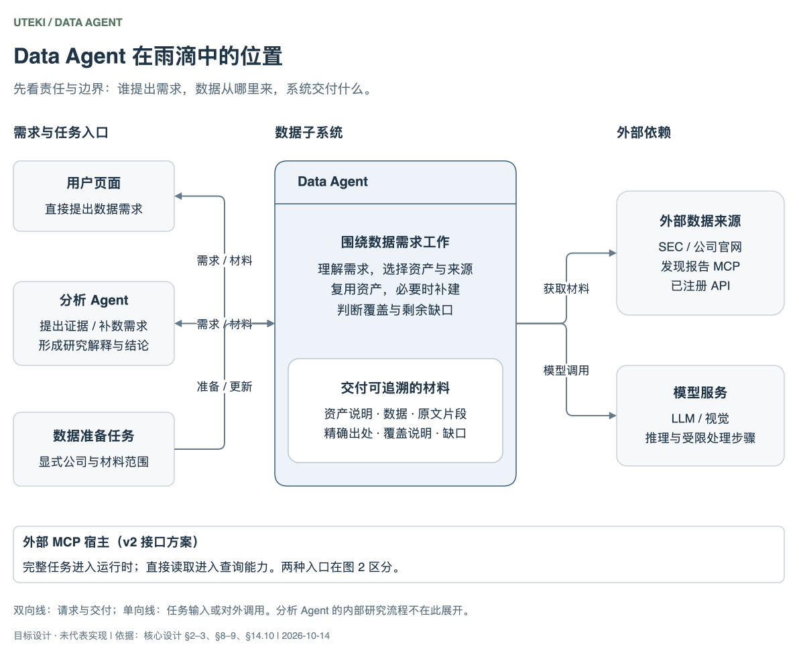
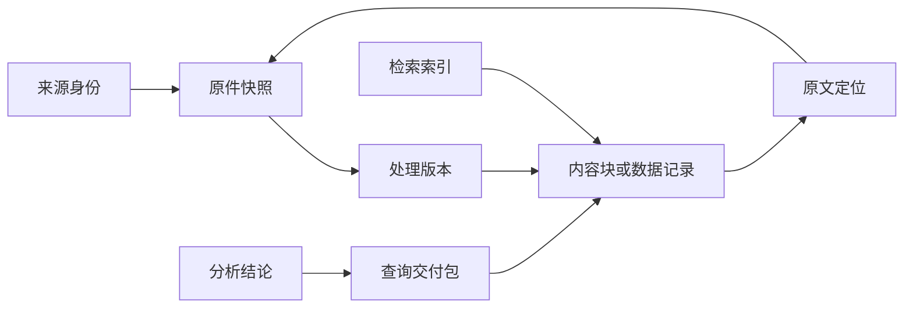
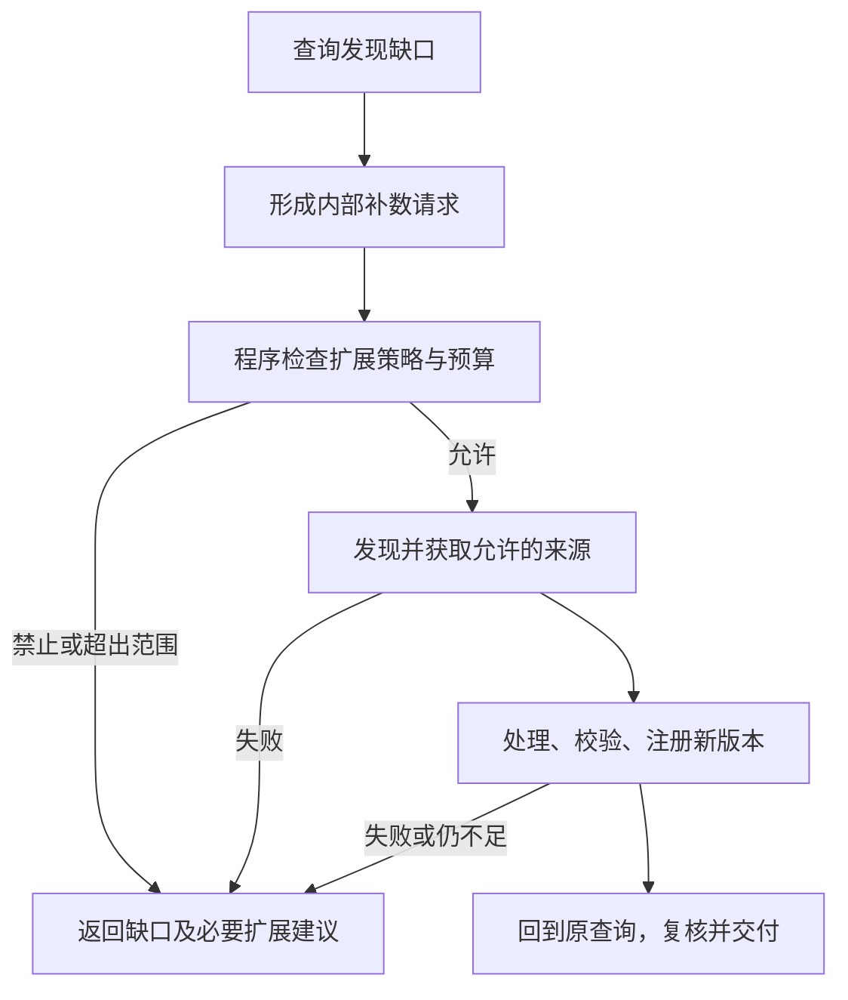
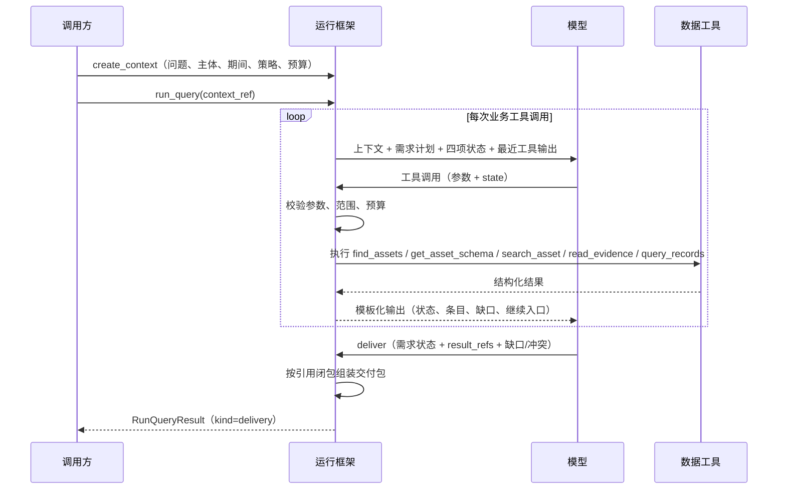
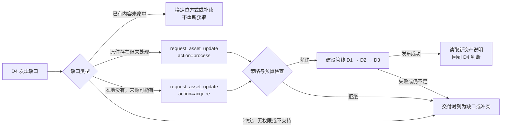
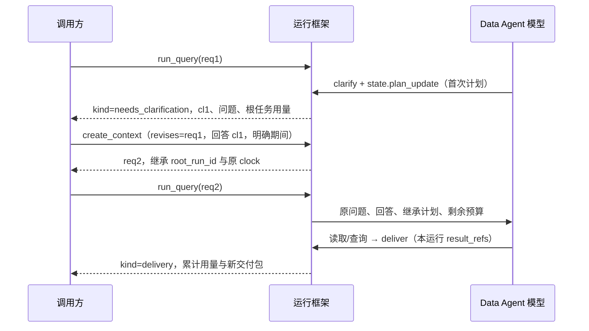

# Data Agent 与分析 Agent：数据能力框架设计

日期：2026-10-15 · 版本：设计稿 v1.30 · **状态：第四批原限定验收记录保留（14.12.12）；后续 review 的 R1–R4 已完成修正及限定验收（14.12.14）：187 项测试、49 个安装文件核验及旧格式兼容通过。第五批第一步双 SDK 离线绑定已完成限定验收及 review（14.12.15）；按用户连续推进授权，下一步为 T5/T6 运行控制。未接生产、未新增真实取数、模型调用为 0，不代表 Agent 自主业务通过。前三批和环境证据见 14.12.8–14.12.11；M0 仅离线接入及本地 CLI 探针通过，真实模型/网关未验收。保留 OpenRouter、两套官方 SDK 与各模型独立 prompt，DeepSeek 为低成本功能验证候选，工作台后置**。

本文整理已确认职责、设计及分批限定验收，不新增业务范围授权，不宣称目标框架全部实现。公司、年份和单次实验属于验收案例，不成为通用规则。DA-01 获取与储存、DA-02 解析与索引、DA-03 查询与材料交付保留为模块 ID。第四批原交付后停止；review 原发现见 14.12.13，收尾证据和后续离线适配准入见 14.12.14。模型功能验证与业务效果验收分开，工作台继续后置。

## 1. 这份设计要回答什么

目标：让用户与分析 Agent 通过同一套 Data 能力取得足够、聚焦且可追溯的数据。数据缺失时有补充路径，数据错误时能定位到来源、处理、查询或分析环节。

开工前必须回答：

1. 获取、解析、存储、索引和查询各负责什么，如何交接？
2. 不同输入处理成什么，哪些不需要文档解析？
3. 原件、处理结果、索引、交付与分析引用怎样关联？
4. 多个子问题如何选择不同数据与执行方式？
5. 没有数据、存在冲突或来源不可访问时怎么办？
6. 谁审核、谁缓存，什么时候复用、更新或停止？

**状态约定：**“已有”沿用原稿记录的局部机制，本轮未重新核验源码；“有限验收”仅指指定案例；“建议设计”等待本轮 review；“待设计/验证”表示没有完整实现或证据。旧文档中的历史方案和旧运行结果不能自动升级为当前能力。

**参考流程的适配原则（2026-10-13 确认）：**用户贴出的流程可能是对其他项目的总结，先作为参考输入；后续每个流程都需判断是否适配雨滴，再讨论采用。已确认的职责保留，参考项目的具体实现不能自动成为雨滴的实现事实或技术选型。

- 先看解决的问题和前提：是否适用于雨滴的 PDF、HTML、已注册 API 等材料，是否依赖现成资产库、特定业务系统或已生成的元数据。
- 再映射雨滴的职责和契约：先明确分析 Agent 与 Data Agent 的业务归属，再区分模型判断、工具程序与检索后端的具体执行工作；能否保留指定版本、原文定位、处理状态、覆盖与缺口。涉及现有能力时按需核对源码和产物，没有证据的部分明确待验证。
- 说明哪些保留、哪些调整、哪些不采用及原因，确认后写入设计。优先复用已有机制；Function 与执行层的分离不意味着必须新建独立 HTTP 服务，通信方式和部署位置按雨滴实际需要另定。

## 2. 第一层：职责边界

**职责层级（2026-10-13 确认）：**资产接入、处理、生成和维护说明均属于 Data Agent 的整体职责；其中模型负责判断，工具程序承担具体执行。下表“程序执行层”在这些流程中承接 Data Agent 的工具工作，业务归属与执行方式分别描述；生成时机与内部职责见第 7.2.2 节。

| 角色 | 负责什么 | 交付什么 |
|---|---|---|
| 分析 Agent | 拆解研究问题，提出证据需求；解读研报，比较公司、竞对及不同报告观点；形成解释、假设、结论和观察建议；关注与持仓相关的风险（是否交给独立风险 Agent 待设计） | 清晰易读、可交互且可追溯的研报解读，带引用的报告、图表、比较结果，持仓风险观察及补充数据请求 |
| Data Agent | 发现/获取数据；组织处理；生成和维护资产说明；选择数据源与查询方法；核对材料是否满足数据请求；补查与交付 | 资产说明、数据、原文片段、必要上下文、精确出处、覆盖说明与缺口 |
| 程序执行层 | 下载、解析、SQL/检索执行、计算、版本保存、边界校验、资源控制与任务调度 | 可复核的工具结果和运行记录 |
| Codex | 实现与测试系统，独立核验原件、过程与交付 | 工程修复及验收判断；不代替运行 Agent 选材料、填答案 |

Data Agent 可以做明确口径的计算、格式整理及来源表述抽取；投资解释、研究假设与结论归分析 Agent。管理层解释要保留说话者，不能自动变成已证实的因果关系。

**监控的分工：**分析 Agent 提出观察对象与意义；Data Agent 按要求更新、记录观测值与变化；程序负责定时、失败恢复和通知。产品价格/库存是观测信号，不能直接等同产品好坏或需求强弱。端到端持续监控目前待设计/验证。

### 2.1 分析功能：解读研报

**已确认的功能方向（2026-10-13）：**将研报变得清晰、易读、简单、可交互、可 ref（可引用并回到原文）。以下交付方式为建议设计，未实现或验收。

- **清晰易读：**先讲报告的核心观点、依据、关键假设与风险，再按需展开术语、图表和估值逻辑；简化表达时保留限制条件、不确定性和反面证据。
- **区分观点归属：**明确哪些是报告作者的观点或预测、哪些是可核验事实、哪些是分析 Agent 的解释或判断，不把研报结论直接当作事实。
- **可交互：**用户可围绕某个结论追问“为什么”“假设是什么”“哪里可能不成立”，并展开相关证据；需要新材料时，通过同一套 Data 能力补查。情景计算应显式标注用户或 Agent 新设的假设，不改写原报告预测。
- **可 ref：**关键观点、数字和图表关联报告版本及具体页码、段落或表格位置，用户能从解读回到原文；补充来源分别引用，定位不可用时明确缺口。

建议交付结构：核心观点 → 推理与依据 → 关键假设及风险 → 可展开的解释与原文引用。验收关注用户能否读懂论点、追问依据并核对原文，不能只检查摘要长度或引用格式。

### 2.2 分析功能：关注持仓风险

**已确认的功能方向（2026-10-13）：**关注持仓对应的行业风险、公司风险和宏观风险；可以由风险 Agent 完成，但当前职责、工作流及独立 Agent 形态尚不清晰，保持待设计，不据此启动开发或持续监控。

建议从“风险如何影响当前持仓”组织内容，而非只罗列风险新闻：

| 层次 | 关注内容示例 | 与持仓的关联 |
|---|---|---|
| 行业风险 | 供需、竞争、技术替代、行业监管变化 | 影响哪些持仓的需求、价格、利润率或竞争位置 |
| 公司风险 | 经营执行、财务、客户集中、治理及公司特定事件 | 哪项原投资假设受到影响，依据是什么 |
| 宏观风险 | 利率、汇率、经济周期及政策变化 | 经由融资成本、收入、成本或估值等路径影响哪些持仓 |

**建议的最小风险交付：**发生了什么变化 → 影响哪些持仓、通过什么路径 → 支持证据与不确定性 → 后续观察信号及证伪条件。同一风险可能同时影响多个持仓，应展示共同暴露；缺少仓位权重或必要数据时，说明无法量化组合影响，不编造风险分数或损失估计。持仓及其时点来自用户明确提供或授权的数据，不从对话猜测。

**责任边界提案：**分析 Agent 解释风险对研究结论和投资假设的影响；若设风险 Agent，由其聚合跨持仓风险、跟踪变化并反馈分析 Agent；两者共用 Data 能力取证，程序负责调度与通知。是否拆分独立 Agent、持仓输入、风险优先级、观察频率与提醒触发规则仍需 review；现阶段不承诺自动交易或仓位调整。

## 3. 能力关系：建设数据与使用数据分开

**四类一级功能已确认（2026-10-13）：**收集数据、处理数据、存储与管理数据、查询与交付数据。更新与时效、质量与冲突、追溯与问题定位属于各功能的补充要求；自主判断、状态更新和工具调用属于运行机制，不与四类一级功能并列。

下面是这四类功能的目标关系图，表达数据建设、使用及按需补充的关系；用户已认可本图（2026-10-13），不代表当前代码已完整实现这些能力。


**图例：**①–④ 为四类一级功能，外部材料、数据需求和交付结果是输入/输出；编号不表示固定执行顺序。实线表示正常的数据或请求流，虚线表示缺口触发的有条件补充。两条补充路径均遵守第 8 节的来源、权限及资源边界。

- **数据建设路径：**收集 → 保存并冻结原件 → 按类型解析、规范化与校验 → 保存处理结果，注册资产、说明与索引；可独立完成数据准备任务。
- **数据使用路径：**理解需求 → 查找已有资产 → 读取资产说明及相关内容 → 整理或计算 → 判断是否满足需求 → 交付。用户与分析 Agent 使用同一套查询能力和结果包，用户页面可按需展示查询过程。
- **按需补充：**缺原件时补收集，原件已有但不可用时补处理；新结果保存并登记后回到查询。已有可用数据时直接复用，内容不足时在查询内部补查、补读。
- **交付边界：**满足需求后交付；因权限、资源或其他限制无法继续时，交付已确认部分及明确缺口和停止原因，按第 9.2 节在交付前进行整体充分性检查。
- **功能与执行机制：**四类功能均属于 Data Agent；模型负责选择、理解与判断，工具程序负责具体执行。更新、质量、追溯等要求贯穿各功能，不另增一级功能节点。
- **与模块 ID 的关系：**既有 DA-01 获取与储存、DA-02 解析与索引、DA-03 查询与材料交付继续保留为模块 ID。四类功能是本节的业务职责划分，不要求对应四个 Agent 或部署服务，也不新增并行开发任务；存储、版本、身份和出处仍贯穿三个模块。

### 3.1 系统架构与 review 优化（职责已确认，2026-10-14）

**状态：**第 2–11 节的职责及本节 A1–A9 已于 2026-10-14 确认。用户随后指出原图不清晰，并确认按“系统关系 → 内部组件”两个抽象层次使用 draw.io 重绘。用户现已反馈方案 review 完成；图示仍表示目标设计，不代表实现。剩余决策与本轮评估集中在 14.16。

[打开可编辑的 draw.io 文件（两页）](design/diagrams/data-agent-architecture.drawio)。下方 SVG 由 draw.io 导出，可放大查看，也内嵌了两页绘图数据。维护时编辑同一份 `.drawio` 文件并重新导出两张预览；不另建平行架构方案。

**图 1 · 系统关系：Data Agent 在雨滴中承担什么责任**



先看输入、责任和交付：用户页面与分析 Agent 提出数据需求；数据准备任务提出显式公司与材料范围的建设需求。Data Agent 使用外部数据来源与模型服务，交付数据、原文、精确出处、覆盖说明及缺口；研究解释、假设和结论仍归分析 Agent。本图只展开雨滴的数据子系统，不将其当作整个雨滴的全部功能。

**图 2 · 组件架构：Data Agent 内部如何完成数据任务**


- **边界与归属：**模型决策、运行框架、查询能力、建设能力和资产存储管理都属于 Data Agent。框表示逻辑职责；首期仍是单机、单用户、Python 进程内调用，不表示独立部署服务。右侧文字明确规则配置、模型服务与外部来源的使用方，省略跨图的支撑连线。
- **查询与建设：**运行时调度查询能力；已有资产不足时，在策略允许范围内经 `request_asset_update` 补建设。数据准备任务与按需补建使用同一条建设管线。发布后的新资产可用于后续查询；已有查询按冻结引用读取，不因新版本发布而漂移。
- **共同基础：**本地文件与 SQLite 维护权威内容和元数据；资产内检索索引与 DuckDB 记录视图属于可重建的派生数据。SQLite 发布状态是查询可见性开关；发布事务、冻结说明与实时能力的具体规则见 14.5。运行记录、完整工具结果、交付包与同一任务的费用继续按 6、8.4、14.9 保存。
- **MCP 接入：**按 14.10 的 v2 接口方案，`run_query` 进入完整任务运行；外部宿主直接调用读取工具时，不经过 Data Agent 充分性判断，其工具结果不能称为 Data Agent 交付。`request_asset_update` 不直接向外部宿主开放。现有 v1 冻结，v2 的方案展示不代表迁移已经实现。

**读图约定：**图 1 双向线表示需求与材料交付，单向线表示任务输入或对外调用。图 2 实线表示主调用或数据访问（除标注外省略返回），虚线仅表示策略允许时的按需补建。位置不表示执行先后；查询循环、建设阶段与发布顺序由第 7–9、14 节的流程展开。第 3 节四类一级功能保持不变：收集与处理落在建设能力，存储与管理落在共同基础，查询与交付由运行时和查询能力共同完成。

#### 3.1.1 Review 发现与优化（已确认）

| # | 发现的问题 | 优化提案 | 影响章节 |
|---|---|---|---|
| A1 | 第 7.2 节工具清单只有读取工具与一个补建设入口，第 8.3 节另列发现、获取、处理、注册能力；建设路径由谁、经哪个入口执行没有统一 | 建设能力收敛为一条**资产建设管线**：程序编排“发现 → 获取 → 快照 → 解析 → 标注 → 校验 → 发布”各阶段，模型只在需要理解的阶段受限参与（来源发现、公司角色、语义标注、摘要），费用计入发起任务。模型可见工具保持 5 个读取工具加 `request_asset_update`；预先准备数据与查询中补缺口走同一管线，不维护两套建设流程 | 7.2、8.2、8.3 |
| A2 | 第 6 节三类职责没有区分可重建与不可重建；DuckDB 只在正文出现，不在职责表内，与 SQLite 的主数据边界不清 | 存储分**权威层**与**派生层**：本地文件（原件与实际处理产物）和 SQLite（身份、关联、版本、依据、发布状态）不可由其他层重建；资产内检索索引和 DuckDB 结构化视图都由已发布 build 派生，以 build 引用为键，可删除重建。公司、资产等主数据只在 SQLite 维护，DuckDB 不作第二个元数据来源 | 6、6.1 |
| A3 | 文件、SQLite、索引、DuckDB 四处写入，第 6.1 节要求原子发布，但没有约定以哪一处作为“已发布”的判定 | 以 SQLite 的 build 发布状态作为**唯一可见性开关**：产物写入暂存目录 → 校验 manifest、hash 与引用闭包 → 构建派生层 → 一个 SQLite 事务登记产物并把 build 置为已发布。查询只看已发布 build；派生层缺失或失败时只把对应能力降为 partial，不影响原件与其他能力 | 6.1、6.2 |
| A4 | “检索索引”同时承担资产发现与资产内定位；第 12.1 节外部候选（PageIndex、OpenAI 文件检索）替换的到底是哪一层不清 | 检索分两级：**资产级发现**基于 SQLite 元数据过滤和资产标题、摘要的文本匹配，由 `find_assets` 进程内调用，首期不需要 HTTP 后端；**资产内检索**定义统一接口（outline / concept / text，返回绑定 build 的块引用与定位），A/B 只替换这一接口的后端。外部后端返回的片段必须能映射回雨滴的块与原文定位，否则不能作证据 | 6、7.2.1、12.1 |
| A5 | 传输与部署方式留待以后决定；仓库已有只读 `uteki-data` MCP（`discover_data / get_data_schema / query_facts / read_source`），与第 7.2 节六个工具的关系未说明 | 首期按单机单用户做成**单进程 Python 库**，分析 Agent 与用户页面进程内调用，不新建 HTTP 服务；外部宿主沿用 MCP，作为能力层只读工具的一种暴露方式。现有四个 MCP 工具与新工具的对应和替换在接口文档中对齐，不并行维护两套语义 | 7.2、接口文档 |
| A6 | 来源策略、材料 profile、概念表、模型配置都要求“显式选择、版本化”，但架构中没有它们的归属 | 新增**规则与配置**作为版本化输入（随代码版本管理），由 build manifest 与运行记录引用其版本；运行时只能显式选择，不能由公司名触发。现有 `adapters/alphabet_*` 是实验运行时显式选择的公司映射，只作历史基线，新管线中的适配器按材料类型和来源注册 | 4、5.2、5.5 |
| A7 | 查询记录、工具结果、交付包和费用要保留，但第 6 节只说“按上述职责保存” | 运行记录与冻结交付包作为内容写入本地文件（按请求组织），SQLite 只登记引用与状态；同一任务的费用记在同一账本，不因新目录而拆分 | 6、8.4 |
| A8 | DA-01 “获取与储存”同时包含①收集和③存储，模块 ID 与四类功能对不齐 | 对应关系：DA-01 = 发现、获取与原件快照写入；DA-02 = 解析、标注、校验与派生层构建；DA-03 = 目录、检索、结构化查询与交付。SQLite 元数据目录与发布协议是三个模块共用的基础，不单列模块 | 3、13 |
| A9 | 第 2 节职责表把“程序执行层”与 Agent 并列，与“执行属于 Data Agent 职责”的正文容易误读 | 架构图中把运行框架与能力层画在 Data Agent 边界内，职责不变；第 2 节表格措辞等确认后再调整 | 2 |

**不纳入本次优化：**风险 Agent 的形态、持仓数据来源、持续监控与调度、语义缓存，以及第 4 节第三方研报的接入表述（用户已说明有发现报告 MCP 入口，表述待整理第 4 节时一并更新）。

#### 3.1.2 现有实现的参考现状

**用户补充（2026-10-14）：**先要求“忽略已有实现，以做对和做好为最终目的”，随后明确采纳“重建 Data 核心、底层复用、外围升级”，并要求计入旧代码成本，优先 follow 官方协议与 SDK；与自定义 Agent 机制冲突时优先官方能力，差异大且升级成本高时重建对应模块。最新指定 OpenRouter 统一模型入口，对比 OpenAI 与 Claude 两套 SDK 及配套实现，见 14.17。下表按 2026-10-14 只读核对源码与依赖，未运行。

| 组件 | 现有实现（仅参考） | 第 14 节方案 |
|---|---|---|
| HTML 解析 | lxml，`document_sources/parsed_package.py` | 新建块模型，保留 DOM 定位与 iXBRL 标签（14.6） |
| PDF 文字与坐标 | poppler `pdftotext -bbox-layout`，`research_data/company_materialization.py` | Docling 与 PyMuPDF 做 A/B 后定（14.6、14.8） |
| OCR 与图片 | tesseract CLI；Claude、DeepSeek、Qwen 视觉适配 | OCR 引擎随 PDF A/B 决定；视觉读取按需补处理（14.6） |
| 原件存储 | 按内容 hash 保存本地对象，`document_sources/company_acquisition.py` | 新内容存储布局（14.3） |
| 元数据目录 | 未实现；SQLite 仅用于预算账本与发现报告 | 新建 SQLite 目录（14.4） |
| 结构化查询 | DuckDB 1.5.5 快照，`research_data/query_dataset.py` | DuckDB 派生视图，记录来自 iXBRL 与 SEC XBRL（14.6、14.7） |
| 资产内检索 | 原文目录、搜索、读取请求，`domain/research_data/execution_scope.py` | `ContentIndex` 接口，FTS5 基线，外部后端经 A/B（14.7） |
| Agent 运行时 | openai-agents 0.22.2 已安装；`autonomous_model.py` 用 Runner 作单轮决策，`autonomous.py` 自行调度 24 种 action | 两套官方 SDK 各自承担完整循环，重新接入相同业务工具，退出旧决策协议与调度；沿官方接口升级，不新造 Agent 框架（14.9、14.17） |
| 对外接口 | `uteki-data` MCP v1，只读四工具 | MCP v2 同名工具；v1 冻结（14.10） |
| 来源接入 | SEC 获取与索引、有限官网发现、发现报告接口 | 新 connector 协议（14.6） |

## 4. 第二层：获取哪些类别的数据

| 类别 | 例子 | 来源选择原则 | 当前边界 |
|---|---|---|---|
| 官方披露 | 财报、公告、业绩材料、电话会材料 | 官方披露系统或确认归属的官方渠道；区分原版和修订版 | SEC 与有限官网获取已有；全部类别取齐未验 |
| 专业接口数据 | 财务、估值、股价、K 线、成交量 | 适配任务的专业供应商；保留供应商、口径与版本，必要时对照披露 | FMP/行情没有已验收的统一接入 |
| 公司官方网页 | 产品、定价、技术文档、博客、发布动态 | 确认官方归属，保存时间和网页版本 | 有限 HTML 发现已有；全面覆盖未验 |
| 产品与经营观测 | 价格、库存、销量、交付时间、性能评测 | 可验证来源；保留型号、地区、渠道、采样方法等条件 | 通用接入与持续监控待设计 |
| 第三方观点材料 | 研究报告、行业评论、独立测试 | 保留作者、范围与方法；观点和事实分开 | 研报经已有的发现报告 MCP 入口接入，发布券商与收录平台分别记录；其他第三方材料仅定义边界 |

**首期来源收敛（2026-10-14，用户确认）：**新 Data 核心先接 SEC 披露/结构化接口、公司官网等官方来源；专业商业 API 与第三方研报来源后续按需选择。上表保留完整能力分类，发现报告旧入口保留为现状，不纳入本次首期 connector 验收。PDF、HTML、明确 API 的格式范围不变，首期样本从官方材料中选取。

来源不是一条绝对可信的排名。官方适合证明自身披露，专业接口适合标准化查询，其他一手观测可能适合价格等问题。分别记录来源适用性、处理质量与当前问题适配性，不用一个“可信”标签替代全部判断。

公司、证券、产品、业务分部是不同对象；需要明确身份及映射。来源规则、适配器和使用权限应版本化并显式选择，不因某个公司名称触发隐藏特例。公开可访问也不等于可无限抓取或再分发。

## 5. 首期输入与材料资产

**已确认（2026-10-13）：首期支持 PDF（含扫描页和内嵌图片）、HTML 和明确接入的 API 数据；PPT/PPTX 不在本期范围。** 独立图片、任意 Markdown/CSV 导入与音频转录不因内部使用这些格式而自动成为本期输入能力。

| 输入 | 处理产物 | 定位与质量要求 |
|---|---|---|
| PDF | 文字、章节、表格、扫描页 OCR、图片区域及必要视觉读取结果 | 绑定原件版本、页码、区域及坐标定义；保留表头、单位、脚注和跨页关系。无法可靠识别的内容留缺口 |
| HTML | 页面快照、原始目录、段落、列表、表格和必要图片 | 绑定冻结页面版本、元素/文本区间或单元格；复杂交互导致获取不全时留缺口 |
| API 数据 | 原始响应、规范化记录及字段说明 | 保存来源、请求参数（凭据除外）、时间、分页/覆盖状态、主体/期间/单位/空值口径和原始字段定位；不承诺任意接口自动接入 |

PDF 先提取文字和版面并建立图片区域索引；扫描页或文字层不足时使用 OCR，需要理解图表时再视觉读取。图片须进入可发现范围；原图、OCR 和模型描述分别保存。明确披露的数字与坐标估读结果分开，不将估读冒充精确披露。跨页表格保留原始片段，能确认连续关系时再关联，不强行拼接。

### 5.1 一篇材料作为一个资产

**已确认：PDF/HTML 以一篇材料作为一个可浏览、可搜索、可引用的资产。** 资产同时组织原文、目录和提取内容；目录与内容建立索引，提供稳定定位能力。API 数据通过显式定义的资源/快照范围提供资产说明，具体粒度待定，不强套章节结构。

| 组成 | 内容 |
|---|---|
| 身份与来源 | 公司身份、symbol 映射、材料类型、报告期间、发布时间、来源及版本；发布时间与报告期间分开，未知值显式 |
| 原文 | PDF/HTML 原始字节、页面快照及必要图片资源 |
| 原始目录 | 实际章节标题、父子层级、顺序和定位；推断的结构注明推断状态 |
| 提取内容 | 段落、列表、表格、图片等内容块，包含所属原始章节、顺序、原文定位及质量状态 |
| 资产说明（schema） | 目录、内容类型、语义覆盖、定位方式、支持的查询操作及已知缺口；API 另含字段、单位、时间口径等说明 |
| 索引 | 目录索引、受约束的语义索引、全文索引；共同指向同一份内容与原文 |

表格保存行列、单元格、表头关系、单位、脚注与原始区域；图片保存原图或裁剪图、图题、提取文字、派生描述及不确定性。转成 Markdown 可方便阅读，但不能替代这些结构与原文映射。

### 5.2 原始目录、规范目录与语义索引

目录回答“内容在哪里”，语义索引回答“哪些内容与问题有关”。每个内容块保留原始章节归属，同时可关联多个语义概念；通过引用关联，不为多个标签复制原文内容。

解析后建立受约束的语义标注，允许规则或模型参与，受两种 scope 限制：

- **材料范围：**只基于当前资产及明确的内容范围标注，不借其他材料补造本资产没有的信息。
- **分类范围：**使用显式选择、版本化的材料适配器与分类规则，限定合法章节类别、内容类型和概念；不随意创建标签或强填分类。

10-K 等材料使用对应适配器，将原始章节映射到规范目录。保留原始标题与层级，不假设所有公司的子目录相同；映射记录明确、推断或未匹配状态。逻辑路径如“公司 / 报告期间 / 10-K / business / overview”是导航入口，不是唯一证据 ID，也不保证每份材料都存在该子章节。

语义概念应有统一定义，并保留原文名称与具体口径。例如将某行 Net sales 关联收入概念时，须结合表名、行列和上下文区分合并/分部、金额/增长率、年度/季度及历史/预测。标签必须有证据定位；字段合法不证明语义标注正确，语义质量需独立验收。

全文索引覆盖正文、表格文字、图题及 OCR，并区分文字来源。产品名及别名可通过全文搜索或类似 grep 的匹配定位；受约束语义索引属于本期基础能力，不依赖先引入向量检索，也不属于第 10 节后置的语义答案缓存。

目录应区分原件存在、尚未处理、已处理但未分类、仅能原文读取和已确认可查询等覆盖状态。标签未命中不能直接推断未披露。索引和派生摘要帮助定位，事实引用最终落到原文或原始字段。

### 5.3 资产契约：Agent 先知道有什么，再知道怎么查

**本节至 5.6、6.1、7.1–7.5 为本轮细化提案；其中 5.3.1 的公司与资产关联思路、5.3.2 的三层版本关系与典型变化规则、7.2.1 的流程与职责、7.2.2 的输出边界、说明信息含义与内部职责、7.2.3 的定位与读取衔接原则已确认，其余待用户 review。字段名、状态与函数名不是现有代码声明。** 目标是让同一版本材料和显式查询条件获得可复核定位，不承诺不同模型每次推导完全相同。以下 JSON 与调用例均为虚构设计样例，不是公司事实或实跑。

资产分两种类型：`document` 与 `dataset`。文档资产是一份逻辑材料；API 数据资产是显式注册的供应商资源、数据口径与声明范围，一个快照可包含多个分页响应。不把每页响应注册成彼此无关的数据资产，也不把“某个供应商全部数据”作为一个无边界资产。

**资产身份与版本的细化判定：**三层版本关系、三种典型变化及查询绑定原则已在第 5.3.2 节确认；本段的具体标识字段、表现形式与 API 规则仍为提案。`asset_id` 回答“是哪份材料或哪项数据资源”，`snapshot_id` 回答“冻结了哪次原始内容”，`representation_id` 区分具体原件形式，`build_id` 区分基于原件的处理结果。API 的声明范围是注册时固定的主体、期间规则等边界；一次获取的实际覆盖和一次查询的筛选条件分别记录，不能反过来静默修改资产身份。

| 变化 | 身份与版本处理 |
|---|---|
| 另一报告期间的新报告，或无法证明是同一逻辑材料 | 建立独立资产；相似标题、相同文件名或字节 hash 不足以合并身份 |
| 同一报告发布修订版 | 保留资产身份，新增原件快照并记录有依据的修订关系；保留旧快照，不自动替换历史引用 |
| 同份材料有 PDF/HTML 两种形式 | 核对逻辑材料身份后可归属同一资产；分别保留原件、表现形式与定位，不据此认定内容逐块等价 |
| API 在声明范围内增加实际覆盖或返回更新数据 | 保留资产身份，新增冻结快照并记录请求、响应分片与实际覆盖；分页不产生独立资产，缺页仍记为缺口 |
| API 更换供应商资源、改变数据口径，或超出原声明范围 | 建立新资产并记录关系；不通过扩写旧资产边界使原授权自动扩大 |
| 只改变查询期间、字段或筛选条件 | 产生新的查询记录，已有快照足够时直接复用；需要补获取时按上述快照规则处理，不为每次查询建资产 |
| 原件不变，只更新解析器、OCR 或分类规则 | 新增处理构建，保留原件与旧构建；不同构建的块 ID 不保证相同 |

快照的原件清单也冻结。后来发现的另一表现形式或补到的 API 页不能追加进已冻结快照；需要新的快照及关联，可复用相同字节的存储。首次快照冻结前可汇集分页响应，但冻结后仍缺页时必须保留当次不完整状态。以上只规定身份与追溯原则；首个 API 的具体资源与声明范围仍待选择，未在本轮决定供应商或接入范围。

**分页覆盖与来源版本一致性分别判断：**每个响应分片保留请求、获取时间，以及供应商提供的数据版本或快照依据（没有则记未知）。页数齐全、同次运行获取或归入同一内部快照，都不能独自证明各页来自同一来源版本。补页可以形成新的冻结集合，但不能消除原分片的时间或版本差异；要求同一来源版本的查询，在依据不足时须返回一致性缺口，不能仅凭覆盖齐全交付为完整结果。其他查询也保留这些差异，按原请求的口径判断可用性；不因此自动扩大获取或重复调用。

**身份划分走查（2026-10-13，虚构场景，非实跑）：**按用户“先试试”，暂采用资产、快照与查询分离的划分继续设计。以下固定 `A1` 为演示供应商 P、主体 X 的年度利润表历史实际值资源；期间规则为供应商已披露的财政年度，具体查询再指定年度与截止日，不把滚动的“最近三年”作为资产身份。初始 `S1/B1` 只覆盖 FY2024–FY2025；所有操作均假定在原授权范围内。

| 输入或变化 | 按设计应得到的结果 | 能区分的错误判断 |
|---|---|---|
| 从查询 FY2024–FY2025 改为只查 FY2025 | 仍用 `A1/S1/B1`，新增查询记录；已有值及出处可复用 | 不应因为筛选条件变化新建资产或重新获取 |
| 查询扩至 FY2023–FY2025，后来补到 FY2023 的响应 | `A1` 不变，形成 `S2/B2`，保留各分片出处与 `S1`；若分片缺少共同来源版本依据，覆盖可齐而一致性仍未知 | 不能修改 `S1`；不能将“补齐年度”直接当作“同一版本完整数据” |
| 供应商随后修订 FY2025 的值 | 同一 `A1` 保存新快照和相应构建；旧查询仍指向 `S1/B1`，新查询按显式版本与截止日选择 | 不能因刷新资产而改写旧交付中的值，也不能默认最新值适用于历史截止日 |
| 改取预测值或另一供应商的数据 | 超出 `A1` 的资源/口径，需独立资产及关系，并另行检查原政策是否允许 | 不能作为 `A1` 的补页或普通筛选返回 |
| 原始响应不变，只修正字段单位映射 | `A1/S1` 不变，新增处理构建，保留 `B1` 与原字段定位 | 处理纠错不伪装成供应商更新；原有交付仍可复核 |

走查结论：身份划分暂未在上述场景中出现矛盾；补页场景暴露了“覆盖完整不等于来源版本一致”的缺口，已补入契约。这里检验的是规则是否说清，不是工具行为或真实供应商能力；首个 API 能否提供一致版本依据仍待接入时验证。

采用“共同信封 + 类型专属 schema”，不把 API 字段伪装成文档章节。资产说明的信息范围与含义已在第 7.2.2 节确认；下表的具体字段及编码仍为提案。

| 共同字段组 | 最小内容与规则 |
|---|---|
| 身份 | `asset_id`、`asset_kind`、`title`、`entity_refs`、`material_type`、`language`；公司主体 ID 与 symbol/交易所映射分开。多主体资产保留各主体角色，不能把提及公司都当作发行主体 |
| 来源与时间 | `source_ref`、`reporting_period`、`published_at`、`available_at`、`acquired_at`；附时间依据。发布日期未知可空，禁止用下载时间填充；截止日适用性单独判断 |
| 冻结引用 | `snapshot_id`、`representation_id`、`build_id`；分别指原件快照、PDF/HTML/API 表现形式、处理与索引构建。每次读取都绑定这组版本，不隐式跳到最新 |
| 内容覆盖 | `coverage` 描述已观察到的主体/期间/概念及证据；报告期间不替代内容覆盖期间，未知不当作无覆盖 |
| 处理状态 | `readiness` 分别记录原件、结构、表格、图片、语义索引的状态与未完成位置；不以一个 ready 掩盖局部缺陷 |
| 规则与能力 | `profile_ref`、`taxonomy_ref`、`capabilities`；列出可用概念、过滤字段、操作及读取限制；不宣称不支持的查询 |
| 使用边界 | `policy_ref`、`issues`；服务端逐次检查权限与范围，schema 中的声明不授予权限 |

文档的专属 schema 包含目录入口、规范章节映射、块类型、概念覆盖摘要、全文语言/字段及读取方式。API 的专属 schema 包含记录键、字段类型/语义/单位、维度、期间口径、分页范围、分片来源版本及一致性状态、空值含义、允许的过滤/聚合操作和原始响应定位。

**渐进加载：**`find_assets` 返回摘要；`get_asset_schema` 先返回能力、覆盖、根目录或字段摘要；展开指定章节/字段组时才加载详情。资产说明由当前构建的 manifest、目录和分类规则生成，不另写一份会与索引漂移的自由文本说明。模型生成的内容概述注明派生，不能独自证明覆盖。

#### 5.3.1 公司与资产关联（思路已确认）

**已确认（2026-10-13）：**公司独立维护，资产独立维护，通过带角色和判断依据的关联记录连接；内容相关的关联绑定对应材料版本。以下三个结构描述逻辑职责，表名、字段、角色枚举、唯一约束及实际存储实现仍待细化。

| 逻辑结构（表名示意） | 负责什么 | 主要信息 |
|---|---|---|
| 公司 `companies` | 确认是哪家公司 | 稳定公司 ID、规范名称、别名；公司身份与证券代码/交易所映射分别维护；补充行业及竞争对手信息，字段归属建议见 5.3.3 |
| 资产 `assets` | 确认是哪份逻辑材料或哪项数据资源 | 资产 ID、标题、资产类别、材料类型、来源地址/链接及业务时间；链接与时间按对应来源及版本维护，见 5.3.3 |
| 公司与资产关联 `asset_company_relations` | 说明材料与公司的关系 | 资产引用、公司 ID、关联角色及判断依据；内容相关关联保留适用版本 |

- 一家公司可以关联多份资产，一份资产也可以关联多家公司；行业、宏观材料允许没有具体关联公司，保留行业、地区等覆盖对象。
- 披露主体、主要研究对象与普通提及分别表达。年报中出现另一公司名称，不足以将其归为主要研究对象；关联须有依据，无法确认时保留未知。
- 发布方归来源信息，与研究对象分别记录。发布方本身是公司时，可以引用同一公司主档，不为其发布角色另造公司身份。
- 公司 ID 列表可作为资产检索条件，利用关联记录找到候选；接口字段、角色过滤及具体匹配语义继续单独 review。

**虚构示例：**甲公司的年报关联甲公司，角色为披露主体；比较甲、乙两家公司的研报作为一份资产关联两家公司，角色为研究对象，发布券商另在来源信息中记录；宏观材料可以没有具体公司关联。

本次仅确认关系思路，不冻结公司 ID 格式、物理表结构及版本引用字段，不代表数据库或查询接口已实现。

#### 5.3.2 资产、原件版本与处理版本（关系已确认）

**已确认（2026-10-13）：**分别记录材料身份、原始内容版本及处理结果版本。以“甲公司 2025 年年报”这一虚构材料说明：

| 层次 | 回答的问题 | 示例 |
|---|---|---|
| 资产 | 是哪份逻辑材料 | 甲公司 2025 年年报 |
| 原件版本 | 保存的是哪次原始内容 | 最初发布版、后来发布的修订版 |
| 处理版本 | 基于哪个原件，生成了哪份处理结果 | 首次解析结果、修正表格提取后的结果 |

一个资产可以保留多个原件版本，同一原件版本可以保留多次处理结果；处理版本记录所依据的原件版本。三种典型变化的处理已确认：

- 发布下一年度年报：新增资产。
- 修订同一份年报的原文：保留资产身份，新增原件版本。
- 原文不变，重新解析或修正提取：保留原件版本，新增处理版本。

查询结果同时绑定选用的原件版本和处理版本，保留当时读到的内容及其处理依据；后续更新不覆盖旧版本或旧结果的引用。

本次确认概念关系、上述典型变化和查询绑定原则；具体 ID、版本选择规则、PDF/HTML 表现形式与 API 分页细则、物理存储和接口仍待 review，不因本次确认自动冻结第 5.3 节的其余草案。

#### 5.3.3 公司与资产的业务字段（业务范围与时间含义已确认）

**已确认（2026-10-13）：**沿公司、资产、公司与资产关联、来源、原件版本、处理版本组织目录，并纳入公司基本信息、业务与行业、竞争关系、资产身份与覆盖、来源链接和可用性等业务信息；时间分别表达报告期间、内容覆盖、发布与修订、历史可得性、关系适用期间及系统获取、处理、登记和核对时间。竞争关系保留业务范围、时间与依据；资产可展示多个来源链接，并关联相应来源记录和原件版本。以下记录已确认的业务范围与含义，分阶段必填及维护原则见 5.3.4；具体字段名、逐字段约束、提取规则、编码及物理表仍待 review，不直接改写接口契约。

| 对象/字段组 | 业务信息范围 | 归属与使用边界 |
|---|---|---|
| 公司身份 | 公司 ID、规范名称、简称/别名、证券代码与交易所、官网、注册国家/地区 | 公司身份与证券映射分别维护；多地上市不产生多个公司身份 |
| 公司业务与行业 | 业务简介、主营业务、行业/细分行业、分类体系及版本或分类依据 | 可关联多个行业；行业关联保留业务范围、适用时间和依据，不能只按公司名生成分类 |
| 竞争对手 | 对方公司引用、竞争涉及的业务/产品、市场或地区、适用时间、说话者与原文证据、判断/核对状态 | 用公司之间的关系记录维护，对外可展示竞争对手列表；同业不自动等于竞争，单方披露不自动变成双方共同确认 |
| 公司补充时间 | 信息核对时间；成立日期、证券上市日期仍仅作为后续可选提案 | 上市日期归对应证券；是否纳入首期字段待后续需要时决定 |
| 资产身份与内容 | 资产 ID、标题、摘要、资产类别、材料类型、语言 | 摘要注明生成依据与版本，不能单独证明全文覆盖 |
| 资产覆盖对象 | 公司及其角色、涉及业务、行业、地区与内容覆盖期间 | 发布方与研究对象分别表达；宏观材料允许没有具体公司，覆盖未知时保留未知 |
| 资产来源与链接 | 发布方/作者、来源类型、来源页面链接、文件直链或 API 资源地址、对应来源与原件版本引用 | 资产摘要/详情可直接展示来源链接；底层通过来源记录及版本维护，可保留多个来源；本地文件位置另行登记 |
| 资产版本与可用性 | 原件版本、处理版本、对应产物清单、可用能力、覆盖缺口和核对状态 | 状态对应具体版本及能力，不以单一 ready 掩盖未处理部分 |

**时间字段按业务含义分别维护：**沿用第 7.2.2 节已确认的报告期间、内容覆盖期间、发布时间、获取时间和历史可得性定义，并补充版本、关系及处理记录所需的时间。

| 时间 | 回答的问题 | 建议归属 |
|---|---|---|
| 报告所属期间 | 这份材料名义上报告哪个财年、季度或期间 | 资产及相应版本的业务元数据；期间标签与有依据的起止日期分别保留 |
| 内容覆盖期间 | 已观察到的内容实际涉及哪些期间 | 对应原件/处理版本的覆盖信息，可包含多个期间 |
| 发布时间 | 来源何时发布该材料或版本 | 对应来源与原件版本，保留来源证据 |
| 来源修订/更新时间 | 来源何时修订了这一版本 | 对应原件版本；未知时不以雨滴发现变化的时间替代 |
| 历史可得时间 | 在指定历史时点能否取得该版本 | 对应来源与版本及其可得性依据；获取时间不能冒充首次公开时间 |
| 获取时间 | 雨滴何时实际取得这些内容 | 获取记录；相同内容再次获取可保留新记录，不据此强制生成新内容版本 |
| 处理时间 | 这份解析、抽取或摘要产物何时生成 | 处理版本或具体产物；失败和完成状态分别保留 |
| 关系适用时间 | 行业归属或竞争关系适用于哪个期间 | 对应关系记录；来源发布时间、系统观察时间与关系生效时间分开，未知边界不补造 |
| 记录创建/修改及核对时间 | 雨滴何时登记、修改或核对了这条元数据 | 系统记录；不替代材料发布、修订或业务关系的实际发生时间 |

时间表达保留精度：已知具体时刻时支持带时区的 datetime，只有日期时保留日期，报告期间保留期间表达；原始时区未知时明确留缺口。系统获取、处理等事件记录实际发生时刻。未知业务时间保留为空及相应原因，具体数据库存储类型和接口编码仍待确定。

行业、竞争关系和摘要等派生信息保留来源、判断方式与核对状态。竞争证据绑定说话者、业务/地区范围、时间及原文；供应商、客户、普通提及和竞争关系分别维护。这里定义数据表达，不开展公司或竞争关系的实际研究与填充。

#### 5.3.4 字段完整性与维护（原则已确认）

**已确认（2026-10-13）：分阶段必填，业务信息逐步补齐。** 能登记保存与能满足某类查询分别判断；缺失业务属性不要求补造，也不妨碍保留真实取得的原件。

| 阶段 | 必须具备的信息 | 阶段边界 |
|---|---|---|
| 公司正式登记 | 公司 ID、规范名称、身份依据 | 尚未确定的公司身份保留待确认，不因名称相似直接合并 |
| 资产登记 | 资产 ID、来源身份、资产类别、实际状态 | 登记资产不代表原件已保存或处理已完成 |
| 原件保存完成 | 原件版本、文件位置、内容 hash、获取时间 | 绑定所属资产与来源；仅发现链接或获取失败不能标为已保存 |
| 处理完成 | 输入原件版本、处理版本、产物清单、处理依据与时间、可用能力及缺口 | 状态对应实际产物；局部可用保留能力与覆盖缺口，不宣称全文已处理 |

行业、竞争对手、摘要、发布时间、报告期间等业务信息允许暂缺，并说明未知、未处理、不适用或存在冲突；这些含义需要区分，具体状态编码尚未确定。竞争对手列表为空不能直接解释为没有竞争对手，未处理也不能解释为未披露。

- 来源链接：通过网页或下载取得的材料保留实际来源地址；没有网页地址的材料保留真实接入记录，不补造 URL。
- 行业与竞争关系：建立明确关系时保留对象、范围、来源证据和时间依据，信息不足时保留待确认状态。来源所述期间与关系真实起止时间分别表达，不能因要求时间依据而补造未知日期。
- 查询适用性：业务属性缺失的材料可保存并在其已具备能力范围内使用。对指定公司、期间、口径或历史截止日的查询，仍须核对相应条件；历史可得性依据不足时不能作为已满足截止日要求的证据。

**维护责任仍归 Data Agent 的接入与处理流程：**

| 执行方式 | 已确认的分工 |
|---|---|
| 工具程序 | 生成系统 ID，记录实际链接、内容 hash、文件位置与系统时间，校验引用、存储产物并更新对应状态；来源直接提供且可按规则读取的信息优先直接读取 |
| 模型参与 | 对需要理解正文的业务分类、竞争关系和摘要等按需提取，保留来源依据与核对状态；模型给出结果不等于内容已通过业务核验 |

沿用第 5.3.2 节的版本规则：新年度等独立材料登记新资产，同一材料原文修订新增原件版本，重新处理新增处理版本；元数据更正保留修订记录，历史交付继续引用原版本。查询沿用第 7.2.2 节读取指定版本已有说明、按需补处理的原则，不要求每次查询重新生成元数据。

以上确认阶段要求、允许缺失的原则及维护分工；字段值与依据的关联原则见 5.3.5，具体关系表、冲突处理、修订记录结构以及每类材料的提取和校验规则继续细化。

#### 5.3.5 业务字段值与依据（关联原则已确认）

**已确认（2026-10-13）：业务字段保存值，同时关联该值的依据。** 公司和资产仍按普通业务字段组织；行业、竞争关系、发布时间、摘要等信息增加依据引用。系统生成的 ID、hash、获取时间等沿已有运行与版本记录追溯，不要求每个系统字段另建业务依据记录。

| 依据记录的信息 | 负责说明什么 |
|---|---|
| 对应对象、字段及修订版本 | 支持的是哪家公司、资产或业务关系的哪个值，避免字段更新后旧依据被错误关联到新值 |
| 来源与原件版本 | 依据哪份材料及哪个冻结版本；保留来源身份 |
| 精确位置 | 定位到页码、段落、表格或 API 字段，并能读回对应原文或记录 |
| 生成方式 | 区分来源直接提供、规则提取和模型提取；关联相应处理版本 |
| 适用范围与时间 | 保留业务、地区、期间及未知部分；关系起止时间不由材料日期补造 |
| 核对状态 | 分别记录引用是否有效、提取是否符合原文；有引用不等于判断正确，也不把工程校验通过自动视为业务核验通过 |
| 修订关系 | 记录改了什么、为什么改及旧依据，保留历史引用 |

**虚构示例：**甲公司年报披露“我们的云服务面临乙公司的竞争”。可记录甲与乙的竞争关系，业务范围为云服务、地区未明确；依据为甲公司年报原件 V1 第 12 页的对应段落，说话者为甲公司，模型提取关联处理版本 B1。材料时间保留，竞争关系起止时间未知。查询表达为“甲公司在该年报中将乙公司列为云服务竞争对手”，保留原材料的陈述范围；该示例不是实际抽取或核验结果。

同一字段可以关联多条依据。出现新依据或发现提取错误时新增修订并保留旧记录；存在冲突时同时保留候选值与依据，不能仅因一条记录较新就静默覆盖其他候选。历史交付继续绑定当时的值、修订及材料版本。

以上确认业务值与依据的关联方式；具体 SQLite 表、字段编码、引用约束、冲突处置和核验流程仍待细化，不新增通用事实平台或审核 Agent。

### 5.4 三种索引共用内容与证据地址

| 对象 | 最小字段 | 关系与限制 |
|---|---|---|
| 原始章节 `Section` | `section_id`、`parent_id`、`title_raw`、`order`、`locator_refs`、`structure_origin` | 目录树无环；标题重复仍有不同 ID；推断章节保留状态；找不到章节归属的块留在显式未归属区域，不能丢弃 |
| 内容块 `Block` | `block_id`、`section_id`、`kind`、`order`、`content_ref`、`locator_refs`、`context_refs`、`issues` | 文本、列表、表格、图片保留各自载荷；上下文关系含标题、表头、单位、脚注及延续片段 |
| 规范映射 `SectionMapping` | `section_id`、`canonical_section`、`profile_version`、`basis_refs`、`method`、`status` | 将原始章节关联到标准类别；多个原始章节可对应同一类别，不用固定 Part 路径猜测原文 |
| 语义关联 `Annotation` | `target_ref`、`concept_id`、`role`、`dimensions`、`basis_refs`、`taxonomy_version`、`method`、`validation` | 标注可落到段落、表格行/单元格或图片区域；不要求整张表只有一个主题 |
| 可选结构化值 `ValueRecord` | `value`、`unit`、`period`、`entity_ref`、`dimensions`、`evidence_refs` | 只有完成值、单位、期间及口径映射后，才声明该指标可结构化查询；主题命中不能生成数值记录 |

语义关联的 `role` 区分主题描述、定量数值、变化说明和单纯提及。`dimensions` 按概念定义约束，例如合并/分部、金额/增长率、实际/预测；未能确定的维度显式 unknown，不用默认值补齐。`validation` 分开记录工程合法性和语义检查状态，不把模型自报高置信度写成已验证。

表格采用行列/单元格 ID、合并关系、表头关联和原文区域；跨页片段关联但不覆盖原片段。图片保留原图区域、图题、OCR 与派生说明；需要视觉读取但未执行的区域明确列入缺口。全文索引可索引这些派生文字，但返回必须标明来源。若图中只有视觉信息，章节导航和未处理区域清单仍需能找到它。

证据地址是类型化对象，而不是拼接的一条长字符串：文档固定到版本及块，可细化到字符区间/表格行列/图片区域；API 固定到响应分片、记录键和字段。PDF 定位必须说明文件页序号与印刷页码、坐标原点和单位；HTML 定位必须针对冻结快照，无法重现的在线 DOM 选择器不能作为唯一出处。

### 5.5 受约束标注：统一口径，同时保留未知

分类规则分开管理三类信息，不混成标签袋：

1. **章节类别：**用于导航，例如业务、风险、财务报表；由显式材料类型适配器定义。10-K 的规范目录需在实现前核对适用表单与规则版本，本稿不把示例路径当作完整标准目录。
2. **数据概念：**例如收入，定义含义、包含/排除项、允许角色与维度、单位/期间要求及证据要求。`financial.revenue` 等 ID 是本稿候选命名，正式分类表待冻结。
3. **实体提及：**产品、品牌、分部、公司名称及原文别名；允许从原文发现新的实体值，不要求把所有产品名预先编入固定分类表。只有有依据时合并别名，不能把同名实体自动合并。

构建步骤：显式选择 profile/taxonomy → 提取结构与原文 → 在当前资产及选定范围内提出目录映射/语义关联 → 工程检查 ID、枚举、定位、范围和维度类型 → 保存合格关联、失败与未分类位置 → 生成索引及覆盖摘要。标注过程不随意引入新概念；不匹配时保留未分类，可提出规则扩展建议，规则变更交工程版本化处理。

标注时可读取关联表头、脚注、标题等必要上下文，但须记录实际读取范围和依据；不能为了填标签补入其他资产的事实。按结构块及依赖上下文标注，不把同一文档的标签反复复制到每段。相同输入与配置可以复用已有构建；分类规则变化生成新构建，保留旧关联以便重放。

**覆盖有边界：**记录“检查了哪些块、哪些尚未分类、哪些图像未读、哪些表格失败”。扫描完全部块只证明处理范围覆盖，不证明模型识别出全部收入材料。语义检索不能成为唯一召回入口；未标注部分仍可目录导航和全文检索。未知和冲突不能通过降低校验标准消除。

### 5.6 最小 schema 示例

下面展示文档资产的读取界面，省略项仍按 5.3 契约校验。`semantics=partial` 意味着概念未命中不能判定不存在。

```json
{
  "schema_version": "asset-schema/v1-proposal",
  "asset_ref": {"asset_id": "asset-demo", "snapshot_id": "snap-1", "representation_id": "pdf-1", "build_id": "build-1"},
  "asset_kind": "document",
  "subject": {"entity_id": "issuer-demo", "role": "issuer"},
  "material_type": "annual_report",
  "reporting_period": "FY2025",
  "available_at": null,
  "profile_ref": "annual-report/v1-proposal",
  "taxonomy_ref": "data-concepts/v1-proposal",
  "readiness": {"structure": "ready", "semantics": "partial", "images": "partial"},
  "outline": {"roots": ["sec-business", "sec-financials"], "has_more": false},
  "concept_coverage": [{"concept_id": "financial.revenue", "roles": ["quantitative", "explanation"], "indexed_targets": 3}],
  "capabilities": ["outline", "concept_search", "text_search", "read_blocks", "read_region"],
  "gaps": [{"code": "IMAGE_UNREAD", "target_ref": "fig-7"}]
}
```

这里的计数只说明已索引目标数；没有 `query_records` 能力意味着尚不能把任意表格直接当标准化指标表查询。未知可得时间的资产在严格历史截止日请求中不具备自动合格资格，普通检索也需保留时间缺口。

## 6. 存储与关联设计

**已确认（2026-10-13）：按内容存储、元数据管理、检索索引划分三类职责。** 它们通过材料资产及版本关联，不要求对应三个独立服务或数据库；首期组件分工见第 6.1 节，具体文件格式和物理表仍待细化。

资产的原件及实际处理产物按版本保存，元数据登记身份、关联、内容位置和可用状态，检索索引用于查找并指向这些内容。只有满足相应检查的内容才登记为可用，失败部分保留记录和缺口，不因文件存在就宣称整个资产可用。

| 职责 | 保存或管理什么 | 版本与关联规则 |
|---|---|---|
| 内容存储 | 原始 PDF、HTML 快照、API 响应及必要资源；处理后的段落、表格、图片、转录、规范化记录，以及实际生成的目录、摘要、标注、资产说明和检查结果 | 原始字节冻结；处理产物绑定原件版本、处理器及配置版本，重新处理生成新版本；内容指纹用于完整性和去重，不单独代替来源身份 |
| 元数据管理 | 公司、资产、来源及它们的关系，原件与处理版本、时间、内容位置、可用状态和覆盖缺口 | 管理身份、版本和引用关系；标为可用的内容必须实际存在且通过相应检查，保留必要的变更历史 |
| 检索索引 | 用于筛选、全文检索、语义检索或结构导航的派生查找结构及内容引用；具体检索方式待选型 | 由已保存内容及相应规则构建，绑定资产、处理和索引版本；可以重建，但不能指向不存在或不同版本的块 |

模型生成的目录、摘要和标注属于需要保存的实际处理产物；基于它们建立的查找结构才属于检索索引。重建索引不等于重新生成或覆盖这些产物；需要重新生成时，应保存新的处理版本。

查询范围、条件、工具结果、审核与选择记录、交付数据包及费用继续保留，并冻结每次交付使用的来源、处理和索引版本及补查、修订关系。这些记录按上述职责保存，不另增一类存储责任。

查询时可沿“检索命中 → 元数据中的版本与位置 → 处理内容 → 原件定位”追溯。工具可以在一次调用中完成定位和读取，不要求调用方固定执行三次工具调用。

建议的可追溯关系：



关系至少保留：资产标识、来源标识、原件版本/指纹、处理版本、分类规则与索引版本、章节/块/记录标识、原文定位、查询与交付包标识。这里是逻辑字段，最终字段名及跨版本迁移尚未冻结。

逻辑导航路径与证据地址分开：证据绑定资产版本、解析版本及原始块/记录定位，不以可变标题、symbol 或段落序号串作为唯一身份。重新解析生成新版本，不承诺不同解析版本的块 ID 自然一致。

派生计算另外保存公式、操作数记录、单位/口径和精度。分析引用需定位到数据包内的具体证据项，不能只引用整个数据包或整份报告。

**现有实现核对（2026-10-13，仅源码）：**[获取流程](../src/uteki/infrastructure/document_sources/company_acquisition.py)将原始字节按内容 hash 保存为本地对象；[查询数据集构建](../src/uteki/infrastructure/research_data/query_dataset.py)保存 JSON 产物、DuckDB 快照及文件 hash 清单；[查询服务](../src/uteki/infrastructure/research_data/query_service.py)核对清单后只读打开该快照。[现有目录接口](../src/uteki/infrastructure/research_data/query_catalog.py)提供限定数据集与范围内的来源、对象、指标和期间视图，不能据此认定目标中的统一公司/资产元数据管理已经完成。本轮未运行这些路径。

上述机制此前作为优先复用对象；2026-10-14 起按第 3.1.2 节用户补充，现有实现仅作参考，选型以第 14 节为准。首期按第 6.1 节已确认的本地文件、SQLite 元数据管理与 DuckDB 查询分工细化；统一元数据结构、跨格式映射、缓存生命周期和发布一致性仍待 review。

### 重复、冲突与时效

- 相同字节可复用存储，但不同来源仍保留独立来源记录。
- 同一事实在不同文件重复披露，保留多个出处及关联，查询不可重复计数。
- 不同年份材料的相似段落不能因文本相同直接删除。
- 重述、镜像、修订及冲突要显式关联；无法确定哪个适用时返回冲突，不静默选最新。
- 分别保存报告期间、公开/可得时间、获取时间、处理时间。未知公开时间不能由下载时间或 PDF 元数据替代。
- 质量状态应区分未处理、待核验、可按某策略消费和存在冲突；具体状态机与发布规则待设计。

### 6.1 首期存储组件分工与落地方案

**首期运行前提及组件分工已确认（2026-10-13）：按单机、单用户设计，先跑通完整流程。**

| 职责 | 首期组件分工 | 内容与边界 |
|---|---|---|
| 内容存储 | 本地文件 | 保存 PDF、HTML、API 原件及实际处理产物，包括段落、表格、目录、摘要等，均按对应版本保留 |
| 元数据管理 | SQLite | 集中管理公司、资产、关联关系、来源、版本、时间、内容位置和可用状态；核心表分工见 6.2，具体字段与约束继续 review |
| 检索索引 | 后端待 A/B 后选择 | 按资产、版本和内容块引用定位内容；第 12.1 节的既有候选与验证安排保持 |

现有 DuckDB 继续承担结构化数据查询和计算，例如筛选年度收入、汇总分部记录。公司和资产主数据由 SQLite 元数据目录维护，DuckDB 分析快照保留对应资产、版本与证据引用；两者的引用一致性需要在实现中检查。该分工增加一种数据库的维护成本，首期仍以同机运行的组件组织。

以上是已确认的设计分工，不代表 SQLite 资产目录或跨组件连接已经实现。单机前提不自动排除已纳入第 12.1 节的托管检索候选。

元数据目录以公司、资产、公司与资产关联、来源、原件版本和处理版本为核心记录，具体业务字段见第 5.3.3 节；这六类记录不限定物理表数量。来源关联到实际保存的原件版本，内容相同的官网与镜像可复用文件并保留各自来源关系。处理版本关联实际产物清单，目录登记清单引用与必要状态，清单保留正文、表格、目录、摘要等产物的位置与 hash；来源及产物的具体字段和登记机制继续 review。

**以下文件布局、表结构及发布一致性细节仍为提案：**

```text
assets/<asset_id>/
  snapshots/<snapshot_id>/<representation_id>/
    source-manifest.json       来源、时间依据、资源清单及 hash
    originals/                 PDF、HTML/图片资源或 API 响应分片
  builds/<build_id>/
    manifest.json              输入引用、处理器/配置/profile/taxonomy 版本
    sections.jsonl             原始目录
    blocks.jsonl               块及定位
    payloads/                  表格、图片、转录或规范化记录
    annotations.jsonl          规范映射与语义关联
    quality.json               检查结果和覆盖缺口
    asset-schema.json          从本构建产物生成的说明
```

目录与内容查询视图草案包括 `assets / snapshots / builds / sections / blocks / annotations / records`，全文索引保存文本及原块映射。这是逻辑对象清单，不表示每类对象都必须成为 SQLite 物理表；具体登记范围及既有组件的复用继续细化。

- 构建在暂存位置完成，核验文件清单、引用闭包、schema/index 版本一致及局部缺口后，原子发布可见 manifest。中途失败不得留下 schema 宣称 ready、内容却缺失的版本。
- 可发布带明确局部缺口的构建，但相应能力及覆盖必须降为 partial；损坏的引用不能作为正常证据返回。构建发布成功不等于语义内容通过验收。
- 查询选择版本后固定 `asset_ref`；翻页、读块、计算和交付都绑定它。新数据到达不能让同一次查询悄悄混用两个 build；需要更新时显式新增引用并重新判断覆盖。
- 同份披露的 PDF/HTML 可建立“同一材料的不同表现形式”关联，但各保留原件与定位；未经核对不合并内容或认定逐块等价。镜像来源、修订与财务重述也分别保留关系。
- 索引可以重建，交付绑定的原件和构建不得随缓存清理。首次发布使用幂等构建键（输入/处理器/配置/规则版本）；模型输出保留实际产物 hash，重跑不得覆盖同一个已发布构建。

### 6.2 元数据核心表与关联（职责已确认，字段待 review）

**已确认（2026-10-13）：**SQLite 元数据目录按以下核心表职责组织。表名作为当前设计名称，具体字段、主键编码、唯一性与引用约束、发布事务及迁移仍待逐项 review；本次确认不代表数据库已创建。

| 表 | 职责 |
|---|---|
| `companies` | 公司身份、名称、简介等基本信息 |
| `company_securities` | 公司与证券代码、交易所的映射 |
| `company_industries` | 公司所属行业、分类依据、业务范围及适用时间 |
| `company_competitors` | 两家公司的竞争关系、业务范围、时间与依据 |
| `assets` | 资产身份、标题、类型及基本描述 |
| `asset_company_relations` | 资产关联哪些公司，各自是什么角色 |
| `sources` | 来源身份、发布方、来源地址 |
| `source_records` | 每次发现或获取的记录，关联资产及实际取得的原件版本 |
| `asset_snapshots` | 原件版本、内容 hash、保存位置 |
| `asset_builds` | 处理版本、输入原件、产物清单与可用状态 |
| `metadata_revisions` | 业务字段或关系的修订值、变更原因和历史 |
| `metadata_evidence` | 支持特定修订值的来源、精确位置、生成方式和核对状态 |

- 一家公司可以有多个证券代码、行业和竞争关系，通过公司与资产关联记录连接多份资产；一份资产也可关联多家公司，并保留角色。
- 一份资产可有多个原件版本，每个原件版本可有多次处理结果；原件与处理版本沿用第 5.3.2 节的身份及引用规则。
- 同一份原件可以对应多条来源获取记录，文件复用时保留各自出处；发现或获取记录与原件已保存的状态分别表达。
- 一次字段修订可以关联多条依据；修订记录保留当时的值，历史交付引用相应修订及材料版本。

正文、表格、图片及详细产物清单继续保存在内容层，SQLite 登记位置、版本、状态与必要引用。具体材料表现形式、API 分页、字段修订粒度和关联表约束仍待细化，不因本表清单确定而冻结这些细节。

#### 6.2.1 美股优先与多证券映射（范围已确认，细则待 review）

**范围确认（2026-10-13）：**当前主要关注美股。设计按美国上市证券的研究场景细化，不将上市市场等同于公司注册地。

美股场景也需要“一家公司对应多只证券”。例如 Alphabet 的 GOOGL 是 A 类股票，GOOG 是 C 类股票，均在 Nasdaq 上市，见其 [2025 年度 Form 10-K 封面的证券登记表](https://www.sec.gov/Archives/edgar/data/1652044/000165204426000018/goog-20251231.htm)。在雨滴中，两者对应同一条公司主档、两条证券映射；这是设计例子，不表示已登记真实公司数据。

| 场景 | 多映射带来的处理要求 |
|---|---|
| 查公司年报、收入、业务与竞争情况 | 由证券映射解析到同一个 `company_id`，复用公司材料；不因有两个代码而重复存储同一资产或累计收入 |
| 查股价、每股指标或具体持仓 | 保留具体证券身份及适用期间；不同股类的数据须核对各自口径，不能只按 `company_id` 混用 |
| 从股票代码搜索资产 | 先解析证券与公司关系，再按公司查材料；即使查询公司材料，也保留用户原始证券上下文 |
| 汇总公司层面的持仓敞口 | 可按公司归集，但先按各只证券的数量、价格、币种及时间计算；不能直接合并不同股类的股数 |
| 证券更名、换代码或映射不明确 | 保留映射依据与历史有效范围；未知或冲突继续标记待核对，不能用当前映射替换历史身份 |

**首期建议：**保留 `companies` 与 `company_securities` 两张表，先支持美股研究所需的公司身份与证券映射。正常只有一个代码时仍是一条映射，多股类时增加映射记录，公司的获取、处理、保存与查询主流程保持一致。复杂跨市场换算不随本次关系建模自动纳入首期；如后续接入存托凭证或跨市场价格比较，再明确其类型、比例与币种规则，资料未明确前不自动换算。

多映射不等于身份模糊：已核实的两个股类可以明确属于同一家公司；同名公司或缺少交易所、时间依据而无法判定的代码则属于待消歧输入。若界面以后设置首选展示代码，它只影响展示，不能成为价格或持仓查询的默认替代证券。以上补充说明多映射的影响与建议边界，具体字段、约束及证券标识方案仍待 review，尚未实现。

## 7. Query 如何变成取数任务

研究拆解归分析 Agent；数据获取计划归 Data Agent，其取材不得依赖 Codex 手选块。

**已确认（2026-10-13）：用户与分析 Agent 共用同一套数据查询能力。** 两者区别在上层封装，不在取材机制；接收相同语义与范围的请求时，取材、补查、审核及交付标准一致。

- 统一请求：问题、对象、时间范围、来源要求及资源边界等。
- 统一结果：数据、原文片段、必要上下文、精确出处、覆盖说明与缺口。
- 分析 Agent 消费结果包；用户页面展示同一份结果包，并按需展示运行记录与查询过程，不另建取数逻辑。
- 是否允许自主扩展由本次请求的策略决定，与调用方是用户还是 Agent 无关。

### 已确认的查询主流程

**理解问题 → 查找资产 → 读取资产说明（schema）→ 查找数据 → 处理并交付结果。** 这是 ReAct 的主路径，不是只能执行一次的固定流水线。

| 阶段 | Data Agent 与工具的职责 | 产出 |
|---|---|---|
| 理解问题 | 识别对象、时间、意图及资源/来源边界；将宽泛问题推导为数据需求，保留未确定项，必要时澄清 | 与原问题关联的数据需求和范围 |
| 查找资产 | 按公司、材料类型、报告期间、发布时间/截止日等条件筛选；检查版本、覆盖和可用状态 | 候选资产简短摘要，不一次加载全部 schema 或全文 |
| 读取资产说明 | 读取选中资产的目录、内容类型、语义覆盖、口径、定位方式、支持操作及缺口 | 对资产内容和查询方式的认识；必要时修订数据需求 |
| 查找数据 | 模型提出类型化条件，程序按范围、分类规则和工具契约校验并编译；选择目录导航、语义索引、全文搜索或结构化查询，根据已返回内容按需补读上下文，衔接原则见 7.2.3 | 带章节归属、块/记录 ID、原文定位和质量提示的候选证据 |
| 处理并交付 | 工程层按材料类型校验格式；Data Agent 聚合判断完整性、重复、冲突与口径，必要时补查，最终冻结交付 | 统一结果包、覆盖说明、精确出处和缺口 |

schema 是资产的使用说明，不只是数据库字段表。PDF/HTML 提供目录、块类型、语义索引和读取方法；API 提供字段定义、单位、时间口径、覆盖范围及查询条件。身份、版本、质量与缺口为共同信息。按摘要 → schema → 相关目录/索引 → 内容渐进读取，不把所有资产的详细信息一次塞入上下文。

宽泛问题需要 Data Agent 结合可用数据推理所需数据类型与范围；程序负责验证和执行条件，不凭关键词擅自认定业务口径。独立需求可以并行，依赖项顺序执行，均继承原请求范围。下面是设计示例，不是实跑：

| 问题 | 定位方式 |
|---|---|
| 这家公司做什么业务？ | 由规范目录定位 Business 对应的原始章节，读子目录和相关内容；必要时补充分部等其他章节，保留各自归属 |
| 去年增长如何？ | 明确“去年”和增长维度，将需求映射到收入等相关概念，跨章节检索表格与说明；不能只搜索“增长”或只限定一个章节 |
| 产品 X 是什么？ | 全文搜索产品名及有依据的别名，读取命中块、所属章节、邻近段落及相关图表 |

报告期间不等于文档中所有数据的覆盖期间；一个年报可能提供多个期间的比较数据。搜索返回候选，读出的表头、单位、脚注与原文上下文用于确认适用性。解析出表格不等于已建立统一财务指标：结构化查询必须有明确字段、单位和期间契约。

证据不足可继续查找数据；资产不适合则重新选资产；缺资产时按第 8 节策略获取、处理并注册新资产后返回查询。新增资产也需经过 schema 与质量检查，不能下载完就当作查询已完成。最终返回答案数据及可展开的证据，不只是块 ID；用户页面与分析 Agent 使用同一结果包。

### 7.1 请求上下文与数据需求计划（提案）

调用方提交原问题和已知范围，未知项允许显式留空；Data Agent 可以推导候选需求，但执行前必须解决影响取数的关键歧义。相对时间绑定请求时钟及时区，再区分财政年/自然年；不能默默替用户选择“去年”的口径。研究问题若需要解释判断，Data 层交证据与必要计算，结论仍遵守第 2 节边界。

运行上下文固定：`request_id`、原问题、主体、期间/截止日、来源与扩展政策、资源上限。需求计划保存 `need_id`、需求说明、概念/实体候选、维度、必需/可选、歧义和查询状态；每次修订保留版本与理由，不能通过删掉未满足的需求让覆盖变成完整。

宽泛问题不会直接编译成一个 SQL。先看资产摘要和 schema，用合法概念与字段形成查询步骤；字段不存在、概念不支持和范围越界返回明确错误，不自动删除过滤条件或改查别家公司。若需要新增分类能力，当前可沿原文目录继续查，但不得冒称已具备该概念的完备索引。

### 7.2 最小工具契约（提案）

具体方法、request 与 response 独立维护于[Data Agent 接口契约](DATA_AGENT_API.zh-CN.md)，v0.5 在 v0.4 业务工具契约上改为官方 Agents SDK 集成，剩余技术缺口见 14.16.2。第 7.2.1 节记录已确认的找资产流程与职责，第 7.2.2 节记录已确认的获取资产输出边界，第 7.2.3 节记录定位与读取的衔接原则；设计与接口尚未实跑。

保留五个读取工具和一个内部补建设入口；不为每种材料创建一套 Agent 工作流。函数名是提案，正式实现需对照已有工具避免重复。

| 工具 | 输入 | 返回与职责 |
|---|---|---|
| `find_assets` | 模型提出搜索词、搜索来源和动态过滤条件；程序结合请求上下文组装后端请求，参数来源见 7.2.1 | 程序保留统一候选结构，模型接收有长度限制的候选文本、检索状态与继续入口；不返回全文，不触发外部获取或解析 |
| `get_asset_schema` | 固定资产引用、所需 facet、目录父节点/字段组、游标（字段仍为提案） | 先返回资产说明与读取入口，正文后续按需读取；输出边界与信息含义见 7.2.2 |
| `search_asset` | 资产引用、`mode=outline/concept/text`、对应查询条件、排序、游标 | 候选块/行/区域、匹配依据，可附原文片段与已取得的必要上下文，保留出处、继续读取入口及未覆盖区域；不返回最终答案，内容充分性由 Data Agent 判断 |
| `read_evidence` | 精确目标引用、所需表格行列/文本区间/图像区域、上下文选项、输出上限 | 原文内容及出处，必要表头/单位/脚注依赖，质量提示、是否截断和继续读取入口 |
| `query_records` | 具备该能力的资产引用、schema 字段/概念、类型化过滤/投影/允许计算 | 数据记录、单位/口径、操作数及字段证据；参数化执行，不开放任意 shell/SQL |
| `request_asset_update` | 原请求与 need 引用、缺口、`action=acquire/process`、目标范围 | 第 8 节内部请求的状态、新资产/build 引用或失败缺口；继承原政策预算，不扩权限 |

程序侧的共同返回信封包含 `operation_id`、使用的版本、`status=ok/partial/error`、`items`、`next_cursor`、`truncated`、`coverage`、`issues`、实际资源使用。`find_assets` 写给模型的 `output` 由第 7.2.1 节的适配过程生成，不能把程序侧结构与模型可见文本视为同一层。空列表不是错误，也不是不存在证明；partial 可以有可用项但必须列缺口。游标绑定查询条件与冻结版本，跨条件或跨版本使用应拒绝。

三个搜索模式分别约束：outline 只处理章节/子树导航；concept 使用 schema 暴露的概念、角色和维度；text 处理明示的词语/短语/有界正则及文本来源。grep 类能力作用于已授权资产的提取内容，不等于开放本机任意路径或执行命令。

`read_evidence` 必须返回请求目标和上下文的角色，不把“附带上下文”伪装成直接命中。目标超限时显式分段，未返回的脚注不能标为已读；图片需要时返回真实图像/区域，单有模型描述不算读过原图。需要新 OCR/视觉处理的动作走已授权 process 请求，其费用计入原任务。

### 7.2.1 找资产：从用户问题到模型可见候选（已确认）

**已确认（2026-10-13）：**本节定义找资产的流程与职责，不代表接口或运行时已经实现。这里的“主模型”指 Data Agent 当前使用的模型；Function 是由 Python 执行的工具，不另增加一个 Agent。输入是用户原问题及已明确的任务上下文，产出是可识别、可继续读取、带匹配信息与检索状态的候选资产。

本节借鉴其他项目的流程，确认的是各层职责与交接。下文 HTTP 请求是一种执行方式的示例；雨滴采用本地调用、HTTP 或其他传输方式，以及后端部署在哪里，仍需结合实际实现判断，不由参考流程预设。

每轮模型调用，框架提供当前消息和当轮可用工具的 schema。以下仅表达调用关系，不指定实际 SDK 方法名：

```python
llm.chat_completion(
    messages=messages,
    tools=tool_schemas,
)
```

模型可以提出工具调用，程序执行后将对应结果作为工具消息写回；下一轮仍由同一个 Data Agent 判断。提供工具 schema 不意味着每轮都必须搜索。

**0. 根据用户 query 检索候选资产。** Data Agent 模型生成 Function 调用参数（搜索词、搜索来源及需要显式表达的过滤条件）→ Python 工具校验、补入任务上下文并组装 HTTP 请求 → 后端在选定范围内检索 → 返回候选资产。这里完成资产发现；获取、解析和注册新材料仍按第 8 节单独处理。

| HTTP 请求信息 | 来源与责任 |
|---|---|
| 搜索词、选择哪些搜索来源 | 模型生成 Function 参数，程序检查合法性及是否在当前可用范围内 |
| 原始问题 | 框架从当前任务上下文取出，和模型改写的搜索词分别保留 |
| 公司 ID 列表、时间范围、资产类型、业务范围 | 已明确的任务上下文，或模型显式填写的 Function 参数；程序校验并转换，不能从关键词自行猜测或放宽原范围 |
| 分页、请求数量、超时等执行信息 | 程序配置与执行状态；模型可控制哪些项由后续工具契约明确 |

Function 参数和 HTTP 参数不必相同，但补入的每项业务条件必须有明确来源。缺失条件保留未知；影响检索的关键歧义交给模型澄清，程序不填默认公司、期间或业务口径。

**1–4. 工具结果适配。** 后端原始响应、程序内部候选结构和模型可见 `output` 分别管理：

| 步骤 | 执行方 | 处理与产物 |
|---|---|---|
| 1. 转换统一结构 | Python 来源适配层 | 将不同后端字段映射为统一候选，保留资产引用、标题、类型、来源、摘要、元数据、匹配信息及缺口；没有的信息保持未知 |
| 2. 合并、去重、排序 | Python 聚合层 | 合并不同来源的候选，按约定身份与版本规则去重，再按统一规则排序；保留各来源的检索状态 |
| 3. 生成模型可读文本 | Python 格式化层 | 从统一候选按确定性模板生成 `output`，让模型能识别资产、了解命中依据并继续读取；此步骤无需额外调用模型 |
| 4. 控制长度并写回对话 | Python 工具与框架 | 按结果数量及上下文预算生成有限展示；保留检索状态、缺口、分页或继续入口，将 `output` 作为对应工具调用的结果写入对话 |

后端原始 JSON 不直接写入模型上下文。程序侧保留完整结构化结果供后续读取和追溯，模型收到的是适配后的工具文本。格式化不会把“未知覆盖”改写成“已覆盖”，也不会把候选摘要包装成经原文验证的结论。

去重只合并有依据的重复命中；不同期间、修订或尚未确认等价的表现形式保留差异，不能只按标题合并。不同来源的分数不能默认直接比较，需要约定统一合并与排序规则。该排序表达初步检索相关性，不代表资产已经适合本次业务问题。

本地归一化、合并去重、排序和格式化按程序规则执行；按资产类型排序只是可选规则之一。后端检索与排序是否依赖模型仍待核对接入实现，不能从本地适配层不调用模型推断整个检索过程都没有模型参与。

长度控制需保留资产引用和必要状态，让模型知道本次展示的范围、是否还有未展示结果、哪些来源失败或未完成，以及如何继续。普通分页、后端执行不完整和模型展示截断分别说明；不能将首屏结果冒充全部结果，或将未展示资产当作已读。

**5. Data Agent 依据结果选择下一步。** Data Agent 可以选择候选并读取资产说明、继续翻页、调整搜索条件，或报告当前检索缺口。它负责判断业务相关性、期间与口径是否适用，并通过后续阅读确认内容是否充分；不能仅凭标题、排序或摘要认定某个资产最能回答问题。

**本阶段完成条件：**Data Agent 收到一批可识别、可继续读取、带匹配信息和检索状态的候选资产；若没有候选或执行失败，也收到明确状态与缺口。这里确认的是资产发现与结果回传，不是最终答案成立。

Function 的精确 schema、搜索来源枚举、HTTP 字段映射、统一候选字段、排序细则、文本模板和长度预算仍待单独讨论，在接口文档中落定；本次不展开数据建模或实现。

### 7.2.2 获取资产：先返回说明与读取入口（输出边界与信息含义已确认）

**已确认（2026-10-13）：**选中候选后的“获取资产”，先取得指定资产的说明与读取入口，正文由后续工具按需读取。本节已确认输出边界、以下九类信息的含义、按资产类型提供概览和按需展开的原则，以及 Data Agent 在接入、处理阶段生成并维护说明的职责；具体字段名、JSON 结构、状态枚举、异常处理及底层调用实现仍待讨论。

在雨滴现有设计中，这一步对应逻辑能力 `get_asset_schema`，接续 `find_assets` 返回的资产引用。说明始终对应选中的资产及内容版本；第 5.3 节保留具体身份与能力字段的设计提案。

| 信息 | 需要表达的内容 | 帮助 Data Agent 判断什么 |
|---|---|---|
| 资产标题 | 原始标题，语言作为辅助信息 | 这是什么材料 |
| 资产引用与版本 | 能唯一定位资产及当前内容版本的引用 | 后续如何读取同一份材料，避免同名或版本混淆 |
| 来源 | 发布机构、原始链接、获取渠道 | 谁发布、从哪里取得；发布方与收录平台分别是谁 |
| 类型 | 分开表达资产类别、业务类型、表现形式，例如文档／年度报告／PDF | 材料的用途及适用的处理方式 |
| 关联公司或对象 | 公司 ID、名称及其角色，例如发布主体、研究对象；无单一公司时说明行业、地区等覆盖对象 | 材料主要讲谁，关联关系是什么 |
| 时间信息 | 报告所属期间、内容覆盖期间、发布时间、获取时间；历史研究另保留可得时间及依据 | 是否符合本次研究的时间范围 |
| 内容概述与覆盖 | 简短主要内容、已知覆盖范围及限制 | 是否值得进一步阅读，哪些内容尚不能确认覆盖 |
| 可用状态与缺口 | 原件是否存在，文字、表格、图片等处理到什么程度，已知缺口 | 当前能读什么，哪些部分尚不可用 |
| 结构概览与读取入口 | 文档目录概览或数据集字段概览，以及支持的搜索、读取、查询方式 | 下一步使用什么工具，从哪里开始 |

**来源与公司角色：**公司年报通常有明确的报告主体；券商研报的发布方是券商，研究对象可能是其他一家或多家公司，两者分别表达。行业或宏观材料可以没有单一关联公司，保留行业、地区等覆盖对象。正文偶然提及的公司不能直接归为主要研究对象。

**时间信息分别表达：**

| 时间含义 | 说明 |
|---|---|
| 报告所属期间 | 材料名义上的报告期间，例如 FY2025；不等于发布时间 |
| 内容覆盖期间 | 材料实际包含哪些期间，例如同时比较 FY2023–FY2025；依据已观察到的内容，不能仅由标题推断 |
| 发布时间 | 来源何时发布这份材料 |
| 获取时间 | 雨滴何时取得这份原件 |
| 历史可得时间及依据 | 用于判断指定历史时点是否已能取得该版本材料；依据不足时保留未知 |

发布时间与获取时间不能互相替代。保留来源的时间精度：只知道日期就保留日期；知道具体时刻时保留时区信息，不能补造时刻或时区。日期精度和带时区时间如何编码，留待接口设计。

**按类型提供读取入口：**

- **PDF/HTML：**首次给出目录概览、可读取的内容类型和已知缺口，提供展开目录、搜索内容、读取原文片段的入口。
- **API 数据资产：**首次给出字段与维度概览、期间和单位说明，以及允许的过滤、查询操作；不强制转换成文档目录。
- **渐进加载：**首次返回简明概览，完整目录和详细字段按需展开；具体首屏数量、长度及分页规则仍待设计。

**未知与派生信息：**信息不全时允许缺失，并说明未知、不适用或尚未处理等原因；未处理不能表达为未披露。模型生成的内容概述需标明派生性质，不能独自证明完整覆盖。以上信息清单不要求每份材料都有全部信息，也不允许为填满说明而补造事实。

**生成时机与内部职责（2026-10-13 确认）：**Data Agent 在接入、处理资产时生成、保存并维护资产说明；查询时通过工具读取指定版本的已有说明，结合当前问题判断是否继续阅读或补处理。接入、处理和说明维护都在 Data Agent 的整体职责范围内，再按执行方式区分：

| 执行方式 | 承担的工作 |
|---|---|
| 模型判断 | 决定获取什么、需要补什么；按需参与公司角色识别、内容理解和概述生成 |
| 工具程序执行 | 下载、解析、记录版本和时间、保存处理结果、更新状态、组装并返回说明 |

例如，Data Agent 决定获取一份年报，通过工具完成下载和处理、生成说明；后续使用同一版本时读取已有说明。该职责划分不要求每个处理步骤都调用模型；各类信息的具体来源、提取规则、模型参与位置与校验方式仍待逐项讨论。

Data Agent 根据说明判断候选是否值得继续读取，选择目录导航、内容搜索或结构化查询，再按需取得原文片段、表格或记录。取得说明不代表已经读过正文，也不证明材料足以回答问题。

“取得已有资产的说明”与第 8 节“从外部获取原件、处理并注册资产”分别表达。原件缺失或处理未完成时保留状态与缺口，补获取或补处理仍遵守第 8 节的策略；这些分支的具体交互后续单独讨论，不默认在读取说明时完成全部建设。

**细化进展：**第 5.3.4 节已确认阶段必填要求、允许缺失的原则，以及程序记录和模型按需提取的分工。逐字段的来源依据、提取和校验规则，以及缺失、未就绪或部分可用时的具体交互和接口字段继续讨论；按雨滴的实际资产与查询方式检查适配性，确认后再写入设计。

### 7.2.3 定位与读取：按已返回内容衔接（原则已确认）

**已确认（2026-10-13）：**定位与读取是两个逻辑动作，但不固定为两次工具调用。内容搜索若已返回足以支持当前问题判断的原文、必要上下文及出处，Data Agent 可以核对后直接继续判断与交付，无需再读取同一内容；若只返回位置、不完整片段或缺少关键上下文，则按需展开读取。

- **定位：**找到与当前问题相关的候选段落、表格或记录，取得可继续读取的原文位置。
- **读取：**取得判断所需的原文及表名、表头、单位、脚注、邻近段落等必要上下文。搜索工具可以同时完成定位并取回相关内容。
- **判断：**Data Agent 结合原问题、返回内容及状态判断是否足够。足够与否取决于当前需求和已有内容，不由工具调用次数或命中分数决定；自主判断与任务状态更新机制见第 9.2 节，具体状态字段、补查分支细节及停止阈值仍待细化。

**虚构示例，非实际接口返回或业务事实：**用户问“甲公司 2025 年营业收入是多少？”，假设已找到对应年报并取得资产说明。

| 搜索工具返回的内容 | Data Agent 的下一步 |
|---|---|
| 甲公司 2025 年年报，第 80 页，合并利润表；单位为人民币亿元；营业收入一行列明 2025 年 120、2024 年 100 | 对这个单值问题已取得判断所需信息，可核对后回答 2025 年合并营业收入为 120 亿元并引用原页；无需重复读取同一片段 |
| 仅返回“第 80 页命中：营业收入……120……” | 期间、单位和口径尚不明确，继续读取相关表格的表名、单位、列标题和营业收入行，再判断和回答 |

本原则适用于内容定位与证据读取，保留第 7.2.1 节资产发现和第 7.2.2 节先取资产说明的职责边界。工具需保留实际返回范围、截断及缺口；摘要或位置提示不等于已读原文，满足一个问题不代表全文覆盖完整。具体工具参数、返回长度及底层实现仍为提案。

### 7.3 条件语义：避免稳定地漏掉材料（提案）

查询条件分三类，编译器不能混用：

- **硬边界：**授权主体、资产范围、来源政策、明确截止日和版本；不能放宽。未知身份或未知历史可得性不能冒充满足条件，返回对应不合格/待确定原因。
- **内容匹配：**概念、内容期间、分部、单位等。已知不匹配可排除，元数据未知则单列 unresolved 候选，交 Data Agent 查原文，不在后台丢弃。调用方显式要求严格值查询时，仅返回合格值并同时列出未解决覆盖。
- **排序偏好：**指定章节优先、表格优先、文字命中等。偏好仅影响顺序，不暗中变成排除其他章节/类型的硬过滤。

候选排序优先精确概念/维度匹配和明确映射，再参考文本相关性；同查询、同索引版本采用固定并列排序键。相关性分数不是事实置信度。多个需要合并材料时记录去重规则，不将“同概念”误当成“同一事实”。

概念搜索只查已建关联，必须返回分类覆盖缺口。未充分标注时，Data Agent 可以读取相关原始章节、全文检索和未处理区域；有明确动作与新增证据才继续，不能无限更换同义词。一次 top-k 返回、所有标签处理过或某章未命中，都不足以宣称全文没有披露。

### 7.4 三类问题的端到端设计走查（非实跑）

**例 A：“这家公司做什么业务？”** 主体已明确。`find_assets` 找到允许的年报资产 → `get_asset_schema` 取得原始根目录、规范映射与缺口 → outline 搜索业务章节并逐层查看 → `read_evidence` 读取业务说明、产品类别与明确关联的分部内容 → Data Agent 检查是否遗漏重要业务、是否混入未来计划。交付各业务及原文依据，保留 Business 与其他章节的原始归属；不能只读目录标题就作答。映射缺失时仍能查看原始目录，不伪造规范章节。

**例 B：“去年增长如何？”** 先确定期间与增长维度；假定用户已明确为某公司两年合并收入及披露的变化原因。工具调用草案：

```json
[
  {"tool": "find_assets", "args": {"context_ref": "req-demo", "filters": {"entity_ids": ["issuer-demo"], "material_types": ["annual_report"], "content_periods": ["FY2025", "FY2024"]}}},
  {"tool": "get_asset_schema", "args": {"asset_ref": {"asset_id": "asset-demo", "snapshot_id": "snap-1", "representation_id": "pdf-1", "build_id": "build-1"}, "facets": ["capabilities", "concepts", "coverage"]}},
  {"tool": "search_asset", "args": {"asset_ref": {"asset_id": "asset-demo", "snapshot_id": "snap-1", "representation_id": "pdf-1", "build_id": "build-1"}, "mode": "concept", "query": {"concept_id": "financial.revenue", "roles": ["quantitative", "explanation"], "dimensions": {"entity_scope": "consolidated"}, "periods": ["FY2025", "FY2024"]}}},
  {"tool": "read_evidence", "args": {"asset_ref": {"asset_id": "asset-demo", "snapshot_id": "snap-1", "representation_id": "pdf-1", "build_id": "build-1"}, "targets": ["tbl-4/row-7", "paragraph-80"], "context": ["headers", "units", "footnotes", "section_title"]}}
]
```

这是依次执行的交互示例：资产引用来自上一步返回，target 来自真实搜索结果；生产 Agent 不接收预置答案块。搜索可命中财务表中的 Net sales 行和另一章节的变化说明，而不要求原文包含中文“收入”。年份覆盖未知的资产保留为待查候选，不只按封面年份排除。若 API 已有同口径记录，则读取其 schema 后走 `query_records`，说明材料仍走文档路径。计算增长率时保留两期操作数和公式；零基数或不可比口径返回限制，不硬算。模型判断原因文本的相关期间与说话者，不能把相关叙述当成已证明的因果。

**例 C：“产品 X 是什么？”** 查允许资产 → schema 确认全文字段与语言 → text 搜索产品原名、有依据的别名 → 读取所在章节和邻近段落，必要时查看相关图片。同名产品不能仅靠文本一致合并；所属公司/业务关系必须有证据。图片文字未处理时返回未覆盖位置，可按预算补处理；不能以正文零命中断言未提及。

三类结果均形成同一交付包：`request_ref`、需求计划版本、采用的资产引用、数据/片段及精确引用、必要上下文、逐需求覆盖、冲突/缺口、范围内搜索记录、费用与停止原因。需求状态采用 supported/partial/unresolved，不用材料数量给出“完整率”。程序核验格式和引用闭包，Data Agent 聚合判断充分性；不增加独立审核模型。

### 7.5 本轮设计的验收边界（提案，尚未执行）

| 验收输入或反例 | 必须观察到的行为 |
|---|---|
| 中文“收入”对应英文 Net sales，数值与解释分散不同章节 | 概念检索能返回相应候选并按原文确认口径；不要求固定章节或中文关键词 |
| 收入、分部收入、递延收入、增长率同时出现 | 候选保留角色/维度，不能把同词项直接当同指标；不确定项显式待核对 |
| 业务章节标题变化或缺少规范映射 | 原始目录可浏览；不能因映射失败丢正文或补造 Business 节点 |
| 新产品未在分类表内、存在同名实体 | 全文定位仍可用；新实体值不需要新概念枚举，同名不自动合并 |
| PDF 扫描页、跨页表格、图像含独有信息 | 页/区域可发现，表头脚注可跟读；未处理区域影响覆盖说明，不能无声遗漏 |
| 内容期间未知、标注不全、搜索分页或上下文截断 | 返回 unresolved/partial、继续入口与未读范围；不能据首屏结果宣称完整 |
| API 分页不全、空值、原文与接口口径冲突 | 单列覆盖缺口及口径，不把 null 当零，不重复累计分页或交叉来源记录 |
| 同材料修订、重解析、查询中发布新版本 | 原查询引用不漂移，旧交付仍可定位；新旧不能静默混合 |
| 截止日可得时间未知、主体/来源越界、扩展关闭 | 不返回伪合格证据，不启动未经允许的外部获取；可返回解释性缺口 |
| 模型标错但枚举合法、两个不同公司同形表格 | 独立原件验收能发现语义错配；格式检查不冒充内容正确或可迁移性证明 |

先冻结人工独立核对的少量跨材料案例及必要/可选证据，再跑 Agent；参考答案与精确目标不进入运行上下文。分别验收解析保真、标注准确/遗漏、候选召回、读回定位和最终充分性。工具同输入确定性与真实 Agent 选择稳定性分开测试；准确率、召回率及重复运行阈值需用户确认后冻结，不在看到结果后设线。

### 7.6 完整 Data Agent 的业务完成定义与验收流程（2026-10-14，待冻结案例与阈值）

**业务完成定义：**在已约定的公司/期间、官方来源和 PDF（含扫描/内嵌图片）/HTML/明确接入 API 范围内，用户或分析 Agent 能提出数据需求；Data Agent 能建设和维护可复用资产，自主查找、阅读、提取、计算、补缺口，并交付可核对的数据与明确限制。业务验收同时覆盖第 3 节四类功能及更新、冲突、追溯、纠错要求。三类查询样例、六工具可调用、SDK 接通或单条财务链路成功都不足以代表全部完成。

“完整”以冻结范围为边界，不承诺任意网站、所有财务概念或所有公司。首期第三方研报/商业 API、PPT、独立图片、任意表格导入及持仓风险决策不自动纳入；Data Agent 提交数据和出处，研究结论遵守第 2 节分析 Agent 边界。公司/产品说明、行业/竞争关系等已列业务字段不能因首条链路只验收入就默认省略。

#### 7.6.1 每类功能必须交付的业务结果

| 功能与任务入口 | 什么结果才算功能完成 | 必须覆盖的反例或限制 |
|---|---|---|
| 独立准备任务：为指定公司/期间建设数据 | 明确身份，在授权官方来源自主发现候选并选择/获取；冻结原件、范围、时间和失败，产出可用资产及缺口，之后可直接查询 | 从未登记公司/空目录开始；代码与名称歧义；附件/重定向越界；获取失败。不能人工预先放好答案材料再称自主建设 |
| 材料处理：PDF/HTML/API 变为可读可查资产 | 文字/章节/表格/图像区域/原始 API 记录保真；单位、表头、脚注和分页覆盖可核验；目录、说明、索引真实描述已具备能力 | 扫描页、跨页表格、图像独有信息、API 空值/不完整覆盖；能处理的正例必须取得正确内容，不能全部返回 partial 充当已支持 |
| 存储与元数据维护 | 正确关联公司、证券、资产和版本；摘要/行业/竞争等派生字段保留依据与核对状态；重复内容可复用，原件、产物及旧引用可追溯 | 同名不同主体、同业但无竞争证据、单方竞争陈述、同一材料的不同来源、修订/重述；身份或关系未知不得强行确定 |
| 描述类查询：公司做什么、产品是什么 | 交付支持问题的原文与必要上下文，能说明业务/产品及原件所述关系、范围和时间；保留未覆盖部分 | 正文与目录不一致、新产品未标注、同名产品、信息分布在多处；不能只读标题、摘要或首屏就宣称完整 |
| 数值与变化查询 | 精确交付请求期间和口径的数据、可复算公式与操作数、对应期间的披露说明和说话者 | 合并/分部、收入/递延收入、年度/累计季度、零基数、重述、单位差异、跨材料计算。管理层陈述与系统归纳分开，不补造因果 |
| 缺口补充与合理结束 | 分清“没检索到”“没原件”“未处理”“冲突/不支持”，在权限/预算内补读、获取或处理，回到原问题；受限时交付已确认部分和具体缺口 | 已有原件不重复下载；扩展关闭不联网；来源明明存在且能力/预算充足的正例不能以“未找到”算通过 |
| 最新、指定版本、复用与纠错 | 按第 10 节处理时效；第二次查询可复用，发布新版本不改变旧交付；错误能定位责任层、形成修订并影响后续选择 | 最新检查失败返回有日期及“未确认最新”；旧值不可静默覆盖；已知错误不能继续被新查询当成已核验数据。纠错传播规则尚待下表冻结 |
| 用户与分析 Agent 消费 | 同一数据包既能直接查看数值、原文、缺口和出处，也能供分析 Agent按需要补数；澄清、取消、恢复及失败状态可理解 | 调用者不需猜字段语义或手工补事实；分析补数继承原范围与账本；最终可见结果不能遗漏后台已记录的重要限制 |

每行验收至少具有可成功的正例和必要反例。正确拒绝/返回缺口只能证明边界处理正确；某次任务带缺口结束，不等于该功能在可解任务上已完成。数据准备、查询和维护分别验收，不能只测“已有干净数据时回答一个问题”。

#### 7.6.2 完成业务验收的六步过程

以下是业务验收过程，与 14.12 工程分期相互对应，不新增一套研发排期：

1. **冻结业务任务和必需结果。** 将上表转成案例：用户输入、明确范围、必须返回哪些数据/说明/出处、允许的缺口、必须拒绝的行为。覆盖三类查询、独立数据准备和维护；明确支持的格式、指标、公司差异及质量/成本要求。完成条件是每项首期功能都有可判定的验收案例，无“模型觉得够就算够”。
2. **独立准备验收依据。** Codex 与用户按原件确定必要事实/证据、期间和口径、合理同义表达与明确不可得项；保留开发样本、独立公司/材料及边界样本。被测 Agent 只得到正常业务输入与获准来源/材料范围，不得到 gold、正确 URL 答案包或必要语义块。验收预先选定材料的检索实验与自主来源发现实验分别记录，不混称端到端。
3. **从空目录验证建设。** 通过正式准备入口完成身份登记、发现/获取、解析/说明/索引与发布；人工独立读回原件和产物，检查上表建设与管理结果。系统建设了什么、遗漏什么都可见，才进入查询验收；不能依赖开发者临时补数。只读原件库可共用，两套 SDK 的实验运行、派生产物、记忆和账本关联保持可区分。
4. **验证完整业务任务。** 从用户/分析 Agent 正式入口运行描述、数值、混合问题和补数链路；按原始问题的必要结果逐项核对，而非按模型自己列出的需求数计分。检查事实正确、关键内容有无遗漏、原文是否支持说明、引用能否读回、交付是否可直接使用。
5. **验证异常、变化和持续使用。** 在缺原件、缺处理、官方检查失败、冲突、重述、澄清、取消/恢复及二次查询条件下重放；再发布更新或修正错误，检查新查询受影响、旧交付可追溯、成本不重置。通过开发案例后验证独立案例和预先约定的重复次数，不能选一次最好结果作为成绩。
6. **验收两套实现并作交付决定。** 两套各自先通过同一业务标准，再依据 14.17 比较共同模型和原生配套；一套得分更高不能掩盖两套都未达到业务底线。逐功能记录实现/验收证据、覆盖范围、剩余缺口、费用与稳定性，由用户验收最终可见结果和采用范围；之后才按 M5 完成数据/入口迁移和试用。不要求两套走相同工具顺序，也不将保留单套试用表述为另一套已经完整通过。

上述每一步进入下一步，均要求其必需输入可用、前一步对应检查通过；后续场景暴露共同机制错误时回到责任层修复。最终业务验收须覆盖冻结范围内所有必需功能；展示缺口不能豁免应实现的功能，调整范围需用户明确接受。

#### 7.6.3 当前仍不清楚、不能交模型自行补齐的细节

四类功能和三类问题原先只有原则与示例；7.7 已补充业务验收包 v0.1，但真实样本、规则细节与阈值尚未冻结。以下将工程缺口翻译成业务影响，不重复建立 T1–T9 台账；“待冻结”不表示已经发现运行故障。

| 未冻结内容 | 若直接交模型补齐，会出现什么问题 | 应如何补齐、由谁决定 |
|---|---|---|
| 首期支持与必过任务清单 | 只挑熟悉公司/简单 PDF/收入问题展示；行业/竞争、扫描图表或维护能力被默认省略 | Codex 从 7.6.1 提出公司/期间/格式/概念/任务与正反例清单；用户确认业务覆盖及取舍。SEC companyfacts 已有首个 dataset 方案，非 SEC 新 API 后置，不据此扩大范围 |
| 需求拆解和整体充分性标准 | 用户问收入、利润和变化说明，模型只登记收入，再将自己登记的需求全部标 supported；格式合法但漏答 | 按三类问题及组合问题定义必需结果和原问题到需求的对应关系。运行模型可拆解和补细项，不可删原要求；开发验收独立对照原问题/验收包计算遗漏，不能用模型自评作分母（7.1、9.2） |
| 新公司与来源覆盖的业务入口 | 空目录时 create_context 找不到主体；或只找到第一份材料就称资料齐全，开发者暗中预登记才能演示 | 明确独立准备任务输入、主体候选核验/登记及查询缺主体时的处理；冻结各材料类型的获准入口、覆盖范围与完成依据。Codex 设计工程规则，来源扩展由用户授权（T2、8.1） |
| 指标概念、口径及跨材料计算 | 模型把相似标签合并，自选合并/分部、年度/季度、重述值，或心算后只贴两条出处 | 冻结最小概念表、包含/排除项、记录选择、期间/单位/重述规则与可执行公式；歧义时澄清或列冲突。Codex 提出规则与反例，影响业务口径的取舍由用户确认（T4） |
| 元数据提取与“可用”的核验级别 | 模型生成的摘要/行业/竞争关系只要有合法引用就变成筛选事实；同业被当作竞争 | 明确规则提取/模型候选/语义核验状态如何影响展示与硬筛选；限定行业分类、关系类型、说话者/适用范围和历史版本。Codex 提出核验规则与独立样例；无依据维持未知（5.3.5、T1） |
| PDF/OCR/图片产物的可靠性规则 | 猜测图中数字、错接跨页表或遗漏脚注；用一个总体 ready 掩盖局部错误 | 定义精确披露/OCR/估读/模型说明的类型、依赖与可用条件；按真实正例验证表头/单位/脚注/区域读回，规定不能可靠处理时的行为（T7、E-PDF）。阈值在看到结果前冻结 |
| 最新检查、冲突及修订的选择规则 | 模型以发布时间、下载时间或“较新”自行选版本；“最新检查失败”成为通用兜底 | D5 行为已定，不重问；还需按材料类型明确查哪些官方入口、同次检查何时可复用、修订/重述怎样参与选择、什么覆盖证据能支持“未找到/未披露”。程序固定范围与版本规则，模型只在其内判断适用性 |
| 何时补查、澄清、停止与交付部分结果 | 停得过早但始终标缺口，或无限反复搜索；数据可解却被算成功结束 | 定义关键歧义、各缺口允许动作、无新增信息的计数、时间/调用/预算参数、取消/致命失败及返回规则；阈值由 Codex 提案、用户确认资源与体验取舍（8.4、T5/T6） |
| 纠错后的影响传播与生命周期 | 只修一个输出，错误索引/元数据/后续回答继续被复用；或修改旧原件使历史不可重放 | 明确错误定位、受影响能力失效/标记、显式重建、新修订采用及旧交付提示/保留规则；不改历史事实，不自动扩大成监控系统。保留期/删除策略涉及用户取舍（第 10–11 节、T8） |
| 交付样例与业务通过阈值 | 两套返回字段一致但用户仍需自己找原文、补口径；挑选好看的回答宣称完整 | 冻结用户/分析 Agent 各一份理想交付样例，以及必需事实准确性、遗漏、引用支持/读回、正确拒绝、完成率、重复稳定性、延迟/费用的分母和阈值。Codex 准备，用户确认；失败/部分结果全部计入，不能剔除后计分 |

上述具体规则应先写入本设计/接口和验收例，再由代码执行或 prompt/Skill 引导；不是一律让用户逐条回答。实现路径、数据结构及测试选择由 Codex 完成；新增业务取舍、验收覆盖和资源额度交用户决定。当前允许继续 M0 小范围技术验证，但“完整业务开发与最终验收均已无歧义”的结论尚不成立。

#### 7.6.4 哪些确实应该由模型判断

- **运行中的 Data Agent：**在已定范围与 schema 内拆解具体需求、提出搜索词、挑选候选材料、选择目录/全文/概念/记录路径、读取必要上下文、提出受约束标注/摘要、识别冲突、判断下一步与充分性。这些是要用独立业务案例评测的能力，不是通过文档即可保证正确。
- **工程执行：**身份/版本/引用合法性、允许来源、数值计算、发布完整性、预算/取消、实际工具输出登记等由程序校验。语义真实性和有没有漏掉关键内容不能仅靠这些检查证明。
- **写代码的 Codex 或其他执行 Agent：**可选择实现算法与官方扩展点，提出缺失规则的候选方案及反例；不能未经说明自行决定业务范围、财务口径、许可/采购、额度或通过阈值，也不能给被测 Agent 填 gold、事实或必要材料块。

以“某公司两年合并收入、增长率和披露的变化说明”为例：模型可以判断先读哪份报告、用什么关键词以及是否还缺解释；两年口径、数值/公式、解释对应期间、说话者、原文支持、缺口和最终所需字段必须有既定规则和独立验收。若模型只交收入而未处理变化说明，即使已登记需求全通过格式检查，也应判为该正例业务未通过。

### 7.7 业务验收包 v0.1：用具体案例判断完成（2026-10-14，建议稿）

#### 7.7.1 使用方式与共同判定规则

**本节先供用户判断业务规则是否合理。** 下列“晴岚科技”、产品、材料、日期、页码和数字全部虚构，不代表任何实际公司；首批真实官方材料与候选核对见 7.8，尚未冻结正式 gold。正式验收时用独立核对的官方原件替换并冻结；被测 Agent 不得加载本节、答案表或验收侧必要块。合成材料只用于明确规则/边界，不能独自证明真实财报能力。自主发现实验只提供公司/期间/授权来源范围等正常输入，检索部件实验可以预置完整材料库，二者分开标注。

正式被测执行使用新的上下文，不继承这个包含示例答案的设计会话；只授予正常输入、获准原件/来源和运行工具，工具及文件访问范围不得触达验收侧答案。用户要求由新 Agent 再生成数据仍按此执行，本轮没有启动执行 Agent。

每张案例卡有四项：**用户怎么问 → 已知材料/条件 → 必须交付什么 → 哪些行为判失败**。已知材料是验收者视角，运行模型必须通过工具取得；案例不固定搜索词、工具顺序或模型措辞。BC 编号只标识测试案例，不是新增任务队列。

统一规则建议如下，确认后冻结：

- 原问题中每个明确要求都是必需项；正确结果、明确不可得或需澄清分别判定。模型遗漏一个要求再宣布自己的计划完成，该案例仍失败。只有案例预先规定确实受限时，准确返回缺口才是预期结果。
- 精确数据必须对应主体、期间、单位、合并/分部及来源版本；计算由确定性工具执行并携带操作数和公式。业务上的数值相等按明确单位/精度比较，不按字符串相同判断；展示四舍五入不改变保留的原数。
- 解释必须有对应期间原文支持并保留说话者；管理层说法、系统归纳、估读和未知分别标明。来源有一段相关文字不自动证明完整支持答案。
- 重复披露可有多个出处，不能重复累计；可比口径或修订关系不明时并列冲突或澄清。未声明的币种换算、季度年化、分部加总、重述选择不由模型临场决定。
- 两套 SDK 采用同一业务标准、固定输入与权限，独立记录产物/记忆/用量。某套较好不意味着它已合格；Skills/Memory 不得填补本次未取得的事实证据。

主例的虚构材料提供：

| 合并口径，单位均为百万美元 | FY2024 | FY2025 |
|---|---|---|
| 收入 | 100 | 120 |
| 净利润（本例明确为合并净利润） | 10 | 8 |

虚构 FY2025 经营讨论写明：“订阅客户增加促进了收入增长；新增合规支出压低了净利润。” 这只作为该公司管理层陈述，不构成对其他原因的排除。原始材料的财年起止日、单位、表头、脚注和发布日期均应在正式案例中明确。

#### 7.7.2 十四组业务案例

**BC01｜从没有这家公司开始，准备可复用数据。**

- **用户输入：**“准备晴岚科技 FY2024、FY2025 的年度报告和两年的年度业绩材料，只用指定官方入口。” 初始目录为空；验收侧模拟官方入口中每类/每年各有一份，且身份核验信息可得。
- **必须做到：**核对并登记公司身份，独立找到这四份材料，保存原件、来源/期间/时间和版本，产出可查询的资产说明；再次准备相同范围时不制造重复有效资产，后续查询可直接消费。
- **失败例：**开发者先填入正确材料 URL 或答案记录；只下载一份就称两年资料齐全；名字近似的另一家公司被合并。歧义变体中有两个合法同名候选时应请求区分，不能猜一个；这不代表正常明确身份案例可以不建设。

**BC02｜公司做什么，产品属于谁。**

- **用户输入：**“按 FY2025 披露，晴岚科技有哪些业务？Atlas 是做什么的？” 虚构材料在不同章节说明云软件、边缘硬件；Atlas 是该公司的云产品。同一材料另提到另一家公司同名 Atlas 产品；“明年考虑进入支付”只是计划。
- **必须做到：**覆盖已披露的两类业务，说明本公司 Atlas 的用途并关联原文；区分同名产品与未来计划。原始目录、正文全文及图题能互补，不依赖先有正确语义标签。
- **失败例：**只列首个业务；把计划中的支付写成当前主营业务；把他人的 Atlas 功能移植过来；只引用目录标题。材料未给完整收入构成时，不得顺便编造各业务收入占比。

**BC03｜收入涨了，利润却降了：不能漏答。**

- **用户输入：**“给出两年合并收入、合并净利润、各自同比变化，以及公司披露的变化说明和出处。” 材料使用 7.7.1 主例，数值和解释位于不同位置，两个年度记录也可位于不同资产。
- **必须做到：**收入 100→120、增加 20、同比 +20%；净利润 10→8、减少 2、同比 −20%；交付两个公式及操作数出处，并注明管理层分别如何解释收入和净利变化。
- **失败例：**只写“增长 20%”；收入和净利润都判增长；两组数字正确但不交解释；有解释却不是对应期间；模型心算后只附两份报告链接。跨资产计算是 T4 必须补齐的真实接口能力，本例不能靠人工补公式结果通过。

**BC04｜问题有歧义时先问清楚。**

- **用户输入：**“这家公司去年增长怎么样？” 本例上下文未指定增长指标，且财年不等于自然年。
- **必须做到：**一次聚焦澄清指标和期间，例如“你想看 FY2025 相对 FY2024 的合并收入增长吗？” 用户明确后沿原任务继续；回答已明确“FY2025 合并收入同比”的变体直接执行，不重复澄清。
- **失败例：**默认为股价、收入或自然年；回答后换公司/扩权限；澄清恢复后重置预算。模型可以提出候选理解，执行范围以用户回答或已核验上下文为准。

**BC05｜缺上一年材料：补到，或准确说明为何不能补。**

- **用户输入：**“比较两年合并收入。” 本地仅有 FY2025 的 120，允许的官方入口存在 FY2024 的 100，访问正常且预算足够。
- **必须做到：**扩展开启时自主获取、处理、发布并读回 FY2024，再交付 +20%。扩展关闭的变体不得外部获取，只交付 120 和缺少比较基期的说明；不能计算增长率。
- **失败例：**开启时只说“库里没有”便结束；关闭时偷偷联网；下载成功但未取得正确记录就称补数完成。另一个变体中旧原件已存在、仅未解析，应补处理而非重复下载。

**BC06｜扫描页、跨页表和图中信息都能被看见。**

- **用户输入：**“取出这份官方 PDF 的资产总额和各地区收入，并保留单位、脚注和原页。” 合成表格跨两页，单位“百万美元”只在首页；总资产明确为 1,200，地区行可读，末页脚注说明口径；另有带数值标签的内嵌图。
- **必须做到：**保留 1,200 百万美元及上下文，正确关联跨页行而不重复表头；提供页/区域读回；扫描文字注明 OCR。图中明确标签可提取，只有高度/趋势而无精确标签的变体标为估读或无法取得精确值。
- **失败例：**把 1,200 当美元；漏掉跨页最后一行/脚注；猜出图中精确数字；把所有扫描材料都判 partial 以规避正常可读案例。分辨不清的负例必须诚实保留缺口。

**BC07｜API 记录有空值、重复项和不完整覆盖。**

- **用户输入：**“给我 FY2025 经营现金流、购建固定资产的现金支出，并计算前者减后者。” 本例首批响应只有 FY2024 经营现金流 20 和 FY2025 支出 null；后续可得响应补出 FY2025 经营现金流 24，并重复 FY2024 记录。
- **必须做到：**按接口声明补齐可取的响应范围并去重；返回 FY2025 的 24，支出未知，差值不能计算。字段名/期间/单位和原始记录能读回；续取失败时列覆盖缺口。这里是通用 API 覆盖案例，不声称 SEC companyfacts 使用这种分页协议。
- **失败例：**首批没 FY2025 现金流就称未披露；用 FY2024 的 20 代替；把 null 当 0，算出差值 24；重复记录参与加总。

**BC08｜同一个数有多个出处，口径相近的数不能混用。**

- **用户输入：**“FY2025 合并收入是多少？” 已核对为同一披露的 HTML 记 120 百万美元，PDF 记 1.2 亿美元；另有云业务收入 80 百万美元、递延收入 30 百万美元。
- **必须做到：**回答合并收入 120 百万美元；可保留两个等值出处，说明单位换算有依据。分部收入和递延收入各自保持概念与范围，不进入合并收入求和。
- **失败例：**把两份披露加成 240；回答 80；用 120+30 得到 150；只看标题相似便判断记录等价。仅单位不同、其他口径未核验时，不允许直接去重或合并。

**BC09｜最新检查失败、指定旧版与历史截止日。**

- **用户输入与条件：**a）“给我最新年度报告的合并收入”，本地有 2026-02-10 发布的 FY2025 报告，当前官方检查失败；b）“只看 FY2024 指定版本”；c）“只使用截至 2025-12-31 已公开的资料”。
- **必须做到：**a）可交付符合硬边界的 FY2025 材料及收入，展示发布日期和“未确认最新”，保留检查失败和时效缺口；b）固定指定 FY2024 版本；c）不得用 2026-02-10 才公开的版本证明当时已知的信息。
- **失败例：**a）直接称“最新”；b）擅自改成较新年报；c）用下载时间或报告覆盖年度替代历史公开时间。三种变体分别记结果，不能以一项通过覆盖另外两项。

**BC10｜重述与冲突：先确定比较口径。**

- **用户输入与材料：**“按已核验的官方修订可比口径计算 FY2025 收入增长。” FY2024 原披露 100，后续官方明确修订同一口径为 90；FY2025 可比值为 120，修订已在本次截止日前公开。
- **必须做到：**用 90 和 120 得到 33.33%（显示保留两位），说明采用修订值并保留原数/修订依据。用户指定原披露口径的变体使用 100 和 120，结果 20%，不静默替换。
- **失败例：**不说采用哪个版本；只因文件更新就认定重述。另一个变体只有两来源 120/118、没有可解释差异或权威修订依据，须列冲突及限制，不能平均、拍板或假装已解决。

**BC11｜行业相同，不自动意味着竞争。**

- **用户输入：**“晴岚科技属于什么行业，披露过哪些竞争对手？” 年报明确说云业务与乙公司竞争，同时将丙列为供应商、丁列为客户；戊只因行业相似出现在候选列表。
- **必须做到：**将乙表达为“晴岚科技在该年度披露中认定的云业务竞争对手”，保留说话者、范围、日期和原文；丙/丁维持各自关系，戊不能因此成为竞争对手。行业编码只有选定分类体系且有可核对依据时才能填；否则可给有据的业务描述或候选标签及状态。
- **失败例：**四家公司都列为竞争对手；把单方陈述写成双方确认；把报告日期当关系开始日；模型随意选一个行业代码用于硬筛选。

**BC12｜读错数字以后，后续查询也要变正确。**

- **用户输入：**“你把 120 读成 1,200 了，请核对。” 验收者设置某旧处理版本确有此错误，冻结原件仍明确是 120。
- **必须做到：**先核对原件，不仅凭用户一句话改值；标明受影响产物和引用，避免新查询继续采用已知错误值。若既有工具能正确重处理，生成新 build/修订并验证后重新查询；若属工具缺陷，保存复现并交工程修复，修复后按原输入重放。历史包不被改写，可通过外部修订/失效状态提示已知错误。
- **失败例：**只改聊天文字；覆写原件/旧包；旧索引仍返回 1,200；运行 Data Agent 擅自修改工具代码；尚未修好就称纠错完成。工程介入的变体明确记录人工工程步骤，不计为运行 Agent 自主修工具。

**BC13｜取消、恢复、再次使用与记忆。**

- **用户输入与条件：**任务读到一半被取消，随后请求继续；另做一次相同版本的重复查询，再以新年度问题检查记忆复用。
- **必须做到：**停止继续发起动作，保留已发生/结果未知费用；同内核恢复不重置根预算、不重复已有副作用，交付证据按契约重读/核验。相同已建材料可复用，不重复建设；新年度问题重新取本年度证据。两内核记忆和原生 session 不混用。
- **失败例：**取消后仍继续花费；崩溃即记零费用；恢复获得新额度；重新下载解析所有未变化材料；从历史记忆直接拿 FY2025 的 120 回答 FY2026。复用不等于完全没有新调用或费用。

**BC14｜用户看得懂，分析 Agent 接得住。**

- **用户输入：**主例问题由用户提出；随后分析 Agent 带已有包引用请求补充“分部收入”。
- **必须做到：**用户直接看到两年数值、增长/下降、披露说明、精确出处入口、日期/口径与缺口；分析 Agent 取得语义相同的结构化数据与证据引用，补数继承原任务约束和账本。缺少分部数据时先判断允许的补查路径，不改变原合并数据含义。
- **失败例：**只给 JSON/内部块 ID，用户还得自己找数字；页面隐藏接口中的重要缺口；分析消费时丢失期间或单位；返回“可以继续帮你分析”却没有实际数据包。页面/消费适配验收不等于此轮重做 UI。

#### 7.7.3 功能覆盖与建议通过标准

| 首期功能 | 必验案例 |
|---|---|
| 收集与独立准备 | BC01、BC05；官方范围/身份/失败不可省略 |
| PDF/HTML/API 处理、资产说明与索引 | BC01、BC02、BC06、BC07；三种格式及扫描/图像正例必须实际可用 |
| 公司/资产元数据、行业/竞争与版本管理 | BC01、BC08、BC09、BC10、BC11、BC12 |
| 描述/产品、数值/计算、混合查询与交付 | BC02、BC03、BC04、BC07、BC08、BC10、BC14 |
| 补数、时效、纠错、恢复与复用 | BC05、BC09、BC10、BC12、BC13 |
| 两套 SDK 与配套能力对比 | 两侧共同执行适用案例；BC13 另测记忆/恢复，按 14.17 分离共同能力与原生配套效果 |

**建议的小样规模（尚未冻结/授权实跑）：**真实材料采用 2 家开发公司＋1 家独立公司；材料集合覆盖 HTML/iXBRL、PDF 文字层、扫描/内嵌图以及已接入 API，不要求每家公司天然拥有全部难例。若所选材料没有某类必测内容，应先补合适的官方样本，不能运行后删除该要求。独立样本在开发规则固定后用于检验，不靠反复调提示直到这一份过关。合成边界案例保留，用于控制难以自然复现的故障。

**建议的初验判定：**逐次、逐案例先验硬要求，再汇总效果；不是先设平均分再容忍关键错误。

| 检查项 | 分母/观察对象 | v0.1 建议门槛 |
|---|---|---|
| 必需结果覆盖 | 验收侧从原问题确定的必需项 | 每个必过正例全部交付；预先允许的缺口按条件分支判定。模型漏列的需求仍计入分母 |
| 事实/计算正确 | 所有交付的数值与事实陈述，包括模型主动添加的内容 | 不允许错误主体/期间/单位/口径、错误计算或无依据新增事实；按原件精度比较，展示舍入依预定规则 |
| 证据支持与读回 | 所有交付事实/解释的证据，以及计算全部操作数 | 每项有适用原件支持，必要表头/脚注/说话者齐全且精确位置可读回；链接存在但不支持结论判失败 |
| 合理缺口与拒绝 | 预先设置的不可得/禁止/冲突/歧义变体 | 每个变体走正确分支；可解正例返回无依据缺口也判失败，不能通过拒答提高准确率 |
| 硬边界 | 全部执行记录与发布/费用状态 | 越权、版本破坏、预算重置、未知费用记零、未读证据冒充支持等为 0；发生一次即该次失败 |
| 初步稳定性 | 每个冻结任务/变体在独立重置条件下的 3 次运行 | 建议必过案例 3/3 满足上述要求；任何失败保留并定位。3 次只作小样准入，不宣称生产可靠性概率 |
| 费用与时间 | 所有已发出调用、失败、部分结果及未知预留 | 不突破事先授权上限；按模型请求/业务调用/耗时/实际或未知费用分别记录。具体延迟/费用目标在真实样本与配置明确后冻结，当前不编数字 |

“14 组”是案例家族数，不是模型调用次数。实跑清单按 **具体输入＋变体＋SDK/模型配置＋重复序号** 展开，先算总资源再冻结，受同一实验总额度约束；不得按 case/SDK 拆账本绕过上限。初验失败修正后，重放受影响原例与必要独立边界，保留之前失败；不得删失败后重新计算成绩。更大范围试用和性能结论需要另有明确样本与观察窗口。

#### 7.7.4 一份容易验收的交付长什么样

以下仍是 BC03 的**虚构展示样例**；S1/S2 仅为假想材料位置，不是现有可点击原件。实际产品必须提供真正的读回入口。用户不必看到内部 schema：

> 晴岚科技 FY2025 合并收入增长，但合并净利润下降。两年口径均为合并，单位为百万美元。

| 指标 | FY2024 | FY2025 | 增减额 | 同比 | 应能打开的证据位置 |
|---|---|---|---|---|---|
| 收入 | 100 | 120 | +20 | +20% | 两期收入行及表头、单位、脚注 |
| 合并净利润 | 10 | 8 | −2 | −20% | 两期净利润行及必要上下文 |

> 计算：收入同比＝(120−100)÷100；净利润同比＝(8−10)÷10。操作数均能回到对应原件。
>
> **公司披露的说明：**管理层将收入增长与订阅客户增加联系起来，并称新增合规支出压低了净利润。此处保留经营讨论的对应期间原文与说话者；未据此量化各因素贡献。
>
> **范围与限制：**使用指定 FY2024/FY2025 版本；本题未要求最新检查，也未核验其他未披露因素。本例所请求的数值、计算与披露说明均有依据；不扩展为盈利预测或投资结论。

分析 Agent 消费的结构化包须包含相同数据、单位/期间/口径、公式和操作数引用、说明的证据、版本与缺口；不能只发送上面的自然语言摘要。正式样例 review 应同时查看用户展示与对应数据包。

#### 7.7.5 本轮已具体化与仍待冻结的内容

本轮已经把“回答完整、准确、可追溯”具体化为 14 组案例、逐项必需结果、错误反例、输出样例和建议门槛，尚未通过这些验收。上节 7.6.3 的规则提案已有可讨论载体，不等于所有工程与业务细节已解决。

仍需在对应阶段填入：

1. **真实验收清单：**具体公司、证券/身份、官方入口、材料/截止日、问题和全部变体；逐项检查功能覆盖。正式 gold 由独立原件核验形成，不能把虚构表替换成看似真实的公司名就使用。
2. **概念与选择规则：**最小财务概念及字段映射、利润具体口径、资本开支定义、行业分类体系、元数据候选进入展示/硬筛选的条件；BC03/BC07 的显式口径不成为其他请求的默认值。跨资产计算和新主体准备入口仍须落实 T2/T4。
3. **维护与状态规则：**同次最新检查复用条件、修订/冲突选择、取消/致命错误接口、纠错影响图及已知错误提示、历史保留/删除策略；用 BC09/BC10/BC12/BC13 固定预期，不能靠模型临场决定。
4. **运行与采用标准：**SDK/模型/路由、每例停止限制、实验总额度、延迟目标，是否采纳上面的 3 家/3 次初验建议。先冻结再执行，具体数字不是本轮模型调用授权。

Codex 负责把规则提案落实成可审阅契约和反例，用户决定业务覆盖、争议口径与资源取舍；无需用户设计字段或工具实现。验收包不代表案例已实跑；用户随后授权的独立交互原型见下节，不安装依赖、不改生产代码。

#### 7.7.6 产品交互原型（2026-10-14，单题方向认可，工作台设计后置）

**用户 review 结论：**“单独看问题来说是 OK 的”；工作台整体仍需优化或设计，后续单独调整。本次认可限定于已展示的单题案例表达与交互方向；不将原型视为最终工作台方案，也不扩大为全部业务规则/阈值已冻结或真实系统验收通过。当前停止工作台界面扩展，业务案例与契约主线保留。

入口：[Data Agent 产品评审原型](design/data-agent-product-review/index.html)。沿用现有编辑式主题 token、引用组件与品牌图形；独立页面不替换生产前台或工程后台。原型页面、文件与侧栏均标明虚构数据，没有模型调用、官方取数或真实业务写入。所有示例状态由本地交互推进，各案例互相独立，不能将其流程说明视为真实运行日志。

| 原型视图 | 覆盖案例与可操作行为 | 重点判断 |
|---|---|---|
| 数据问答 | BC03/BC14 用户交付：两年数据、同比、管理层说明；引用打开精确片段并返回原位置。BC05 切换本地限制/允许补查；BC09a 最新检查失败；BC04 澄清后继续 | 是否漏答、原文是否好找、缺口是否显眼、必要澄清是否好回答 |
| 资料与资产 | BC01 空库→发现四份→保存原件→处理与读回；筛选与查看片段；重复准备不增加示例资产 | “找到/保存/可查询”是否区分，范围与期间是否明确 |
| 纠错与修订 | BC12 先查看原件并确认 120，再演示重处理；新版本 120 与旧错误版本 1,200 可切换查看 | 是否只改聊天、旧包是否仍可读、已知错误是否仍有警示 |
| 两套方案对照 | A/C 完整方案、B/C 共同模型；分别查看应用 system prompt 草稿、版本、未配置项；两侧可独立切换人工编写的完整/漏答显示样例 | 相同业务标准下能否看清模型、SDK、提示词差异；样例不能归为对应模型的实际表现 |

提示词示例只展示独立维护与内容查看，不声称已调优、最终组装或对特定模型有效；精确模型、原生提示与实际 hash 未取得时明确标为待冻结/未采集。BC02、BC06–BC08、BC09b/c、BC10–BC11、BC13，以及 BC14 分析 Agent 消费/补数分支尚未在本原型交互展开，仍按上文完整验收包推进，不以原型覆盖替代业务验收。

右侧评审意见仅保存在当前浏览器，可导出 Markdown；不自动发送给 Codex，也不作为模型验收成绩或生产采纳记录。提供中英与日夜主题。程序检查、用户视觉 review、真实业务验收分别记录，不能互相替代。

本地预览：在仓库根目录运行 `python3 docs/design/data-agent-product-review/serve.py --port 8874`，打开 `http://127.0.0.1:8874/data-agent-product-review/index.html`。服务仅监听本机，按白名单只读提供本原型与所需共用资源；不是部署。已检查示例状态与引用/计算、双语页面生成和 HTTP 资源一致性，未做浏览器视觉验收。

#### 7.7.7 真实材料准备与 SEC 原件下载恢复（2026-10-14）

**范围：**验收侧已保存苹果 FY2023/FY2024 官方业绩新闻页及财务报表 PDF、微软 FY2024/FY2025 年报 HTML、苹果 SEC companyfacts 响应；原先失败的苹果两份 10-K 已补齐。合计 9 份目标原件/响应，另存 SEC 申报目录用于核对身份与选取期间。这是人工选材的验收准备，不是被测 Agent 自主发现或正式业务验收；后续执行上下文不得加载验收答案与预选语义片段。

**现象 → 机制证据：**临时下载脚本没有调用仓库的 `resolve_sec_contact` / `prepare_sources`，仅发送通用 `UtekiAcceptanceReview/0.1`，没有读取已有联系信息；两份 403 响应均明确为 `Undeclared Automated Tool`。此前只记录缺口没有纠正取数入口，不能称为已修复。SEC [访问说明](https://www.sec.gov/search-filings/edgar-search-assistance/accessing-edgar-data)要求声明应用及联系信息。此次不把所有 403 都归因为 User-Agent，也不据此保证未来不会发生出口或限流问题。

**修正与原例回归：**复用现有 `query_cli agent acquire`，由私密配置解析联系信息，显式限定公司 CIK、10-K、两年报告期、截止日和资源；沿原公开 HTTPS 路径，无代理变更、无自动重试。实际 3 次请求（1 次申报目录、2 次原年报 URL）均为 HTTP 200，两份原件通过 CIK / form / period 校验及落盘 SHA256 核验。旧 403 响应和初始 manifest 保持不变，新恢复记录关联失败与成功版本；本次没有改动生产下载器，也没有模型调用。

本地证据（`output/` 不随 Git 交付）：[初始记录](../output/data-agent-acceptance-20261014/manifest.json)、[恢复与独立核验](../output/data-agent-acceptance-20261014/sec-recovery.v1.json)、[实际运行](../output/data-agent-acceptance-20261014/sec-recovery/result.json)。两份恢复原件分别为 [FY2023 10-K](../output/data-agent-acceptance-20261014/raw/aapl-2023-10k.html)、[FY2024 10-K](../output/data-agent-acceptance-20261014/raw/aapl-2024-10k.html)。

**防止同类遗漏：**验收准备与正式取数共用 SEC 联系信息解析、下载、限流、失败留存及身份校验入口；临时脚本不另写默认 SEC 请求头。该要求同步写入 AGENTS.md。后续新取数按显式输入运行；本次配置仅用于原例回归，不能成为通用公司的默认配置。9 份原件取齐不代表 BC01–BC14 全覆盖、语义核验通过或 SDK 已接入；映射及剩余缺口见 7.8。

### 7.8 首批真实材料与验收候选（2026-10-14）

#### 7.8.1 本轮产物与适用边界

**本轮完成的是“每个案例已有可核对材料，或明确还缺什么”的准备步骤。** 苹果和微软用作开发候选：苹果能检验收入增长而净利润下降、年度/季度列、GAAP/non-GAAP 及现金支出符号；微软能检验真实分部口径变化、带业务范围的竞争陈述。两家均已被本次开发会话阅读，不能再冒充未见过的独立验收公司。第三家独立公司、正式试验清单和阈值尚未冻结。

| 来源 ID | 已保存的官方材料 | 当前用途及限制 |
|---|---|---|
| A23-K / A24-K | 苹果 FY2023 / FY2024 SEC 10-K HTML；报告期末分别为 2023-09-30 / 2024-09-28 | 身份、年度合并数、经营解释、表头/单位与 iXBRL 上下文；原下载失败和成功记录均保留 |
| A23-E / A24-E | 苹果 2023-11-02 / 2024-10-31 年度末业绩新闻页 | 官方 PDF 链接来源及发布日；季度标题数字不能直接作为年度答案 |
| A23-P / A24-P | 新闻页链接的年度业绩财务报表 PDF | 包含季度与全年列，明确标为 Unaudited；FY2024 第 4 页另有 non-GAAP 调节表，不能与 GAAP 混用 |
| A-API | SEC Apple companyfacts JSON 原始响应 | 8 条候选记录按概念、实际起止日、单位、form、accession 选取；不是分页接口，也不是下载时点之前全部历史版本的证明 |
| M24-K / M25-K | 微软 FY2024 / FY2025 官方年报 HTML | 年度截止日为 6 月 30 日；分部 recast 与竞争陈述。未核实的首次公开日期保留未知，Last-Modified 不替代发布日期 |

本地验收侧产物（不随 Git 提交）：[正常输入草稿](../output/data-agent-acceptance-20261014/questions.v1.json)、[候选事实与精确位置](../output/data-agent-acceptance-20261014/candidate-evidence.v1.json)、[离线核验记录](../output/data-agent-acceptance-20261014/checks.v1.json)。生成脚本同目录，仅用于验收准备；不得接入产品运行。

已核对 9 份目标原件/响应的 hash，保留 2 份原 403 错误页；8 条 API 事实与对应原年报的无分部维度 iXBRL 事实一致；12 处 HTML 上下文可按冻结版本定位，5 项 Decimal 计算已复核。PDF 已查看 FY2024 第 1/3/4 页及 FY2023 第 1 页渲染，核对年度列、括号符号和脚注；本轮另检查保存的文字提取。文字层检查不证明扫描/OCR 能力，数字相等也不证明整个回答充分。尚未运行被测 Agent。

输入草稿只有正常问题、主体及必要授权范围；精确报告链接、必要块、事实、公式答案和出处定位放在验收侧。自主发现时被测 Agent 从正常官方入口自行选材；明确标为“完整材料部件测试”的 R05 才可预置整份 PDF。未来运行须用工具与文件权限隔离验收侧产物，单靠 prompt 写“不要看答案”不算隔离。

#### 7.8.2 四个可以直接判断对错的真实例子

**R03｜苹果收入增加，净利润减少，两个要求都要完成。**

问题明确要求 FY2023/FY2024 报告口径 GAAP 合并收入、净利润、增减额、同比及公司披露的相关变化原因。金额用百万美元，同比保留两位；这是该案例的显式输入，不是所有查询的默认口径。

| 指标（百万美元） | FY2023 | FY2024 | 增减额 | 同比 |
|---|---:|---:|---:|---:|
| 合并收入 | 383,285 | 391,035 | +7,750 | +2.02% |
| 合并净利润 | 96,995 | 93,736 | −3,259 | −3.36% |

依据：[FY2024 10-K](https://www.sec.gov/Archives/edgar/data/320193/000032019324000123/aapl-20240928.htm) 的 Consolidated Statements of Operations（印刷第 29 页）；冻结 HTML 表位置和各年度 iXBRL/API 记录已写入候选证据。年报说明 Services 增长主要来自广告、App Store 和云服务；有效税率同比增加涉及 State Aid 净税费、境外有效税率及股权薪酬税收利益。回答须保留公司陈述的范围，不能将税率说明夸成唯一利润原因。

验收还检查：保留 FY2024 52 周、FY2023 53 周的差异，不自行年化；不用季度数字、营业利润或调整后 non-GAAP 净利润替代指定指标；计算给出原数与公式。普通查询可直接读取 FY2024 年报的比较列，不强迫跨资产。另设 T4 受控部件例才能专门检验“两个操作数只能来自不同指定资产”的计算能力，当前未运行该变体。

**R07｜经营现金流减购置固定资产现金支出，符号不能算两次。**

问题显式要求 Apple FY2024 合并经营现金流减 PPE 现金流出金额。结果应为 **118,254 − 9,447 = 108,807 百万美元**。依据为 A24-K 现金流量表、A24-P 第 3 页及 A-API 对应年度记录。报表用括号展示支出，API 概念记录正的流出金额；必须保留原始表示和转换规则，不能算成 `118,254 − (−9,447)`。也不能擅自把这个特定差额命名成适用于所有问题的自由现金流。原响应这些字段非空；null、重复及覆盖不全另作带标记的故障 fixture，不能改写原响应来伪装真实披露。

**R10｜微软同一个分部，旧年数字为什么不同。**

| PBP 分部收入（百万美元） | FY2024 | FY2025 |
|---|---:|---:|
| FY2024 年报原披露的分部划分 | 77,728 | 本例未取得同口径值 |
| FY2025 年报采用的分部划分 | 106,820（重列比较数） | 120,810 |

按 FY2025 分部划分，增长为 **(120,810 − 106,820) / 106,820 = 13.10%**。[FY2025 年报](https://www.microsoft.com/investor/reports/ar25/index.html) Note 1 的 Recast 说明和分部表，与 [FY2024 年报](https://www.microsoft.com/investor/reports/ar24/index.html) 原分部表一起支持该判断。公司明确该调整不影响合并资产负债表、利润表或现金流量表，不能叫作合并收入出错。

将 120,810 与 77,728 混算会得到 55.43%，但不能作为可比增长率。如果用户要求看原披露，可以并列原数并说明范围变化；不能静默认定不同分部划分可比。这个真实例是“分部范围重列”，补充 BC10，不替代同一口径数字修订和无解释冲突两个原变体。

**R11a/b｜同一家公司，不同年度的竞争陈述不能靠记忆补齐。**

微软 FY2024 年报 Azure 云服务竞争陈述点名 Amazon、Broadcom、Google、IBM、Oracle；同段的 AI 和安全产品竞争分别保留其业务范围。FY2025 对应段落改为云服务商/开源等类别表述，未点名 Amazon、Google。限定 FY2025 该段的问题应交付这一范围内的结果；不能从 FY2024 或模型记忆补名字，也不能推断竞争关系已终止。说话者均为微软；披露年度不是关系开始日期，未选择行业分类体系时不能生成行业编码。精确段落和原件 hash 见候选证据。

#### 7.8.3 BC01–BC14 映射与缺口

下表“已核对”指验收侧原件/候选预期，不表示产品已通过。8 条问题草稿覆盖其中部分分支，14 组均有材料或待补项；不把案例家族数当已执行次数。

| 案例 | 已对应材料或具体变体 | 仍需完成的验收准备/实现 |
|---|---|---|
| BC01 准备公司与材料 | R01：A23/24-K 和 A23/24-P 四类必需材料，E 新闻页支持来源链；原件齐全 | 独立发现、主体注册、解析/发布/读回、重复准备。允许保留额外新闻页，不要求目录总资产恰好 4 份 |
| BC02 业务与产品描述 | M25-K 的 operating-segments 及各业务章节可作为候选 | 业务/产品对应事实逐项 gold 核验；同名产品/未来计划反例、行业体系与标签状态尚未冻结 |
| BC03 数值＋解释 | R03：年度合并数、API/HTML 相互核对，经营解释有精确位置 | Agent 是否漏答、解释是否充分、真正跨资产计算变体及独立公司验证 |
| BC04 歧义澄清 | R04 模糊问法与 R03 明确问法构成正反对照；苹果非自然财年 | 澄清后的范围/费用继承与恢复检查；不能对明确输入再次提同一问题 |
| BC05 补数与复用 | R05：只有 A24-P 仍有两年数，禁止外扩也可回答 | 真正缺少基期值时的允许/禁止补查，以及“已有原件但未解析”变体。不能把缺旧文件误当缺数据 |
| BC06 PDF/OCR/图 | A24-P 年度/季度列、现金流括号、非 GAAP 调节表已读页；A23-P 年度列已核对 | **真实扫描页、跨页表、图中明确标签正例仍缺**；另需无精确标签/不可辨认负例，不能删减这项覆盖 |
| BC07 API | R07：8 条年报 accession/期间/单位记录已核对 | null/重复/覆盖不全/补取失败的受控 fixture；不伪造 SEC 分页协议，原快照不可修改 |
| BC08 同数不同出处 | A24-K、A24-P、A-API 数字相符，API 为美元、表格为百万美元 | 去重/概念范围与季度/分部/non-GAAP 反例运行；同源重复披露不算多份独立事实支持，未审计 PDF 不冒充审计年报 |
| BC09 时效/旧版/历史 | A23/24-K、E、P 有明确版本；filing date、可得时间与下载时间分别记录 | 受控最新检查失败和指定旧版分支；历史可得性依据不全时保留未知，当前快照 hash 不证明过去已是相同字节 |
| BC10 修订与冲突 | R10：微软原分部数/重列数及说明均已读回 | 同口径财务修订、无法解释的数值冲突另设案例；不要把微软重列当所有修订类型的完整覆盖 |
| BC11 关系与行业 | R11a/b：指定年度、说话者、业务范围的正例与有限范围负例 | 供应/客户/竞争可并存的分类校验及明确行业体系；没有名字仅说明限定材料未点名 |
| BC12 纠错传播 | 可在 A24-K 的冻结收入上另建错误派生值用于可比复现 | 故障仅放测试 build，不能改原件；新 build/旧引用/后续查询/工程介入分支尚未运行 |
| BC13 取消/恢复/记忆 | 问题和材料可复用于后续运行测试 | 两套 SDK 会话、取消、费用未知、恢复幂等、记忆隔离均无实跑证据；M0 先做小 fixture，M4 验真实业务 |
| BC14 用户/分析消费 | R03 候选事实与解释可形成共同交付依据，已有单题原型 | 真实结构化包、用户可读输出一致性及分析 Agent 补数继承；不据此恢复工作台设计 |

#### 7.8.4 还需明确什么，何时才阻塞

| 未完成项 | 由谁怎样补齐 | 必须在何时完成 |
|---|---|---|
| M0 精确 SDK/CLI 版本、原生装配与离线工具/错误/事件 fixture | Codex 核对本地代码与官方接口，形成可复现代码；不同模型 profile 独立，未配置不静默复用 | 限定离线部分已完成（14.12.5）；新增模型按 14.17.8 核验，不依赖正式财报 gold |
| T1/T2/T3/T8，以及影响存储的 T4/T5 | Codex 按 14.16 提出字段/行为和反例，业务有实质取舍再聚焦交用户 | M1 对应模块实现前；独立存储切片按 14.12.7，本次材料表不替代契约冻结 |
| 扫描/跨页/图的真实正例、缺失/冲突等 fixture、跨资产计算与 BC02 事实包 | Codex 补官方材料并独立核对，故障 fixture 明确标记，不让模型填预期 | 对应 M2/M3 能力开发与验收前 |
| 真实问题的来源截止日与历史版本依据 | 候选问题具体化后显式填写；指定旧版本与“最新”分开。公开时间未知不靠文件时间补齐 | 相应真实任务冻结前 |
| 独立公司、最终运行矩阵、重复数、阈值和资源 | 保留 2 家开发＋1 家独立、3 次初验提案；Codex 形成具体清单和成本，用户决定业务与资源取舍 | M4 业务实验前；M0 付费调用也须先冻结自身模型、路由与额度 |
| 执行与验收隔离 | 新执行上下文只获得正常任务与获准来源/完整材料；工程验证不能通过工具或文件读取答案包 | 任何被测模型运行前 |

**阶段判断：开工准备有条件通过，M0 限定离线接入已完成；M1 首个存储切片准入见 14.12.7。** 无需再确认已定架构、官方来源、旧版本回退或独立 prompt 原则。模型调用前的精确模型/上游/额度尚未冻结，调用数继续为 0；M0 整体只有完成两侧真实循环及其验收才算通过。材料准备不冒充 M2 建设完成，工作台调整仍单独后置。

## 8. 缺数据时的处理与停止条件

### 8.1 两种业务方式与扩展策略

**已确认（2026-10-13）：支持禁止扩展与受控自主扩展两种方式。** 两种方式都不得编造；取不到就返回明确缺口。扩展指超出本次指定材料或数据快照，获取并纳入新数据；已有材料内的搜索、阅读与补上下文属于普通查询。

| 策略项 | 规则 |
|---|---|
| 是否允许扩展 | 关闭时只使用指定数据范围；记录缺口但不执行外部获取 |
| 允许来源 | 指定文件、URL、网页路径、域名或已注册接口；区分单个网页和网站路径范围 |
| 禁止来源 | 黑名单优先；命中即拒绝 |
| 业务范围 | 公司、对象、期间与材料类型；允许换来源不等于允许换研究对象 |
| 资源限制 | 下载数量、大小、耗时、调用次数和费用，继承原查询约束 |
| 范围外处理 | 返回缺口和扩展建议，交上层决定，不自行提高权限 |

采用白名单内自主扩展，黑名单补充排除。页面中的链接、重定向目标及附件不自动继承授权，执行前均由程序重新检查。具体匹配规则与策略字段尚待细化。

### 8.2 Data Agent 内部补数请求

扩展作为 Data Agent 内部可记录、受策略约束的一次补数请求，不新增独立 Agent。请求关联原查询，说明缺少什么、为什么需要、期望范围，并继承范围、权限及共享预算。



返回新增可用数据或未解决的缺口；下载成功不等于补数完成。新材料不自动更改原问题、期间或截止日，旧快照和交付保持可追溯。

**设计示例，非实跑：**查询某家公司两年收入，当前快照缺上一年。关闭扩展时返回已有收入与缺口；开启且官方材料位于白名单内时，补取、处理并核对主体/期间/单位及出处，再回到原查询。来源被禁止、访问失败或预算不足时返回具体限制。

### 8.3 Function 与 Skill 的职责

以下是已确认的逻辑能力划分，不是已实现的接口清单；第 7.2 节给出函数与参数的细化提案，尚未冻结；Skill 清单仍待确定。

| Function 能力 | 作用 |
|---|---|
| 查询目录与读取材料 | 判断现有数据是否足够，避免重复获取 |
| 发现来源 | 在允许范围内寻找候选材料，返回来源与适用性信息 |
| 获取材料 | 下载网页、文件或调用已注册接口，保存原始响应 |
| 处理与校验 | 按格式解析，检查身份、期间、完整性与出处 |
| 注册与返回 | 纳入可查询目录，返回版本、覆盖与剩余缺口 |

Skill 指导官方披露发现、特定材料处理及覆盖审核等方法；Function 执行动作。权限、白黑名单和预算由程序检查，加载 Skill 不增加权限。

用户页面展示原查询、缺口、实际扩展范围、新增材料和剩余限制；分析 Agent 消费同一份结果。

### 8.4 缺口诊断与停止

| 诊断 | 动作 | 交付时如何表达 |
|---|---|---|
| 已有可用数据，当前未命中 | 调整查询/导航，补上下文；记录依据 | 本次查询未命中，不推断未披露 |
| 原件存在但未处理/处理失败 | 派发补处理；完成后注册新版本再查询 | 原件存在，尚不可直接消费 |
| 本地没有，接入来源可能有 | 扩展开启且策略允许时获取、处理、校验；否则返回缺口 | 补充取得什么，或具体失败原因 |
| 需要新来源 | 扩展开启且策略允许时发现并核验；范围外交上层决定 | 候选来源与验证状态，不冒称已获得数据 |
| 来源冲突 | 核对主体、期间、口径和修订关系，保留各方 | 未解冲突与可支持的有限结论 |
| 无权限、访问受阻或能力不支持 | 保留诊断，尝试已允许的替代来源 | 阻塞/不支持，不是材料不存在 |
| 在明确范围中核查后仍无证据 | 保留已查范围和限制 | 未找到足够证据；“未披露”需另有覆盖依据 |

停止规则需设置总次数、时间/费用预算、失败类别及取消机制。连续动作没有新增有效信息时应停止或调整计划，不能无限重复。同一任务的补查/失败/未知费用计入同一预算，不拆账本绕过限制。具体阈值本轮不确定。

原问题和范围不能因补查而静默变化；必要扩展要记录理由，并依据授权执行或请求决定。新数据形成新版本/新交付包，旧结论的依据保持可追溯。

## 9. 格式分别校验，完整性聚合判断

**已确认（2026-10-13）：完整性/充分性检查是 Data Agent 的必要职责，属于其 ReAct 循环中的推理与决策，不另设审核模型。工程层按材料类型分别校验格式，Data Agent 聚合全部材料判断是否满足原始数据请求。**

### 9.1 工程层：按材料类型校验格式

不同材料使用各自的格式契约，不要求全部转成同一种格式。以下是设计示例，具体字段与校验器尚待细化：

| 材料产物 | 格式与结构检查示例 |
|---|---|
| 文档片段 | 文本、原件版本及定位字段是否齐备，引用能否解析到对应内容 |
| 表格或结构化记录 | 列/字段类型、必填项、单位和期间字段是否符合契约，记录定位是否有效 |
| 图片或页面区域 | 原图/页标识与区域定位是否有效，转录或结构化字段是否符合对应契约 |
| 聚合交付包 | 各材料标识、引用关联、版本与声明范围是否符合交付契约 |

工程检查返回可操作的错误：哪份材料、哪个字段或引用、违反什么规则。Data Agent 根据错误修订或调用相应工具重新处理，再交工程复验。

工程兜底负责拒绝不合法产物进入可用交付、执行既定修订次数/预算上限，并在无法修复时保留失败及明确缺口；不能靠填造数据、静默丢弃错误材料或放宽校验让结果通过。具体修订上限待定义，继承同一任务资源边界。

格式通过仅说明对应结构与约束合法，不证明事实正确，也不证明材料完整。某项格式失败导致证据不可用时，该缺口必须进入 Data Agent 的整体判断。

### 9.2 Data Agent：聚合材料判断完整性

**自主判断机制已确认（2026-10-13）：**由同一个 Data Agent 自主判断信息是否足够、下一步做什么。模型结合原始请求、已有证据、本轮工具结果和下述判断标准更新任务状态；框架保留状态、执行工具调用并将结果带入下一轮，同时执行权限、预算和次数等约束。业务充分性由模型判断，工程校验仍按第 9.1 节执行。

完整性相对于原始请求及其范围判断，不要求收集所有可能相关材料。Data Agent 在 ReAct 中结合已取得的不同材料、格式检查结果、覆盖说明与缺口，判断：

- 每项数据需求是否有可用证据，是否遗漏对象、期间或必要上下文。
- 不同材料能否共同支持所需数据，主体、单位、期间及口径是否一致，冲突是否解决或明确呈现。
- 重复材料是否仅提供重复证据，不能把材料数量或逐份通过当成覆盖完整。
- 是否需要补查、修订、按第 8 节扩展，或因限制停止并交付部分结果与缺口。

每轮维护以下四项任务状态，作为后续判断与执行的依据：

| 状态内容 | 需要表达的信息 |
|---|---|
| 已满足的需求 | 原始请求中哪些需求已获得可用证据支持，并关联对应证据 |
| 剩余缺口 | 哪些需求仍未满足，缺少什么证据或必要上下文，存在哪些未解决的冲突或限制 |
| 下一步动作 | 补读、继续查询、重新找资产、按第 8 节补获取/处理，或交付结果与明确缺口；动作受现有权限与资源边界约束 |
| 简短理由 | 该动作针对哪个缺口、为何适合下一步；交付时说明需求满足情况或停止原因 |

这里的“每轮”主要指取得新的工具结果后更新；新增、修订或排除材料也须更新整体覆盖判断。最终交付前必须完成一次基于当前材料集合的充分性检查。记录可核验的状态与简短理由，不要求暴露模型私有思维链。

四项状态是组织自主判断和保留可检查记录的方式；判断本身仍由模型结合需求与证据完成，四项写全不代表判断正确。具体提示词、状态字段与保存方式、工具接口及执行次数/预算阈值仍待技术设计和验证。

**设计示例，非实跑：**请求两年收入及变化原因。收入表格式正确，管理层说明片段格式也正确；仍须聚合检查是否覆盖两年、单位是否一致，以及说明是否对应所查期间与变化。只有收入表时，不能因表格校验通过就宣称整个请求完整；缺少的说明应补查或明确列为缺口。

例如，已取得两年同口径收入及出处、尚未取得管理层说明时，状态可记录为：**已满足**两年收入及增长率计算所需数据；**剩余缺口**为管理层对对应期间变化的解释；**下一步**搜索同一份年报的经营讨论章节；**理由**是该章节可能包含所需说明，是否命中及是否适用仍须依据返回内容判断。

### 9.3 分析消费与开发验收的边界

分析 Agent 消费数据包后，判断证据是否足以支持分析结论；需要新增证据时，带原研究问题、已有包引用、缺少什么、理由及期望范围向 Data Agent 请求补数。它不替代 Data Agent 的交付完整性检查，也不是每次直接用户查询都要增加的审核节点。

Codex 对照原件和冻结标准进行独立验收，属于开发与评测流程，不是生产查询的运行节点。Data Agent 自身的完整性判断仍需在评测中验证，不能以自审通过代替系统效果验收。

本文原稿记录已有 Data 复核、范围/引用校验和有界补查；本轮未读取源码复核。上述职责确认不代表当前实现已按此组织，分析消费反馈闭环及跨材料完整性效果仍待验证。

## 10. 数据复用与缓存边界

**已确认（2026-10-13）：本期不做语义缓存，后续可再评估。** 不根据问题向量相似度直接返回历史答案；相关 Embedding、相似问题检索和命中判断不属于本期建设范围。

本期复用原件、处理结果与索引，以及已有证据包。Data 层统一管理持久数据；分析 Agent 保留研究上下文、使用过的数据包引用和必要片段。

| 复用对象 | 复用条件 | 需要更新或重新检查的情况 |
|---|---|---|
| 原件 | 来源策略允许复用，已有版本完整且满足本次范围 | 要求最新数据、来源变更或完整性失败；更新保存新版本，不覆盖旧证据 |
| 处理结果与索引 | 原件指纹、处理/索引版本与配置一致，质量状态适用 | 原件/处理器/配置变化或发现处理错误 |
| 已有证据包 | 工程检查范围、版本、权限等约束；Data Agent 判断证据是否适用于本次请求 | 请求、数据版本、来源政策或新鲜度要求变化；缺少的部分补查 |
| 未命中与失败记录 | 作为带时效的诊断和控制重复尝试的依据 | 新数据进入、来源恢复或有效期结束后重新检查；不能据此认定数据永久不存在 |

**工程层判断是否允许复用，Data Agent 判断是否足够。** 已有证据包是本次查询的可用材料，不因问题相似就自动成为本次答案。Data Agent 在 ReAct 中聚合已有与新增材料，按第 9 节检查完整性，再形成交付；不足时按第 8 节的扩展策略处理。

**设计示例，非实跑：**上次查询两年收入，本次增加“解释收入变化”。原收入证据满足范围和版本要求时可复用，再补管理层说明；不能仅凭问题相似直接返回旧结果包。

分析 Agent 需要补充时带已有包标识向 Data 请求。Data 先查现有原件、处理结果与证据包，再补不足部分。再次提问不意味着重新下载或解析全部材料，也不承诺完全免除模型调用。

**时效规则（2026-10-14，用户确认）：**指定某年某份材料或明确版本的查询固定使用相应快照；“最新”请求先检查获准访问的官方来源，并记录检查时间、范围与结果，再固定所选版本。检查失败但已有符合主体/来源/历史截止日等硬边界的旧材料时，允许返回旧版本，必须展示材料日期和“未确认最新”，同时列出时效缺口；该结果不能把“已取得最新数据”的需求标为 supported。旧材料不满足硬边界或根本不存在时，只返回缺口。来源检查方式、同一运行内的检查复用与失效传播在实现前细化，不引入定时监控或语义缓存。

**证据存档和缓存不同：**缓存可以淘汰，可复现交付引用的证据不能随缓存淘汰一起消失。保留期限、删除策略、外部来源许可和依赖数据包的生命周期尚待设计。

## 11. 如何定位错误

| 对照 | 可能定位的责任层 |
|---|---|
| 来源身份/原始响应与真实披露 | 来源不适用、供应商错误、旧版本或获取错误 |
| 冻结原件与处理结果 | 漏内容、错读数字、丢表头/单位、转换定位丢失 |
| 处理结果/索引与执行条件 | 索引映射、公司/期间/指标条件或查询执行错误 |
| 查询结果与最终数据包 | 选择遗漏、错误去重、审核放过不充分材料 |
| 数据包与分析结论 | 错误解释、未支持的推断或引用使用错误 |

以上是候选原因，不凭错误消息直接定根因。保留实际输入、工具参数、SQL/检索条件、来源版本、输出、审核理由与修订快照；不要求记录模型私有的内部思维链。修复共享机制后，用原问题及独立案例检验，不写公司答案特例。

### 错误处理与工程修复边界

**已确认（2026-10-13）：Data Agent 可以在现有工具和授权范围内修订查询、材料选择与处理动作，不自动修改工具代码、校验规则或工具实现。**

| 情况 | 处理方式 |
|---|---|
| 查询条件、材料选择或输出格式有误 | 在 ReAct 内修订，再执行、校验并聚合判断完整性 |
| 来源不可访问、材料缺失或证据冲突 | 按第 8 节策略补查或使用允许的替代来源；仍无法解决则返回缺口 |
| 解析器、索引、查询工具等工程机制有缺陷 | 保留复现信息，将受影响结果标为不可用或待核验，交工程修复；不自行改工具或编造补丁数据 |

工具失败不自动证明工具存在缺陷，应先区分输入错误、来源问题、暂时故障与工程缺陷；无法确定时保留待定位状态。可用结果与受影响结果分别记录，不能把问题静默隐藏在最终交付中。

运行时修订继承同一任务的次数、时间和费用限制，达到停止条件后返回实际结果与缺口，不无限循环。工程修复由开发流程处理，修复后以原输入重放，并检查必要的独立案例；工程修复完成不自动等于原查询已通过验收。

## 12. 历史基础与尚未闭合的设计

以下“已有基础”为原稿记录，本轮未读取源码重新核验；不是本期完成声明。PPT、任意格式/接口接入和语义答案缓存均不作为本期开工前提。

| 主题 | 已有基础 | 尚未完成 |
|---|---|---|
| 获取 | SEC 按范围获取、有限官网模型发现、原件保存与缺口记录 | 任意公司/来源发现、完整覆盖、接口与监控 |
| 解析/定位 | HTML 块/表格/目录；PDF 文字/页码/坐标；指定图片补证 | 本期 PDF/HTML 资产目录、图片/复杂表格与语义标注；已选 API 的字段契约与覆盖校验 |
| 存储/版本 | 内容指纹、来源清单、版本文件、DuckDB 查询数据集 | 所有类型统一目录与版本关联、生命周期及发布策略 |
| 查询 | 小目录/数据说明、类型化条件、SQL、文档阅读、受限自主循环 | 任意问题/多类型计划、统一补建设编排及更广泛化 |
| 审核 | Data 证据复核、范围/引用契约、局部有界修订 | Analysis 真实消费反馈、跨范围缺漏评估 |
| 缓存 | 原件验证复用、冻结数据集和过程留底等局部基础 | 本期更新失效与证据增量复用；语义答案缓存后置 |

源码与范围依据：

- [公司获取、保存和复用](../src/uteki/infrastructure/document_sources/company_acquisition.py)
- [有限官方网页发现](../src/uteki/infrastructure/document_sources/official_discovery.py)
- [材料处理入口](../src/uteki/infrastructure/research_data/company_materialization.py)、[HTML 解析产物](../src/uteki/infrastructure/document_sources/parsed_package.py)
- [结构化数据集](../src/uteki/infrastructure/research_data/query_dataset.py)、[目录](../src/uteki/infrastructure/research_data/query_catalog.py)、[查询服务](../src/uteki/infrastructure/research_data/query_service.py)
- [自主查询](../src/uteki/agents/data_query/autonomous.py)、[交付复核](../src/uteki/agents/data_query/answer_handoff.py)、[补查循环](../src/uteki/agents/data_query/retrieval_cycle.py)
- [现有 Data/Analysis 边界与历史方案](DATA_QUERY_ANALYSIS_BOUNDARY.zh-CN.md)、[查询架构历史设计](DATA_AGENT_QUERY_ARCHITECTURE.zh-CN.md)
- [当前三项模块清单](DATA_AGENT_THREE_WORKSTREAMS.zh-CN.md)：案例、限制和旧任务归属以其记录为准。

### 12.1 本期技术选型与 A/B 验证（待开展）

**本期必做（2026-10-13 确认）：**相关候选方案需经过 A/B 验证，再决定采用或组合方式；在相同材料、问题与评价口径下比较，具体对照范围和评测方案后续明确。用户已要求进入具体技术实现的设计讨论；候选方案与验证设计可据此细化，接入与 A/B 尚未启动。

**候选范围（2026-10-13）：**用户已确认将 OpenAI `file_search` / Retrieval 纳入候选；与此前讨论的 PageIndex 一并保留，雨滴现有能力作为比较基线。这里确认候选资格，尚未决定采用、组合方式或流程变更，也不代表完成雨滴材料上的接入与效果验证。

| 方案 | 在雨滴中考虑的用途 | 当前证据与待确认边界 |
|---|---|---|
| 雨滴现有能力（基线） | 复用已有解析、原文定位、文档阅读和结构化查询机制，补齐统一资产说明及目标检索能力 | 第 12 节保留局部机制记录；已有 HTML 产物可查看目录、内容块和表格定位。本轮未重新核验全部源码，不能将目标中的目录、概念和全文检索视为均已完成 |
| PageIndex（外部候选） | 复用目录树组织与沿树检索能力，评估如何适配雨滴的资产、版本及证据契约 | 已查看官方预生成 PDF 索引并人工读回原页，未由雨滴重新生成该索引或执行真实 Agent 检索；HTML、复杂表格、图片及精确定位的适配仍需核对 |
| OpenAI 文件检索（外部候选） | 使用 vector store 的文件切分、索引和内容检索，评估语义/关键词检索如何接入 Data Agent | 官方文档已核对，尚未用雨滴材料实测；公司、期间等业务元信息、版本关联、原文精确定位和覆盖缺口仍需按雨滴契约检查 |

OpenAI 候选包含两种接入方式，先作为同一检索后端的选项记录：

- **Responses + `file_search`：**由 OpenAI 托管模型与工具之间的检索调用，并可生成带文件引用的回答。
- **直接调用 Retrieval `vector_stores.search`：**返回命中片段、文件身份、属性与分数，由雨滴工具继续适配结果，交 Data Agent 判断与组织交付。

**2026-10-19 File Search 对照接入核对（真实效果未测）。**用户在 14.20 五模型对照后要求加入官方 File Search，并询问能否使用 OpenRouter。当前安装的 Agents SDK 0.24.0 中 `FileSearchTool` 声明只支持 OpenAI 模型的 Responses API；实际调用 SDK 的 Chat Completions 工具转换器，在发送 HTTP 前报 `Hosted tools are not supported with the ChatCompletions API`。项目 `GatewayOpenAIModel` 当前使用 `OpenAIChatCompletionsModel`，`profiles.py` / `live_policy.py` 的 provider 仅含 OpenRouter、DeepSeek，不能只加一个 tool 就声称接通。环境及项目 `.env` 未发现 OpenAI 官方凭据，未读取或输出密钥值。

已读 [OpenRouter Server Tools](https://openrouter.ai/docs/guides/features/server-tools) 及官方索引，并使用现有凭据只读请求 `GET https://openrouter.ai/api/v1/tools`：HTTP 200，返回 11 项工具，无 `file_search`。SDK/响应类型里出现相关字段、支持 Responses 格式或允许上传 PDF，都不能单独证明支持 OpenAI 的 vector store 托管工具；未执行付费失败探针，也不声称穷尽了未来/未公开路由。

| 对照方式 | 模型入口 | 检索入口及可比性 |
|---|---|---|
| 原生 File Search 对照（建议先做） | 同一 OpenAI Agents SDK、同一 Terra 模型，两侧均使用 OpenAI 官方 Responses | A 使用现有数据工具；B 使用 `FileSearchTool`、同一组原始 PDF，由 OpenAI 建索引。只改检索能力及必要工具说明，比较完整链；旧 OpenRouter/Chat 结果只能作历史参照，不能当严格 A 组 |
| 五模型检索后端对照（可选扩展） | 保持此前 OpenRouter/DeepSeek 路由 | 将官方 `vector_stores.search` 包为普通 function，五模型均可调用。检索仍需 OpenAI 凭据；这是 Retrieval 后端，不是原生 File Search 工具循环 |
| 仅 OpenRouter 凭据 | 保持 OpenRouter | 本次未找到可直接使用的 OpenAI 原生 File Search 服务；PDF 输入/自建检索属于另一候选，不能替代原生对照后仍用同一名称 |

首个问题沿用 14.20 原 C2、相同 Apple/Alphabet 材料白名单，原件/问题/业务 prompt/计算与验收目标不变，双方全新会话；不把 gold 数值、指定页/单元格或摘要预先交给模型。原生 B 先上传完整原 PDF，等待真实索引完成、保存 file/vector-store ID 与原件 hash，并启用 `include_search_results`。OpenAI 自行解析切块与当前 Docling/目录/表格处理的差异属于被测能力，不把其返回片段预先补齐成本站解析结果。业务上分别看数值/期间/币种/单位/合并口径、代码计算、出处、完整交付；工程上看回合、错误、返回体/累计上下文、耗时、token 与费用。原生文件引用中的 `index` 不能当成 PDF 页码；引用不能精确对齐原件时列为定位缺口，不制造 row/column/block_ref，也不直接进入生产证据链。检索命中、答案正确和达到现有证据契约分开报告。

官方 [Terra 模型页](https://developers.openai.com/api/docs/models/gpt-5.6-terra) 列出 File Search 支持，但尚未验证本地账户权限。按当前 [OpenAI 价格页](https://developers.openai.com/api/docs/pricing)，Responses File Search 每千次工具调用 $2.50，检索内容另计模型 token，向量存储首 1GB 免费、超出 $0.10/GB/日；不能仅凭 PDF 原件大小估算处理后索引占用。实施前需接通官方 Responses、保存原生搜索结果/引用并将模型、工具和索引费用纳入原账本；只创建本次临时远程索引，设置到期并保留清理记录。金额、次数和预留不因更换提供方重置，原五路授权不自动扩成新的十路。此处完成的是接入核对和可比较方案，尚未增加生产代码、上传文件、建立索引或执行真实 File Search；不以本地 SDK 拒绝复现冒充服务验收。

候选的比较应分别关注文档结构导航、内容片段召回及原文读回；选中检索后端不替代 Data Agent 对获取、处理、说明维护、补查和交付的整体职责。“定位内容 → 必要时展开原文”沿用第 7.2.3 节已确认的衔接原则，具体后端实现仍待验证；纳入 OpenAI 候选不改变第 7.2.1–7.2.2 节已确认的职责。

**其他层的历史候选：**[历史抽取设计第 6 节](DATA_AGENT_EXTRACTION_DESIGN.zh-CN.md#6-pageindex-与类似技术如何使用)还记录了 Docling（文档解析与表格结构）和 LangExtract（文本信息抽取与来源对齐）。它们分别与现有解析、直接抽取路径比较，属于可组合的不同环节；本次保留历史候选身份，不恢复旧评测任务，也不将旧版本调研视为当前能力验证。

证据入口：

- PageIndex 的机制见[官方仓库](https://github.com/VectifyAI/PageIndex)。此前 PDF 产物来源、人工读回记录及 HTML 对照来源保存在本地 `output/pageindex-inspection-2026-10-13/`，不随 Git 交付；分别为 `pdf/provenance.json`、`pdf/query-walkthrough.json` 和 `html-uteki-existing/provenance.json`。PDF 是官方预生成结果加本地人工检查，HTML 属于雨滴既有解析产物；换机器仅凭本文不能复现这些本地检查。
- OpenAI 的能力及两种调用方式见 [File search](https://developers.openai.com/api/docs/guides/tools-file-search) 与 [Retrieval](https://developers.openai.com/api/docs/guides/retrieval) 官方说明；当前仅完成文档核对。

## 13. Review 记录与开工门槛

**当前状态（2026-10-14）：**用户已完成方案 review，并采纳 14.16.1 的原则取舍；其中 D2 改为新 Agent 重新生成数据，D5 已明确检查失败时返回标注日期的旧版本，D9 收敛为首期官方来源。最新确定 OpenRouter 下两套 SDK 及配套能力的交叉比较方向，静态评估见 14.17。以下保留此前各轮 review 的当时记录；具体样本、参数、许可选型与实施仍按对应阶段收敛。

**v1.3 新增细化待 review：**5.3–5.6 的资产/schema/标注契约、6.1 的文件与发布方案、6.2 的表字段与约束、7.1–7.5 的需求计划、工具、条件语义、场景走查及验收；其中 5.3.1 的公司与资产关联思路、5.3.2 的三层版本关系与典型变化规则、5.3.3 的业务字段范围与时间含义、5.3.4 的阶段必填与维护原则、5.3.5 的业务值与依据关联方式、第 6 节的三类存储职责、第 6.1 节的单机单用户运行前提与首期组件分工、第 6.2 节的核心表职责与关联、7.2.1 的找资产流程与职责、7.2.2 的获取资产输出边界、说明信息含义与内部职责、7.2.3 的定位与读取衔接原则已单独确认。具体字段名、逐字段约束、提取校验规则、编码与实现仍未确认。其余提案不因写入本文自动视为用户批准或实现完成。

**身份划分 review 进展（2026-10-13）：**此前按用户“先试试”完成第 5.3 节五个虚构场景走查，补充分页覆盖与来源版本一致性的区分。本轮已确认第 5.3.2 节三层版本关系、典型变化与查询绑定原则；具体字段、表现形式/API 细则及其他新增契约仍待 review，虚构走查不代表真实 API 或工具已验证。

**已通过 review（2026-10-13）：**第 5、6 节的首期输入范围与材料资产组织原则，第 7 节的“理解问题 → 查找资产 → 读取 schema → 查找数据 → 处理交付”主流程及统一入口与结果包，以及第 8 节的两种业务方式、扩展策略、内部补数请求和 Function/Skill 职责；第 9 节已按用户确认明确为工程层分别校验格式、Data Agent 在 ReAct 中聚合判断完整性，暂不设审核模型；第 10 节明确本期复用原件、处理结果和已有证据包，语义缓存后置；第 11 节明确运行时修订与工程修复边界，Data Agent 不自动修改工具。设计确认不代表接口已实现或业务验收通过。

**补充确认（2026-10-13）：**第 7.2.1 节明确同一个 Data Agent 发起工具调用并消费工具结果；Python 负责参数补齐、后端调用、候选归一化、去重排序、模板格式化和长度控制，框架回写工具消息；后端检索与排序作初步相关性判断，业务适用性及证据充分性仍由 Data Agent 在后续阅读中判断。

**补充确认（2026-10-13）：**第 7.2.2 节明确获取选中资产时先返回说明与读取入口，正文按需读取；说明包括标题、引用与版本、来源、类型、公司或对象、时间、内容概述与覆盖、可用状态与缺口、结构概览与读取入口。发布方与研究对象、不同时间含义分别表达，保留来源时间精度和未知信息，PDF/HTML/API 按各自结构渐进加载。接入、处理、生成与维护说明均属于 Data Agent，在其内部区分模型判断与工具程序执行；接入、处理时生成说明，查询时读取已有版本并判断是否需要补处理。用户提供的外部项目流程均需先检查雨滴适配性；本地程序规则、待确认的后端实现与 Data Agent 判断分别描述，不把参考项目的模型依赖或 HTTP 部署方式直接视为雨滴现状。

**技术选型安排（2026-10-13 确认）：**第 12.1 节保留 OpenAI 文件检索、PageIndex 与雨滴现有基线，以及其他层的历史候选；相关 A/B 验证与技术选型列入本期，依据验证结果再决策，尚未开展。当前已进入具体技术实现的设计讨论，数据模型、存储责任、元信息提取及检索实现仍需逐项 review，不因阶段转换而自动确定选型。

**流程确认（2026-10-13）：**第 7.2.3 节明确定位与读取是两个逻辑动作，不要求固定两次工具调用；搜索已返回足够原文、必要上下文及出处时由 Data Agent 核对并继续判断，不足时按需展开读取。第 9.2 节明确模型结合原始请求、已有证据、本轮工具结果及判断标准自主判断，更新“已满足的需求、剩余缺口、下一步动作及简短理由”；框架保留状态、执行工具并控制权限与资源边界。具体状态字段、补查分支细节、接口及停止阈值仍待细化。

**功能层级确认（2026-10-13）：**第 3 节按收集、处理、存储与管理、查询与交付划分四类一级功能。更新、质量、追溯等为补充要求，自主判断与状态更新为运行机制；用户已认可表达数据建设、数据使用和按缺口补充路径的功能关系图，并要求转入具体技术实现讨论。

**业务闭环判断：**现有设计覆盖数据建设、已有数据查询交付、缺口触发的补收集/补处理，以及受限时带缺口结束；补充结果登记后可回到查询并供后续复用。该业务主流程足以进入技术设计讨论，具体数据契约、组件选型、实现和效果验收仍需分别完成。

继续在同一文档细化以下设计缺口；它们归属三个模块，不是新增执行队列：

| 归属 | 待明确的设计决策 | 通过条件 |
|---|---|---|
| DA-01 | 扩展白名单匹配细则、来源身份、公开时间和更新规则 | 已有、未知、失败、未披露不会混淆；来源可核验 |
| DA-02 | review 5.3–6.2；冻结最小字段、首个材料 profile/概念表和 API 资源范围；后续核对已有解析器/存储适配 | 每项交付能回到冻结原件的具体部分；索引可重建 |
| DA-03 | review 7.1–7.5；冻结工具字段、分页/读取上限、修订与停止配置及小样验收标准 | 正常、缺数、冲突、更新四类路径都有明确责任和终态 |

设计验收示例：文档问题能定位原段落；数值问题能核对单位和字段；混合问题能组合两类证据；缺数据能补取或说明限制；修改原件/处理器后旧证据仍可复现；同数据复用不重复计数。以上是拟议验收，未在本轮执行。

**架构与技术方案（2026-10-14）：**用户采纳第 3.1 节架构图与 A1–A9；随后要求制定完整技术方案并补充“忽略已有实现，以做对和做好为最终目的”。第 14 节给出技术方案 v1.1（含 SQLite 逐表字段，承接下段 6.2 字段 review），[接口契约 v0.4](DATA_AGENT_API.zh-CN.md) 覆盖全部工具；两者待 review，开发需单独授权。

**当前设计进度：**技术方案 v1.3 与接口 v0.5 已明确两套 SDK 的比较边界（14.17），14.12 是工程分期与准入；14.17.6 定义不同模型的 system prompt 独立维护原则。7.6/7.7 保留业务验收及原型，7.8 已完成首批真实材料、候选问题/事实核对与逐组缺口映射。M0 离线接入代码及限定验证完成，证据见 14.12.5；原五项契约走查保留于 14.15。未重建生产核心、冻结正式 gold、调用模型或运行模型评测。

## 14. 技术方案 v1.3（官方 SDK 双实现与 OpenRouter 接入，2026-10-14）

**依据与原则：**用户已完成方案 review，并选择在现有仓库重建 Data 核心、底层复用、外围升级。优先采用官方协议、套件和已有 Agent 能力，计入旧代码的改造、回归、兼容与退役成本；最新要求模型 API 统一经 OpenRouter，对比 OpenAI Agents SDK 与 Claude Agent SDK 连同配套能力的两套实现。不能把“重建核心”解释为自建通用 Agent 框架。本节及[接口契约 v0.5](DATA_AGENT_API.zh-CN.md)已据此修订。14.15 保留此前五项契约修订的文档走查；本次映射与成本评估见 14.17，均不表示实现或真实评测完成。

选型按以下优先顺序判断：

1. **做对：**证据能回到冻结原件的具体位置；版本不漂移；未知不补造；失败与缺口可见。
2. **做好：**召回、读取保真、表格与定位精度。
3. **官方能力优先：**Agent 循环、工具协议、会话、Skills、Memory、恢复与观测分别 follow 两套 SDK 已有能力；先调整应用接入，再考虑最小业务扩展，不复制 SDK 已有机制。SDK 未提供共同能力时显式记录差异，不用自研替身掩盖；业务证据与资产约束仍须满足前两项。
4. **成本与维护：**同时比较 SDK 对齐升级、局部重建、旧代码提取复用的开发/适配、回归、迁移、运行与后续升级成本；不按目录新旧或历史投入多少机械选型。

每项关键选型写明理由与替代方案；凭经验无法判定、需要实测的，列入第 14.8 节 A/B，不预先定论。

### 14.1 运行形态与代码组织

- 单机单用户，Python ≥3.11，业务层以进程内库提供能力。分析 Agent 与用户页面进程内调用，外部宿主经 MCP（stdio）访问；不建 HTTP 服务。Claude Agent SDK 官方运行时会启动 Claude Code 子进程，不能将整个运行环境宣称为严格单进程；子进程与可选 sandbox 的生命周期由各 SDK 接入层管理。
- 新 Data 核心按 `src/uteki/data_platform/` 组织，不依赖旧 `research_data`、`data_query` 的业务编排和领域契约；合格通用组件可提取复用。两套 SDK 共享一个 Data 业务核心，各自承担通用 Agent 机制，不在新包中重写一套。旧代码保留对照与必要兼容入口，不继续扩功能；逐模块成本见 14.17。
- 契约统一用 pydantic v2 定义（`extra=forbid`），工具 JSON Schema、MCP schema 与文档示例都由契约导出，避免三处漂移。

| 子包 | 职责 |
|---|---|
| `contracts/` | 引用、时间、定位、共同信封、工具请求与响应、交付包 |
| `catalog/` | SQLite 元数据目录：迁移、仓储、身份与证券解析、发布事务 |
| `content/` | 内容存储：对象写入、目录布局、staging、manifest 与 hash 校验 |
| `connectors/` | 首期 SEC EDGAR 文件、SEC XBRL、公司官网及显式提供且可核验官方来源的本地原件；统一抓取策略检查。发现报告与商业 API 后续按需接入 |
| `build/` | 资产建设管线：阶段协议、解析器、目录、标注、校验、说明生成、发布编排 |
| `retrieval/` | 资产级发现与资产内 `ContentIndex` 后端 |
| `structured/` | DuckDB 结构化记录视图与类型化查询编译 |
| `application/` | 与 SDK 无关的业务工具、需求状态、实际展示证据、交付与根预算接入；读取/建设层不反向依赖 Agent 实现 |
| `agent/` | 两套官方 SDK 的独立装配与薄适配：profile、网关、工具包装、会话、权限、事件与原生配套；SDK 承担完整循环 |
| `interfaces/` | `DataService` Python 入口、MCP v2 服务、CLI |

依赖在实施时锁定精确版本：pydantic v2、lxml、duckdb、mcp、ULID 实现；PDF 解析库待第 14.8 节 A/B 决定。`openai-agents==0.22.2` 已在锁文件及本地环境核实；按官方发布说明与契约兼容检查选择保留或升级，不仅修改版本号便宣称升级完成，SDK 接入见 14.9、14.17。

#### 14.1.1 完整 Data Agent 的预计文件组织（2026-10-14）

**开工判断：可以进入正式开发，先实现共享 Data 核心，再接完整 Agent。** 两套 SDK 的实跑、模型选择和业务阈值分别在用到它们前落实，不统一阻塞原件、目录、解析和确定性工具开发。下面给出完整范围的文件职责和开发顺序；它是实现地图，不是已完成清单，也不要求一次创建所有空文件。

**本次实际状态：**第一批原件/清单、第二批目录/快照/发布恢复、第三批官方 HTML/iXBRL 获取/解析/最小出处读回已完成限定验收（14.12.9–14.12.11）。第三批新增 evidence、connectors/official、build 的 dom/html/xbrl/pipeline/validate、retrieval/content 及必要包入口；复用原存储/目录/发布，不接生产。其余文件按后续批次推进，不能扩大为整个文件地图已实现。下列函数名仍是实现入口建议；已交付契约以 14.3.1、14.5.1、14.6.1 及实际源码为准。包的 `__init__.py` 只做必要导出，不承担业务流程。

**先看项目根目录：**仓库根是 `uteki/`，`src/` 只存放可安装的 Python 源码。以下是主要目录的目标职责图，已有与预计新增分别标注；不是完整文件清单或本轮搬迁结果。官方对照及选择理由见 14.1.7。

```text
uteki/                              项目/仓库根目录（已有）
├── pyproject.toml                  包元数据、依赖、命令入口（已有）
├── uv.lock                         主项目依赖锁（已有；M0 使用独立 requirements 锁）
├── README.md / AGENTS.md / TODO.md  项目入口、协作规则、当前动作（已有）
├── src/                            Python 源码根（已有）
│   ├── uteki/                      产品代码的导入包（已有）
│   │   └── data_platform/          原件/目录/发布/首条 HTML 材料链已限定验收；其他能力按批次建设
│   └── uteki_eval/                 现有评测入口（已有，保留兼容）
├── apps/                           应用/工作台代码（已有；活动页面归位后置）
├── tests/                          自动化验证；新模块按 unit/integration/fixtures 分组
├── examples/                       最小使用示例（已有官方 HTML 建设与读回入口）
├── scripts/                        操作、验收、迁移入口；新增归 data_agent/
├── config/                         应用配置；新增 data_platform/ 见下方
├── docs/                           核心设计、接口及专项说明（已有）
└── skills/                         现有开发协作 Skill（已有，不自动装入产品 Agent）
```

图中省略的现有源码、历史实验、基准材料和运行目录按原保留规则处理；`data_root` 是显式配置的存储位置，可以位于仓库外，不属于 Python 包。生产运行记录不写入 `src/`、`examples/` 或测试夹具。下图才是新增业务模块及其配套文件的展开，所有路径均相对于上述仓库根：

```text
src/uteki/data_platform/
  contracts/       共同数据与工具契约
  catalog/         主体、资产、版本、修订及运行登记
    migrations/   有版本及 hash 的数据库迁移
  content/         原件对象、输入清单、发布与恢复
  connectors/      官方来源发现、受限获取、本地官方原件导入
  build/           解析、规范化、索引派生及资产说明
  retrieval/       资产查找、全文/概念定位、原文读回
  structured/      结构化记录查询与确定性计算
  application/     共享业务工具、状态、证据交付和预算接入
  agent/           两套 SDK 装配、profile 与原生配套能力
    providers/     OpenRouter 参数与凭据引用配置
  interfaces/      Python DataService、MCP v2、CLI

config/data_platform/
  settings.example.json
  source-policies/<policy_id>.json
  material-profiles/<profile_id>.json
  concepts/v1.json
  runtime-policies/<policy_id>.json
  model-profiles/<kernel>/<model_key>/<role>.json
  prompts/<kernel>/<model_key>/<role>.md
  skills/<skill_id>/SKILL.md              按需新增，原生加载能力验证后接入

tests/unit/data_platform/
tests/integration/data_platform/
tests/fixtures/data_platform/             仅合成工程夹具
scripts/data_agent/evaluate.py
scripts/data_agent/verify_delivery.py
scripts/data_agent/migrate.py
```

代码、配置和运行数据分开：原件、目录库、会话、账本及运行记录仍放显式 `data_root`（14.3），真实验收原件及 gold 使用隔离的验收目录。密钥只使用安全存储/进程环境中的引用，不写入上述配置。`<...>` 表示创建具体配置时的命名位置，不是预先批量生成的文件。

#### 14.1.2 共享核心：逐文件职责

下表路径相对于 `src/uteki/data_platform/`。阶段是该文件首次投入工作的时间；后续可以扩充其已定职责，不用另开同功能文件。

第二批实际落地与下表规划的差异：`contracts/common.py`、`contracts/assets.py`、`catalog/database.py`、`catalog/migrations/0001_catalog.sql`、`content/publication.py`、`content/recovery.py` 的本批部分已实现；登记/关系/修订/本地 run 身份集中在 `catalog/repository.py`。没有预建 entities/assets/revisions/runs 空壳，也没有创建 `0002_runs.sql`；本地 run 最小字段已随 0001 冻结，后续生产运行扩充再增加迁移。共同响应信封、业务 Locator、完整查询/运行协议和派生索引仍未实现。

| 文件 | 文件内的主要功能与入口 | 阶段与处理 |
|---|---|---|
| `contracts/common.py` | `TemporalValue`、`FiscalPeriod`、Issue/Error、共同响应信封；ID 类型和保守时间比较；缺失值不补造 | M1，新增 |
| `contracts/content.py` | `ObjectRef`、主原件及附属资源的 `InputManifest`；明确 present/missing；确定性序列化和输入 hash | M1 首批已实现及限定验收（14.12.9） |
| `contracts/assets.py` | 公司/证券/资产关系、`AssetRef`、快照/表现形式/build、来源候选与获取结果、发布能力及元数据依据 | M1 基础，M2 补来源字段；新增 |
| `contracts/evidence.py` | 块/表格/记录、各类 Locator、`ResultRef`、上下文及计算依赖；明确原文、派生结果与模型说明 | M1 引用基础，M2/M3 落实内容；新增 |
| `contracts/query.py` | 请求上下文、六个业务工具的请求/响应、过滤条件与分页绑定；供 Python、SDK 工具与 MCP 共用 schema | M1 上下文，M3 工具；新增 |
| `contracts/run.py` | 需求计划/state、运行身份、交付/澄清/失败类型及运行策略；只定义业务状态，不替代 SDK 会话 | M1 身份，M4 运行协议；新增，T5/T6 冻结后实现对应分支 |
| `catalog/database.py` | 打开 SQLite、WAL/FK 配置、迁移 hash 校验、事务及写入归属；拒绝不兼容目录 | M1，新增 |
| `catalog/migrations/0001_catalog.sql` | 公司、证券、来源、资产、快照、build、修订等已冻结目录表和约束；迁移版本不可回写 | M1，新增；字段依 T1/T2/T3/T8 落定 |
| `catalog/migrations/0002_runs.sql` | 持久运行、幂等键、上下文关联与恢复字段；费用表只在唯一账本归属明确后落定 | M1 身份，M4 生产恢复；新增，不复制第二套费用权威 |
| `catalog/entities.py` | `register_entity`、`resolve_entities`；待确认主体、证券有效期、别名歧义及身份依据 | M1，新增 |
| `catalog/assets.py` | `register_asset`、`begin_snapshot`、`get_build`、`begin_build`、`fail_build`；业务身份与字节去重分离 | M1，新增 |
| `catalog/revisions.py` | `record_revision`、历史关联查询、目录视图 revision；保留冲突、修订依据与适用快照 | M1，新增 |
| `catalog/runs.py` | 原子创建/获取运行、幂等占用、持久状态、澄清继承及恢复登记；不执行模型循环 | M1/M4，新增 |
| `content/store.py` | `put_object`、`read_object`、`verify_manifest`、`put_manifest`、`read_manifest`；不可变写入、逐次完整性验证、损坏/缺失报错 | M1 首批已实现及限定验收（14.12.9）；复用判断见 14.3.1 |
| `content/publication.py` | `open_staging`、`promote`、`freeze_snapshot`、`publish_build`；复验清单后移动文件，再通过 catalog 事务改变可见性 | M1，新增；字节存在不等于资产已发布 |
| `content/recovery.py` | 识别中断 staging、已移动但未提交的 build；复验后完成/标失败；一致备份和恢复检查 | M1，新增；不自动删除原件或失败历史 |
| `connectors/transport.py` | SourcePolicy 校验、每次请求/重定向检查、限流、超时、字节/调用配额、获取失败记录 | M2，提取旧获取组件的通用规则后适配 |
| `connectors/sec.py` | `discover`/`fetch`：SEC submissions、申报原件及 companyfacts；期间/表单来自显式输入或元数据 | M2，适配复用；不默认样本公司或年份 |
| `connectors/official.py` | 公司官方根目录发现、链接候选与下载；需要模型选择时使用独立的受限 SDK 任务及根预算 | M2，提取 `OfficialDiscovery` 底层能力，不搬旧协调器 |
| `connectors/local.py` | 导入调用者提供的官方原件与来源说明；记录未知 URL/发布时间；进入同一建设管线 | M2，新增 |
| `build/pipeline.py` | `prepare`、`process`、`request_update`；执行 discover→acquire→freeze→parse→validate→derive→describe→publish，保存各阶段失败/版本 | M2，新增业务建设流程；不是通用 Agent 调度器 |
| `build/html.py` | HTML/SEC DOM、段落、章节、表格跨度、图片引用与 locator；从冻结字节解析 | M2，提取适配已有 `sec_index` 算法 |
| `build/xbrl.py` | iXBRL 和 companyfacts 的 concept/context/unit/scale/期间/维度提取；记录和原始节点关联 | M2，提取适配现有 iXBRL 提取能力 |
| `build/pdf.py` | 统一 PDF 解析出口；文字层、表格、页面与坐标；扫描/OCR 路径按 E-PDF 选定后接入 | M2，新增；不提前指定获胜解析库 |
| `build/vision.py` | 图片/图表的按需处理、区域定位、派生结果及模型/prompt 记录；远程调用受原预算控制 | M2/M4，新增；不把图像描述当原件事实 |
| `build/normalize.py` | 原始目录到规范目录、材料 profile/概念映射、标注依据；未匹配保留 unclassified | M2，新增；模型参与标注时使用独立 profile |
| `build/validate.py` | 文件 hash、schema、引用闭包、表格/locator、内容能力与缺口校验；输出格式级检查结果 | M2，提取既有完整性规则并接新契约；不判断整题充分性 |
| `build/describe.py` | 生成 `asset-schema.json`、冻结内容/发布能力；结合当前派生索引计算实时能力与读取入口 | M2，新增 |
| `retrieval/assets.py` | `find_assets`：主体/来源/截止日硬过滤、目录搜索、稳定排序和版本呈现 | M3，新增；查询不偷偷下载或补建 |
| `retrieval/cursors.py` | 分页参数与目录/build/index revision 绑定；可重放或明确 `CURSOR_EXPIRED` | M3，新增；依 T3 |
| `retrieval/index.py` | `ContentIndex` 窄接口及后端选择；统一 outline/text/concept 返回的 build 块与 locator | M2 最小读回，M3 完整；新增，不建通用检索平台 |
| `retrieval/fts.py` | 构建/查询 FTS5、标题/章节/概念过滤、覆盖与索引状态；输出候选片段与原文地址 | M2 最小索引，M3 完整；新增 |
| `retrieval/evidence.py` | `read_evidence`：按冻结 locator 读回原段、表头、脚注、图片区域及依赖；应用实际返回长度限制 | M2 最小读回，M3 完整；提取旧阅读器的有效能力 |
| `structured/records.py` | records.jsonl→DuckDB；类型化筛选编译为参数化 SQL；保留期间、币种、单位、重述及维度 | M2 视图，M3 查询；改接新资产/build 契约 |
| `structured/calculations.py` | 十进制定点计算、操作数唯一选择、增长率/零基数/单位检查；返回可追溯 operand_refs | M3，新增；依 T4，不让模型替代计算 |

`publication.py` 负责文件与数据库的协作顺序，catalog 负责唯一写入事务；不会让两处独立判断“已经发布”。`describe.py` 维护唯一的有效能力规则，查找、说明与实际读取都调用它。结构化视图和全文索引可重建，不能反向成为原件或业务身份的权威来源。

#### 14.1.3 Agent、OpenRouter 与配套能力：逐文件职责

仍相对于 `src/uteki/data_platform/`。两个 SDK 共享业务工具、契约、原件与验收；原生循环、会话、Skills、Memory、权限及事件分别接入。

| 文件 | 文件内的主要功能与入口 | 阶段与边界 |
|---|---|---|
| `agent/profiles.py` | `load_profile`、模型 × SDK × 角色匹配、prompt 正文/version/hash、显式能力要求；缺配置则拒绝装配 | M0 接入经验→M4 正式装配；新增 |
| `agent/providers/openrouter.py` | 通过官方扩展点构造 OpenAI 客户端配置、Claude 进程环境/原生配置；模型/上游/重试/推理参数与凭据引用；保存网关请求身份 | M0→M4，提取已验证接入；只做适配，不写循环或自造协议转换器 |
| `application/tools.py` | 六个业务工具的唯一函数入口；校验权限/范围，调用目录、读取、计算或补数；返回共同业务结果 | M3，新增；OpenAI FunctionTool 与 Claude MCP 都包装这里 |
| `application/state.py` | 接受需求计划、状态版本及已有结果引用；检查新旧需求与上下文边界，记录无进展状态 | M3/M4，新增；保存任务状态与简短理由，不要求私有推理 |
| `application/evidence.py` | 记录实际展示的结果与范围，分配 ResultRef；跟踪截断、分页和上下文依赖；旧运行引用不能冒充新结果 | M3/M4，适配旧可见性检查经验 |
| `application/delivery.py` | `deliver`、`clarify`、强制部分交付；从登记结果复制原文/数值/公式，验证依赖闭包及需求覆盖 | M3 确定性校验，M4 SDK 终态；新增 |
| `application/budget.py` | 复用既有 RunBudget 的预留/结算/未知语义；绑定 root_run；网关对账与辅助调用计费接入 | M0/M4，适配复用；账本迁移前先明确唯一权威，不双写出两种余额 |
| `agent/openai_runtime.py` | 装配官方 Agent/Runner、FunctionTool、Session、hooks、终止/取消/恢复；接入可用的官方 Skills/Memory 配置 | M4，重新接入官方完整循环；不复用旧单轮 action 调度 |
| `agent/claude_runtime.py` | 装配 ClaudeSDKClient、进程内 MCP 工具、权限/hooks、原生事件、会话/恢复、Skills/Memory；隔离 CLI 环境 | M4，独立原生实现；不将 OpenAI Model 类型强加给 Claude |
| `interfaces/service.py` | DataService：`create_context`、六工具、`run_query`；组合依赖、选择已配置 runtime、复用持久运行；业务调用者的统一入口 | M3 直接工具，M4 完整 Agent；新增 |
| `interfaces/mcp.py` | MCP v2 的注册、内容块与错误映射；对外开放约定七个入口，内部 `request_asset_update` 不暴露 | M4，新增；旧 MCP v1 冻结 |
| `interfaces/cli.py` | 准备材料、查看发布状态、重建索引、按显式任务运行查询、检查运行记录 | M2 最小准备命令→M4；新增，不隐式运行批量模型 |

Skills/Memory 首期放在两个 runtime 的官方装配配置中，业务数据记忆仍是可验证资产。只有实际复杂度需要时才拆各自的 `*_features.py`，不预建自研 `memory_engine`、`skill_engine`、Planner/Executor 框架或 PM Agent。任务难度选模通过已有 SDK Agent/子任务能力及 profile 完成；低成本模型的兼容验证不能替代具体业务效果验收。

**依赖方向：**contracts 被各模块引用；catalog/content 不导入 Agent SDK；connectors/build/retrieval/structured 操作共享数据能力，运行/预算依赖由调用者通过窄契约注入；application 消费这些能力；SDK runtime 只装配 application 的业务工具与原生扩展；DataService/CLI/MCP 负责入口组合。下层不导入 agent 或 application 的具体运行实现，application 不导入任何 SDK。外部接口不直接改原件或发布状态。构建入口与查询补数共用同一 pipeline，不出现两套下载、解析或发布流程。

#### 14.1.4 配置、测试、脚本与旧文件处理

| 预计文件/文件组 | 内容与功能 | 建立时点 |
|---|---|---|
| `config/data_platform/settings.example.json` | 显式 data_root、配置引用和启用能力的配置模板；不含机器路径、密钥、样本公司或隐藏预算默认值 | M1 |
| `config/data_platform/source-policies/<policy_id>.json` | 官方来源域名/路径、重定向规则、请求/字节/时间边界；SEC 联系信息用凭据配置引用 | M2 |
| `config/data_platform/material-profiles/<profile_id>.json` | 材料类型、规范章节、抽取/标注范围及适用性；只为实际支持类型建立文件 | M2 |
| `config/data_platform/concepts/v1.json` | 首批概念、单位/角色及明确的 XBRL 映射；不把某家公司事实写成规则 | M2 |
| `config/data_platform/runtime-policies/<policy_id>.json` | 轮数、墙钟、无进展、输出长度、预算和取消策略；数值在对应实验前冻结 | M4，接入探针沿用自己的明确边界 |
| `config/data_platform/model-profiles/<kernel>/<model_key>/<role>.json` | 精确模型 ID、OpenRouter 协议/上游、能力参数、prompt/原生能力引用及验证状态 | M0/M4；只为实际使用组合创建 |
| `config/data_platform/prompts/<kernel>/<model_key>/<role>.md` | 对应模型的独立 system prompt 正文；role 可为 query、plan、extract，但不默认每题启用三角色 | 与对应 profile 同时创建；不复制同正文假装独立调优 |
| `config/data_platform/skills/<skill_id>/SKILL.md` | 经确认的业务操作说明和工具使用规则；各 runtime 通过官方机制按需加载 | M4 配套能力验证时；不内含验收答案 |
| `tests/unit/data_platform/test_content.py` | 原件/hash/清单往返、附属资源变化、缺失/损坏、中断/重复写入；验收当前存储草稿 | M1 首批 |
| `tests/unit/data_platform/test_contracts.py` | schema、时间/期间、locator、未知字段及未知状态；不写只重复字段赋值的测试 | M1→M3 |
| `tests/unit/data_platform/test_catalog.py` | 主体身份、历史修订/适用快照、幂等、目录视图与约束 | M1 |
| `tests/unit/data_platform/test_tools.py` | 硬边界筛选、分页、跨材料计算、零基数/币种/单位、补数权限、交付闭包 | M3 |
| `tests/unit/data_platform/test_runtime.py` | profile 隔离及脚本化响应下的计划/状态/终止/取消；两套原生装配分别检查 | M4；不声称真实模型效果 |
| `tests/integration/data_platform/test_publication.py` | 文件/数据库故障注入、无半发布、恢复/备份、旧引用重放 | M1 |
| `tests/integration/data_platform/test_materials.py` | 官方源适配到解析/发布/读回的链路；默认用本地冻结响应，在线获取显式开启 | M2 |
| `tests/integration/data_platform/test_agent.py` | 两套 SDK 消费同一业务工具、澄清继承、工具错误、恢复、引用可见性和预算 | M4；离线与付费运行入口分开 |
| `tests/fixtures/data_platform/` | 工程测试所需合成 HTML/PDF/JSON/故障响应，逐用例注明身份与用途 | 随功能建立；不复制正式 gold 到运行材料 |
| `scripts/data_agent/evaluate.py` | 按冻结任务、模型矩阵、材料版本及总额度运行功能/业务评测，保存原生事件和收费记录 | M4；默认不触发付费，不自动遍历全部模型 |
| `scripts/data_agent/verify_delivery.py` | 独立读回原件、核对引用与计算，并与隔离验收包对照；输出通过项/缺口供业务 review | M3/M4；脚本检查不冒充人工语义验收 |
| `scripts/data_agent/migrate.py` | 显式旧→新映射、先预演后迁移、保留原件/hash/旧引用/账本、验证回退 | M5；不自动清理旧数据 |
| `pyproject.toml`（改）与 `requirements/data-platform.txt`（预计新增） | 正式核心依赖、CLI/MCP 入口及可复现依赖；已锁定 M0 依赖保留，PDF 依赖选型后才加入 | 随实际实现，避免只改版本号声称升级 |

旧代码的处理依据见 14.16.4；此处给出对应目标文件，避免“全部复用”或“全部重做”的模糊承诺：

| 已有入口 | 对应目标与处理 | 保留/回归要求 |
|---|---|---|
| `infrastructure/document_sources/index_artifacts.py`、`snapshots.py`、`parsed_package.py` | 提取 hash/完整性/原子写入经验到 content 与 build/validate；旧快照 ID 和 SEC 绑定不带入新通用契约 | 原函数和旧包继续保留；当前 content 草稿没有改动它们 |
| `infrastructure/document_sources/sec_index.py`、`agents/reading/document_reader.py` | 适配到 build/html 与 retrieval/evidence，保留表格、DOM 和上下文规则 | 用原失败例与新 locator 读回验证，不仅比较字符串输出 |
| `infrastructure/document_sources/company_acquisition.py`、`official_discovery.py` | 提取获取/官方发现能力到 connectors，复验来源策略及失败记录 | 不搬旧 CompanyDataCoordinator，也不让 Codex 为生产运行手选答案块 |
| `infrastructure/research_data/company_materialization.py` | 提取 iXBRL 事实处理到 build/xbrl | 去除旧 dataset/样本依赖；保留期间、单位、维度及原文关联回归 |
| `agents/runtime/run_budget.py` | 优先由 application/budget 适配既有语义；必要提取后让旧入口兼容调用 | 原账本仍有效；迁移/恢复不能重置额度或未知费用 |
| `agents/sdk_probe/`、`config/sdk_probe/`、`scripts/run_sdk_probe.py` | 保留为 M0 接入证据，已验证装配可提取到两个 runtime/provider | 合成探针不直接当生产 Agent；Sonnet v1 草案不覆盖、不自动执行 |
| `agents/data_query/autonomous.py`、旧 model 与 coordinator | 新业务链成熟后由官方 runtime 替代旧 action 编排 | 保留旧入口、失败案例及迁移回退；不继续扩旧调度器 |
| `interfaces/data_mcp/`、已有 DataService 调用者、`apps/review_workbench/` | v1 冻结；M5 逐个调用者切换到新接口 | 工作台设计单独后置；接口迁移不自动触发 UI 重做 |

#### 14.1.5 开发批次、准入与可 review 的结果

阶段路线仍为 14.12；以下把它映射为可执行批次。整套 Data Agent 从第一批起就是正式核心开发，完整产品可用与业务验收完成要等后续链路接齐。

| 批次 | 主要文件 | 完成后能 review 什么 | 开始条件/尚需落实 |
|---|---|---|---|
| 1 原件与输入清单 | contracts/content、content/store、test_content | 两份主文件相同但附图不同的材料生成不同清单；旧原件仍读回；损坏不能伪装成功 | 已按 14.3.1 实现，限定验收通过，证据与停止点见 14.12.9。无需模型 |
| 2 目录、快照与发布 | contracts/common/assets、catalog、content/publication/recovery | 显式登记材料、冻结快照、构建/发布/中断恢复；新版本不改变旧引用 | 14.5.1 已固定本批契约；36 项第二批测试和 25 项第一批回归通过，限定验收与停止点见 14.12.10 |
| 3 首条真实材料链 | connectors、build、最小检索/记录读回、CLI | 官方材料从获取到可发布、可定位、可读回；缺图/未知日期/解析失败可见 | 14.6.1 静态 HTML/iXBRL 子集已完成，真实材料及行为证据见 14.12.11；PDF/OCR 不在本批 |
| 4 六个工具与交付 | contracts/query/evidence、retrieval、structured、application/tools/evidence/delivery、service | 用程序走完找材料→读数/原文→计算→出处交付，缺数与冲突分支可核验 | 原限定验收见 14.12.12；review 的 R1–R4 已按 14.12.14 收尾，187 项测试与旧格式兼容通过 |
| 5 两套真实 Agent | profiles、OpenRouter、两个 runtime、state/budget、run 持久化 | DeepSeek 等低成本候选完成自主工具循环；错误/取消/恢复/用量可核对 | 第四批收尾已关闭，可先开始离线适配；真实路径仍要求对应 M0 路径通过、T5/T6 完整、独立 prompt 和精确模型/路由已配置；付费前明确额度 |
| 6 配套与业务验收 | 原生 Skills/Memory 配置、evaluate/verify 脚本 | 新 Agent 自行发现/选择/补查，BC01–BC14 冻结范围的真实结果和两套方案差异 | 真实材料/gold 隔离、独立公司、重复数/阈值/费用与适用能力明确；功能通过不代替业务通过 |
| 7 迁移与试用 | MCP/CLI、migration、调用者适配 | 实际用户入口使用新 Agent，旧引用可读、账本连续且能回退 | 冻结业务范围通过、迁移与退役范围明确；工作台视觉调整仍另行安排 |

**贯穿案例：**用户问“比较显式指定的两年收入，计算增速并解释原因”。`service.py` 建立主体/期间/来源/截止日上下文 → 所选 runtime 让模型提交需求计划 → tools 调用 retrieval/assets 查目录 → evidence 读取管理层原文、structured 查询同口径数字并计算 → application/evidence 登记实际展示的出处 → delivery 组装带数值、计算和原文依赖的结果包。缺材料时经受限更新工具走 connectors/build/content/catalog，再回到读取；换 SDK 仍使用同一组业务函数。模型选材料和判断充分性，代码执行计算及引用校验。

**当前停止点：**批次 1–4、第五批双 SDK 离线绑定及运行控制已完成各自限定验收（14.12.14–14.12.16）。Prompt 3 的网关契约和非付费准备见 14.12.17，仍不可实跑；下一步为 Prompt 4 的真实传输与批次预算工程，先离线验收。尚未取得真实网关、账单或业务验收证据，不因配置/离线通过自动放行付费运行。

#### 14.1.6 当前仓库目录组织 review（2026-10-14）

**结论：存在需要治理的结构问题；保留单仓，按实际依赖渐进整理。** 主要问题是共享能力与 Agent 职责混放、实验代码成为正式依赖、活动页面与历史材料混在文档树、入口状态和环境锁漂移。目录数量或同名文件本身不构成删除依据。上述问题不统一阻塞共享 Data 核心开工，但新核心不能继续增加相同依赖；可复现环境问题须在相应环境交付前解决。

**核查范围与限度：**核对当前工作树的 Git 文件清单、根配置/入口、源码 AST 导入、代表性调用者及保留规则；没有遍历原件/私密运行正文、运行模型、启动应用或执行完整回归。计数是当时 Git 跟踪清单/静态导入点，不是运行覆盖或业务质量结论。原有未提交改动和五个存储草稿保留。

| 优先级与问题 | 当前证据 | 影响与根因判断 | 建议与完成条件 |
|---|---|---|---|
| **P1：共享底层反向依赖 Agent** | 源码 AST 中有 39 处绝对导入从 `infrastructure` 指向 `agents`。例如 [query_dataset.py](../src/uteki/infrastructure/research_data/query_dataset.py#L12) 从 Agent 目录取 DocumentReader；[semantic_review.py](../src/uteki/infrastructure/research_data/semantic_review.py#L9) 从 Agent 取写文件函数及 coordinator 的私有 `_verify_manifest`；coordinator 又调用 infrastructure | 共享读取/完整性能力放在 Agent 目录，基础设施中还混入业务编排。修改旧协调器会牵动底层复用；这里证明的是职责/依赖交叉，不据静态导入宣布运行时发生循环导入故障 | 新核心明确 content/retrieval/application/agent 边界；提取必要纯函数并保留旧入口。验证纯存储/读取不依赖模型、SDK 或旧 coordinator，新增代码不再反向导入。旧全库重排随模块迁移，避免一次改完 |
| **P1：依赖声明与锁不一致（初次 review 记录；后续已修复，见 14.12.8）** | [pyproject.toml](../pyproject.toml#L16) 已声明 `m0` extra；[uv.lock](../uv.lock#L1309) 的根包 optional groups 和 provides-extras 仅有 analysis/data/mcp。另有 M0 独立 requirements 和独立环境 | 当前工作树存在两条环境准备路径，主锁未包含新 extra；不能用已安装环境通过冒充新检出可复现。本轮只核对锁元数据，没有执行 uv 同步 | 在交付环境前明确主项目与 M0 独立环境的关系，同步各自声明/锁及安装命令；从干净环境核对必要导入。此次不擅自升级全体依赖或删除已验证 M0 锁 |
| **P1：默认文档入口状态漂移** | README 原文仍写“功能开发暂停”；OpenSpec context 默认要求读旧 `ROADMAP`，其 M0 指 9 月旧范围；当前 M0 是双 SDK 接入。旧 `ARCHITECTURE`、`docs/design/README` 也保留当时的现行式表述 | 入口选择可把旧阶段、旧路线当成当前任务；是默认导航与状态维护不一致，不是历史文档应被改写 | **本轮已修正 README 和 OpenSpec 默认入口**，指向唯一核心设计/当前 TODO，不重写历史正文。后续读取旧材料须携带日期/适用范围；不新增平行任务主线 |
| **P2：实验目录同时承载可执行依赖和冻结记录** | `experiments/` 有 21,677 个跟踪文件，其中 402 个 Python 文件。正式测试通过日期路径动态加载实验代码，如 [test_small_model_comparison.py](../tests/test_small_model_comparison.py#L18)、[test_e6_projection_visibility.py](../tests/unit/test_e6_projection_visibility.py#L11) | 按“旧实验”整目录归档会破坏回归。代码、输入、模型输出与独立验收材料的生命周期不同，却依赖相同目录存续 | 可复用评测函数提取到现有 evaluation 区域或测试支持代码；新合成夹具归 tests/fixtures，冻结材料仍按原版本保留。移动前查测试、配置、页面及 manifest 引用，核对原 hash；不能靠删测试或改失败标准达到清理完成 |
| **P2：活动前端分散在 docs 与旧 app** | 当前 Swiss C 页面代码位于 `docs/design/company-workspace-swiss-c/`；[app.mjs](design/company-workspace-swiss-c/app.mjs#L5) 导入 `apps/uteki_zero/brands.mjs`，另读取其公司注册表。`uteki_zero` README 已注明独立页面退役但共享模块仍在用 | “docs=文档”“退役 app=可删”两种假设在这里均不成立。页面/模块/素材边界尚未随前台更替整理 | 工作台/前台调整阶段再将活动应用代码及共享素材归位；docs 保留设计说明与不可变验收样本。迁移要保持静态路由、图标、双语及原文链接。此项后置，不借目录 review 启动 UI 重做 |
| **P2：产物位置与状态难区分** | 同时有 `data/`、`experiments/`、`output/`、`outputs/`、`docs/design/data-agent-acceptance/`；后者有 2,535 个跟踪文件，其中 2,496 个 JSON。`output/` 有 13 个经允许保留的交付文件，`outputs/` 另有 6 个规划导出/生成文件 | 目录名不能直接说明它是运行私有数据、发布交付还是历史证据。多个任务导出也容易被误认为当前台账。这里只确认组织混合，不声称这些文件发生了泄漏或全部可以删除 | 新运行只写显式 data_root/被忽略的 output；公开交付按白名单登记；历史规划导出仅作快照，当前动作只认 TODO。旧原件、费用和失败保留原路径/恢复映射，不合并输出目录后覆盖同名文件 |
| **P2：脚本/测试按历史增长，导航与依赖类别不一致** | scripts 根目录有 80 个跟踪文件，另有新 probe；tests/unit 有 264 个当前可见文件，部分直接依赖实验脚本。已有 offline runner 刻意区分 portable 与 local-data，说明并非完全没有边界 | 按目录名无法判断某脚本是当前正式入口、实验入口还是历史重放，也无法仅从 unit 推断无本地材料依赖 | 新脚本按领域归 `scripts/data_agent/`，新测试区分 unit/integration/fixtures；保留现有 portable/历史回归标准。旧入口先记录真实调用者和可替代入口，再迁移；不立刻挪动全部脚本 |

**已确认可以保留的结构：**

- `src/`、`apps/`、`tests/`、`config/` 的顶层用途成立，单仓不妨碍两套 SDK 共用数据能力。此次未在 domain 发现指向 agents/infrastructure 的绝对导入；新 data_platform 草稿也没有导入旧 research_data/data_query。这是限定静态检查，不是完整架构合规证明。
- `agents/` 顶层的 **25 个五行文件是 `sys.modules` 兼容别名**，例如 [run_budget.py](../src/uteki/agents/run_budget.py)。静态检查仍有 **73 处绝对 from-import 调用点**经过这些旧入口，主要在应用与测试；不能据同名直接判定有两份实现或删除。新代码使用规范实现路径，旧调用者归零且兼容范围明确后再退役。
- 双 SDK 是已确认产品需求，不算应合并的重复实现；M0 探针、旧生产 runtime、新 data_platform 草稿则是三个不同状态，须分别标记。目前 CLI/MCP 注册仍指向旧入口，不能让新目录名暗示已切换生产。
- `AGENTS-zh.md` 已是转到 AGENTS.md 的短入口；现有保留清单也明确了原件、失败、账本和历史回归的保护边界。继续使用这些机制，不另造归档/任务系统。

**本次对新文件计划的直接修正：**把原计划 `agent/` 下的 tools/state/evidence/delivery/budget 五类共享业务文件归入 `application/`；`agent/` 只保留 profile、provider、SDK runtime 与原生配套装配。只调整预计路径，未移动源码、增加另一套业务实现或新增通用框架。新验收/迁移脚本归 `scripts/data_agent/`，避免继续平铺根 scripts。RunBudget 过渡复用只允许已确认不依赖 SDK 的纯预算模块，不能借此导入旧协调器。

**治理顺序：**先统一默认入口和新增代码边界（本轮文档已落实）→ 修复声明/锁/安装命令一致性（已完成，14.12.8）→ 按 14.1.5 验收首批存储 → 随模块交付提取底层、迁移调用者 → M5 处理旧入口和活动前端归位。历史数据归档另按依赖闭包及保留协议执行。开工无需等待全库目录清理完成，也不能把这次 review 记作所有问题已修复。

#### 14.1.7 对照官方项目：保留 src 布局，明确仓库与业务边界（2026-10-14）

**核对结果：两家官方 Python Agent SDK 都使用 `src/<导入包>/`，因此保留现有 `src/uteki/`。** 前一版文件图从 `src/uteki/data_platform/` 画起，省略仓库根，容易让人误以为 `src/` 是整个项目的根目录；14.1.1 已补全。这次参考的是 Python SDK 实现仓库，不把 SDK 内部目录直接当成业务应用的规定模板。

| 对照项目 | 仓库根与源码位置 | 可采用的组织方式 |
|---|---|---|
| [OpenAI Agents Python](https://github.com/openai/openai-agents-python) | 根目录有 `pyproject.toml`、`uv.lock`、`tests/`、`integration_tests/`、`examples/`、`docs/`；源码在 `src/agents/` | 源码、测试、示例、文档分开；[构建配置](https://github.com/openai/openai-agents-python/blob/main/pyproject.toml) 指定 wheel 包为 `src/agents`，使用时导入 `agents` |
| [Claude Agent SDK Python](https://github.com/anthropics/claude-agent-sdk-python) | 根目录有 `pyproject.toml`、`tests/`、`e2e-tests/`、`examples/`、`scripts/`；源码在 `src/claude_agent_sdk/` | SDK 源码与端到端测试、示例、工程脚本分开；[构建配置](https://github.com/anthropics/claude-agent-sdk-python/blob/main/pyproject.toml) 指定 wheel 包为 `src/claude_agent_sdk`，使用时导入 `claude_agent_sdk` |
| Uteki 当前配置与目标 | 根目录为 `uteki/`；[pyproject.toml](../pyproject.toml) 已设置 setuptools 的 `package-dir={""="src"}` 与 `where=["src"]` | 延续 `src/uteki/`；用 `tests/`、`examples/`、`scripts/`、`docs/` 表达不同用途，两套 SDK 通过依赖安装并在自身命名空间导入 |

**四层名称分别表示什么：**

| 路径/名称 | 含义 | 使用方式 |
|---|---|---|
| 仓库根 `uteki/` | Git、构建配置、应用、文档等共同所在位置 | 在这里执行项目安装和工程命令 |
| `src/` | 构建工具查找可安装 Python 包的源码目录 | 不作为业务导入名称 |
| `src/uteki/` 中的 `uteki` | 产品代码的 Python 包名 | `import uteki` |
| `uteki.data_platform` | 共享 Data 业务模块 | 例如 `from uteki.data_platform.content import ContentStore`；首批字节/清单契约与限定验收见 14.3.1、14.12.9，其他模块仍按各自批次推进 |

`src` 布局是常见选择，**不是 Python 唯一强制标准**。[Python Packaging 官方说明](https://packaging.python.org/en/latest/discussions/src-layout-vs-flat-layout/) 同时介绍 src 与 flat 布局：src 有助于区分源码与工程文件、减少从当前目录误导入源码而掩盖安装包问题；代价是通常需要先安装项目，开发时可使用 editable 安装。Uteki 已有这套布局，移除它会增加导入、打包和回归改动，当前没有相应业务收益。开发安装方便与正式安装验证是两件事；发布前仍须在干净环境验证实际安装包、所需配置资源和命令入口，不能靠临时修改 `sys.path` 掩盖缺包。

**本项目采用的约定：**

1. **仓库组织沿用官方项目的共同模式。** 产品源码进 `src/`，工程验证进 `tests/`，最小调用示例进 `examples/`，操作入口进 `scripts/`，设计与使用说明进 `docs/`。新脚本保持薄入口，复用逻辑留在可导入包；原有历史回归依赖按 14.1.6 渐进处理。示例不承载生产逻辑或验收 gold，不因参考仓库有某目录就建立空目录。
2. **业务划分由 Uteki 负责。** `data_platform/contracts/catalog/content/application/agent` 等是本项目按职责选择的子包，不声称是 OpenAI 或 Anthropic 的标准。两家源码内部组织不同，不逐层照抄。保留现有业务名称，按每批实际功能创建文件，不为标准化新增平行 `data_agent` 核心或重复分层。
3. **两套 SDK 保持第三方依赖，接入代码保持薄。** `agent/openai_runtime.py` 和 `agent/claude_runtime.py` 只做各自原生装配，业务工具共用 `application/`；OpenRouter 适配继续保留。会话、工具循环、Skills、Memory 等优先使用官方支持能力，具体差异按 14.17 验证，不把 SDK 的 `memory`、`client`、`run` 等内部实现复制到本仓库。
4. **配置与原生发现规则分清。** `config/data_platform/` 的独立模型 profile/prompt 是本项目应用配置，不是 SDK 自动识别的标准目录；由对应接入层显式加载。产品 Skill 候选与根目录开发协作 Skill 分开，原生加载路径/权限验证后才接入，不能仅创建 `SKILL.md` 就宣称两套 SDK 都已启用。切换模型仍要求其独立 prompt，不能因统一目录而合并正文。
5. **复现方式统一，构建工具不为外观替换。** 继续使用现有 setuptools，无需因官方 SDK 使用 Hatch 而改构建后端。主 `pyproject.toml`/`uv.lock` 与 M0 独立声明/锁的适用范围和命令已按 14.12.8 对齐。现有发行名 `uteki-eval` 与导入包 `uteki` 不必同名；如正式发布时调整发行名，另查安装调用者，不在本次目录说明中顺手改名。

**本轮完成边界：**只更新目录设计与名称说明，没有创建空目录、搬迁源码、改变依赖或运行付费模型。14.1.6 的文件数量是该次检查快照，不随其他清理工作自动成为当前数量。后续环境修复已完成（14.12.8），再进入首批存储验收；目录标准化不另开一轮全库重构。

#### 14.1.8 剩余任务 review：业务、原子能力与 subagent 分工（2026-10-15）

本节是现有 Prompt 4–14 的执行分解，不新增一套目标或自动恢复已暂停 goal。subagent 指开发协作助手，不表示产品 Data Agent 必须新增子 Agent 调度。用户要求功能优先、验收轻量；已完成的存储、目录、HTML/iXBRL、六工具和运行控制复用，缺失的能力按下表补齐。

**当前源码约束。** connectors/official.py 的 acquire_html 要求显式 main_url/allowed_urls，尚非从公司输入自主发现；connectors/sec.py 尚未创建，旧获取设施可按现有入口复用。contracts/evidence.py 和 contracts/query.py 使用 HtmlLocator，application/tools.py 直接装配 HtmlReader，build/pipeline.py 仍是 HTML 发布链，因此 PDF/OCR/API 不能只加解析文件就宣称接入完成。agent/profiles.py 当前仅允许 OpenRouter 路由，带 reasoning_effort 的配置仍被拒绝；gateway_http.py 的推理守卫对应旧契约，新模型接入须显式适配。这里先固定最小格式/请求契约，再按现有模块加薄适配，不预建通用插件平台。

| 原任务 | 用户能完成的业务 | 原子能力与现有基础 | 剩余最小交付 / 完成观察 | 执行归属 |
|---|---|---|---|---|
| P4 | 用指定 SDK/模型回答一个材料问题 | 独立 prompt/profile、协议装配、function call/result、usage；已有本机模拟闭环 | 按 14.17.10 路径真实调用、至少一次实际业务工具、合法交付与费用可核对；兼容能力分别标支持/跳过/未验证/失败 | 主 Agent；实跑串行 |
| P5.1 | 输入公司和期间即可找到官方材料 | 主体/证券解析、官方候选发现、来源核验；已有目录登记及精确 URL 获取 | 一个新主体的候选→选择→获取→原件登记可复跑，不把人工正确 URL 当发现结果 | 来源 subagent；登记/权限契约由主 Agent负责 |
| P5.2 | 查询官方 API 数字，缺材料时补数 | SEC companyfacts 原始 JSON、概念/期间/单位、null/修订处理、缺口分类、受限更新 | 一个数值能从 API 原件读回并被 query_records 使用；扩展关闭不联网；最新检查失败明确日期与未确认最新 | 来源 subagent；记录 schema/公共工具接线由主 Agent负责 |
| P6.1 | 从 PDF 正文读到原文出处 | 冻结 PDF、文本顺序、物理页/印刷页、区域定位 | 一份 PDF 从解析发布到 search/read_evidence，能读回原页；旧 HTML 入口仍可用 | PDF subagent；Locator/reader 接口先固定 |
| P6.2 | 从 PDF 表格取数并计算 | 行列/跨页表头、脚注、数值与单位、记录→计算依赖 | 一张有表头/脚注的表完成取数、计算与出处交付；无法确定结构明确缺口 | PDF subagent；复用共享计算 |
| P7 | 读取扫描页和图中明确标签 | 页面渲染、OCR、旋转/坐标、原图区域、质量标记、解释与原文分离 | 扫描正例和区域出处可读回，估读不变成精确财务数；依赖 P6 的页/区域契约 | PDF subagent 后续小批次，非与 P6 同时改契约 |
| P8 | 选择正确版本、识别冲突并纠错 | 带依据的公司/产品/关系、重复披露去重、重述选择、历史截止、修订传播；已有不可变快照/部分修订 | 同一指标新旧披露按请求选对，冲突可见；新修订生效且旧交付读回不变 | 主 Agent 集成；局部提取/独立案例可委派 |
| P9 | 复用任务经验、按复杂度选模型 | 原生 Skills、会话/压缩、经验记忆、权限、角色 profile、独立 prompt；已有会话与 profile 基础 | 一项适用原生能力接入一个业务案例；跨任务无事实污染；可选不支持能力显式跳过 | 单个 SDK 子任务可委派；运行/预算/选择规则由主 Agent负责 |
| P10–11 | 确认回答在业务上可用 | 正常/缺数/冲突案例、独立原件核验、口径/公式/出处、共同模型与不同模型比较 | 每条业务链先一个正常案例和必要反例；完整 BC01–BC14 仍保留、分批覆盖，未覆盖明确列出 | 主 Agent 跑集成；可委派独立原件核验，不把 gold 给产品 Agent |
| P12 | 必要时提高检索效果 | FTS5 基线、外部命中映射、精确读回、召回/耗时/成本 | 比较与选型仍在总目标，排在正常功能链之后；没有授权或不适用候选明确记录 | 适合后置独立子任务；不得抢占当前功能链 |
| P13 | 从 Python/CLI/MCP 使用新能力 | 已有 Python DataService；补薄 CLI/MCP、分析补数、迁移映射、备份/回退 | 同一输入经入口得到一致结果；隔离副本迁移/回退可演示，来源/账本连续 | CLI/MCP 薄适配可委派；迁移、共享状态与最终接线由主 Agent负责 |
| P14 | 在实际使用中交付并决定切换 | 受控切换、观察窗口、质量/费用/失败记录、回退及操作说明 | 按授权范围实际完成用户任务，保留已知缺口；未通过的一侧不标完成 | 主 Agent 与用户决定，不能委派自动生产切换 |

**建议并行方式：一个主 Agent + 最多两个开发 subagent，按小批次启用。** 先由主 Agent 固定本批会用到的最小输入/输出、来源策略、记录及 Locator/reader 扩展点；主 Agent 独占 contracts、service/application、共享 catalog/SQL、SDK/HTTP/预算、依赖锁和顶层 TODO/设计写入。第一轮来源 subagent 做 P5.1，PDF subagent 做 P6.1；主 Agent 处理 P4 的最小真实入口及两者接线。缺少实跑授权不阻止来源/PDF 的非模型实现，也不允许子任务自行花费。

来源 subagent 主要改 connectors 的独立实现及对应 fixture/示例；PDF subagent 主要改 build/pdf 与对应读取适配、fixture/示例（新增文件实际需要时再建）。P5.2/P6.2 复用各自分工顺序接上，P7 等页/区域契约稳定后再做。P8、P9 分小任务穿插，但不同时修改公共文件。公共文件需求先反馈主 Agent，不能各自复制一套 schema/预算机制；所有最终代码串联仍由主 Agent负责。

每张任务卡沿用 AGENTS.md 的最小格式：目标、显式输入与接口、允许写入文件、一个运行命令、关键预期/必要反例、资源边界和停止点。共享环境的重装由主 Agent 串行执行；子任务使用独立临时 data_root，不共写 Catalog/账本，也不按分支或检查点复制依赖环境。交付后先看 diff，再用当前安装包执行一个核心正例及受影响反例，最后把来源/PDF 结果接到现有工具→计算→出处交付；不以子任务“完成”报告代替集成。

不默认启用多模型顾问或循环审查。开发 subagent 也有上下文/调度成本，数量多不保证更快；实现效果由可复跑业务结果决定。该方案是可行性评审与后续分工建议，本轮未启动 subagent、模型调用、完整回归或业务开发。

**已有实现的保留缺口也不遗漏。** 14.12.16 的四项历史偶发事件（收尾恢复、初始化观察归属、澄清 worker 超时、恢复时钟失败）尚缺原现场因果证明，不因后续通过就关闭；由主 Agent 在受影响链上保留诊断、按证据修复，不无变化循环重跑。网关澄清后继、真实费用、原生配套隔离与业务效果分别并入 P4/P9/P10–11；其他平台、真实断电及网络文件系统未验证仍是适用边界，不自动变成当前小批次的新增平台任务。

### 14.2 标识、时间与证据地址

**系统 ID：**类型前缀 + ULID，由程序生成，时间可排序，不含业务含义；名称、证券代码和 URL 都不作 ID。

| 前缀 | 对象 | 前缀 | 对象 |
|---|---|---|---|
| `co_` | 公司 | `as_` | 资产 |
| `sec_` | 证券 | `sn_` | 原件快照 |
| `src_` | 来源 | `rp_` | 原件表现形式 |
| `sr_` | 来源获取记录 | `bd_` | 处理版本（build） |
| `rev_` | 元数据修订 | `ev_` | 修订依据 |
| `req_` | 请求上下文 | `run_` | 运行（查询、建设或直接读取） |
| `job_` | 建设任务 | `dl_` | 交付包 |
| `cl_` | 澄清请求 | | |

build 内的块、章节、表格、图片和记录使用 build 内唯一 ID（如 `blk-000123`），全局引用总是“`asset_ref` + 内部 ID”，不承诺不同 build 间内部 ID 一致。原始字节和产物文件以 sha256 寻址，用于完整性与去重，不代替来源或资产身份。

**交付引用 `ResultRef`：**`{run_id, operation_id, kind: evidence / record / calculation, item_id}`，由宿主登记实际展示给模型的工具结果。原文证据与结构化记录保存完整 `asset_ref` 和 locator；计算保存 `operand_refs`，证据保存上下文 `dependency_refs`。搜索片段只有实际返回原文并可定位时才登记为证据；位置、摘要和程序侧未展示结果不算已读。交付递归复制这些引用及其依赖，不要求为了换一种 ID 重复读取同一内容。细节见接口 0.4、4–6、9.2。

**时间值 `TemporalValue`（以下每行是一个独立示例）：**

```jsonl
{"value": "2026-02-04T16:05:12-05:00", "precision": "datetime"}
{"value": "2026-02-04", "precision": "date"}
{"value": "2026-02", "precision": "month"}
```

- `datetime` 必须带时区偏移；来源只有本地时刻、时区未知时，降为 `date` 并记 `TIMEZONE_UNKNOWN`，不补造时区。
- 未知值为 `null`，同一对象的 `unknown_reasons` 说明原因：`not_disclosed_by_source / not_processed / not_applicable / conflict`。
- **保守比较：**date 或 month 精度的值表示一个区间，下界按 UTC+14 起点、上界按 UTC−12 终点换算。判断 `available_at <= as_of` 时，区间上界 ≤ `as_of` 才算满足；区间跨越 `as_of` 时为 unresolved。发布时间范围筛选同理：完全落在范围内为 matched，部分重叠为 unresolved。
- SQLite 每个业务时间存四列：`<name>_value`、`<name>_precision`，以及用于索引比较的 `<name>_lower_utc`、`<name>_upper_utc`。系统事件时间（获取、处理、登记）一律为带时区的 UTC 时刻。

**报告期间 `FiscalPeriod`：**`{label, fiscal_year, fiscal_quarter, start, end, basis}`。`label` 如 `FY2025`、`FY2025Q3`；`start`、`end` 为日期，取自来源（10-K 封面、XBRL `dei:DocumentPeriodEndDate` 等）；`basis` 取 `source / derived_from_fiscal_year_end / unknown`。不把 FY 默认换算成自然年。

**证据地址 `Locator`：**类型化联合，不拼接字符串；每个 locator 都必须能由 `read_evidence` 读回。

| 类型 | 字段 | 规则 |
|---|---|---|
| `pdf_region` | `block_id`、`page_index`（物理页，1 起）、`page_label`（印刷页码，可空）、`bbox`、`coord_system`、`char_range`（可空） | `coord_system` 固定为 `pdf_pt_top_left`（PDF 点、左上原点）；印刷页码与物理页分开 |
| `html_node` | `block_id`、`dom_path`、`char_range`（可空） | `dom_path` 针对冻结快照，在线 DOM 不作出处 |
| `table_cell` | `table_id`、`row`、`col`（0 起）、`row_span`、`col_span`、底层 `pdf_region` 或 `html_node` | 合并单元格保留跨度 |
| `image_region` | `image_id`、`bbox`、`coord_system=image_px_top_left` | 原图与区域都可读回 |
| `record_field` | `record_id`、`field`、`shard_id`（API 响应分片）、`json_pointer` | iXBRL 记录另附对应 `html_node` |

所有 locator 都绑定外层的 `asset_ref`（`asset_id / snapshot_id / representation_id / build_id`）。

### 14.3 内容存储布局

> 2026-10-16：下列布局记录已有 HTML/SDK 链路；用户确认的新文档查询存储见 14.18。新查询不沿用读取时完整重解析，也不把 iXBRL 概念目录当作业务标签索引。旧资产与账本保持原状，不能将两套入口的验收状态混为一谈。

`data_root` 由配置显式给出，代码中不设默认路径。

```text
<data_root>/
  catalog.sqlite                       元数据目录（14.4）
  objects/sha256/<前两位>/<sha256>      原始字节，不可变，按内容去重
  assets/<asset_id>/
    snapshots/<snapshot_id>/
      snapshot-manifest.json           来源记录引用、表现形式清单、对象 hash、冻结时间
      representations/<representation_id>.json   格式、主对象 hash、附属资源清单
    builds/<build_id>/
      manifest.json                    输入引用与完整输入清单 hash；处理器、配置、profile、taxonomy；产物清单及 hash
      sections.jsonl  section-mappings.jsonl  blocks.jsonl
      tables.jsonl  images.jsonl  records.jsonl  annotations.jsonl
      quality.json                     检查结果、覆盖与缺口
      asset-schema.json                冻结内容说明、content_readiness 与 published_readiness
  derived/<build_id>/
    fts.sqlite                         资产内全文与标注索引（可重建）
    records.duckdb                     结构化记录视图（可重建，仅限有记录的 build）
  staging/<job_id>/                    未发布工作区
  runs/<run_id>/
    request.json  turns.jsonl  tool-calls.jsonl  needs-plan.jsonl  results.jsonl
    clarification.json  delivery.json  usage.json  result.json
```

- 原始对象只写一次：同目录临时文件写完并 fsync → 用硬链接原子创建不存在的最终名称 → fsync 目录；不能使用会覆盖现有文件的 rename/replace。同 hash 已存在时校验完整字节后复用。具体边界见 14.3.1。
- build 在 `staging/` 生成，发布时整体 rename 到 `builds/`（同一文件系统内原子），发布后只读。
- `derived/` 可删除重建；`builds/`、`snapshots/`、`objects/` 和 `runs/` 中被交付引用的内容不随缓存清理。保留期限与删除策略属于第 10 节待设计项，本期不做自动删除。
- `needs-plan.jsonl` 保留接受的计划修订；`results.jsonl` 保留实际展示的可交付结果及依赖；`clarification.json` 与 `delivery.json` 按实际返回分支生成，`result.json` 保存带 kind 的终态响应。澄清后新运行链接原运行，不覆盖原件或拆分账本。

#### 14.3.1 首批原件与输入清单契约（2026-10-14，实现前固定）

本批只提供字节对象与完整输入清单，不创建资产/快照身份或目录发布状态。适用显式受调用者控制的本地 POSIX 文件系统，要求硬链接、文件及目录 fsync；不承诺网络文件系统、恶意并发替换目录或真实断电后的硬件持久性。正常并发创建同一对象必须无覆盖；这不等于 14.4/14.5 的多入口事务协议已经实现。

**数据契约：**Pydantic v2，严格类型、禁止额外字段、不可变；入口重新验证实例，不能信任 `model_construct`/`model_copy(update=...)` 生成的对象。直接构造无效契约报 Pydantic ValidationError，存储入口按下表转换为稳定错误码。

| 类型 | 字段及约束 |
|---|---|
| `ObjectRef` | `sha256` 为 64 位小写十六进制；`byte_length` 为非负整数，拒绝 bool/字符串强转。只标识字节，不代表公司/资产/快照 |
| `PresentResource` | 显式 `status=present`、非空 `resource_key`、显式 `source_url`（字符串或 null）、合法 `object_ref` |
| `MissingResource` | 显式 `status=missing`、同样的 key/source_url、非空 `reason`；不能带 object_ref。表示调用者声明的缺口，不由读文件失败自动生成 |
| `InputManifest` | 显式 `schema_version=uteki-input-manifest-v1`、主文件 `main`、`main_source_url`（字符串或 null）、`resources`（Python tuple，JSON array，可为空）；资源 key 不重复。文本须为非空、非全空白的 UTF-8 文本，不含 Unicode Cc 控制字符或 Cs 代理码；null 与未提供不同 |

资源 key 是清单内的原样标识，不作为本地路径；URL 仅记录调用者声明，不在本批核验来源权威性。规范编码为 UTF-8、无 BOM/尾换行、紧凑 JSON、键排序、资源按 resource_key 排序；不做 Unicode 归一化。所有声明字段（含 URL、缺口及原因）进入清单 hash，只有资源枚举顺序不影响结果。编码/hash 方法也重新验证实例。相同主文件配不同附属资源或缺口必有不同规范字节；主文件 hash 不代替完整清单 hash。

**接口与错误：**`ContentStore(data_root)` 只接受显式非空 str/Path、绝对且已存在的目录，不创建根、不补当前目录；显式根路径的符号链接在初始化时解析一次，解析后的内部路径禁止符号链接。省略必需参数由 Python 报 TypeError，其余无效根报 INVALID_DATA_ROOT。

| 接口 | 行为 |
|---|---|
| `put_object(bytes) -> ObjectRef` | 接受空字节；按 sha256 存储，不覆盖任何已有对象；重复写入校验完整内容后复用 |
| `read_object(ObjectRef) -> bytes` | 重验引用、常规文件类型、长度与完整 hash；不修改文件或修复损坏 |
| `verify_manifest(InputManifest) -> None` | 重验字段并读回主文件及每项 present 引用；missing 保留为声明缺口，不当作存储异常 |
| `put_manifest(InputManifest) -> ObjectRef` | 闭包校验通过后把规范清单作为内容对象存储；这是输入清单入库，不是快照发布 |
| `read_manifest(ObjectRef) -> InputManifest` | 先校验对象字节，再验证清单结构/规范编码及所有 present 引用；拒绝重复 JSON key、非规范编码和无效结构 |

错误使用 `ContentStoreError.code`：`INVALID_DATA_ROOT`（根无效）、`INVALID_OBJECT`（非 bytes 输入）、`INVALID_REFERENCE`（引用结构无效）、`INVALID_MANIFEST`（结构或规范字节无效）、`OBJECT_MISSING`（所需文件/目录缺失）、`OBJECT_CORRUPT`（长度/hash/期望字节不一致，包括语法合法但长度写错的引用）、`UNSAFE_OBJECT_PATH`（内部符号链接或非常规类型）、`STORAGE_IO_ERROR`（权限、写入、同步等 OS 错误，保留异常原因）。遇到 present 资源缺失/损坏时仍报对应对象错误，绝不转成 missing 或成功。

**写入与中断：**临时文件位于目标对象目录，只有全部字节写完、文件同步成功且内容核对通过，才能通过无覆盖链接建立最终名称；最终目录同步完成才返回成功。目录创建/同步失败、文件写入/fsync 失败、链接失败及链接后目录同步失败均不得返回成功。重试创建目录时也重做必要父目录同步，不能跳过上一轮失败的同步。已有对象损坏时保持原状并失败。

普通异常尽力清理本次临时文件；进程突然退出可能留下 `.pending-*`，它们不能通过 ObjectRef 读取，也不由下一次写入采纳或自动清理。链接前中断没有最终对象，重新提交原字节可重新写入；链接后但返回前中断可能留下完整最终对象，调用结果仍未确认，下一次提交须完整校验并同步后才能复用。旧对象不变，不新增自动恢复/垃圾回收服务。进程崩溃和故障注入测试不当作真实断电验证。

**实现前确定的验收组：**C1 显式根及类型拒绝；C2 空/二进制字节往返、去重和重新打开；C3 清单规范编码、顺序独立与字段再验证；C4 附属资源变化/缺口变化及旧清单保留；C5 非法/重复 key/非规范清单、缺失、长度错误、同长度损坏及内部符号链接拒绝；C6 文件写入/同步/链接/目录同步故障及重复调用；C7 独立进程中断、残留隔离及并发同内容写入；C8 普通安装包的隔离导入与使用示例。测试由这些行为推导，不以草稿现状或通过数量替代完成条件。

**复用判断：**旧 `agents/data_query/artifacts.write_new` 使用最终路径的排他打开，未实现完成前不可见或 fsync，且位于旧 Agent 层；`infrastructure/research_data/artifacts` 带旧样本业务依赖。两者均不直接导入。保留本草稿使用的标准库 hash/临时文件/硬链接机制，在 content 层修正契约和错误边界，不扩大旧模块重构。

### 14.4 SQLite 元数据目录

**通用约定：**WAL 模式，`foreign_keys=ON`，所有表含系统时间 `created_at`、`updated_at`（UTC）。表结构用版本化 SQL 迁移文件管理，`schema_migrations` 记录已应用版本及文件 hash，启动时发现不一致即拒绝打开。业务字段的当前值存主表，历史与依据存 `metadata_revisions` 和 `metadata_evidence`，主表引用当前修订。下表“必填”指数据库层非空；业务时间按 14.2 展开为四列，表中只写逻辑名。

在 6.2 的 12 张核心表之外新增 6 张支撑表：`company_aliases`、`asset_relations`、`snapshot_representations`、`derived_indexes`、`runs`、`run_cost_entries`，分别承接别名检索、资产间关系、`representation_id`、派生层状态、运行记录引用与费用账本。

#### 公司与证券

**`companies`**

| 字段 | 类型 | 必填 | 约束与说明 |
|---|---|---|---|
| `company_id` | TEXT | 是 | 主键，`co_` |
| `canonical_name` | TEXT | 是 | 规范名称；不单独作身份依据 |
| `identity_basis_kind` | TEXT | 否 | `sec_cik / lei / manual_verified`；美股首期以 SEC CIK 为主 |
| `identity_basis_value` | TEXT | 否 | 与 kind 组成唯一键（非空时） |
| `status` | TEXT | 是 | `confirmed / pending_identity`；`confirmed` 要求身份依据非空 |
| `incorporation_country` | TEXT | 否 | ISO 3166-1；不由上市地推断 |
| `website_url` | TEXT | 否 | 官网 |
| `fiscal_year_end` | TEXT | 否 | `MM-DD`，取自来源（如 SEC submissions）；变更时以修订保留历史 |
| `description_revision_id` | TEXT | 否 | 业务简介的当前修订 |

**`company_aliases`**：`alias_id` 主键；`company_id` 外键；`alias`（必填）；`alias_kind`：`former_name / short_name / brand / translation`；`valid_from`、`valid_to`（可空）；`revision_id`。别名只用于检索候选，命中多家公司时返回歧义，不自动选择。

**`company_securities`**

| 字段 | 类型 | 必填 | 约束与说明 |
|---|---|---|---|
| `security_id` | TEXT | 是 | 主键，`sec_` |
| `company_id` | TEXT | 是 | 外键 |
| `ticker` | TEXT | 是 | 大写交易代码 |
| `exchange_mic` | TEXT | 是 | ISO 10383，如 `XNAS`、`XNYS` |
| `share_class` | TEXT | 否 | 如 `Class A`；来源未写明时为空 |
| `security_type` | TEXT | 是 | `common / preferred / adr / unit / warrant / other` |
| `figi` | TEXT | 否 | 唯一（非空时） |
| `valid_from`、`valid_to` | 日期 | 否 | 代码适用期间；未知保留为空 |
| `status` | TEXT | 是 | `confirmed / pending` |
| `basis_revision_id` | TEXT | 否 | 映射依据所在修订 |

唯一键为 (`exchange_mic`, `ticker`, `valid_from`)；程序另外校验同一 (`exchange_mic`, `ticker`) 的有效期不重叠，且起点未知的记录最多一条。代码解析按请求时点进行，多条命中报歧义；GOOG / GOOGL 这类多股类是同一 `company_id` 下的两条记录。

**`company_industries`**：`industry_id` 主键；`company_id`；`taxonomy`（`sec_sic / naics / gics / custom`）与 `taxonomy_version`；`code`、`label`；`business_scope`（可空）；`valid_from`、`valid_to`（可空）；`status`：`confirmed / candidate / conflict`；`revision_id`。SEC SIC 代码可由来源直接读取，其余分类需有依据。

**`company_competitors`**：`relation_id` 主键；`company_id`、`competitor_company_id`（检查二者不同）；说话者 `asserted_by_company_id` 或 `asserted_by_source_id`（二选一必填）；`business_scope`、`region`（可空）；`valid_from`、`valid_to`（可空）；`status`；`revision_id`。关系是有向陈述（“A 在某材料中称 B 为竞争对手”），不自动生成反向关系。

#### 资产、来源与版本

**`assets`**

| 字段 | 类型 | 必填 | 约束与说明 |
|---|---|---|---|
| `asset_id` | TEXT | 是 | 主键，`as_` |
| `asset_kind` | TEXT | 是 | `document / dataset` |
| `material_type` | TEXT | 是 | 已注册类型，如 `sec_10k / sec_10q / sec_20f / sec_8k / earnings_release / investor_presentation / broker_report / xbrl_company_facts`；未知类型拒绝登记 |
| `title` | TEXT | 是 | 原始标题 |
| `language` | TEXT | 否 | BCP 47 |
| `reporting_period` | FiscalPeriod | 否 | 展开为 `period_label / fiscal_year / fiscal_quarter / period_start / period_end / period_basis` |
| `natural_key` | TEXT | 否 | 来源给出的材料身份，如 SEC accession number + 主文件名；唯一（非空时），用于去重 |
| `declared_scope_json` | TEXT | 否 | dataset 必填：资源、主体、期间规则、数据口径 |
| `status` | TEXT | 是 | `registered / has_snapshot / retired` |
| `summary_revision_id` | TEXT | 否 | 派生摘要的当前修订 |

**`asset_company_relations`**：主键 (`asset_id`, `company_id`, `role`)；`role`：`issuer / subject / mentioned`；`basis`：`source_metadata / rule / model`；`status`：`confirmed / candidate`；`revision_id`。发布方只记在 `sources`。

**`asset_relations`**：`from_asset_id`、`to_asset_id`、`kind`（`amends / same_material_other_form / supplements`）、`basis`、`revision_id`。SEC 修订申报（如 10-K/A）作为独立资产，用 `amends` 指向原资产：修订申报可能只含部分内容，不能当作原报告的完整新版本；同一来源替换同一份文件（如官网 PDF 更新）才在原资产下新增快照。

**`sources`**：`source_id` 主键；`source_kind`：`sec_edgar / sec_xbrl_api / official_site / fxbaogao / data_vendor / user_file`；`publisher_name`（必填）；`publisher_company_id`（可空）；`platform_name`（可空，如收录平台）；`canonical_url`（可空）；`policy_ref`（适用的来源策略版本）。

**`source_records`**

| 字段 | 类型 | 必填 | 约束与说明 |
|---|---|---|---|
| `record_id` | TEXT | 是 | 主键，`sr_` |
| `source_id` | TEXT | 是 | 外键 |
| `asset_id` | TEXT | 否 | 身份确定后填写 |
| `snapshot_id` | TEXT | 否 | 原件保存并冻结后填写 |
| `run_id` | TEXT | 是 | 发起的运行 |
| `request_url`、`final_url` | TEXT | 否 | 重定向后地址单列；不含凭据 |
| `http_status` | INTEGER | 否 | |
| `outcome` | TEXT | 是 | `discovered / acquired / failed / denied_by_policy` |
| `failure_code` | TEXT | 否 | 失败时必填 |
| `acquired_at` | 系统时间 | 否 | 实际取得时刻 |
| `published_at`、`source_revised_at`、`available_at` | TemporalValue | 否 | 各附 `*_basis`；`available_at` 不得由获取时间填充 |

**`asset_snapshots`**：`snapshot_id` 主键；`asset_id`；`status`：`collecting / frozen / failed`；`frozen_at`；`manifest_sha256`（冻结后必填）；`revision_of_snapshot_id` 与 `revision_basis`（可空）；`completeness`：`complete / partial / unknown`；`version_consistency`：`consistent / inconsistent / unknown`（API 分片使用）。冻结后表现形式清单不可追加。

**`snapshot_representations`**：`representation_id` 主键；`snapshot_id`；`format`：`pdf / html / xbrl_instance / api_json`；`object_sha256`；`byte_size`；`resource_manifest_sha256`（HTML 附属图片等，可空）。

**`asset_builds`**

| 字段 | 类型 | 必填 | 约束与说明 |
|---|---|---|---|
| `build_id` | TEXT | 是 | 主键，`bd_` |
| `snapshot_id`、`representation_id` | TEXT | 是 | 输入原件 |
| `input_manifest_sha256` | TEXT | 是 | 完整、规范化输入清单的 hash，含主对象、附属资源及缺失记录；定义见下 |
| `build_key` | TEXT | 是 | sha256(规范化的版本身份、完整输入 hash 与处理配方)；仅 staging / published 行上唯一 |
| `retry_of_build_id` | TEXT | 否 | 显式重试关联的失败 build；失败记录及产物不覆盖 |
| `processor_version`、`config_sha256`、`profile_ref`、`taxonomy_ref` | TEXT | 是 | 处理依据 |
| `status` | TEXT | 是 | `staging / published / failed` |
| `readiness_json` | TEXT | 是 | 发布时状态（published_readiness），发布后不变；状态枚举不变 |
| `manifest_sha256` | TEXT | 否 | `published` 时必填 |
| `job_id` | TEXT | 是 | 生成它的建设任务 |
| `published_at` | 系统时间 | 否 | |
| `failure_code` | TEXT | 否 | `failed` 时必填 |

**build 身份与内容去重：**`build_key` 对命名字段对象作规范化序列化后计算 hash，字段为 `asset_id / snapshot_id / representation_id / input_manifest_sha256 / processor_version / config_sha256 / profile_ref / taxonomy_ref`。配置必须覆盖处理范围（capabilities、targets）、规则及受限模型步骤的模型/提示词版本。输入清单包含主对象 hash，以及按稳定路径或资源键排序的附属资源 hash、冻结 URL 映射和缺失资源原因；HTML 主文件不变但图片变化时，完整输入 hash 必须变化。清单规范化规则自身带版本，禁止用不带字段边界的字符串拼接。

同字节属于不同快照或表现形式时，分别登记 build，原始对象仍按 hash 去重；不跨版本复用带旧资产引用的说明或 locator。数据库用 `UNIQUE(build_key) WHERE status IN ('staging', 'published')` 约束同一身份与配方的有效建设。已有 published 返回该 build，已有 staging 返回任务状态；已有 failed 时不自动重跑，只有显式且符合重试/预算规则的请求才新建 build_id 与 job_id，记录 retry_of_build_id 并校验其指向同一 build_key 的 failed 行。失败历史不占用后续尝试的唯一键，不靠改配置伪装新输入。

**`derived_indexes`**：主键 (`build_id`, `kind`, `backend_version`)；`kind`：`fts / records_duckdb / external:<backend>`；`status`：`ready / failed / stale`；`file_sha256`；`built_at`。不存在的行或文件视为缺失，不能视为 ready；重建状态变化记入发起运行。操作记录保存实际使用的后端版本、hash 与观察时刻。

#### 修订、依据与运行

**`metadata_revisions`**：`revision_id` 主键；`object_type`（`company / alias / security / industry / competitor / asset / asset_company_relation / asset_relation`）；`object_id`；`field`；`value_json`；`status`：`current / superseded / candidate / conflict / rejected`；`reason`；`supersedes_revision_id`（可空）；`created_by_run_id`。同一字段可同时存在多条 `conflict` 候选，不按时间先后静默覆盖。

**`metadata_evidence`**：`evidence_id` 主键；`revision_id`；`source_id`、`snapshot_id`、`build_id`（可空）；`locator_json`（14.2 的 Locator）；`method`：`source_direct / rule / model`；`method_ref`（规则 ID，或模型名与提示词 hash）；`ref_check`：`valid / invalid / unchecked`；`content_check`：`confirmed / unverified / rejected`；`applicable_scope_json`（业务、地区、期间，可空）。

**`runs`**：`run_id` 主键；`kind`：`query / build / read`（read 用于外部直接读取的记录归属）；`parent_run_id`（补数或澄清继续时指向前序运行）；`root_run_id`（首次运行指向自身，后续继承）；`context_ref`（query 运行非空，在 kind=query 的行上唯一；read 可复用上下文，重复 run_query 不新开运行）；`status`：`running / completed / partial / failed / cancelled / needs_clarification`；`record_dir`；`budget_limit_usd`；`started_at`、`ended_at`。上下文修订、新 run_id 和等待人工回答均不重置根任务累计费用与运行计数。

**`run_cost_entries`**：`entry_id` 主键；`run_id`（记到根运行，补数与重试不另开账本）；`provider`、`model`；`reserved_usd`、`actual_usd`；`state`：`reserved / settled / unknown`。存在 `unknown` 时，新的付费调用须先对账。

### 14.5 发布与一致性协议

SQLite 中 build 的 `published` 状态是唯一的可见性开关（A3）。

1. **登记任务：**按 14.4 的完整 build_key 登记 staging；通过部分唯一约束区分 published 复用、staging 已在执行、failed 的显式新尝试，不能将另一快照的 build 当成本次结果。
2. **生成与初验：**产物写入 `staging/<job_id>/`，校验文件 hash、块/章节/表格/标注/locator 引用闭包，确定不可变内容的 `content_readiness`。失败则置 failed，保留 staging。
3. **构建派生层：**基于已初验内容生成 `derived/<build_id>/`，校验并登记派生索引；失败或缺失只影响依赖该索引的能力，不阻止其余可用内容发布。
4. **生成最终说明：**根据内容与派生层结果生成 `asset-schema.json`，同时写入 `content_readiness`、`published_readiness` 和具体缺口；此时才确定最终 manifest 及各产物 hash。
5. **最终校验与移动：**再检查完整 manifest、引用闭包、说明中的发布能力与拟写入 SQLite 的状态一致；通过后整体 rename 到 `builds/<build_id>/`。若校验失败，保留失败记录，不移动或发布。
6. **发布事务：**单个 `BEGIN IMMEDIATE` 事务中写入 `manifest_sha256`、与说明一致的 `readiness_json`、`published_at`，并将状态置为 published。
7. **崩溃恢复：**显式恢复入口先取得全目录排他锁，不能根据 staging 超时抢占活跃持有者。目录已移动但事务未提交的，按最终 manifest 与冻结说明重新校验、同步后补完事务或置为 failed；未完成 staging 明确失败，原记录和文件保留，不自动重跑。恢复不重写已移动内容；孤儿 staging 只报告并保留。提交后 head 未同步的结果须显式核验提交链，不当作已确认成功。具体实现见 14.5.1；未发布 build 对查询不可见。

快照冻结采用同样模式：全部表现形式的对象写入并校验后，单个事务把 `collecting` 置为 `frozen`。查询只读 `frozen` 快照与 `published` build，并在整个运行中固定 `asset_ref`；新 build 发布不影响进行中的查询。

**冻结说明与实时能力：**`content_readiness` 描述该 build 内容能支持什么，`published_readiness` 记录发布时可用状态，二者随说明冻结；SQLite `readiness_json` 保存后者。API 的 `readiness` 与 `capabilities` 则按内容上限和此次检查的派生层状态合成：全文/概念检索依赖显式选择的 ContentIndex 后端（基线为 FTS），结构化查询依赖 records_duckdb，原文读取与原始目录不依赖这些索引。所需索引缺失、failed、stale 或 hash 校验不通过时，对应能力为 not_ready，并返回原因；只有确有可查询的部分覆盖时才用 partial，完全不可用不能写 partial。成功重建可恢复到内容上限，不能提高内容覆盖。

`find_assets`、`get_asset_schema`、实际读取工具共用此规则；每次操作记录 `availability`（观察时刻、后端版本、hash 与状态）。重建不修改冻结说明、原文或旧交付。说明读取后索引再失效，实际读取须返回明确错误，不沿用旧状态、不静默改版本；索引全部失效也不阻断不依赖索引的原文读取。

**版本呈现规则：**系统中不存在隐式的“默认版本”。`find_assets` 对每个（资产、快照、表现形式）返回最新的 published build，同时给出 `other_builds` 计数与修订关系；更早的 build 需显式引用。是否选用修订快照由 Data Agent 依据请求判断，结果包记录实际选择。

#### 14.5.1 第二批实施契约（2026-10-14，实现前固定）

本节细化第二批指令授权的最小目录、冻结、发布和恢复，不改变第一批 ObjectRef/InputManifest。验收目标为用户任务中的十项条件及 A–I 反例；契约在实现前固定，现已完成本地合成数据的限定验收（14.12.10）。真实处理器、检索工具、业务内容充分性及 Agent 联调不在本批。

**复用与文件范围：**复用第一批 ContentStore 的原件校验与确定性清单；旧 `research_data/query_catalog.py` 绑定旧 scoped port 和快照字段，不能直接替代统一目录。旧 `agents/archive/research_archive.py` 的 flock、`agents/runtime/run_budget.py` 的显式事务提供机制参考，但不导入其业务层或费用账本；使用标准库 sqlite3/fcntl 完成局部实现。新增 contracts/common.py、contracts/assets.py、catalog/database.py、catalog/repository.py、catalog/migrations/0001_catalog.sql、content/publication.py、content/recovery.py 及必要 tests/fixture。repository 先承接本批窄接口，后续职责增长才按 14.1 分开 entities/assets/revisions，避免现在建立空壳。SQL 必须随普通 wheel 打包，pyproject 只增 package-data，无依赖升级。

**身份、时间与显式登记（T2/T4/T5 的本批部分）：**

- 程序生成类型前缀 + ULID（48 位毫秒时间、80 位随机数；同毫秒内不承诺排序），业务输入不能指定任意内部 ID。引用验证类型与格式。主对象引用继续用完整 ObjectRef，不只存 hash 丢失长度。
- `Catalog.initialize(data_root)` 使用显式已有绝对根，允许其已有第一批 objects；已有目录用 `Catalog.open(data_root)`，不隐式初始化或覆盖。根校验沿用 ContentStore；所有目录控制文件禁止内部符号链接。
- `start_run(request_key, purpose, kind, parent_run_id=None)` 显式登记本地 build/read 任务，记录 run_id/parent_run_id/root_run_id、系统 UTC、状态；同 key 同请求复用，内容不一致报 IDEMPOTENCY_CONFLICT。继续任务显式指定 parent 并继承根身份；build 重试必须属于同一根任务，每次尝试有独立 job_id，保留 retry_of_build_id。恢复把有中断失败工作的运行标为 failed 并保留原因，成功恢复文件不自动证明整个 run 已完成；完成由调用者显式 finish，仍有 collecting/staging 时拒绝终结。不给模型调用创建账本或恢复协议。
- `register_policy`、`register_material_type`、`register_source`、`register_company`、`register_alias`、`register_security`、`register_asset` 为显式接口；不自带样本公司、年份、网址或默认策略。策略只存调用者提供的版本化引用/说明，不在本批实施网络允许规则。材料类型未登记即拒绝。调用者提供身份依据（种类/值/说明）才可确认；无依据只可 pending。仅登记依据，不宣称本地调用验证了真实权威来源。
- natural_key 按既有设计唯一；同 key、不同身份请求报冲突而非合并，调用者需明确版本更新或独立 amends 关系。别名检索返回候选；多个候选报 AMBIGUOUS_ENTITY，pending 不用于 confirmed 硬匹配。证券按交易所、代码及显式有效日期解析，重叠/未知区间冲突拒绝；未知边界不能在历史查询中充当无限有效，返回 UNRESOLVED_TIME。别名可返回未知时效或未核验的候选，但通过别名作确定身份解析时，须有明确有效区间和已确认依据，不能自动把候选升级为确定匹配。
- `TemporalValue` 保留值、精度、保守 UTC 区间；发布时间/可得时间未知时保存明确原因，获取时间单列。快照保存本次来源记录及日期依据；不把下载时刻填成历史可得时间。FiscalPeriod 保存显式边界和依据；未提供即未知，不根据公司名或 FY 标签补算。

**历史修订与目录视图（T1/T3）：**

- 元数据修订采用追加行（value/status/reason/evidence/run/适用范围/被替代修订）。初版只开放本批使用的公司名称、资产标题/状态等明确字段；不提供可写任意 SQL 列的通用更新器。candidate/conflict 不改变当前值；current 必须显式指出被替代版本，防止并发旧值覆盖。旧证据不删除。
- 公司—资产关系绑定到 collecting 快照，保存 role、basis、status、evidence；冻结时成为该快照不可变清单的一部分。S2 的新增关系不改变 S1；冻结后纠错需新快照，旧快照及修订关系保留。资产之间 amends/supplements 关系单独登记，不把修订申报当完整替换。
- `CatalogView{catalog_id, revision, token}` 绑定目录视图，每次成功改变持久目录状态的事务推进 revision；完全幂等读取不推进。指定旧 view 的读取在 revision/token 不符时返回 CURSOR_EXPIRED，首期不提供跨调用历史视图重放或完整分页接口。显式 AssetRef 不依赖最新 view，仍读冻结旧版本。

**一致性与持久化（T8）：**

- 单机本地 POSIX，与第一批文件系统要求一致。一个 Catalog 上下文持有 `.catalog.lock` 的排他非阻塞 flock，直到关闭；其他进程或第二实例打开返回 CATALOG_BUSY，不用时间阈值夺锁。不支持跨进程共享连接或并发目录读句柄；这是首期明确边界，原件只读仍可单独使用 ContentStore。OS 释放锁后才能执行恢复，活跃任务不会仅因等待超时被判断死亡。
- SQLite 使用 WAL、foreign_keys=ON、synchronous=FULL、显式 BEGIN IMMEDIATE。迁移文件按包内固定版本列表应用，schema_migrations 保存每份 hash；未知版本、历史 hash 改写或外键/完整性异常拒绝打开。初始化在独立临时数据库完成并同步后无覆盖落为 catalog.sqlite；失败残留不可当作初始化成功。
- `catalog-head.json` 保存 catalog_id/revision/随机 commit token，SQLite 保存追加提交记录。事务先提交数据库，再原子更新并同步 head；返回成功以前两者须一致。正常打开要求一致；head 落后且能在数据库提交链证明时，显式 recover 才可向前补写。head 比数据库新、同 revision token 不同或 catalog_id 不同均报 CATALOG_INCONSISTENT，不以旧库覆盖新文件。
- 打开/恢复核对已冻结快照和已发布 build 的文件清单、hash 与引用；多出不属于目录记录的权威 snapshot/build 目录也报不一致。未登记 staging 只报告 orphan，不自动删除。目录与文件同步失败保留原错误和未确认结果，不盲重做事务。
- 一致备份边界：关闭所有 Catalog 句柄、完成 WAL checkpoint 后，在停写状态复制完整 data_root（数据库、head、objects、assets、失败 staging 和必要记录）；恢复到新的显式根，再全量复验后使用。数据库单独回退不受支持且须检测；本批不新增自动备份服务。锁文件不代表活跃状态，始终以真实 flock 为准。

**冻结与 build 状态：**

- collecting 快照登记 asset/source/source-record、来源时间及原因、表现形式（format + InputManifest ObjectRef）、关联、前序快照及修订依据。冻结前重新读回每份输入，至少一个表现形式；有 missing 资源不得声明 complete，未知保持 unknown。快照清单包含冻结的材料/来源/关系及时间，不从当前元数据动态重组旧版本。
- freeze_snapshot 先持久化确定的候选清单身份，再写独立快照暂存目录；校验后无覆盖移动至 assets/<asset>/snapshots/<snapshot>，最后事务置 frozen。任何中断都保持 collecting/frozen/failed 的可辨状态；明确失败保留失败码与文件，不能追加冻结内容。
- begin_build 按 14.4 的八项身份字段计算有版本的规范 build_key；published 返回既有结果，staging 返回已有任务，failed 只允许显式 retry_of 指向同 key 的失败尝试。数据库部分唯一约束保护 staging/published。配方的 config_sha256 指向显式规范配置内容，其覆盖范围/模型提示版本由调用者声明，本批不执行处理器。
- 发布协议使用 staging/<job_id> → assets/<asset>/builds/<build> → SQLite published；发布前把候选最终 manifest 和 readiness 固定到 staging 目录记录，再最终复验、移动、事务提交。发布后的数据与输入引用不可修改。跨快照永不复用带旧 AssetRef 的 build。

**本批发布产物契约与真实校验：**

本批实现能被独立校验的最小文档发布格式 `uteki-build-v1`，不把 fixture 通过扩大成真实解析器通过。BuildManifest 必须绑定完整 AssetRef、InputManifest ObjectRef、BuildRecipe 和有序文件表（安全相对路径、ObjectRef），文件集合精确匹配，不接受多余/缺失或符号链接。manifest.json 自身不进入自引用 hash。

- 必需 `sections.jsonl`、`blocks.jsonl`、`quality.json`、`asset-schema.json`。sections 行显式 id/title/parent_id；blocks 行显式 id/section_id/text/原件字节区间 locator/dependency_ids。JSON/JSONL 产物拒绝重复对象 key 与非有限常量。唯一 ID、目录无环、块章节归属、块依赖存在且无环、locator 绑定当前表现形式的 main 或 present 资源且区间有效，都必须检查实际文件内容，不能仅相信调用者的“校验通过”。无章节可为空；有块时归属可明确为 null，不能伪造目录。
- byte-range locator 只服务本批产物存储/引用闭包，不替代 14.2 的 HTML DOM/PDF/表格/记录业务 Locator；后续解析批次须扩充相应类型并验收。可发布只有原件及明确未处理缺口的 build，但不能声称已有文本/目录内容。表格、图片理解、结构化查询和检索未实现，相关能力不得为 ready。
- quality 显式保留 issues/coverage；schema 绑定 AssetRef，声明 content_readiness/published_readiness/gaps，发布前核对所声明文本/目录能力与实际块/章节，原件能力与输入闭包对应，其他能力为 not_ready。完整来源/时间/材料身份来自冻结快照，不能使用未来目录修订覆盖它。readiness 不证明语义正确或整份材料充分；派生索引本批不构建。
- `read_published(AssetRef)` 与 `read_artifact(AssetRef,path)` 只接受 frozen + published 的精确组合，并复验冻结文件和输入，不回退最新。`list_published(view=...)` 提供不带搜索/分页的最小目录视图：仅 frozen+published、排除 retired 材料，按每个资产/快照/表现形式返回最新 published build 与 other_builds 数量；旧 AssetRef 仍可读。管理接口 `get_asset`/`get_build`/`get_snapshot` 可返回未发布状态，类型和用途与可用内容读取分开。

**恢复与错误：**显式恢复只在成功取得全目录锁后执行。已移动候选有完整、与数据库候选一致的 manifest/输入/说明时补完冻结/发布事务；已移动但校验失败置 failed 并保留原件；未完成 staging 置 INTERRUPTED 失败，不执行处理器或自动新建尝试。已成功 frozen/published 的损坏是 CATALOG_INCONSISTENT，不能伪装成待恢复或修改旧状态。恢复提交前重新同步最终目录、父目录和 staging 父目录；此前同步失败不能因为文件已经移动而跳过。重复恢复不重复发布/增建。操作错误使用 CatalogError.code：INVALID_ARGUMENT、NOT_FOUND、INVALID_STATE、IDENTITY_CONFLICT、AMBIGUOUS_ENTITY、IDEMPOTENCY_CONFLICT、CATALOG_BUSY、MIGRATION_MISMATCH、CATALOG_INCONSISTENT、RECOVERY_REQUIRED、CURSOR_EXPIRED、UNRESOLVED_TIME、PUBLICATION_INVALID、STORAGE_IO_ERROR；原件错误仍保留第一批 code/cause。数据库约束与系统 I/O 失败归类并保留 cause，不用吞异常返回空集合。

**实现前固定验收：**用户 A–I 正常/失败案例逐项映射测试；额外覆盖 pending/别名歧义、证券重叠、未知时间、候选修订不覆盖当前值、视图过期、迁移事务失败、快照冻结中断、提交后 head 未同步、旧数据库单独回退、包内 SQL 安装。真实子进程验证 flock 和进程退出，普通异常测试验证 fsync/移动/事务失败；第一批原例按影响回归，包安装与源码/hash 一致。明确未验证网络文件系统/断电/恶意并发路径替换，不扩张为完整 M1 或业务验收通过。

机制依据：[ULID 规范](https://github.com/ulid/spec)、[Python sqlite3 事务控制](https://docs.python.org/3.13/library/sqlite3.html#transaction-control-via-the-isolation-level-attribute)、[SQLite 原子提交](https://www.sqlite.org/atomiccommit.html)。它们说明底层机制，不替代本项目故障与业务验收。

### 14.6 资产建设管线

**阶段协议：**每个阶段实现 `run(inputs, ctx) -> StageResult{status, outputs, issues, usage}`，并声明阶段版本；阶段结果逐条写入任务记录，失败阶段保留输入与错误。任务 `BuildJob{job_id, run_id, trigger, target, policy_ref, budget}` 的 `trigger` 为 `prepare`（CLI 数据准备任务）或 `request_asset_update`（查询中补缺口），两者走同一条管线（A1）。

| 阶段 | 执行方 | 输出 | 失败或不足时 |
|---|---|---|---|
| discover | connector 规则；官网发现可受限调用模型 | 候选来源记录 | 无候选记为缺口 |
| acquire | 程序 | 原始对象、`source_records` | 记 `failed` 或 `denied_by_policy` |
| freeze | 程序 | 确定资产身份，冻结快照 | 身份无法确定则资产保持待确认，不合并 |
| parse | 程序 | 块、表格、图片、记录 | 局部失败记入 quality，能力降级 |
| outline | 程序；推断结构需标注 | 原始目录树 | 推断章节标 `inferred` |
| annotate | 规则与 XBRL 标签优先，模型受限补充 | 规范章节映射、概念标注 | 未匹配保留 `unclassified` |
| validate | 程序 | 第 9.1 节格式检查结果 | 不合格产物不进入可用能力 |
| derive | 程序 | 派生索引及校验状态 | 只影响依赖该索引的能力 |
| describe | 程序生成；摘要可由模型生成并标为派生 | 含内容能力与发布能力的最终 `asset-schema.json` | 缺项与派生层失败写入 gaps |
| publish | 程序 | 最终 manifest 复验通过后的已发布 build | 见 14.5 |

**抓取策略：**`SourcePolicy{allow, deny, redirect: recheck, max_downloads, max_bytes, max_seconds}` 以版本化配置文件管理；每次请求（包括重定向目标和页面中的附件链接）在发出前重新检查，deny 优先。SEC 请求遵守其公平访问要求：声明含联系方式的 User-Agent，并限速。联系方式和账号等凭据只放本机配置，不进仓库。

**Connector：**

| Connector | 范围 | 说明 |
|---|---|---|
| SEC EDGAR 文件 | 按 CIK 取 submissions 列表与申报文件（10-K、10-Q、20-F、8-K 及附件） | 以 accession number + 主文件名作 `natural_key`；`published_at` 取 SEC 受理时间并保留精度 |
| SEC XBRL 数据 | companyfacts 等结构化接口 | 作为 dataset 资产（见下） |
| 公司官网 | 显式授权的域名或路径 | 发现可由模型参与，抓取前做策略检查 |
| 发现报告（后续） | 已有 MCP 入口作为后续研报接入候选，不纳入首期官方来源验收 | 发布券商记为 publisher，发现报告记为 platform |
| 本地文件 | 用户显式提供、可核验官方来源的原件用于首期；其他来源后续按需 | 保留文件来源说明；没有网页地址时不补造 URL |

**SEC 结构化财务数据作为首个 dataset（新建议）：**美股以 SEC 为权威来源，XBRL 数据本身带概念、期间、单位、维度和申报编号，能直接支撑 `query_records`，比从表格反解析数值更可靠。分两层：

- **申报内记录（主）：**10-K、10-Q 等 iXBRL 文档在 parse 阶段提取 `ix:nonFraction` 等事实，生成记录；每条记录同时带 `record_field` 与对应 `html_node` locator，数字能回到原文位置。
- **companyfacts 数据集（辅）：**每家公司一个 dataset 资产，声明范围为“该公司在 SEC 已申报的 XBRL 事实”，每次获取为一个快照；每条事实保留 accession number、form、filed 日期，用于跨期查询和核对。两层出现差异时并列返回，不静默选择其一。

**各格式处理：**

- **HTML（SEC 与官网）：**lxml 解析冻结快照，自建块模型：段落、列表、表格（单元格、跨度、表头关系）、图片引用、iXBRL 标签；章节树来自目录锚点与标题结构，推断部分标注。
- **PDF（年报、业绩材料、研报）：**Docling（版面分析、阅读顺序、表格结构、OCR 集成；MIT 许可）与 PyMuPDF（文字层、精确坐标、图片提取；AGPL 或商业许可，使用路径待确认）在相同输出契约下做 A/B（14.8），按表格保真与定位精度选定，也可组合使用（例如 PyMuPDF 取文字与坐标，Docling 取表格结构）。没有文字层或文字覆盖不足的页面走 OCR，引擎随同一 A/B 决定；OCR 文字标注来源，不与文字层混同。PyMuPDF 的许可选项见[官方说明](https://pymupdf.readthedocs.io/en/latest/about.html#license-and-copyright)。
- **图片：**登记区域、图题与可提取文字；需要理解图表时经 `request_asset_update(action=process, capabilities=[vision])` 按需处理，结果作为派生产物标注模型与提示词版本。

**标注：**profile 按材料类型版本化（`sec_10k`、`sec_10q`、`sec_20f`、`sec_8k`、`earnings_release`、`broker_report`），定义规范章节类别与原始标题的匹配规则。概念表 v1 以 US-GAAP 概念为锚，先覆盖收入、利润、现金流、资本开支、分部等小规模集合；iXBRL 事实可按标签直接关联概念，正文叙述的关联由规则优先、模型受限补充，并记录方法与验证状态。不随意新增概念；不匹配的内容保留 `unclassified`。

#### 14.6.1 第三批实施契约（2026-10-14，实现前固定，限定验收完成）

本批由第三批 Goal 明确启动，完成官方 HTML/iXBRL 获取→冻结→确定性解析→真实出处→发布→读回；不包含 Agent 自主选材、六工具全集、PDF/OCR、搜索或模型调用。第二批原件/目录/迁移不重写；本节为实现前固定的行为及必要实现细化，最终验收见 14.12.11。基线与失败证据置于 `output/data-agent-html-20261014/`，原前两批记录保留。

**材料与网络范围：**主材料 A24-K：Apple Inc.、CIK 0000320193、FY2024 10-K、期末 2024-09-28，`https://www.sec.gov/Archives/edgar/data/320193/000032019324000123/aapl-20240928.htm`；独立主体回归 M25-K：Microsoft Corporation、CIK 0000789019、FY2025 官方年报 HTML、期末 2025-06-30，`https://www.microsoft.com/investor/reports/ar25/index.html`。二者来自 7.8 已核对来源：前者原件 SHA-256 `d973d738142b64c66b749d7a9657fd28c3726ab48fd0847060835b11c82aabb9`，后者 `564154a15ac28c0f7f72f304ae26b74c29cfca9f3eafe8d59595776769d621ca`。已有两份材料已被开发会话阅读，不称盲测或未见过的公司；微软材料没有 ix:nonFraction，验证同一 HTML/表格实现，iXBRL 的独立边界用合成 fixture，不伪造其具有标签。至少一次实际官方网络获取通过才可完成本批；新取得字节如不同，不覆盖旧原件/预期，先独立核验差异。

- 必要资源为静态正文直接引用的 `img[src]`；只允许对应年报目录内 HTTPS 图片。Apple 两张 jpg，Microsoft 两张 png；微软 noscript 中的第三方 HTTP 跟踪像素排除并记录原因。CSS/脚本/iframe/远程字体不执行不抓取，图片仅保存引用和原件，不做理解。srcset、动态渲染或不能取得的正文资源登记明确缺口，不能冒充完整呈现。
- 主文档和批准资源 URL 进入显式 allowlist，每次请求及重定向目标重新检查。单份最多 8 次物理请求、6 份响应、每份 20 MiB、合计 40 MiB、每请求 20 秒、阶段总时限 120 秒、请求间隔至少 1 秒；自动重试 0。网络失败保留响应/元数据，恢复是否重放由当前失败证据决定，最多一次已授权临时网络重试，不用换域名或绕过入口掩盖 403。
- 复用 `prepare_sources` 的受限会话和 `resolve_sec_contact`，不引入临时下载器。为其增加可选请求策略回调，使初始 URL 和 redirect 都检查精确清单，原调用者默认行为保留。下载响应存于本批独立获取目录，随后经已有 ContentStore 导入，不建立新的产品对象存储。联系人只经已有私密配置解析；不打印值或写入公开配置。

**复用与文件职责：**`connectors/official.py` 适配上述获取；`build/html.py` 复用现有 `sec_index` 最新显式版本的 DOM/候选块规则并适配新格式，补足可见性、表格和覆盖核验，不搬旧 DocumentReader/编排；`build/xbrl.py` 复用/提炼数值解析的 Decimal 机制，但替换旧 calendar-only 期间与 USD-only 限制。`contracts/evidence.py` 固定新产物和 locator；`build/pipeline.py` 调用已有目录/发布接口，`build/validate.py` 实际复验内容及定位，最小 `retrieval/content.py` 负责显式引用读回。增加可运行 CLI/Python 示例、行为测试及独立验收脚本。仅因发布分派需要调整 assets/publication；不改已交付 SQL 迁移，不为后续模块建立空壳，不升级现有依赖。

**版本与产物：**保留 `uteki-build-v1` 原四文件和校验原样；新增 `uteki-html-build-v1`，按 manifest.schema_version 明确分派，未知版本失败。新格式必需 `sections.jsonl`、`blocks.jsonl`、`tables.jsonl`、`records.jsonl`、`images.jsonl`、`quality.json`、`asset-schema.json`。所有文件仍由现有 BuildManifest/ArtifactFile/ObjectRef 绑定 hash/长度和完整 AssetRef；产物清单完整匹配。新 schema 使用独立版本与类型，不能放宽旧 readiness。原件可用与正文/表格/记录是否处理分开；未实现的 images-understanding/search/query 能力固定不可用，结构化记录枚举/原文读回不等于结构化查询能力。

**HTML 与定位：**仅解析显式编码的冻结字节，lxml 无网络、无脚本执行，不取在线 DOM。保留原 DOM 路径，文本规范化规则带版本；脚本、style、noscript、ix:hidden、hidden/aria-hidden 和内联 display:none/visibility:hidden 不作可见正文。显式 nav/header/footer 导航单列排除，不凭公司关键词删正文；不声称支持外部 CSS 布局或动态页面。章节来自实际 heading/目录锚点；推断标题标记 inferred，不强造层次。表格保留所有单元格、空格、row/col/span、显式/候选表头、caption、前后上下文与脚注链接；嵌套表格独立标识，不默认为财务数据表。非法跨度/网格冲突明确报错或留质量缺口，不静默改成 1。

每个块、单元格和数值含类型化定位：HTML 节点路径及规范文本范围，表格单元格另绑定 table_id/坐标/跨度，记录字段另绑定 record_id/字段及原 ix 节点。外层始终是完整 AssetRef。读回返回对应冻结对象、DOM 节点原文/序列化片段、规范文本、位置及上下文；路径必须实际唯一解析，引用须属于当前 build。未发布、未知 ID、越界、hash/原文不符或版本错配明确失败。定位存在和语义匹配分别核验。

**iXBRL 支持范围：**枚举原件所有 nonFraction，不按 gold 概念筛选；保留 concept 的 QName/namespace、fact id、context/unit id、原始数值、format/decimals/scale/sign、精确 duration/instant、实体标识及维度。期间不按自然年归类，不将 52/53 周年报改成年化数值。单位保留显式 measure 或 numerator/denominator，不假定 USD。支持显式命名空间的 num-dot-decimal/numdotdecimal、fixed-zero 及未转换的合法 decimal，用 Decimal 应用缩放和 sign；不支持的 numwordsen、fraction、复杂 continuation/exclude 等逐事实保留状态与原因。nil 单列而非零；重复/冲突事实保留各自 ID 与上下文，不合并或自动选一个；typed dimensions 保留原始结构并明确支持状态。记录规范化不是 taxonomy 验证或财务语义推断。

**独立验收与冻结阈值：**运行解析前，验收侧重新核对两份原件 hash；冻结 A24 fiscal-weeks/Services 正文、合并利润表与现金流表（含单位/脚注上下文），及 M25 recast 正文和利润表。数值至少核对 A24 收入 391,035（2023-10-01 至 2024-09-28、USD、scale=6）、比较期间收入 383,285、净利润 93,736、经营现金流 118,254、PPE 流出金额 9,447；数值在其原 context/单位下核验，不以括号自行翻转 iXBRL sign。具体 DOM 路径、原文和表格网格、上下文 hash 存入验收侧冻结文件，独立于生产包/CLI输入。M25 表格的金额读回作为 table cell，不虚构 iXBRL 记录。

- 必选正文/表格/数值核验点 100% 正确，定位均唯一并指向冻结原件；不能以平均分掩盖期间/单位/符号错误。
- 整份文档所有可见文本、表格、图像引用和 inline facts 必须纳入产物或逐项可解释的排除/缺口，未解释遗漏为 0；各类枚举总数与原 DOM 独立计数对齐。按当前原件原始计数 A24 有 63 张 table、963 个 nonFraction；M25 有 66 张 table、0 个 nonFraction，过滤后差异须可追溯。不能把已排除/未支持事实计作解析成功。
- 同冻结输入/配方的规范内容 hash 相同；事件时间及 run/build 身份差异单列。合成案例覆盖 nil、负 sign、缩放、不同期间/维度/单位、重复事实、隐藏节点、合并/嵌套表格、缺资源、未知格式、坏定位及失败恢复。
- 原件/目录/发布回归、旧格式读回、当前安装包与资源 hash、真实获取/发布/重开/读回均须有证据；无网络仅能完成离线子项，不能宣布整批通过。网络与模型请求分开计数，本批模型调用为 0。

规格依据：[Inline XBRL 1.1](https://specifications.xbrl.org/work-product-index-inline-xbrl-inline-xbrl-1.1.html)、[lxml 解析选项](https://lxml.de/parsing.html)。实现只承诺上述显式子集，失败和未支持不等于完整规范支持。后续如果需改变业务范围或冻结标准，先说明证据与取舍，不能事后调低标准。

**本批实现细化（不改变材料和验收阈值）：**

- `build/dom.py` 统一冻结 DOM、可见性与精确路径映射；Locator 显式区分 `visible_text_v1` 和 `raw_text_v1`。前者保留 br 边界并排除声明的隐藏内容，后者保留 inline fact 的原始节点文本，不能将两种文本投影混比。所有引用仍绑定外层 AssetRef，不执行调用者提供的任意 XPath。
- `uteki-html-parser-v1` 的本批早期试运行产物保留；最终处理器为 `uteki-html-parser-v2`，增加脚注链接 resolved/missing_target/ambiguous_target/external 状态与命名锚点，按展开的 QName 分组重复事实，并将未支持的 srcset 以明确 MissingResource 登记。两个处理器都有明确分派；v1 继续按原投影/字段复验，v2 不能省略其新增字段或缺口。文件集合仍为 `uteki-html-build-v1`，第二批 `uteki-build-v1` 校验未放宽。
- 数字转换限定已核对的登记表：2015-02-26 的 numdotdecimal，以及 2020-02-12 的 num-dot-decimal/fixed-zero。二者数字分组规则不同，按 namespace 分派；其他登记表和转换保留 unsupported，不凭名称相似猜测。依据：[Registry 3](https://www.xbrl.org/Specification/inlineXBRL-transformationRegistry/REC-2015-02-26/inlineXBRL-transformationRegistry-REC-2015-02-26.html)、[Registry 4](https://www.xbrl.org/Specification/inlineXBRL-transformationRegistry/REC-2020-02-12/inlineXBRL-transformationRegistry-REC-2020-02-12.html)。
- UTF-8 完整 HTML 文档是本版入口要求；带 base href 的材料明确拒绝，不误用页面地址解析资源。隐藏的空单元格也逐项登记排除，不能因没有文本便从覆盖核验中消失。非法跨度先在复用旧解析器前检查，避免先展开异常网格再报错。正文图片必须 present 或明确 missing；未登记的正文图片返回 INPUT_INCOMPLETE。
- 发布复验在原 hash/引用闭包检查上，从冻结字节和已支持的配方重建规范产物并逐文件比对。该程序检查不代替独立原件核验。`retrieval/content.py::HtmlReader` 构造时复验发布状态、文件及输入，并持有已验证字节视图；同一视图的读取不联网、不换版本。要检查后续磁盘损坏，重新构造读取器；不承诺持续监测磁盘或并发修改。
- 验收侧冻结文件为 `output/data-agent-html-20261014/acceptance/frozen.v1.json`，SHA-256 `673de5a8d4169ed4c740c4ab93183f1ec8a82ee835f9ade4975b74574cc51f12`，包含 4 处正文、3 张表的原始单元格及 12 处数值出现位置。准备时猜错的比较期 context 已在冻结前按原件更正为 c-19，记录保留；该预期不进入产品包或解析输入。

### 14.7 检索

**资产级发现（`find_assets`）：**在 SQLite 中先按硬边界与过滤条件筛选，再用 FTS5 对标题、公司名、别名、证券代码和派生摘要做文本匹配。FTS5 同时建两种分词：`trigram`（支持中文与子串）和 `unicode61` + porter（英文词形）；已核实本机 SQLite 3.47.1 支持两者。主体过滤是硬条件，文本相关性只影响排序；同分按完整 `asset_ref` 固定排序。当前实现以有效标题与已登记公司名/别名/证券代码构建候选文本；各分词器 BM25 分数只用于各自排名，同分共享 dense rank，再用 RRF（k=60）合并。合并以 Fraction 精确比较，不直接混比不同分词器分值；短于三个字符时加入确定性的子串次数排名。无 query 时按完整引用排序。该规则只表达文本相关性，不表示业务充分性。

**资产内检索（`ContentIndex` 接口）：**

| 模式 | 输入 | 返回 |
|---|---|---|
| `outline` | 父章节（可空）、深度 | 子章节、规范映射状态、块数与页码范围 |
| `text` | 短语、全部词、任一词或受限正则；文字来源（正文、表格、图题、OCR）；章节范围 | 命中块、匹配区间、片段、文字来源 |
| `concept` | 概念 ID、角色、维度、期间 | 已标注目标、标注依据、未标注覆盖 |

基线后端：每个 build 一个 `fts.sqlite`，包含两种分词的块全文表与标注表。所有后端返回 build 内的块 ID 和 locator；外部后端（PageIndex、OpenAI 文件检索）接入时，雨滴导出带字符偏移的块文本，后端命中按偏移映射回块，映射不上的命中计入 issues，不作为证据。正则使用线性时间引擎并限制长度与执行时间。

**结构化查询（`query_records`）：**`records.duckdb` 由 build 的 `records.jsonl` 派生；查询由类型化请求编译为参数化 SQL，不开放任意 SQL。数值以十进制字符串传递，保留 `decimals` 与 scale；`null` 与 0 严格区分。

#### 14.7.1 第四批实施契约（2026-10-14 固定，2026-10-15 完成限定验收）

用户已启动第四批 Goal：基于前三批 HTML/iXBRL 完成六工具与可追溯交付。六工具仍为 `find_assets/get_asset_schema/search_asset/read_evidence/query_records/request_asset_update`；计算属于 query_records，deliver 是控制入口。本批是确定性 Python 库和脚本验收，不启动模型、SDK 循环、真实新增获取、工作台或迁移试用。材料继续使用第三批冻结 A24-K、M25-K 的独立副本；跨资产、冲突、权限、分页和中断补合成数据。基线与失败保留于 `output/data-agent-tools-20261014/`，验收 gold 不传入产品入口。

**存储与复用：**已有 Catalog 持有单根排他锁；旧 SQL 迁移和已发布 build 不改写。派生索引放 `derived/<build_id>/<generation>/`，每代包含 FTS5、DuckDB 和绑定完整 AssetRef/源 manifest hash/处理器版本的校验清单；完整落盘后才原子切换 head。旧代保留，失败候选不变成可用 head。读取复查源/索引 hash；丢失、损坏、过期只影响实时能力，不静默重建或改写冻结 schema。需求、操作、实际返回结果和交付使用现有 ContentStore 保存不可变对象，`runs/<run_id>/` 保存指向对象的控制记录；继续使用 Catalog 的 read run 身份，不新建数据库/费用账本。运行记录只实现同步工具所需的接受、结果、终态和中断检测，不冒充 T5 的 SDK 恢复。

**支持范围：**静态 HTML 的目录、正文、表格单元格、原始 inline fact 及第三批 Locator。text 模式支持 phrase/all_terms/any_terms，regex 由已锁定 DuckDB 的 RE2 执行，长度上限 200，不使用 Python 回溯正则执行用户表达式；FTS5 使用 unicode61/porter 与 trigram，短字符串明确使用有界文字匹配。concept 仅指原件已有展开 QName 的 iXBRL 标注，不凭关键词补造财务概念或标注普通段落。图片/OCR/语义映射及其他格式明确 unsupported。来源、公司/证券均查现有登记，未知时间保留未知；as_of 使用保守上界，无法证明满足的材料不作为合格候选，原因进入 issues。期间筛选不把 FY 当自然年；按显式记录期间或报告元数据检查，未确认的内容期间留 unresolved。

**记录与 T4：**记录返回各自状态、原始表示、Decimal 字符串、expanded QName、entity/context、精确期间、单位、维度和出处；nil/unsupported 不变成 0。selector 绑定完整 AssetRef，允许明确 record_id 或 concept/期间/单位/维度组合；多匹配即歧义，不自动选首条。重复事实保留来源，计算不得重复累计相同语义事实。跨资产计算的每个操作数分别指定版本并做范围核验。difference/ratio/growth 为两个操作数，sum 为有界列表；Decimal 精度 50、ROUND_HALF_EVEN，除法最多 18 位小数。金额单位须一致；ratio/growth 输出 ratio，growth=(current-base)/base；零分母和非 parsed 值返回 null 与限制。growth 要求同概念、主体、单位及维度，期间差异须显式声明比较依据；sum 不自动合并维度，跨期间累计需显式非重叠期间依据。不同概念的 ratio/difference 仅在调用者明确给出比较依据且其他口径一致时允许，不声称程序验证了任意自然语言的经济含义。所有操作保留公式/输入/舍入规则；不换汇、不年化、不推断重述优先级。

**分页与返回：**不透明游标绑定 context/run、工具、全部业务参数（包括 limit/max_bytes，排除 cursor/state）、目录视图或明确 build/index generation；视图变化显式 CURSOR_EXPIRED，改参 CURSOR_MISMATCH。工具不通过创建新目录 revision 逃避分页绑定；直接运行登记与查询结果写入不改变材料视图。find_assets 按 14.7 的相关性及同分规则排序，其他结果按契约内部 ID 排序。目录游标冻结候选身份/匹配/排序，实时 readiness 不参与过滤排序；派生内容查询单独绑定 index generation。返回上限应用于实际序列化的可交付结果；超过上限保留可继续位置/未读说明。计算的 supporting_records 同样占记录和字节预算，依赖不完整则不返回有效计算。位置/目录摘要不登记为原文，搜索只有实际返回的原文片段及对应范围可以登记。

**计划与交付：**首次业务调用提交非空完整需求计划；已有 need 的描述/required 不变且不可删除。请求形状、计划版本、先前结果引用、范围与预算检查通过后才一起接受 state；执行失败保留已接受状态和错误。四项状态覆盖全部需求。ResultRef 由宿主生成，绑定 run/operation/kind/item；登记内容与实际返回值一致，未返回内容不能被交付引用。deliver 只能引用本运行已返回的结果，程序递归复制证据和计算依赖，拒绝悬空、循环、跨运行、伪造值及带未解决冲突的 supported 声明。交付对象不可修改；持久化失败或中断不伪造成功，重开可核对已完成响应，不自动重执行可能产生副作用的未完成操作。

**补处理、限制与停止：**request_asset_update 在范围/扩展策略内显式构建或重建本批索引，成功后返回同一冻结 AssetRef 及新的派生 generation，要求重新读取说明；原件/配方变化才生成新 build。重复请求有稳定请求键，冲突请求拒绝；失败与中断残留保留。acquire 复用既有受限入口的适配，采用受控传输验证，未授权网络时零外部请求；不将它记为新一轮官方获取验收。操作数、命中、返回字节、工具轮数和同步执行时限有界，取消/耗尽明确终止；不实现模型调用恢复或计价。

**验收门槛与文件：**八项条件与 A–I 案例按任务说明逐项验证；原文/数值/期间/单位/引用及交付闭包必选点 100% 正确，未知不作事实，禁止看到结果后减少失败案例。真实材料预期从第三批冻结原件独立核对后固定；M25 不伪造 iXBRL 记录。新增 contracts/query、contracts/run、retrieval 的 assets/index/cursors、structured 的 records/calculations、application 的结果/交付/工具模块、service，以及必要测试/示例/验收脚本；文件仅按职责需要创建。普通安装当前包、相关文件 hash、前三批受影响回归、差异与文档收尾全部通过后才能关闭 Goal；随后停止，不自动进入第五批。

**实现补充约定（2026-10-15，验收见 14.12.12）：**

- 请求的原文上下文与目标用 dependency_refs 绑定，同页返回且共同占字节预算；只交付目标时仍递归带上表头、单位附近原文、脚注等已请求依赖。读取合并单元格按覆盖范围选择；返回的单元格、记录和局部正文 Locator 可原样读回。源码、契约及其他条件的验收证据统一列于 14.12.12，局部测试不替代全部验收。
- 原件 QName 记录保持精确期间；日期时间比较按真实时区时点执行，不按 ISO 字符串字典序。来源没有主体或单位等关键口径时不算有效操作数。select.fields 校验字段可用性，当前记录列均用于口径/追溯，不通过字段投影隐藏操作数来源。
- FTS 的词干匹配与字面匹配不同，命中区间分别从 FTS 高亮和原字符映射取得；regex 的首次匹配由同一 RE2 引擎定位。trigram 搜索文本与最终大小写比较统一采用 casefold；源文本另存以保持字符偏移，因此索引版本升为 uteki-derived-html-v2。旧代只读保留，旧索引需显式重建，不改写原 build。
- acquire 使用宿主预配置的 OfficialAcquisitionAdapter；每个精确请求绑定已登记 asset/source、经确认的主体关系、显式时间、配方、URL 清单及下载限制。工具参数不能自行提供配置扩大权限；SEC 配置仍启用既有 inline 身份验证并从私密设置读取联系人。适配器默认不启用网络，本批只以合成 fetch 验证已批准请求经过既有获取、清单、快照和 HTML 发布链；外部调用数与合成传输次数分开记录。修改旧 official.acquire_html 仅增加可选取消回调，原行为默认保持。
- 幂等签名包含宿主获取计划指纹；接受后未保存响应的操作显式不确定，不盲重放。响应持久化后进程退出可原样重放；交付落盘与目录 run 收尾间中断，精确重放仅补目录终态。重复读取产生新 ResultRef、重复处理产生新 generation，都不单独算新增有效信息。

阶段记录、原始失败与最终证据均保留于 output/data-agent-tools-20261014/；最终验收、安装来源、原件核对、修正及边界见 14.12.12。

### 14.8 A/B 验证方案

| 实验 | 对照 | 所在分期 | 费用 |
|---|---|---|---|
| E-PDF：PDF 解析 | Docling / PyMuPDF / 二者组合；OCR 引擎对照 | M2 | 本地运行；解析/OCR 可能使用本地模型，远程模型调用不属于该实验默认范围 |
| E-RET：资产内检索 | FTS5 基线 / PageIndex / OpenAI `vector_stores.search` | M5 | PageIndex 与 OpenAI 产生模型或检索费用，运行前单独申请额度（预计超过 $3 须事先批准） |

**模型与资源口径：**“本地运行”不等于“不使用模型”。Docling 的布局、表格及 OCR 管线可加载本地模型，首次使用可能下载权重；本地模型版本、配置、下载需求及机器资源应进入实验记录，不能仅登记远程 API 费用。远程服务是另行开启的能力，见[官方本地模型与远程服务说明](https://docling-project.github.io/docling/usage/advanced_options/)。本轮只纠正文档口径，不安装或运行这些模型。

**案例：**3–5 家美股公司的官方 10-K、10-Q、业绩材料 PDF 与投资者材料，覆盖第 7.4 节三类问题，以及表格、跨页表格、扫描页和适用的语言难例。第三方研报样本随其来源接入后置，不因格式支持 PDF 就自动恢复研报接入。公司与材料清单、阈值由 Codex 协作准备，用户确认后冻结；Codex 独立对照原件核验，参考答案和必要块不进入被测 Agent 的运行上下文。

**指标：**

- E-PDF：表格单元格保真（行列、跨度、表头）、文字与坐标定位误差、阅读顺序错误数、OCR 字符准确率、处理耗时。
- E-RET：必要块召回@k、locator 映射成功率、读回正确率、费用、延迟；中英文查询分别统计。

通过阈值与选择规则在看到结果前与用户确认并冻结。实验只比较检索与解析环节，不代表 Data Agent 端到端效果。

### 14.9 Data Agent 运行时（基于官方 Agents SDK 重新接入）

**适用范围：**本节具体类名与配置描述 OpenAI 接入路径；两套完整实现及交叉比较见 14.17。共享 DataService、工具业务 schema、资产与交付契约不依赖 SDK 类型，不能把 Runner/Session/Model 等 OpenAI 类型要求强加到 Claude 适配层。

**装配与循环：**使用官方 `Agent` + `Runner`，模型经 OpenRouter 的兼容接口接入；优先验证 HTTP Responses 与目标模型的组合，Chat Completions 作为显式记录的兼容候选，不能无声切换。OpenRouter Responses 为无状态接口，不使用 `store=true` 或非空 `previous_response_id`；会话由 SDK 本地 Session 承担（14.17）。Runner 负责完整模型—工具循环、消息编排与标准运行结果；删除原方案自建 `ModelClient` 和逐轮分发器的要求。`DataService` 承担应用入口，`RunContextWrapper` 携带业务上下文，6 个业务数据工具及 `clarify`/`deliver` 通过官方 `FunctionTool`/函数工具机制接入。见[官方运行指南](https://openai.github.io/openai-agents-python/running_agents/)和[工具指南](https://openai.github.io/openai-agents-python/tools/)。

1. **上下文与记忆：**优先用 SDK Session 管理会话；单机首条链路使用内置 SQLiteSession，通过官方输入过滤扩展点控制实际给模型的内容。会话历史、业务需求/结果登记、不可变原件是不同对象；历史摘要不能替代本次已展示 ResultRef。长上下文压缩优先官方能力，压缩调用也计入根预算。Skills 与跨任务经验 Memory 的适用边界见 14.17，不自建替代框架。
2. **工具执行：**使用 SDK 原生工具 schema、校验和执行。业务适配层按接口 8.1 校验候选计划、state、引用、范围和预算，再接受状态并执行；实际展示的证据范围由业务适配层登记。需要串行的业务动作通过 SDK 的模型/工具执行配置限制；不再为了“每轮恰好一个自定义 action”另写循环。Sandbox 自带辅助工具如被采用，不等价于新增 Data 业务权限。
3. **终止：**优先用官方 `tool_use_behavior` 扩展点，把成功校验的 `deliver`/`clarify` 转为终止结果；参数/引用校验失败不能因工具名命中就被当成成功交付。SDK 自由文本返回也不能绕过交付登记。具体返回与错误映射须用离线契约测试核验，不复制 Runner。该配置能力见[Agent API](https://openai.github.io/openai-agents-python/ref/agent/)。
4. **观测与记录：**SDK hooks/tracing/usage 提供执行事件；业务层保存源文件、版本、工具实际展示结果、交付与根账本，SDK trace 不充当不可变证据或费用权威。运行记录保留 SDK/model/config 版本与状态关联。

**任务状态与计划入口：**state 保留第 9.2 节四项状态，并增加可选 `plan_update={base_version, needs:[{need_id, description, required}]}`。新任务首次调用必须由版本 0 提交非空计划，可与 find_assets 或 clarify 同轮完成；宿主先以候选计划校验需求引用，不能要求新 ID 预先存在。更新后版本加 1 并保留历史；后续可省略更新。同一上下文内不删除原需求，已有 ID 的 description 与 required 固定并按字段相等校验；细化可添加需求并保留原项，范围改变须修订上下文。校验失败不接受计划/state 或执行工具，执行失败则保留已接受计划和错误。

状态用 `result_refs` 关联先前已展示的证据、记录与计算；每项需求在 satisfied 或 gaps 中恰好出现一次，部分满足仍列 gaps，不能提前引用当前尚未执行的工具结果。计划与 state 由运行框架消费，不参与业务查询或游标绑定；不要求也不保存模型私有推理。

**停止规则：**最大轮数、预算上限、连续 N 轮没有新增有效信息、墙钟时间上限、调用方取消。阈值由请求的运行策略显式给出，共享代码不设隐藏默认值；达到条件时，运行框架从最近已校验状态与引用强制组装部分交付，不再调用模型，未判断的新结果不自动变为 supported。首轮计划尚未登记时，仅将原始问题列为 unresolved 并说明未完成拆解。计数在澄清继续后沿用；重复读取并分配新 ResultRef 本身不算新增信息，按完整资产引用、实际范围/内容及计算依赖判断。

**交付：**`deliver` 提交全部已登记需求的状态（supported / partial / unresolved）、result_refs、缺口、冲突与说明。原文搜索、读取、记录查询与计算结果均可直接引用；位置提示和模型摘要不登记为原文证据。程序递归收集证据的上下文依赖与计算的原始记录，将原文、数值和公式从工具登记结果复制到交付包；模型文字只进入标注为模型说明的字段。引用未展示、旧运行、类型不符或悬空依赖时拒绝，预算允许时才能修正；格式有效不等于业务充分。

**澄清与继续：**`run_query` 返回 kind=delivery 或 kind=needs_clarification；后者携带 clarification_id、原问题关联、待澄清问题与需求、计划/state、根任务用量与余额。调用方用 `create_context(revises_context_ref, clarification_response, 完整上下文字段)` 提交回答，再运行新上下文。旧上下文/澄清记录不变，相对时间沿用原 clock；计划与版本历史继承，旧引用须经新运行重新读取和范围检查后才能交付。root_run_id、已用费用、未知预留、轮数、无进展计数与执行时间沿用，人工等待时间不计入执行时间，澄清不增加额度或授权范围。上下文与 query 运行一一对应，重复调用返回同一执行/已存结果；同一澄清的重复相同回答返回原后继上下文，避免重复执行。

**模型、费用与恢复：**使用 SDK 的模型/provider 接口及现成实现，不再自定义平行 `ModelClient`；供应商与模型显式选择，不使用 MiniMax。SDK usage 是单次运行统计，应用仍需根任务的预留、结算、未知费用与跨澄清累计。已有 `MeteredModel` 按 SDK `Model` 扩展，优先评估适配；其流式计费尚未实现，不能直接宣称覆盖所有 Runner 路径。重试、自动压缩与 Memory 生成等实际调用均需纳入同一授权预算，不能由 SDK 默认重试叠加应用重试。暂停/取消与恢复优先复用 SDK RunState；进程崩溃、外部副作用和账本对账仍按 T5/T6 补业务协议，不能把可序列化状态视为自动保证恰好一次执行。

### 14.10 接口层

- **`DataService`（Python）：**`create_context`、6 个数据工具，以及 `run_query(context_ref) -> RunQueryResult`（delivery / needs_clarification 两种返回，字段见接口第 9 节）。分析 Agent 补数时传入原交付包引用，并以 revises_context_ref 链接原任务账本。
- **MCP v2（stdio）：**同名暴露 `create_context`、`find_assets`、`get_asset_schema`、`search_asset`、`read_evidence`、`query_records`、`run_query`；`request_asset_update` 首期不对外部宿主开放。外部宿主直接调用读取工具时，结果不经 Data Agent 充分性判断，不称为 Data Agent 交付。
- **MCP v1：**冻结，不扩展；迁移完成后另行决定下线时间。
- **CLI：**数据准备任务（显式公司与材料范围）、发布状态查看、派生层重建、运行记录查看。

### 14.11 测试与验收

| 层 | 测试 | 通过标准 |
|---|---|---|
| 契约 | schema 往返、未知字段拒绝、时间保守比较、locator 校验 | 违反契约的输入一律报错，不静默修正 |
| 目录 | 迁移 hash、唯一性、证券有效期不重叠、身份规则 | 名称或代码不能单独确认公司 |
| 发布 | 在 14.5 每一步注入中断；派生构建失败、删除及重建 | 不出现半发布；最终说明与发布状态一致；实时能力随索引变化，冻结文件 hash 不变 |
| 版本 | 同字节不同快照、HTML 附属资源变化、失败后显式重试；新版本后重放旧查询 | 版本归属不混淆、完整输入变化可识别、失败原件保留；旧引用与旧交付不漂移 |
| 解析 | 程序生成的合成 HTML/PDF 夹具；E-PDF 冻结真实材料 | 定位可读回；不以样本公司作默认值 |
| 检索 | 排序确定性、游标绑定、外部命中映射闭包 | 同输入、同目录/build 与同索引版本下结果一致；不可映射命中不进证据 |
| 运行时 | 脚本化假模型驱动首次计划、搜索/记录/计算交付、澄清继续、强制停止 | 计划先登记再引用；交付依赖闭合且已展示；澄清问题可返回、旧引用拒绝、预算与计数不重置 |
| 端到端 | 第 7.5 节案例冻结小样，真实模型 | 单独授权运行；与独立原件验收分开报告 |

脚本检查、真实模型评测和用户验收分别记录；测试通过不等于业务内容正确。

### 14.12 开工评估、七阶段路线与准入（2026-10-14）

本节描述工程推进顺序；完整 Data Agent 的业务完成定义、验收过程和未决规则以 7.6 为准。M0–M5 的技术产物不能代替逐功能业务验收；尤其 M0 SDK 验证和首条财务查询成功不表示整个产品完成。

#### 14.12.1 现在能否开始代码

**判断：M0 离线部分、M1 原件/目录/发布切片及 M2 首条 HTML/iXBRL 材料链已完成各自限定验收，不依赖充值或全部 SDK 实跑。** 下一批查询/计算/交付、付费调用及旧入口切换仍各有准入条件。业务目标、首期来源、核心重建边界、两套 SDK/统一网关与共同交付要求已确认，无须重新 review 整套架构。剩余问题按实际依赖收敛，不能以局部实现代替生产能力完成。

| 要开始的工作 | 当前证据与判断 | 仍需满足的开工/执行条件 |
|---|---|---|
| M0 离线验证代码 | **限定范围已通过**：原生装配及本地探针证据见 14.12.5、14.17.7 | 新模型仍须独立 profile 与参数检查；离线结果不代替真实协议/工具循环 |
| M0 经 OpenRouter 实跑 | **未就绪**：只有文档路径和静态分析，没有本项目实跑证据 | 固定两侧 SDK/CLI、共同模型及实际路由、超时/重试/调用与费用上限；离线边界通过且本次模型额度明确后才调用 |
| M1 原件存储切片 | **限定范围已通过**：字节存储、清单、损坏/中断及安装隔离证据见 14.12.9 | 只覆盖 14.3.1 的本地 POSIX 契约；不把该切片称为完整快照发布或 M1 通过 |
| M1 最小目录/发布切片 | **限定范围已通过**：T1/T2/T3/T8 及本批运行身份已落实，证据见 14.12.10 | 全局排他打开、本地 POSIX、固定四文件合成发布格式；完整查询/运行协议和真实解析产物另行验收，不等于完整 M1 |
| M2 首条 HTML/iXBRL 材料链 | **限定范围已通过**：两份真实官方材料及独立原件核验见 14.12.11 | 不扩大为完整 PDF/OCR/companyfacts、查询索引或 Agent 自主选材能力 |
| M3–M5 工具、Agent 业务验收、比较与迁移 | **尚未完成**：第三批材料可支持下一批确定性工具开发；真实 Agent 仍缺前置证据 | 按下表前置条件逐步进入；不因设计完整、fixture 通过或某一模型答对就提前放行 |

M0 结论若显示某 SDK 的必需能力无法满足共同业务契约，应修订对应接入方案并报告证据，不继续大规模建设后才处理；也不能静默删除用户要求的某套实现。后期 PDF/检索最优选型、完整记忆策略、所有公司覆盖，不阻塞最小 M0 代码。

#### 14.12.2 七个阶段及各自完成目的

保留 M1–M5 的模块编号，新增 M0 技术验证；加上开工准备，共 **7 个阶段**。阶段编号表达验收范围，不要求所有任务串行等待：M1 独立存储按自身契约开工；依赖 SDK 的真实 Agent 联调必须有对应 M0 证据。M0 受控接入与 M4 业务/原生配套比较是不同结论；M5 补齐迁移与交付。仍一次只推进一个小任务，不自动启动并行执行。

| 阶段 | 完成目的与主要产物 | 如何验收完成 | 进入下一阶段的条件 |
|---|---|---|---|
| 开工准备 | 把已确认方向落实成一个可执行小任务；明确共享核心、两套实现、范围、反例与资源边界 | 14.16/14.17 与接口无当前任务所需的冲突；M0 任务卡可审阅；哪些结论未验证写清楚 | M0 范围明确并获开工授权；技术版本在接入前锁定。模型额度未定只允许先离线工作 |
| **M0：两套 SDK 最小技术验证** | 各自原生循环接同一小工具集；优先核验经 OpenRouter 使用 DeepSeek 的功能路径（14.17.8），保留 Sonnet 草案；形成版本/协议/事件/费用记录 | 先离线检查工具错误、无效交付、取消与用量缺失；再在冻结额度内验证真实模型→工具→结果循环及实际路由/收费。文本接通不算通过，DeepSeek 功能结果不替代 B/C 业务比较 | 对应运行路径的必需能力有证据后进入真实 Agent 联调；M1 独立存储无需等待本阶段全部完成 |
| **M1：共享 Data 底座** | 建立 contracts/catalog/content、身份/快照/build、原件存储、发布、最小运行身份及根账本归属；确定底层代码提取复用范围 | 14.11 契约、目录、发布/中断恢复、版本重放检查通过；未知不变事实、旧引用不漂移、无半发布。fixture 只验证事务机制 | T1/T2/T3/T8 与影响持久化的 T4/T5 已落定；M2 的官方样本、来源策略、解析产物/许可及验收阈值明确 |
| **M2：真实材料建设** | SEC 与公司官方来源、HTML/iXBRL、companyfacts、PDF（含约定扫描/图片）；执行 E-PDF，产出可发布的真实资产及最小读回入口 | 独立对照官方原件检查期间/单位、表头/脚注/结构、locator、hash、公开时间与缺口；解析质量达预先冻结阈值。M2 同期具备发布所需最小说明/派生能力 | 冻结范围内真实资产可用且能读回；尚不支持范围显式可见；M3 的查询/计算/分页/展示契约已冻结 |
| **M3：数据工具与可追溯交付** | 完成资产说明、FTS5、DuckDB、6 个工具、计划/结果登记及交付校验；用脚本贯通定位→读取/查询→计算→交付 | 正常、缺数、冲突、分页、跨材料计算、非法引用及内部补数权限通过；所有验收计算能回到正确口径的原数，未展示结果不能交付 | 两套 SDK 可消费同一真实业务工具；T4 完成，T5/T6 生产运行与失败/取消协议完成；M4 任务、独立验收材料、指标和总额度冻结 |
| **M4：完整 Agent 与原生配套比较** | DataService/MCP v2 接入；由新 Agent 在小范围自主发现/选择/阅读/补查并再生成产物。先 B/C 共同模型，再 A/C 完整方案；分层验证 Skills/记忆/压缩/恢复 | 财务数值＋变化解释＋出处读回的真实链路通过；复放原失败与独立公司/难例；核验 14.17 的路由、权限、未知费用、上下文可见范围。共同能力与配套增益分开报告 | 选定试用配置在冻结业务范围达到硬门槛和质量/费用目标；另一套的缺口和保留方式有证据。支持继续双实现或收敛的决定不由单次答案推导；M5 检索实验和迁移边界明确 |
| **M5：选型定稿、迁移与交付** | E-RET 决定检索后端；按授权范围由新 Agent 再生成数据；迁移实际调用者，保留旧引用、原件和账本，验证回退后逐步切换 | 检索阈值和映射闭包通过；更换后端后复验受影响业务链。新旧入口在必保行为上核对；备份/恢复/回退演练通过；用户验收可见交付，完成约定试用窗口 | 项目交付：采用的 SDK/配套/检索配置、可用范围、运行方式、成本与已知缺口明确；旧入口退役条件落实。后续升级按变更影响回归，不自动扩来源或开启新一轮实验 |

M0 不使用完整 6 工具、正式公司目录或生产发布；M1 的显式 fixture 不冒充真实材料；M2 为发布/读回补最小真实实现，M3 再补完整工具。M2 的首条链路所需官方 connector 不再拖到 M4。这样解决 T9 的阶段依赖安排；各阶段具体字段和测试仍须在实现前落实，不能据排期表宣称 T1–T8 已关闭。

E-RET 候选若需要另一直连厂商服务，按 14.17 核对统一网关边界；没有明确接入授权的候选记为当前不适用，不强行运行。M4/M5 对“不支持”的记录是能力边界，不自动等同于已经完成用户要求；影响已约定交付目标的缺口必须解决或由用户显式调整范围。

#### 14.12.3 每阶段如何推进与判定准入

每期使用同一个轻量过程：**冻结本期输入与标准 → 完成一个可运行的小范围实现 → 工程检查 → 必要的真实材料/模型验证 → 独立核对业务结果 → 作出阶段判定。** 当前任务在 TODO，本节维护路线；代码、原件、运行与费用记录作为证据链接，不另建任务体系。不要求每一期都运行模型：M1/M3 的确定性行为先用离线方式验证；需要模型的部分提前明确额度。

阶段判定只用三种结论，并写明适用范围：

- **通过：**冻结范围的必需产物与验收均有证据；下一阶段的输入、契约、资源条件齐全，可以在已授权范围继续。
- **有条件通过：**剩余项不影响指定的下一步，例如离线部分可开始而付费调用额度未定；写明可做与不可做的工作、补齐时点。不得用于豁免证据错误、越权、费用失控、数据损坏等硬门槛。
- **不通过：**必要能力未实现或验收失败，先回到根因责任层修正，重放原失败与必要独立边界。不能更换样本、放宽标准或反复重跑直到得到一次成功。

共同硬门槛为：冻结案例中未发现事实/引用错配、越权读取或写入、原件/历史破坏、未读材料冒充证据、未知费用记零、恢复导致预算重置、无效结果伪装成功。工程违规案例必须被拒绝或按约定返回缺口。**硬门槛不使用综合平均分抵消**；通过只对已验证范围成立，不表示所有输入永无错误。召回/充分性/时延/费用等质量目标则在每次实验前填写明确分母、阈值、重复数和选择规则；当前未填的指标不算已冻结，不事后用“整体不错”补判。

阶段通过与下一阶段可开工分开：先核验本期结果，再检查下期专属前置条件；二者不能用“代码合并”或“Agent 说完成了”代替。Codex 整合工程检查、独立原件核验、反例与费用证据；用户决定业务标准、资源与采用范围，不需要逐条选择工程实现。沿用每期开工授权边界，已覆盖的阶段和额度不重复索要；授权范围内的必要修复与回归持续完成。授权本身也不能代替技术验收通过。

#### 14.12.4 第一张代码任务卡（M0，离线部分已授权）

本卡保留最初的 Claude B/C 任务范围与完成标准；后续 DeepSeek 功能探针按 14.17.8 单独记录，M1 独立切片的等待关系以 14.12.7 为准，不回写历史成绩。

**目标：**验证两套官方 SDK 能在统一 OpenRouter 下保持原生执行，暴露工具、终止、取消、恢复、配置隔离及用量上的真实差异，为 M1/M4 提供边界证据。

**输入/必要入口：**14.17、接口第 8–9 节、已有 SDK 版本与预算组件；只读取本任务需要的官方 SDK 说明。先冻结版本和小型合成 fixture。受控材料由实验显式提供，标明“接入验证”，不能称 Agent 自主发现来源或端到端业务评测。

**范围与产物：**两套最小原生装配、一个相同的只读 fixture 工具及受控错误分支、原生事件和业务可见结果记录、版本/路由/费用证据、可重复运行入口。接口状态映射先验证已有契约，致命错误/取消用原生事件保存并据此细化 T5/T6，不捏造公开 API 已支持的结果类型。不建立生产目录、不迁移数据、不仿制 SDK 循环；合格接入代码后续再接真实工具。

**执行顺序：**先离线验证工具 schema、实际输出边界、错误/无效终止、事件缺失与未知费用；正式调用前补齐共同模型、真实上游、API 格式、超时/重试/步数/总额度。之后只验证同一 Claude 模型的 B/C 路径，GPT 及 Skills/Memory 效果留 M4，M0 可探明其必要配置和扩展点。

**验收与停止点：**两侧均完成真实模型→工具→结果循环，关键事件可观察且不绕过来源/证据/预算要求；已知不兼容或缺失事件有复现证据和影响说明。若关键约束无法成立，停止扩建并回到接入方案；成功则交付最小代码与证据，转而补齐 M1 契约。模型费未授权前调用次数为 0；不借用旧专项额度，任何实跑前将具体数值写入本任务范围。已完成的离线部分见下节，不能据此宣称整个 M0 通过。

#### 14.12.5 M0 离线实现与证据（2026-10-14）

**实现范围：**独立 [sdk_probe](../src/uteki/agents/sdk_probe/) 使用官方 SDK 装配一个共同的只读 `read_fixture` 工具。显式合成 fixture 与三份独立 prompt 草稿在 [config/sdk_probe](../config/sdk_probe/)；只接受精确的 fixture 模型 ID × kernel 匹配，没有模型/提示词 fallback。两个模型草稿正文分别维护，同一 Claude fixture 在两套 SDK 下另保留装配适配；尚未绑定真实模型或调优。代码未接生产 DataService、6 个业务工具或任何验收答案包。

| 组件 | 固定版本与已验证内容 | 结论边界 |
|---|---|---|
| OpenAI Agents SDK | 0.22.2，openai 3.13.0；实际 Agent/Runner/FunctionTool/Pydantic 输出，模型响应由脚本 fixture 注入 | 已运行 SDK 原生多轮、错误后再次取数、轮数限制、取消与交付校验；未调用模型 |
| Claude Agent SDK | 0.2.166，MCP 2.2.0；实际 ClaudeSDKClient、进程内 MCP 初始化/列工具/调用、权限回调和 ResultMessage | 测试替身位于官方 Transport 接口，模拟 CLI 消息；**未执行 Claude 原生 CLI 的 Agent 循环**，不能与 OpenAI Runner 的覆盖深度等同 |
| Claude Code runtime | SDK 随包版本 2.1.299，执行 `--version` 核对；本机已有 CLI 同版本 | 记录随包可执行文件 hash，不依赖 PATH 自动选版本；版本命令不算模型或 Agent 运行 |
| 共享只读契约 | 显式 record ID＋snapshot hash；返回 result_ref/value/unit，终态再次核对已返回数据 | 未读取引用、错误结果、数值/单位被替换不得成功；工具返回边界不证明模型理解，也不代表生产可见证据协议已全部完成 |
| OpenRouter 配置 | OpenAI 官方 Chat Completions 模型适配器，显式 `/api/v1`、客户端与 Runner 重试均为 0；Claude 显式 `/api` | 仅实例化与配置核对。真实模型、Anthropic 上游固定、网关参数支持及 Claude 内部重试仍待验证 |
| 配置隔离 | 新 worker 采用显式环境，丢弃父进程凭据/路由；Claude 无默认内置工具、无额外设置/Skills/插件，仅注册共同 MCP 工具 | SDK 的 `options.env` 本身会合并 `os.environ`，所以不能只写 options 就声称隔离。实际 CLI 的全局登录、自动记忆及辅助请求边界仍须实跑核验 |
| 费用 | 保留原生 raw usage 的缺失和 Claude 估算；网关实际费用保持未知；复用既有 RunBudget 验证未知费用预留及重开账本限制 | 本轮仅临时合成账本；尚未将两套 SDK 的每次真实请求接入统一预留/对账。Claude 估价不作为 OpenRouter 账单 |

**检查结果：**[15 项测试](../tests/unit/test_sdk_probe.py)通过；独立 worker 的 9 个 SDK 场景通过（正常、工具错误、无效交付、取消，两侧分别执行；Claude 另有缺终态）。还核对了第二条不同值/单位的记录、真实 MCP 参数拒绝、原生失败优先于合法结构化输出、失败证据保留、原生 CLI 参数生成及独立 profile 匹配。离线入口禁止网络连接和子进程，传入 Claude 测试 Transport 为必需参数，当前没有付费运行开关。失败场景会保留原生事件和预期/实际状态，不能只输出通过的部分。

本地证据：[最终 SDK 场景](../output/m0-sdk-20261014/probe-final.json)、[测试日志](../output/m0-sdk-20261014/tests-final.log)、[独立 worker 日志](../output/m0-sdk-20261014/worker-final.log)。原 SDK 声明后续迁至 [requirements/m0.in](../requirements/m0.in)，完整 40 个依赖版本不变，见 [requirements/m0.txt](../requirements/m0.txt)；安装于独立环境，原 `.venv` 和用户 Claude 登录未修改。早期检查记录保留，未提交、推送或部署。

可重复运行（输出文件须是新路径）：

```bash
uv venv output/m0-sdk/.venv --python 3.13
uv pip sync requirements/m0.txt --python output/m0-sdk/.venv/bin/python
uv pip install --no-deps . --python output/m0-sdk/.venv/bin/python
uv pip check --python output/m0-sdk/.venv/bin/python
output/m0-sdk/.venv/bin/python -I scripts/run_sdk_probe.py --python output/m0-sdk/.venv/bin/python --fixture config/sdk_probe/fixture.json --profiles config/sdk_probe --output output/m0-sdk/probe.json
output/m0-sdk/.venv/bin/python -I -m unittest discover -s tests/unit -p test_sdk_probe.py -v
```

官方依据：[OpenAI 模型扩展](https://developers.openai.com/api/docs/guides/agents/models)、[Claude Python SDK/Transport/权限与工具配置](https://code.claude.com/docs/en/agent-sdk/python)、[OpenRouter Claude 接入](https://openrouter.ai/docs/cookbook/coding-agents/claude-code-integration)。本地锁定版本源码另核对了 SDK 原生参数、环境合并与事件类型；未将网页描述直接当作本机运行结论。

**真实调用准入：**固定本次模型 ID/上游、两侧独立 prompt 草稿与 hash、API 参数、每侧原生步数/超时/重试、总调用及费用限制；完成调用前预留、取消后未知费用保留与网关对账方案，并确认所需额度。此后才能开放真实调用入口，运行模型→工具→结果、实际 CLI 配置隔离及恢复验证。SDK session 恢复、Skills/Memory 效果、生产工具的证据可见性和业务质量仍无通过结论。14.12.7 已调整 M1 独立切片的准入；新功能验证候选见 14.17.8，原 B/C 契约和证据保留。

#### 14.12.6 首批真实接入契约草案（2026-10-14，尚不可执行）

用户接受 14.17.7 的核对结论后，将已验证的模型映射、独立 prompt 和推理配置纳入 [live-contract.draft.v1.json](../config/sdk_probe/live-contract.draft.v1.json)。它是具体配置审阅产物，不是运行入口；`execution_enabled=false`，付费授权为 false，现有离线入口仍拒绝真实模型 profile。这里确定**第一批接通验证**，不借此扩大为完整 M0 通过或混合模型业务评测。

| 项目 | 草案配置与原因 |
|---|---|
| 输入与模型 | 两侧读取同一合成 fixture 的显式 `alpha` 记录及冻结 SHA-256；共同模型 `anthropic/claude-sonnet-4.6`，固定 Anthropic 第一方上游。此型号已做本地映射探针，且公开接口当前列有该上游；不表示选为生产最优/最便宜模型 |
| OpenAI SDK 路径 | `OpenAIChatCompletionsModel` → OpenRouter `/api/v1`；provider only=`anthropic`、fallback=false、require_parameters=true；独立应用 prompt，low reasoning、输出上限 2048，客户端及 Runner 重试为 0，关闭 trace 上传 |
| Claude SDK 路径 | 原生模型身份 `claude-sonnet-4-6`，通过官方 `modelOverrides` 发出网关 ID；保留原生 preset＋独立应用 prompt，adaptive thinking＋low effort，无模型 fallback。无内置业务工具，MCP 仅共同只读 fixture；候选输出上限环境变量尚须抓取实际请求验证 |
| 比较与停止点 | B 后 C 串行，各一次模型→只读工具→结构化结果；每侧最多 3 个物理模型请求，共最多 6 个，禁止自动重跑。两个 SDK 的 max_turns 都暂填 3，仅为各自保险线，不作为同等调用量的证据；总请求控制还须实现 |
| 时间与状态 | 单请求 45 秒、单侧运行 120 秒、根任务 300 秒；取消立即停止后续派发，不能把超时等同于服务端未计费。缺 usage/请求身份时保留全额未知预留并停止后续侧，先对账 |
| 本次不包含 | 财报答案、模型排名、强弱模型混合方案、生产核心、工作台；真实恢复/取消等 M0 剩余验收在基础接通后按同一根账本安排，不自动追加调用 |

两份模型/内核绑定的 prompt 草稿正文、版本和应用正文 hash 已在 JSON 中落地，未调优；不是最终原生 system prompt 的 hash，也不带财报 gold。实际运行还须记录原生 preset/SDK 版本、可观察装配结果与工具 schema，按 14.17.6 验收。任务分层时继续独立 profile，不启用 `opusplan` 替代它。

**额度提案是根任务合计 $3，尚未请求批准或消费。** 当前公开 Anthropic 上游价格为每百万 token 输入 $3、输出 $15、缓存读 $0.30、5 分钟缓存写 $3.75、1 小时缓存写 $6；执行前重新取快照，见 [OpenRouter 公共模型端点](https://openrouter.ai/api/v1/models/anthropic/claude-sonnet-4.6/endpoints)。草案按纯文本请求不超过 48 KiB、另加 16,000 token 协议余量、输入最高 $6/百万、输出不超过 2048 token 预留：每次至多约 $0.421632，六次合计 $2.529792。此为有前提的保守工程估算，**不是供应商账单或已经生效的硬上限**；不允许通过取消预留、忽略辅助请求或另开根账本塞入更多调用。请求大小、输出上限或计价无法验证时不发出请求。

预算复用既有 `RunBudget` 的预留与未知状态机制，但它尚未接入 Claude 的全部物理请求，通用网关对账也未完成；不能拿单侧日志里的 estimated cost 充当实际结算。Claude `max_budget_usd=0.5` 只作为次级原生估算停止条件，它在超额后停止，不代替调用前控制。优先采用 OpenRouter 官方任务专用 key credit limit（$3、不按周期重置、计入 BYOK）及适用的模型/provider 约束，不改共享账户默认设置，不新增自写 Agent 循环。官方 key 限额在所有套餐可用，但本账户凭据/权限/剩余额度未检查，限额的请求中费用与在途行为仍须确认。依据：[官方额度控制](https://openrouter.ai/docs/guides/best-practices/capping-shared-agent-keys)。本轮未创建 key、修改任何远端设置或读取真实凭据。

**真实派发前仍须完成四项技术准入：**

1. 把两侧草案装配到本地模拟网关，核对请求中的模型、prompt、low reasoning、2048 输出上限及允许工具。上一轮 probe 未限制输出，其原生请求曾为 32k/64k，不能沿用默认值实跑。
2. Claude 上游固定优先使用官方 key/provider guardrail，并在真实返回元数据核对 Anthropic。SDK 没有现成任意请求 body 透传字段，不能把 OpenAI 侧 `extra_body.provider` 想当然搬到 Claude。官方 preset 可存路由，但 API 总是取当前版本，且可能合入工具/提示词；若采用须独立导出/核对冻结配置，未验证前不视为解决。依据：[provider routing](https://openrouter.ai/docs/guides/routing/provider-selection)、[preset 的版本与合并边界](https://openrouter.ai/docs/guides/features/presets)。
3. 验证全部模型请求、内部重试和辅助请求的派发前预算控制、请求计数、取消后未知保留及网关实际费用对账。若官方机制不足以满足冻结条件，明确阻断，不先开放无限额调用。
4. 完成真实 CLI 的全局登录、记忆、设置和辅助请求隔离检查。上一轮虚拟凭据/本地代理验证不能自动证明真实凭据下隔离仍成立。

这些是实施方应解决的接入问题，不要求用户逐项决定实现方式。四项完成后再提交这批具体范围与额度作最后确认；用户先前对架构/分工的“OK”不写成付费授权。**本节及 v1 JSON 保留为 Sonnet 候选的历史草案；最新低成本候选见 14.17.8，不能把旧价格、prompt 或路由直接套给 DeepSeek。** 当前动作见 TODO，不自动启动真实调用或模型质量比较。

#### 14.12.7 共享核心的独立开工边界（2026-10-14）

此前将全部 M0 完成统一前置到 M1 过于保守：原件字节、内容 hash 和清单校验不依赖哪套 SDK 或哪个模型。调整的是依赖顺序，M0/M1 的完成标准与失败记录均保留；没有把未通过的接入实验判为通过。

**本批范围与完成：按 14.1 文件清单对齐 M1 原件存储契约并验收首批草稿，已完成（14.12.9）。** 输入为 14.2–14.5 及相关旧存储实现；只检查可直接复用的字节写入/hash/原子操作。明确 `data_root` 必须由调用者提供、内容 hash 不代替资产/快照身份、原件不可覆盖、输入清单包含主文件与附属资源及其缺口。字段、错误行为、复用范围与反例已先写入 14.3.1，再验收并修正 content 草稿；该切片无需真实模型或充值。判定依据为具体行为及安装包证据，不能以文件存在宣称实现通过。

首批反例：相同字节可去重但不合并业务身份；主文件或附属资源改变须生成不同内容/清单 hash；旧引用仍读回旧字节；对象缺失/损坏须显式失败；写入中断不能返回完整成功。对象存储完成不等于快照冻结，快照和 build 的查询可见性仍由 14.5 的目录事务控制。该切片不承担公司关系、分页、索引、Agent 编排或生产迁移。

后续按原路线补齐 M1 目录/发布及相应 T1–T5/T8，再进入 M2 真实材料、M3 工具、M4 Agent/业务验收和 M5 迁移；每项只等待自己的必需输入。两套 SDK 的真实循环、费用/恢复/隔离与能力缺口必须在相应 Agent 联调前解决；业务正确性与原生配套效果仍在冻结真实案例上独立验收。

#### 14.12.8 开发环境可复现：声明、安装与独立复验（2026-10-14）

**完成范围：**用户授权修复主环境与 M0 的依赖/锁/安装不一致，分别从全新隔离环境验证。根因有两项：M0 extra 加入主项目后未同步主锁，独立验证环境与主环境的声明归属不清；探针通过 `sys.path`/`PYTHONPATH` 加载源码，掩盖未安装项目的问题。两个锁有 17 个共同依赖版本不同，不以批量升级或覆盖历史锁处理。

**修复：**主项目仅保留 analysis/data/mcp extras，由原 `uv.lock` 管理；M0 四个直接 SDK 依赖迁至 `requirements/m0.in`，与主项目基础依赖共同对应原 `requirements/m0.txt`。两环境安装同一项目包；M0 先同步 40 个固定依赖，再 `uv pip install --no-deps .` 安装项目。探针入口移除两处源码路径注入，worker 改为 `python -I -m ...`；凭据隔离、合成输入和禁用网络/子进程的测试约束保持。完整命令见 [本地开发](LOCAL_DEVELOPMENT.md)。

| 验证对象 | 本轮实际结果 | 证据 |
|---|---|---|
| 主环境声明/锁 | `uv lock --check --offline` 通过；analysis/data/mcp 声明与主锁一致；原锁字节/hash 未变化 | [核验汇总](../output/data-agent-env-20261014/verification.json)、[锁检查](../output/data-agent-env-20261014/main-lock-check.log) |
| 主环境干净安装 | 全新 venv，`uv sync --locked --no-editable`，含项目共 42 包；版本符合主锁，`uv pip check` 通过；核心依赖、两个 Uteki 包及四个命令入口导入成功 | [安装日志](../output/data-agent-env-20261014/main-verified-install.log)、[导入与版本](../output/data-agent-env-20261014/main-verification.json) |
| M0 声明/锁 | 用 pyproject 基础依赖 + m0.in，在原锁约束下重新解析 40 包，包名/版本集合与 m0.txt 完全相同；原锁字节/hash 未变化 | [解析日志](../output/data-agent-env-20261014/m0-resolution-online.log)、[核验汇总](../output/data-agent-env-20261014/verification.json) |
| M0 干净安装 | 另一全新 venv，40 个依赖 + 当前项目共 41 包；`uv pip check` 通过，两套 SDK 与项目均可导入，版本逐项与锁相同 | [安装日志](../output/data-agent-env-20261014/m0-verified-install.log)、[导入与版本](../output/data-agent-env-20261014/m0-verification.json) |
| 安装包与离线入口回归 | 两环境均普通安装；`python -I` 核对模块来自各自 site-packages。M0 独立 worker 从仓库外工作目录运行，9/9 合成场景通过；已有测试 15/15 通过，无跳过 | [测试日志](../output/data-agent-env-20261014/m0-tests.log)、[worker 日志](../output/data-agent-env-20261014/m0-worker.log)、[场景原件](../output/data-agent-env-20261014/m0-probe.json) |

**限制与失败保留：**验证平台为 macOS arm64、CPython 3.13.15、uv 0.12.15；未验证其他 Python/操作系统、完整历史回归、存储草稿业务行为或真实模型/网关，不能据此扩大通过范围。最初默认缓存受沙箱权限限制，改用任务目录缓存；沙箱内下载遭 DNS 限制，取得网络执行许可后仍按原锁从 PyPI 安装，新成功环境与前次失败环境分开，失败日志保留。仅下载缓存可复用，不从旧 venv 复制已安装包；原主环境、原 M0 环境和模型凭据未作为新安装验证来源。模型调用数为 0。

**停止点与下一批目标：**本轮环境任务完成后停止，不创建存储 Goal 或开始存储实现。下一批按 14.12.7 冻结并实现原件/清单契约，验收相同字节去重、主文件/附属资源变化、旧引用读回、缺失/损坏及写入中断明确失败；范围不含目录发布或 Agent 联调。

#### 14.12.9 原件存储与输入清单：首批实现验收（2026-10-14）

**结论：14.12.7 的八项完成条件在本次声明环境内通过，本批停止。** 契约先固定于 14.3.1；实现位于 [contracts/content.py](../src/uteki/data_platform/contracts/content.py) 与 [content/store.py](../src/uteki/data_platform/content/store.py)，三个包导出文件保留原职责。测试仅使用合成字节与临时数据根；没有抓取材料、模型调用、目录发布或生产切换。

**现象 → 根因 → 修正：**原草稿允许相对根落到当前目录、绕过验证构造的实例生成 hash，以及部分异常漏出既定错误类型。它们分别来自根路径入口、契约重验和 I/O 错误边界，已在对应层修正。另补齐目录创建后同步失败的重试同步，避免“目录已存在”跳过未完成的持久化步骤。旧 `write_new` 直接写最终名称，不满足本批完整对象可见性，不直接复用或扩改旧运行时。首次行为验证的失败保留于 [baseline-unit.log](../output/data-agent-content-20261014/baseline-unit.log)；最终检查发现根目录 stat 权限错误仍未转换，最小反例保留于 [root-io-before.log](../output/data-agent-content-20261014/root-io-before.log)，修复后原例通过。

| 完成条件 | 直接行为证据 | 本次结果 |
|---|---|---|
| 1 显式合法 data_root | `test_root_must_be_explicit_existing_absolute_directory`、`test_root_io_error_is_normalized`：缺参、空白、相对路径、缺失、普通文件、I/O 失败均拒绝；显式根符号链接解析一次 | 通过 |
| 2 字节往返与去重，hash 不代表业务身份 | 空/二进制/较长字节逐字节读回；重复写入 inode/mtime 不变；ObjectRef 只含 hash/长度，拒绝 asset_id 等额外字段 | 通过；没有创建或合并业务实体 |
| 3 主文件、资源、缺口及确定性清单 | 精确规范字节断言、中文 key、资源顺序调换、重复 key、显式字段及 copied/constructed 实例重验；清单对象 hash 与规范字节相符 | 通过 |
| 4 内容变化与缺口/损坏区分 | 主文件、附图、key、URL、缺口移除及原因变化分别改变清单；present 文件缺失/损坏导致 put/read/verify 失败，绝不转成 missing | 通过 |
| 5 不覆盖及旧引用读回 | 新旧字节独立保留、旧清单保留；重新打开存储及独立进程读回旧引用；两个进程同内容写入复用完整对象 | 通过 |
| 6 非法结构、引用、缺失和损坏显式失败 | 无效引用/清单、重复 JSON key、非规范编码、错误长度、同长度篡改、内部链接/FIFO 均拒绝；损坏对象不被读或重复 put 修复，OS 原因保留 | 通过 |
| 7 中断与再次调用 | 文件部分写入、文件 fsync、link、父/最终目录 fsync 的受控失败；新进程分别在部分写入、链接前、链接后 `os._exit(73)`，无成功输出，旧对象可读，残留不被采纳，重新提交成功 | 通过；链接后未返回属于结果未确认，完整对象可以已经存在 |
| 8 当前安装包与独立运行 | 新建仅装主锁 data extra 的普通环境，修改后强制重建项目；五个包文件与源码逐字节/hash 一致；`python -I`、仓库外临时 cwd 运行测试/示例，无 Agent SDK，`uv pip check` 通过 | 通过 |

**验证证据与命令：**[核验汇总及代码/测试 hash](../output/data-agent-content-20261014/verification-final.json)、[21 项单测](../output/data-agent-content-20261014/unit-final.log)、[4 项进程集成测试](../output/data-agent-content-20261014/integration-final.log)、[示例结果](../output/data-agent-content-20261014/example-final.json)、[依赖检查](../output/data-agent-content-20261014/pip-check-final.log)。无跳过；早期失败和此前 20+4 项结果保留，没有覆盖。测试源码分别为 [test_content.py](../tests/unit/data_platform/test_content.py)、[test_content_processes.py](../tests/integration/data_platform/test_content_processes.py)，故障子进程与示例在 [store_worker.py](../tests/fixtures/data_platform/store_worker.py)。

本次解释器为 `output/data-agent-content-20261014/venv/bin/python`；环境创建使用 `uv sync --locked --extra data --no-editable --offline` 与显式 `UV_PROJECT_ENVIRONMENT`、Python 3.13，缓存仅复用下载/构建文件，不复制旧环境。源码修改后运行 `uv pip install --offline --reinstall-package uteki-eval --no-deps . --python output/data-agent-content-20261014/venv/bin/python`。测试命令为该解释器加 `-I -m unittest discover -s <测试目录> -p <测试文件> -v`；实际绝对目录及命令记录在核验汇总。完整可复制的新环境、hash 检查、测试与示例命令见 [LOCAL_DEVELOPMENT.md](LOCAL_DEVELOPMENT.md#原件存储与输入清单的独立验收2026-10-14)。

曾观察到普通 `uv sync --no-editable` 复用修改前 wheel；[reinstall-1.log](../output/data-agent-content-20261014/reinstall-1.log) 保留前后 hash，[最终重装日志](../output/data-agent-content-20261014/reinstall-final.log) 与核验汇总证明最终被测包。安装说明因此增加显式重装和内容核对，未改变依赖声明、锁文件、SDK 版本或主/M0 环境关系。

**最小用例（仅合成数据）：**下例使用已安装包，调用者给出已有绝对 data_root；完整的 present/missing 资源示例可运行 `python -I tests/fixtures/data_platform/store_worker.py example "$uteki_content_root"`。

```python
from pathlib import Path
from tempfile import TemporaryDirectory
from uteki.data_platform.content import ContentStore
from uteki.data_platform.contracts import InputManifest

with TemporaryDirectory() as directory:
    store = ContentStore(Path(directory).resolve())
    main = store.put_object(b"synthetic original")
    manifest = InputManifest(
        schema_version="uteki-input-manifest-v1",
        main=main, main_source_url=None, resources=(),
    )
    reference = store.put_manifest(manifest)
    reopened = ContentStore(Path(directory).resolve())
    assert reopened.read_object(reopened.read_manifest(reference).main) == b"synthetic original"
```

**差异与限制：**相对任务开始前五个草稿，仅两个实现文件有机制修改；新增三个测试/夹具文件。关联文档修改用于保持安装方式、唯一入口和验收状态一致；未改旧存储、生产入口、依赖或既有记录。[最终检查记录](../output/data-agent-content-20261014/review-final.json) 核对了测试后源码未变、草稿差异、锁版本、文档链接和上述示例；限定文件的 `git diff --check` 通过。当前验证为 macOS arm64、CPython 3.13.15、uv 0.12.15、Pydantic 2.13.5。其他平台/Python 版本、真实断电、网络文件系统、恶意并发目录替换、完整历史回归均未运行；本地进程中断测试不证明这些性质。目录/快照发布、真实模型和业务效果未实施或验收，不计作通过。

**第一批交付时的下一批提案与准入（后续已按第二批指令完成，见 14.12.10）：**目标为“完成最小元数据目录、快照冻结与 build 发布/恢复：显式登记主体及材料，发布前不可查询，失败或中断不产生半发布，新版本不改变旧引用，重开后状态可核验”。范围按批次 2 限于 contracts/common/assets、catalog 及 content/publication/recovery 的必要部分。开始实现相应模块前，先在本设计固定 T1 关联适用版本、T2 首次登记与歧义、T3 目录视图/游标、T8 写入归属与一致备份恢复，以及影响持久化的 T4/T5 字段；用合成 fixture 明确成功、回滚、中断、恢复和旧版本读回反例，确认本批 ObjectRef/InputManifest 被引用而非重新定义。业务含义发生变化才交用户决定，普通事务/迁移实现由 Codex 选择。进入该批需新的批次指令，不自动开始；M0 真实实跑在 Agent 联调前补齐，不阻塞这批确定性存储工作。

#### 14.12.10 最小目录、快照冻结与发布恢复：第二批验收（2026-10-14）

**结论：第二批十项条件在声明环境内通过，本批停止。** 先固定 14.5.1，再实现和修正；32 项单测、4 项独立进程集成测试通过，第一批 21 项单测与 4 项进程测试回归通过，共 61 项（进程测试内部另含多个中断位置）。没有真实材料获取、模型调用、生产读写、提交或部署。测试通过只证明本批存储/发布行为，不是完整 M1、真实解析或业务效果验收。

**实现与复用：**新增 `contracts/common.py`、`contracts/assets.py`、`catalog/{__init__,database,repository}.py`、`catalog/migrations/0001_catalog.sql`、`content/{publication,recovery}.py`，以及三份测试/fixture；第一批五个包文件与三份测试/fixture hash 保持不变。复用 ContentStore 的对象、清单、错误和目录同步机制；旧 query_catalog 依赖旧 scoped port/快照字段，不直接搬入新目录。SQLite/flock 采用标准库，未引入 Agent 框架或第二套账本。`pyproject.toml` 相对本批基线只增加 SQL package-data；`uv.lock`、`requirements/m0.in`、`requirements/m0.txt` 均未改。

**验收对照：**单测指 [test_catalog.py](../tests/unit/data_platform/test_catalog.py)，进程测试指 [test_catalog_processes.py](../tests/integration/data_platform/test_catalog_processes.py)。下表测试均实际执行；证据汇总含命令、安装内容、源码/测试/log hash 和案例映射：[verification-final.json](../output/data-agent-catalog-20261014/verification-final.json)。

| 条件 | 结论与可观察行为 | 关键证据（测试名片段） |
|---|---|---|
| 1 显式根与可靠初始化 | 通过；沿用第一批显式已有绝对根校验，initialize/open 分开，缺库不隐式初始化；初始化 head 未确认须显式恢复，坏提交链拒绝 | `explicit_initialization`、`initialization_head_failure`、第一批根路径回归 |
| 2 迁移与约束 | 通过；包内 SQL hash/版本检查，真实 FK/状态/有效 build 唯一约束；坏迁移不生成权威库，原残留保留 | `migration_failure`、`changed_migration_history`、`schema_foreign_key_status_and_build_uniqueness`；安装 13 个源码/SQL 文件逐一核对 |
| 3 登记与业务身份 | 通过；pending/歧义/未知证券时效不硬匹配；请求冲突报错；两公司同字节分别发布，修订与 amends 保留 | `idempotency_pending_identity`、`unregistered_material`、`unknown_security_dates`、`metadata_candidates_history`、`amendment` |
| 4 输入冻结 | 通过；重新检查实际对象和完整清单；已登记对象缺失/损坏明确 failed，不能混作声明 missing；冻结不可追加；新附图生成新版本 | `freeze_rechecks_registered_resource_bytes`、`complete_claim_with_missing_resource`、`snapshot_relations`、`old_reference_and_artifacts` |
| 5 build 身份/重试 | 通过；八字段规范 key；有效尝试唯一，published/staging 幂等，failed 显式同 key 且同根任务重试，不覆盖失败记录 | `build_staging_published_and_failed_reuse_rules`、`retry_run_inherits_root`、双身份/新附图案例 |
| 6 发布复验 | 通过；实际四文件/manifest/hash、引用图与 locator/readiness 校验；坏引用、越界、环、重复 JSON key 和虚假能力拒绝 | `missing_or_corrupt_staged_file`、`actual_content_references_and_readiness`、`ambiguous_json_keys` |
| 7 唯一可见性 | 通过；公共 list/read 只提供 frozen+published；已移动且数据库回滚的 build 不可见；退休隐藏但显式旧引用仍读回 | `directory_visibility_latest_build`、`publication_transaction_rollback`、进程 `build_move_and_commit_interruptions` |
| 8 中断/恢复/并发 | 通过；快照移动前后、build 移动前后/提交后退出；head 未确认报 RECOVERY_REQUIRED；重新同步、有效候选恢复/坏候选失败；锁保护活跃持有者 | 两组进程中断测试、`live_owner_cannot_be_stolen`、`recovery_must_retry_failed_destination_directory_sync`、`moved_but_corrupt_candidate`、`commit_head_failure` |
| 9 历史与视图 | 通过；重开后旧 build/原附图读回；S2 关系不倒灌 S1；旧视图明确 CURSOR_EXPIRED；停写整根复制可恢复，数据库单独回退拒绝 | `old_reference_and_artifacts`、`snapshot_relations`、`view_expires`、`complete_quiescent_copy`、`published_corruption_and_database_only_restore` |
| 10 安装与回归 | 通过；全新 data-only 环境普通安装，再强制重装当前项目；仓库外 `-I` 运行，导入来自该环境 site-packages；SQL 已打包，锁检查/依赖检查通过 | `install-1.log`、`reinstall-3.log`、`installed-3.json`、下述四份最终测试日志；9 个安装包，无 Agent SDK |

**A–I 案例映射：**A 对应进程 `normal_example_reopens_two_distinct_versions` 和合成示例；B 对应 `unregistered_material_and_identity_conflicts_do_not_merge`（含两份已发布引用）；C 对应 `old_reference_and_artifacts_survive_new_attachment_version`（沿旧/新引用分别读回原附图）；D 对应 `snapshot_relations_do_not_flow_back_into_old_versions`；E 对应 build reuse/retry 两项；F 对应缺文件/损坏/真实引用/readiness 校验；G 对应真实子进程 `build_after_move` 及事务回滚测试；H 对应活跃进程持锁测试；I 对应迁移 hash、坏提交链、旧库回退、未知权威目录及已发布损坏测试。

**原失败与机制修正：**

- 未知证券/别名有效期曾被 SQL 的 NULL 宽条件当作历史确定匹配。保留候选检索，但确定解析增加已知有效区间和已确认依据检查；[原失败](../output/data-agent-catalog-20261014/unknown-time-before.log)在最终单测回归通过。
- 目录已移动后首次 fsync 失败，原恢复路径只复验文件便提交，遗漏重做持久化同步。恢复和正常提交统一重新同步最终目录及父目录；持续注入同一故障时恢复仍失败，移除故障后才成功。[原失败](../output/data-agent-catalog-20261014/recovery-sync-before.log)保留。
- 默认 JSON 解码会接受重复 key 并覆盖先值，导致非法内容可进入已发布产物。产物解码先拒绝重复 key/非有限常量，再做严格 schema 与引用校验。[原失败](../output/data-agent-catalog-20261014/ambiguous-json-before.log)保留。
- 最后补验 SQLite 真正回滚、初始化 head 不确定、整根复制和已移动候选损坏；SQL sidecar 在连接前拒绝符号链接。测试中 SQLite context manager 不负责 close 引起的 ResourceWarning 已通过显式 closing 修正，旧日志保留；最终单测启用 `-W error::ResourceWarning`，无该告警。

**本次验证证据与运行入口：**

- 当前源码与普通安装包共 13 个 Python/SQL 文件 hash 一致，路径/解释器/依赖版本见 [installed-3.json](../output/data-agent-catalog-20261014/installed-3.json)；Git HEAD 仅作基线，实际工作区内容以 verification 中逐文件 SHA-256 为准，未提交。
- [unit-final.log](../output/data-agent-catalog-20261014/unit-final.log)：32 项；[integration-3.log](../output/data-agent-catalog-20261014/integration-3.log)：4 项。集成运行后仅补改单测及文档，受测包/进程 fixture hash 未变，没有为凑“final”重跑无变化检查。
- 第一批 [content-unit-final.log](../output/data-agent-catalog-20261014/content-unit-final.log)：21 项；[content-integration-final.log](../output/data-agent-catalog-20261014/content-integration-final.log)：4 项。最终日志均无失败、跳过；历史失败日志仍保留，不能与最终通过混为一轮。
- 可复制安装/hash/测试/示例命令见 [LOCAL_DEVELOPMENT.md](LOCAL_DEVELOPMENT.md) 的“目录、快照与发布的独立验收”。本次测试工作目录为仓库外临时目录，解释器均带 `-I`；未改 sys.path/PYTHONPATH。包重装命令使用 `--reinstall-package uteki-eval --no-deps .`，不重新解析依赖。
- 可运行示例：[catalog_worker.py](../tests/fixtures/data_platform/catalog_worker.py)，`example <显式已有绝对临时根>`。它登记一份合成材料，发布附图更新前后两版，关闭重开后读取两版；输出 [example-final.json](../output/data-agent-catalog-20261014/example-final.json)，明确 `business_verified=false`。测试中的公司、日期和内容只在 fixture 内，不是产品默认值。
- 相对任务前逐文件副本的差异检查、锁/第一批文件不变、SQL 安装和测试后源码不变见 [review-final.json](../output/data-agent-catalog-20261014/review-final.json)。未清理、还原或提交其他工作区改动。

**已验证边界与未运行检查：**macOS arm64、CPython 3.13.15、uv 0.12.15、Pydantic 2.13.5，本地 POSIX。未验证其他 OS/Python 版本、真实断电、网络文件系统、恶意并发目录替换或完整历史业务回归；本批没有重新运行 M0 SDK 场景，不记作通过。Catalog 首期全生命周期独占，同根另一读/写 Catalog 句柄返回 BUSY；不支持分布式或并行目录读。确认依据由调用者提供，不证明真实权威身份；ready 只核验本批结构与声明一致性，不证明语义正确/完整。字节 locator、四文件 `uteki-build-v1` 和原件读取不能替代 HTML/PDF/表格/记录业务证据能力。失败/staging 残留保留，不自动清理；整根备份须关闭句柄并停写，不支持仅恢复数据库。0001 已随本批交付冻结；此前未验收的本地实验库如 hash 不同会被拒绝，不静默迁移或销毁。

**第二批交付时的下一批提案（后续已按第三批 Goal 完成，见 14.12.11）：**完成一条已明确来源与范围的官方 HTML/iXBRL 材料链：复用既有受限获取入口→保存原件与附属资源→冻结→从冻结字节解析章节/文本和本批明确的表格或数字→生成真实 locator/说明→通过发布校验→沿显式引用读回。开始前固定来源/材料范围、处理能力、业务 locator 与格式版本兼容方式、独立验收点及阈值；若使用 SEC，继续既有 acquire/prepare_sources/resolve_sec_contact 入口。完成条件是原文/数值、期间/单位、出处与缺失分支可独立核验，新旧引用稳定；PDF/OCR、模型调用、六工具全集及 Agent 联调不自动带入。需要新的批次指令；T4 跨材料计算/记录选择、T5 模型恢复/费用、T6 致命错误/取消与完整分页仍保留后续准入。

#### 14.12.11 官方 HTML/iXBRL 材料链：第三批验收（2026-10-14）

**结论：**14.6.1 固定范围的八项完成条件及 A–G 案例通过。A24-K 与 M25-K 均实际通过既有获取入口下载，冻结、解析、发布后关闭重开，读回真实原件出处；未调用模型或接生产。汇总：[verification-final.json](../output/data-agent-html-20261014/verification-final.json)；差异检查：[review-final.json](../output/data-agent-html-20261014/review-final.json)。不等于完整 M2、Agent 自主选择材料或业务分析通过。

**改动与复用：**新增 11 个包文件，职责见 14.6.1；新增真实材料示例、独立原件核验脚本、两个合成 fixture 和三组测试共 7 个支持文件。已有代码仅改 `contracts/assets.py` 的明确格式枚举、`content/publication.py` 的新格式复验分派、旧 `company_acquisition.py` 的可选精确 URL guard。ContentStore、Catalog、SQL 迁移、恢复协议及旧四文件校验继续复用；原存储与目录测试未改，依赖声明和两套锁未改。新增产物检查从冻结字节重建并比对，独立 gold 仅用于验收脚本。

| 完成条件 | 实际证据与结果 |
|---|---|
| 1 受限获取与来源 | 两份主 HTML 及各两张图片均返回 HTTP 200；保存请求/最终 URL、获取时间、响应 hash。最终源码实跑见 `acquisition-final.log` 与各 acquisition 目录 `result-final.json`/source-run。最初 sandbox DNS 失败保留；每份累计 7 次请求尝试、6 份成功响应，未超冻结的 8/6 上限，自动重试 0。没有绕过 SEC 入口 |
| 2 冻结与复现 | 主件/资源经 InputManifest 冻结；最终重新获取字节与原清单一致。配方固定处理器、编码、候选/规范化规则；同输入/配方的规范产物复现。发布/可得/修订时间未知仍为未知，下载时间不代替它们 |
| 3 正文与结构 | 两份材料共 129 张表、10,689 个源单元格全部对账：10,621 个可见单元格纳入产物、68 个隐藏单元格明确排除。正文、图像与章节覆盖另行计数，未解释遗漏 0；表格保留跨度、表头、相邻上下文与脚注链接 |
| 4 iXBRL | A24 的 963 个 nonFraction 全部留存：953 个可解析、2 个 nil、8 个 unsupported、0 个 invalid。953 个数值由验收代码从原节点独立计算并核对期间/单位/维度；重复事实保留各个 context，不取首个。M25 无 inline facts，能力为 not_ready |
| 5 真实出处 | 13,201 个正文/单元格/数值 Locator 独立对照源 DOM、文本投影及范围；166 个表格链接核对目标/状态。关闭重开后沿 AssetRef 返回原文、原件对象和上下文；坏定位/错误 build/损坏明确失败 |
| 6 发布 | 实际七文件产物按 hash、输入闭包、配方重建和 readiness 校验后发布。伪造 Locator/数值/ready 被拒绝；未发布和只移动目录不能读取为成功 |
| 7 兼容与失败 | 第二批四文件格式及 HTML v1/v2 分派保留；主件/附图变化、未取得资源、已登记资源丢失/损坏分开。真实旧 v1 与最终 v2 引用在当前安装包均读回，见 `compatibility-final.json`；四种进程中断及显式恢复均通过 |
| 8 独立验收与安装 | 冻结的 4 处正文、3 张完整表及 12 处数值出现位置全部通过；另做整份覆盖和所有定位/数值核验。普通安装的 32 个相关源码/SQL 文件逐字节一致，无源码路径注入；记录见 `installed-final.json`。本批 34 项测试、相关回归 90 项通过，未运行项单列 |

**两份真实材料的结果：**

| 项目 | A24-K | M25-K |
|---|---:|---:|
| 正文块 / 可见文本原子 | 717 / 3,876 | 900 / 4,156 |
| 章节 | 162 个推断标题，outline=partial | 67 个实际 heading，outline=ready |
| 表 / 可见单元格 / 明确排除单元格 | 63 / 6,269 / 68 | 66 / 4,352 / 0 |
| inline facts | 953 parsed + 2 nil + 8 unsupported | 0，原件无该标签 |
| 图片引用 | 2 present | 2 present + 1 noscript 排除 |
| 独立定位检查 / 冻结核验点 | 7,949 / 16 | 5,252 / 3 |

逐项结果及产物 SHA-256 见 [A24 核验](../output/data-agent-html-20261014/acceptance-A24-final.json)、[M25 核验](../output/data-agent-html-20261014/acceptance-M25-final.json)。两份原件 hash 和 gold hash 仍是 14.6.1 的冻结值。A24 的 8 项未支持是 4 个 typed-dimension 事实及 4 个 numwordsen 转换，未隐藏或按零处理；其 inline_facts=partial。图片理解、结构化查询、搜索均 not_ready，不将数值枚举当成完整查询能力。

**A–G 可核对案例：**A 见两份 `example-*-2.json` 的关闭重开及原文/数值出处；B 保留 2024/2023 收入各自的多个事实和原 context，合成例补维度/冲突/nil；C 对三张冻结表全部单元格、表头与上下文核对，合成例补合并表头、嵌套表和失效/歧义脚注；D 主 HTML 不变而附图变更生成不同输入，明确 missing 不等于对象损坏，旧引用仍可读；E 四文件格式、HTML v1/v2 同时保留，未知处理器失败；F 模拟 403/重定向越界/超限、畸形输入、坏定位、写入失败和四种进程退出，不返回半成功；G 同一实现处理 M25，不加公司分支，不给解析器预填 gold。对应测试名称与证据入口已逐项写入 verification。

**问题、修正与回归：**初始原件审计把可见正文的 br 规范化与 fact 的原始文本投影混比，另发现无文本的隐藏单元格未进入排除清单。现分别校验 visible/raw 投影，并逐项登记隐藏单元格，原失败日志保留；整份覆盖重新核验通过。后续在共同解析层补足脚注缺失/歧义状态、QName 别名分组、未支持 srcset 缺口，以及旧解析器展开前的跨度上限检查；v2 明确版本化，原 v1 字段/字节复验保留。没有删除失败案例或放宽阈值。

**运行及安装证据：**环境为 macOS arm64 / CPython 3.13.15 / uv 0.12.15、Pydantic 2.13.5、lxml 6.1.3；主锁 data-only 共 9 包。`install-8.log` 强制普通重装当前包，`installed-final.json` 再核对来源/文件 hash；`lock-final.log` 与 `dependency-check-2.log` 通过。最初依赖检查因默认缓存权限失败，原日志保留，不能计作通过。执行方式见 [LOCAL_DEVELOPMENT.md](LOCAL_DEVELOPMENT.md) 的本批安装、测试、真实材料示例和独立审计命令；本次测试在仓库外使用 `-I` 和 ResourceWarning-as-error。

- 新增单测：`html-unit-final.log` 22 项、`official-unit-final.log` 8 项；独立进程：`html-integration-final.log` 4 项，均针对最终普通安装包。
- 相关回归：`all-unit-7.log` 中前两批 53 项、`all-integration-7.log` 中前两批 8 项，以及 `acquisition-regression-7b.log` 29 项。最后安装改动只影响新 HTML 实现，前两批/旧获取的受测源码与测试未再改变；相关新实现已重跑，不重复计算旧日志中的 HTML 测试。总计 124 个不同测试，最终适用结果无失败/跳过。
- 原 `acquisition-regression-7.log` 直接执行测试文件实际运行 0 项，已改用 unittest discovery 得到 29 项，不能将零项当通过。所有旧失败、原件、v1 产物和 staging 中断证据保留。
- 独立核验脚本为 `scripts/data_agent/verify_html_material.py`；真实示例为 `examples/data_platform/official_html.py`。请求及原件/gold 位于被 Git 忽略的本地证据目录，新检出先恢复它们或按明确来源策略另行取得，不声称只 clone 即有真实验收数据。

**剩余边界及未运行：**只验证本地 POSIX/macOS/Python 3.13；其他平台、真实断电、网络文件系统、恶意并发目录替换、完整历史业务回归及本批 M0 重跑未运行。只支持 UTF-8 静态 HTML 及明确 iXBRL 子集；不处理 PDF/OCR、动态渲染、base href、图片理解、完整 XBRL 规范或财务语义判断。A24 无实际 h1–h6，其推断目录未冒充人工确认结构；M25 是不同主体回归，开发前已见，不称盲测。没有生产切换、模型调用、Git 提交/推送或部署。

**下一批提案与准入（未启动）：**完成“六工具与可追溯交付”的确定性程序链：找材料→说明能力/版本→读原文/查同口径记录→计算→交付含依赖出处的结果；缺数、冲突、分页及非法引用明确可见。开工先固定 T4 的期间/单位/维度、重复/冲突选择、跨资产计算依据，以及 T6 的分页/错误/取消边界；继续复用本批冻结材料与前两批目录，不重建存储。验收至少包含“两期收入增速回到各自原数及公式”“同概念多期间/维度不得任取”“缺数或不同口径不能输出成功计算”“过期分页和旧引用行为明确”。这批仍可不调用模型；Agent 联调须另满足对应 M0、独立 prompt/模型/路由和额度条件。只有新的批次指令才开始；本批在此停止。

#### 14.12.12 六工具与可追溯交付：第四批限定验收（2026-10-15）

**结论与范围：**第四批已完成确定性 Python 工具链、行为验收、独立原件核验与文档收尾。复用前三批 ContentStore、Catalog、快照/build 发布、HtmlReader 和既有官方获取入口；增加六工具、FTS5/DuckDB 派生索引、Decimal 计算、需求/结果登记与不可变交付。计算仍属于 query_records，deliver 为控制入口。未运行模型、未新增真实取数或接生产；不把本批通过记作 Agent 自主选材、财务语义充分性或完整 Data Agent 业务通过。

**代码与接口：**contracts/query.py、contracts/run.py 固定请求、计划和结果引用；retrieval/assets/index/cursors 处理范围、索引与分页；structured/records/calculations 处理精确记录和计算；application/session/evidence/reading/tools/delivery 与 service.py 完成同步调用、实际返回登记和交付闭包。connectors/updates.py 通过宿主精确计划接入既有获取/发布；旧代码唯一必要改动为 official.acquire_html 增加可选取消回调。实际支持/不支持的字段见 API 0.0；调用示例为 examples/data_platform/data_tools.py，独立验收脚本为 scripts/data_agent/verify_tool_delivery.py。没有引入新依赖、SQL 迁移、平行模型协议或调度平台。

**八项条件与 A–I 证据：**本地证据根为 `output/data-agent-tools-20261014/`，逐项索引见 [verification-final.json](../output/data-agent-tools-20261014/verification-final.json)，差异与范围核对见 [review-final.json](../output/data-agent-tools-20261014/review-final.json)。

| 条件 | 核验及结论 |
|---|---|
| 范围/版本一致 | 直接读与发现均拒绝越过主体/来源边界，as_of 不可扩大；未知可得时间不合格，未知报告期间返回 partial/unresolved。完整 AssetRef 校验沿用前三批；案例 I。 |
| 原文与表格 | 独立对原件检查实际返回字符范围、hash、数值/年份/单位行、单元格跨度及交付副本；单独交付目标仍带所请求上下文。无 th 标记时返回原文候选及 HEADER_ASSOCIATION_UNCONFIRMED，不冒充确定表头关系；案例 A/D/F。 |
| 结构化记录 | 返回原始表示、期间、单位、维度、状态和 context/unit 原文；nil 与 0 不混同，多匹配不选首条。不支持的 typed dimension 保留在无维度过滤的查询结果中，但不冒充“显式空维度”匹配；案例 B/I。 |
| 确定性计算 | 原件两期收入增长独立核对；同主体跨资产保留两套完整版本；单位冲突、歧义、重复累计、零分母、非 parsed 值和期间不可比不给有效数值。按真实时区时点比较期间；案例 A/B/C。 |
| 分页/输出预算 | 稳定视图遍历无重复/遗漏，改参不匹配、目录/索引变化过期；原文上下文和计算操作数计入预算，未返回内容不登记、不交付。词干、regex 和 Unicode 命中映射回原字符；案例 E/F。 |
| 显式更新/失败 | 缺失/损坏派生索引不静默修复；受控失败与真实进程退出覆盖接受后、索引切换前后、响应落盘后及交付收尾间隙。旧对象不破坏，不确定响应不自动重执行。acquire 覆盖精确策略、主文件 403、附件缺失、取消、幂等、宿主计划改变及网络默认关闭；案例 G/I。 |
| 计划/交付 | 需求不可删除改写以掩盖缺口；伪造、跨运行、悬空、循环依赖及冲突仍声明 supported 均拒绝。交付只复制实际返回结果与依赖；重开可读，落盘后中断精确重放不改内容；案例 H。 |
| 当前包/回归/差异 | 强制普通重装后 48 个 Python/SQL 文件与当前源码 hash 相等，仓库外 -I 运行；171 个不同测试通过，无失败/跳过。依赖与锁检查通过；旧文件改动、未提交改动及停止点已核对。 |

**真实材料程序验收：**沿用第三批冻结 A24-K、M25-K 的独立副本，没有新的 HTTP 请求。gold v1 先固定正文、收入事实及计算；v2 在表格工具运行前加入第三批已独立核验的原表单元格，没有删除或改小原门槛。v2 SHA-256 为 `1dc993f357c87fa37507e70af7f19d16bc74b71f700b8e32ccc53037a7a06fe5`；原件 hash 与第三批相同。

| 材料 | 实际返回证据核对 | 数值记录 | 必选原表单元格 | 交付闭包条目 |
|---|---:|---:|---:|---:|
| A24-K | 36 | 36 | 15 | 31 |
| M25-K | 35 | 0，原件不含 inline facts | 12 | 27 |

A24 两个显式原记录为 391035000000 与 383285000000 USD，各自保留原财年日期，增长结果 `0.020219940775141213`；预期由验收侧用原件及独立 Decimal 计算固定。结果、关闭重开与独立核验见 example-A24-release.json、example-M25-release.json、audit-A24-release-2.json、audit-M25-release-2.json；独立核验亦覆盖原件中的维度、context/unit 路径与 scale/sign/decimals。请求使用新 request_key 执行当前代码，未用旧幂等响应冒充新验收。材料/记录由程序显式选择，gold 未进入产品请求；这不是 Agent 自主选材或盲测。两个表格均保留候选表头关联未确认的 issue；“读回原表”通过不替代业务口径判断。

**安装与测试：**macOS arm64 / CPython 3.13.15 / uv 0.12.15，主锁 data-only 共 9 包。install-13.log 为最终强制普通安装；installed-final.json 覆盖 40 个 Data 文件及 8 个复用获取/领域文件。pyproject、主 uv.lock、M0 两份声明/锁与任务前 hash 一致。pip-check-1.log、lock-check-1.log 通过，之后未改变依赖声明或版本。

- data-unit-release.log：123 项；随后仅补两个主体/来源/期间边界用例，scope-final.log：2 项；共 125 个不同 Data 单测。
- data-process-release.log：17 项真实子进程/存储/发布测试；legacy-acquisition-release.log：29 项旧获取链回归。总计 171 项，均使用普通安装包、-I 和 ResourceWarning-as-error，不用 PYTHONPATH 或 sys.path 注入。
- 其中本批新增 47 项（34 查询/交付、8 受控 acquire、5 进程）；其余 124 项为此前材料链及相关回归。阶段日志保留，不重复累计同一测试。

**根因修复与保留记录：**修正了返回上下文未挂依赖、空 capabilities 使 process-only 错放 acquire、时间字符串顺序代替真实时点、词干/casefold 与片段定位不一致、typed dimension 被降成空维度等机制；对应反例均进入行为测试。示例选择器原先依赖 JSON 对象键顺序，响应持久化后生成了不同引用排列并触发幂等冲突；现按固定语义顺序遍历，原请求重放与首次结果完全相等，两份旧交付仍可读回（old-delivery-readback-3.json）。验收准备误查快照清单文件名、合成测试错误空白预期与未声明图片分别在验收脚本/fixture 层修正；prepare-1.log、query-unit-3/4.log、example-A24-replay.log 及所有旧版本、原件、gold、失败候选保留。一次验收编排误并行打开同一 Catalog 被 CATALOG_BUSY 正确拒绝，后按既定单根排他规则串行验证通过；不计作成功样本。未改动前三批原件或已有解析/存储契约来放宽通过标准。

**未运行与能力边界：**其他操作系统/架构、真实断电、网络文件系统、恶意并发目录替换、完整历史业务回归和本批 M0 重跑未运行；本批 acquire 仅受控传输，不能记作真实联网获取通过。PDF/OCR、图片理解、概念语义标注、任意 SQL、完整 XBRL 规范、自然语言经济含义验证、SDK/MCP/Agent 自主循环和费用对账不在本批完成声明内。来源/权限和交付契约仍需由后续 runtime 正确装配，官方 SDK 的历史压缩不能替代已返回证据。

**停止与下一批：**第四批到此停止，不自动进入第五批。下一批具体目标是将这套 DataService 接入 OpenAI Agents SDK 与 Claude Agent SDK 的原生工具/运行机制，先完成离线同案例回放：首次计划、六工具调用、有效/无效交付终止、缺口、取消、上下文隔离与各模型独立 prompt/profile 选择；共享业务语义，不复制 Runner。真实 DeepSeek/OpenRouter 功能调用前另行冻结具体模型、路由、独立 prompt 版本、物理请求上限及费用授权；功能通不等于业务效果通过。新批次指令后开始，不借本批收尾开启模型或工作台。

#### 14.12.13 实现与方案复核：第四批原发现（2026-10-15，后续已按 14.12.14 关闭）

**结论：沿用现有架构，先修共享核心，再进入第五批。** 本次按用户要求对照实际源码、原方案与第四批实施补充，检查限定验收之外的边界；未修改产品代码。六工具、应用所有的原件/业务状态/交付、SDK 之外的确定性计算仍符合分层方向，不需要因此重建框架。14.12.12 是当时测试范围内的通过记录，不能作为新增反例的豁免；本节保留原反例及修正要求；随后完成情况与当前准入见 14.12.14。

| 编号/级别 | 方案要求、观察与根因 | 修正后的可观察结果 |
|---|---|---|
| R1 / P1 | 14.7.1 要求同步时限有界、耗尽停止。实际 service.py 在 preflight/accept 后才计时、execute 完成后才检查总时限；connectors/updates.py 将 plan.max_seconds 原样传到获取链，未继承根请求剩余时间。合成主请求耗时 1.25 秒、总上限 1 秒时，附件请求仍在约 1.29 秒启动，并发布一个 build，最后才返回 BUDGET_EXCEEDED。 | 预检/执行采用明确累计时间口径，阻塞操作、检查点与后续动作继承剩余 deadline；到期不再启动新请求或发布步骤。已提交/结果不确定的副作用准确报告，不伪装未发生，也不以事后报错代替执行控制。取消和超时分别验证；SDK 强制部分交付仍后置。 |
| R2 / P2 | 第 6 节及 14.4 要求维护当前值与修订历史。Catalog.record_revision 更新 assets.title，但 retrieval/assets.py 从不变的 asset.payload 取 title，用于展示和 FTS。合成修订后 Catalog 显示新标题，find_assets 仍显示旧标题，按新标题搜索返回 0 项。 | 展示和检索读取同一个有效元数据视图；current 修订生效，candidate/conflict 不自动采用。原 payload/原件、历史交付和修订依据不改写；跨层回归覆盖后续发现。 |
| R3 / P2 | 同步上下文需明确失败、可按原请求检查/恢复。Session.create 先保存 run head，再写 context 映射；后一步失败时泄漏原始 OSError。重开后同键请求命中已保存 head，却依赖不存在的映射，固定返回 CONTEXT_NOT_FOUND，无公共恢复路径。 | 错误可区分输入不存在与创建未完成；在校验既有不可变对象后通过明确恢复流程收尾，保持原请求/run/context 身份。不靠换键丢弃旧状态，不静默补造；覆盖写入失败、真实进程退出及旧上下文不受影响。 |
| R4 / P2 | 14.7 要求文本相关性排序、同分按完整 AssetRef；14.7.1 却简写为固定引用排序。当前 candidates 只合并 FTS 命中集合，再按完整引用排序，没有相关性分值/排序。此项由源码确认，未做相关性效果验收。 | 恢复 14.7 的排序原则，明确双分词命中合并与确定性同分规则；相关性不放宽主体/来源/时点过滤。用不同相关度及同分、翻页案例验收；不引入模型重排或新检索平台。 |

**复现与证据：**[probe.py](../output/data-agent-tools-20261014/review-20261015/probe.py)、[observations.json](../output/data-agent-tools-20261014/review-20261015/observations.json)、probe-2.log 位于原第四批证据根的 review-20261015 子目录。复用原普通安装环境，在仓库外以 Python `-I -W error::ResourceWarning` 运行；先重新比对 48 个源码/SQL 文件、实际 site-packages 内容与 installed-final.json 的 hash，全部一致，故未无变化重装。合成目录/HTML/传输和受控写入故障均只使用临时数据根，模型及真实外部请求为 0。第一次 probe.log 因审阅脚本漏传 find_assets 必填查询/过滤条件而中止，修正脚本后跑完四项观察；该失败日志保留，不算产品反例。原四份测试日志 hash 与 171 项通过记录相符，本轮未重新执行全部 171 项，也未新做真实材料或业务效果验收。

**不应误判的边界：**

- 额外观察到：同一 find_assets 目录游标下，派生文件损坏后，后页 readiness 从 ready/partial 变为 not_ready，目录视图 hash 不变、响应仍为 ok。设计本来区分冻结目录/材料与实时 availability，因此此观察本身不证明身份或分页遗漏错误。下一轮将“游标固定候选身份/排序；readiness 反映读取时状态，不是冻结值”的口径写清楚；若以后按 readiness 过滤/排序，则相关状态必须纳入游标视图。现有查询记录的 index generation 绑定仍单独核验，不将全部分页字段一概宣称冻结。
- API 0.0 已声明的 full 表格子集、原件 QName、显式拒绝 OCR/compact、完整口径字段返回（select.fields 仅校验）属于当前实现范围，不自动等于完整目标 API。第五批需按可执行契约导出 schema，保持目标接口与当前子集的差异可见；不得仅添加“实现补充”就消除 R1–R4 的反例。
- SDK/MCP、模型循环、强制部分交付、澄清继续、T5/T6 生产恢复/取消/费用契约、Skills/Memory 及真实模型比较仍在后续批次。当前 application.Session 保存业务状态，不是替代官方 SDK 的会话/Runner；未实现这些后续项不计作本批新增回归。

**下一批任务与停止点：**本次只 review 和更新文档；下一轮作为第四批收尾，修正 R1–R4、澄清上述接口口径，并完成当前源码普通重装、原失败与必要独立/历史回归、安装内容与范围差异检查后停止。保留旧测试、失败、原件、交付及其他未提交改动，不重写已验收存储/解析、不扩展模型调用或新格式。关闭本节待办后，再开始两套官方 SDK 离线适配；真实调用准入和各模型独立 prompt 要求不变。

#### 14.12.14 第四批 review 收尾修正与验收（2026-10-15）

**结论：R1–R4 已关闭，本批完成并停止；满足第五批两套官方 SDK 离线适配的代码开工条件。** 沿用共享 Data 核心、六工具及原件/版本/交付机制，不重建 Agent 框架、不进入 SDK 联调或真实模型调用。原反例、失败日志和前三批/第四批证据保留；不把本批确定性通过扩大为真实网关或自主业务效果通过。

| 条件 | 根因修正与验收证据 |
|---|---|
| R1：剩余时限与取消 | 新 application/limits.ExecutionLimit 从 DataService.call 进入时计时、扣除已用时间；预检耗尽仍计时且不接受计划。获取链继承剩余 deadline，逐请求 timeout 取原限制与剩余时间较小者；DuckDB 有中断、SQLite 有进度检查；索引 head、发布移动与数据库提交前有检查。原 1 秒/1.25 秒慢主请求只发起一次传输，不再请求附件或发布；测试覆盖预检超时、索引提交前后取消/耗尽、原生查询中断、发布提交前后取消及已提交/不确定 effects。 |
| R2：有效元数据 | retrieval/assets 的有效视图覆盖当前 assets.title，展示与 FTS 使用同一值；初始 payload 不改。current 标题可检索，candidate/conflict 不被采用；元数据修订、索引重建后旧原件/引用/交付内容不变。 |
| R3：显式创建恢复 | 用已有 registrations 与 ContentStore 冻结创建意图，再写 creation/head/context 映射及完成确认；无需 SQL 迁移。create_context 原请求/原键加 recover=True 校验并完成创建，错误为 RECOVERY_REQUIRED/CONTEXT_INVALID 等明确类型。第一控制文件、head、映射写失败以及映射可见但同步未确认均有测试；后者重新同步相同映射后才确认完成。四个真实子进程退出位置（原子写入临时文件、创建意图、head、映射）恢复同一 request/run/context；只有存在持久化创建意图时，才允许保留普通 .pending-* 残留并继续显式恢复，残留不当作已提交状态，不重置已完成但损坏的 head，不接受改变请求绕过幂等。 |
| R4：相关性与游标 | 按 14.7 的双分词器独立排名合并，使用精确分数与固定完整引用同分规则；不同相关度、同分、逐页完整遍历均通过。排序协议版本纳入游标，旧安装包生成的原排序游标在新包中明确过期，不静默混用；原主体/来源/as_of 硬边界测试回归；实时 readiness 故障不改变目录候选及排序，后页可明确显示 not_ready；派生内容游标仍校验 generation。 |
| 当前包与历史兼容 | 新建主锁 data-only 环境，强制普通重装（install-9.log），仓库外 -I 导入 site-packages。49 个 Python/SQL 文件与当前源码一致、打包清单包含全部文件；依赖与锁检查通过。另由原第四批旧安装包生成纯合成旧格式数据，新包读回旧上下文/原件引用/交付，交付字节规范化内容完全一致，无需迁移。 |

**代码范围与技术选择：**应用新增一个限时对象；修改 service/session/tools、发现与派生索引、官方获取适配。为了让检查发生在真正的发布边界，build.pipeline/Publication 增加可选 checkpoint，原默认行为保持；旧 company_acquisition.prepare_sources 仅新增可选 remaining_seconds 并限制每次请求 timeout。未改内容 hash/输入清单/SQL schema、HTML 解析规则或处理版本。业务状态仍属于应用，创建恢复不扩展成 SDK 会话、工具重执行或 T5/T6 生产恢复。

**时限和副作用口径：**采用协作取消，不承诺抢占式硬实时终止。已经开始的不可抢占系统调用可能在 deadline 后返回；其后不再启动下一业务请求、索引切换或发布动作。错误记录/必要持久化收尾继续完成，不能用强杀破坏已有对象。停止发生在提交之后时不撤销或隐瞒已提交内容；error.details.effects 保留获取 receipt、索引 generation、snapshot/build 状态及恢复要求。目录持久化状态不确定时继续遵守原 RECOVERY_REQUIRED 协议，致命异常携带 operation/effects 供核查；不自动发布残留候选或重执行请求。强制部分交付仍由后续 runtime 实现。

**证据与运行结果：**证据根 `output/data-agent-review-fix-20261015/`，入口为 [verification-final.json](../output/data-agent-review-fix-20261015/verification-final.json)、[review-final.json](../output/data-agent-review-fix-20261015/review-final.json)、[installed-final.json](../output/data-agent-review-fix-20261015/installed-final.json)、[compatibility.json](../output/data-agent-review-fix-20261015/compatibility.json)。140 项 Data 单测（data-unit-v9.log）、18 项进程测试（process-v9.log）、29 项旧获取链回归（legacy-v9.log）通过，共 187 个不同测试；本批新增 15 个单测及一个覆盖四个退出位置的进程测试，未重复累计阶段重跑。新用例在 test_review_fixes.py 与 test_tools_processes.py，旧行为测试标准保留。

首轮恢复实现误用 ObjectRef 不存在的 canonical_bytes，以及下一轮将继承 ValueError 的 CatalogError 再次包装，分别由 review-tests-1/2.log 暴露并修正；这些失败与后续日志保留，不记作通过。通过依据是最终安装与日志，不是阶段“成功”描述。审阅时原 probe 的三项缺陷分别转成行为回归，原 readiness 观察保留为边界测试，没有改变目标 API 来迁就失败。

**边界与未运行：**只使用临时目录、合成 HTML/记录和受控传输，真实网络/模型调用均为 0；没有加载生产数据或重新获取两份真实财报。其他平台/文件系统、真实断电、M0 重跑、真实 SDK/网关、完整业务效果未运行。依赖声明和锁文件不变；未提交、推送或部署，其他未提交改动保留。

**后续准入与停止：**第五批可以在新指令后开始双 SDK 的原生工具绑定、离线同案例回放与独立 prompt/profile 装配；共享业务契约，不复制 Runner。完整第五批和真实调用仍需 T5/T6、强制停止/澄清继续/费用等契约及对应离线证据，具体模型、路由、物理请求限制和额度另行冻结。本批不自动进入 SDK、付费调用或工作台。

#### 14.12.15 第五批第一步：双 SDK 离线绑定与 review（2026-10-15）

**结论：本步七项条件完成限定验收；下一步进入 T5/T6，完整第五批及完整 Data Agent 尚未完成。** 用户已授权按剩余任务逐步实施，每步 review 后核对/调整下一步；各步“停止”作为验收检查点，付费、业务标准和生产切换仍遵守其明确授权条件，不因连续 Goal 自动放行。

实现增加 agent/profiles、agent/binding、agent/openai_runtime、agent/claude_runtime 与 providers/openrouter；业务六工具仍调用原 DataService，原 contracts/content/catalog/build/retrieval/service 源码不变。profile 绑定 kernel/model/role、SDK 版本、独立 prompt 正文/hash 和显式路由配置；只有 fixture profile 可运行，live/未验证能力和未经验证的 reasoning 配置拒绝。OpenRouter 配置边界已经保留，但没有发出真实网关请求。

| 条件 | 当前证据 |
|---|---|
| 官方循环与共享工具 | OpenAI 实际 Runner/FunctionTool；Claude 实际 SDK/MCP 与随包 CLI。两侧合成案例均执行六工具、明确处理索引、读回原文、代码计算并由 DataService 校验交付；模型回答由脚本提供，不是自主业务效果。 |
| 独立 profile | 两侧 fixture 的 query prompt 不同；模型/内核/角色错误、正文 hash 变化、配置逃逸、SDK 版本不符、能力未配置及不同模型复用正文都有拒绝检查。未提供真实模型 profile，不声称已调优。 |
| 非法终态 | 非法参数、未建索引的业务错误、伪造引用、纯自由文本在两侧均不成为交付。Claude 负例另核验原生正常终态与无 fixture API 错误，避免把其他失败当作预期拒绝。 |
| 消息与证据 | handler 返回、SDK 消息与交付分别记录。OpenAI on_llm_start 捕获输入；Claude UserMessage 工具结果与下一次实际本地 Messages 请求逐项对照。仅 handler 返回或截断文本不能使原完整 ResultRef 通过适配层检查；不声称“模型已理解”或任意压缩策略已验收。 |
| 可复现环境 | 主 pyproject 新增 agent extra，主锁只增加 Claude SDK 0.2.166，其余版本不变；M0 声明/锁不变。新的 data+agent 环境 43 包，另建 data-only 环境；两边普通重装后 48 个 Data 包 Python/SQL 文件全部 hash 一致。 |

**测试与证据：**`output/data-agent-sdk-20261015/` 的 [verification-final.json](../output/data-agent-sdk-20261015/verification-final.json)、[review-final.json](../output/data-agent-sdk-20261015/review-final.json)、[OpenAI 原生输入/输出](../output/data-agent-sdk-20261015/openai-final.json)、[Claude 正常案例](../output/data-agent-sdk-20261015/native-final/success.json)。7 项 SDK 单测、2 项 Claude 原生集成测试（5 个场景）、140 项核心单测、18 项 data-only 进程测试通过，共 167 个不同测试。当前安装包及源码清单见 installed-final.json 与 installed-core-final.json；不同场景和阶段重跑不重复计入测试数。没有运行新真实取数、付费模型、M0 历史探针或完整业务评测。

**本步 review 的实际修正：**合成计算请求漏传必填 select 先在 fixture 修正，没有放宽产品 schema。OpenAI 原生最终输出在未声明 output_type 时转为字符串，改为以官方终止回调确认加已校验交付判定，最终输出仍保留。macOS 配置目录采用规范化路径比较并允许系统自动补入的编码变量。Claude 权限模式不能依赖默认值：初次 native init 显示 auto，并产生额外分类请求/拒绝，现显式 default，由 can_use_tool 与 PreToolUse 限定业务工具；原失败及合成请求保留。

原进程套件含“SDK 不在环境中”的依赖隔离检查，在 agent 环境中失败符合该检查的前提；随后在新建 data-only 环境按原标准通过，没有修改/跳过测试。新测试与主锁在 macOS arm64 / Python 3.13.15 验证，其他平台、真实网络/模型协议、持久 SDK 恢复和业务准确性未验证。

**下一步调整与边界：**OpenAI 正常案例为 8 次脚本模型响应，Claude 正常案例为 9 次本地合成请求；后者在 accepted deliver 后仍有原生终态交互。此差异不作性能优劣结论，下一步需实现不追加模型调用的强制停止、T5/T6 的取消/未知结果/根账本、澄清继续和持久恢复。原生 init 仍报告内置 Skills/plugins，空 settings/skills 配置不能当作全部原生配套已禁用；具体隔离/增益在后续配套步骤验收。当前仅暴露离线入口，以上缺口不能通过“SDK 运行成功”提前豁免。

#### 14.12.16 第五批第二步：T5/T6 协议与限定离线验收（2026-10-15）

**当前结论：目标附件 Prompt 2 的限定离线验收完成。** 本节保留各检查点当时的未完成项、失败及修正，不把历史“待完成”当作当前状态，也不改写原失败。最终范围、七项逐项审计及后续准入见本节末尾检查点 16；真实网关、实际收费、完整原生配套和业务效果仍未验收。

**检查点 16 实施前规则：持久根停止优先。** 逐项审计在检查点 15 安装包复现：根账本已取消，普通非终态恢复仍执行保存响应中的 find_assets，并在下一次模型请求被账本拒绝后将结果写为 partial；进行中的响应与随后超时也会丢失原 cancelled 原因。原因是模型派发核对根账本，而动作准入主要检查进程内 stopped 标记，普通恢复未继承持久停止。修正位于共享 RuntimeJournal：恢复先读取原根停止；每次模型/业务动作准入同步检查账本；持久化首次停止原因优先于随后局部超时/额度原因。允许确认原已发生副作用、保存迟到响应与生成无模型部分交付，不允许新业务动作、原生续跑或新模型请求。已经接受的交付/澄清及冻结结果不因稍后根停止而撤销。根停止之外的身份、计时、费用未知及原生历史要求保持。

**检查点 15 时钟兼容规则。** 旧安装包已在同一次系统启动、宿主 UTC/子进程 Asia/Shanghai 的真实进程案例中拒绝合法退出观察（`clock-timezone-baseline-1.log`）；macOS 原实现 hash 了 `kern.boottime` 的整段输出，其中含本地时区格式化日期。新记录显式保存 `domain_version=2`，macOS 仅使用经过校验的启动秒/微秒及单调时钟实现标识；时区显示变化不改变身份。缺少版本字段的旧记录仍按原 v1 字节算法验证，不改写旧 clock 或旧观察。宿主启动前同时捕获两种标识，按被观察运行的已存版本绑定；未知版本、真实时钟域差异或无法核验的旧时区记录拒绝核对，不重置耗时。原生执行和中断恢复宿主使用同一规则。本例证明时区机制缺陷，不证明此前缺少原现场的偶发时钟/观察失败已解决。

**检查点 15 实施前契约：统一 Python 运行入口。** 在现有 `service.py` 的 DataService 增加显式 `query_runtime` 注入及异步 `run_query(context_ref, recover=False)`，保持当前文件位置，不为入口改名搬迁共享工具。QueryRuntime 只约定宿主调用形状；两侧通过标准库 partial 绑定既有 run_offline、profile、limits 及各自模型/CLI 配置，不新增运行循环、任务注册表或费用账本。缺少 runtime 明确拒绝，不从环境推断模型或默认启动网络。运行从 DataService 入口计时，向既有 SDK 入口传递原单调起点，原生装配与恢复继续使用同一 Journal。

当前进程内调用任务的取消就是该共享运行的取消请求；应用因调用者断连而取消此任务时，也停止根运行并等待既有收尾，不隐式保留后台执行。只读 inspect/read_run_result 不启动执行。未来 MCP/CLI 须按这一规则映射实际连接关闭/取消信号，不能新增“断连即费用为零”的假设。本步通过真实 SDK 的宿主调用、取消、澄清及实际进程中断核验入口组合；只测试离线传输，不提前实现正式 MCP/CLI、付费 provider 或生产切换。

**检查点 14 实施规则：宿主取消与原生压缩请求。** 两侧离线入口把 RuntimeJournal 绑定到同一宿主执行。等待调用者被取消时，宿主先持久停止原根账本，再向原 SDK 任务发送一次取消；不能等待模型适配器主动传播 CancelledError 才停止。加入同一运行的调用者共享这一取消决定，重复取消继续等待原任务收尾，不再打断收尾或创建替代运行。已经完成的响应仍登记，停止后的新模型请求与业务动作被拒绝；强制部分交付继续使用原已校验状态。该协作取消不保证任意阻塞适配器立即退出，所属 worker 的实际退出观察及监督清理仍是独立边界。

Claude 自动压缩仍由锁定原生 CLI 执行，其 Messages 请求与主请求经过相同的模型/输出限制、请求数和根账本；不将压缩当作免费本地动作。当前 OpenAI 入口是显式 Model 的普通 Agent/Runner，未装配 Session 压缩器、Sandbox、Memory 或 handoff；这只是当前离线装配的范围，不能据此放行未来配套或真实网关的辅助调用。压缩后的业务充分性、引用重新读取及 Skills/Memory 增益仍按后续配套/业务验收处理，本检查点只验证物理请求控制和取消。

**检查点 13 实施规则（下文限定验收已完成，完整 T5/T6 未完成）：入口与结果提交计时。** 有效的离线 SDK 调用从公开入口进入时捕获单调时间，传入原 RuntimeJournal；配置装载发生在调用方，非法 profile/环境仍在启动 SDK 前拒绝，已有结果的只读重放不重开执行。SDK 绑定/选项等装配失败纳入同一异常收尾，保存失败或恢复要求，不留无返回的 active 记录。业务结果仍不可变，其 runtime 用量明确是结果准备时快照；当前 Session 在结果持久提交后另记实际累计时间。正常执行收尾先标记计时确认 pending，再提交原结果，最后记录计时；该确认中断时，旧结果可读，但不得以旧快照继续澄清后继，须用原宿主真实退出观察核对。新记录不覆盖旧包，不把恢复宿主耗时混入原进程。计时收据自身最后写入的尾部仍可由实际退出观察核对，不宣称一次采样包含随后发生的 I/O；完整宿主准入与辅助请求仍需分别验收。早期取消反例在原实现已通过，保留回归，不据猜测重写调度。

**检查点 12 实施规则（下文限定验收已完成，完整 T5/T6 未完成）：初始化中断。** 原实现先保存 native initializing/root_budget，再创建和绑定 SQLite，恢复却直接要求账本已经完整存在。新初始化先冻结原上下文、native 身份、根策略及唯一账本路径；仅新根的未启用阶段可以生成并保存一份无请求的初始数据库字节对象，作为发布输入而非另一份费用权威。从该对象复制到独立暂存文件，经文件同步、禁止覆盖的链接及目录同步发布唯一可写账本；不得将可写账本硬链接到不可变对象。根描述确认 ready 后，缺失/损坏账本只能明确失败，不能从初始对象重建；已启用的历史账本规则不变。显式初始化恢复要求原宿主真实退出与时间核对，沿原 native/root 身份继续，恢复宿主仍单独计时；尚未启动 SDK 时不伪造原生历史。根初始化未完成时其他后继不能抢占建账。旧格式没有该初始化证据时不自动取得重建许可。残留暂存文件不采纳，原失败保留；本项不等同于完整启动/收尾、辅助请求或 T5/T6 验收完成。

**检查点 11 实施规则（下文限定验收已完成，T5/T6 未完成）：**真实进程退出后，先恢复澄清并加入受控延迟、再登记原退出观察，检查点 10 安装包可稳定触发 `upper_below_recorded_execution`。机制是恢复宿主的耗时写入累计时间，却仍用原进程的观察上界核对。修正采用同一 Session 内独立的恢复尝试记录：原进程耗时与宿主恢复耗时分别核对、共同累计到根执行时间；恢复期间等待用户或下一次恢复的间隔不计入。恢复宿主再次退出须有其本身的实际退出观察，不能借用原进程观察或降低已计耗时；原业务结果对象、SDK 历史和费用账本不改写。恢复后原生续跑把已确认的恢复时间纳入新执行段基数，并保留原记录。该反例与早期偶发索引时钟失败具有相同错误分类，但不能据此宣称早期现场的根因已确认。启动/最终收尾全流程与辅助请求仍须另外核对，不以本项修正关闭完整 T5/T6。

**本节先固定实现规则，不代表下列能力已经通过。** 输入为 14.12.15 的双 SDK 离线绑定；继续使用合成数据、本地脚本响应和真实进程中断，不发送真实模型请求。本步完成条件仍为目标附件 Prompt 2 的七项要求；局部账本、hook 或测试完成不能关闭整个 T5/T6。

**检查点 10 实施规则（待验证）：**普通失败目前先写 Session 终态、再写 Catalog、最后保存运行返回，故中断可能留下无法确认的终态。新结果采用带版本的 `RunQueryResult`，先保存不可变结果和提交意图，再幂等完成 Session/Catalog/原生结果；恢复确认原结果，不重跑 SDK。业务交付已接受而 SDK 收尾失败时仍保留该交付，并分别报告原生失败。`recovery_required` 是非终态，Catalog 的 `running` 仅指业务记录尚未结束，不是进程存活证明；检查入口同时返回业务状态、原生阶段与 Catalog 状态。宿主显式 `close_run` 仅在原进程组已被实际观察退出、尚无交付/澄清意图且业务副作用已确认或关闭时结束运行；无副作用且无响应意图的只读操作可记为放弃，不能伪造工具响应。关闭保存原因与原状态依据、停止原根账本、保留未知请求/费用及原生历史，不释放未知预留、不继续原生会话。关闭中断只能继续原关闭意图；旧格式结果保持原样读回，缺少退出证据的旧执行不自动取得关闭许可。完整宿主耗时、辅助请求覆盖和全部 T5/T6 的结论仍须后续证据。

1. **身份与占用。** `context_ref` 对应唯一业务 `run_id`；澄清后创建子运行，保留 `root_run_id`。首次请求键由调用方提供，参数摘要不匹配必须拒绝；SDK 工具调用 ID 在本次原生运行内绑定持久业务操作键，不能每次重放随机生成键。记录内核、精确模型/profile/prompt hash、原生 session 与业务上下文的映射，不跨模型/内核重用原生会话。保持当前 Catalog 单进程排他写入；同宿主重复查询等待同一执行，另一个进程因锁拒绝。重新取得排他权不等于原模型请求未发出，仍须检查持久状态。
2. **唯一根账本。** 复用现有 `RunBudget` 的 SQLite 预留/结算/未知语义；将无 SDK 依赖的实现提取到 infrastructure，旧导入路径兼容转出同一实现。新根运行在唯一账本冻结根身份、限制和离线/真实模式；澄清和子任务引用它，不复制费用权威。请求身份与预留在同一事务保存，状态为 prepared → dispatched → responded，或 dispatched → outcome_unknown。调用前持久化 dispatched 表示“可能已发送”；该写入与网络之间无法原子提交，崩溃时保守保留未知，不能承诺外部恰好一次。持久化的响应与费用状态同事务提交；SDK 估算不替代网关账单，账单缺失保留整笔未知预留。
3. **恢复与费用对账。** prepared 的请求尚未获准发出，可在同身份下继续或明确取消并释放预留；dispatched 无持久响应时不能自动重发。接管时标记 outcome_unknown，保存原请求/预留，只有可核验的原请求响应或账单能够补充对账。账单对账只解决费用，不伪造业务响应。读取已存响应不消耗新请求；参数、profile 或响应不同不能覆盖旧记录。不能用换键、切模型、增加 root 或 SDK 自动重试绕过未知状态和限制。原生辅助/压缩/重试的每次物理调用都必须经过同一入口；未证明覆盖的入口保持真实调用关闭。
4. **终态与停止。** `RunQueryResult` 明确区分 delivery、needs_clarification、failed、recovery_required；delivery 的业务状态为 completed/partial/cancelled。工具的普通 error 可交模型处理，持久化不确定、账本异常、未保存的副作用等不能当普通可重试错误。限额、取消、无进展或墙钟到期后阻止新模型请求和新业务动作，使用最近一次已校验的计划/state 及其可见引用生成不可变部分交付，不追加模型补写。首轮无计划时仅以原问题创建 unresolved 项。接受 deliver/clarify 后用 SDK 原生停止机制结束；Claude 的 PostToolUse 停止 hook 必须用真实 CLI/合成本地请求数验证，不能只看返回配置。原生终态失败与已提交交付分别保留，不能互相抹去。
5. **澄清与计数。** clarify 保存不可变问题、阻塞 need、原问题、计划/state、根用量和剩余预算。回答必须匹配 clarification_id 及 revises_context_ref；同一相同回答幂等，不同回答不能悄悄另开后继。保留原 clock、授权范围、计划历史、根请求数、无进展计数与已用执行时间；等待人工时间不计入执行时间，执行中崩溃的未确认时段明确保留，不自行记零。继承的旧结果只能用于待核验提示，本次交付必须重新读取并检查范围。模型物理请求、业务工具次数和 SDK 轮次分别记录，不把两套原生 max_turns 当同一种计数。
6. **中断顺序与责任。** 模型响应先持久化，再允许工具执行；工具接收意图先持久化，再产生副作用，返回前保存响应。已接受而未确认的工具不自动再执行；依原副作用记录核验或保留 recovery_required。交付先保存不可变对象和业务终态，再收尾 Catalog/SDK 记录；恢复只能补齐缺失确认，不生成第二份不同交付。取消是显式运行控制；本地 SDK 任务被取消时视为取消请求，尽力停止原生运行并保留在途未知。后续网络适配器须明确断开是否请求取消，不能仅凭 HTTP 断开认为远程请求未计费。
7. **验收。** 分别测试两套原生停止/错误/取消/恢复，覆盖请求已标 dispatched 但无响应、响应已保存、工具副作用后、交付对象后及终态确认前的受控失败与进程退出。检查费用不重置、旧对象/旧交付不变、旧安装格式可读、当前源码普通安装一致。验收证据在 `output/data-agent-runtime-20261015/`，原始基线与失败保留；完整结果尚未产生。

**实施检查点 1（局部已验证，第二步未完成）：**`RunBudget` 实现移至 `uteki.infrastructure.run_budget`，两个旧路径转出同一模块，不新增第二本费用账。保留原有 API 对未绑定旧账本的语义；新绑定根只能走持久请求 API，不能以旧 reserve/settle 或宽松重开参数绕过记录。prepared/dispatch/response 的请求与费用操作同一 SQLite 事务；账单对账不伪造丢失响应，已知实际费用超过预留时如实登记并阻止后续调用，不声称本地估算能约束供应商最终收费。离线零预留必须显式选择，真实路径要求正数预留及可核验收费依据；本轮收费依据全部为合成 fixture，无真实账户查询或账单。

Claude 使用锁定 SDK 的 `PostToolUse` → `continue_=False`，仅在 DataService 接受交付后停止。真实 SDK/CLI + 本地合成 Messages 服务验证同一正常案例由 9 次变为 8 次请求；四个非法/自由文本终态场景保持失败。停止后的最终工具输出不再宣称进入下一次模型请求，原生消息仍保留。以上证明该 fixture 的原生停止，不代替所有取消/恢复或模型理解验收。

检查点证据：[checkpoint-1.json](../output/data-agent-runtime-20261015/checkpoint-1.json)。155 项核心单测（含 15 项新账本测试）、7 项 SDK 单测、19 项 data-only 进程测试（新增 1 项覆盖预留事务中、预留后、dispatch 后、响应事务中、响应提交后五处真实进程退出）、2 项 native 集成测试及 10 项旧预算/重试回归，共 193 项。两个新环境普通安装，各 51 个源码/SQL 文件与当前包一致；依赖声明/两套锁未改。原测试连接 ResourceWarning 与旧测试 fixtures 顶层导入失败日志保留，分别通过显式关闭测试连接、标准 unittest `-t` 指定测试包根修正；未注入源码目录或修改产品导入路径。仅 macOS arm64/Python 3.13 本地验证，真实模型/网关调用 0，未验证真实账单、断电、其他平台及完整历史业务。

**实施检查点 2（局部已验证，第二步仍未完成）：**在现有 Session/ContentStore 中记录 native execution、原生 session、独立 profile、显式 RuntimeLimits、工具调用 ID 与请求键；同宿主同一上下文等待同一任务，已完成结果可读回，绑定变化拒绝。OpenAI 使用官方 Model 扩展记录脚本模型请求/响应；Claude 使用本机 HTTP 透传边界，在转发前持久化请求、保存完整响应后交回 CLI，不转换协议或复制原生循环。只允许精确 fixture 模型、输出上限和随机本机令牌，拦截未授权重试；真实网关与辅助/压缩路径尚未放行。

停止处理新增宿主 `force_delivery`：取消、墙钟、业务工具数、无进展、模型请求数或原生 SDK 轮数触限后，从最后接受的 state 和本次可见引用生成不可变部分交付，不再调用模型。首轮无计划时仅保留原问题为 unresolved；新工具结果尚未经过判断不能自动变为 supported。宿主收尾不增加业务工具轮数；存在未确认副作用时仍要求恢复，不能以部分交付掩盖。交付保存 business_status、stop_reason、账本快照及未知请求；离线合成费用与真实账单分开，gateway billed cost 仍为 null。

交付恢复修正了原机制缺口：过去在交付对象写入后退出，已接受操作只保存参数，无法找回当时随机生成的完整交付身份。现在在同一次接受操作中保存完整 terminal_intent，再写交付对象、业务响应和 Catalog 终态。`deliver(..., recover=True)` 仅按原请求/键补齐原包；缺少旧意图的中断不重新生成，损坏不静默修复。两侧 `run_offline(..., recover=True)` 可协调已经保存的交付意图/响应，原模型调用数不变，并显式标明 native_success=false、UNCONFIRMED_AFTER_PROCESS_EXIT 和执行时间存在未确认区间。这里是业务交付恢复，不是原生 SDK 非终态续跑；先前已记录的执行时间不会清零。

**检查点 2 验收：**[checkpoint-2.json](../output/data-agent-runtime-20261015/checkpoint-2.json) 汇总 164 项核心单测、21 项 data-only 进程测试、17 项 SDK 单测、1 项 OpenAI 进程测试（8 个退出位置）、7 项 Claude 原生集成测试（13 个场景）和 10 项旧预算/重试回归，共 220 个不同测试，重跑不重复累计。新建 data-only 环境并重装 SDK 环境，源码/SQL 与安装包逐文件核对；依赖声明与两套锁未变。OpenAI 与 Claude 在 delivery_accepted、delivery_object_written、delivery_response_committed 三处真实退出后恢复同一交付，均不增加原 8 次请求。Claude 取消后原生子进程已退出，触限场景仅 1 次请求。

**原失败与边界：**native-3.log 的 worker 退出后继承管道仍由 CLI 持有，以及 native-4.log 的 killpg(0) 权限异常均保留。fixture 宿主改用文件捕获、独立进程组、实际成员核验及限定本组清理；native-5/6 已重放原中断。取消与退出同名检查点曾使用相同证据文件名，已分开命名，并在 native-7 单独重采取消原生证据，native-6 的通过日志保留。只验证 macOS arm64/Python 3.13、本机合成传输；没有真实模型/账单、生产数据、断电、其他平台或完整业务评测。fixture 宿主的进程回收不冒称已经实现通用生产 worker 监管。

**实施检查点 3（澄清限定验收，第二步仍未完成）：**新增 SDK 无关的 clarification 应用逻辑，复用 Catalog 的幂等登记和 Session/ContentStore，不新增数据库迁移或另一套运行存储。`clarify` 在接受操作时保存包含原始问题、阻塞需求、计划/state、用量和余额的完整不可变意图；同一问题可按原请求/键恢复。回答通过 clarification_id 和原 context 匹配，一份澄清只绑定一个完整回答/策略；同一回答即使使用不同传输键也返回同一后继，改变答案或复用其他上下文的键明确拒绝。回答登记后、上下文创建前中断须显式 recover=True，不能换键另开。

后继保留原问题/caller、解释 clock、计划及历史、业务轮数、无进展计数和已用时间；新 created_at 单独记录，人工等待不增加执行时间。主体、来源策略、截止日、已知期间字段、扩展权限与业务运行上限只允许保持或收紧；自然语言回答与字段语义一致性仍非程序已验证事项。已有计划和历史 state 进入模型输入，但旧引用仅作提示，新上下文没有继承可交付结果，必须重读。业务 Session 以 needs_clarification 结束，本地 Catalog 的该次执行记 completed；这不表示原业务问题已完成，完整对外运行状态统一仍在本步待办内。

子运行沿 parent/root 关联，使用新的原生 session ID，共用根 ledger；首次 SDK 执行发生在确定性澄清之后时，同样在原 root 建账。账本按原根金额打开，子上下文更严格的策略另行检查，不能用子限额重建账本或忽略旧未知费用。物理请求上限按根累计；根请求/响应字节上限不能扩大，原生 max_turns 仍为各 SDK 本次调用的不同语义，不冒充统一累计轮次。两侧正常澄清各 1 次合成请求后停止，后继完成 8 次工具循环，根账本记录共 9 次；剩余请求耗尽时直接部分交付，不重新获得上限。

**检查点 3 验收：**[checkpoint-3.json](../output/data-agent-runtime-20261015/checkpoint-3.json) 汇总 175 项核心单测、22 项 data-only 进程测试、22 项 SDK 单测、2 项 OpenAI 进程测试、9 项 Claude 原生测试及 10 项旧预算/重试回归，共 240 个不同测试；Claude 保留 17 个原生场景文件。覆盖连续澄清、主体扩张拒绝、原问题对象丢失、根账本丢失、未知费用、四处回答/上下文创建退出，以及两侧各三处澄清终态退出。新建 data-only 环境与 SDK 环境的 55 个源码/SQL 文件逐项匹配当前源码；两套依赖锁/声明不变，旧安装包生成的上下文与交付可原样读回/重放，未回填新字段。首次兼容检查脚本误把旧 fixture 的交付 request 用作上下文 request，明确校验失败；改为读取原上下文 request 后通过，失败说明保留，没有为此修改产品代码。

**仍待完成：**非终态 SDK 状态恢复与已接受普通工具的副作用核验；未确认执行时间的核对；恢复待处理状态与 Catalog/API 的完整终态归一；辅助/压缩等其他原生请求的实际覆盖及相关取消边界。当前恢复只补齐已存交付/澄清，不重启模型；原生退出时间未确认时保留 execution_time_uncertain 并阻止澄清后继创建，不将拒绝继续当成完整恢复完成。当前仅暴露离线入口，部分恢复状态仍以明确 CatalogError 返回，尚非完整 RunQueryResult 协议。下一步继续本节 T5/T6，不据本检查点进入付费模型或 Prompt 3。

**检查点 4：普通响应与派生索引恢复（限定验收，第二步未完成）。** 原最早偏差是副作用记录留在 ToolExecution 内存：index head 已发布、进程退出，业务操作仍 accepted，缺少可核对的目标/响应。现普通工具在返回前保存完整响应意图及结果登记，显式恢复只确认同一响应、ResultRef、执行时间和计数，不重新执行工具。索引发布前持久化目标 generation、manifest 与已授权输出候选，之后再移动 head；副作用事件写入所属操作，进程退出不再只剩内存记录。恢复先核对来源、目标文件/hash 与实际 head，只有一致时重确认相同 head 字节及目录同步；head 不同、文件损坏或缺少意图时继续明确 recovery_required，不激活待发布候选、不覆盖现有 head 或再建一代索引。

`service.call(..., recover=True)` 必须使用原请求/state/request_key，不能用恢复入口执行新请求。完整 response_intent 已存时直接完成同一响应；只有已核对的索引副作用时返回明确 recovery 信息及 elapsed_lower_bound，elapsed_ms 为 null、execution_time_uncertain=true，后续业务/模型动作和澄清不能把未确认时间当零。同步索引目录确认失败过去返回普通 error，现保留 accepted 操作并抛 RECOVERY_REQUIRED；原写入后确认失败案例已重放，恢复确认同一 generation，未削弱损坏和取消边界。

两套 SDK 的显式恢复先协调已接受工具的原响应/索引效果，并补齐原工具调用 ID 的返回记录；没有终态意图时仍返回 recovery_required、native_success=false，未运行 SDK 续接、未将恢复结果冒充模型已读。官方获取链现有 effects 同样持久化，但没有完整响应意图的获取/快照/发布中断仍未提供完整核对流程，不能凭索引案例关闭普通副作用恢复整项。

**检查点 4 验收：**[checkpoint-4.json](../output/data-agent-runtime-20261015/checkpoint-4.json) 汇总 179 项核心单测、23 项 data-only 进程测试、22 项 SDK 单测、2 项 OpenAI 进程测试、10 项 Claude 原生测试及 10 项旧预算/重试回归，共 246 个不同测试；Claude 保留 19 个原生场景。新增真实退出覆盖索引意图、head 已切换但 receipt 未保存、发布后、完整响应意图和响应提交五处；未发布时不自动激活，新 head 或损坏文件不被覆盖。两侧普通响应恢复保持 1 次合成请求，索引发布后恢复保持 3 次；原澄清/交付恢复及旧引用继续通过。新建 data-only 环境和 SDK 环境普通安装均有 56 个源码/SQL 文件与当前源码一致，旧安装格式读回/重放相同，依赖/两套锁未变。仅 macOS arm64/Python 3.13、本地合成传输；模型/OpenRouter 调用 0，未验证真实账单、生产、断电或其他平台。下一动作仍是本节剩余恢复能力，完整 T5/T6 尚未通过。

**检查点 5 官方获取/发布恢复规则与限定验收：**官方 acquire 在传输前把计划与 source-run 身份绑定到已接受的业务操作；每次取得响应后保存不可变 receipt，在下一次请求前登记；完成获取后保存完整输入清单、receipt、子运行及 snapshot/representation/recipe 身份。receipt 只能证明已登记的请求，进程退出时的在途请求仍可能未知，不能据上次计数认定未发生。显式恢复不调用下载器或解析器，不执行全目录恢复；只核对该操作所属的原输入、来源记录及已移入最终目录的同一快照/build，并使用既有 Publication 校验、同步和提交机制补齐确认。同一 job/AssetRef、缺失资源及用量保持；只取得原件或只有暂存产物时保留 recovery_required 和原件，不自动发布或重跑。损坏、归属或参数不一致不能接纳。恢复过程再次中断须可重复核对，未知执行时间继续阻止新业务动作，直到后续时间核对协议完成。该规则不替代本节其余 SDK 续跑、终态及辅助请求验收。

**检查点 5 证据：**[checkpoint-5.json](../output/data-agent-runtime-20261015/checkpoint-5.json) 对应本轮 184 项核心单测、24 项 data-only 进程测试、22 项 SDK 单测、3 项 OpenAI 进程测试和 11 项 Claude 原生测试，共 244 个不同测试（本批新增 8 项）。核心获取进程测试覆盖传输前、主件 receipt 后、完整输入后、快照冻结后、build 提交前/后、子运行完成后、响应意图及响应提交九处；保留原件、缺口、原发布身份，未发布状态不被激活，其他运行的 collecting 对象不受影响。两套 SDK 分别在 build 提交前后真实退出，恢复保持原 1 次合成模型请求及 2 次合成下载；Claude 共 21 个原生场景，所属进程组清理确认。新建 data-only 与 SDK 环境普通安装的 57 个源码/SQL 文件和当前源码一致；旧安装格式的上下文/交付读回及重放相同，依赖及两套锁未改。最初一条测试把既有 response=null 误断言为字段不存在，失败日志保留，修正断言后通过；未重跑检查点 4 未受影响的 10 项旧预算/重试测试，不计入本轮总数。

**本检查点的剩余边界：**只核对已取得记录和已经存在的最终发布，未完成获取/尚未发布的 accepted 操作仍需明确的继续或关闭协议；未知执行时间不能归零。非终态 SDK 续跑、时间核对、完整 RunQueryResult/Catalog 终态及原生辅助/压缩请求覆盖仍未验收。下一动作优先落实执行时间核对和非终态继续，不因本检查点通过进入 Prompt 3 或付费路径。全部验证为 macOS arm64/Python 3.13、本地 POSIX 与合成传输；没有真实模型、外部网络、生产、断电及其他平台证据。

**检查点 6 时间核对协议与限定验收：**不从旧 PID/最后一次 tick 推断精确退出时间。原生运行先持久同一启动周期的单调时钟域、开始值及累计预算基数；宿主通过小型进程观察器启动并持有实际 Popen 句柄，等待退出并确认所属进程组已清理后，才能登记该运行的退出观察。观察器只管理进程生命周期，不执行 Agent 循环或模型调用；仍由原官方 SDK 运行。登记在取得 Catalog 排他锁后进行，不另开目录写入者。观察必须匹配原 owner PID、启动时间窗口、时钟域、context/native session 及原计时基数；无观察、跨启动周期、损坏或归属不符保持未核对，不接收调用者任填的 elapsed 数字。

观察提供“原生开始至已确认退出”的保守上界，包含退出观察/清理开销，不声称是精确 CPU/模型耗时。预算按该上界扣减，原已确认下界、未知记录和观察依据保留；观察结束以后等待人工或等待恢复的时间不进入预算。重复核对同一观察不重复扣减；新一次执行须建立新计时段，不能复用旧观察。恢复原响应/副作用后才解除该段的时间未核对限制，未知模型响应/费用仍独立阻止继续。澄清后继继承已扣减的累计时间及根账本，旧澄清/交付包保持不可变。该机制不把原生非终态续跑、部分获取继续或全部 T5/T6 自动标记完成。

**实现与权限边界：**`application/execution_clock.py` 的 ObservedWorker 仅由宿主使用，绝对 executable/cwd、显式环境、无 shell；以实际进程句柄和进程组查询确认退出。原生运行记录跨进程时钟域失败时保存 domain=null 与原因，进程内 deadline 继续有效，不因缺少系统启动元数据权限阻塞原有正常运行。无有效观察的旧中断仍保留未核对，不按当前时刻或新 PID 补造记录。核对结果通过 `runtime.time_reconciliation`、`inspect_context.time_reconciliations` 和后续交付 usage 显示保守上界依据，澄清后继继承此记录；已冻结旧包不回填。宿主观察超时明确停止根运行并生成可核验的部分交付，不启动新模型补写。

**检查点 6 证据：**[checkpoint-6.json](../output/data-agent-runtime-20261015/checkpoint-6.json) 对应 184 项核心单测、29 项 data-only 进程测试、23 项 SDK 单测、4 项 OpenAI 进程测试及 12 项 Claude 原生测试，共 252 个不同测试（本批新增 8 项）；Claude 共 22 个原生场景。真实进程验证观察后等待不计入原执行、重复核对不重复扣、无观察/归属不符/时钟域不符/损坏拒绝，以及宿主超时清理和部分停止。两套 SDK 的澄清在写入交付对象后退出，恢复保留原问题及原 ID，子任务实际完成工具链并交付；根物理请求累计为 9，时间依据和计数继承。新建 data-only 与 SDK 普通安装各有 58 个源码/SQL 文件与当前源码一致；旧安装生成的确定性交付保持相同，上一检查点安装包生成的无 clock 原生终态可原样读回、未结束运行保留时间未知，不补造时钟字段。依赖/两套锁未改，模型/OpenRouter 调用 0。

首次 SDK 单测因将启动元数据读取变成普通运行的强依赖而失败，原日志 sdk-unit-10.log 保留；修正为显式缺少跨进程计时能力，新增反例并通过最终回归。native-11 批次期间安装包发生变化，仅保留诊断记录、不计作统一版本证据；最终以重新安装后的 native-12 为准。当前仅 macOS arm64/Python 3.13 验证，Linux 分支未运行；仍未验证断电、真实模型/网关/账单或生产宿主接入。

**剩余范围与下一动作：**完整 T5/T6 未完成。优先补一般非终态 SDK 持久状态/会话的继续，禁止用新 Runner/会话无依据重放未知请求；未发布获取的继续/明确关闭、完整 RunQueryResult/Catalog 终态及原生辅助/压缩请求覆盖仍须补齐。受观察的澄清后继是本批已通过路径，不宣称任意中断都已可继续。

**检查点 7 的 OpenAI 续跑协议（实施前固定）：**使用官方 FunctionTool 的 approval interruption 作为宿主持久化边界：保存 `RunResult.to_state().to_json()`，由已授权的业务工具策略批准后仍交给官方 Runner 执行。该边界不新增人工确认，也不复制模型/工具循环。恢复通过 `RunState.from_json()`，绑定原 context、native session、SDK 版本和 profile；保存时记录已消费的物理请求前缀及当时实际可见引用。模型边界另持久化有序请求意图；如果响应已经保存而新的 SDK 状态尚未保存，只有请求内容与原记录完全一致时才从原账本读回响应，不产生第二次物理请求。prepared 可沿原身份发出，dispatched/未知结果不能重发。恢复仍要求原副作用与退出耗时核对通过；开始新执行段时归档旧时钟及观察，继续原累计预算。旧无状态运行不补造可恢复状态。公共 SDK 小探针作为实施前证据保留，新增实现与限定结果见下文；Claude 原生续跑另行核验，不能套用 OpenAI 状态。

**检查点 7 实现与限定结果：**新增 agent/openai_state.py，只负责保存/校验公共 SDK RunState 及有序模型请求意图，不调度模型动作。初始状态和每次工具 approval interruption 存为不可变对象；SDK 配置、context/native session、已消费请求前缀与当时可见引用一起绑定。恢复副作用/时间后通过原生 SDK 反序列化，原工具 call ID 复用已登记结果；后续新请求才消耗额度。物理响应已保存但 SDK 状态未保存时，从原账本恢复原 ModelResponse，比较完整请求而非只比较工具名或消息数量。请求变化、未知响应、错误 SDK 版本或缺失状态不发新请求。旧无状态记录不被猜测成可恢复状态。新执行段保留旧 owner/clock/观察/核对记录，保持同一 native session 与根预算；澄清的新上下文规则不变。

原序列化机制将 SDK 的 wire alias（如 async）保存为 Python 字段名 async_，同时展开未提供字段；Pydantic 读回后把 async_ 当额外字段，官方审批状态复制拒绝。现保存正式别名及字段是否提供，未丢弃明确 null；原 model_response_committed 退出重放通过，独立字段别名/缺省反例覆盖。没有修改 SDK 内部字段或放宽其恢复校验。首次及后续失败日志保留：openai-resume-1 为该真实机制失败；openai-resume-2 为 fixture 的空 worker-mode 参数；openai-resume-3 另有 fixture 将“恢复后的第三个工具结果”误当原调用链第五步的断言，已按实际调用顺序修正。

最新 [checkpoint-7.json](../output/data-agent-runtime-20261015/checkpoint-7.json) 汇总 184 核心单测、29 核心进程测试、24 SDK 单测、4 原 OpenAI 进程测试、6 新续跑测试和 12 Claude 原生测试，共 259 项；Claude 22 场景。新续跑测试覆盖 10 个退出位置、两次中断、恰好耗尽请求额度的最后工具，以及未知响应、变更请求、版本不符与状态缺失。正常链始终共 8 次合成物理请求；已保存响应与完成操作保持相同，终态再次调用不执行模型。data-only 新环境和 SDK 环境均普通安装当前包，59 个源码/SQL 文件匹配，旧确定性和旧原生格式兼容检查通过。两套锁及依赖声明未改，真实模型/网关请求为 0。

**未关闭的时钟现象：**openai-resume-3 的 index_after_head 曾在原副作用协调后返回“execution time observation could not be verified”，没有调用新模型。该次日志及失败结果保留；新增现场捕获后，clock-recovery-diagnostic 的三次独立定点复现及最终 openai-resume-4 整组通过，仍未取得原失败的具体校验原因。因此不将该现象归因为已修好的序列化问题，也不放宽时钟核对或宣布其已解决。后续继续检查，完整 T5/T6 仍未通过。Claude 一般非终态续跑、部分获取继续/关闭、完整 API/Catalog 生命周期、辅助/压缩/真实网关请求及生产 worker 接入仍是未完成项。当前证据仅限 macOS arm64/Python 3.13/本地 POSIX，不包含真实断电、其他平台或业务评测。

**检查点 8 实施前协议：Claude 原生会话续跑。** 使用公共 `resume=<原 session ID>`，不 fork、不改写 SDK transcript，不用新会话替代旧会话。持久绑定隔离工作目录/配置目录、SDK 版本、CLI 内容与原始输入；SDK 实际输出的 assistant 消息另外保存不可变核验副本。恢复须先通过原副作用、根账本与退出时间核对，再用公共 `get_session_messages` 对照原始输入、已观察的 assistant 消息、原工具调用 ID/参数及完整工具响应；每个已完成模型请求也须在会话中有对应消息。缺失/损坏、待执行调用、原生补造的取消错误、未知请求或绑定变化均阻止续跑，不把加载了历史称作恢复完成。新请求转发前再次核对实际 Messages 正文携带这些工具历史；仅在实际请求边界登记证据可见性，保存的历史本身不能提升证据权限。续跑沿用原 session、根账本及累计计时，原生 max_turns 仍表示本次 SDK 调用的上限。此处先落地已完整保存工具结果后的正例，其他中断仍保留显式缺口，不关闭整个 T5/T6。

**检查点 8 实现与限定证据：**新增 `agent/claude_state.py` 保存原始输入与公共 SDK assistant 消息的不可变核验副本，绑定隔离目录、SDK 版本和 CLI 内容 hash；使用官方 [session resume](https://code.claude.com/docs/en/agent-sdk/sessions)，不复制 Agent 循环或修改原生 JSONL。前置本机原生探针确认：PreToolUse 前退出后 CLI 会补入取消错误，PostToolUse 后退出可保留实际 MCP 返回；官方 SessionStore eager mirror 为异步副本，在这两个立即退出位置没有完整镜像，故未将其当作恢复成功保证。证据在 [claude-resume-probe](../output/data-agent-runtime-20261015/claude-resume-probe/summary.json)，探针仅验证小工具的协议行为。

实际 Data 链在第 1、3、5、7 个工具的 PostToolUse 退出，经观察进程结束后恢复，均保持原 session、已完成操作与响应，沿同一根账本完成 8 个物理请求的交付。首次实现把 CLI 恢复时追加的 `No response requested.` 当成额外模型内容而拒绝；原失败日志与被拒请求保留。核对锁定 CLI 的合成消息后，只接纳原 assistant 内容之后这一精确分隔标记，业务证据仍只来自原工具结果；追加任意其他 assistant 文本的反例在新请求发出前被拒绝。缺失/改动 transcript、工具结果尚未进入原生历史、模型响应未观察或仍未知的场景保持 recovery_required；三次根请求上限在恢复后保持，生成部分交付而不再请求模型。本次未验证连续两次 Claude 中断或跨机器恢复。

时钟核对新增可区分的失败原因及不可变现场引用：观察不可读、绑定/当前时钟域不符、生命周期范围异常、无关操作、上界低于已记录耗时等分别保留。`reconcile_time` 校验失败本身不修改 head；RuntimeJournal 收到失败后单独保存诊断和原观察引用。受控上界不足反例证明不降低原耗时、不发请求；既有跨时钟域反例验证可诊断且不放宽校验。旧 openai-resume-3 的偶发失败仍未取得根因证据，本轮 OpenAI 整组通过只算回归，不将其标为已解决。

最终安装/行为/差异证据入口：[checkpoint-8.json](../output/data-agent-runtime-20261015/checkpoint-8.json)。184 项核心单测、30 项核心进程测试、24 项 SDK 单测、4 项既有运行进程测试、6 项 OpenAI 续跑测试、12 项既有 Claude 原生测试和 5 项新 Claude 续跑测试，共 265 项通过；后两组分别覆盖 22 和 13 个原生场景。新建 data-only 环境与 SDK 普通安装各 60 个源码/SQL 文件匹配当前源码；旧确定性交付及无 clock 原生格式保持兼容。原生场景、失败日志、安装内容及相对检查点 7 的差异均保存 hash，依赖/两套锁未变。本检查点继续限定 macOS arm64/Python 3.13、本地 POSIX 与合成传输，真实模型/OpenRouter 调用 0；其他平台、断电、跨机器及完整历史业务回归未运行，不进入付费或生产。剩余任务为原生历史不完整时的恢复、未发布获取的继续/明确关闭、完整 RunQueryResult/Catalog 生命周期、辅助/压缩与真实网关边界、生产宿主接入，以及早期时钟失败的原因核对；完整 T5/T6 仍未验收。

**检查点 9 实施前协议：未发布获取的显式处理。** 保留 `call(..., recover=True)` 只确认既有响应/已经移动到最终位置的发布行为；新增宿主 `resolve_update(context_ref, request_key=原工具请求键, action='continue_local'|'close')`，不作为模型业务工具开放，不接收替换输入或新 URL。`continue_local` 只允许完整、已冻结的原输入及原计划，先核对原操作/子运行归属、完整性、根账本与退出时间，再沿原 snapshot/build/job 继续本地解析与发布，不重新下载。调用前记录处理意图与新的计时段；中断重入须重新取得对应退出观察。未封存产物可由同一冻结输入/recipe 补写，已有字节必须相同；封存或已发布产物损坏明确失败，不覆盖修复。`close` 保存原收据、原件、缺口、已发生用量及在途未知，关闭未完成操作及其未发布候选，不删除数据、不撤销已发布版本、不假装成功或补造取得的资源。关闭本身不能消除原时间/费用未知，也不能绕过根停止状态重新发请求。获取端在请求前/返回后保存传输阶段，使中断后能区分已知完成请求和在途未知；旧记录缺少该证据时保守保留未知。本协议不自动放行 SDK 续跑或关闭整个 T5/T6。

**检查点 9 实现：未发布获取的显式继续与关闭。** 获取用量原来主要在 `finally` 落盘，直接进程退出会绕过该段，导致完整收据和已记录用量不同步。本轮在每次传输前/返回后持久化阶段、收据和用量，并在获取前固定 recipe；后续处理不因代码升级或恢复时机换用新配置。新增 `DataService.resolve_update` 宿主入口，`continue_local` 核对原请求、adapter、冻结输入/收据/recipe、运行归属、根停止/未知请求及实际退出观察后，沿原身份完成本地解析和发布。原响应确认入口保持不重新解析/下载。新计时段与 SDK 续跑共用现有时钟机制，第二次中断须有新的退出观察；已发布或已有完整响应意图时可继续确认同一结果。

`close` 是明确失败，返回 ACQUISITION_CLOSED 及保留记录的不可变引用。已登记原件缺失或损坏时拒绝声称保存完整；只关闭本操作所属的未发布候选，保留收据、原字节、已冻结快照、已发生用量及在途未知。新传输阶段区分请求前、可能已发出、已返回；旧收据缺少阶段证据时保留未知。已移入最终位置的 build 必须确认，关闭不能撤销发布。未封存产物补写须字节相同；封存文件缺失/损坏不重建，可明确关闭，继续失败后转关闭保留原处理历史。旧纯同步操作关闭时计入原已知耗时下界，仍保留未确认时间；重放原响应不重复扣减。宿主处理没有新增模型请求，也没有补造原生工具消息，不能据此宣称缺少原工具结果的 Claude 会话已经续跑。

**检查点 9 限定验收：**[checkpoint-9.json](../output/data-agent-runtime-20261015/checkpoint-9.json) 汇总 184 项核心单测、41 项核心进程测试、24 项 SDK 单测、4 项既有运行进程测试、12 项 Claude 原生测试、6 项 OpenAI 续跑、5 项 Claude 续跑及 2 项新增双 SDK 获取处理测试，共 278 项不同测试。新核心进程组 11 项测试覆盖八个原获取中断位置、继续/关闭自身中断、发布及响应确认、输入/绑定/预算/退出观察拒绝、封存损坏、旧收据和旧同步耗时；新增两项 SDK 测试覆盖两侧各两个场景，Claude 原生场景总数为 37。两个普通安装环境各 61 个源码/SQL 文件一致，data-only 环境不含 SDK；旧确定性/无 clock 原生格式兼容通过。最后的旧同步耗时下界修正后重跑受影响的核心进程与双 SDK 获取组，其他回归所覆盖实现未变化。原夹具误用不存在的 object_path 方法的失败日志保留，未放宽缺失原件验收。

完整 T5/T6 仍未完成：原生历史不完整时的运行关闭/恢复、完整 RunQueryResult/Catalog 生命周期、宿主全流程计时/取消、辅助/压缩和真实网关请求覆盖及生产宿主接入继续待办；早期偶发时钟失败尚未解释。当前证据只覆盖 macOS arm64/Python 3.13、本地 POSIX、合成传输与限定处理路径，不覆盖真实模型/OpenRouter/账单、生产、断电、其他平台或完整业务验收。依赖声明、两套锁和指令文件与检查点 8 一致，未提交、推送或部署。

**检查点 10 实现：运行结果持久化与显式关闭。** `completion-baseline-1.log` 重现普通失败在 Session 已结束、Catalog 尚未确认处中断后丢失原错误，恢复只能得到 recovery_required 的问题。新增 SDK 无关的 `application/run_completion.py`，复用 Session/ContentStore/Catalog 和同一 RunBudget：结果先校验并保存不可变对象/意图，再确认业务状态、目录终态及原生结果头。恢复沿原对象完成提交，不重新执行 SDK；结果/目录/业务状态冲突或对象损坏明确拒绝。`RunQueryResult` 区分业务 kind/status、是否终态、原生成功以及是否仍需核对；`read_run_result` 和 `inspect_context.lifecycle` 提供已有结果和一致性状态，没有为此新增一套数据库或费用权威。

`close_run` 只在原进程组已有真实退出观察且无待确认交付/澄清时操作。未确认获取或索引副作用、已有工具响应意图必须先经原入口处理；没有副作用/响应意图的只读 accepted 操作可保留为 closed，原响应仍为 null，不能被后续 recover 当成尚可执行。关闭意图固定键、原因和原状态对象，新的计时段归档旧观察；中断后只可继续该关闭，不能重新开启 SDK。根账本停止后，prepared 请求明确放弃，dispatched 保留 outcome_unknown；获取已显式关闭但传输在途未知时，结果仍包含对应操作/保留证据引用及 reconciliation_required。原始 SDK 工具 ID、参数、结果和 transcript 均不改写，业务关闭不是原生历史修复。

本轮新增契约曾错误地要求“业务失败必须原生失败”，真实 Claude CLI 的自由文本终态暴露该反例：SDK 可以正常结束但未提交合法业务包。已保留原失败并修正为两种状态独立；反向情况也验证了已提交澄清后原生收尾失败仍保留业务问题与 native_error。这里不放宽合法交付标准。结果中的账本/耗时是保存意图时的冻结快照，不能当作最终宿主收尾耗时或后续账单核对结果；全流程执行时限/取消与辅助请求仍须继续完成。

收尾审阅另重现“先恢复澄清终态、后补真实退出观察”时，缓存结果阻止当前时间核对的问题（`late-clock-baseline-1.log`）。恢复现在只更新当前 Session 的时间依据，固定结果对象及其历史快照不变；真实 OpenAI 进程反例回归后，原澄清仍相同、后继可创建且根物理请求累计为 9，不重置费用或计数。该迟到时序未另跑 Claude 专项；不将此修正称为已解释早期偶发时钟失败。

**检查点 10 限定验收：**[checkpoint-10.json](../output/data-agent-runtime-20261015/checkpoint-10.json) 保存 193 项核心单测、47 项核心进程测试、25 项 SDK 单测、33 项两侧 SDK 进程/原生测试及 1 项新增迟到观察反例回归，共 299 项不同测试；最后局部时间修正后重新安装两环境，单独回放该反例及 9 项已有终态回归（后者不重复计数）。新终态/关闭组覆盖四个终态提交中断位置、四种放弃情形、六处关闭自身中断、缺观察拒绝、已有响应确认及未确认获取的分步关闭。两套 SDK 新增各五个场景，Claude 本轮总计 42 个原生场景；所有进程句柄与所持组退出后才记通过。两个普通安装环境各 62 个源码/SQL 文件匹配，data-only 无 SDK，旧确定性及无 clock 原生格式可读，依赖检查分别为 9/43 个包。原失败、全量测试前及局部修正后的源码 hash、原生场景和差异均保留；原生基线报告在后续关闭场景复用通用文件名之前另存原字节，避免丢失证据。

依赖声明、主锁/M0 锁及 AGENTS 与检查点 9 相同；仅合成数据和本机受控传输，真实模型/OpenRouter 调用 0，未接生产、提交、推送或部署。完整 T5/T6 仍需宿主全流程计时/取消、辅助/压缩请求覆盖及运行准入核对；早期偶发时间失败仍保留。未验证真实模型/网关/账单、真实断电、其他平台及完整业务效果，正式统一运行入口和后续批次继续按目标推进。

**检查点 11 限定验收（2026-10-15）：**新增 `application/recovery_clock.py` 在既有 Session 中登记宿主恢复尝试，不新增费用权威或 SDK 循环。实际退出观察绑定原生运行及具体恢复尝试；未完成尝试阻止后续 SDK 恢复和澄清后继，错误观察不改变其 head。原进程上界与已确认恢复耗时分别核对后累计，SDK 续跑归档原段记录并沿用累计基数。`Session.complete` 确认旧响应意图时保留更高的已计时间。恢复宿主的监督超时沿用原根停止；已有不可变终态或提交意图在取得新观察后可补核对原进程收尾时间，但不改写结果快照。

本轮新增 6 项行为测试：真实退出后的延迟恢复/迟到观察；恢复宿主在三处再次退出并拒绝借用原观察；SDK 恢复准备取消/耗尽后无新增请求；恢复宿主监督超时停止原根；终态意图和已提交结果的原进程收尾核对；错误恢复观察拒绝且 head/时间不变。与既有核心、进程、两侧 SDK 及旧格式回归去重后共 **305 项测试通过**。SDK 全组初跑的诊断包装器遗漏新增关键字参数，造成六项测试、16 个错误位置；保留原失败并修正透传，最终安装包重跑 18 项受影响集成测试全部通过。统计仅合并初跑逐项通过项和最终通过项，不把失败整组当作通过。最终核心 193 项、SDK 25 项单测及 9 项时钟进程检查也通过；版本差异、原始失败和逐项证据由 [checkpoint-11.json](../output/data-agent-runtime-20261015/checkpoint-11.json) 记录。

两套普通安装各 **63 个源码/SQL 文件**与当前源码逐项匹配；核心环境无 SDK、旧格式原交付/终态及原生身份保持、依赖检查通过。主声明、两套依赖锁和 AGENTS 未修改，保留其他工作区改动；测试在仓库外以 `-I` 运行。仅 macOS arm64/Python 3.13、本地 POSIX、合成数据与本地合成传输；真实模型/OpenRouter 调用为 0，未接生产、提交、推送或部署。其他平台、真实断电、真实收费与完整业务效果未验证。**后续仍需完成：**运行初始化中断、正常启动/最终持久化收尾全流程的时间与取消，以及压缩/辅助请求的计量或明确拦截。早期偶发索引时钟失败继续保留，不把本轮相同错误分类的可复现原因当作旧现场因果证明；完整 T5/T6 和付费准入未通过。

**检查点 12 限定验收：初始化恢复（2026-10-15）。** 检查点 11 的普通安装包在保存 native initializing 与 root_budget 两处真实退出后均报账本缺失，证据为 `initialization-baseline-1.log`；本次修正位于应用运行初始化层，不修改 SDK 循环或费用核心。新根将无请求的初始数据库存为不可变发布输入，复制到独立临时文件后以不覆盖链接发布，并确认根描述 ready。仅该未启用阶段可继续创建；ready 后缺失、损坏、根策略不一致或已有本上下文请求均拒绝重建。可写账本与初始对象不共享 inode，后续预留不改写初始对象。未链接的残留输入不采用；链接完成但临时名尚未清理时，两者是同一文件的别名，修改别名即破坏账本，必须拒绝，不能从初始对象静默修复。残留不被自动扫描采纳或清理。旧格式缺少创建意图不取得新许可。

真实进程覆盖 8 个初始化位置，另有暂存写入/链接后的受控异常、恢复宿主再次退出、实际退出观察缺失、无关现存账本、初始对象损坏、已启用账本缺失/损坏/已有请求，以及确定性澄清后由首个 SDK 子任务建立原根账本。两侧真实 SDK 分别在三个位置退出后沿原 native/root 身份完成正式工具链，各 8 次合成请求；首次初始化耗时到期及恢复已取消根均不启动首个模型请求。核心进程初跑 58 项中有一个测试误把已链接别名当成未发布残留并修改，代码正确拒绝；随后修正测试分类、增加明确账本损坏负例，9 项初始化测试通过。原失败保留，不将初跑整组写成通过；其余 57 项独立通过的检查与最终复验去重。本轮共 **294 项不同测试**（新增 13 项），具体版本、日志、原生事件、差异及局限见 [checkpoint-12.json](../output/data-agent-runtime-20261015/checkpoint-12.json)。其他历史 SDK 场景未重跑，不计本轮成绩。

两个独立普通安装环境各 64 个源码/SQL 文件逐项匹配；旧确定性交付及旧原生终态/未知时钟格式保持、依赖检查通过，主声明、两套锁与 AGENTS 未变。所有测试从仓库外以 `-I` 运行；仅 macOS arm64/Python 3.13、本地 POSIX、合成数据和受控本机传输，真实模型/OpenRouter 调用 0，未接生产、提交、推送或部署。断电、其他平台、真实收费和完整业务效果未验证。**完整 T5/T6 仍未通过：**SDK 入口预检、首次运行与最终持久化收尾的全流程计时/取消，辅助/压缩请求覆盖及正式宿主接入继续按目标推进；早期偶发索引时钟失败仍保留，本轮不为其提供根因结论。

**检查点 13 限定验收：入口与结果提交计时（2026-10-15）。** 检查点 12 的原普通安装包在有效 profile 预检耗时 1.05 秒、运行上限 1 秒时仍发出三次合成请求；SDK 装配异常直接抛出，未保存明确结果；结果提交处延迟 0.25 秒也没有计入当前累计时间。原失败见 `host-lifecycle-baseline-1.log`、`finalization-baseline-1.log`。本轮在公开 SDK 入口传递单调起点，在装配前检查剩余时间，并将绑定/选项/状态装配纳入已有异常收尾；不改写 SDK 原生循环。结果提交前保存计时确认 pending，提交原不可变结果后记录当前时间；结果快照增加 timing_scope，读取当前状态与读取原结果分别表达。确认中断阻止隐式运行及澄清后继，真实所属进程退出观察可继续核对；没有原观察时明确保留不确定性。结果意图尚未保存便退出时，恢复不能编造原错误，允许沿既有显式关闭机制结束。

当前包的 196 项核心单测、31 项 SDK 单测，以及核心进程/SDK 集成的逐项通过和定点复验，共覆盖 **315 项不同测试，本轮新增 10 项**。两套实际 SDK 分别验证在原结果提交与最终计时确认处退出，恢复保持原结果引用且不增加模型请求；核心进程还核对结果意图前退出、pending 核对和 recorded 后退出的耗时尾部。早期取消反例在旧实现已通过，仅保留回归，不声称修复了未经证实的调度问题。

原始整组失败保留：`core-process-18.log` 的 60 项中 1 项失败，`sdk-finalization-regression-1.log` 的 28 项中 3 项失败；最终 6 项核心及 3 项 SDK 定点复验通过，未修改产品源码或放宽时间/观察要求。其中旧 SDK 用例原来把启动运行当只读结果重放，已改为检查 pending 时拒绝启动、原结果仍可由只读入口取得。其余一次核心恢复错误、一次初始化观察归属失败、一次 30 秒监督超时未重现；已补充错误/现场诊断，但首个现场信息不足，不能据复验通过确认根因或关闭。早期 openai-resume-3 的索引时钟失败仍单独保留，不与本轮现象强行归因。

两环境各 64 个源码/SQL 文件与普通安装包逐项匹配，原检查点 12 的两套基线安装保持，旧交付及无 clock 原生格式、依赖检查通过。主声明、两套锁及 AGENTS 未变，其他未提交改动保留；测试从仓库外以 `-I` 运行。证据入口：[checkpoint-13.json](../output/data-agent-runtime-20261015/checkpoint-13.json)。仅 macOS arm64/Python 3.13、本地 POSIX、合成数据和本机受控传输，真实模型/OpenRouter 调用 0，未接生产、提交、推送或部署。计时收据自身写入尾部仍需实际退出观察，其他平台、断电、真实收费、完整业务未验证。**下一步继续宿主全流程准入/取消、辅助/压缩请求覆盖与观察/时钟不确定性的诊断；完整 T5/T6 和付费准入未通过。**

**检查点 14 限定验收：宿主取消及原生压缩计量。** 检查点 13 的安装包上，受控适配器吞掉 CancelledError 后继续完成 8 次模型响应及工具链；另一个受控清理路径被第二次取消打断，根停止也未及时记录。这两个反例先失败，支持根因在宿主把取消决定依赖于 SDK 异常传播。修正只涉及共享宿主 run_once 与两侧 Journal 绑定；先持久停止同一根账本，再发送一次取消，后续信号与加入的调用者等待原执行收尾。当前反例分别变为 cancelled/仅一次已发模型请求，未继续普通业务工具；两位调用者得到同一原结果。既有提前取消、正常执行、澄清、终态及非终态恢复继续回归。

原生 Claude CLI 在合成高 token 用量下确实发出自动压缩请求；合成服务提供独立 ID 的文本摘要，CLI 输出 compact_boundary。主请求与压缩请求的原始 body 分别与根账本核对：两次均计入同一上限，下一请求被阻止并强制部分交付。压缩响应处重复取消仍保留完整已到响应，停止后不追加请求且原生子进程正常清理。独立本机 HTTP 测试另验证自动重试头、错误模型/输出限制、错误私有令牌、重复 JSON key 和非允许端点均不转发；取消发生于上游等待期间时，迟到响应持久记录但不交 SDK，也不允许后续请求。该证据不证明摘要保真、业务引用充分性或真实收费。

本轮当前普通安装包通过 196 项核心单测、34 项 SDK 单测、11 项选定核心进程回归、23 项选定 SDK 恢复回归及 4 项新传输/原生压缩测试，共 **268 项不同测试，新增 7 项**。原包取消反例失败保留；新增加入调用者测试曾误读不存在的顶层 usage，已改为已有交付契约 delivery.usage.model_calls，产品协议未迁就测试。初次探索探针因证据目录未创建而未保存结果，后续探索曾把工具调用回复给摘要请求；二者不计验收。正式压缩 fixture 返回文本且验证独立响应身份。相关代码未变后不重复运行无关套件；未重跑的历史测试不计入本轮。

两个隔离环境各 64 个源码/SQL 文件与安装内容一致，检查点 13 的原安装包也按原 hash 核对；旧确定性交付、旧原生终态/未知时间格式与依赖检查通过。静态核对锁定 OpenAI Session 保存/压缩入口与当前普通 Agent 装配，记录未启用的可选组件，不将其记成已完成原生配套运行测试。源码、日志、差异及原生报告入口为 [checkpoint-14.json](../output/data-agent-runtime-20261015/checkpoint-14.json)，仅 macOS arm64/Python 3.13、本地 POSIX、合成材料及本机传输；真实模型/OpenRouter 调用 0，未接生产、提交、推送或部署。原观察归属、核心恢复、监督超时及更早索引时钟失败仍未取得原现场根因；本轮通过不关闭这些问题。**下一步完成正式宿主准入/监督/断连控制及相关实际接入验收，继续追踪这些不确定性；完整 T5/T6 和付费准入未通过。**

**检查点 15 限定验收：Python 宿主入口与时钟域兼容（2026-10-15）。** `DataService.run_query` 通过显式 QueryRuntime 绑定原 SDK 入口；未配置时拒绝，计时从服务入口开始，不新增模型循环、运行注册表或账本。两侧经服务入口完成正常交付、重复读取、取消及原结果恢复；OpenAI 另验并发等待者共享取消和澄清后继继承根预算。实际监督退出后两侧生成部分交付并保留未知派发，不重新请求；该 fixture 在派发登记后、HTTP 发送前阻塞，不等于外部请求已发送。

旧安装包在 UTC 宿主与 Asia/Shanghai worker 下复现退出观察拒绝；数字启动信息与显式 domain_version 修正后，原生 worker、恢复 worker 及再次核对宿主分别处于不同时区仍可累计原耗时。旧安装 worker、旧安装 supervisor 保存的观察均按原 v1 核对，clock 和观察引用不被回填/改写；旧跨时区记录无法核验、未知版本、错误归属/时钟域及损坏观察继续拒绝。原 sandbox 启动信息读取失败、获准本机诊断和旧包失败分别保留。该因果证据只关闭本次可复现时区缺陷，不证明检查点 13/14 保留的四项偶发故障原因。

当前普通安装包通过 297 项不同测试：核心单测 201、SDK 单测 38、核心进程回归 26、SDK 原生/恢复回归 23、服务宿主集成 4、时区/旧宿主/未知版本进程测试 5；相对检查点 14 新增 18 项。Claude 保存 13 个原生报告会话。两套全新普通安装各 64 个 Python/SQL 文件与当前源码一致，旧确定性交付/无时钟原生格式及旧时钟观察兼容、依赖检查通过。仅 macOS arm64 / Python 3.13 本地 POSIX；Linux/其他平台、真实断电、正式 CLI/MCP 断连信号及真实模型/网关未验。锁文件、预算核心和此前其他工作树修改未改变。逐文件 hash、日志与差异见 [checkpoint-15.json](../output/data-agent-runtime-20261015/checkpoint-15.json)。下一步对原 T5/T6 七项条件逐项核对收尾，不凭本检查点测试数量宣布整个第二步或付费准入通过。

**检查点 16：持久根停止与七项收尾审计（2026-10-15）。** 检查点 15 的普通安装包稳定复现四项失败：OpenAI 在根账本取消后的进程恢复仍执行保存响应中的新工具；进行中的迟到响应和后续超时丢失原取消原因；Claude 恢复仍进入原生历史检查。共同原因是派发检查持久账本、动作及恢复主要依赖进程内停止标记。现仅修改共享 `application/runtime.py`：普通恢复及动作/模型准入读取根停止，首次持久停止原因优先。原已发生效果仍可确认，迟到响应仍留账；新业务动作和原生继续被阻止。

首次修正另暴露“根已取消、没有退出观察”被强制收为终态的问题；中间安装包的失败保留，最终修正要求未核验执行时间仍保持 `recovery_required`。新验收还确认较晚取消不撤销既有交付。原包四项失败及中间包一项失败分别保存于 `root-stop-baseline-1.log`、`root-stop-baseline-live-1.log`、`root-stop-baseline-claude-1.log`、`root-stop-unobserved-1.log`，不能只保留成功重放。

当前源码普通安装包通过 **325 项不同测试**：核心单测 201、SDK 单测 40、核心进程 26、SDK 集成 49、持久停止进程反例 4、时钟/旧宿主兼容 5；新增行为测试 6 项。原生 SDK 集成使用脚本响应和本机合成服务；两环境各 64 个源码/SQL 文件与实际安装内容一致，基线及中间包也分别按对应 hash 核对。旧确定性交付、旧原生终态/未知时间、v1 时钟/旧宿主观察及依赖检查通过。证据与逐文件差异见 [checkpoint-16.json](../output/data-agent-runtime-20261015/checkpoint-16.json) 和 [changes-checkpoint-16.diff](../output/data-agent-runtime-20261015/changes-checkpoint-16.diff)。本轮未改依赖锁、预算核心或其他既有工作树改动。

**原 Prompt 2 七项验收对应：**下表按原要求核对，不以测试总数替代行为证据；报告中的 `requirement_audit` 保存代表性测试 ID，完整测试及原生报告另有 hash。

| 原要求 | 当前实现与行为证据 | 结论及边界 |
|---|---|---|
| 1. 根运行、请求幂等、SDK 会话与业务上下文 | `RuntimeJournal`/`run_once` 固定 profile、limits、context/native/root 绑定；相同活跃上下文加入同一执行，原工具 ID 重放相同结果，改变请求/版本明确拒绝。`test_runtime`、两侧 continuation 与初始化进程测试核验 | 限定通过；没有跨 SDK/模型无损接管原会话的承诺 |
| 2. 唯一账本与累计费用 | `infrastructure.run_budget.RunBudget` 是唯一实现，旧导入保持同一对象；prepared/dispatched/responded/outcome_unknown、预留与响应/收费事务保持绑定。未知响应/收费阻止换键继续，账单确认不伪造响应；辅助请求共用额度。`test_run_budget`、预算进程及原生压缩/传输测试核验 | 限定通过；货币边界使用合成非零费用，SDK 离线零预留显式标为 synthetic，真实收费仍为未知/未测。当前未装配的可选请求入口不获真实运行许可 |
| 3. 停止及无模型部分交付 | 持久根停止与宿主取消共同约束模型/动作准入；适配器吞取消、重复取消、迟到响应、恢复后取消、预算/轮数/无进展/墙钟触限均有反例。`force_delivery` 只用已校验 state 与可见引用；缺退出观察不借取消制造终态 | 限定通过；本地监督退出与远端请求是否已执行是不同证据，未知请求和费用保留 |
| 4. 澄清继承 | `clarification` 的答案绑定幂等、范围只能收窄、原 clock/计划/根用量及计数继承；人工等待不计执行时间，旧结果只作提示且须重读。11 项核心澄清行为及两侧真实 SDK 后继/恢复测试核验 | 限定通过；未核验执行段或未结束原生运行不能通过创建后继绕过 |
| 5. 错误、终态与断连 | `RunQueryResult`、`run_completion` 固定 delivery/needs_clarification/failed/recovery_required；普通工具 error、运行失败与持久化不确定分开，业务接受交付与原生失败分别报告。`DataService.run_query` 等待任务取消停止同一根运行；只读检查不启动执行 | 限定通过；本步覆盖 Python 任务取消和真实 worker 观察，正式 CLI/MCP 信号映射留目标附件 Prompt 13；持久化不可用时明确抛错，不编造已持久完成的结果 |
| 6. 请求、副作用与交付恢复 | 响应先保存再准入工具；工具接受/效果/响应意图及终态对象逐步确认。OpenAI 公共 RunState 与 Claude 公共 session resume 分别验证；未知响应、缺失/篡改历史明确不续跑。原获取可显式继续本地处理/关闭，原运行可按条件关闭，不伪造原生历史。两侧 acquisition/continuation/completion/runtime process 测试核验 | 限定通过；不保证任意中断都可无损继续，无法确认时返回恢复要求或沿明确关闭协议结束，原记录及未知费用不清零 |
| 7. 真实中断及旧行为回归 | 当前安装包上的两侧真实进程退出覆盖初始化、模型请求/响应、工具/发布效果、交付和收尾；第四批相关时限/副作用、旧引用及交付由核心 201+26、SDK 40+49+4 和时钟兼容 5 项覆盖。原包读回脚本核对旧对象及原生身份不变 | 限定通过；macOS arm64/Python 3.13、本地 POSIX；未验证其他平台、真实断电、网络文件系统或完整历史业务 |

**保留问题及准入判定：**四项历史偶发事件——`core-process-18` 收尾恢复错误、一次初始化观察归属错误、一次澄清 worker 30 秒监督超时、早期 `openai-resume-3/index_after_head` 时钟失败——仍缺原现场因果证明；本轮 49 项集成通过且未产生新的观察诊断，不足以关闭它们。它们限制稳定性结论，不能被记为修复完成；当前没有证据证明本次持久根停止修正解释了这些事件。后续遇到同类情况仍须保留现场、按原恢复/未知费用规则停止，不能追加盲重试。

据原限定输入、两套 SDK 及七项条件，**Prompt 2 离线范围通过；Prompt 3 的只读网关准备可开始**。这不放行 Prompt 4 的真实调用：精确模型/上游、费用捕获与调用前控制、凭据/余额、独立 prompt、物理请求/输出限制、实际额度及未解释失败的处置均须进入具体执行契约。当前真实模型/OpenRouter 调用数为 0，未接生产、提交、推送或部署；完整 Data Agent 目标继续保留。

#### 14.12.17 第五批第三步：OpenRouter 执行契约与非付费预检（2026-10-15）

**本步完成的是可 review 的具体执行准备，不是付费准入或真实接入。** 契约为 [gateway-contract.draft.v1.json](../config/data_platform/gateway-contract.draft.v1.json)，状态 `prepared_not_executable`、`execution_enabled=false`。两套新增 profile 均为 `unverified`，各自 prompt 正文与 hash 不同；当前产品 runtime 仍拒绝真实配置，未通过改状态绕过离线保护。本步未修改生产 Python/SQL、依赖声明或两套锁。证据入口：[verification.json](../output/data-agent-gateway-20261015/verification.json)。

**模型与实际请求。** 冻结候选为两侧 `deepseek/deepseek-v4.1-flash`、OpenRouter、第一方 `deepseek` 上游；无模型/上游 fallback。版本为 OpenAI Agents SDK 0.22.2、OpenAI 3.13.0、Claude Agent SDK 0.2.166、随包 CLI 2.1.299。按主锁全新普通安装并强制重建当前项目，43 个包依赖检查通过，包内 61 个 Data Python/SQL 文件及 3 个预算模块逐项核对。仓库外 `-I` 运行的实际请求预检分别使用 OpenAI `httpx2.MockTransport` 和 Claude 原生 CLI＋本机合成 Messages/SSE 服务，各捕获 1 次请求，大小分别为 43,094 / 44,239 字节。精确模型、独立应用 prompt、六业务工具＋deliver/clarify 的 schema 及 4,096 输出限制均一致；OpenAI 原始合成 usage.cost 保留。原生进程退出及进程组清理已观察，不能据此推断远端收费或网关支持。

OpenAI 使用 Chat Completions，实际发送 `provider.only/order=['deepseek']`、`allow_fallbacks=false`、`require_parameters=true` 和 `reasoning.enabled=false`；非流式 get_response 的 `stream=false` 在锁定 SDK 中省略该字段。Claude 使用原生 Messages，SDK 配置 thinking disabled、显式完整应用 prompt；实际 CLI 请求未传达 disabled，检查点 7 已发现并阻止真实派发，详见 14.12.18；CLI 发出 `unrecognized_model` 提示，但仍把精确 DeepSeek ID 发给合成端点。本地没有证明 OpenRouter 接受这些请求。[OpenRouter 官方说明](https://openrouter.ai/docs/cookbook/coding-agents/claude-code-integration)只保证 Claude Code 与 Anthropic 第一方上游的兼容性，因此该 DeepSeek 路径保留为实验；不自动改用 Sonnet 或直连。Claude 的上游约束拟用任务 key 的模型/供应商限制，尚未配置或验证；本机请求没有提供该保证。虽然空 Skills/plugins 配置下请求中的工具清单仅含八个 MCP 工具，init 仍列出原生内置 Skills/plugins，本步不能声称已禁用全部配套能力；完整配套隔离留 Prompt 9。

**输入和案例。** [fixture-contract.json](../output/data-agent-gateway-20261015/fixture-preflight-2/fixture-contract.json)保存完整合成原件、附属资源、输入清单、处理配置与十份上下文模板；临时 Catalog 中十个独立上下文均创建成功后关闭，未启动 runtime。每侧依次为正常循环、首次完整工具结果后退出/恢复、首个 find_assets 受控错误、派发后取消、应用暂未观察到收费；请求上限分别 10/10/4/1/1，共最多 52 次，串行、无自动重试，单请求 45 秒、单场景 180 秒、批次执行 1,800 秒。故障场景必须实际到达并观察指定边界，否则记未覆盖。最后一项保留真实响应原件，仅隔离应用收费观察，不伪造“网关没返回 usage”。实际运行 ID 在新隔离 Catalog 创建后、派发前冻结；不同内核/场景的原生身份与业务上下文分别保存，批次账本不得借澄清机制扩大权限。

原草案把 fixture 的 `Cash movement` 写成“operating cash flow”，已对照原件修正；问题明确两个实际财政年度及变化率，保留原单位和脚注，不给数值答案、脚本动作或预选语义块。恢复、取消及收费故障用宿主注入，模型收到完整普通问题，不会收到“执行 G01”等内部场景指令。当前仅准备合成功能材料，不算真实财报业务验收。

**价格、预留与充值。** 保存的公开端点快照显示第一方 DeepSeek 有分时价格；按最高档输入 $0.30/百万 token、输出 $1.20/百万 token 计算，未套用最低第三方或直连价格。128 KiB 请求字节＋16,384 token 余量、4,096 输出的估算为每次 $0.049152、52 次 $2.555904，**字节不等于可证明的 token 上限，该估算不能直接充当硬预留**。在更紧的收费 token 上界尚未验证时，按端点所列 1,048,576 context 与 393,216 completion 的保守包络预留每次 $0.786432；52 次均取包络为 $40.894464。该包络本身仍依赖选定上游继续遵守公开上限、价格及收费项，派发前须复核。$3 仅是本次待确认的批次停止上限提案，不保证能执行完矩阵：串行请求结算后释放差额；下一请求预留放不下即停止，不能为了跑完而追加额度。主请求、辅助、失败、未知费用共用现有 RunBudget 权威；真实传输和跨场景累计还须在 Prompt 4 实现/验证。

当前进程的 OpenRouter/DeepSeek 凭据存在性检查均为 false，未读取其他私密存储，认证账户请求为 0。账户余额、任务 key 剩余额度及是否需充值均未知，不能写成余额不足。[当前 key 接口](https://openrouter.ai/docs/api/api-reference/api-keys/get-current-api-key)与[账户 credits 接口](https://openrouter.ai/docs/api/api-reference/credits/get-remaining-credits)能力不同，后者要求 management key；不为检查余额索取管理凭据或修改共享账户设置。原 Sonnet $3 提案不继承为本次授权。

| 真实执行准入 | 当前状态 |
|---|---|
| L1 实际 SDK 请求装配 | 限定本地通过；新安装结果 request-probe-4，非网关/业务通过 |
| L2 真实 transport、原始响应/收费与调用前控制 | 待 Prompt 4 非付费工程实现/验收 |
| L3 两套内核、全部场景共用批次预算与停止状态 | 待 Prompt 4 非付费工程实现/验收；不得重置未知费用 |
| L4 有效凭据、余额/key 限额、实际模型/上游约束 | 未验证 |
| L5 具体矩阵与额度授权 | 未取得；不自动充值或调用 |
| L6 开跑前价格、收费 token 上限与必要参数复核 | 待执行前核对；不把工程估算当网关保证 |

**原失败和范围。** 前两次探针分别因脚本误用未安装的旧 `httpx` 和误断言必须包含 `stream=false` 失败；按锁定 SDK 的 `httpx2` 依赖和序列化行为修正，保留日志及与原 hash 一致的脚本版本。全新安装首次 `--offline` 因固定 wheel 不在缓存失败，之后按原锁下载成功；依赖检查首次受默认缓存目录权限限制，`--no-cache` 重放通过，均未改锁或放宽检查。14.12.16 的四项历史偶发故障仍未关闭。仅 macOS arm64/Python 3.13、本机合成传输；本轮没有重跑未变化的全部 325 项历史测试，真实模型/OpenRouter 推理为 0，未接生产、提交、推送或部署。下一步只推进 L2/L3 可独立完成的工程；全部 14 项完整目标保留。

#### 14.12.18 第五批第四步：真实网关工程（2026-10-15，进行中）

**先固定批次与场景控制的职责。** Prompt 3 的十个场景需要共同费用上限，但它们不是同一业务问题的澄清后继。直接共用现有 root stop 会使第一个 G04 取消阻止后续所有场景；另开账本又会拆散总额度。采用现有 `RunBudget` 的同一 SQLite 账本：批次 root 保存总费用/请求上限及整批停止；每个场景增加不可变 control scope，绑定该场景的业务身份、profile、请求上限与自己的停止原因。原生 session 仍由各 SDK 管理，不用 scope 模拟 SDK 会话。

实现前约束：scope 不拥有第二份余额；准备、派发、响应与收费仍在原账本事务中。批次 root 冻结允许的 scope ID 清单及派发并发上限；声明清单后不允许省略 scope 或注册清单之外的场景。相同请求键不能改绑 scope，不允许给旧请求事后补绑；scope 上限不大于批次上限。场景取消只阻止该 scope 的准备/派发，迟到响应可保存/结算；用户取消整批仍调用 root stop，阻止全部 scope。任何场景的未知响应/费用继续阻止整个批次，不因切换内核/场景而解禁。请求上限、取消和可选串行派发限制在事务内检查，不能用先读计数再写入的方式防并发。恢复只处理明确归属、已确认失去执行者的 scope；不会把其他仍在运行的请求擅自标为未知。未声明 scope 的旧调用和账本格式保持原行为。本步控制层不加载凭据、不发网络请求，也不产生真实执行授权。

当前先完成上述账本控制及行为/进程验证，再把真实 transport 与两套 runtime 接到同一机制。L2/L3 仍未整体通过，模型请求仍为 0；本节的局部实现不得替代 Prompt 4 的真实功能验收。

**检查点 1：同账本的批次/场景控制。** `infrastructure/run_budget.py` 新增可选 root scope 清单/派发并发限制，以及 `bind_scope`、`stop_scope`、`inspect_scope` 和按 scope 恢复。scope 归属与预留/请求在同一事务中落盘，沿用原 reservations 与 metered_requests，不新增费用权威。旧根绑定未启用这些扩展时保留原合同字段及响应形状；既有无 scope 请求不被新 scope 事后接管。所有场景累计占用 root 费用和请求数；scope 停止、root 停止分别保存第一次原因，前者不重置费用，后者阻止全部场景。已知在途请求占满并发槽返回 `RequestInFlight`，与未知请求须恢复的状态分开。

原 Prompt 3 安装包上的最小复现确认：把“取消第一个场景”直接写成 root stop，会阻止下一场景派发。新机制的首版另暴露缺失场景归属记录可能绕过停止/计数的问题；原安装版本保留三项反例失败和一项错误类型不符。现对声明 scope 清单的根，在准备/派发前核对既有请求的 scope 关联，缺失或身份不符明确 `RequestRecoveryRequired`，不补建归属、不降级为无 scope 请求。原反例及状态未变化断言已在重装包上通过。

本检查点在主锁 data-only 的全新普通安装中验证，64 个 Python/SQL 文件（61 个 Data 文件＋3 个预算模块）与源码匹配，9 个包依赖检查通过。共 **44 项不同检查通过**：预算单测 27、预算进程测试 5、既有初始化/恢复 9、既有收尾 3；本轮新增 16 项，其中四项实际进程退出覆盖 scope 关联事务中、派发后、响应/收费保存后和取消落盘后。最后补充的损坏后 stage/请求数断言单独重放，不重复计入总数。原失败、基线和最终代码 hash、日志及范围差异见 [checkpoint-1/verification.json](../output/data-agent-gateway-runtime-20261015/checkpoint-1/verification.json)。

本检查点只修改预算共同机制及必要测试/文档，主锁/M0 锁、profile/网关草案、两套 runtime 和其他工作树改动未变。scope 测试使用内核标签和合成收费，不是两套 SDK 的真实联调；未重跑完整 325 项旧测试、未测其他平台/真实网关，原四项历史偶发故障仍保留。**下一动作：实现原始 HTTP 响应/费用证据捕获，再接入实际 SDK 与持久 RuntimeJournal；scope 初始化/归属必须通过宿主绑定，不能只传标签便声称 L3 完成。**

**检查点 2 实现前约束：响应与收费分别确认。** 原始响应先在现有账本的不可变 response event 中保存字节、hash、HTTP 状态和必要响应头；不另建费用权威。HTTP 完整、协议终态、可用业务结果与收费确认是不同结论。截断、超限、连接中断或缺少流终态保存有限原字节并保持 outcome_unknown；后续收费核对不能把缺失响应补成成功。若后来取得同一次请求的完整原响应，可显式补充，必须保留此前不完整事件；不得用新请求覆盖。JSON 重复字段、非有限/负费用、generation 身份冲突不采用为账单。金额从原始 JSON 按 Decimal 读取；Chat 的 `usage.cost` 和 generation 查询的 `data.total_cost` 才是对应账户收费依据，token 估算、上游成本和 Claude session 估算不能替代。Claude Messages 未获得可核验 generation 身份/收费字段时保留未知，不把原生 msg ID 猜改成网关 ID。模型/上游核对与收费分开：错误路由已发生的费用仍保留，不能因业务不采纳而抹账。本切片先验证解析、原字节保存及同账本原子记录，实际网络 transport 和 SDK/宿主绑定继续后续接线。

**检查点 2 限定结果（2026-10-15）。** 新增 `agent/providers/openrouter_evidence.py`，消费传输方提供的有界响应块，保存 HTTP entity 原字节与 SHA-256、状态及长度/编码/内容类型/请求身份响应头；不保存认证、Cookie 或任意头，也不声称保存 TLS/HTTP 分块帧。字节在 Content-Encoding 解压前保存；本切片只解析 identity 编码，其他编码保留原件并显式不支持，不能误作已解压 JSON。Chat JSON、Messages JSON/SSE 的终态与 usage 分别观察；SDK 继续负责模型内容和工具协议。费用使用原 JSON 的 Decimal；Messages 计数或会话估价不作结算，没有可核验网关 generation 身份时明确留缺口。依据为 [OpenRouter usage accounting](https://openrouter.ai/docs/guides/guides/usage-accounting) 与 [generation metadata](https://openrouter.ai/docs/api/api-reference/generations/get-request-&-usage-metadata-for-a-generation)；Messages 搜索结果对应参考页本轮返回 404，未据其未经核验的额外 metadata 字段实现收费。响应头中的 generation 身份仍须实际网关确认可获得，不能由合成头推断已支持。

`RunBudget.record_response` 新增显式 `outcome_known=False`：不完整原响应与未知结果同事务保存，后续账单可以确认费用但不能解开未知响应；取得同一次完整响应时，保留原不完整事件，适配器核对协议、状态、必要头和原字节前缀，原已结算金额不再累加或换收据。新账单可声明 generation 身份命名空间；同一身份不能结算两次物理请求，检查在既有 SQLite 事务中执行。旧调用省略新参数时保持原字段及行为，不新增费用账本。

原反例保留：首版在响应头/body generation 冲突时仍保留一个可用于核账的 ID；独立复核又证实 generation 查询 body 的非法 ID 可借响应头通过，以及同一 generation 可被两个物理请求重复结算。均已在适配/账本责任层修正并重放；另保留合成 JSON 小数写法错误和沙箱拒绝本机监听的失败，前者修正 fixture，后者以同一输入在允许 loopback 的环境复验。收尾另用反例复现合法 JSON 在 Content-Length 声明结束前 EOF 及忽略 Content-Encoding 可误判完整的问题；现保存并检查长度/编码，原字节保留，原失败与本机分块读取短响应重放均通过。本检查点全新主锁 data-only 普通安装累计 **71 项不同检查通过**：响应/收费 22、本批进程/本机 HTTP 5、旧预算 27、旧预算进程 5、初始化恢复 9、收尾 3。新增 27 项，其中四项真实退出覆盖接收后未记录、响应事务中、完整响应落盘后和部分响应已核费；本机短响应保留实际收到的字节并保持未知。最后 HTTP 边界修正仅重跑受影响的 27 项；其余 44 项沿用本检查点日志，相关源码与测试 hash 未变，不重复计数。65 个源码/SQL 文件与安装内容一致，9 个包依赖检查通过。源码、失败、最终日志和差异见 [checkpoint-2/verification.json](../output/data-agent-gateway-runtime-20261015/checkpoint-2/verification.json)。

本检查点不包含实际 SDK/HTTP transport/RuntimeJournal 接线、真实收费查询或完整 SDK 恢复联调；模块本身不加载凭据、不联网、不授予运行权限，调用方必须提供可信传输与冻结身份。全部金额均为合成账单，真实模型请求与实际推理费用为 0；主锁/M0 锁及网关草案未变，原四项历史偶发故障未关闭。**下一动作：将实际 HTTP 请求边界和宿主的批次/scope 绑定接入持久 RuntimeJournal，再以两套实际 SDK 验证原始响应、费用、取消与恢复；L2/L3 仍未整体通过。**

**检查点 3：实际 SDK 的 HTTP 边界（2026-10-15，限定验收）。** 新增 `agent/providers/gateway_http.py`，由宿主显式提供已绑定 scope、冻结 profile、截止时间、凭据及准入回调。私密 loopback 代理保留两侧原生协议，逐物理请求预留、派发、接收和记录；合成模式只允许明确的本机地址及合成凭据，未准入的外部契约拒绝构造。不发现凭据、不选择模型、不执行模型循环、不授予真实运行权限。原始响应先落盘再返回 SDK；当前 SSE 收齐后转交，不提供实时逐事件转发。

原关闭连接反例确认 `http.client` 会自动重新连接；现在显式建立一次连接、禁止自动重连，持有 HTTP/1.0 分离响应的 socket 以便取消。依据为 [Python 官方说明](https://docs.python.org/3.13/library/http.client.html#http.client.HTTPConnection.connect) 和锁定本机实现。回归另发现 EOF 后设置已关闭 socket 会误报响应不完整，已按响应关闭状态修正。慢速请求正文受总接收期限限制；响应超时、超限和短 Content-Length 保留有限原字节及预留。响应落盘失败不在异常分支重写，原 dispatched/reserved 继续阻止新派发，等待原恢复机制确认，不记零费用。

OpenAI Chat 适配器顶层 `ModelResponse.response_id` 为 `None`，见[官方 SDK 参考实现](https://openai.github.io/openai-agents-python/ref/models/openai_chatcompletions/)及当前安装源码，网关 generation 从原始响应保存。原测试对该字段、项目账本 `control_scope_id` 和 `RequestInFlight` 有错误假设，已修正测试，未修改 SDK 或放宽生产契约。Claude CLI 实际使用 `/v1/messages?beta=true`；核对 [Anthropic 官方 SDK 源码](https://github.com/anthropics/anthropic-sdk-typescript/blob/main/src/resources/beta/messages/messages.ts) 后仅允许该精确路径并原样转发，其他查询仍拒绝。原失败日志及中间源码快照保留；最初关闭连接失败未单独冻结源码，不声称每份早期日志都有独立版本快照。

当前普通安装包 **74 项不同检查通过**：HTTP 行为 15、两套实际 SDK 同账本联调 1、响应/收费 22、响应进程/短传输 5、预算单测 27、scope 进程 4。OpenAI 实际客户端和 Claude 原生 CLI 各发一次本机请求；独立 prompt、八个工具 schema、模型/输出限制和原始收发字节核对通过。两请求使用同一账本，合成账单共 $0.08；Claude 先保留未知费用，再用合成 generation 核对。Claude 进程组确认退出。66 个普通安装 Python/SQL 文件与当前源码一致，43 个发行包依赖检查通过；主锁、M0 锁、profile 和旧 runtime 未改。证据及差异见 [checkpoint-3/verification.json](../output/data-agent-gateway-runtime-20261015/checkpoint-3/verification.json)。

**未完成及停止点。** 本检查点没有业务工具执行和持久 RuntimeJournal 接线，不能替代 G01–G05；实际网关/路由/收费及原生配套隔离未验证。宿主仍须覆盖 DNS/响应头阻塞、整体执行截止及取消，socket 超时不当作完整运行上限。四项历史偶发问题保留，L2/L3 不记整体通过。用户于 2026-10-15 确认：**完成 Prompt 4 的非付费工程与验收后暂停 goal 供 review，不进入 Prompt 5**；真实模型验证保持未授权、未执行，不将非付费收尾写成完整 Prompt 4 通过。下一动作是持久绑定批次 scope 与业务根身份，完成两套 SDK 规定场景及受影响恢复回归。

**检查点 4：持久批次绑定及业务交付（2026-10-15，限定验收）。** 新增 SDK 无关的 `application/gateway_batch.py`，复用 Catalog 注册、ContentStore 不可变对象、原账本发布和 `RunBudget`。创建时冻结批次 UUID、独立业务根/context hash、各自 profile/limits/transport 与执行契约 hash；所有 scope 使用同一总费用上限。每个 `RuntimeJournal` 挂接同一已发布账本，保留自己的业务根和原生 session；业务初始化不再创建另一个账本。批次激活登记与 ready 标记共同确认已启用，已启用后即使账本和标记同时丢失也拒绝从初始空账本重建；未启用的原发布意图可显式恢复。绑定、原生身份或 ready claim 不符明确失败，不自动采纳已有文件。当前只接独立业务根，不声称已支持网关澄清后继。

`RuntimeJournal`、收尾和显式关闭沿原账本读取，但只恢复/停止自己 scope 的请求；整批 stop 和任意 scope 的未知费用仍约束全部业务动作。合成网关与真实模式在结果中明确区分，`runtime.root_run_id` 保留业务根，预算根另在 `runtime.budget` 中记录。检查交付路径发现其仍硬编码旧账本位置；原普通安装包上的取消交付实际返回 recovery_required。现让交付按同一冻结绑定读取账本，并保存批次累计、当前 scope 请求数和独立身份；合成账单只标作 synthetic_cost_usd，真实费用为 null。取消交付和显式缺口交付两项反例/独立边界已通过，未知预留及其他 scope 状态不被清除。前一份 fixture 漏写 Chat `object` 导致收费未知的失败也保留，修正的是合成响应，不放宽终态解析。

本检查点累计 **323 项不同检查通过，新增 17 项**：核心单测 249、SDK 单测 40、新批次进程 3、既有核心初始化/收尾/恢复时钟 19、两套原生 SDK 初始化/取消/收尾 12。最后交付修正后重放受影响的 **310 项**；另 13 项初始化/恢复时钟保留修正前同一检查点证据，不计作最后版本重新执行。新进程测试覆盖四个批次发布退出位置、三个业务初始化位置及一次已派发退出，未知预留保留且不重发。主锁 data-only 与 data+agent 两套普通安装均核对 67 个 Python/SQL 文件，分别 9/43 个发行包通过依赖检查；本轮后续源码修正复用这两套环境，仅重装当前项目并核对内容。主锁、M0 锁、profile 与网关草案未变，其他工作树改动保留。日志、安装清单和相对检查点 3 的差异见 [checkpoint-4/verification.json](../output/data-agent-gateway-runtime-20261015/checkpoint-4/verification.json)。

**下一动作仍是 Prompt 4 非付费部分。** 当前新证据覆盖账本/RuntimeJournal/交付绑定，旧原生 SDK 回归使用既有离线 transport；二者不能合并宣称真实 SDK 网关业务闭环已通过。还须将现有官方循环接到该 HTTP 边界，核对原生逻辑请求与物理请求、完成宿主截止/取消监督及 G01–G05。真实 OpenRouter、路由、generation 核费、付费授权、其他平台和四项历史偶发问题均未验证/关闭；真实模型调用及费用为 0。L2/L3 保持未整体通过，达到前述非付费停止点后才暂停供用户 review，不进入 Prompt 5。

**检查点 5：OpenAI 官方循环的实际网关接线（2026-10-15，单侧限定验收）。** `openai_runtime.run_gateway` 复用既有 Runner、approval interruption、RunState、工具绑定与收尾；新增 `providers/gateway_openai.py`，通过官方 `AsyncOpenAI` 客户端扩展接入上一检查点的 `GatewayHTTP`，不另写模型/工具循环或协议转换。依据为[官方自定义模型客户端示例](https://github.com/openai/openai-agents-python/blob/main/examples/model_providers/custom_example_agent.py)与 [RunState 参考](https://openai.github.io/openai-agents-python/ref/run_state/)，并核对锁定本机 SDK 签名。profile 新增 gateway 配置校验，真实授权仍只由冻结 HTTP 契约准入；未授权的真实来源及合成来源试图使用外部端点均在连接前拒绝。

原生逻辑请求先保存意图，其 hash 和同一个物理请求键进入账本；原始 HTTP 响应落盘后才交给官方 SDK 解析，再保存原生解析对象。恢复沿原 RunState，核对请求顺序、业务/profile/scope 与原字节；已回答请求通过官方客户端重新解析保存的原响应，prepared 沿原键继续，未知请求或对象缺失明确要求恢复核对，不重发。取消会关闭所属连接并等待传输记录完成后收尾。正常结果和原生成功分别保留，合成收费不作为实际收费。

本轮反例确认：恢复时实际序列化字节变化虽然被传输拦截，但 OpenAI 3.13.0 的 `APIConnectionError` 包装使应用错误码丢失，结果误记普通 failed。先核对[官方错误说明](https://github.com/openai/openai-python#handling-errors)、[官方 v3.13.0 源码](https://github.com/openai/openai-python/blob/v3.13.0/src/openai/_base_client.py)及本机实现，再在适配器通过公开 `__cause__` 只还原项目 CatalogError，保留原链且不升级依赖。主分支说明称自定义传输应用异常原样传播，本机锁定版与该版本源码实测为包装，不能直接套用主分支结论。原失败与修正前包源码快照保留，修正后同一反例返回 recovery_required，物理请求仍为原 1 次。

共 **71 项不同检查通过，新增 10 项**：OpenAI 网关集成 10、原 SDK 单测 40、HTTP 边界 15、原 OpenAI 恢复 6。最后修正只涉及新增适配器的错误保留，重放其全部 10 项；另 61 项代码路径未变，保留同检查点回归证据。正常场景 8 次合成 HTTP 完成查找、说明、处理、检索、原文读取、确定性计算与交付；准备后、原响应落盘后、首个工具结果保存后三处真实退出都恢复原身份，最终仍为 8 次请求。另验证派发未知、SDK 响应对象丢失、重建字节变化、schema 合法的工具错误进入下一原生请求、取消保留未知预留，以及未授权来源。G05 扣留收费观察时完整原响应仍保留并阻止另一个已登记 scope 派发；合成 generation 核对只结算原请求，模型请求数保持 1，不改写冻结结果中的历史未知状态。

两套现有环境各 68 个普通安装 Python/SQL 文件匹配源码，data-only/SDK 分别 9/43 个发行包通过依赖检查；没有新建环境，主锁、M0 锁、profile/prompt 和网关草案未改。测试使用 `-I` 和合成材料，最终集成组从仓库外运行。原失败、原始响应、原生记录、安装内容及范围差异见 [checkpoint-5/verification.json](../output/data-agent-gateway-runtime-20261015/checkpoint-5/verification.json)。

**未完成项不能合并旧证据计作通过。** 本检查点按独立合成场景创建 fixture 批次，每批登记两侧 scope，但只实际执行 OpenAI；尚未执行双侧十场景共享同一冻结批次。G04 当前验证响应尚未收到时取消的未知结果分支，整批后续场景不能绕过该未知状态另开账本。下一步是 Claude 原生业务接线、必要收费观察及完整宿主截止/取消监督，再核验整组执行/停止顺序。真实模型、OpenRouter 路由/收费、认证 generation 查询、完整原生能力隔离、网关澄清后继及其他平台均未验证；四项历史偶发问题保留，真实调用/费用为 0。L2/L3 不记整体通过，尚未达到用户约定的 Prompt 4 非付费暂停点。

**检查点 6：Claude 官方循环接入与持久收费观察（2026-10-15，限定非付费工程）。** 新增 `agent.claude_runtime.run_gateway` 和 `providers/gateway_claude.py`，沿既有官方 SDK/CLI、MCP、Pre/PostToolUse 与 session/resume 执行。内部共享原离线循环，网关配置和授权边界分别检查；CLI 使用隔离环境和私有 loopback token，宿主凭据不写入原生运行绑定。HTTP 线程对 Session 的操作仍回到 Catalog 所属线程，退出时在线程中关闭代理并等待请求线程，避免阻塞原生回调。依据为 [Claude 官方 session 文档](https://code.claude.com/docs/en/agent-sdk/sessions)和 [hooks 文档](https://code.claude.com/docs/en/agent-sdk/hooks)；原生历史读取及工具终止机制保持，未复制官方循环。

Messages token usage 不作为账单。新增受控 `GET /v1/generation?id=...`，依据 [OpenRouter 官方 generation 接口](https://openrouter.ai/docs/api/api-reference/generations/get-request-%26-usage-metadata-for-a-generation)，只使用原响应明确取得的 generation ID；原生 msg ID 不猜成 generation ID。每次最多一次只读 HTTP，同一请求最多两次观察；网络前在原 RunBudget 写入序号，原响应及查询原字节分别保留。查询中断占次数；完整账单已落盘而结算未完成时，重新打开后从同一字节结算，不再查询、更不重发模型。查询与 POST 共用已有字节上限、连接关闭、deadline、无重试/重定向边界；同一响应和账单身份验证后才释放预留。停止允许受限只读核费，不允许新模型或业务动作。新表位于同一账本，不新增余额；旧账本缺少该表不会自动修复。

Claude 在原始 SSE 与收费落盘后才将原字节交给 CLI。缺少收费或 generation 身份时阻止工具执行；恢复沿原生会话，并校验已观测 assistant 消息对原 HTTP 响应的覆盖。仅有完整 HTTP/账单而没有原生历史仍返回 recovery_required；不能把核费当作模型会话恢复成功。测试使用合成 `X-Generation-Id`，不证明真实 OpenRouter 会提供该 header；缺身份路径保留未知。

本轮首次新增测试有两类测试侧错误：一条把 `inspect_root().cost.unknown_reserved_usd` 当成 `summary()` 的直接字段；两条中断案例把已经完成自身恢复时钟的 worker 再登记为原生执行 owner，生产检查正确拒绝。先核对既有字段与 `ObservedWorker.record`/`RecoveryClock` 的持有人规则，再修正测试宿主，只重放原失败；没有修改生产时钟归属检查或降低恢复标准。原日志与测试源码保留。

本检查点共 **111 项不同检查通过，新增 14 项**：Claude 网关 7、只读核费 7、共享 HTTP 15、预算单测 27、SDK 单测 40、OpenAI 网关回归 10、Claude 旧离线恢复 5。Claude 网关组第一次完整运行的五个通过案例保留，两条测试宿主归属错误单独修正重放；费用字段断言错误也保留原日志后重放。生产源码在最终安装后未再改变。真实 CLI 验证正常 8 次合成 POST/8 次合成 GET、工具后退出恢复仍 8 次、工具错误进入下次原生输入、核费后取消无业务工具执行；缺身份/账单保持未知。两处新增真实退出证明：账单原字节已保存时无需新 GET 即可核费；派发状态未知时不重发。旧离线恢复覆盖不同工具位置、历史丢失/篡改、未知响应与根请求上限，未将合成结果当真实模型效果。

复用检查点 4 的两套普通安装环境，核心/SDK 均有 69 个 Python/SQL 文件与当前源码相同，9/43 个发行包依赖检查通过；没有创建新环境，未修改依赖、锁、profile/prompt 或执行草案。测试从仓库外以 `-I` 运行。依赖检查首次被 uv 缓存的沙箱读权限阻止，原失败保留，取得现有缓存访问权限后检查通过。代码版本、受影响差异、失败及原始/原生证据见 [checkpoint-6/verification.json](../output/data-agent-gateway-runtime-20261015/checkpoint-6/verification.json)。

**下一步及边界：**完成整体宿主监督（特别是 DNS/响应头阻塞时的截止、取消及子进程退出观察），然后在一个冻结批次及一个账本内执行双侧 G01–G05。当前各案例是独立 fixture 批次；未证明同批十场景执行/停止顺序。新增 Claude asyncio deadline 不是阻塞系统调用的完整强制监督证据。真实 OpenRouter 身份、路由与收费、真实模型效果、网关澄清后继、完整原生能力隔离和其他平台仍未验证；四项历史偶发问题不因本轮回归通过而关闭。真实模型调用/费用为 0，L2/L3 不记整体通过，尚未到用户约定的 Prompt 4 非付费暂停点。

**检查点 7 收尾：宿主监督、同批十场景及真实参数缺口（2026-10-15）。** 本轮已完成可执行的非付费工程与限定验收，按用户要求暂停 goal 供 review，不进入 Prompt 5。完整 Prompt 4 仍未通过；不能用本机合成结果替代真实 OpenRouter、模型或费用验收。证据入口：[verification.json](../output/data-agent-gateway-runtime-20261015/checkpoint-7/verification.json)、同目录 `changes.diff`；历史检查点的下一步描述保留为当时记录。

宿主新增薄层 `GatewaySupervisor`，复用 `ObservedWorker` 的真实进程组退出观察和唯一 RunBudget。请求派发后即使 DNS 或滴流响应头阻塞，父进程仍可按请求/场景/批次剩余时间或显式取消停止该 scope 并回收所属组。账本轮询采用有限锁等待；停止记录写入失败仍终止子进程、保留原失败，不当作完成。连接建立后再检验 deadline，避免 DNS 迟到返回后继续发送。九个实际 SDK 故障场景覆盖双侧 DNS、响应头、取消、初始化总截止及一次停止写入失败；均观察到所属进程组清空。实际恢复继续使用既有 RuntimeJournal，不增加模型循环、独立账本或 SDK 依赖到共享核心。轮询、清理宽限及 OS 调度不等于实时系统保证。

一个派发前冻结的批次包含十个业务上下文/原生身份，两侧依序执行 G01 正常、G02 首次工具后退出恢复、G03 工具错误、G04 已派发后取消、G05 收费观察扣留。请求数分别为 8/8/2/1/1，双侧共 40 次本机合成 POST；Claude 20 次及 OpenAI G05 一次 generation GET，共 21 次。40 个不同 generation 身份结算在同一账本，累计合成 $0.40；没有每个业务根另建预算库。G02 原身份及先前工具结果保持，G04 由宿主生成部分交付，G05 两侧均阻止未知费用下新增请求，再以原 generation 查询结算而不重发模型。G05 旧 recovery_required 结果不被事后结算改写。真实模型调用/费用均为 0。

**实际参数偏差必须保留。** 20 个 Claude 原始请求均省略 `thinking`，同时包含 `output_config.effort=high`，与配置 disabled 的预期不同。锁定 Python SDK 0.2.166 的 subprocess_cli.py 已把 disabled 映射为 `--thinking disabled`；最早已观察偏差是随包 CLI 2.1.299 的 HTTP 序列化结果，内部机制及受支持修复尚未证实。[OpenRouter 官方映射](https://openrouter.ai/docs/guides/best-practices/reasoning-tokens#reasoning-with-the-anthropic-messages-api)表明 effort 会映射为推理设置，必须显式 disabled 才能覆盖它。历史 [SDK issue 693](https://github.com/anthropics/claude-agent-sdk-python/issues/693)涉及另一旧版参数映射，不能直接当作当前根因。当前最小修正是在真实发送的校验层拒绝缺失 disabled；20 个捕获原字节在最终安装包中重放，均在预算预留及连接前拒绝。另验显式 disabled 与 effort 共存可校验、enabled/adaptive/null 拒绝。合成端点继续保留诊断原字节，未改协议、模型、别名、SDK 版本或冻结契约，不宣称已修好 CLI。

当前 66 项不同测试通过：监督 5 项（九个 SDK 场景）、同批次 1 项（十场景）、当前时钟进程 12 项、预算 27 项、HTTP 15 项、根停止 4 项、query host 超时 1 项、参数拒绝 1 项。另有 3 项旧安装包时钟兼容检查因未提供显式旧环境而跳过，不计通过。最后仅增加真实来源参数拒绝，65 项既有通过证据按安装 hash 保留；重放受影响的新检查与 20 个捕获请求，不重复合成十场景。两个复用的普通安装环境各 70 个源码/SQL 文件与当前源码一致，仓库外 `-I` 运行、无路径注入，依赖检查通过；锁和 SDK 版本未变。`output` 保存本地验收材料，不是产品部署入口：当前固定复用检查点 4 的核心/SDK 环境，不按检查点复制依赖；历史环境及失败未删除。

| Prompt 4 条件 | 本轮非付费结论 | 尚未完成 |
|---|---|---|
| 1. 两侧工具闭环 | 两套实际 SDK/CLI 经本机合成 HTTP 完成 G01–G05，工具与交付可读回 | 真实模型经 OpenRouter 的工具选择及闭环 |
| 2. 模型、路由、参数、独立 prompt | 捕获精确模型、独立应用 prompt、八工具 schema；OpenAI provider/reasoning 字段一致；Claude 推理字段偏差已阻止真实发送 | Claude disabled 传达的官方兼容修复；实际供应商及路由核验 |
| 3. 错误、取消、恢复、用量 | 同批次及宿主故障的限定行为通过；未知费用保留并阻止新增请求 | 真实网关下的对应行为、跨平台稳定性 |
| 4. 原生证据与费用 | 原请求/响应字节、原生身份、工具结果、交付及合成账本关联已核对 | 实际 OpenRouter generation、收费和账户核对 |
| 5. 不兼容定位 | 区分 SDK 配置、CLI 传输字段与网关映射；原请求未篡改，未替换组合 | CLI 内部原因及受支持解决路径 |
| 6. 最小修正与重放 | 实际发送前拒绝偏差；受影响检查及捕获重放通过，其他证据按版本保留 | 授权后真实原失败的复验；当前不存在真实模型失败记录 |

**暂停与保留缺口。** 当前冻结契约仍为不可执行，L2/L3 的本机功能证据不等于真实准入，L4/L5/L6 不因本轮通过而放行。四项历史偶发问题继续按 14.12.16 保留；网关澄清后继、完整原生 Skills/Memory 等隔离、真实财报业务效果、其他平台及真实断电/网络故障未覆盖。下一动作等待用户 review 决定，goal 只暂停、不缩小或标完成。

### 14.13 各功能维度的运行流程与接口

**用户要求（2026-10-14）：**按功能维度说明 Data Agent 的运行流程与接口：Agent 做了什么、为什么这么做、为什么可以取得效果。

下文按第 3 节四类一级功能，加上连接建设与使用的“按缺口补充”，共五个维度展开。每个维度给出触发与输入、运行流程、使用的接口（字段见[接口契约 v0.4](DATA_AGENT_API.zh-CN.md)）、模型判断与程序执行的分工、设计理由，以及效果来自什么机制。**“为什么可以取得效果”是基于机制的预期，不是实测结论**；每项列出由哪个测试或 A/B 来证实。

| 维度 | 触发 | 主要接口 | 模型判断 | 程序执行 |
|---|---|---|---|---|
| D1 收集数据 | 数据准备任务；`request_asset_update(acquire)` | `SourceConnector`、`ContentStore.put_object`、`freeze_snapshot` | 补数时决定获取什么；官网候选无法按规则判定时做选择 | 来源发现、策略检查、下载、去重、冻结 |
| D2 处理数据 | 快照冻结；`request_asset_update(process)` | `BuildStage`、`ContentIndex.build` | 规则无法判定的概念标注、图片视觉读取、派生摘要 | 解析、目录、规则标注、校验、说明生成、派生索引 |
| D3 存储与管理 | D1、D2 的每次写入；元数据修订 | `CatalogRepository`、`ContentStore` | 无（模型提取的元数据只作为待核对修订写入） | 登记、版本、发布事务、修订与依据 |
| D4 查询与交付 | `run_query(context_ref)` | `create_context`、6 个数据工具、`clarify`、`deliver` | 拆解需求、选资产、选定位方式、判断充分性与冲突、决定下一步 | 范围硬边界、参数校验、执行、格式化、预算、交付闭包 |
| D5 按缺口补充 | D4 中诊断出缺口 | `request_asset_update`、`runs`、`run_cost_entries` | 诊断缺口类型、决定补什么并说明理由 | 策略与预算检查、执行建设管线、记录费用 |

#### D1 收集数据：发现来源与获取原件

**触发与输入：**CLI 数据准备任务（显式公司 ID、材料类型、期间）或查询中的 `request_asset_update(action=acquire)`。两者生成同一种 `BuildJob`，只是 `trigger` 不同。

**运行流程：**

1. 确定目标：公司 ID（含 CIK 等身份依据）、材料类型、期间；缺失身份依据时停止并报缺口，不按名称猜。
2. 按来源策略选择 connector；首期 SEC EDGAR、SEC XBRL、公司官网或可核验官方来源的显式本地原件，不由公司名触发特例。
3. `discover`：SEC 按 CIK 读取申报列表，按 form 与期间筛选；官网只在授权域名或路径内列候选，规则无法判断时由模型挑选并记录理由；第三方研报发现后续按需接入。
4. 每个 URL（包括重定向目标和附件）先过 `SourcePolicy`，deny 优先；被拒绝的写 `denied_by_policy`。
5. `fetch`：字节写入 `objects/`（sha256 去重），记录 `source_records`（请求与最终地址、状态码、获取时间、发布时间及依据）。
6. `freeze`：按 `natural_key` 判定资产身份（新资产、原资产的新快照，或带 `amends` 关系的独立资产），冻结快照后交给 D2。

**为什么这么做：**证据能否用于历史截止日、能否被复核，取决于来源身份和时间是否可靠。抓取放在程序里并逐个 URL 检查，权限不会随页面链接扩散；模型只在规则判断不了的地方参与，失误范围可控。

**为什么可以取得效果：**

- **召回可枚举：**SEC 申报列表是权威、完整的清单，按 CIK 与 form 过滤即可得到全部候选，不依赖搜索引擎排序。
- **不重复、不混淆：**`natural_key` 去重，同一申报不会因多次获取变成多份资产；修订申报独立登记，不覆盖原报告。
- **永远可复核：**原始字节冻结并带 hash，任何时候都能读回当时取得的内容。
- **失败可见：**失败与拒绝都有记录，后续不会盲目重试，也不会把“没取到”当作“不存在”。

**证实方式：**M2 中，样本公司的申报枚举结果与 EDGAR 列表逐项比对；重复获取不产生新资产；被拒绝 URL 不出现在对象库中。

#### D2 处理数据：把原件变成可定位、可查询的内容

**触发与输入：**快照冻结后自动开始；查询中需要 OCR、视觉读取或表格结构时，通过 `request_asset_update(action=process)` 补做。输入是快照中某个表现形式的原始字节。

**运行流程：**`parse` → `outline` → `annotate` → `validate` → `derive` → `describe` → 交给 D3 最终复验并发布。

1. `parse`：按格式选适配器。HTML 生成段落、列表、表格（单元格、跨度、表头）和图片引用，并提取 iXBRL 事实为记录；PDF 按 E-PDF 选定的方案生成带页码与坐标的块和表格，无文字层的页走 OCR。
2. `outline`：从目录锚点、书签与标题结构建立原始章节树；推断出的章节标为 `inferred`，找不到归属的块放入“未归属”节点。
3. `annotate`：profile 把原始章节映射到规范类别（如 Item 7 → `mdna`）；iXBRL 事实按标签直接关联概念；叙述段落先用规则，规则不能判定时由模型在概念表 v1 范围内标注，并记录方法与版本。
4. `validate`：第 9.1 节格式检查与引用闭包；不合格的产物不进入可用能力。
5. `derive`：构建并校验 `fts.sqlite` 与 `records.duckdb`，记录各项成功/失败与覆盖。
6. `describe`：基于内容与派生层结果生成最终 `asset-schema.json`（第 7.2.2 节九类信息），区分 content_readiness 与 published_readiness；摘要由模型生成时标为派生，随后确定最终 manifest 并复验。

**为什么这么做：**查询效果的上限由处理质量决定：表格丢了表头、页码错位、章节归属错误，后面再好的模型也拿不到正确证据。理解性工作在建设时做一次并保存，查询时直接读取，同一材料不必每次重新理解。

**为什么可以取得效果：**

- **导航不依赖模板：**原始目录与规范映射并存，不同公司的子目录不同也能浏览；映射失败时原始目录仍可用。
- **数字来自结构而非猜测：**iXBRL 事实本身带概念、期间、单位和维度，避免从表格反解析时搞错期间或口径，并且能回到原文位置。
- **标签可检查：**概念表固定、每条标注都有定位和方法记录，错误可以发现和更正；不在表内的内容保留为未分类，不强行贴标签。
- **缺口可见：**每种能力单独记录 readiness，“图片未读”“表格失败”会出现在资产说明里，查询时不会被误当作已覆盖。

**证实方式：**E-PDF 的表格保真与定位误差；iXBRL 记录与原文数字逐项一致；概念标注的准确与遗漏由独立原件验收评估（第 7.5 节）。

#### D3 存储与管理：保证可复现与可追溯

**触发与输入：**D1、D2 的每次写入；行业、竞争关系、别名等元数据的新增或更正。

**运行流程：**

1. 原始字节经 `put_object` 写入，写一次、按 hash 去重。
2. 建设产物写入 staging，经 `promote` 校验 manifest 后整体移动。
3. `publish_build` 在单个事务中把 build 置为 `published`（第 14.5 节）。
4. 元数据值经 `record_revision` 写入，附依据（来源、版本、locator、方法、核对状态）；冲突值并列为候选。

**模型的角色：**这一维度没有模型判断；模型在 D2 或 D4 中提取的元数据只以 `candidate` 修订进入，附依据，等待核对。

**为什么这么做：**交付必须能复现，多组件写入必须有唯一的可见性开关；否则“读到一半写入的 build”或“索引指向不存在的块”会在不报错的情况下产生错误证据。

**为什么可以取得效果：**

- **索引可丢、证据不丢：**权威层与派生层分开，索引出错可以删掉重建，原件和处理产物不受影响。
- **不会读到半成品：**单事务发布，查询只看 `published`。
- **旧交付不漂移：**查询固定 `asset_ref`，新版本发布不改变旧引用。
- **元数据错误可追溯：**每个业务值都能查到依据与历史，更正时保留旧值。

**证实方式：**第 14.11 节的中断注入、版本重放与目录约束测试。

#### D4 查询与交付：从问题到可核对的结果包

**触发与输入：**用户页面或分析 Agent 调用 `create_context` 建立范围，再调用 `run_query`。



**运行流程：**

1. **理解问题：**首轮通过 `state.plan_update(base_version=0)` 登记需求计划，再校验 state 引用，明确对象、期间与口径；歧义影响取数时调用 clarify，返回 needs_clarification 分支，回答后按 14.9 继续。
2. **找资产：**`find_assets` 按主体、材料类型、期间筛选，返回候选与匹配状态。
3. **读说明：**`get_asset_schema` 查看目录、能力与缺口，判断这份材料能否回答、用哪种方式读。
4. **定位与读取：**按问题选择方式：业务描述走 `outline` 进入对应章节；产品名等专有名词走 `text`；跨章节的同义表达（如英文 Net sales 对应“收入”）走 `concept`；精确数值走 `query_records`。命中内容不足时用 `read_evidence` 补读表头、单位、脚注和邻近段落。
5. **判断：**每轮更新四项状态；检查期间、单位、口径是否一致，冲突是否需要并列呈现；不足时继续定位、换资产，或进入 D5。
6. **交付：**`deliver` 提交全部需求的状态与 result_refs，程序递归复制实际展示的原文、记录、计算及上下文/操作数依赖，组装交付包。

**Agent 做了什么：**模型负责拆解需求、判断资产是否适用、选择定位方式、判断内容是否足够与是否冲突，并决定下一步。程序负责范围硬边界（主体、来源、截止日）、参数校验、执行、输出格式化、预算与停止，以及交付闭包。

**为什么这么做：**问题形态差别很大（业务描述、数值增长、产品是什么），固定流水线覆盖不了，需要模型按问题选择路径。但事实必须来自材料，所以模型只做判断、不生成事实；范围与预算由程序执行，模型无法越界。

**为什么可以取得效果：**

- **只装相关内容：**按“摘要 → 说明 → 目录 → 正文”渐进加载，上下文里是与问题相关的内容，减少漏读和编造。
- **定位方式互补：**目录回答“在哪里”，全文找专有名词，概念标注找跨章节的同义表达，记录给出精确数值；一种方式的盲区由另一种补上，而不是押在单一检索上。
- **不会越界：**主体、来源与截止日由程序检查，模型的参数越界会直接报错，不会被静默放宽。
- **限制空转：**每轮状态针对一个具体缺口，连续没有新增有效信息达到阈值时强制交付；分配新引用 ID 本身不算新增信息。
- **结果可核对：**数值与原文从工具结果复制，引用必须是本次运行读过的证据，每条结论都能回到原文位置；不足之处以缺口形式明确交付。

**证实方式：**第 7.5 节验收案例的冻结小样；E-RET 的必要块召回；同一问题重复运行，检验真实模型选择的稳定性。脚本检查、模型评测与用户验收分开报告。

#### D5 按缺口补充：补到，或说明为什么补不到

**触发与输入：**D4 中按第 8.4 节诊断出缺口，并且该缺口属于“原件存在但未处理”或“本地没有、来源可能有”。



**运行流程：**模型诊断缺口类型并说明理由 → 调用 `request_asset_update` → 程序检查扩展策略与剩余预算 → 允许时同步执行建设管线，记录到同一根运行的费用账本 → 返回新资产引用或缺口 → 模型读取新资产说明，确认适用后继续 D4。

**Agent 做了什么：**模型判断缺的是什么、属于哪一类、补什么最可能解决；程序做策略与预算检查、执行管线、记录费用与结果。

**为什么这么做：**数据不足时，调用方需要的是“补到了”或“为什么补不到”，而不是一句“没找到”。补数会花钱、会接触外部来源，必须受原请求的策略和预算约束。

**为什么可以取得效果：**

- **对症处理：**先区分缺口类型，未命中就换方式查，原件已有就补处理，不重复下载，也不把“本次没找到”误当作“需要新来源”。
- **质量一致：**补来的数据走同一条建设管线，与预先准备的数据同等校验，之后也能复用。
- **不会失控：**策略与预算继承原请求，扩展关闭时不发起任何外部请求，补数费用计入同一账本。
- **不误报完成：**新资产必须发布并经模型读取确认适用，下载成功不等于需求满足。

**证实方式：**第 7.5 节中缺数、冲突、更新三类路径的验收案例；扩展关闭时外部调用数为 0；补数前后的费用都落在同一根运行账本中。

### 14.14 待决项

以下为技术方案 v1.1 原列的六项，当前完整清单及解决时点见 14.16；该处集中维护本轮评估，不另建任务表。

1. M2 与 A/B 的样本公司和材料。
2. 概念表 v1 的具体概念清单。
3. 运行策略中各停止阈值的数值。
4. E-RET 的额度，以及 E-PDF、E-RET 的通过阈值。
5. PyMuPDF 的 AGPL 许可是否可接受。
6. 首个非 SEC API 数据资源（是否需要、选哪家）。

### 14.15 五项契约修订与两条流程走查（2026-10-14，仅文档）

**范围与判断：**用户授权将 review 的五项问题修入本核心设计及接口文档，再检查“首次查询 → 取数 → 交付”和“澄清 → 继续”。以下对照修订后的字段、状态转换、引用来源与失败分支逐步走查；采用虚构输入与预期响应，不是工具调用记录、程序测试或真实模型评测。不改变 A1–A9 或实施授权边界。

| # | 原问题与可触发场景 | 机制修订 | 对应位置 |
|---|---|---|---|
| R1 | 首轮提出 need_id，但宿主要求它已存在 | 同一调用先以 plan_update 建立候选计划，再校验引用，全部校验通过后原子接受计划/state | 14.9；接口 8.1 |
| R2 | 搜索已有充分原文、记录查询已有数值/增长率，deliver 却只接受 read_evidence 的 ID | 三类 ResultRef 统一登记实际展示范围，交付递归复制上下文与计算操作数 | 14.2、14.9；接口 0.4、4–6、9.2 |
| R3 | 两个快照主文件相同，或 HTML 图片变化但主文件相同 | build_key 包含版本身份与完整输入清单，原始字节去重与 build 归属分离 | 14.4；接口 10 |
| R4 | 说明已生成后索引失败；发布后索引被删除 | 派生层完成后生成最终说明并复验；冻结内容/发布状态与当前有效能力分开 | 14.5–14.6；接口 3、10 |
| R5 | clarify 返回问题，调用方无类型承接或无字段提交回答 | RunQueryResult 明确澄清分支；回答关联旧上下文；继续继承根账本与计划历史 | 14.9–14.10；接口 1、9.1 |

#### 流程一：首次查询 → 取数 → 交付

**虚构输入：**已登记的公司甲；请求 FY2024、FY2025 同口径收入、增长率及管理层解释；期间、来源策略与运行预算显式给出。假定已有通过发布校验的年报 build。仅为引用说明，用 R、O、E、V、C 作运行、操作、证据、记录、计算的短名，不作为生产默认值。

| 步骤 | 调用/状态 | 检查结果（按文档） |
|---|---|---|
| 1 | create_context → req；run_query(req) → 新运行 R，根运行也是 R | 输入范围固定，计划版本从 0 开始；无须已有 need_id |
| 2 | 首次 find_assets 携带 plan_update(base_version=0)，登记收入/增长率与解释两个需求；satisfied 为空，二者均在 gaps | 先用候选计划检查需求 ID，再接受为 v1；错误引用不能使计划部分生效。工具结果不能被同次 state 预先引用 |
| 3 | get_asset_schema(完整 asset_ref) | 返回冻结的内容/发布能力与本次有效能力；records 和检索实际可用才进入下一步，不由旧发布状态保证可用 |
| 4 | search_asset 返回管理层解释原文 E 及所需上下文，登记 kind=evidence 的 ResultRef(R,O1,E) | 模型实际看到的原文范围与登记范围一致，可直接引用；只有命中位置或摘要则必须补读，不生成可交付原文引用 |
| 5 | query_records 返回两年记录 V1/V2 与增长计算 C，C.operand_refs 指向本操作实际展示的 V1/V2 | 记录与计算均有 ResultRef；若操作数因上限未展示，就不返回该计算，列明缺口。无需为换证据 ID 重读记录 |
| 6 | deliver 的 state 将两项需求移至 satisfied；needs 引用 E 和 C，status=supported；无未解冲突 | 宿主纳入 E 的上下文和 C 的 V1/V2，收齐 assets_used；原文、数字、公式来自登记结果，返回 kind=delivery 与冻结交付包 |

**反例检查：**仅提供 hit_id、裸 calc_id、程序侧未展示记录、其他运行的结果或悬空依赖，均不能通过引用校验。若第 5 步后预算耗尽、尚未完成第 6 步判断，宿主按最近已校验状态交付部分结果，不把刚取得的记录自动宣告满足全部需求。

#### 流程二：澄清 → 继续

**虚构输入：**已登记公司甲，请求“去年收入”；财年与自然年含义仍未确定，其他输入与预算已明确。假定根任务仍有继续空间，无未知费用待对账。



| 步骤 | 调用/状态 | 检查结果（按文档） |
|---|---|---|
| 1 | req1 对应 R1；首轮 clarify 与 plan_update(base_version=0) 一起提交“取得去年收入”需求，标为 gaps | 接受计划 v1 后可校验 blocking_need_ids；澄清问题不是伪造数据结果 |
| 2 | 返回 kind=needs_clarification，包含 cl1、req1、R1/root_run_id、问题、计划/state、累计 usage 与余额 | 调用方有明确字段显示问题；R1 停在 needs_clarification，宿主不继续调用模型 |
| 3 | 调用方回答“指 FY2025”，重传完整字段，question 保留原问题，periods 指定 FY2025，带 revises_context_ref=req1 与 clarification_response | 宿主验证 cl1 与 req1 对应、结构字段有效且符合原边界；回答原文保留供模型核对，新 req2 沿用原解释 clock。错误 ID、无授权扩大范围或重置预算不能通过 |
| 4 | run_query(req2) 创建 R2，parent=R1，root=R1；传入原计划 v1，相关需求仍在 gaps | 需要更新计划时使用 base_version=1；费用、未知预留、轮数、无进展计数与执行时间继续累计，人工等待不计入执行时间 |
| 5 | R2 按澄清后的范围获取说明并读取/查询；如复用 R1 的材料，也必须以固定资产版本重新取回 | R1 的 ResultRef 不能直接交付；R2 新登记结果通过当前范围校验后，才可支持需求 |
| 6 | R2 deliver → kind=delivery | 新交付引用 R2 的结果，用量来自根 R1；原澄清记录、计划历史、费用记录不被覆盖 |

**反例检查：**重复提交完全相同的 cl1 回答返回原 req2；重复 run_query(req2) 等待同一执行或返回保存结果，不新开付费运行。根预算已耗尽时不得因新上下文再次调用模型；出现未知费用须先对账。跨日回答仍按原 clock 解释相对时间。

**支撑边界检查：**不同快照同字节时，版本身份使 build_key 不同；主 HTML 相同但附图不同，完整输入清单 hash 不同。failed build 的显式后续尝试可新建 ID，原记录保留；published/staging 同 key 不重复启动。索引构建失败发生在最终说明之前；发布后删索引只改变有效能力，重建成功恢复到内容上限，冻结说明与旧引用不变。

**文档检查：**两份文档的 9 个 JSON/JSONL 示例块可解析，代码围栏成对，本地链接目标存在；已检查旧交付字段/返回签名残留和改动空白格式。上述检查不执行接口，也不代替契约实现后的测试。

**结论与停止点：**这两条流程在修订后的文档契约上都有明确输入、返回分支、状态归属及引用闭包，原五项缺口已逐项对应修订。尚未证明程序实现、真实解析/检索质量或模型充分性判断正确；第 14.11 节运行时、发布与版本测试仍待获准实施。本轮停在文档修订与走查，继续由用户 review，不启动 M1。

### 14.16 Review 后的未决项与实施路径评估（2026-10-14）

**已采纳路线：在现有仓库内重建 Data 核心，底层组件按契约择优复用，外围接口分阶段升级。** 用户补充要求优先 follow 官方 SDK、计入旧代码成本；数据由新 Agent 及建设管线重新生成。最新双内核评估见 14.17，本节保留初次路线比较与业务契约缺口；没有据静态阅读得出性能或工期承诺。

核对范围为本设计、接口 v0.4、旧 Data 的执行范围/运行时、dataset 构建、原件获取与解析包、费用账本和 MCP 入口。未全面审计 UI/分析链路、现存数据量及实际外部调用者；未执行代码、回归、模型或 A/B。下文“已有机制”表示读到对应实现，不表示本轮已验证可直接复用。

#### 14.16.1 用户已确认的原则与剩余细化

首期格式仍为 PDF（含扫描页和内嵌图片）、HTML、明确接入的 API；用户最新将来源收敛为官方来源。以下原则已确认，具体数值、公司清单与工程细节由 Codex 继续形成可审阅方案，不重复询问已定方向。

| 编号 | 事项 | 已确认原则 | 剩余细化时点 |
|---|---|---|---|
| D1 | 重建边界与兼容 | 采纳 Data 核心重建、底层复用、外围升级；计入旧代码成本，通用机制优先官方 SDK | 切换前冻结必保调用者/行为清单 |
| D2 | 历史数据与再生成 | 采用新 Agent 及建设管线重新生成处理产物与新交付；旧原件、引用、失败及账本留作历史证据。通过版本/来源/时效校验的原件可复用，旧加工结果不直接改标为新结果 | 再生成前冻结材料/任务范围与额度；切换前验证旧引用仍可读 |
| D3 | 第一条业务验收 | 采纳“财务数值＋变化解释＋可读回出处”；包含独立公司与难例，手工 gold 不进入 Agent 上下文 | M2/实验前确定官方材料样本 |
| D4 | 概念与计算 | 采纳小规模概念集、显式映射与计算边界，未知保留；跨材料计算明确操作数、口径及出处，不能隐含换汇或重述选择 | Codex 在 M1/M3 前细化 schema、概念清单与计算契约 |
| D5 | 最新数据 | 最新请求先检查官方来源；检查失败时返回注明日期的旧版本并标明“未确认最新”，保留时效缺口；指定版本固定使用指定版本 | 已选定行为；字段与检查复用机制在实现前细化 |
| D6 | 资源与模型 | 采纳显式参数、根任务累计、单次与实验额度分开；不用 MiniMax，不沿用旧专项余额 | Codex 先提出数值，涉及调用前确认具体额度；双核分别记录资源 |
| D7 | 验收协作 | 用户与 Codex 协作冻结标准；工程验证、独立原件核验与业务充分性分开，保留失败和独立样本 | 看到实验结果前冻结阈值；不默认新增审核模型 |
| D8 | PDF 许可 | 采纳先核对使用方式与许可、再比较效果和成本；不等同于已选择 PyMuPDF 或批准商业采购 | PDF 依赖与分发方案确定前 |
| D9 | 来源范围 | 首期仅官方来源：SEC 与公司官网等；第三方研报、商业 API 后续按需选择，旧入口保留为现状 | 首期 connector 范围已收敛；未来新增来源再决定 |

上述原则不再重复确认；优先完成影响 M1 的业务契约和 SDK 接入边界。样本、预算数值与许可选型按对应阶段准备，不将 M4/M5 的全部细节前置到 M1。

#### 14.16.2 需要补齐的技术契约

这些是当前文档未明确的执行规则，不直接证明旧代码存在对应故障。除涉及上表业务取舍外，由实施方写出一致规则与最小反例，不逐项索要技术实现偏好。

**2026-10-14 落实说明：**下表保留最初缺口及解决时点；第二批已按 14.5.1 落实 T1 快照关系、T2 最小显式登记、T3 revision/token 变化后明确过期、T8 单机独占与一致恢复，以及 T5 本地 run/root/job 身份，验收见 14.12.10。T4 仅固定当前 AssetRef/输入版本边界，未实现记录选择或跨资产计算；T5 模型调用恢复/未知费用、T3 完整分页等仍未实现，不能据局部验收关闭整项后续契约。

| 编号 | 现有定义与缺口 | 可区分问题的反例 / 需补内容 | 解决时点 |
|---|---|---|---|
| T1 | 14.4 的公司—资产关联以资产/公司/角色为主键，虽有 revision 与 evidence，但**关联适用快照及历史筛选规则未落定** | 网页 S2 新增提及公司乙，S1 没有；搜索 S1 或历史截止日不能仅用当前关系命中乙。冻结关联依据及适用版本，规定修订如何参与筛选 | M1 契约与目录前 |
| T2 | `create_context` 只能解析已登记主体；准备管线已有概念，但**空目录首次登记、别名/证券/策略注册接口不完整** | 空库首次准备公司甲，或研报出现未登记主体：由哪个已授权入口验证并登记，何时为 pending，何时能用于硬边界匹配；复合键对象如何关联通用 revision | M1 前 |
| T3 | API 0.8/2 要求游标绑定目录视图，**目录修订生成与可重放周期未定义** | 两页之间发布/退休资产，不能静默遗漏或重复。明确固定可重放视图，或版本变化后显式 `CURSOR_EXPIRED`；不假设 SQLite 文件天然提供跨调用快照 | M1/M3 契约前 |
| T4 | API 6 仅接收一个 AssetRef；`record_selector` 尚未展开 | 两年数字分别来自两个材料时没有跨资产计算入口；同一期存在重述、不同维度或单位时如何选唯一操作数。先按 D4 选择支持范围，再固定 selector、公式/零基数/单位规则；不允许模型算完只附原数出处 | M3 前；影响记录 schema 的部分在 M1 |
| T5 | build 崩溃恢复已有设计，query 的“重复调用返回同一执行”**没有持久恢复机制** | 模型调用已发出、响应未落盘即崩溃；原运行不能永远 running，也不能重开调用或把费用当零。补首次请求幂等键、运行占用与恢复状态、记录顺序、未知费用对账及取消检查点 | M0 核对原生事件/费用；M1 固定身份/状态；M4 前完成生产协议 |
| T6 | run.status 有 failed，但 RunQueryResult 只有交付/澄清，stop_reason 没有致命错误 | 服务不可用、模型连续返回非法工具调用或持久化失败，究竟返回哪种类型；正常工具 error 可由模型处理与运行致命失败要分开。还须明确取消入口与客户端断开语义 | M0 取得原生失败/取消证据；M4 前冻结并实现生产契约 |
| T7 | vision 可补处理，locator/quality 主要按原文与 OCR 定义；外部检索要求映射但未验证能力 | 模型图片说明不能混作原文；明确原图区、OCR、模型解释的类型与依赖。外部 chunk 无法精确映射时不得成为可交付证据；坐标/旋转/字符范围等由各适配器契约固定 | M2 前固定产物；M5 前验证后端映射 |
| T8 | 14.1 业务进程内库与 SDK 子进程边界、14.4 SQL 迁移、14.5 build 发布已定义；**多个入口共用数据目录时的写入归属和恢复边界仍不全** | 页面进程与 MCP 同时打开目录，或数据库恢复到旧备份而文件已升级。明确首期写入者、并发拒绝/串行策略，权威文件与数据库一致备份/恢复；不因此扩大成分布式服务 | M1 前 |
| T9 | 原分期中 M1 要验发布而完整 describe/derive 在 M3，M2 要读回而六工具在 M3，部分 connector 在 M4 | 14.12 已调整依赖：M0 受控 SDK 验证；M1 fixture 验事务；M2 同期具备真实发布/读回的最小能力与首条链路 connector；M3 补全工具。不能把 fixture 通过写成完整业务能力通过 | 阶段依赖安排已明确；各期实现和具体验收仍待执行 |

文档口径另已纠正两点：E-PDF 本地执行仍可能使用解析/OCR 模型；PyMuPDF 不只有 AGPL 一种许可路径。当前没有运行这些候选。

#### 14.16.3 重做与升级的评估角度

先按正确性门槛淘汰不合格路径，再比较总交付成本。**不以文件数、代码行数或“能跑起来”给路线打分；目前证据不足以报复用百分比、工期或成本数值。**

| 角度 | 应检查的证据 | 对路线选择的作用 |
|---|---|---|
| 核心语义是否相容 | 身份/版本/时点、原件定位、发布可见性、根预算是否能在同一契约下成立 | 若需要同时维护两套互相翻译的核心真相，倾向重建该核心 |
| 耦合与改动范围 | 谁依赖旧 dataset、action schema、证据包与磁盘布局；调用者能否在服务边界隔离 | 边界清楚可逐步换；隐含依赖跨层传播则扩大对应模块的替换范围 |
| 既有代码的有效价值 | 确定性机制、独立测试、失败案例和边界行为，而非实现年代 | 能脱离旧业务契约、通过新契约与独立样本验证的组件才复用 |
| 数据、接口与回退成本 | 旧引用是否可读、账本是否连续、迁移可否验证、切换失败能否退回旧入口 | 全重写也不能省略迁移；升级也不能靠长期双写维持兼容 |
| 完整业务效果 | 同材料/问题/权限/预算下的定位、数值、口径、缺口与需求覆盖 | 新架构不自动提高业务质量；解析/检索分数与端到端验收分别判定 |
| 总工作量与风险 | 新写＋适配＋迁移＋验证＋并存维护；到首条完整链路的距离 | 通过任务拆分估计，不先认定升级便宜或重写更干净；可逆小步优先 |
| 运行与长期维护 | 资源/许可、故障恢复、隐式默认值、是否存在两套权威状态 | 单机简洁方案优先；不为尚未授权的多租户/分布式需求提前扩建 |

| 路线 | 当前判断 | 关键代价 / 成立条件 |
|---|---|---|
| 全 Uteki 推倒重做 | **当前不推荐** | 尚无证据证明外围 UI/分析产品整体不适用；扩大重写会增加非本任务的回归与迁移面，仍须保留历史记录 |
| 沿现有 Data 核心原位增补 | **不推荐作为主路线** | 固定 dataset/旧 execution scope 与新资产目录、独立 build、请求上下文差异较大；新旧语义同时存在会增加适配与验收负担 |
| 在现有仓库重建 Data 核心、底层择优复用、接口逐步切换 | **推荐** | 新核心服从目标契约；复用须经过依赖与行为检查；显式承担旧数据映射、调用者迁移和并存期限，不能无限维护两套新功能 |

#### 14.16.4 现有组件的建议处理边界

| 层 | 本轮看到的源码依据 | 建议处理与限制 |
|---|---|---|
| 领域契约与资产目录 | [execution_scope.py](../src/uteki/domain/research_data/execution_scope.py) 的 ExecutionScope（12 行起）绑定旧 snapshot/source 范围，source_policy 固定为 local-frozen-v1；旧 dataset 构建见 [query_dataset.py](../src/uteki/infrastructure/research_data/query_dataset.py)（52 行起） | **重建** AssetRef、上下文、目录、修订及发布规则；旧整体 dataset 不直接充当新 catalog/build |
| Data Agent 运行时 | [autonomous.py](../src/uteki/agents/data_query/autonomous.py) 的 AutonomousDecision（402 行起）有 24 种 action；[autonomous_model.py](../src/uteki/agents/data_query/autonomous_model.py)（359 行）用 Runner 作单轮决策 | **重新接入官方完整运行循环**，退出旧自写 action 调度；保留失败案例。双核方案各自使用官方 SDK，不互相模拟运行协议（14.17） |
| 内容包与 HTML 解析 | [parsed_package.py](../src/uteki/infrastructure/document_sources/parsed_package.py)（304、370 行起）已有 staging、manifest/hash、发布前复验；[models.py](../src/uteki/domain/documents/models.py)（33、76 行起）已有单元格跨度与 DOM 块 | **候选复用底层规则与算法**，改接新版本/locator 契约；旧包格式和候选状态不能直接等价于新发布协议 |
| 来源获取与 iXBRL | [company_acquisition.py](../src/uteki/infrastructure/document_sources/company_acquisition.py) 的 prepare_sources（363 行起）及传输检查；[company_materialization.py](../src/uteki/infrastructure/research_data/company_materialization.py) 的 extract_inline_records（146 行起） | **候选提取复用**域名/重定向检查、完整性、XBRL 原始事实处理；重新适配 SourcePolicy/预算/快照，不把旧协调器整体搬入新核心。PDF 表格能力仍待新方案验收 |
| 费用机制 | [run_budget.py](../src/uteki/agents/runtime/run_budget.py)（20 行起）有事务预留、未知费用与已有上限检查 | **优先评估复用**；新 root_run、恢复协议与目录账本仍需接齐，不能同时维护两个费用权威来源；原专项账本不重置 |
| MCP 与外围接入 | [server.py](../src/uteki/interfaces/data_mcp/server.py)（48 行起）为旧四工具入口；[workspace_check.py](../apps/review_workbench/workspace_check.py)（81 行起）仍引用 LocalResearchDataPort | **冻结 v1，新增 v2，逐调用者迁移**；保留 UI/分析职责，但不承诺接入代码零改动。是否仍有外部使用者尚待核对 |
| 测试与历史产物 | 解析包、获取恢复、预算及旧运行时均已有对应测试/产物机制；本轮只读未重跑 | **保留作为证据与回归材料**；选择可比较的原输入，另加新契约和独立难例；历史通过不代表新实现通过 |

已按采纳路线在 14.1 明确：**新核心不依赖旧业务编排和旧领域契约；合格通用组件可抽出为无旧业务依赖的基础模块。** 不能为了复用重新引入旧 dataset/action 假设，也不因文件位于旧目录便机械重写。若局部依赖审计表明提取复用比重写更复杂，替换该模块；不由一个模块的问题推导整个产品必须推倒。

#### 14.16.5 收敛顺序与停止点

1. D1–D9 原则已确认；14.17 收敛用户指定的 OpenRouter＋两套 SDK 完整实现方向及交叉比较方案。架构方向已明确，兼容性、费用与效果仍须按冻结范围验证，不预先指定比较赢家。
2. 按 14.12.7 的真实依赖落实 M1：原件存储切片先冻结自身契约再实现；T1/T2/T3/T8 及 T4/T5 的数据边界在相关模块实现前补齐，给出保留/替换范围和反例。M0 全部实跑不再统一阻塞独立存储；无需把远期选型全部前置。
3. 按 14.12 的任务卡推进 M1–M5，对应 M0 证据在真实 Agent 联调前补齐。后续打通建设—查询—交付链路，再迁移入口。验收原件、版本/恢复/账本与业务充分性，最后切换；保留旧引用及回退入口，停止双线扩功能。

本轮完成静态评估及未决项同步，停止在文档交付。没有重写代码、迁移数据、安装依赖、运行模型或宣布旧系统退役。

### 14.17 OpenRouter 下两套官方 SDK 实现与交叉比较（2026-10-14）

**用户已明确的方向：模型 API 统一由 OpenRouter 提供；OpenAI Agents SDK 与 Claude Agent SDK 各自连同配套能力，作为两套底层实现进行交叉比较。** 共享一套 Data 业务核心与验收契约；保留两套 SDK 的真实运行机制和差异。静态判断为有可行接入路径、值得做有边界的验证；尚未实测接通，更不能承诺所有模型、协议和原生能力任意组合。比较结果决定采用范围与长期维护方式，不预先宣布某套胜出，也不默认生产请求每次执行两遍。

#### 14.17.1 当前代码事实与模型入口

- 原有环境使用 `openai-agents==0.22.2`；M0 独立环境现已安装 Claude Agent SDK 0.2.166，限定离线验证见 14.12.5。现有生产 [autonomous_model.py](../src/uteki/agents/data_query/autonomous_model.py) 的 `Runner.run(..., max_turns=1)` 仍只生成宿主动作，外层自写循环负责调度；M0 未替换它。
- [claude_messages.py](../src/uteki/agents/runtime/claude_messages.py) 是一次 planner 决策的 Claude Messages 传输，类型基于 OpenAI SDK `Model`；它不执行工具或继续 Agent 循环，不能算 Claude Agent SDK 内核。
- 以下 URL、能力和限制已按官方文档核对；候选 Claude SDK/CLI、模型及配套组件的精确版本在验证前锁定。文档的当前能力不自动等于本地已安装版本支持。

| 接入路径 | 官方依据与边界 | 雨滴接入要求 |
|---|---|---|
| OpenAI Agents SDK → OpenRouter Responses / Chat Completions → 显式模型 | 官方 SDK 提供相应模型实现与自定义 endpoint；OpenRouter 提供兼容入口。其 Responses **只支持无状态请求**，拒绝 `store=true` 和非空 `previous_response_id` | 使用官方模型/provider 扩展点，保留完整的 OpenRouter model ID；以本地 SDK Session 保存历史。固定 API 格式，HTTP/SSE、结构化输出与工具调用逐项验收，不假定 WebSocket 兼容 |
| Claude Agent SDK → Claude Code runtime → OpenRouter Anthropic Messages → 显式模型 | SDK 运行 Claude Code 子进程，并允许通过 `ClaudeAgentOptions.env` 配置其环境；OpenRouter 官方给出 Claude Code 接入，**兼容保证限于 Anthropic 第一方上游**，非 Anthropic 模型可能不能正常工作 | 以进程级配置传入 `ANTHROPIC_BASE_URL=https://openrouter.ai/api`、网关认证及 model；隔离已有登录/环境。此组合由官方接入机制推导可行，仍须验证具体 SDK/CLI 版本；不能把 CLI 指南当成本项目 SDK 已联调成功 |

依据：[OpenAI 模型接入](https://openai.github.io/openai-agents-python/models/)、[OpenRouter Responses](https://openrouter.ai/docs/api_reference/responses/overview)、[Claude SDK 运行形态](https://code.claude.com/docs/en/agent-sdk/overview)、[Claude SDK Python 配置](https://code.claude.com/docs/en/agent-sdk/python)、[OpenRouter Claude Code 接入与兼容边界](https://openrouter.ai/docs/cookbook/coding-agents/claude-code-integration)。仅有一次文本请求成功，不能证明整套 Agent 能力可用。

统一 OpenRouter 是统一**模型推理入口与对账渠道**，不等于统一 SDK 运行协议。SDK 本地工具、MCP、Skills 可以继续各自采用原生实现；厂商托管检索、sandbox、服务端压缩和 trace 上传则逐项核对实际 endpoint、权限、额外费用及网关支持。需要另一直连服务的能力列为当前配置不可用/另行接入项，不静默绕过统一入口，也不自研一个同名能力伪装官方实现。主模型、辅助模型、子任务、压缩及 Memory 生成若会调用模型，均须明确路由，防止只有主请求经 OpenRouter。

#### 14.17.2 共享什么，保留什么差异

| 层/能力 | 共同部分 | 两套实现各自负责的部分 |
|---|---|---|
| Data 业务核心 | Catalog/Content/Build/Index、6 个数据工具的业务函数与 schema、ResultRef、来源/发布/交付规则、根账本 | 工具注册与消息包装：OpenAI FunctionTool；Claude SDK 原生进程内 MCP。内部补数工具仍受内部执行身份限制，不扩大外部 MCP 权限 |
| Agent 执行 | 同一任务与交付契约、预算/取消要求 | OpenAI Agent/Runner 与 Claude 原生循环、事件、错误和终态映射；只写必要应用适配，不新建通用 Agent 循环 |
| System prompt | 业务规则、证据/权限/输出契约与验收标准共用 | **不同模型各自独立维护内容、调优及版本**；同模型在不同 SDK 下保留必要适配与原生提示。共享规则不意味着共用一份最终提示词，详见 14.17.6 |
| 会话与恢复 | run/root/context 到内核、SDK 版本和原生 session ID 的映射；业务任务状态与原件引用 | Session、checkpoint、压缩记录及恢复机制分别保存。跨内核比较使用独立运行；切换运行时创建新 session 并重新读回证据，不翻译原生会话状态冒充无损续跑 |
| Skills | 可兼容的任务说明与脚本内容、业务目的和授权范围 | OpenAI Sandbox Skills 与 Claude Skills 各用原生加载、目录及工具机制；兼容性逐份核对。基础 Agent 不因用了 OpenAI SDK 就自动拥有 Sandbox Skills |
| Memory | 已核验业务资产与必要用户约束可共享 | OpenAI Sandbox Memory、Claude 自动记忆的生成/读取/隔离各自验证；会话历史、跨任务经验和财务证据分开。实验记忆目录与训练历史独立，测试答案不写入记忆 |
| 观测与计费 | 同一业务事件口径、证据审计、根预算与 OpenRouter 对账 | SDK 原生 hooks/trace/usage 保留原始含义；应用只映射必要公共字段，同时保留无法归一的原始事件和缺口 |

原生能力依据：[OpenAI 工具](https://openai.github.io/openai-agents-python/tools/)、[Sessions](https://openai.github.io/openai-agents-python/sessions/)、[Sandbox Skills](https://openai.github.io/openai-agents-python/sandbox_agents/)、[Sandbox Memory](https://openai.github.io/openai-agents-python/sandbox/memory/)、[Claude 自定义工具](https://code.claude.com/docs/en/agent-sdk/custom-tools)、[Skills](https://code.claude.com/docs/en/agent-sdk/skills)、[配置与自动记忆](https://code.claude.com/docs/en/agent-sdk/claude-code-features)。共用业务函数不要求两套 Agent 走完全相同的工具选择路径。

#### 14.17.3 交叉比较矩阵与归因

| 组合 | 定位 | 能回答的问题 |
|---|---|---|
| A：OpenAI SDK＋固定 GPT 模型 | 主比较组合 | OpenAI SDK 配套方案的实际业务效果与成本 |
| B：OpenAI SDK＋固定 Claude 模型 | 共同模型对照 | 与 C 使用同一模型、同一 Anthropic 上游，观察 SDK 整套执行方式的差异 |
| C：Claude SDK＋与 B 相同的 Claude 模型 | 主比较组合 | Claude SDK 配套方案的实际业务效果与成本 |
| D：Claude SDK＋与 A 相同的 GPT 模型 | 可选兼容探索 | 先判断是否稳定可用；没有兼容证据时记为未支持/未验证，不作为必跑组合或效果输赢 |

先以 B/C 获得可比较的共同模型路径，再加入 A；D 通过兼容检查且有独立价值时再纳入。A/C 比较的是可部署的**完整方案**，不能把差距全归于 SDK；B/C 也包含 SDK 原生提示、协议转换、工具编排和上下文策略的共同影响，不是对某一个内部组件的纯因果证明。A/B 则观察同 SDK 下模型/协议适配的差异。

比较分两层，分别报告：

1. **共同能力层：**固定任务、冻结材料、业务工具实现、权限、输出契约和资源上限；关闭未声明的经验记忆与可选扩展。比较正确性、证据读回、调用顺序、错误恢复及成本。不同模型使用各自独立调优并冻结的 system prompt；两个 SDK 保留自身必要原生提示，记录可观察差异，不要求提示逐字相同。B/C 共同模型尽量保持应用规则与引导可比，但记录 SDK 适配造成的实际差异；模型/SDK/prompt 的影响不能直接拆成单因素结论。
2. **原生配套层：**逐项加入 Skills、上下文压缩、会话恢复、经验 Memory；需要时再比较子任务。保持同一业务目标与权限，允许不同原生实现；记录启用条件、增益、失败和新增开销。分别做冷启动和固定历史后的复用，不拿一侧已有经验对另一侧空白会话。共同能力结果与配套增益分开，避免只比较功能交集而遗漏用户要看的细节。

每次冻结 SDK/CLI、模型 ID、API 格式、实际上游、推理与缓存设置、各自 prompt profile/版本/内容 hash、原生配置、工具/Skill 版本、材料 hash、任务和预算。可控制的路由禁用 fallback，要求支持所需参数；SDK 未暴露控制入口时先核实官方配置路径，并用返回元数据/网关记录核对实际路由，不能只相信配置值。不能固定或核验的组合降低为非受控探索。OpenRouter 会在默认配置下路由或忽略部分不支持参数，见[provider routing](https://openrouter.ai/docs/guides/routing/provider-selection)。不使用自动模型选择或随时间漂移的别名作为冻结模型身份。

#### 14.17.4 先证明的契约与验收案例

| 检查 | 最小案例与必须观察的结果 |
|---|---|
| 基础业务效果 | 同一“财务数值＋变化解释＋出处读回”问题；数值/期间/单位正确，说明有原件支持，引用闭包成立。独立公司用于验证泛化；gold 与必要块只给独立验收，不给被测 Agent |
| 可见证据与交付 | 大工具结果、分页、SDK 截断/压缩后再次交付；未实际展示的条目不得引用。记录消息边界可证明的可见范围，不将 handler 返回量等同于模型实际收到量，更不宣称模型已理解；非法 deliver 不得映射成成功 |
| 时效与澄清恢复 | 官网检查失败、指定旧版本、澄清后继续；按 D5 返回有日期及“未确认最新”的可用材料与缺口，硬边界不放宽；继承根预算、重新验证引用，无重复业务副作用 |
| 权限与原生工具 | Skills/Read/Bash/内置联网尝试绕过允许来源或直接改写已发布资产；业务服务与执行环境共同阻止，不能只靠 prompt。Claude 的 allowed_tools 不是移除其他工具的清单，自动批准也可能绕过 can_use_tool，须按官方权限/hook 顺序验证 |
| 费用、重试与取消 | 普通完成、流式中断、恢复、自动压缩、辅助模型及调用结果未知；计入同一根账本，SDK 与网关重试不得叠加突破授权；未得到最终 usage 不记为零费用。无法证明预算控制粒度时记录缺口，不能先上线再放宽标准 |
| 经验记忆与配置隔离 | 同一固定历史后复用、无关历史、两个独立任务交叉；不读取未声明的用户全局配置或另一内核记忆，不以历史经验替代本次财务原件。配置源为空也不能未经核验就宣称禁用了全部自动记忆 |

工程契约可先用离线事件/故障注入检查，真实效果必须用相同冻结输入实跑并独立核对原件。指标分别记录业务正确性/充分性、引用准确与遗漏、完成/失败类型、业务工具调用及模型请求次数、恢复行为、总耗时、token/缓存/费用、接入与后续升级改动。不要用同一个 `max_turns` 数字假装两套 SDK 的计数语义相同；性能分位数与胜负结论必须有足够重复样本，重复数和阈值事先冻结。

费用以 OpenRouter 可核对的实际用量/收费记录对账，SDK 估算保留但不代替网关账单；尚未取得 generation ID、完整 usage 或子调用记录时保留未知预留。特别是 Claude 的费用报告可能是 session 累计，而单次预算按调用计算；不能把恢复后的累计值重复相加，也不能沿用其列表价估算充当 OpenRouter 结算。双方适配的 usage 透传、辅助调用捕获和调用前控制仍是待验证项。依据：[OpenAI usage](https://openai.github.io/openai-agents-python/usage/)、[Claude cost tracking](https://code.claude.com/docs/en/agent-sdk/cost-tracking)、[OpenRouter usage accounting](https://openrouter.ai/docs/cookbook/administration/usage-accounting)、[Claude permissions](https://code.claude.com/docs/en/agent-sdk/permissions)。

#### 14.17.5 旧代码与双实现的真实成本

| 成本项 | 处理判断 |
|---|---|
| 旧 Agent 编排与模型传输 | 从旧 24-action 宿主循环迁至官方循环；旧 Claude 单轮模型适配不冒充第二内核。保留回归案例和必要旧入口，明确切换/退役条件，避免长期同时维护旧循环和两套新循环 |
| 底层业务组件 | 原件/解析/hash/结构化查询与来源策略只维护一套；按 14.16.4 提取复用，计算去除旧 dataset 假设的改造与回归成本，不以历史投入决定复用 |
| 计费与恢复 | [run_budget.py](../src/uteki/agents/runtime/run_budget.py) 的预留/结算/未知语义可候选复用；[call_costs.py](../src/uteki/agents/runtime/call_costs.py) 的 MeteredModel 是 OpenAI Model 扩展且流式未实现，不能直接覆盖 Claude SDK 内部请求。需各自接入事件并对账 |
| 第二套运行环境 | 增加 Claude SDK/CLI 版本、子进程、环境/记忆隔离与权限验证；OpenAI Sandbox 原生配套也有运行环境依赖，不把两侧均视为只多装一个包 |
| 外围与维护 | DataService/MCP/UI 保持共同业务契约；各 SDK 的流式进度、取消、错误与恢复分别映射。记录每次 SDK 升级所需适配/回归与能力漂移；旧引用兼容和历史费用保留 |

不预估无依据的复用比例、工期或“成本翻倍”。一次基础对照只能证明接入与选定案例，不证明值得永久维护双实现；应结合原生配套的业务增益、运行费用、适配量与升级负担决定后续采用范围。

**当前产物与下一步边界：**本节保留接入可行性、两层交叉矩阵和验收角度。M0 已完成官方 SDK 版本安装与限定离线代码验证（14.12.5），再由 M4 用官方材料完成真实业务与原生配套比较。真实模型、实际路由及运行阈值在实跑前锁定；未读取密钥、运行模型或产出性能/业务比较成绩。

#### 14.17.6 不同模型独立维护 system prompt（2026-10-14，用户已确认）

**不能将在 A 模型上调好的同一份 system prompt 直接用于 B 模型并作为默认正式方案。** 共享的是业务要求，分别维护的是模型实际接收的应用指令内容及装配配置。这里的 A/B 泛指不同模型，不限定为上表组合编号。此要求同时适用于同一 SDK 切换模型，以及两套 SDK 的完整方案比较；不是仅给同一份正文换一个文件名或 ID。

| 层次 | 管理方式 | 不能由调优改变的内容 |
|---|---|---|
| 公共业务规则 | 一处维护证据、时效、缺口、权限、费用、交付规则，作为各 profile 的一致性基准 | 不因模型表现不同放宽来源、事实标准、范围或验收 |
| 模型专属应用提示词 | 每个模型独立维护任务组织、指令表述、例子和工具使用引导；相同规则可复用片段，但最终正文独立 review、调优、版本化 | 不注入测试公司答案、gold、必要语义块；不把格式变化声称为已验证优化 |
| SDK 装配与原生提示 | 使用对应官方扩展点，保留原生工具/会话语义；记录应用指令怎样与 SDK 原生部分组合 | 不为“统一”而重写原生循环或盲目覆盖内置提示；不可观测部分标未知 |

设计上的最小配置身份是 **明确模型 ID/版本 × SDK/运行时 × prompt profile 版本**；记录 API 格式与实际路由、适配范围、公共契约版本、应用正文快照及 hash、可获得的最终装配提示/原生 preset 与 SDK 版本、工具描述和 Skill 版本、调优来源与状态。模型家族可作为初稿起点，不能代替精确模型的适配验收。模型版本或 SDK 变化后重新核对对应 profile，不能只改 model 字段就把旧验证结论沿用。

没有匹配 profile，或其适配范围/状态不满足正式运行要求时，明确显示“该模型尚未配置/尚未验证”，不静默回落到另一模型。专门用于调优或兼容探索的草稿可在已声明的任务与额度内执行，但结果标为探索，不能冒充冻结验收。

比较时的公平性依靠**相同业务标准、明确且可比的调优机会和独立留出验证**，不靠逐字相同的提示词：

1. 开发案例用于各自调优，记录尝试、版本、费用与停止条件；调优投入差异可见。原型内的提示词只是展示草稿，本轮没有进行调优调用。
2. 验收前冻结两侧 profile 的内容与版本；真实验收公司/问题/变体保留独立，测试答案不得进入 prompt、Skill 或 Memory。
3. 正式结果绑定实际模型、SDK、prompt 内容 hash 和配置；原生部分无法读取时，记录 preset/版本及可观测边界，不编造最终 hash。
4. 测试后改 prompt 视为新候选；原失败与费用保留，按既定回归及独立样本重新验证，不事后修改标准或只报告最好一次。
5. A/C 结论归于整套方案；B/C 固定同一 Claude 模型时保留必要 SDK 适配，提示与工具上下文差异一并说明。若要定位某次退化来自模型还是提示词，先保留原输入和原失败，再设计最小受控对照，不自动扩大成新一轮多模型实验。

M0 联调前冻结其小范围接入用 profile 与日志字段；M4 业务比较前完成各模型独立调优和留出标准冻结。页面“配置/对照”能查看模型、提示词版本、适配/验证状态与内容；业务答案页无需展示内部 prompt 细节。落实示例见 7.7.6，生产配置加载与运行记录尚未实现。

#### 14.17.7 推理、规划与按任务选模型（2026-10-14）

**用户要求：允许某些任务使用能力更强的模型，另一些任务使用性价比模型；优先使用两套 SDK 的原生能力。** 这不等于每个请求都拆成多 Agent，也不等于降低推理强度就一定更省总费用。当前 M0 生产适配尚无任务分层选模；下列策略为待业务验证的设计，限定请求探针结果另列。

三个控制维度分别记录：**reasoning** 是一次调用的推理设置；**plan** 是任务步骤、输入/依赖和停止条件；**model routing** 是每项任务实际使用的模型、prompt 与预算。计划可由当前 Data Agent 在原生循环中生成和调整，简单查数不强制先调用强模型规划。对外记录任务计划、动作、证据与简短决策说明，不要求暴露隐藏思维链。

| 维度 | OpenAI Agents SDK 0.22.2 | Claude Agent SDK 0.2.166 / CLI 2.1.299 |
|---|---|---|
| 推理设置 | `ModelSettings.reasoning`；本地 Chat Completions 适配器将 effort 写入请求的 `reasoning_effort`。具体模型/API/网关的支持需验证 | `ClaudeAgentOptions.thinking`、`effort`；配置值不保证最终请求携带，已发现模型 ID 识别边界，见下方探针 |
| 不同任务不同模型 | `Agent.model` 与独立 instructions；通过原生 `as_tool()` 保留主 Agent，或 handoff 转移处理权 | 主模型与 `AgentDefinition.model/prompt` 可分别配置；也可启动独立原生会话。`set_model()` 只切模型，不能据此认定应用 prompt 同步切换 |
| 规划阶段 | 用 Agent 指令、结构化计划与原生工具组织任务；没有要求所有任务都先过一个固定 planner 的统一开关 | `permission_mode="plan"` 是原生规划权限模式；`opusplan` 提供规划用 Opus、执行用 Sonnet 的模型切换，但不能单独满足独立 prompt 要求 |

本地源码入口：`agents/agent.py` 的 `model`/`as_tool`、`agents/model_settings.py` 的 `reasoning`、`claude_agent_sdk/types.py` 的 `AgentDefinition`/`ClaudeAgentOptions`、`client.py` 的 `set_model`/`set_permission_mode`；依赖均为 M0 锁定版本。官方说明：[OpenAI 混合模型](https://openai.github.io/openai-agents-python/models/#mixing-models-in-one-workflow)、[Claude 子 Agent](https://code.claude.com/docs/en/agent-sdk/subagents)、[Claude 模型配置与 opusplan](https://code.claude.com/docs/en/model-config)、[OpenRouter reasoning 参数](https://openrouter.ai/docs/guides/best-practices/reasoning-tokens)。SDK 支持不等于具体网关组合已联调。

**建议的业务分工与升级条件：**

| 任务例子 | 首选处理方式 | 何时升级或留缺口 |
|---|---|---|
| 显式期间、单一清晰表格的字段提取；材料分类；有约束的元数据整理 | 经过对应案例验证的性价比模型，独立 profile | 单位/期间不明、跨页表格/扫描图、引用缺失或校验失败，交回主 Agent 定位；不能因为名字叫“提取”就一律用低价模型 |
| 开放问题拆解、跨材料口径冲突、重述差异、复杂补查与交付充分性判断 | 能力更强的模型，按需提高推理强度 | 缺来源、语义仍不确定或预算不足时留缺口；强模型也不能补造事实，不默认新增独立 reviewer |
| 原件下载、hash、引用读回、确定性加总/增长率、结构/schema 校验 | 已验证的代码与数据工具 | 程序不确定业务含义时返回给 Agent；HTTP 403 等基础设施失败不能靠换强模型修复 |

例如，“取指定年度收入并算同比”：性价比模型定位/提取带出处数据，代码算同比；“两份材料同年收入不同，能否比较”：强模型检查合并范围、重述、币种和期间，再调用工具计算。这里不向生产执行者提供 gold 或预选语义块。任务间传递冻结资产/结果引用、必要上下文与缺口，不能只传无法读回的自由文本结论。

每个可选角色绑定精确模型、SDK、独立 prompt 版本/内容 hash、原生推理参数及同一根预算。升级是显式记录的决策，不以 SDK/网关错误 fallback 代替质量升级；候选缺 profile、权限、预算或兼容证据时不得静默切换。原请求、子任务、压缩和辅助调用共同计费。性价比依据同一业务标准下的**合格交付总成本**、正确性/遗漏、重做与升级率及耗时评估，不能仅比较 token 单价。B/C 固定模型基线保留，混合模型方案单列后续比较，避免将路由收益归为 SDK 本身。

**本轮按用户要求立即验证的结果：**使用真实 SDK 和随包原生 CLI，连接仅监听 `127.0.0.1` 的合成 Anthropic Messages 服务；新进程、临时工作目录与配置目录、空 settings sources、无业务工具，使用虚拟令牌，外部 HTTP(S) 请求经本地拒绝代理。服务返回固定合成响应，不执行模型推理。三个探针共 **12 个本地 Messages 请求、12 个成功终态、0 个 OpenRouter 请求、0 次付费模型调用**；不把合成 usage/CLI 估价当真实账单。探针用的 4.6 型号仅是显式协议测试输入，不是最终模型选型。

| 检查 | 观察与结论 |
|---|---|
| `opusplan` 两阶段路由 | SDK 以 plan 启动，同一会话通过 `set_permission_mode("default")` 切到执行；实际请求从 `anthropic/claude-opus-4.6` 变成 `anthropic/claude-sonnet-4.6`。验证了模式切换后的 CLI 路由，未验证模型自主生成/采纳计划或自主调用 ExitPlanMode |
| 切换时的应用提示词 | 两阶段均携带同一应用 marker，完整 system payload 的 hash 也相同；原生 `opusplan` 不会根据本项目的 profile 注册表自动加载另一份正文。独立模型＋独立会话配置则各自只带对应 marker，system hash 不同。这里只证明配置分离，不证明提示词优化有效 |
| 推理参数的原始失败 | 直接把两条 OpenRouter ID 设为模型/别名映射时，显式 high/low 未进入 `output_config`，adaptive 被装配成固定 `thinking.budget_tokens=31999`。因此不能用配置文件中的 effort 声称运行已经采用对应强度 |
| 最小原因对照 | 换成 Claude 原生模型 ID，high/low 与 adaptive 均进入请求；保持网关 ID、仅添加 `_SUPPORTED_CAPABILITIES` 环境变量，在此接入路径仍未修复。支持“当前 CLI 对这些模型 ID 的能力识别有差异”的判断，不推论所有网关 ID 都失败 |
| 官方配置修正与回归 | 用 `modelOverrides` 将 `claude-opus-4-6` / `claude-sonnet-4-6` 映射到对应 OpenRouter ID，运行时保留原生模型身份；实际请求仍发网关 ID，同时携带 high/low 和 adaptive。以同一原输入回归 `opusplan`，规划/执行路由保持正确，medium 与 adaptive 均恢复；共享 prompt 现象仍在，没有伪称解决 |

证据：[原始路由与 prompt](../output/opusplan-probe-20261014/summary.v1.json)、[模型命名/能力声明/官方映射对照](../output/opusplan-probe-20261014/capabilities/summary.v1.json)、[原案例回归](../output/opusplan-probe-20261014/regression/summary.v1.json)、[检查与文件 hash](../output/opusplan-probe-20261014/checks.v1.json)。各目录保留实际请求正文和 SDK 事件；探针脚本在同一目录，仅为本地接入实验，没有改变生产适配器或旧 M0 离线入口。

**采用边界：**按任务采用独立模型＋独立 profile，通过官方 Agent/子 Agent/会话能力实现；`opusplan` 仅作为原生能力对照，不直接作为满足独立 prompt 要求的默认方案。候选 Claude 接入配置采用官方模型映射，分别记录原生模型身份和网关 ID。真实 OpenRouter 上游、参数接收/实际用量、工具循环与任务交接、预算与业务质量仍待冻结范围后实跑；本轮没有据本地请求正确宣布网关兼容通过。OpenRouter 对 Claude Code 的兼容保证仍限 Anthropic 第一方上游，见[官方接入说明](https://openrouter.ai/docs/cookbook/coding-agents/claude-code-integration)。

#### 14.17.8 低成本功能验证、DeepSeek 与可切换模型入口（2026-10-14）

本节保留当时的 DeepSeek 选择及证据；后续轻量原则和价格快照见 14.17.9，最新 SDK/模型组合以 14.17.10 为准。旧冻结契约不被新偏好自动授权或改写。

**用户确认：保留 OpenRouter 适配以便换模型；SDK 继续使用 OpenAI Agents SDK / Claude Agent SDK。** DeepSeek 优先作为链路与功能验证候选，此阶段不评价财报分析效果或确定生产模型。默认模型入口仍为 OpenRouter；DeepSeek 官方直连只作为已查明的兼容路径，不据此切换默认入口或静默 fallback。

| 路径 | 本轮核对结果 | 尚不能宣称 |
|---|---|---|
| OpenAI Agents SDK → OpenRouter → DeepSeek | 现有官方 `OpenAIChatCompletionsModel` 可显式配置 endpoint/model；候选 ID 为 `deepseek/deepseek-v4.1-flash`，执行前固定具体上游与参数。锁定 SDK 的 converter 对含工具调用和合成 `reasoning_content` 的消息完成本地往返检查 | 未验证 OpenRouter 实际返回的推理字段、流式重放、工具循环、路由及费用；合成消息通过不等于线上兼容 |
| Claude Agent SDK → Claude Code → OpenRouter → DeepSeek | 继续保留此适配路径；OpenRouter 的 Claude Code 兼容保证限 Anthropic 第一方，DeepSeek 组合须单独验证 | 不假定任意模型 ID 都保留 thinking/effort、结构化输出或全部原生功能；失败显式记录，不切换 SDK 或偷偷改为官方直连 |
| 两套 SDK → DeepSeek 官方接口 | 官方分别提供 OpenAI 兼容入口和 `/anthropic`，并发布 Claude Code 接入指南；说明保留 SDK、替换模型存在官方路径 | 官方直连证据不替代 OpenRouter 中间转换的实测，也不证明本项目全部 SDK 配套能力通过 |

依据：[DeepSeek 模型与接口](https://api-docs.deepseek.com/quick_start/pricing/)、[Anthropic 兼容字段](https://api-docs.deepseek.com/guides/anthropic_api/)、[Claude Code 官方接入](https://api-docs.deepseek.com/quick_start/agent_integrations/claude_code/)、[OpenRouter DeepSeek 端点](https://openrouter.ai/api/v1/models/deepseek/deepseek-v4.1-flash/endpoints)、[OpenRouter Claude 兼容边界](https://openrouter.ai/docs/cookbook/coding-agents/claude-code-integration)。本地检查使用 `openai-agents==0.22.2` 的 `models/chatcmpl_converter.py` / `reasoning_content_replay.py`；分别传入直连/网关模型名与 base URL，确认合成 reasoning 字段和 tool call ID 被保留，未发送网络推理请求。该结果不覆盖 OpenRouter 的其他推理扩展字段或完整会话恢复。

**切换契约：**SDK 内核、网关/API 协议、精确模型 ID、实际上游、能力参数和独立 prompt profile 分别配置。切换时加载对应模型 × SDK × 角色的正文/版本/hash，并验证工具、推理、输出限制与用量能力；缺 profile 或能力未知时显式报未配置/未验证，不能只改模型名后沿用 Sonnet prompt。主调用及辅助/压缩/子任务的模型都记录实际身份，继续计入同一根账本。跨模型/内核不默认无损续接原生 session；按 14.17.2 新建运行并读回共享证据。

**需要保留的协议差异：**DeepSeek 官方 Anthropic 接口会忽略 `thinking.budget_tokens`、`tool_result.is_error`，`output_config` 仅支持 effort；服务端 `mcp_servers` 不支持不等于 SDK 本地 MCP 工具不能用。其工具错误与结构化终态必须验证应用可见结果，不能按配置存在就判通过。官方接口还会将 `claude-opus*` 映射为 DeepSeek Pro，不应复用 Opus 别名做低成本默认；直连模型名也不能直接冒充 OpenRouter ID。这些直连规则不推断为 OpenRouter 已实现的转换行为。

**功能验收与业务验收分开：**两条 DeepSeek 路径记为功能探针，验证“模型选只读工具 → SDK 执行 → 模型消费结果 → 应用校验交付”，再按 M0 契约验证错误、取消、恢复及用量。它们不改写 14.17.3 的 B/C 共同 Claude 比较，也不据此宣布 Skills/Memory 增益或业务质量通过；不兼容时保留具体缺口，Sonnet v1 草案仍是另一个候选，不自动追加调用。

**充值与开工：**当前不需要为离线开发充值。只检查了当前进程是否有 OpenRouter/DeepSeek 凭据，均未配置；未查询真实账户余额，因此不能判断账户是否需要充值。实际调用前再核对账户余额、任务 key 剩余额度与最终批次上限。原 Sonnet `$3` 是未授权的任务上限提案，不是充值金额或既有消费；DeepSeek 要按 OpenRouter 实际上游重新冻结价格和预留，不能沿用直连价格。真实调用继续为 0；M1 独立切片按 14.12.7 推进。


#### 14.17.9 功能优先、轻量验收与新模型偏好（2026-10-15）

用户要求后续以功能跑通为首要目的，验收侧轻量、模型调用低频。每批默认交付一个可运行入口、一条正常链与本次必要反例，输出状态、关键结果和缺口；不例行全量回归或扩大比较矩阵，必要回归由改动影响决定。复用已有环境，避免按检查点创建安装副本；源码改变时重装并核对导入。既有费用/权限/原件完整性/未知状态仍保留，合成功能验证不改写为业务效果验收。可复制的本机命令集中在 LOCAL_DEVELOPMENT.md，不另建验收体系。

本节初稿沿用 OpenRouter；用户随后确认 DeepSeek 官网直连、OpenRouter 用于 GPT/Sonnet，最新路由见 14.17.10。用户指定 Claude Sonnet 5.5 与 GPT-5.6 Luna/Terra/Sol；以下为当日 OpenRouter 普通同步请求的公开标价，单位 USD / 百万 token，不含缓存、附加工具、长上下文或供应商差异。价格在真正调用前按选定端点复核。

| 准确模型 ID | 输入 / 输出 | 建议用途 |
|---|---|---|
| `anthropic/claude-sonnet-5.5` | $2 / $10 | 按最新要求，经 OpenRouter 接入 OpenAI Agents SDK；见 14.17.10 |
| `openai/gpt-5.6-luna` | $0.20 / $1.20 | OpenAI SDK 常规功能验证的默认候选 |
| `openai/gpt-5.6-terra` | $2 / $12 | Luna 确认存在能力缺口时按需升级 |
| `openai/gpt-5.6-sol` | $4 / $20 | 复杂问题按需使用，不例行参与所有用例 |

依据：[Sonnet 5.5](https://openrouter.ai/anthropic/claude-sonnet-5.5)、[Luna](https://openrouter.ai/openai/gpt-5.6-luna)、[Terra](https://openrouter.ai/openai/gpt-5.6-terra)、[Sol](https://openrouter.ai/openai/gpt-5.6-sol)。OpenAI 官方对 [Luna](https://developers.openai.com/api/docs/models/gpt-5.6-luna) 和 [Sol](https://developers.openai.com/api/docs/models/gpt-5.6-sol) 的模型身份也已核对；网关调用价格仍按选定 OpenRouter 端点计。

Sonnet 5.5 的官方网关说明为 thinking 始终开启，以 effort 控制深度/成本；下一轮应验证低 effort 和输出 token 上限，不沿用 DeepSeek 的 disabled 条件。不同模型仍分别维护 prompt 正文/version/hash。现有 HTTP 验证器与冻结契约只适用于此前配置，本轮未通过改 ID、放宽守卫或覆盖原契约假装完成迁移。未来先完成新配置的本机请求捕获，再做真实调用。每 SDK 选一个正常链，只能证明各自路径功能，不等于同模型的 SDK 公平比较；完整比较仍在后续业务阶段。

**充值建议与调用预算分开。** 未读取账户余额或私密账户配置；有足够可用余额则无需新增充值，否则建议首次购买 $5 credits。[官方条款 4.1](https://openrouter.ai/terms)最低单次购买 $5；[官方费用说明](https://openrouter.ai/blog/insights/governing-team-ai-spend/)标准银行卡充值费为 5.5%、最低 $0.80，故 $5 credits 预计支付 $5.80，税费及实际结账为准。不建议为本轮一次性购入大量余额或开启自动充值。

**原最小真实联调提案（组合已被 14.17.10 修正，未执行）：**当时拟 Luna/OpenAI SDK 与 Sonnet/Claude SDK 各一条正常功能链、最多各 10 次物理模型请求、合计 20 次。最新组合不再沿用这一模型分工，也不把 20 次复制给每个新组合。整轮共享总预算 $1、$0.80 预警仍仅为待确认提案，不是每个 Prompt 可重置的 $1。实际先固定一个最小批次及物理请求上限，串行，不自动重试或切换模型；每次请求须有保守预留，失败/未知继续计入，余额不足以覆盖下一次预留时停止。完整历史、工具定义、工具结果和推理输出均纳入费用。输出上限初拟 4,096 tokens（含适用的推理），若不足明确失败后再调整方案。核费查询复用既有受限机制，不另行扩大调用。

上述是后续选择与预算建议，尚非执行授权、已安装 profile 或已配置 key 限额；旧 DeepSeek 草案、累计证据和历史失败保持。当前 goal 仍暂停；本轮仅复跑存储示例、OpenAI/Claude 各一条已有合成功能链，各 8 次本机请求并成功交付，真实模型调用/费用 0。用户恢复并确认具体实跑额度后，再按此方向形成新的短执行契约，余额不等于可自行花费的任务额度。

#### 14.17.10 最新 SDK/模型矩阵与可选能力跳过规则（2026-10-15）

本节保留实跑前的规划与准入状态；其后用户已授权本批 $1 / 40 请求，真实执行及升级后的结论见 14.17.11。

用户明确要求以下组合；SDK 是运行内核，模型品牌不决定必须使用哪家 SDK。这里的 OpenAI SDK 指 OpenAI Agents SDK，Claude SDK 指 Claude Agent SDK，不以裸 HTTP 客户端代替 Agent 运行。此前将 Sonnet 默认分给 Claude SDK 的建议已修正。

| 运行内核 | 模型与入口 | 最小验证目的 | 当前状态 |
|---|---|---|---|
| OpenAI Agents SDK | DeepSeek 官网直连，OpenAI 兼容 Chat Completions 入口 | 模型选择业务工具→SDK 执行→结果返回模型→合法交付 | 可复用本机合成工具循环；直连 provider 适配及真实路径未验收 |
| Claude Agent SDK | DeepSeek 官网直连，`https://api.deepseek.com/anthropic` | 同一业务输入下核对工具循环及可用原生配套 | 可复用本机合成循环；旧 OpenRouter 请求存在 thinking/effort 契约偏差，直连须重新按能力配置并验证，不能沿用旧失败宣称直连失败或成功 |
| OpenAI Agents SDK | OpenRouter → `openai/gpt-5.6-luna`；Terra/Sol 按需 | 低成本 GPT 功能链；有明确能力缺口时再验证强模型 | 新模型 profile、能力参数与真实链尚未验收 |
| OpenAI Agents SDK | OpenRouter → `anthropic/claude-sonnet-5.5` | 同一 SDK 下切换模型，使用 Sonnet 独立 prompt/profile | 新模型 profile、能力参数与真实链尚未验收 |

**用户已确认：DeepSeek 官网直连，OpenRouter 用于 GPT/Sonnet。** 当前 `Route.provider` 只允许 OpenRouter，需要小范围扩展端点、认证、usage 与费用适配；继续复用两套 SDK、共享 Data 工具和现有任务预算机制，仍保留 OpenRouter。供应商支持和价格以具体端点为准，OpenRouter generation 核费接口不能套用到 DeepSeek 直连。DeepSeek 直连账户与 OpenRouter credits 分开，任务总成本合并控制，不把某一账户余额当另一入口可用额度或各开一份任务上限。未经实际请求核对，不把官网兼容表套用到 OpenRouter 转换结果。各路径实跑时还须固定精确模型、实际上游和对应版本，不用可静默映射的模型别名绕过独立 prompt 要求。路线选择已确认，真实调用额度尚未授权。

**用户允许跳过不支持的可选能力，规则如下：**

- 逐项记录“已验证支持 / 已确认不支持并跳过 / 未验证 / 验证失败”，附 SDK 版本、路由、官方依据或最小探针证据及业务影响；临时故障和未知不能伪装成已确认不支持。能力不同不直接判整个 SDK 不可用，也不为补齐可选项自建通用 Agent 框架。
- 可按需跳过供应商不支持的托管工具、原生强制结构化输出、缓存控制或特定 reasoning 参数；参数省略须由具体能力配置决定，保留独立 prompt、应用侧交付校验、实际用量和预算限制。模型强制产生推理时记录并计费，不能因跳过参数而伪称推理已关闭。
- 核心业务 function call、tool result 和可校验交付是该材料查询路径的必要能力。若不支持，记录该路径对当前任务不可用或部分可用；不能跳过核心调用、预填答案或静默换模型后记为整条路径通过。修订能力契约需保留旧失败，不能仅放宽 HTTP 守卫掩盖真实偏差。
- DeepSeek 官网 Anthropic 兼容表明确列出支持工具定义、tool_use/tool_result，同时忽略或不支持部分字段。`mcp_servers` 服务端字段被忽略，不等于 Claude SDK 本地 MCP 工具不可用；Skills、会话与记忆也应按 SDK 本地机制和实际任务逐项核对，不因模型品牌整体删除。旧资料与锁定版本不一致时，先核对官方文档和实际版本源码，再做最小验证。

依据：[OpenAI Agents SDK 模型兼容说明](https://openai.github.io/openai-agents-python/models/)、[DeepSeek Anthropic 兼容字段表](https://api-docs.deepseek.com/guides/anthropic_api/)、[OpenRouter Claude Code 接入边界](https://openrouter.ai/docs/cookbook/coding-agents/claude-code-integration)。优先使用 SDK 现有兼容模型入口与原生机制；不因增加组合引入新模型框架。

**调用与开发顺序：**先完成对应 profile/请求的非付费核对，再按明确额度串行验证最小真实业务链；首次正常结果只能证明该组合的功能，业务效果与 SDK 公平比较仍分别报告。DeepSeek 同模型双 SDK 可用于内核对照；OpenAI SDK 内的 DeepSeek/GPT/Sonnet 可用于模型对照，不混合归因。四条路径是待覆盖矩阵，不是要求同一批全部跑完，更不自动追加 Terra/Sol、费用或重试。后续开发 subagent 分工见 14.1.8；本次只有源码 review 和文档更新，goal 仍暂停，没有启动 subagent 或真实调用。


#### 14.17.11 四路径真实功能验收及 SDK 升级（2026-10-15）

**只读 review：提前交付与接口开销。**最新 Sonnet 的 6 个原 HTTP 请求均包含 `query_records` 等全部 8 个工具，实际 system prompt hash 与独立配置一致并明确要求代码计算；6 个响应均 HTTP 200、finish_reason=tool_calls、输出 383–1545 tokens，均未触及 4096 上限。首两步是 find_assets/search_asset，第三步开始 deliver；之后 3 次请求纠正重复 state/delivery 的覆盖、缺口、引用不一致，报告费用 $0.311986，占本次 $0.525774 的 59.3%。底层 `calculate` 在验收侧从同份原件得到的两个实际记录上返回增长比例 `0.020219940775141213`（2.02%）；这是定向能力检查，不是产品 Agent 自主选择记录或业务通过。由此排除本例“工具未传给 SDK”“HTTP 错误强迫结束”“输出截断”作为提前交付原因；仍不能证明模型选择提前结束的内部原因。

首个真实请求 59,585 字节，工具 schema 为 55,553 字节（93.2%）；各工具重复的 TaskState/PlanUpdate/Need/Satisfied/Gap/ResultRef 定义合计 27,832 字节。此计量只说明请求开销，不能单凭字节推导 token 数或模型能力下降。**供 review 的候选，尚未采纳/实现：**保持内部 DataService 的引用可见性、证据闭包、状态一致性及合法 partial；终态工具是否让模型只写一次 need/status/refs/gaps，再由薄适配机械生成重复的 state，减少两份相同信息的不同步。另按各模型单独版本化提示词，区分“尚未尝试读取”与“工具确认不可用”，不把固定工具序列、样本答案或特定公司的记录喂给 Agent。前者涉及模型可见契约和旧请求兼容，需 review 后决定；不能以方便通过为由删除业务验证。证据位于 `extended-verification.json` 的 `read_only_delivery_review`，本次新增模型调用 0、未改任何 SDK/runtime/prompt。

**最新收尾：**Sonnet 在上述修正后追加 6 次、响应报告 $0.525774，仍提前返回 partial：只执行 find_assets/search_asset，未尝试 typed records 或代码计算，随后多轮修正 deliver/state 不一致。原文片段引用 3 条均可读回，营收值一致，但这不满足完整链路；不把模型未使用能力归因为 SDK 不支持。四路仍为 0/4 完整通过。当前同账本 A/B/C/D＝20/17/20/16，共 73/80 次；响应报告累计 $1.26415393、未核账预留 $1.4361136、可用 $0.29973247，无在途/未知传输。原 33 个请求逐项保持，追加授权后新增共 40 次。停止重复实跑；先 review 工具使用、state/deliver 重复表达及提前交付，再决定下一批，未追加次数、费用、模型或业务范围。证据：[extended-verification.json](../output/data-agent-live-20261015/continuation-fix/extended-verification.json)。

**追加授权后的复验与必要修复（2026-10-15）：**A/B/C/D 新执行分别新增 10/7/5/7 个物理请求。A/C 在发送前触发本项目 200 KB 请求限制；这与单次工具页上限、供应商上下文上限是不同边界。B 的最后一条是 SDK 带 `error` 的合成 API 错误，本地原审计误报为会话身份缺失；旧代理未记拒绝原因，不能把其具体底层原因也认定为字节超限。依照 [官方 AssistantMessage 与 error 定义](https://code.claude.com/docs/en/agent-sdk/python#assistantmessage)，现先保存错误消息并分类，非错误助手消息仍执行原身份/原件审计；本地拒绝记录只保存有限已知错误码与字节数，避免泄露任意异常文本。两项官方 Claude SDK 本地回归通过，零真实调用。

D 已产出明确 partial 的 JSON：营收数值与验收侧重读原件一致，3 个片段引用可逐字读回，但没有 typed records、代码计算及完整期间/口径证据，因此仍不通过。根因之一是 `query_records` 接收了前缀式概念而索引只存展开名称，返回空集合被模型当成数据缺失。现共享索引对非法概念标识明确报错，工具 schema 给出获取实际标识的方法；不替换概念、不猜命名空间。C 的后续实跑又暴露未声明的记录字段，现统一字段名单与错误反馈；旧非法请求仍非法，允许字段及来源语义未放宽。

新执行可通过 `prepare-attempt --max-request-bytes 512000` 显式调整本地请求字节上限，按原计价提高该执行的单次预留上界，保留原批次/原 scope/原累计限制。这是本地工程参数修正，不新增额度或原生 Agent 框架；每次发送仍按实际字节与输出上限预留。12 项受影响行为检查通过，包括两套官方 SDK 合成链、拒绝/正常响应、原账本历史/次数边界和概念查询；字段反馈扩展后复跑对应检查通过，不重复计数。C 已用新执行追加 5 次，未再触发字节限制，但未完成取数计算便用尽累计 20 次；原 200 KB 以上的真实请求尚未由本轮 C 结果证明可通过。原问题/材料/profile/prompt 均保持，版本与结果入口见 `continuation-fix/extended-verification.json` 及 `LOCAL_DEVELOPMENT.md`；下文保留各历史执行当时的费用和限制。

**追加授权（2026-10-15，执行中）：**用户明确批准本批累计上限 $3、每路 20 次、整批 80 次，继续原四路验收。新增 `extend-allowance` 只为这一既有批次登记显式授权和修订意图，原 SQLite 账本内原子更新累计上限及绑定；旧请求/响应、费用预留和旧会话不重写，旧停止原因保存在不可变授权记录中。仅允许这次继续的 native_max_turns 场景停止解除，不解除取消、根停止或未知传输。新上下文仅更新已授权费用上限及当前 SDK 配置，原问题、材料、解释时钟、prompt、路由及传输字节上限保持。原 descriptor/ready 标记留存，新 descriptor 指回原件；旧 manifest 可读历史，但不能据此创建新的旧策略执行。4 项行为检查和 14 项既有批次回归通过；实际旧 33 个请求逐项与原证据一致，唯一账本不变，变更后的剩余额度 $2.16029964。原授权/失败段落保留历史含义；当前执行使用 [extended-batch.json](../output/data-agent-live-20261015/extended-batch.json)，证据见 [allowance-extension-verification.json](../output/data-agent-live-20261015/continuation-fix/allowance-extension-verification.json)。

**恢复实跑的最新状态（2026-10-15）：**用户恢复 goal 后，当前源码普通重装并核对 7 个修复模块；新增注释不改变原验收代码语法树。A 新会话新增 5 次 DeepSeek HTTP 200，修正筛选后发现材料，但旧计划版本及把资产 ID 拼成 evidence ResultRef 的调用仍被拒绝，累计 10 次停止。D 新会话新增 2 次 OpenRouter HTTP 200，响应确认 Sonnet 5.5 / Anthropic 上游；两次资产发现无工具错误并最终找到材料，下一次请求在派发前因预留超过剩余额度停止。两路均没有计算或交付，未进入本轮修复的 search_asset 分页；A 的 reasoning_content 实际返回，D 两次响应没有 reasoning_details，不能据此宣称签名推理回传已真实验证。两路首次自然语言 query 均未命中，而当前 find_assets 是元数据短语检索；此外 AssetRef 不是可直接交付的 ResultRef，这两项模型可见契约仍需澄清，未放宽原引用/计划校验。

原账本现累计 A/B/C/D=10/10/10/3，共 33 请求，无在途。响应报告累计收费 $0.16685756，未核账预留 $0.6728428，剩余 $0.16029964；本轮 Sonnet $0.109454，DeepSeek 按 usage 保守估算 $0.032616（不是核实账单）。A/B/C 已用完次数，D 余额不足以覆盖当前下一请求。原 $1/40 请求及各路 10 次契约未改变，目标未完成。新尝试使用同一账本、原问题、原材料和独立 profile/prompt；不向产品 Agent 提供冻结答案。D 首次输出 manifest 因父目录缺失失败，创建目录后用同一 attempt-key 读回已登记上下文，无重复请求。证据：[resume-verification.json](../output/data-agent-live-20261015/continuation-fix/resume-verification.json)；以下初次运行和后续修复段落保留其历史含义。

**范围与结论：**依据本轮任务附件，固定 Apple FY2024 Form 10-K，问 FY2024/FY2023 合并净销售额、同比、币种/单位/期间和可读回出处。四路使用同一材料与业务 context，独立 SDK×模型 prompt；一个独立验收 Agent 只读原件核验，答案未给产品 Agent。仅验收固定材料功能，不包含自主来源发现、PDF 或模型排名。共享工具/存储/交付继续复用，两侧均由官方 SDK 原生执行循环。**没有完整业务案例通过。**

| 路径 | 真实请求与已观察能力 | 结果及缺口 |
|---|---|---|
| A：OpenAI Agents → DeepSeek `deepseek-flash` 直连 | 4 次完整模型响应，自主工具调用、Data 工具执行与结果回传已观察 | failed。搜索结果约 167 KB，下一完整请求 231,228 字节，超过冻结 200,000 上限，发送前拒绝。原 openai 客户端把本地校验异常包装成连接失败；已修正分类并用原未发送字节重放，变为明确 INVALID_REQUEST。结果体积问题尚未修复，没有提高上限或注入正确调用 |
| B：Claude Agent → DeepSeek 同模型 Anthropic 接口 | 10 次完整 SSE，实际 SDK/CLI、本地 MCP、thinking 和多轮 tool_use/tool_result 已观察；取得结构化记录 | partial。原生 10 轮达到上限，宿主已确认进程组退出并确定性收尾；模型未完成计算或有效交付，交付中没有证据/记录/计算，6 项需求仍缺失。工具参数与状态约束多次报错，暴露契约可发现性问题；不能只归因模型便宜 |
| C：OpenAI Agents → OpenRouter `openai/gpt-5.6-luna` / OpenAI 上游 | 1 次外部 POST，路由前 HTTP 404；不是模型成功返回 | failed。路由漏斗在参数筛选排除候选，generation 查询 404，账单未确认。官方文档核对后新请求配置省略未声明的 `store`，保留官方支持的 `parallel_tool_calls=false` 和严格 provider 路由；尚未真实复验，不能宣称已确定哪个字段导致原 404 |
| D：OpenAI Agents → OpenRouter `anthropic/claude-sonnet-5.5` / Anthropic 上游 | 0 次真实请求 | not_executed。同批 C 未知费用阻塞新请求；另有 SDK Chat 适配器丢失 reasoning_details 的本地反例。未执行不计成功或已确认不支持 |

**费用与停止：**15 次外部推理 POST / 14 次确认模型响应；无隐式重试，没有重开账本。DeepSeek usage 按峰值非缓存价估算合计 **$0.1033662**，不是实际账单；完整 usage 无单次账单的 14 次请求仍保留全部 **$0.4133265** 预留。OpenRouter 404 的 **$0.0171616** 未知预留继续保留；合计占用 **$0.4304881**、剩余 **$0.5695119**，无在途请求、未越 $1 上限。账本 known_billed=0 表示未取得可核验单次账单，不表示免费。两次账户观察间 DeepSeek 余额从 ¥63.15 到 ¥63.00，OpenRouter 可用 credits 为 $16.218016 且未变；账户差额不能冒充逐请求核费或据此把未知费用置零。凭据有效，本轮不需要充值。

**最小机制修改：**`Route` 和 provider 薄层增加 DeepSeek 两种协议及完整 usage 证据；复用同一个 RunBudget，把价格估算、实际扣费和完整预留分开。未知/不完整响应继续阻塞，只有完整、模型匹配且有受约束 usage 的响应可保留全额预留后继续；不从估算释放额度。`live_function.py` 负责一次准备、官方 SDK 执行、宿主终止收尾、读取状态及既有受限核费；partial/failed 不返回成功退出码。原始响应、原生请求、失败、独立原件核验和旧恢复结果保留。

**官方优先与版本升级：**先核对 [OpenRouter OpenAI SDK 接入](https://openrouter.ai/docs/guides/community/openai-sdk)、[工具调用](https://openrouter.ai/docs/guides/features/tool-calling)、[参数路由](https://openrouter.ai/docs/guides/routing/provider-selection) 和 [推理信息保留](https://openrouter.ai/docs/guides/best-practices/reasoning-tokens#preserving-reasoning)。端点 supported_parameters 列表缺项不单独证明 API 不支持；撤回了据此省略 parallel_tool_calls 的临时判断，原捕获仍保留。

用户进一步要求版本问题升级、保持最新稳定。于本轮核对官方发布后，主环境升级为 **openai-agents 0.24.0、openai 3.31.0、claude-agent-sdk 0.2.167（随包 CLI 2.1.300）**；主锁另外仅升级新版 Agents 必需的 pyjwt 2.15.1、urllib3 2.8.0。当前 profile 和未启用的合成网关草案更新绑定；旧实跑 batch.json、账本、prompt 和版本归属不改写。M0 的独立原版本与锁保留用于复现，不冒充已用新版本验收，也不在恢复旧原生状态时偷偷换 SDK。以后相关 SDK 故障先查官方变更并验证最新稳定，锁定经过核验的版本；不使用无上限浮动依赖。

升级后，实际官方 Runner 的两轮本地响应探针仍丢失 OpenRouter 的 signed/encrypted `reasoning_details`，只有普通 reasoning 字符串被带回。**兼容检查失败，升级未解决；不以改写、伪造签名或静默关闭推理通过验收。** 探针仅表明这条 Chat 适配路径有缺口，不证明所有 OpenAI SDK 接口或 Sonnet 模型不可用。后续应优先评估官方受支持的原样回传入口，再决定必要薄适配，保留同一原例验证。

**验证与局限：**升级前本轮 65 项不同的预算、HTTP、接入及捕获检查通过；升级后 32 项本地行为检查通过（25 项 runtime、3 项四 profile 请求装配/本地错误分类、OpenAI 与 Claude 各正常链和恢复两项）。这些使用合成模型响应，不是 32 次业务实跑通过。主环境复用并普通重装源码，依赖/锁与安装文件 hash 核对；M0 只复核声明解析与原锁相同，未重新安装运行。完整历史回归、其他平台、真实模型在新 SDK 上的效果、原生 Skills/记忆/结构化输出及端到端自主来源发现未验收。

**能力分层：**DeepSeek 双侧 function calls / tool results 已验证；Claude 本地 MCP 已验证；两侧可观察到推理响应，但完整推理连续性与业务效果分别核验。服务端 MCP、托管工具、原生强制结构化输出、Skills/Memory 本批未验证，不能把未用记为“不支持”。C 未进入模型、D 未执行。代码计算和有效来源交付四路均未取得通过证据，不能跳过这两项后判完整功能通过。

**交付与下一动作：**[汇总证据](../output/data-agent-live-20261015/verification-final.json)、[当前状态](../output/data-agent-live-20261015/inspection-final.json)、[独立原件核验](../output/data-agent-live-20261015/acceptance/original_case_A24_K.json)、[升级后推理兼容反例](../output/data-agent-live-20261015/openrouter-reasoning-compatibility-latest.json)。可复制命令见 [本地开发说明](LOCAL_DEVELOPMENT.md#四路径真实接入的运行与复核2026-10-15)。按任务约定暂停供 review，目标仍未完成；下一小批先评审工具输出大小/参数契约和 OpenRouter 兼容修复，沿用原费用与失败证据，不自动进入来源/PDF 开发或追加实跑。


**同日追加：用户授权一次 Luna 最小请求，先区分网络与参数路由。**复用官方 OpenAI 3.31.0 客户端及标准 HTTP transport，直连 `https://openrouter.ai/api/v1`；仅传 `model=openai/gpt-5.6-luna`、消息 `Reply with OK.`、`max_tokens=64`，关闭 SDK 重试，30 秒超时，不带工具、reasoning、store、parallel_tool_calls 或 provider 筛选。唯一一次请求 2.793 秒返回 HTTP 200、文本 `OK`，响应模型相同、实际上游 OpenAI；usage 为输入 10 / 输出 5 tokens，供应商响应 cost 为 **$0.000008**，已按原账本登记。这证明当前网络/凭据/基础模型接入可用，不证明原完整参数请求或 Agent 业务链已修复；只改变整组额外参数不能定位具体字段。

原 404 已用原机制完成第二次、也是最后一次 generation 核费查询，仍 404；未将其费用改成 0。为执行用户这次明确授权的单次排查，RunBudget 增加**主机显式传入、绑定请求 hash / 原未知响应 hash / 原根与 scope、最多一次的诊断授权**。原未知费用保持未知及全额预留，普通调用仍阻塞，未扩大原金额/请求/并发上限；未知派发或不完整响应不能用此授权绕过。诊断计入原 Luna scope，累计整批 16 次、Luna 2 次 POST（其中 1 次业务失败、1 次基础诊断成功），不是另开额度或自动恢复整批。

诊断首版捕获遇到官方 HTTP 客户端已解压 `response.content`、同时保留 gzip header 的表示差异，导致本地观察器暂记未知；对照实际客户端源码后给 SDK 捕获增加显式 decoded 标记，保留原 header、正文及首次失败观察，用相同已保存响应离线恢复核费，**没有第二次模型请求或新增核费 GET**。5 项诊断边界、27 项原预算回归和原网关响应证据回归结果见该目录检查日志；第一次回归的测试注入签名不兼容也保留，修正后重放。累计已核实响应费用 $0.000008，未知 $0.0171616 与完整 usage 保留 $0.4133265 不变，原 $1 预算剩余 $0.5695039。结果：[result-reconciled.json](../output/data-agent-live-20261015/C-luna-openai/minimal-probe/result-reconciled.json)，入口：[probe_openrouter_minimal.py](../scripts/data_agent/probe_openrouter_minimal.py)。旧汇总继续代表诊断前状态；其余工作保持暂停，下一步仅需隔离原请求额外参数。

**同日追加：Luna Agent 原请求的参数兼容修复。**用户要求继续 fix Agent 请求，并结合两方官方文档。OpenAI [Chat Completions](https://developers.openai.com/api/reference/resources/chat/subresources/completions/methods/create) 声明 `store` 和 `parallel_tool_calls`；OpenRouter [Chat API](https://openrouter.ai/docs/api/api-reference/chat/create-a-chat-completion) 声明后者而未声明前者，[严格参数路由](https://openrouter.ai/docs/guides/routing/provider-selection) 会排除不支持所有请求参数的端点。文档支持不等于特定端点严格路由一定接受。沿用原业务输入、独立 prompt、8 个工具、max_tokens=4096、reasoning.effort=low、OpenAI 上游及 require_parameters=true，由实际 Agents SDK Runner 发送两个单变量对照：

| 请求 | 实际结果 |
|---|---|
| 原请求仅省略 store | HTTP 404，仍失败于 Filter by Parameters |
| 在上一请求基础上仅再省略 parallel_tool_calls=false | HTTP 200，5.895 秒，模型 openai/gpt-5.6-luna、上游 OpenAI；find_assets 工具调用被原生 SDK 解析，停在审批点 |

这将当前复现的触发项定位到 **parallel_tool_calls 与该模型/上游的严格参数路由组合**。未查到 OpenRouter 内部实现，不能进一步断言是上游能力缺失还是路由能力登记问题，也不推广成该 API 全面不支持此参数。store 是否还有独立影响未单独证实；省略它沿用此前兼容配置，不能再将“只去掉 store”称为修复。

实现采用显式 profile 能力差异：`Profile.parallel_tool_calls` 默认 False；仅具备显式 request_controls 的 OpenAI/OpenRouter Chat profile 可填 null，表示 SDK 不发送该字段。当前只给 Luna 配置 null，其余 profile 保持原请求。默认值不进入旧 profile metadata，保留既有身份；新的 null 会进入冻结 metadata，网关在发送前拒绝重新注入字段（包括 null）。模型可以一次提出多个工具，**不再声称上游保证每轮最多一个**；本地统一使用 OpenAI SDK 原生 `ToolExecutionConfig(max_function_tool_concurrency=1)` 顺序执行，见 [官方 SDK 示例](https://developers.openai.com/cookbook/examples/agents_sdk/security_scanners_with_agents_sdk)。保留审批、业务状态验证和严格 provider 路由，不手写替代工具调度器、不修改各模型 prompt。

普通重装当前源码后，实际 Runner 序列化与成功请求逐字段一致；已保存真实响应离线回放后仍解析出同一 find_assets，真实业务工具执行数为 0。29 项不同检查最终通过：22 项 runtime、5 项请求/配置/串行工具检查、2 项原网关正常/恢复链。首轮一项反例因测试对 JSON metadata 使用了 Python 严格 tuple 入口而未到达目标校验，改为与实际配置一致的 model_validate_json 后单独复跑通过；未改生产校验或降低标准。诊断脚本最初写补充 native-result 时调用了不存在的 ToolApprovalItem.to_dict，发生在 HTTP 响应、核费和结果落盘之后；保留原响应，用当前源码离线恢复原生解析证据，没有重发付费请求。证据：[verification.json](../output/data-agent-live-20261015/C-luna-openai/agent-request-fix/verification.json)、[installed-replay.json](../output/data-agent-live-20261015/C-luna-openai/agent-request-fix/installed-replay.json)。

本轮只新增 2 个 POST，无重试；成功请求 usage 为 8218 输入 / 368 输出 tokens（其中 16 reasoning），供应商报告 $0.00249595。新增 404 费用未知，保留 $0.075 保守预留；原 404 的 $0.0171616 未改写。整批累计 18 POST，known_billed=$0.00250395、unknown_reserved=$0.0921616、DeepSeek 完整 usage 未核费预留 $0.4133265，余额 $0.49200795、在途为 0。该结论仅完成请求兼容验收；真实工具执行、结果回传、计算与最终交付仍待完整业务链验证。旧冻结 SDK/profile/批次不改写，其余路径、Sonnet reasoning_details、来源/PDF 保持暂停。

**同日追加：其他模型的首轮请求测试。**用户要求“测试一下其它的模型”，本轮限定已有 A/D 两路，每路一次官方 Agents SDK 0.24.0 首轮请求，使用各自独立 prompt、原业务 context 和 8 个工具，保留原 max_tokens=4096/low 配置，不执行工具或进入后续轮次。A 使用其原首轮输入；D 从自身冻结 context 按生产 ToolBinding 构造输入，不传验收答案。仍计入原 scope 和唯一账本，未知费用及原上限不重置。

| 路径 | 首轮实测 | 验证边界 |
|---|---|---|
| OpenAI Agents → OpenRouter → Sonnet 5.5 / Anthropic | HTTP 200，4.934 秒；find_assets；参数 schema 校验通过；报告 cost=$0.047068 | 使用 parallel_tool_calls=null 候选配置并已同步当前 D profile；没有测试旧 false 请求，不据此声称 Sonnet 也复现了 Luna 的 404。响应 reasoning_tokens=0、无 reasoning_details，未覆盖旧推理字段回传反例 |
| OpenAI Agents → DeepSeek 官网 deepseek-flash | HTTP 200，2.233 秒；find_assets；参数 schema 校验通过；输入 15195 / 输出 355（reasoning 45）tokens | 保留原 parallel_tool_calls=false/thinking/effort。按官方峰值非缓存价估算 $0.0049845，非实际账单，完整保留 $0.0243918 预留 |

只变更 Sonnet 当前 profile 和对应装配检查，不改业务实现或独立 prompt。一个本地测试覆盖 A/C/D 三份 profile 装配；当前安装包的实际导入路径/源码 hash 核对，两个已保存真实响应通过当前 profile 离线重放，序列化与真实请求逐字段相同，未新增推理调用。两路真实工具执行数均为 0；HTTP、原生函数解析、参数 schema 与实际业务行为分开，不记多轮链或业务验收完成。Claude SDK + DeepSeek scope 原上限 10 已耗尽且已停止，本轮不追加；Terra/Sol 未纳入测试范围。

实跑前读取 [Sonnet 官方端点价格](https://openrouter.ai/api/v1/models/anthropic/claude-sonnet-5.5/endpoints)，保守预留覆盖最高输入缓存写入价 $4/M 和输出 $10/M；发送 Sonnet 时总占用暂达 $0.80915205，已提示触及 $0.80 预警，未越 $1 硬限，取得报告费用后释放差额。[DeepSeek 官方价格](https://api-docs.deepseek.com/quick_start/pricing/) 峰值非缓存 $0.3/M 输入、$1.2/M 输出。结束时累计 20 POST，已核实 $0.04957195、未知预留 $0.0921616、完整 usage 未核费预留 $0.4377183，剩余 $0.42054815，无在途。证据：[verification.json](../output/data-agent-live-20261015/other-model-probes/verification.json)。其余工作保持暂停；后续仍需工具执行、结果回传、计算及有效交付，Sonnet reasoning_details 连续性单独补证。

**同日追加：原 goal 恢复后的非付费修正。**对照官方 SDK 源码与 [OpenRouter 的推理块回传要求](https://openrouter.ai/docs/guides/best-practices/reasoning-tokens#preserving-reasoning)，确认 openai 3.31.0 的额外字段机制保留原始数组，但 Agents 0.24.0 的 Chat 转换仅消费 reasoning_content/reasoning/thinking_blocks，忽略 reasoning_details；文本 replay hook 不能承载签名和密文数组。现有公开 `Model` / HTTP transport 可用于薄适配，不必覆盖私有 `_fetch_response` 或替换 Runner。

实现位于 `agent/providers/openrouter_reasoning.py`，由既有 `gateway_openai.py` transport 调用。仅 OpenRouter Chat 路径从当前 SDK 已消费请求前缀读取持久 HTTP 回执，校验原会话/context/profile/模型、完整响应及费用状态，再以完整工具调用身份（ID、类型、名称、原参数）、原 assistant 内容及顺序匹配，原样回填 reasoning_details。没有进程内“最近一次签名”缓存，不跨会话找裸 tool_call_id。缺失、歧义、顺序/签名冲突、损坏或不完整记录明确 RECOVERY_REQUIRED。回填发生在网关准入、费用预留、最终请求 hash 之前；当前冻结范围仍为非流式 Chat 工具循环，未承诺非工具推理消息的跨轮会话支持。

重新普通安装当前源码并核对两份变更模块的实际导入路径/hash 后，7 项相关检查通过：4 项字段/绑定/损坏反例，1 项官方网关恢复测试（分别在请求预留后、响应落盘后、业务工具落盘后退出进程，3 个位置均恢复到完整 8 请求合成工具链，签名和密文数组完整，未重复 HTTP 或旧工具），1 项无 reasoning_details 的原正常链，1 项本地准入错误分类。保留原 signed/encrypted 反例内容，覆盖真实 SDK 的输入转换与持久恢复；这是本地合成协议验证，**未新增真实模型调用，也不等于 Sonnet 真实多轮业务验收**。证据：[continuation-fix/verification.json](../output/data-agent-live-20261015/continuation-fix/verification.json)。汇总脚本首次未区分缺失键与显式 null，已修正差异列举并保留初版记录；不涉及生产代码或重跑模型。

**最小续跑扩展（第 2 项新会话接线已实现，未知费用准入未改变）：**用户随后确认使用当前新版 SDK，以新会话执行；不做旧 SDK 会话恢复或通用版本管理。主环境、主锁与四份当前 profile 已核对一致。版本不一致由项目冻结绑定拒绝，不能据此认定官方 SDK 必然不兼容旧会话。第 1 项共享搜索分页仍待范围确认；未知费用准入规则及原额度保持。以下保留原提案证据，最新实现见段末。

1. **搜索结果预算。**原 A 的 search_asset 返回 167,177 字节，主要来自每个命中附带的全表候选表头、单位邻接块及重复证据依赖；下一完整请求 231,228 字节超过原 200,000 上限。当前搜索只有条数上限，内部页预算 180,000 字节；read_evidence 已有 max_bytes，但 SearchAsset 没有对应调用参数。建议在共享搜索契约/实现中增加显式返回字节预算，使用现有分页机制保留依赖完整性，单项放不下则明确 ITEM_TOO_LARGE 与继续位置。保留旧返回与引用，不事后裁剪已登记证据、不按样本预选块、不提高模型请求上限。涉及 `contracts/query.py`、`application/tools.py`、对应工具说明/独立 prompt 和必要行为测试，超出本批原定 provider/SDK 接线范围。
2. **同账本的新执行版本。**当前四路冻结 profile 的 SDK 分别为 0.22.2/0.2.166，当前安装为 0.24.0/0.2.167；C/D 另显式省略 parallel_tool_calls。`load_gateway_binding` 精确绑定旧 context/profile/limits，四份当前 profile 的只读准入检查均正确返回 RECOVERY_REQUIRED；旧 RunState 也不能冒充当前版本。建议追加明确的新执行版本与原 lane 关联，使用相同业务输入/材料和当前独立 profile，保留旧会话/批次/原始失败；共用原账本、原 lane 次数和停止状态，不创建新额度。对两笔已完整收到 404 但账单未知的请求，仅在显式续跑授权下保留原预留后允许新请求，不能重发它们或绕过未知派发/部分响应。此项扩展现有不可变批次的续跑契约，不能通过直接改旧 manifest 或借用单次诊断接口循环调用实现。

两项若采纳，验收只补“原失败输出分页/依赖可读、旧引用兼容、升级新执行沿用原费用与次数、损坏/未知派发拒绝”等必要行为，再从 A/C/D 的剩余额度内尝试完整链。B 仍受原 10 次上限停止，不由新版本解锁。当前仍为 A=5、B=10、C=4、D=1，共 20 POST；已核实 $0.04957195、未知预留 $0.0921616、usage 未核费预留 $0.4377183、可用 $0.42054815。四路均未通过完整原业务验收；本次未实现以上扩展，也未开启后续来源/PDF 工作。

**随后实现：当前 SDK 新会话接原账本。**`gateway_batch.prepare_gateway_attempt` 复用现有 Session、ContentStore 和登记键，为同一 lane 保存新的 context/profile 绑定；不新建预算、不改原 scope/contract，不复制或迁移原 SDK 状态。新 context 保留原业务问题、解释时钟、主体和读取策略；只更换运行身份与创建时间。新增 binding 的 attempt_ref 必须有原 Catalog 登记，回读时校验原批次、业务输入及 hash，丢失/伪造或变更模型、路由、prompt、限额均拒绝。允许变化仅限已经确认的 sdk_version、parallel_tool_calls、mcp_max_result_chars。HTTP 接线使用新会话的有效配置，但预算、费用价格、停止和次数继续由原 scope 控制；同一会话重放仍严格绑定当前配置。旧结果保持原语义，新会话结果单独统计自身请求，原 scope/root 仍提供累计数。

CLI 新增 `prepare-attempt`，不读取凭据或发请求；`run` 先核对当前安装/profile 和账本状态，再创建 worker/工作目录。当前 Luna 新 manifest 已准备并通过实际批次的 profile/官方入口准入；旧 manifest、旧会话 head 及原 ledger 字节未变。两笔完整 404 的未知费用仍让发送前校验拒绝，因此没有创建真实 worker 或追加模型调用。已用 20 次、剩余 $0.42054815 及 B 停止状态不变。

5 项新增行为检查与 14 项既有批次检查通过。两套当前 SDK 分别从冻结旧版本元数据的新会话启动，实际 SDK/CLI 各完成 8 请求合成工具链、证据及计算交付；原请求费用使各自 lane 累计为 9 次/$0.09 合成收费，始终只有一个账本，旧结果可原样读回。覆盖剩余次数耗尽、原停止、未知费用/派发、跨 lane、错误限额及未登记绑定拒绝；不宣称真实模型或新版业务效果通过。初版历史响应 fixture 缺 object/Content-Type，协议检查正确判为不完整，修正后仅重放受影响 4 项；旧失败保留。普通安装后 6 份变更模块 hash 与源码一致。证据：[new-session-verification.json](../output/data-agent-live-20261015/continuation-fix/new-session-verification.json)；新配置：[current-sdk-manifest.json](../output/data-agent-live-20261015/C-luna-openai/current-sdk-manifest.json)；命令见 [本地开发说明](LOCAL_DEVELOPMENT.md#四路径真实接入的运行与复核2026-10-15)。共享搜索分页、允许带未知费用预留继续发送及 B 新次数均未由本次实现放开。

**同日追加：已有真实回执的能力复核。**只读原 HTTP 请求/回执与当前运行状态，核对原证据中的请求/响应 hash 与同一账本一致；未新增模型请求。证据：[capability-audit.json](../output/data-agent-live-20261015/continuation-fix/capability-audit.json)。以下“已观察”只覆盖相应原子行为，不代表整条业务链通过。

| 原子能力 | A：OpenAI + DeepSeek | B：Claude + DeepSeek | C：OpenAI + Luna | D：OpenAI + Sonnet |
|---|---|---|---|---|
| 指定入口/模型响应及自主业务函数调用 | 已观察 | 已观察 | 修复请求后已观察 | 已观察 |
| 共享工具执行、结果回到模型输入 | find_assets 完整回传；search_asset 结果过大，尚未送入下一请求 | 本地 MCP 的 find_assets/get_asset_schema/一页 query_records 完整回传；search_asset 只有 CLI 预览 | 首轮停在审批，未执行工具 | 首轮停在审批，未执行工具 |
| 后续模型响应 | 有；完整链失败 | 有；完整链 partial | 未验证 | 未验证 |
| 代码计算与有效交付 | 未完成 | 未完成，收尾包 evidence/records/calculations 均为 0，6 项需求 unresolved | 未完成 | 未完成 |
| 费用与 usage | 5 次；usage 峰值非缓存价估算 $0.0276633，非账单 | 10 次；同口径估算 $0.0806874，非账单 | 4 次，2 次 404 费用仍未知；成功响应费用 $0.00250395 | 1 次，响应报告费用 $0.047068 |

| 可选能力 | 核对结论 |
|---|---|
| DeepSeek 思考与回传 | A 原真实响应到下一请求的 3 个相邻轮次 reasoning_content 文本逐值一致；B 的 9 个相邻轮次 thinking 文本及 signature 组装后完整一致。证明这些已执行轮次的传输，不证明模型推理正确 |
| Luna / Sonnet 推理连续性 | Luna 已报告 reasoning usage，但没有真实第二轮；Sonnet 首轮没有 reasoning_details。项目适配已通过合成检查，真实多轮仍未验证 |
| 服务端强制结构化输出 | 四路均未启用/未验证，不记为已确认不支持。业务仍使用工具参数及应用侧交付校验 |
| SDK 本地 MCP | B 已验证原生 CLI 调用和结果回传；OpenAI 三路使用 FunctionTool，本批未验证它们的本地 MCP，不因此判定 SDK 不支持 |

**新定位的 B 大结果边界：**search_asset 的完整 canonical JSON 为 69,036 字节，CLI 将较大的序列化输出保存为文件，后续 5 个真实请求只携带 2,407 字节的 `<persisted-output>` 预览。该结果 20 个 ResultRef 的 observed 数为 0，现有可见性校验没有把预览误记为完整证据；最后一次 query_records 的结果也没有后续模型请求消费。不能将“工具处理成功”或“落盘文件存在”称为模型已读到结果。[Claude Code 官方文档](https://code.claude.com/docs/en/mcp#mcp-output-limits-and-warnings)说明：默认成功纯文本结果超过 50,000 字符会落盘，MAX_MCP_OUTPUT_TOKENS 不能调整这个字符阈值；可用每工具的 `_meta["anthropic/maxResultSizeChars"]` 提高阈值，最高 500,000 字符。当前 Claude SDK 0.2.167 的公开 `ToolAnnotations(maxResultSizeChars=...)` 已提供该入口，不需要自建文件读取工具或改 SDK 私有实现。用户随后明确选择调整这一阈值；未授权增加真实调用次数/费用，也未据此解锁旧批次的新执行版本。

**该阈值的实现与限定验收：**当前 B profile 设置 `mcp_max_result_chars=200000`，共享 Profile 校验仅允许 Claude 使用且范围为 1–500,000；缺省字段不进入历史 profile metadata，旧绑定身份保持。`claude_runtime.make_options` 使用公开 ToolAnnotations 为既有 MCP 工具声明阈值，不改提示词、数据结果或提供额外文件读取权限。200,000 字符覆盖已观察的约 69 KB 成功结果，同时保留转存边界；它不是整请求可发送大小承诺，原网关仍按整个序列化请求的 200,000 字节限制准入。

普通重装后两份变更模块的安装路径/hash 与源码一致。4 项本轮检查及 1 项原生 Claude 正常链回归通过：真实 SDK/CLI 对接本机合成响应，69,085 字符默认仅回传预览，配置 200,000 后完整回传相同 JSON；210,085 字符仍转文件。每例只有 2 次合成生成请求及 1 次工具调用。初版测试把 CLI 的 `/v1/messages/count_tokens` 辅助请求误当第二次生成，导致后续返回 500 并触发原生重试直至超时；按官方 [计数接口](https://platform.claude.com/docs/en/api/http/beta/messages/count_tokens) 单独处理并将未知端点明确返回 400 后，原对照通过，不增加超时或重试来掩盖失败。一次沙盒禁止本地监听的检查未通过，随后获准本地监听完成验证；失败日志保留。证据：[claude-inline-verification.json](../output/data-agent-live-20261015/continuation-fix/claude-inline-verification.json)。本轮新增真实模型调用 0；未验证新配置下的真实 DeepSeek/B 业务链，原 B 次数上限、费用和旧会话不变。前述搜索分页及同账本新执行版本仍为待确认提案。


**最新追加：保留预留放行与 Luna 新会话实跑（2026-10-15）。**用户明确要求预算处理从简并直接通过。根因是本项目将“完整失败响应但未核费”和“派发/响应不明”一并阻止后续请求，并非供应商或 SDK 要求再次审批。本次仅复用既有 bounded 状态：`RunBudget.retain_response_reservation` 为指定完整响应追加用户决定，原 HTTP、请求、预留金额及实际费用未知状态保留；全额预留继续计入 $1 上限，旧请求不能重发。没有新表、通用绕过开关或新预算，不改变模型、prompt、工具及次数。新缺失账单或不完整响应仍未被该记录授权。CLI 的 `retain-reservation` 不读取凭据或联网；两笔完整 404 合计 $0.0921616 已登记，放行前后剩余额度均为 $0.42054815。

9 项必要检查通过（3 项新增保留预留边界、5 项既有诊断检查、1 项实际 OpenAI SDK 本机合成工具链）；覆盖重开后继续、原金额/次数限制、停止、旧请求不重发、新未知账单/部分响应拒绝和后续真实账单可核销。复用环境普通重装，安装模块与源码 hash 一致。真实运行前只读核对 OpenRouter 所选端点价格，未改冻结价格。上述检查不冒充真实业务通过。

随后 Luna 新会话发送 6 次真实 POST，均返回 HTTP 200 / OpenAI / openai/gpt-5.6-luna，响应报告费用合计 $0.00783161。前 4 次工具调用依次返回 next_action 不等于工具名、需求覆盖不全、筛选名称未知、首调用缺少计划；第 5 次 find_assets 返回 partial（SCOPE_TIME_UNKNOWN），第 6 次 get_asset_schema 返回 ok。下一请求在发送前被原 lane 10 次上限拒绝；未取得记录、代码计算或有效交付，不记业务成功。

首个偏差已与源码对照：`TaskState.next_action` 的 schema 只声明 Text，缺少“当前工具名”的语义说明；`Session.proposed_plan` 实际要求该值严格匹配，并要求 satisfied/gaps 恰好覆盖全部 needs。工具说明和独立 prompt 尚未完整表达这些约束；失败调用不提交计划，随后省略 plan_update 又触发首调用校验。此为项目接口说明缺口的证据，不是 SDK 不支持工具；筛选名称/时效元数据还需分别核查。下一小任务优先补齐模型可见契约及有用错误反馈，用捕获输入做离线复现，不能自动填值或放宽校验。该业务修正、共享搜索分页及新增次数本轮均未实施。

当前累计 A/B/C/D=5/10/10/1，共 26 次；已核费 $0.05740356，未核费全额保留 $0.5298799（含两笔 404），剩余 $0.41271654，无在途，未超原额度。B/C 原次数已用尽；未自动展开 A/D 或后续来源/PDF。证据：[放行记录及检查](../output/data-agent-live-20261015/continuation-fix/reservation-retention.json)、[Luna 新结果](../output/data-agent-live-20261015/C-luna-openai/current-sdk-run/result.json)、[原始请求及工具记录](../output/data-agent-live-20261015/C-luna-openai/current-sdk-run/evidence.json)。四路完整功能验收仍未完成，前文旧状态保留历史含义。

**本轮已实现：工具契约反馈与搜索预算（2026-10-15，用户要求优先 fix）。**修复范围扩至已经指出的共享工具接口，不扩展业务来源或模型调用。`TaskState/PlanUpdate` 字段及共用工具说明明确：next_action 是本次工具名、所有 need 恰好进入 satisfied/gaps、失败前检不提交计划；SDK 错误附真实 current_task_state.plan 和 operation_accepted，已有校验不放宽、不会代模型补参数。两套官方 SDK 的真实本机请求均含这些说明，各自 system prompt/profile 仍独立且未改。原 Luna 6 次工具参数在临时数据副本原样重放，前 4 次仍拒绝，但字段错误、缺失需求和已提交版本可以定位；最后发现 partial、schema ok 与原案一致，不能据此宣称模型已学会正确调用。

筛选错误的根因已确认：原参数 material_types=[10-K]，当前登记分类为 official-annual-html。现在在分类校验层报 INVALID_REQUEST，指出字段/输入及最多 25 个实际注册名，不硬编码分类别名或静默移除过滤。时效问题来自原任务 as_of=null，而模型在 find_assets 中把 context.clock 作为额外截止日；缺少 available_at 证明时拒绝是正确行为。字段说明明确省略继承上下文、解释时钟不自动成为 cutoff。显式上下文历史截止、直接读与越界行为经合成检查仍拒绝，没有补造来源可用时间。

search_asset 增加 2,000–200,000 字节的 max_bytes，默认完整响应预算 24,000，包含命中、依赖和必要元数据。每个命中和所请求依赖作为整体分页；未返回内容不登记。单条无法容纳则返回 ITEM_TOO_LARGE、target、保守 required_bytes 和停留原 offset 的 cursor，不伪装成功证据、不自动省略上下文。max_bytes 不改变搜索结果身份/排序，故允许同 cursor 调整预算；查询/include/limit 等变化仍拒绝，索引/材料变更仍过期。新预算未显式传入时保留旧请求序列化身份，旧响应与 ResultRef 按原样重放；新执行才采用新默认分页。

原 A 搜索的保存响应按 canonical UTF-8 度量为 158,338 字节（历史其他序列化边界的约 167 KB 记录保留）。原请求带全表候选表头/单位，首条完整依赖约需 66 KB，默认页明确给出 ITEM_TOO_LARGE，不声称已读到证据；离线按所需预算逐页取得全部 10 个命中，无重复，所返回依赖闭合，88 个旧引用仍可读。相同搜索词采用摘要发现时，13,902 字节取得首批 8 个命中；这是接口功能对照，不是模型自主业务成绩。说明建议先摘要定位、再按表格行列精读。单页预算不保证整个累计模型历史低于原 200,000 字节限制；新的真实链仍须核验。

30 项不同检查通过：24 项受影响查询回归、4 项本轮行为检查、OpenAI/Claude 各一条实际 SDK 对本机合成服务的 8 请求工具/计算/交付链。初次单测入口意外也收集了导入的 24 项既有测试，已改为字典持有 fixture，后续默认只跑 4 项；不把重复复验算新增通过。普通重装，7 个变更生产模块与安装包 hash 一致；限定 diff 检查通过。真实请求/新增费用均为 0，原账本 hash 不变，不扩大额度或次数，不进入来源/PDF。证据：[验证汇总](../output/data-agent-live-20261015/continuation-fix/tool-contract-verification.json)、[原例重放](../output/data-agent-live-20261015/continuation-fix/tool-contract-replay-final.json)；可复制合成验证命令见 LOCAL_DEVELOPMENT.md。下一步是一条真实功能回归；当前修复不代表四路完整验收完成。

#### 14.17.12 财务交付要求与业务 Skill（2026-10-16，限定路径 1＋2）

**范围与现状。**用户要求先完成交付契约和业务 Skill，测试加载与执行后停止。本批不修改 `DeliveryRequest`、`TaskState` 或两套生产 runtime，不实施重复状态简化；原四路 prompt/profile、原交付及费用记录保持。下面补清的是财务取数/比较的业务要求与可执行辅助检查，不把尚未接入生产的要求冒充已生效的硬拦截。原 Sonnet 结果应描述为“合法 partial，但未完成指定计算和期间要求”，不能泛化为模型/SDK 不支持。

**当前机制。**模型通过 `deliver(request,state)` 提交需求状态和已观察引用，Python 校验并组装 `uteki-delivery-v1`。OpenAI 工具参数设置 `strict_json_schema=False`，未设置 `Agent.output_type`；应用仍严格校验 JSON/字段/引用。Claude 生产配置 `skills=[]`、`setting_sources=[]`，没有本任务业务 Skill。四份 live prompt 只有首段不同，共同正文没有完成独立业务调优。新增 Skill 是方法组件，不是另一套 Agent 循环。

**业务契约：financial-data-query v1.0.0。**适用于显式范围内的财务取数、跨期比较与代码计算；不把每个任务都强制转为同比任务。JSON 为本批交付接口，Markdown/CSV 是后续可选呈现，本批不实现导出，也不以未生成这些文件判失败。

| 需求类别 | 应交付的信息与现有字段 | 完成标准 |
|---|---|---|
| 来源事实 | `records` 的 value/raw_value、unit、period、entity、concept、dimensions、asset_ref、locator、source_object；通过 `needs[].result_refs` 关联 | 使用可取得的来源记录，保留原单位/期间。展示换算写明依据，不覆盖原数值；`note` 不能作为唯一数值载体来冒充结构化取数完成 |
| 计算 | `calculations` 的 value、unit、formula、operand_refs、comparison_basis、period_policy、limitations | 请求确实需要计算时必须有代码结果；操作数能读回、可比性有证据，未解决限制或空值不能支撑 supported |
| 期间和口径 | `records` 的期间/主体/维度，加上 `evidence` 的表头、单位、脚注或口径原文；需求明确关联引用 | 不把财年当自然年，不把无维度推定为合并，不以 ID 存在代替语义正确 |
| 缺口与停止 | `needs[].gaps`、`status` 及 `state.reason`；现有 package 的 stop_reason 仍为 delivered | 区分 not_attempted、unavailable、conflict、permission_blocked、resource_limited；说明已检查的范围和停止依据。当前没有新增枚举字段，类别以明确文字表达 |
| 覆盖和来源 | 需求计划、全部 needs、证据/操作数依赖、冻结资产版本 | 对照原问题覆盖必需需求；部分交付不能自称完整，缺失/伪造引用不能以缺口标签绕过校验 |

**继续/结束规则。**尚未尝试且存在获准、可用、与缺口相关的工具动作时继续。已证实来源/能力不足、权限或资源阻止继续时允许真实 partial；重大输入歧义用 clarify。不为了凑齐要求猜测事实；不能仅因不想再调用工具就将 not_attempted 改称 unavailable。计划和停止理由由同一 Agent 判断，仍按第 9 节由工程检查形状与来源依赖，不引入审核模型或公司特例。

**实现与检查边界。**[Skill 正文](../config/data_platform/skills/financial-data-query/SKILL.md)包含上述方法的运行说明；[工具参考](../config/data_platform/skills/financial-data-query/references/tool-use.md)解释实际参数语义、增长率操作数顺序、现有重复 state 约束及虚构示例。[检查脚本](../config/data_platform/skills/financial-data-query/scripts/validate_delivery.py)读取现有交付 JSON 与显式需求类别文件，检查需求覆盖、引用依赖、所需结果类别和 partial 状态；默认允许合法 partial，`--require-complete` 对它返回 2，不合法返回 1。脚本不读取 gold，不验证业务语义，不改写交付，也没有自动接入生产 `deliver`。需求类别文件只有 need_id 和 required_result_kinds，不含答案、正确记录或固定工具序列。

**原生接入测试。**复用已安装 OpenAI Agents 0.24.0 / Claude Agent SDK 0.2.167。OpenAI 使用官方 `SandboxAgent`、`Skills(LocalDirLazySkillSource)`、`Shell` 及本机 Unix sandbox，在临时目录检查发现、load_skill、正文进入模型输入和辅助脚本执行。Claude 使用官方 CLI 的项目 Skill 发现、明确 skills 白名单和 Skill/Bash 工具；只连接本机合成 Messages 服务，检查调用 Skill 后正文进入下一请求、随后脚本执行结果进入下一请求。Unix 本机后端仅用于可信合成测试，不作为生产隔离承诺。官方依据：[OpenAI Sandbox Skills](https://developers.openai.com/api/docs/guides/agents/sandboxes)、[Claude SDK Skills](https://code.claude.com/docs/en/agent-sdk/skills)。

**本批验收层次。**前置 DataService 使用已有合成 HTML fixture 实际执行查找、schema、索引、搜索、读取、取数、代码计算和交付；SDK 加载测试的模型决策由脚本提供，不能称为真实模型根据 Skill 自主完成业务。真实模型效果、生产 Skill 装配、两套模型独立 prompt 调优、接口简化及原四路续跑均未完成，不在本次停止点之后自动启动。

复跑入口（不调用付费模型，临时数据自动清理）：

```bash
output/data-agent-gateway-runtime-20261015/checkpoint-4/sdk-env/bin/python -I tests/integration/data_platform_agent/test_financial_skill.py -v
```

**验证结果：**3 项限定测试通过，覆盖交付正常/合法 partial/文字冒充计算/缺失操作数依赖/partial CLI 非零，以及 OpenAI、Claude 原生 Skill 加载与脚本执行。两侧均验证正文在调用前不在模型输入、加载后出现在输入，脚本实际输出进入后续输入；不是只检查 Skill 名称。OpenAI 还逐字节核对 materialize 后的 Skill 文件。macOS 原生 sandbox 初次拒绝测试虚拟环境读取，按已安装 SDK 的 `Manifest.extra_path_grants` 为 `sys.prefix/sys.base_prefix` 配置只读路径后通过，未关闭 sandbox。skill-creator 格式校验通过；其 PyYAML 仅在临时 uv 环境安装，项目依赖未改。7 个相关生产模块与普通安装包逐字节一致，本批没有生产源码变更。真实模型调用 0，原四路结果不改变。证据：[verification.json](../output/data-agent-skill-20261016/verification.json)。本批完成后停止，生产装配及效果验证另行推进，当前状态见 TODO。

#### 14.17.13 按运行配置获取完整 Skill（2026-10-16，加载器及原生加载限定验收）

**当前决定。**按用户反馈，将上一版设计收敛为「default＋template＋映射＋参数＋get_skill」。default 是明确允许的指导内容兜底；未配置专属 Skill 的模型组合可以使用默认指导，不因缺少调优稿阻断。此决定替代上一版“Skill 必须精确匹配，否则未配置报错”的设计；它不替换实际模型、SDK、路由，也不改变 14.17.6 对独立 system prompt 的要求。用户随后同意实现：本批已完成获取方法、配置与两套 SDK 原生加载的限定离线验证；正式 profile/runtime 的自动装配及恢复接入仍在后续，不启动真实模型调用或恢复旧 goal。

**1. 首期只维护四类内容。**

| 内容 | 职责 |
|---|---|
| `SKILL.md` | 默认、完整的公共业务规则；现有财务取数/计算/出处/交付规则保持一处维护 |
| `SKILL.template.md` | 固定组装格式，插入公共正文、所选指导和实际工具说明；不由模型生成或改写模板 |
| `mapping.json` | 登记 default、SDK 默认及 model×SDK×version 对应的指导文件和默认参数 |
| `guidance/*.md` | 默认或专属使用指导；references/scripts 继续共用，业务函数继续由 DataService 提供 |

模板可仅含 `$base_skill`、`$model_guidance`、`$tool_guidance` 三个插槽：`base_skill` 读取现有 `SKILL.md` 的完整内容（含标准 frontmatter），其余插入选中的指导与工具说明。这样不复制财务业务规则，也不需要引入模板依赖。首期用标准库的简单字符串模板；参数不完整或出现未知插槽时报错，不做执行表达式、条件脚本或任意文件包含。

**2. 一条固定的匹配顺序。**对已存在的 Skill，按下列顺序选择一份指导，首个匹配即停止，不叠加多套指导：

1. **精确版本配置**：model＋SDK＋model_version＋sdk_version。
2. **model＋SDK 默认**：相同 model/SDK，两个 version 均为 `*`。
3. **SDK 默认**：当前 SDK 的通用使用指导。
4. **全局 default**：该业务 Skill 的通用指导。

首期不做复杂通配符或版本范围。精确版本条目写明两个实际版本；没有版本特例就只维护 model＋SDK 默认。版本未知（`None`）不猜测、不匹配具体版本，继续走默认项。同优先级重复映射作为配置错误报出。模型 ID 已包含版本时按原值精确使用，不拆字符串猜家族；供应商仅提供滚动别名时保留未知 revision。SDK 版本取实际安装值，运行参数可声明预期版本，但不能在加载 Skill 时安装/升级 SDK。

例如 DeepSeek/OpenAI 新版本没有专属条目时使用 DeepSeek/OpenAI 默认；没有该组合时使用 OpenAI 默认；仍未配置时使用公共 default。结果记录所命中的层级。SDK 默认或全局默认不等于该模型已调优，精确匹配也不自动等于已验证。既有模型调用授权、权限与业务标准不因使用 default 改变，也不因 default 本身新增审批步骤。

以下是映射结构简例；实际 [mapping.json](../config/data_platform/skills/financial-data-query/mapping.json) 另含 Luna/OpenAI 与 Sonnet/OpenAI 条目。未列举的组合按上述顺序取默认，不需要先填满所有组合：

```json
{
  "version": "1",
  "default": {
    "guidance": "guidance/default.md",
    "params": {"output_language": "zh-CN"}
  },
  "sdk_defaults": {
    "openai": {"guidance": "guidance/openai.md"},
    "claude": {"guidance": "guidance/claude.md"}
  },
  "bindings": [
    {
      "model": "deepseek-flash",
      "sdk": "openai",
      "model_version": "*",
      "sdk_version": "*",
      "guidance": "guidance/deepseek-openai.md"
    },
    {
      "model": "deepseek-flash",
      "sdk": "claude",
      "model_version": "*",
      "sdk_version": "*",
      "guidance": "guidance/deepseek-claude.md"
    }
  ]
}
```

**3. 一个获取方法，返回可交给 SDK 的完整内容。**[agent/skills.py](../src/uteki/data_platform/agent/skills.py) 已提供下面的接口；先普通安装当前项目，再传入明确的配置根目录即可调用：

```python
skill = get_skill(
    "financial-data-query",
    config_root=config_root,
    model="deepseek-flash",
    sdk="openai",
    model_version=None,
    sdk_version="0.24.0",
    params={"output_language": "zh-CN"},
)
# skill.content: 已组装的完整 SKILL.md
# skill.files: 所需 references/scripts 的相对路径与内容
# skill.selection: 请求组合、命中规则、指导路径、版本和验证状态
# skill.sha256: 本次正文与资源的确定性内容摘要
```

方法仅做「查映射 → 读模板/选中文件 → 合并参数 → 渲染 → 返回」。不选择业务模型、不调用模型、不安装组件、不运行脚本。默认参数按“全局 default → SDK 默认 → 命中条目 → 显式 params”覆盖；全局 default.params 的键即允许调整的参数，例如输出语言，不另建参数配置表。业务规则、身份、权限和工具能力不允许通过普通 params 覆盖。实际工具名称通过独立的 `available_tools` 参数由宿主注入，省略时不宣称任何新增能力；模型与 SDK 标识取函数的明确参数。`skill.write_to(绝对新目录)` 可输出本次包，拒绝覆盖已有目录；只包含最终 SKILL.md 和 references/scripts，不泄漏未选指导。

映射没有命中才进入下一层；已命中的文件缺失、解析失败、路径越界或参数缺失必须报错，不能继续兜底掩盖配置故障。未知 Skill 名称或没有全局 default 也属于配置错误。加载器计算内容及来源摘要，返回不可变正文/资源快照；后续运行绑定负责与已冻结 hash 对照，不能将“计算出 hash”当作已经实现跨进程恢复校验。必需工具不支持仍由现有 runtime 报出，可选能力关闭并记录；default 不会补出缺失的 function，也不降低交付标准。

**4. 先发现，再由 Agent 按需加载（2026-10-16 补充）。**用户指出 `get_skill` 前需要展示可用 Skill 的名称与描述。这层能力必须存在，但优先采用 SDK 原生目录与加载工具，不要求模型先调用一个自建的 `list_available_skills` FunctionTool。名称和描述统一来自所选包的 `SKILL.md` frontmatter，不另建一份描述映射；模型只选择业务 Skill，不选择 model×SDK×version 的指导稿。

**接口澄清。**`get_skill(name, model, model_version, sdk, sdk_version, ...)` 获取一个适配后的完整包，不能替代 `list_skills`。逻辑上的 `list_skills` 只返回当前范围内所有业务 Skill 的名称、描述等元数据，不渲染完整正文，不要求先选定一个 Skill。供模型使用时，这层发现由 SDK 自动执行；供应用独立查询时，才需要宿主只读列表接口。当前只有 `get_skill` 是项目自建接口，尚无统一的项目 `list_skills` 函数，也没有用 `get_skill` 冒充它。宿主提前组装文件与模型按需读取正文是两个时点。

实际顺序是：

1. **宿主准备**：按 profile 的 Skill 白名单以及实际 model/SDK/version，用 `get_skill` 组装并冻结所选包。此时可以准备磁盘文件，但不把完整正文塞入初始模型输入。
2. **SDK 发现**：SDK 从本次包生成 available skills，向模型展示 `name`、`description` 与原生入口/路径。仅显示本次允许的业务 Skill，不展示所有适配稿。
3. **Agent 选择并加载**：根据用户任务与描述，由 Agent 调用原生加载工具；需要时再读取 references、执行被宿主允许的工具或脚本。
4. **执行与核验**：内容进入输入、工具执行和业务交付分别记录。目录中列出名称不等于已加载，已加载不等于已完成任务。

| SDK | 发现/展示 | Agent 加载完整内容 |
|---|---|---|
| OpenAI Agents SDK 0.24.0 | `LocalDirLazySkillSource.list_skill_metadata()` 返回 `SkillMetadata(name, description, path)`；`Skills` 自动生成 `Available skills` 指令 | 原生 `load_skill(skill_name=...)` 将单个包放入工作目录，随后通过 Shell 读取 `SKILL.md`；`load_skill` 返回成功本身不等于正文已进入模型输入 |
| Claude Agent SDK 0.2.167 | 通过隔离项目的 `.claude/skills/`、`setting_sources=["project"]` 和精确 `skills=[...]` 白名单，原生启动发现并展示元数据 | 原生 `Skill` 工具将所选正文加入后续模型输入；显式设置 `tools` 时须包含 `Skill`，读文件/执行脚本仍受宿主权限限制 |

以上通过已安装 SDK 实现及官方资料核对：[OpenAI Sandbox Agents 的 Skills/lazy local source](https://developers.openai.com/api/docs/guides/agents/sandboxes#load-skills)、[Claude Agent SDK Skills](https://code.claude.com/docs/en/agent-sdk/skills)。因此首期不另写 frontmatter 解析器、Skill 注册表或重复的模型加载循环。`list_available_skills` 是这层能力的业务称呼，并非两套 SDK 都具有同名公共方法；OpenAI 可直接使用上表公共方法查看目录，Claude 使用原生发现。若以后工作台需要统一列表，再做宿主只读适配，不改变模型的原生加载路径。

Claude 的 `system/init.skills` 与 `slash_commands` 不是精确的模型可见白名单：其中可能包含内置项或未列入本次白名单的用户可调用项。验收检查首个实际模型请求中的名称/描述，而不是只看 init 列表。`skills` 白名单也不是文件访问隔离；仍需要限定本次项目目录与工具权限。

**运行配置接入。**profile 继续负责模型、SDK、路由、独立 system prompt 与运行限制，现已增加可选 `skills` 名称列表及 `model_version`；共享 `get_skill` 负责内容，两个 runtime 把冻结后的包交给原生 SDK。2026-10-16 先完成加载器独立验证，后续正式 runtime 接入结果见本节第 6 项。路由的协议参数留在现有 provider adapter；模型可见工具能力作为装配输入，不额外展开一份路由继承树。

OpenAI 候选接入沿用上轮验证的 `SandboxAgent`/`Skills`，Claude 沿用隔离项目目录、精确 Skill 白名单及 Skill 工具。官方机制分别见 [OpenAI Sandbox Agents](https://developers.openai.com/api/docs/guides/agents/sandboxes) 与 [Claude Agent SDK Skills](https://code.claude.com/docs/en/agent-sdk/skills)。这两个 SDK 的加载入口不同，共用的是获取方法及业务包，不重写 SDK 循环。上轮合成加载测试仍不等于已与生产 Data runtime 接通。

宿主每次新执行选择并冻结组合；模型只决定何时使用已配置 Skill，不选择适配版本。只把本次选中的指导和资源交给 SDK，不挂载全部适配稿。沿用现有运行记录保存命中规则、实际模型/SDK、所用文件版本/hash，以及正文是否进入模型输入、工具是否执行；已发现名称不能算已执行。旧配置未声明 Skill 时保持原有行为及序列化身份，新配置不改写旧四路 prompt、结果或费用。

恢复使用原执行的内容快照及绑定，不从最新模板重建；复用现有 ContentStore 和运行记录保存正文/资源引用。运行目录只 materialize 本次选中包；可恢复执行保留稳定目录，随所属运行目录的既有生命周期清理，测试使用临时目录并在结束后清理。不新增全量工程副本、虚拟环境或每轮报告。短期不做中途切模型/SDK/Skill；需要切换时创建新执行版本，沿用原任务与费用记录。

**5. 文件范围与验证。**

| 位置 | 内容与状态 |
|---|---|
| `config/data_platform/skills/financial-data-query/` | 已保留公共 SKILL/references/scripts，新增 template、mapping 和 default/SDK/四条模型路径的 guidance。没有新增 `skill.json`；专属指导都是未经过真实调优的候选 |
| `src/uteki/data_platform/agent/skills.py`、`examples/data_platform/skill.py` | 已实现 `get_skill`、不可变返回值、写入新目录和可复制 CLI 示例；不增加运行依赖 |
| 现有 `agent/profiles.py`、两个 runtime 及必要状态记录 | 加载器独立验证阶段未修改；后续正式接入见第 6 项，独立 system prompt 仍在现有 prompts 目录维护 |
| `test_skills.py`、现有 `test_financial_skill.py` | 已检查匹配顺序、参数、确定性、失败边界及两侧实际正文/脚本；未把其他适配稿复制给 SDK |

加载器至少验证精确版本、model/SDK 默认、SDK 默认和全局 default 四种选择，以及未知版本、重复规则、已命中文件损坏和缺失参数；同一输入生成相同包，未选指导不进入返回内容。随后各 SDK 跑一条合成加载/业务工具链，保留事实、计算与出处校验。真实效果优化另行使用原失败和独立案例，不能把配置可加载或 default 可运行当作模型已完成业务适配。

**限定结果。**5 项加载器测试通过，覆盖四级选择、未知版本、参数优先级/保护、正文和资源确定性、不可变返回包、重复映射、源文件缺失/越界与模板参数错误；CLI 已实际输出完整 Skill。普通重装后核对实际导入位置，安装的 `skills.py` 与当前源码逐字节一致。另 3 项原生/交付检查通过：已有 DataService 合成 8 工具链生成交付后，OpenAI 与 Claude 分别加载 `get_skill` 选择的 DeepSeek/OpenAI、DeepSeek/Claude 正文并执行只读检查脚本。模型决策是脚本，DataService 链在加载测试的准备阶段执行，不称为模型根据 Skill 自主完成业务或完整生产 runtime 已接通。真实模型调用 0，依赖版本未改。

首次 OpenAI 动态包测试因源目录移到 host cwd 之外未发现 Skill；已根据安装的官方 `LocalDir._resolved_src_input` 与 `LocalDirLazySkillSource` 实现确认原因，为本次生成包父目录增加显式只读 source grant 后，原失败单项重放通过，没有扩大到整个仓库或关闭 sandbox。Claude 与交付检查此前已通过，未无变化复跑。原 1.0.0 验证记录保留，新证据为 [configured-verification.json](../output/data-agent-skill-20261016/configured-verification.json)。调用/复跑入口见 [LOCAL_DEVELOPMENT](LOCAL_DEVELOPMENT.md#配置化-skill-获取与限定离线验证)。

**发现环节补充核验（2026-10-16）。**按用户反馈增强并复跑 2 条原生 SDK 测试，均通过：首个模型输入含业务名称与完整描述，尚无完整正文；原生加载后出现所选正文，随后执行检查脚本。OpenAI 同时验证公共 `list_skill_metadata` 的返回内容及首次调用前未 materialize；Claude 在项目中额外放入一个未启用的合成 Skill，验证它的名称与描述没有进入模型目录。原记录保留，新结果追加至同一 `configured-verification.json` 的 `discovery_followup`。仍使用脚本化决策、真实模型调用 0；没有新增生产发现接口或更改现有 runtime。

本批加载器及原生发现/加载限定验收完成后停止。下一批是正式 profile/runtime 接入及旧执行恢复绑定验证，之后才进入真实效果调优；不自动切换旧四路、调用真实模型、简化工具接口或恢复旧 goal。

**6. 正式 runtime 接入（2026-10-16）。**用户批准实现并测试。新 `agent/skill_runtime.py` 负责使用现有 ContentStore 冻结正文与资源，在 `native_execution.skill_snapshot` 保存引用、命中规则及 hash；不自建 Agent 循环。新配置可声明 `skills: ["financial-data-query"]` 与可选 `model_version`，没有 Skill 的旧配置仍使用原有路径，新增默认字段不进入旧序列化身份。没有改写旧四路模型配置、prompt 或费用记录。

两侧实际目录如下。`source` 是仅含本次包的 SDK 源，`workspace/.agents` 由原生 `load_skill` 按需装载；不复制整个配置树或安装环境。Claude 使用调用方已隔离的 worker cwd，不能把项目 checkout 当作该目录。

```text
config/data_platform/skills/financial-data-query/       # 人维护：公共正文、template、mapping、guidance、资源
<data_root>/runs/<run_id>/skill-runtime/               # OpenAI，本机 UnixLocalSandboxClient
  source/financial-data-query/{SKILL.md,references/,scripts/}
  workspace/.agents/financial-data-query/             # 调用 load_skill 后才存在
<isolated Claude cwd>/.claude/skills/
  financial-data-query/{SKILL.md,references/,scripts/}
```

OpenAI 启用 `SandboxAgent + Skills + Shell`，原生 `load_skill` 负责装载，Shell 仅允许 `cat` 读取本包的已冻结文件；Claude 启用项目发现、精确 Skill 白名单和 `Skill/Read`，Read 同样受文件范围及内容 hash 校验。两侧 DataService 业务工具、计算及交付仍在原宿主执行。这一接入不开放任意 Shell/Bash 或脚本执行；Skill 中的检查脚本可按现有独立示例运行，但正式 runtime 仅使用本包指导＋既有业务工具。

恢复复用原 Skill 快照，即使当前模板改变也不重新渲染；快照缺失、hash 不符、运行包改变时明确失败。OpenAI 原生加载/阅读工具结果按首次实际文本保存，避免字典持久化排序或 Shell 时间字段变化导致恢复请求不同。Claude 的公开 `get_session_messages` 过滤 `isMeta`（含 Skill 正文展开），因此先校验其普通会话，再在首次恢复 HTTP 请求派发前校验先前观察的精确 Skill 展开及工具结果；不修改 CLI 历史或取消严格恢复核对。

新增的两份 opt-in 配置是 `model-profiles/{openai,claude}/fixture-skill-query/query.json`，各自拥有独立 system prompt。可复制测试入口、验证结果和真实模型基线边界见 [LOCAL_DEVELOPMENT](LOCAL_DEVELOPMENT.md#正式-runtime-的-skill-装配与恢复)。原生 SDK 接线测试使用脚本化模型响应；40 条 query 的自主选择基线仍单独进行，不用合成链通过代替。

**本轮限定验收结果。**13 项通过：5 项加载器、7 项正式 runtime、1 项旧 Claude 正常链（旧 OpenAI 正常链包含在 7 项内）。两侧均验证首请求展示名称/描述但无正文、原生加载后正文实际进入输入，再执行 8 次业务工具得到计算及交付。OpenAI 进程中断恢复的总模型请求仍为 10，已回答请求不重新调用；Claude 正常恢复通过，改动 isMeta 中 Skill 正文在下一 HTTP 派发前拒绝。内容快照缺失/变更、运行文件越界/修改明确失败。实际安装的 6 个相关模块与当前源码一致，16 份原配置/prompt 未变。模型为脚本，真实调用 0；未运行 gateway/live Skill 回归、40 条真实选择基线或模型效果调优。失败摘要及检查结果追加到现有 [configured-verification.json](../output/data-agent-skill-20261016/configured-verification.json) 的 `runtime_integration`，没有新建平行报告。

**7. OpenRouter 协议链补充实现与 review（2026-10-16）。**用户继续要求实现、测试和 review。本轮确认生产 `run_gateway → GatewayOpenAIModel → OpenAIChatCompletionsModel → GatewayHTTP` 已可与 Sandbox Skills 组合，不重复实现适配器或新增 Agent 循环。补齐现有合成 HTTP peer 的原生工具动作、Skill 专用合成配置及进程恢复入口；不修改现有真实模型 profile/prompt 或原账本准入。

`tests/integration/data_platform_agent/test_gateway_openai.py` 的 `GatewaySkillTests` 覆盖：原生 `load_skill/exec_command` 序列化为 Chat 的 function tools；首请求仅展示 metadata，第三次请求实际携带所选完整正文；保留 model/provider/reasoning 配置，按显式 profile 省略 `store/parallel_tool_calls`；原样传回 OpenRouter 的 `reasoning_details`。正常链用 10 次本机 HTTP 请求完成加载、阅读及原有 8 次业务工具交付；交付后重放不新增请求。中断发生在第三次请求后的业务工具提交边界，恢复总数仍为 10，Skill 快照和原生输出不变。越界文件读取返回 `SKILL_READ_DENIED`，结果确实进入下一次模型请求，文件标记没有泄漏。

本轮新增 3 项与旧正常链 1 项限定验证；SDK 和正式网关适配器实际执行，服务端响应是脚本，不是 OpenRouter 实网。review 检查配置绑定、参数传输、原生输出恢复、权限拒绝及旧路径兼容；没有发现需修改生产代码的问题。初版测试配置错误地将 JSON 列表送入严格 Python tuple 校验入口，已改用项目原有 `model_validate_json`；失败发生在请求前，未放宽契约。合成 peer 按原生工具调用 ID 排除加载/阅读文本，业务工具返回仍须合法 JSON，不能吞掉业务格式错误。

8 个已安装生产模块与源码相同，20 份已有配置/prompt 原字节不变。依赖、生产源码、真实费用记录均未更改。本轮真实模型调用 0；**实际 OpenRouter 服务兼容、具体模型的 Skill 选择能力及 40 条自主基线仍未验证**。记录追加到现有 `configured-verification.json` 的 `gateway_skill_integration`；复跑见 LOCAL_DEVELOPMENT 的正式 runtime 小节。

**8. 真实调用准备与旧执行配置修订（2026-10-16）。**用户要求在前置检查通过后继续真实调用。实际检查发现两项前置限制：原 Luna lane 已累计 20/20 请求；旧 prompt 末尾明确禁止 Skill。新增独立 `model-profiles/openai/live-C-luna-skill-openai/query.json` 及对应 prompt，启用 `financial-data-query` 和受控原生阅读说明，保留模型、路由、参数、原业务问题与验收标准；不覆盖原 profile/prompt。

复用 `extend_gateway_batch`：授权记录可携带 `profile_revisions[lane] = {previous_sha256, current_sha256}`，只在精确匹配时允许该 lane 的 prompt/skills 改变；模型、路由及其余能力继续受原限制。原费用、请求、终态、旧绑定均保持；不新增账本。`RunBudget.extend_root` 支持在金额保持不变时显式增加次数，仍不能降金额或自动增次数。6 项相关测试通过，包括旧引用可读、历史费用不变、错误指纹/未授权/更换模型拒绝、中断与取消边界。4 个安装模块与源码一致。

OpenRouter 只读端点预检为 200，指定 `openai` 路由的 Luna 单价仍为 $0.2/$1.2 每百万输入/输出 token（标准文本低于 272k 输入），与原契约一致。原账本仍为 73 次：已报告 $1.26415393，未核账保留 $1.4361136，剩余 $0.29973247，没有在途或未知传输。提出保留 $3、每路 40/整批 120 的次数调整后，用户询问原因，尚未确认该调整；真实推理调用为 0、原账本未变。准备证据追加至现有 `configured-verification.json.live_preparation`。这些准备不算真实加载/业务通过，40 query 基线仍未运行。

**9. Luna / Sol / Sonnet 真实对照与循环定位（2026-10-16）。**用户明确批准原账本累计上限从 $3 提高至 $6，各模型最多新增 30 请求、串行各一条，并要求定位循环卡点。新增三个 `model-profiles/openai/compare-{luna,sol,sonnet}-skill/query.json`、各自 prompt，以及 Sol 的配置化 Skill guidance/mapping；三条均为 OpenAI Agents SDK 0.24.0 经 OpenRouter、精确指定对应官方上游、reasoning low、无 fallback。保留原 Apple 问题、材料、验收及业务限制（30 turns / 6 no-progress / 600 秒）；仅 max_usd 随明确授权变化。模型及各自指导的比较不是纯模型能力实验，不能由单例推断稳定排名。

`extend-allowance --add-scopes` 在原账本新增 E/F/G 比较 scope，精确授权完整配置及限额；原 A–D 不换模型、不重置计数。原 73 次请求加最多 90 次形成根上限 163，不自动用满。9 项必要行为检查覆盖旧记录保留、未授权/指纹错误/取消拒绝、中断幂等及旧失败 worker 的只读退出证明。旧 B 有原始退出与已完成操作证据，但跨启动时钟域导致旧关闭入口拒绝；仅新增独立比较可用该证据确认无活动，原 recovery_required、不确定历史及费用预留均保留，不伪造旧会话关闭。4 个已安装相关模块与源码一致。

**验收案例的输入、来源与目标结果。**本轮冻结 query 为：

> 请根据 Apple Inc. FY2024 Form 10-K，给出 FY2024 与 FY2023 的合并年度营业收入（Total net sales），统一以百万美元列示，并计算 FY2024 相对 FY2023 的同比增长率（保留两位小数）；说明两个财年的起止日期、币种和合并口径，给出可回查的原件引用及计算式。

输入还包括已验证的 Apple 公司标识、两个财年、允许来源及禁止 acquire/process 的范围；本轮测试查询已入库材料，不测试现场上网发现和下载报告。Agent 自行 find_assets、定位/阅读原件、选择记录、调用代码计算和 deliver。下表是**验收侧独立核对结果，不注入 Agent 输入、prompt 或 Skill**：

| 业务字段 | FY2024 | FY2023 |
|---|---|---|
| Total net sales（百万美元） | 391,035 | 383,285 |
| 财年开始 / 结束 | 2023-10-01 / 2024-09-28 | 2022-09-25 / 2023-09-30 |
| 主体 / 口径 | Apple Inc. 合并年度 | Apple Inc. 合并年度 |

同比计算为 `(391035 - 383285) / 383285 × 100% = 2.02%`，实际计算工具保留 USD 原值和 ratio 结果。来源是 [Apple FY2024 Form 10-K](https://www.sec.gov/Archives/edgar/data/320193/000032019324000123/aapl-20240928.htm) 已冻结的原始 HTML：合并利润表 `CONSOLIDATED STATEMENTS OF OPERATIONS` 的 `Total net sales` 行给出两年收入，表名/表头证明合并及百万单位，原件内嵌 XBRL context/unit 给出准确开始/结束日期与 USD。验收定位为 `/html/body/div[509]`（标题）、`div[510]`（单位）、`div[512]/table`（表格）；这些路径仅为该原件验收入口，不是生产检索规则。

预期交付是含两年记录、代码计算、单位/期间/口径说明及可读回原件引用的 JSON；不能只返回一个百分数。当前交付包由宿主从实际 result_refs 组装。数值正确、引用可读、口径得到证明和完整交付分别验收。

| 模型 | 真实请求 / 响应报告费用 | 实际 Skill 暴露 | 结果及独立核验 |
|---|---|---|---|
| GPT-5.6 Luna | 15 / $0.03397973 | load_skill 完成落盘，但两次 cat 都被 workdir 规则拒绝；正文及工具指南未进入模型输入 | 程序 completed；两年值、日期、币种、2.02% 计算原件核对正确；合并口径缺明确上下文证据，不算完整业务通过 |
| GPT-5.6 Sol | 12 / $0.6199860 | 首次 cat 被同一规则拒绝，随后正文与工具指南均进入输入 | 宿主 no_progress 提前停止，partial；无收入记录和计算 |
| Claude Sonnet 5.5 | 12 / $1.539366 | 正文进入输入，但没有读取正文要求的工具指南 | 两年记录及计算正确；主动 partial，明确缺合并报表标题证据，但仍有可用且未尝试的补查路径 |

**原始症状到机制证据。**

- `agent/skill_runtime.py` 接入官方 Shell 后拒绝任何非空 workdir，连本次合法 workspace 也拒绝；通用错误没有说明触发字段。Luna 改成绝对文件路径仍携带相同 workdir，重复失败后继续业务；Sol 去掉 workdir 后读成功。原生操作日志的 completed 只表示调用结束，不能证明读取成功；本轮核查实际 tool 文本和下一请求正文后纠正了初步成功判断。待修复应仅允许已验证同一工作目录，保持冻结文件 hash、越界与任意命令拒绝，并分别记录发现、落盘、正文可见和指南执行。
- `DataService._register_response` 只以新增证据/记录/计算 ResultRef 或建设成果重置 no_progress；`get_asset_schema` 新概念页不产生这些引用，因此持续取得新元数据也累加无进展。Sol 在 40 项混合分页中先被 outline 占满，再翻 31/40/40/40 个新概念（151 个不同 ID），仍未到收入概念。使用这四个原始响应离线重放同一登记方法，计数依次变为 1/2/3/4；原完整轨迹又夹杂游标/能力错误，最终达到 6 被停止。加大模型请求上限不会修正此误判。候选修复是识别有界的新元数据进展、重复页不刷新，以及提供更直接的概念发现；尚未实现，不将原失败记为修复通过。
- Sol 有 3 个业务工具错误（2 次游标参数变化、1 次专用 reader 不支持）；Luna 有 3 次参数修正（reason 层级两次、deliver reason/gaps 一次）；Sonnet 有 3 个业务工具错误（不支持的 entity_scope、分页时变更 select.fields、交付与 state 引用不一致）。游标绑定整个查询的机制正确，但说明/错误缺少具体差异，交付的 request.needs 与 state 双份引用仍增加负担。Skill 指导未完整读取也影响遵循；本轮不把这些都归因于模型能力。
- Luna 的 FY2024 记录来自地理披露的 Total net sales 总行，FY2023 来自合并利润表；其单位片段来自 reportable segments 说明，无维度不等于合并口径证明。独立检查原件合并报表标题、单位及总收入行，确认两年金额和计算一致，但不替 Agent 将未取得的上下文补进交付。Sonnet 两年均选中合并利润表记录，却未交付标题证据并提前结束。两者数值正确、引用可读与完整业务验收分开。
- 输入不断携带既有工具结果：Luna/Sol/Sonnet 累计输入分别 432,293 / 373,768 / 733,543 token，报告缓存命中 363,249 / 299,130 / 0；Sonnet 输入从首轮 33,960 增至末轮 95,385。本次费用差由价格、实际输入量和缓存共同决定，不能仅按轮数比较。原生加载/阅读本身的必要动作也不能一概记作失败循环；后续优化应先减少误拒绝、无效分页和参数返工，再评估上下文体积。

**交付与停止点。**新增共 39 请求、报告费用 $2.19333173；原账本累计 112 请求、已报告 $3.45748566，旧未核账保留 $1.4361136，可用余量 $1.10640074，无在途或未知传输。原 73 请求规范摘要完全一致；问题、prompt 和 Skill 快照核对通过。证据追加至 `configured-verification.json.model_comparison`，原失败及三条结果不改写。对照期间没有修改业务 runtime/Skill/工具实现、没有重跑或升级依赖。当前完成本轮对照及定位后停止；下一小任务建议先修合法 Skill 读取与新元数据进展判定，再以原输入回归。40 query 自主基线、完整业务验收和旧四路 goal 仍未完成。

**10. 通用 Harness 确定性修复（2026-10-16）。**用户要求把可由工程保证的约束和能力放在宿主，不做公司特例。本轮在上一项证据支持的责任层修正两类机制，不更换模型、prompt、Skill 指导或验收标准。

- **合法 Skill 读取。**先核对已安装官方 OpenAI Agents SDK 0.24.0 的 `Shell.configure_tools`、`ExecCommandArgs.workdir` 与 `_resolve_workdir_command`：SDK 原生支持显式 cwd，问题来自项目包装器。包装器现在允许省略、`.` 或解析到同一 workspace 的合法路径；其他目录、符号链接、TTY、非单文件 cat、包外文件和 hash 不符继续拒绝。错误指出实际 workdir/path/tty 原因。仍复用官方 Shell，不新建命令执行器。`skill_file_read.full_content_returned` 按冻结文件字节与实际输出记录，截断为 false；completed 仍只表示调用结束，不宣称模型已理解或执行指导。
- **新元数据进展。**`application/evidence.py` 将 find_assets 的来源绑定资产元数据与 get_asset_schema 的真实概览/能力/逐项 facet 求规范摘要，`DataService._register_response` 以首次实际返回的新摘要重置 no_progress。请求 ID、游标、耗时、排序/页分组及索引代次不创造进展；重复页、分面重排或换查询取到同内容仍累加。元数据不获得 ResultRef，不能充当已读事实或交付证据。总轮数、墙钟、费用、取消边界不变。
- **历史与恢复。**seen_metadata 随原会话响应提交；旧状态缺字段时从已完成响应重建，不把升级/重开当作新知识；澄清继承摘要和累计次数。中断按既有响应意图恢复，幂等重放不重复登记。原已停止的真实会话和失败结果保持，修复不自动复活或重置它们。

12 项必要检查通过：5 项共享进展/既有停止行为，5 项 Skill 正常读取/工作目录边界/快照篡改/进程恢复/正文截断，1 项 HTTP 包外读取拒绝，1 条 Claude 原有合成正常链。OpenAI 相对/绝对文件路径加显式合法 workdir 均无需权限修正就完成 10 次脚本响应的功能链。用原 Sol 四个响应离线重放，31/40/40/40 个新概念的 no_progress 为 0/0/0/0；重复末页为 1/2/3。重放原 13 个已接受操作，最大计数 3、末值 0，不再触发原阈值 6。另用独立合成材料验证超过六页、重开、旧格式、澄清继承及中断。首次 SDK 执行受外层沙盒阻止 sandbox-exec/kern.boottime；获准本机执行后通过，不取消官方 Sandbox 或时钟校验。

普通源码重装、安装位置/hash 和范围内 diff 检查已完成；真实调用新增 0、费用新增 0。证据追加至现有 `configured-verification.json.harness_fix`，命令见 LOCAL_DEVELOPMENT。这里只保证这些明确的工程行为，尚未真实重跑模型，不声称模型已能选对指标、补齐口径或完整遵循 Skill。定向概念发现、游标续页便利接口、交付重复字段简化及上下文裁剪仍需各自契约与验收，不以自动补参/填证据掩盖语义缺口。

#### 14.17.14 Skill 自动选择基线（2026-10-16，用例与评分入口已准备，真实基线待运行）

用户要求配置 40 条 query，其中 30 条预期加载 `financial-data-query`、10 条预期不加载，交错验证并观察初始基线。该基线只评估“是否自主选择正确 Skill，以及原生加载是否成功”；不执行财务业务，不把加载通过记为数据、计算或交付通过。与上一批脚本强制调用 Skill 的接线测试分开。

**冻结用例。**[skill_trigger_queries.json](../tests/fixtures/data_platform/skill_trigger_queries.json) 是本批唯一用例集，包含 query、预期 Skill 集合、类别和判定理由。30 条正例覆盖取数、比较、期间/单位/主体、冲突、分部、版本、出处补查、缺口、交付、中英表达及混合请求；10 条反例包含一般任务及易混淆的财务词翻译、概念解释、纯算术、空表头设计和被引用的取数指令。虚构主体仅用于意图识别，不提供公司事实或答案。每连续 4 条含 3 正例、1 反例，反例位置轮换；固定同一顺序供两套 SDK 比较。

**运行规则。**每条 query 启动独立会话，仅给模型 query、固定的该 SDK/model system prompt 和 SDK 原生 available skills。`id`、`expected_skills`、类别和理由只留评测侧；不传入预期比例，不在 prompt 中写“本条应加载”，不默认添加 `/financial-data-query`，也不要求所有 query 都调用 Skill。模型只选业务名称，适配版本由运行配置固定。建议以 DeepSeek 官网直连、两套 SDK 各 40 条作为首轮，共 80 个独立案例；SDK/model/路由选择已向用户询问，未据此自动新增付费授权或恢复旧四路额度。

**观察和评分。**记录实际原生工具调用中的 `selected_skills`，以及成功加载的 `loaded_skills`；不能用模型文字“我会加载”代替事件证据。OpenAI 的 `load_skill` materialize 与后续读取正文分开，Claude 的 `Skill` 调用成功与后续输入中的正文分开；报告明确检查到哪一步。初始目录可见、调用成功、正文可见和业务效果不得混为一个成功字段。

- 正例选择率：TP / (TP + FN)；误触发率：FP / (FP + TN)。同时给出选择精确率、总体选择准确率和覆盖率。
- 选中但加载失败单独统计 `load_failed`，不能计为完整加载通过；选择了非目标 Skill 单独报出。
- 请求/鉴权/超时/SDK 错误、未运行均记 unknown，不计为正确不加载；部分结果可以算已知样本指标，但必须同时显示分母、覆盖率和未完成项。
- 首轮如实保留每条错例与原始事件，不边跑边修改描述、prompt 或期望标签。首轮是基线，没有预设“全部通过”结论；后续调优使用新版本，并保留本轮不变。

**已实现与未实现。**[skill_trigger_baseline.py](../scripts/data_agent/skill_trigger_baseline.py) 当前提供用例校验、可读列表和已有观察结果的离线评分，`model_input` 仅返回 query；它不会调用模型，也尚未提供真实 SDK 批量采集。观察文件需带用例 hash、model、SDK/版本、route、prompt hash 和 Skill hash，版本不一致拒绝评分。2 项测试覆盖 30/10 与交错排列、仅 query 投影、异常/缺失非通过、误触发/漏触发及加载失败统计。首轮曾在测试中误写类别数断言，已改为检查必要的行为类别后复跑通过；未修改用例标签来通过测试。

当前真实基线为 **not_run**，真实模型调用 0。下一步先确定具体运行组合与本批额度，再接通原生 SDK 观察采集；沿用现有 HTTP 计量与费用记录机制，不通过新基线绕过旧四路次数上限，不为此开发通用评测平台或改变生产 runtime。

### 14.18 文档解析结果的查询存储（2026-10-16，用户确认后实施）

**本轮契约。**一篇材料是资产；原件版本、解析版本、内容块独立标识。内容块统一支持文本/图片/表格、原件位置、阅读顺序、OCR、派生描述、上下文、超链接、目录归属和固定词表标签。目录保留父子层级与重复标题；路径歧义返回候选节点，不选择第一个。原件有目录而未提取完只能声明 partial，不能说没有目录。目录外内容显式标记。标签为空时区分未处理、无匹配、失败；缺少正式标签定义时不自动补造。

**实现边界。**本轮实现 `contracts/documents.py` 和 `documents/` 的规范解析包、SQLite 存储及查询 API，输入由显式解析器/调用方提供。材料与原件身份不从文件名或内容推测；解析工具/模型、时间、配置及词表版本必须记录。原件与资源复用 `ContentStore`；发布包保存为不可变对象，并在 SQLite 单事务写入材料/原件版本/解析/块/目录与关联/标签/全文索引。尚未提交的对象可残留但不可见；重新提交相同 parse_id 和相同包幂等，冲突拒绝。旧引用精确绑定解析版本，默认版本切换不改变旧结果。

**查询路径。**材料筛选 → 指定版本 schema（目录、标签与可用状态）→ 路径/节点（含子树可选）/标签 any 或 all/内容类型/关键词组合 → 块与明确上下文 → 原件或资源读回。常用筛选、关联和顺序用 SQL 列及索引，复杂表格/位置保存在块 JSON。搜索区分 source/OCR/description；标签没有命中不证明原件未披露。分页有界且绑定查询与版本。只读不会创建数据根、初始化库、重新解析、生成标签或调用模型。

**部署与复用。**根目录须显式、绝对、已存在；新存储使用 `documents.sqlite` 与既有 `objects/`，不写死 output 路径，不修改旧 catalog.sqlite/SDK 协议。它是获准的新文档存储入口，旧 DataService 尚未切换；后续按新契约接入解析器和工具，不以兼容旧内部格式为前提。原件/资源先写对象库，解析包是冻结的可恢复输入，SQLite 是一次发布生成的查询投影；显式 reindex 从冻结包重建单版本投影，不重新解析原文。首次模型接入、PDF/OCR 选型、正式词表和自动打标不在本轮实现中。

**验收。**用无模型的合成解析包覆盖九种查询，验证同名路径歧义、跨版本/非法引用、循环目录、未知标签、重开后旧引用、组合筛选去重、中文/短词与 OCR/描述来源、分页继续、发布中断、资源缺失或损坏，以及从冻结包重建索引。安装当前源码后运行，明确导入位置。可视化/真实解析/真实模型与多进程高并发不记为通过；后续不自动恢复旧付费 goal。

**官方机制。**复用 SQLite [FTS5](https://www.sqlite.org/fts5.html) 和[递归 CTE](https://www.sqlite.org/lang_with.html)；精确中文子串不能假设 unicode61 自动分词，使用明确的子串查询策略。SQLite 事务只保证数据库提交；对象库先写后登记，未提交残留不冒充发布成功。

**实现落点与读写职责。**

| 文件 | 本轮职责 |
|---|---|
| `contracts/documents.py` | Material、SourceVersion、ParseVersion、ContentBlock、Directory、Taxonomy、BlockRef/BlockQuery；位置、处理来源、状态与关联闭包校验 |
| `documents/schema.py` | SQLite 表、外键、目录/标签关联和 FTS5 索引；每个块一行，表格单元格和多处位置存于该行 JSON |
| `documents/store.py` | 显式初始化/打开、不可变包发布、幂等冲突、默认版本、原件/资源读取、从冻结包重建查询投影 |
| `documents/query.py` | 材料筛选、分层目录浏览、路径/子树、标签 any/all、类型/关键词、精确块/上下文读取；只查询 SQL |
| `documents/__main__.py` | `python -m uteki.data_platform.documents` 命令行入口，失败返回非零及错误 JSON |
| `examples/data_platform/documents.py`、`tests/unit/data_platform/test_documents.py` | 可复制合成示例与必要行为验收；不调用解析/OCR/模型服务 |

原件和图片以 `ObjectRef` 指向 `objects/sha256/...`；冻结的 `DocumentPackage` 也以内容寻址文件保存。SQL 的 `materials/sources/parses/blocks/directory_nodes` 分别存材料、原件版本、解析版本、内容块与目录节点；关联表支持一块属于多个目录/标签。整篇规范 JSON 包是恢复输入，正常查询不会读整包再做解析。`get_schema` 返回本解析版本的目录树、实际标签数量、各类型块数量、OCR/描述/打标状态统计、完成打标但无匹配的块数量，以及解析工具/模型、配置 hash 和处理时间；不把空标签或空搜索结果解释为原件没有披露。

全文默认检索 source（正文/结构化表格单元格）与 OCR；description 必须显式选入，并在命中结果标明来源。英文词组采用 FTS5 unicode61，显式 substring 查询采用 trigram，少于三个字符使用当前解析版本范围内的子串匹配；不宣称具备中文语义分词、向量召回或自动分类。目录 `block_count` 仅计直接归属，查询后代须显式 `include_descendants=true`。路径由字符串数组表示，同名完整路径也可能歧义，此时改用返回的节点 ID。目录 schema 过大可只取概览，再按父节点分页。

发布先核对原件/资源字节并保存冻结包，再用一个数据库事务生成完整投影。提交前中断：该版本不可见，旧版本不受影响，对象可能留下未引用残留，不自动清理。提交后、响应前中断：数据库可能已完成，调用方用同一个 parse_id 和同一包核查或重放，返回 reused；不得新造版本掩盖不确定结果。重复发布旧版本不把默认版本切回去。相同身份但不同包/材料/原件/词表定义明确拒绝。显式 reindex 只读取冻结包并在事务内重建该版本目录/块/标签/全文索引；失败回滚，原件丢失或损坏不被静默修复。

**本轮实际验收（2026-10-16）。**复用已有环境，从当前源码普通重装；6 个新模块的安装路径位于该环境 site-packages，字节/hash 与源码一致。`python -I tests/unit/data_platform/test_documents.py -v` 的 14 项通过，包含独立的无目录、多页位置合成输入、中文短词、原文/OCR/描述区分、部分打标、原件/资源损坏、SQL 块载荷损坏后显式重建，以及提交前后真实子进程退出。阻断对象读取后，材料/schema/目录/搜索/块读取仍通过；reindex 只读一次冻结包，证明本入口普通查询不重新读取/解析原件。CLI 实跑 example、schema、组合 query、带标题/脚注的 read、export 和同包 publish 幂等重放；原件字节一致、重开后旧引用相同。首次损坏测试直接改写只读合成对象触发 PermissionError，修正测试故障注入后通过；未放宽生产完整性校验或修改原件权限规则。

本轮证据输出只在临时目录，仓库不新增 output 产物或平行报告；可按 LOCAL_DEVELOPMENT 重现。没有依赖升级、网络取数或真实模型/OCR 调用。**OCR 提供方尚未选择或接入**；示例 OCR/描述由合成 fixture 填写，1 像素图片仅测试资源存取，不能据此判断识别效果。真实 PDF/OCR、正式词表/自动打标、旧 DataService/SDK 工具切换、历史数据迁移、规模性能和多进程高并发未验收；下批先确定真实解析器/OCR 及其输入输出边界，再接入本存储。既有旧路径的重解析行为未在本轮切换，不以新存储测试冒充旧 runtime 已修复。


### 14.18.1 真实 PDF 接入、展示及验收材料纠正（2026-10-16）

`documents/pdf.py` 已接入 Docling 2.139.0：本地 Heron 布局、TableFormer Accurate 表格、RapidOCR/ONNX 的 PP-OCRv6 小模型。依赖使用 `pdf` 可选组并锁定，未改已有依赖版本；模型权重显式预下载至 data/model_cache/docling，转换时关闭 Hugging Face 联网。当前适配仅声明 en，auto 优先使用文字层；full_page 用于强制 OCR 对照。正式多材料 Docling/PyMuPDF A/B 尚未完成，本次功能接入不构成选型胜出结论。官方机制见 [Docling advanced options](https://docling-project.github.io/docling/usage/advanced_options/)。

原件身份与材料元数据显式输入，不从文件名补造公司/期间。SourceVersion 的 acquired_at 记录本次本地导入事件，不冒充原互联网下载时间。同一原件可发布多版解析；版本相同且输入、配置、依赖及权重指纹相同则复用冻结包，不重新推理，冲突明确失败。模型/工具版本、权重 hash、OCR/source/mixed/unknown 来源及原始观察被保留；原始 Docling 输出和 OCR 坐标/置信度写入 CAS，由 parser_output_ref 引用。表格、裁图及 PDF 坐标进入统一契约，原件和资源先写对象库，再单事务发布查询投影。

目录当前从 PDF 原生书签提取，保留 parent、重复标题、页号与目的地纵坐标；同页两个目录可分别定位。无书签不代表无印刷目录，未解析印刷目录时状态不能假称完整。原生目录节点构建完成也不证明印刷目录/正文小标题已全面覆盖。正文标题目前保存为 heading 块，尚未全部组织为更细的目录层级。表格单元格保存行列、合并及位置；概览 content_preview 是阅读展示，不替代精确 cells。图片/表格语义描述、固定标签词表及自动打标尚未实现，PDF 全部链接尚未验收，故本批两版均 partial。本例未生成 caption/footnote 关系，block_relations 为 0；neighbors 可读相邻块，但不是已确认的语义关联。

实际运行材料是 **Alphabet Announces Fourth Quarter and Fiscal Year 2024 Results**，发布日期 2025-02-04，原件来自已有 reading_library（10 页，sha256 f6779037aa896d961bd14fa415eff46d56213407b9a6f78b4ddf86faab8697b8）。auto 默认版约 24 秒，90 块（76 文本/14 表格），9 个一级原生书签；full_page 对照约 41 秒、1,125 条真实 OCR 观察，同样 90 块。首表 11×5、48 个含合并信息的单元格；收入行数值与原件一致。强制 OCR 的部分引语和脚注出现乱码，auto 从原文字层读回后恢复；未宣称全篇/跨材料质量通过。这是显式选材的解析功能验证，不是 Agent 自主选材验收。没有独立图片块，不能据此验收图片理解。

**用户 review 纠正：**当前讨论和截图是 Apple FY2024 Form 10-K，本轮却用 Alphabet 业绩稿验证并发送“原文目录”链接。库中实际只有 Alphabet 一份原件及两版解析，未发现 Apple 数据串入；但验证选材与说明不符合原案例。Apple 截图明确有 Part → Item 层级，不能用 Alphabet 的平面书签解释。Apple 原件目录解析、锚点/页号/正文范围映射和逐项对照仍待完成；不得手工复制截图后称自动解析通过。

展示使用 [Datasette](https://docs.datasette.io/en/stable/getting_started.html) 0.65.5，只监听本机 127.0.0.1:8001。inspect_materials/directory/blocks/table_cells 是只读 SQL 视图，无第二套持久数据。目录、块、单元格均展示材料身份；目录路径以标题数组保存，多归属为路径数组列表。概览加入表格预览，精确行列仍看 cells。日期显示原声明日期，不能把筛选区间下界当发布时间；JSON 数字显式 CAST，使网页字符串筛选正确生效。普通查询不导入 Docling、不重新解析。

已核对真实来源字节、目录定位利润表、同页两书签、旧引用重开、重复导入无推理、默认版不被 OCR 对照切换。首次 full_page 规范化因 PDFium PdfPage 不支持 context manager 而失败，改为显式 close 后在同一原件/模式重放成功。浏览器连接曾被自动审批拒绝（可能读取无关私人会话）；改为只核对本地 HTTP，随后用户自行打开并提供截图。旧 Agent 工具仍未切换，无远程付费调用。本批证据与缺口不替代 Apple 原案例或完整业务验收。

### 14.18.2 目录定位、跨页合并与正文层级恢复（2026-10-16，技术调研与拟议实现）

**目标与状态。**用户已确认目录节点应有独立 code、原文 title、父节点、深度、顺序、拼接路径，并能用 `Business.Company_Background` 定位正文。目标是“确定材料及版本 → 查看目录 schema → 按目录路径/子树取内容块 → 返回原文位置”，不是只展示目录页上的文字。以下算法、字段扩展及分步实施是调研后的方案，尚未实现或验收；14.18/14.18.1 保留当时实现状态。本轮不调用远程模型，不改变现有解析包、数据库或旧引用。

**官方能力与现有缺口（已核对）。**

| 能力 | 可复用依据 | 项目需补的部分 |
|---|---|---|
| PDF 书签、层级和目的地 | [pypdfium2 Python API](https://pypdfium2.readthedocs.io/en/stable/python_api.html)：`get_toc`、`get_dest`、`get_index/get_view` | 书签只是一个来源；无书签不等于无纸面目录，目的地仍须核对正文 |
| PDF 页标签 | 同上：`get_page_label` 返回 PDF 声明的页标签 | 页标签不保证与页面印刷页码一致；缺失、重置及冲突需要单独处理 |
| 正文标题层级 | [Docling PDF heading levels](https://docling-project.github.io/docling/usage/heading_levels/)：书签、编号、样式三类信号；层级阶段本身不新增模型下载 | 需要保留 `SectionHeaderItem.level` 并接入导航树；不能把遍历容器的深度直接当标题层级 |
| 内容、位置及阅读顺序 | [DoclingDocument](https://docling-project.github.io/docling/concepts/docling_document/) 的内容、body/furniture、provenance | 目录条目、正文标题、内容范围三类位置必须分开；目录行不能充当章节正文 |
| 整套树检索候选 | [PageIndex 官方仓库](https://github.com/VectifyAI/PageIndex) 当前 local mode 提供树索引及模型检索，local/cloud 的定位和 OCR 能力不同 | 本轮只作候选比较，未安装或实跑；暂不替换既有块级存储与解析管道，不用其 QA 宣称证明本项目目录提取质量 |

已安装 Docling 2.139.0 的 `HeadingHierarchyModel` 默认编号识别未专门覆盖 `Item 1A`；这不代表整套解析器一定无法识别该标题，仍可能命中书签或样式。官方层级阶段还会忽略未匹配的书签、默认将深度截到 6。项目必须独立保留原始观察及未解决项，深层原文树不能静默截断。布局后处理存在 `document_index` 标签处理，但标签/API 存在不证明当前模型能在目标材料中准确检测全部纸面目录。

项目 `documents/pdf.py` 已开启 `HeadingHierarchyOptions(enabled=True)` 和 `generate_parsed_pages=True`；`_native_directory` 仍只读取书签，`_blocks` 未将标题层级组织为目录树，`_assign_directory` 只按最近书签目的地归属内容。`contracts/documents.py.DirectoryNode` 尚无 code/机器路径。旧 HTML 路径 `build/dom.py` 已有锚点索引，`build/html.py` 已有链接和标题候选，可复用来源定位能力，但尚未接入新文档存储目录契约。

**一、获取结构证据，不预设目录必在前几页。**

1. 固定材料、原件 hash、解析配置/工具版本。PDF 采集书签、内部链接目的地、页标签，以及解析已有的逐页文字/布局/阅读顺序；HTML 直接解析原 DOM 的目录区域、内部 href 和目标 id/name，不先转 PDF 再 OCR。PDF 链接能力须按官方接口补齐并真实验证。
2. 对整篇已有文字/布局作轻量候选扫描；前部页面可以优先处理，但不能把“前 N 页未发现”解释为全篇无目录。扫描件复用真实 OCR 观察；无法读清或仅扫描部分页面时保留 `unknown/partial` 和覆盖范围。
3. 目录候选以多类信号组合：目录/Contents 等标题、连续的条目编号、缩进层级、标题与页码的列对齐、点引线、内部跳转链接、对应正文标题。没有“Contents”标题仍可成为候选；单独出现关键词、编号或一张表均不足以确认目录。图目录、表目录及正文中的引用列表单独分类，不能直接并入章节目录。
4. 候选判定保留区域、原文和命中理由；正文目标解析作为后续交叉核对。不得把正文标题误识别导致的“找不到目标”反向解释为目录不存在。

**二、跨页目录先合并为一个逻辑目录，再构树。**

- 连续页面上的候选区域按编号延续、缩进/列布局、条目格式、目标页码/锚点关系判断是否属于同一目录组；后一页不必重复目录标题。遇到空白页或插页只在有延续证据时跨越，不能无限拼接邻页。正文可能占用目录结束页的余下部分，因此检测单位是区域，不是整页。
- 在组内恢复阅读顺序和跨页父节点栈。多栏先判定栏内阅读顺序，不能按 y 坐标把左右栏交错；换页不清空父子层级。
- 长条目换行、页码独占下一行、条目横跨两页时，依照缩进、编号、页码列及相邻条目边界合并；一个条目保存多个来源区域。不能仅因上一行没页码就把下一行强行接上。
- 主目录、附录目录、每章的局部目录分别保留组和作用域。相同标题不跨组自动去重；多处目录指向同一正文节点时可保留多条来源关系。

**三、把目录条目映射到正文，而不是只得到页号。**

定位依次尝试：有效 HTML 锚点/PDF 内部目的地 → 已核对的页标签/印刷页码映射 → 编号、标题、顺序、父目录和版式共同匹配正文标题。明确链接也需检查目标存在且与条目相符；链接错位或多个目标冲突保留错误/候选，不自动选第一个。文字匹配先做保守的空白、换行、点引线规范化，不删除有区分作用的编号和限定语。

纸面“第 1 页”与 PDF 第 1 张不同。分别保存物理页序、PDF 页标签及原文印刷页码；映射按前言罗马数字、正文、附录等连续区段建立，并用多个标题/页码对应点检查。不能整篇固定加一个偏移。没有页码但有明确目标/标题证据仍可定位；重复标题、页码缺损或 OCR 冲突返回未解决项。

一个章节的范围从正文标题起，到下一个同级或更高层标题前，按全文阅读顺序计算，可跨页、可在同页结束；父章节范围包含子章节。父章节引言等直接内容归父节点，子章节内容归最深已验证节点；查询整章时明确包含后代并去重。同一块跨边界时保留真实片段/多处位置，不能只看首个 bbox 粗暴归属。表格/图片/脚注保留自身块和来源关系，跨页表格的行列合并是另一项能力，目录正确不代表其已经验收。

**四、补正文小标题，以及没有目录的材料。**

| 原文状态 | 构建方式 | 对 Agent 的说明 |
|---|---|---|
| 有目录，但只列 Part/Item | 以目录建立骨架，在已定位的章节范围内融合正文小标题与层级证据 | 区分原目录节点、正文标题节点及推断的父子关系 |
| 没有纸面目录，但有有效书签 | 用书签及正文标题构建并核对 | 原生书签来源，不能称纸面目录已提取 |
| 无目录/书签，有正文标题 | 优先复用 Docling 标题层级，以编号、样式和上下文构建导航 | `source_heading`；若父子关系由样式推断，另标 `hierarchy_basis=inferred` |
| 无目录，也无可靠标题 | 保留页/块阅读导航；语义章节可作为显式启用的模型补充任务 | 不凭空生成 Business 等原文标题；生成节点标 inferred，不能冒充原目录 |
| 目录或正文无法读清 | 保存已取得结构和明确缺口 | unknown/partial，不输出“文档无目录”或完整成功 |

模型补充仅处理难以判断的候选区域及必要相邻上下文，返回引用到已取得块/区域的结构化结果，由代码校验引用、顺序和无环；不能生成不存在的原文。代码校验不能证明语义父子关系正确，仍需真实样本验收。该分支尚未选择并验证具体模型/路由，本轮未调用；不能将它写成已交付能力。目录状态应分别报告原目录发现/解析、正文层级恢复及覆盖率；无原目录也可能有可用的标题导航。

**五、统一目录数据与机器路径。**

在既有解析包/SQLite 投影内扩展，不新增平行数据库。最少区分：

- 原始目录观察：来源种类（PDF bookmark/printed TOC/HTML TOC）、目录组、原始标题/编号/层级、目录页区域数组、声明的页码/目标、解析状态。全部保留，未匹配观察不丢弃。
- 规范节点：`node_id / parent_id / code / title / order`，标题来源与层级判断依据分别记录；关联原始观察、正文 heading_block、目标位置与内容范围。`depth / path_segments / path` 由父子关系派生并校验，不同时手工维护多份层级。
- 内容归属：复用目录—块关联，记录直接归属及未解决/目录外状态；原目录页上的条目单独识别为索引内容，默认章节正文查询不返回这些条目，但仍可回查。

`code` 由原文标题作确定性规范化（保留原语言，空白转 `_`、保留可区分编号；具体规范化版本入解析配置），不由查询时模型翻译或猜测。同父节点 code 唯一；冲突用可追溯的原编号或稳定来源标识消歧。英文示例 `Company Background → Company_Background`。code 不承担跨材料业务分类职责，业务标签仍是独立固定词表。

以完整原文树 `Part_I → Business → Company_Background` 为例：完整路径为 `Part_I.Business.Company_Background`；指定 `scope_node_id=Part_I` 后相对路径为 `Business.Company_Background`。部分路径必须有显式作用域或唯一性校验，不默认剥去 Part，也不匹配第一个同名目录。`node_id` 是引用身份；code/path 在同一发布版本冻结。修正层级、增加子节点生成新版本，旧引用仍读旧版本。用户提供的 Apple HTML fragment 仍须按原 DOM 校验具体目标，不能直接假定该 fragment 就是 Company Background。

**六、实现落点、真实验证和停止点。**

| 落点 | 拟议职责 |
|---|---|
| `contracts/documents.py` | 原始观察、code、层级依据、正文范围与状态契约 |
| `documents/pdf.py` | 输出 PDF 原生结构、Docling 标题/区域和页码证据，复用已有解析结果 |
| `documents/html.py`（新增） | 将既有 DOM/锚点/标题能力接入新文档契约；无公司特例 |
| `documents/directory.py`（新增） | 目录候选分组、跨页条目合并、目标消歧、树/范围/code 构建；规模需要时再拆分 |
| `documents/schema.py / store.py / query.py` | 发布新版本及查询投影、完整/相对路径与子树读取；旧冻结包显式版本处理，不静默重写 |
| 现有 CLI/示例、文档行为测试 | 可复制真实材料命令、数据库查看入口和本次必要行为检查 |

先完成 Apple FY2024 10-K 原 HTML 的“目录 → 正文标题 → Company Background 内容块 → 原文出处”真实链；SEC 获取沿用已批准的 acquire/prepare_sources 入口。随后选定并冻结真实多页纸面目录 PDF 与无目录材料，不能只用合成样例宣称完成；既有 Alphabet 仅作书签正常链的独立检查。补充真实材料尚未选定；不得将手工拼出的目录传入生产解析器冒充自动提取。

验收按失败层分别展示：目录区域召回/误检、条目提取、父子关系、正文目标、正文范围/块归属、路径查询。以冻结的原文人工核对作为独立预期；关键路径必须精确读到正文而非目录行，同页/跨页起止不能混入下一章节。必要边界包括：目录续页无标题、跨页条目/多栏、罗马页码与正文页码重置、同名标题、同页多节、无目录有标题、既无目录又无标题、损坏锚点/无法识别。合成输入只辅助故障与确定性边界，不替代真实解析。

先交付原案例及上述公共机制的实际结果和剩余缺口，再决定是否需要模型补充；不承诺仅靠确定性规则覆盖任意版式，不自动进入 Agent 联调、旧 goal 或付费评测。本轮仅完成资料/源码核对和设计记录，所有新增识别/查询行为仍待实现与真实运行。

**七、合订年报的按页处理与多级目录（用户补充 NVIDIA 实例）。**

本轮下载并用已安装 PDFium 实际检查用户提供的 [NVIDIA 2026 Annual Report](https://s201.q4cdn.com/141608511/files/doc_financials/2026/ar/2026-Annual-Report-Web.pdf)：15,850,437 字节，SHA256 `0e725ba048221539dca3eb1a4e70febfcbb785e9afb96cd3ff0b035d7d734e5c`，175 个物理页，读取到 223 个书签。对全部页的原生文字作了轻量目录候选扫描，并渲染检查第 14、21、90 页；没有调用 Docling 或 DeepSeek 模型。本次下载仅作临时只读检查，尚未发布至文档库。

| 已观察位置 | 原文结构 | 对方案的影响 |
|---|---|---|
| 物理第 14 页 | 三栏及跨栏图片，包含 Fiscal 2026: A Defining Year、Inference Inflection Driving Compute Growth、Computing Architecture Defines AI Factory Economics 等正文标题 | 正文标题必须独立提取；按栏目阅读顺序组织，不能按整页 y 坐标串行，也不能因为没有被纸面目录列出就丢弃 |
| 物理第 21 页，印刷页码 2 | Proxy 部分的目录；多层缩进，正文在其后 | 此目录有局部作用域，不统管前置叙述或后面的 10-K |
| 物理第 89/90 页 | 第 89 页为 Form 10-K 封面，第 90 页是它的 Part → Item 目录，印刷页码再次为 2 | 同一原件有多个文档部分和独立页码序列，必须支持多个目录组 |
| 物理第 92 页，印刷页码 4 | Part I → Item 1. Business → Our Company | 纸面目录骨架需继续补入正文小标题，最终路径可到章节内部 |
| 原生书签 | 同时存在真实章节、源 PDF 文件名、重复嵌套，前几个目的地亦非正文顺序 | 原始书签不能直接作为最终业务目录，须筛选并与正文证据融合 |

上述是原件结构观察，不是自动目录解析的通过结果。本文件中核对到的第 21 和 90 页各自是一处目录；不能据此声称跨页续目录已验收。第 14 页三个标题的跨栏关系与边界尚需自动版面/阅读顺序结果验证；它们不是相互的天然父子节点。

**处理顺序细化。**用户确认此类材料先拆，具体指逻辑按页处理，原件仍保存一份，不生成 175 个材料资产，也不在拆页时丢掉全局书签和链接目标。

1. **原件登记与页面清单。**记录原件、物理页序、尺寸、文字层质量，以及整份 PDF 的书签/链接。每页保持全局位置引用；PDF 内嵌页标签与页面上印刷的页码分开。
2. **逐页初读。**有可用文字层时先获取文字/坐标；扫描或文字不可用页再走真实 OCR。按需获取布局和缩略图。对全部页建立目录区域、封面/文档起点、正文标题、表格/图片及未知区域候选，不只扫描前 20 页；可以一页同时有目录与正文。这里只生成候选，不单页定最终层级。
3. **文档部分与目录组。**结合封面、明确文档标题、目录目标、页码序列和连续性，划分前置叙述、Proxy、10-K 等作用域。系统补的分组节点标明 grouping/inferred，不冒充原文标题；范围不明时保留待确认。多个目录先判断是否同一组的续页，或属于不同部分，不能看到新目录标题就盲目合并。
4. **结构化页面解析。**复用/补齐 Docling 的布局、内容块、真实标题级别和阅读顺序；初读已取得的信息不重复 OCR。读取 `SectionHeaderItem.level` 和原始样式/编号证据，不能用 `iterate_items` 的容器遍历深度代替。对不可信书签不能让默认高优先级推断覆盖正文证据；使用官方可配置的信号开关/层级处理，再在已识别作用域内合并验证。若只能取得不可信的全局书签，关闭其层级权威信号，原观察仍保留。
5. **全局融合。**有效原目录提供章节骨架；每一文档部分的正文标题补齐小节。无目录的部分直接从正文标题构树。结合栏目顺序、跨页继续关系和下一同级/上级标题建立正文范围；同页标题的 y 高低不能决定父子关系。分别保留标题存在的来源证据和父子关系的推断依据。
6. **发布与查询。**在一个冻结解析版本中保存文档部分、目录组、节点、路径及块归属。`Form_10K.Part_I.Business.Our_Company` 是该实例的拟议完整导航形式；前置叙述标题属于自己的分组，不能挂到 Proxy 或 10-K 下。按页缓存是解析过程能力，不改变查询时只读持久结果的约定。

**书签不符合业务需求时。**文件名壳层、纯页导航、重复目标和冗余嵌套先保留在 raw 观察中，经“是否有章节标题/目的地/范围证据”判定是否参与规范树；不是按某个公司名或单个数字正则一刀切删除。标题只是一串数字也可能是真实编号，必须核对上下文。原文已有真实章节但不符合某一业务分类时，保留原文结构，通过独立标签/业务索引提供视角，不重命名原目录来迎合查询。

**10-K、8-K、Annual Report 的边界。**三类共用页面块与目录融合能力；仅在材料/文档部分类型有证据时应用相应结构规则。10-K 可以检查 Part/Item 编号关系，不能凭模板补齐缺失 Item；8-K 保留实际披露 Item、签名及 Exhibit 的独立范围，不强制套 10-K 目录。Annual Report 可能合订叙述、Proxy、10-K 等，不能仅凭文件名把全部页当作 10-K。范围分类或语义标签来自模型时记录模型/提示版本及依据，不能当作原文事实。

**DeepSeek-OCR 的角色与当前限制。**已查 [DeepSeek-OCR](https://github.com/deepseek-ai/DeepSeek-OCR) 与 [DeepSeek-OCR-2 官方仓库](https://github.com/deepseek-ai/DeepSeek-OCR-2)。官方示例提供页面图片转 Markdown（含 grounding）和 Free OCR，可作为扫描件、复杂版面等页面识别的候选后端；“是否为目录、目录属于哪一文档部分、如何跨页连接”仍需单独的分类/结构判断及验证，不能把 OCR 模型存在等同于已验证的目录分类器。可试页面图像加明确分类任务，但该任务的稳定性与所需细度须实测，不承诺纯 yes/no 或模型自报置信度能保证可靠。

默认先利用原生文字与已有布局结果筛选，再对难以判断的页面/区域运行候选模型并保留未知状态；没有文字层时，按实际成本选择轻量页分类或直接复用 OCR 的结构输出，避免每页先完整 OCR、再完整 OCR 一遍。目录分类应输出多标签/区域、相关条目或标题证据，而非仅一个布尔值。若首轮扫描覆盖受限，不能宣告全篇无目录。

官方 OCR-2 示例是 CUDA/Transformers 或 vLLM 推理，本机 macOS 上未验证其部署，也未配置并核实可用 OCR 服务；既有 DeepSeek 文本调用凭据不构成 OCR 接入证据。本轮没有安装或运行该模型，没有费用调用。该提供方仍是待实测候选；实施需要真实可用的推理入口时应立即暴露缺口，不能用 mock 标记完成。

**八、首批收敛至 SEC 原生 HTML 10-K（2026-10-16，范围调整与源码核对）。**

用户认为复杂合订年报难度偏高，提出先从 SEC 提供的 10-K 开始。当前主链以 SEC 原生 HTML/iXBRL 主文档为范围；此前 PDF 拆页、合订文档部分、多目录作用域和候选 OCR 的方案保留，不作为本批前置要求。此轮仅核对实现与状态，没有重新取 SEC 原件、执行解析或授权扩展模型调用。

实际源码已有可复用能力：`infrastructure/document_sources/sec_index.py` 的 `_toc_entries` 提取 Part/Item 目录，`build_legal_outline` 核对正文结构并建立法律章节导航；`data_platform/build/dom.py` 建立 id/name 锚点与精确来源定位；`build/html.py` 提取正文、表格单元格/跨度/脚注、图片资源状态及 Inline XBRL 数值事实。但 `build/html.py` 目前只使用旧解析器的 blocks，未把 `toc_entries/build_legal_outline` 的目录结果接入其 sections；真实 h1–h6 用层级栈，样式推断标题的 parent_id 为 None。底层目录识别也仍有版式范围限制，存在代码不等于任意 SEC 原文已通过。

新 `documents/` 尚无 HTML ingestion 适配；其 DirectoryNode 无独立 code，`resolve_directory` 使用原文 title 数组。只读核对当前 `documents.sqlite` 仍只有 Alphabet 业绩稿，不含已发布 SEC 10-K。旧 HTML 链路、新存储、真实目录业务验收必须分开报告；本轮源码阅读没有重跑旧测试。

下一小批建议复用现有 DOM/SEC 目录/表格机制：固定一份 SEC HTML 与资源清单 → 目录条目和正文锚点核对 → 在 Item 范围内补齐正文小标题与范围 → 映射新 DocumentPackage → 生成版本固定的 code/path → 从 SQLite 读取章节和表格及原文出处。以此前 Apple 原案例的 `Business.Company_Background` 路径作为实际检查入口，不能硬编码其节点/正文；结构错误与不支持版式保持缺口。图片内文字/图表理解仍须独立说明，不因为 HTML 主链不需要整页 OCR 就宣称图片内容已解析。交付以真实 HTML 目录/正文逐项核对、重复查询不重新解析和旧引用可读为准；不自动扩展到 PDF、8-K、Agent 联调或恢复旧 goal。

**九、明确两份带书签 PDF 与小节粒度（2026-10-16 输入，2026-10-17 确认方向）。**

用户进一步指定本批提取对象为以下两份 10-K PDF，要求一个标题下的文章不要拆开，先明确“最小一级标题”。这次明确输入优先于第八部分暂拟的 HTML 路径；不扩展到 NVIDIA 合订年报或任意无目录扫描件。

| 固定输入 | 本轮只读核对 | 原件 SHA256 |
|---|---|---|
| [Alphabet 2025 10-K](https://s206.q4cdn.com/479360582/files/doc_financials/2025/q4/GOOG-10-K-2025.pdf) | 99 页，103 个原生书签，940,068 字节 | `9953e8d2e70b18c5bf0af3b2b2a1e96de0555f51cbb39a625497b434e19fb43a` |
| [Apple 2025 As-Filed 10-K](https://s2.q4cdn.com/470004039/files/doc_financials/2025/ar/_10-K-2025-As-Filed.pdf) | 80 页，102 个原生书签，1,858,048 字节 | `3eb270b22acb7d8d8e9c32a43dc221dec3345f8e4bca02755fdbc1ee16c823de` |

实际用 PDFium 读取书签及前部原生文字，渲染查看正文页。Apple Business 下的书签已经包含 Company Background、Products、Services、Segments 等，但没有 Products 下的 iPhone/Mac 等或 Services 下的 Advertising/AppleCare 等。因此“PDF 自带目录”和“全部正文标题都已编码在书签里”不同；书签可作为骨架，仍需补正文标题。Alphabet 的 Overview 书签也包含多种正文小标题，不能简单把整份文档固定成三级或四级。上述为原件观察，未运行 Docling/OCR，也未验收自动层级提取。

**本批粒度：**用户在讨论短标题和长风险标题后认可“书签建立骨架、正文样式补齐标题、模型处理歧义、代码合并原文”的方向，并补充无效信息过滤。以没有已确认子标题的正文小节作为最小业务读取单元，其标题下多个自然段、列表及跨页连续正文保持完整，不按段落、固定字数或页边界切成独立小节。Products/Services 保留为父节点，可聚合读取其全部内容；认可方向不代表具体自动识别效果已经验收。

- Apple `Business.Products.iPhone`、`Business.Services.AppleCare` 为拟议叶子小节；`Business.Segments` 和 `Business.Competition` 也可以是叶子，叶子不要求处于相同深度。
- `Digital Content` 下的多个自然段保持在同一小节；`Wearables, Home and Accessories` 下的多段同样保持完整。正文句子中的品牌或普通加重文字不自动升级为标题。
- 原标题单独成行、样式/间距及同级模式、已知父章节共同用于判断；不能用“所有斜体都是末级标题”之类规则。无法确认是标题还是强调文本时保留疑点，不擅自切开正文。
- 父标题有自己的引言时，直接正文保存在父节点，不能因只抽叶子而丢弃；读取整个父章节按顺序组合自身正文和子小节，避免重复。
- 最小单元是逻辑小节，不改变精确来源要求。内部仍可保留多个段落/页的坐标与原始块引用，输出合并正文同时保持原段落边界。表格、图片仍保留结构/资源引用及所在章节位置，不强行改成无结构纯文本。
- 小节过长时传输可分页并标明继续位置，不静默截断或改变其 section 身份；重复查询读取持久化结果，不重新解析。

长句也可能是原文末级标题。Business Risks 下每个经确认的风险标题及其后全部自然段组成一个小节，父节点仍支持完整读取；不得按标题字数限制、截图边缘或换页拆节。标题候选要从原生文字和布局中补充，不能只对 Docling 已识别的 section_header 分层。正文中的粗体/斜体强调和表头不自动升级为标题；跨行标题的合并和父子关系有歧义时保留候选及出处。模型补充只选择已有原文块/范围及关系，正文仍由代码组合；具体模型、路由及真实效果尚未验证，不能作为已接入能力。

下一小批以这两份原件的目录骨架、Apple Products/Services 与 Business Risks、Alphabet Business 为实际验证范围，展示原文标题、父路径、正文首尾、来源页与识别/过滤理由。它是限定的真实材料解析验证，不是两份全文业务验收或自主 Agent 评测。本轮只完成设计补充和源码核对，没有运行新的解析或模型调用。

**十、无效信息过滤：保留原件，净化默认正文（2026-10-17，新增要求与实施约定）。**

用户要求解析后减少无效信息。本批先处理有位置和结构证据的排版噪声；是否默认隐藏封面登记、签字等辅助章节的偏好尚未收到答复，因此先保留这些章节，不将未回复视为扩大过滤授权。业务上的相关性随问题变化，不能在入库时让模型自由删除“看起来不重要”的披露。

**已核对的现状。**[DoclingDocument 官方说明](https://docling-project.github.io/docling/concepts/docling_document/) 区分 body 与 furniture，并保留位置和来源。当前 `documents/pdf.py::_blocks` 显式遍历两者，把 page_header/page_footer 映射为 header/footer；原始块保留是正确的，但 `contracts/documents.py::BlockQuery` 和 `documents/query.py::query_blocks` 尚未提供相应正文过滤。这里缺少的是块分类到读取视图的连接，而非必须更换 OCR 模型。分类本身仍可能出错；本次源码检查不证明两份新 PDF 的噪声识别质量。旧 SEC HTML 的重复导航识别依赖已验证目录和链接，只复用证据原则，不直接套用到 PDF。

| 内容 | 默认正文处理 | 保留方式及约束 |
|---|---|---|
| 已核实的页眉、页脚、独立页码、重复返回目录导航 | 排除 | 保留原始块、位置和排除理由；不能仅因位于页边或文字重复就删除 |
| 空白、纯装饰性分隔线 | 不作为正文内容输出 | 保留原件及已有布局观察；不能把图表轴线、表格边界或负号按装饰清掉 |
| 原目录页的目录条目 | 用于建目录，不混入对应章节正文 | 保留目录观察和定位来源；有正文的混合页面按区域处理，不整页删除 |
| 单位、币种、期间、合并口径、表头、脚注、图注、来源说明 | 保留，并关联相应表格/正文 | 跨页重复表头属于理解数据的上下文，不按通用重复文本规则删除 |
| 风险披露、限制条件、前瞻性声明、审计意见 | 保留 | 不凭“法律措辞/模板/长段落”判作无效；后续查询可按章节选择 |
| 封面登记、证券信息、签字、附件等辅助章节 | 本批保留，可按目录查询 | 辅助内容不等于噪声；未来默认隐藏仅改变读取视图，仍可精确访问 |
| 无法可靠分类、识别冲突或疑似乱码 | 保留并报告疑点 | 不能通过过滤掩盖 OCR 错误、缺失内容或不完整解析 |

**在同一解析链中完成，不另建清洗平台。**

1. 先保留原始提取块、原始角色/内容层、阅读顺序及坐标，再判定用途。目录条目先用于结构恢复；噪声候选不参与自动标题推断，判定不确定时不静默排除。
2. Docling 的角色/内容层是信号，结合页内位置、重复布局、实际导航目标及邻接关系判断。正文、表格、图注/脚注的明确关联优先保护；若同一块混有页脚和正文，只能对可精确定位的片段处理，否则保留并标疑点。不用公司名、固定页码或样本答案作通用规则。
3. 复用块的身份，在新解析版本内保存最少的过滤判定：保留/排除/待核对、原因、依据的块/区域引用，以及解析级策略版本。原始标签与最终判定分开，排除不代表删除原始存储；由规则版本和冻结输入得到可复查结果。
4. 小节合并、正文搜索和默认正文读取共用同一判定；提供明确的完整内容读取方式。精确块引用仍能取回被排除的原文并看到排除理由。查询视图纳入分页游标签名，不能中途切换视图造成漏项；旧版本没有过滤记录时明确说明，不冒充已经清洗或静默改写旧包。
5. 对 Agent 返回简短过滤摘要和待核对项，按需查看详细记录；数据库查看保留原文、角色、判定、理由和位置。原件不变；过滤政策变化发布新解析版本，读取已发布版本不重新解析或临时让模型决定删什么。

**限定验收。**沿第九部分的真实 PDF 小节验证，不另做大规模评测：核对跨页正文没有夹入页脚、没有丢失段落；长风险标题及后续全部正文保留；表格单位/脚注和重复表头保留；目录条目与正文分离；被排除内容能由精确引用读回。逐条展示被排除的文字、页/区域和理由，再检查相关保留内容，不能以“删除比例高”代表效果好。真实材料未覆盖的失败边界可用合成例补充，但必须单独标明，不能算真实解析通过。

**状态。**本节是设计约定；过滤判定、查询视图和上述真实验收尚未实现/运行。本轮仅更新核心设计和 TODO，未修改解析器、数据库或旧引用，未调用付费模型。

**十一、Docling 可行性实测（2026-10-17，限定六页基线）。**

用户要求先明确 Docling 的处理机制及能否满足需求。核对官方文档、当前安装源码，并直接对第九部分两份原 PDF 运行真实本地 Docling：Apple 物理页 4–5、11–12，Alphabet 物理页 4–5。没有制作删减 PDF 或更换输入字节，用官方 `page_range` 限定页范围。版本为 docling-slim 2.139.0、docling-core 2.101.1、docling-ibm-models 4.0.3、docling-parse 7.22.3；后端为 ThreadedDoclingParseDocumentBackend，CPU 四线程，本地缓存权重，远程服务关闭。启用 OCR auto、表格处理、标题层级、parsed pages，与项目现有核心选项一致。本次是组件评估，未经过 DocumentStore 发布或运行 Agent。

处理机制：后端取得原生文字、位置和字体 → OCR 补充需要识别的图像区域 → 布局模型将区域标成标题、正文、表格、图片、页眉页脚等 → 布局后处理将文字归到区域，表格阶段恢复单元格 → 阅读顺序与文档组装 → 标题层级阶段按书签、编号、样式依次赋 level → 导出/读取按内容层选择。当前文档导出接口 `export_to_markdown` 默认选择 BODY；原始表示仍保留 FURNITURE。不能把布局模型的角色预测当成对业务重要性的判断。官方依据见 [文档结构](https://docling-project.github.io/docling/concepts/docling_document/)、[标题层级](https://docling-project.github.io/docling/usage/heading_levels/)；具体流水线与默认值以本轮安装版本源码为准。

| 实际检查 | 观察结果 | 对实现的判断 |
|---|---|---|
| 六页解析是否真实运行 | 三次转换均返回 success；原生 textline cells 共 300 条，均有字体名，from_ocr 均为 false | 布局模型真实执行，文字使用原生 PDF 文本；没有强制 OCR，不把“无 OCR 文字”理解为 mock。success 仅说明转换结束 |
| Apple 四页的页脚 | 四个带公司、年报名和页码的块标成 page_footer/FURNITURE | 默认 Markdown 排除这四块，原始 JSON 可读回 |
| Alphabet 两页的导航/页眉/页码 | 两处 Table of Contents、两处公司页眉、两个页码，共六块标成 FURNITURE | 显式 BODY 导出与默认导出相等；全部内容导出多出上述六处。正文中的公司名称仍保留，没有按字符串全局删除 |
| Apple Products/Services 的短标题 | Products、iPhone、Services、AppleCare 等均识别为 section_header，但都被赋 level=3 | 标题发现可用，本例层级不满足父子要求；不能直接用 level 栈生成最终目录 |
| Apple 物理第 11 页的三条长风险标题 | 前两条是独立 text 块，第三条为 section_header；文字没有因此消失 | 布局分类漏掉标题，后续层级阶段不会把这些普通 text 自动恢复为标题，单纯开启层级开关无法解决 |
| Alphabet 正文小标题 | Google Services 与其下 Serving Our Users 都为 level=3 | 独立材料也出现层级不足，需要书签作用域和局部版式共同约束 |
| 结构与字体保留 | 观察的相关标题 parent 仍为 body；原生字体存在，但项目 `_observations` 未持久化字体信息 | 不能把 heading.level 当成完整目录树；保留解析字体/样式证据后补目录构建，不重新 OCR 来弥补结构信息丢失 |

根因与候选风险分开：已确认的漏标题发生在布局分类；层级阶段只改已识别标题的 level（书签匹配的 list_item 是有限例外），不能补普通 text。已安装实现对书签/编号/样式分别推断后逐标题按优先级取值，没有显式建立“当前书签父节点下的局部子标题”约束；本例输出证明不能直接作为最终父子树，但页范围解析会影响相对层级，全文结果尚未测。另作无推理的字体解析检查：`HelveticaLTStd-Obl` 可识别斜体，`HelveticaLTStd-BoldObl` 被识别为粗体但 italic=false；这是组合字体名兼容问题，不是前两条标题被标为 text 的已证实原因，不能只修字体映射就宣称漏标题已解决。

**可行性结论与最小补充。**继续复用 Docling；页眉页脚的内容层过滤已有官方能力和本例证据，项目只需接到统一正文视图并保留理由。完整小节需要在项目适配层补齐三件事：保留字体/位置/原始角色，给普通 text 中的标题候选留入口；以校验过的书签范围约束正文子标题层级和原文路径；按已确认边界组合完整正文及跨页来源。短标题/长标题都不能靠公司名或全局粗斜体规则决定。歧义可交模型判断已有原文范围，但目前未选择或验证具体调用，不将其作为现成兜底。

**最小标题和父子关系的具体解法（2026-10-17 补充，待实现）。**先判断原文标题及其 parent，再从树派生 depth/path，不让全局字号排序或模型独立填写绝对 level。限定当前两份带书签 PDF，采用以下步骤：

1. **建立已核对的章节边界。**书签目的地与正文标题/页内位置匹配后成为锚点，范围截至下一个同级或上级锚点。保留全文书签，不把局部页范围缺少祖先解释成根节点；未匹配/冲突书签不强行使用。后续候选的父节点必须处于同一章节作用域，不能因另一章节有同名标题而跨区匹配。
2. **从所有原始文字中补标题候选。**已有 section_header、与书签匹配的文字，以及普通 text 中独立成段、与正文样式不同且重复出现结构模式的文本共同组成候选。按原字体标识、相对字号、缩进、前后间距、连续行和阅读顺序分组，保留信号依据；多行长标题先按来源区域组合，不能用字数门槛排除。字体名的粗斜体解析失灵时仍可比较同一文档内的原字体标识，不把字体名称映射表作为唯一依据。整块混有标题与正文时仅在原始行/字符位置能区分时提出片段候选。页眉页脚、表格内表头、图注脚注的已验证身份优先保护；样式相似只生成候选，不自动认定标题。
3. **在局部范围内决定同级/子级。**先沿用已核对的书签父子边和明确原文编号关系，再用本节已知标题的局部样式、缩进和相邻结构约束新增边。候选只能挂在阅读顺序中仍有效的前置标题下，同级标题关闭前一个同级小节。相同字号不等于同级，相同字体也不等于同级；缩进仅是证据之一。Apple 的 Services/AppleCare 同级输出和 Alphabet 的 Google Services/Serving Our Users 同级输出都要按此重新判断，不能通过整体 level 加一解决。前者有已核对书签锚点和短标题的局部样式差别；后者实际左边界为 43.2/65.7 PDF 点，提供了 Docling 本次层级排序未使用的缩进证据。
4. **歧义交给有约束的模型判定。**一个局部作用域批量提供候选原文块/片段 ID、来源位置、样式、已确认父节点及必要的前后正文；多栏或纯文本证据不足时才补原页面图。输出限于是否标题、标题源片段、parent 候选 ID、判断依据和 unresolved，不能改写正文或凭业务知识新增原文标题。候选互相影响时一并判断，跨页提供连续上下文，不逐行孤立请求。具体模型/路由及触发阈值仍待限定实跑验证，本轮没有调用；后续若执行到此必须接真实入口，不能用人工补树或 mock 宣称自动解析成功。
5. **代码构树、分配正文并核验。**校验引用存在、来源顺序、父节点在允许范围、无环和章节不交叉；从 parent 计算 level/code/path。确认标题后的内容延续到下一同级或上级标题，父节点引言归父节点直接内容；每段正文/表格/图片只保留一个直接归属，读取父节点时按顺序聚合后代。被排除噪声有独立记录，尚未解决的边界不从覆盖清单中消失。若无法确定叶子边界，允许显式读取完整上级原文并报告“最细粒度未完成”，不将其标为叶子解析成功。以上结构检查不代替原文语义核验。

本批先在既有真实原件和候选上复现修正：短标题、三条长风险标题及独立材料的嵌套标题均须定位到准确原文范围，普通正文强调不被升级；多段小节不丢段，不混入下一小节或页脚。确认后再验证全文锚点和跨页边界。人工标注只作独立核对，不注入生产解析器；不以样本公司/标题白名单修复。模型分支未运行时单独标未验证，不宣称整条自动流程完成。

本轮仅评估，没有修改项目解析实现或发布存储。默认内容层排除的 10 个块可逐条核对，不能外推为所有版式的过滤准确率；未验收财务表格/脚注保护、纸面目录页分离、跨页小节完整性、全文父子关系及任何远程模型分支。下一小批的通过标准仍是第九、十部分的实际小节与过滤对照；当前已具备开始限定实现的证据，尚未具备宣称完整解析交付的证据。


**十二、带书签 PDF 的小节实现与限定实跑（2026-10-17）。**

用户授权实现，目的是观察真实解析效果；本批只接现有 Docling、DocumentStore 和查询入口，没有恢复旧 goal、Agent 联调或模型消歧。前述“待实现/本轮仅评估”是第十一部分的基线状态；本节记录之后的工程结果。原件仍为第九部分指定的 Apple / Alphabet 2025 10-K，均保留完整字节，只通过官方 page_range 限定处理范围。实际选定 Apple 物理页 4–5、11–12、32–33，Alphabet 4–7，共 10 个不同页面；修正与扩大覆盖的运行版本分别保留，不能把累计处理页数当作覆盖页数。

实现位置与职责：

- `documents/pdf.py` 保存 Docling 原始输出、原生文字/字体/位置和原书签，记录实际处理页、模型权重 hash、页范围和策略版本。复用官方字体解析器，并规范化组合的 BoldObl 后缀；不以字体解析修正冒充标题发现完成。
- 新 `documents/directory.py` 以书签标题与目的页匹配建立锚点，在局部作用域内结合字号、字重/斜体、缩进和相邻正文补充标题/parent。普通 text 仅在与该范围已识别标题的纯字体模式相同、后续为不同正文样式等条件下恢复；不按公司/标题白名单，也不因标题过长排除。当前仅支持完整来源块的恢复，不支持混合标题正文的字符级拆分。层级不确定时标明 `unresolved_parent_candidate`，原块不删；当前规则仍是候选层级，不能代替全文业务验收。
- `DirectoryNode` 增加 code、heading_block_id、hierarchy_basis；schema 从 parent 派生 depth、code_path，原 title 与位置保留。code 是当前解析版本的可读段，不冒充跨公司统一分类；同级碰撞按节点 ID 加后缀。`ContentBlock.body_selection` 记录 keep/exclude/uncertain、原因和策略版本，当前仅默认排除解析器识别的 header/footer，保留原块及原角色。目录片段/无书签/复杂多栏过滤没有另作未验证的规则。
- 规范包采用 `document-v2`，继续存入原 SQLite/对象库；无需新数据库或物理表迁移。旧 v1 缺省扩展字段不进入序列化，因此旧冻结字节和引用不被改写。新目录校验同级 code 唯一、标题块引用存在和每块过滤政策存在。
- `documents/query.py` 新增 resolve_code_path / read_section，查询已有版本不再次解析。小节聚合自身与后代块，保留段落边界和每块引用；超出返回上限明确失败，不截断成功。`truncated=false` 只代表传输没有截断；局部页覆盖和 `source_completeness=not_verified` 明示源文档完整性未证明。表格/图片在 blocks 中保留专属结构，text 仅拼接文本块。section 默认 body，旧通用 query 默认 all，正文搜索须显式 body；精确引用可取回被排除内容。
- `examples/data_platform/pdf_sections.py` 将已有版本导出为 sections.md、schema.json 和 package.json：显示目录路径、正文、表格网格、块/物理页、过滤对照及缺口，不执行解析或模型调用。实际运行方式写在 LOCAL_DEVELOPMENT 的“带书签 10-K”一节。

真实执行：现有普通安装环境、Docling 2.139.0、本地 Heron/TableFormer/RapidOCR 权重，CPU 四线程、远程服务关闭；选定页有原生文字，OCR auto 本轮未生成 OCR 文字，因此只证明真实布局/表格及原生文字链，不能计为扫描件 OCR 通过。付费/远程模型调用 0。财务页曾出现“标题与单位同块 → 书签精确匹配失败 → 父节点不确定”；补充完整标题加尾部括号副标题匹配，仍保留整块文字，并将跨页重复、紧接已匹配标题的展示文字保留为该节正文，避免生成虚假的子目录。另修正局部页缺少祖先标题时的目录顺序计算，使祖先先于后代。财务 v1/v2 观察结果不覆盖，最终策略 `pdf-sections-3` 在财务 v3 真实复跑；前三组真实 Docling 冻结输出经当前策略重放，父子关系、code 与正文归属不变，重放不冒充新的模型推理。

| 审阅版本 | 实际页/产物 | 原文核对结果 |
|---|---|---|
| apple-2025-business-sections-v1 | 4–5；17 目录、37 块 | Services → AppleCare，Products → iPhone 等；AppleCare、Digital Content、Wearables 三个完整小节逐段与原 PDF 文字层一致，分别保留 1/2/3 段正文 |
| apple-2025-risks-sections-v1 | 11–12；9 目录、18 块 | Business Risks 下 6 个长标题；第 11 页原问题的 3 个小节与原文范围一致，下一标题未混入当前节 |
| alphabet-2025-business-sections-v2 | 4–7；15 目录、78 块 | Google → Google Services → Serving Our Users；Serving Our Users 与 Google Cloud 跨页连续，How We Make Money 下普通粗体列表未升级标题；这 3 个小节与原文范围一致 |
| apple-2025-financial-sections-v3 | 32–33；4 目录、11 块 | 两张表分别 26×4、15×4；标题在正确 Item 8 下，三年列头、单位和表后附注保留；抽查总营收 416,161 / 391,035 / 383,285 和综合收益 113,611 / 98,016 / 96,652 与原页一致，不作为全部单元格准确率 |

原文检查采用独立 PDFium 文本及原页图，九个小节比较时只统一 Unicode/空白/标点并去除已目视核对的页眉页脚；不是逐字节一致或全文质量指标。四组最终审阅版本共排除 18 个页眉、页脚、页码/导航块，原文与位置逐条保留且精确引用可读回；单位/附注保护已在两张真实表上检查。此处未把原文目录页作为输入，**纸面目录条目与正文分离尚未验收**，不能用页眉 Table of Contents 导航文本被过滤来替代。

证据保存在 `data/data_agent_documents/reviews/<parse_id>/`；每组都有 sections.md / schema.json / package.json；`reviews/source-checks.json` 包含九小节核对、18 条排除记录、表格抽查、安装源码 hash 与不可变包核对。原件、原始模型输出、旧解析版本及本轮失败版本在同一 data 根，未切换默认版本。当前 9 份已发布包读回的规范字节与冻结对象完全一致；最终财务 v3 相同输入/recipe 再执行返回 reused=true、local_inference_ran=false。

工程验证：从当前源码普通重装，不升级依赖；五个安装模块与源码逐字节匹配，均来自 site-packages，命令使用 Python -I，未注入导入路径。4 项小节/兼容边界测试及 16 项既有文档存储测试通过；包括多页查询聚合、超限明确失败、过滤视图游标不可混用、旧格式、未观测祖先顺序和合并标题/单位边界。全项目测试、其他平台未运行。无需据此新开大规模回归。

**停止点与未完成项：**本批完成限定实现和上述实际页面核对，停下供用户 review。两份全文、纸面目录定位/跨页目录、复杂合订报告、无书签/扫描件、混合块标题切分、普通强调的广泛误判率、模型消歧和固定业务标签/图片语义描述未完成；完整语义层级仍待进一步验收。所有新解析保持 partial，不自动设为默认。下一步先审阅现有四组结果的最小标题与正文边界，再决定是否扩到这两份 10-K 的全文；不自动启动该扩展。

### 十三、两份 10-K 全文解析与代码 review（2026-10-17）

用户随后授权继续，范围扩至同两份 PDF 全文，并要求一起 review。原件、存储与本地模型沿用前节；没有调用付费模型或进入 Agent 联调。官方标题层级机制依据：<https://docling-project.github.io/docling/usage/heading_levels/>；标准解析与可配置 prompt 的 VLM 管线须区分：<https://docling-project.github.io/docling/usage/vision_models/>。当前仍用标准 PdfPipelineOptions，不启用 VlmPipeline / 图片语义描述。

**现象与修正：**初次全文运行 Apple 发布成功，Alphabet 在第 99 页签字表因模型输出单元格重叠而发布失败，原始 Docling 输出保留在对象库。检查原页和原始单元格确认是网格冲突，不是网络问题。适配器版本 3 对明确的重叠/越界网格记录 table.status=failed、block.status=partial，不选取冲突值；保留原始解析与截图，缺少截图则仍失败。该处理是暴露局部失败、允许发布 partial 文档，不是修复表格识别质量。

目录策略升级为 pdf-sections-4：书签匹配可保护被布局模型误判为页眉的真实标题；在同页和目的地位置约束下匹配很小的标题拼写差异，或合并标题块内的完整原文行；未匹配书签仍保留目的地与章节范围，避免正文串入前章；标题层级回退受当前书签范围约束。纸面目录表过滤须同时具备目录上下文及多个原书签行匹配，不将任意含数字的表格当作目录。没有使用公司或答案特例。

| 全文版本 | 实际覆盖 / 块 / 目录节点 | 书签匹配 | 层级候选 / 表格缺口 |
|---|---|---|---|
| apple-2025-full-sections-v2 | 80 页 / 970 块 / 248 节点 | 99/102；3 个仅保留目的地 | 3 个父子候选；52 张表未触发网格错误，不代表全部数值已核验 |
| alphabet-2025-full-sections-v2 | 99 页 / 1,427 块 / 309 节点 | 91/103；12 个仅保留目的地 | 16 个父子候选；74 张表中 1 张结构失败，73 张通过网格约束 |

最终两次真实本地转换耗时约 51.0 / 45.7 秒，远程调用 0；OCR 观测数均为 0，不作为扫描件 OCR 验收。原九个小节在相同源页范围回查一致；两张 Apple 财务表的文本、单位、附注及全部结构化单元格与此前原页核对版一致。Apple 71 个页脚及 1 张主目录表、Alphabet 193 个页眉、97 个页脚及 2 张目录表从正文视图排除，原引用保留；Apple 7 个有书签依据的标题得到保护。Apple 第 31、57 页财务索引表仍在正文视图，过滤尚不完整。

当前源码普通重装后，两个改动安装模块与源码逐字节核对一致；7 项小节边界测试与 16 项文档存储测试通过。12 份已发布包的规范字节与冻结对象一致；原件字节准确读回、默认版本不变。证据位于 `data/data_agent_documents/reviews/full-source-checks.json`；两份全文各有 `reviews/<parse_id>/sections.md`、schema.json、package.json，失败表截图也已导出。全项目回归及全文逐项业务验收未运行。

**review 新发现：**虽然 PdfPipelineOptions 启用 HeadingHierarchyOptions，但 `_blocks` 没有向 `build_sections` 传递官方 SectionHeaderItem.level；目录父子推断主要依赖原生书签与本项目排版规则。原始模型输出保存了官方 level，可直接比较，不必重跑模型。官方 level 也不能直接当作正确答案：实际 Alphabet 的 Google Services 与 Serving Our Users 均为 6，不能仅依该值恢复已确认的父子关系；是否受默认 max_level=6 或其他推断机制影响尚未验证。应先对照官方层级、当前规则和原页，再决定接入或参数调整。此次只记录发现，未改变解析策略、增加业务 prompt 或启用 VLM。

**停止点：**两份全文均为 partial，供用户 review；未匹配书签、候选关系、失败表、过滤遗漏均保留。无书签/扫描件、复杂合订材料、语义消歧和业务标签仍未完成，不因全文转换成功扩大完成定义。


**十四、原生目录与 passages（2026-10-19，替代本批正文扩目录策略）。**

用户审阅指出 Macroeconomic and Industry Risks 与 Business Risks 粒度不一致，随后明确采用文档原生目录；风险主题句及说明用 `passages[0]`、`passages[1]` 读取。原生书签已有的 Products and Services Performance → iPhone 保留。`passage` 是一个完整内容组，可包含多个自然段、表格/图片与跨页内容，不是单个排版段落。第九至十三部分是旧版本过程记录；不再以恢复全部正文标题树作为本批目标。

- 目录只采用原书签 node/parent/title/order，规范 code 并保留目的地、标题匹配依据及未匹配问题。字体、长句、正文小标题不会增加导航节点；缺失或不可靠目录不冒充已解决，本批不扩展该类材料。
- 章节内保留有序原始 blocks。原生目录标题单独保存，不重复加入 passage。完整块的突出样式及后续普通正文、解析器标题标签作为分组信号；它们仅影响平面分组，不生成层级。没有可靠主题边界时保留该章节连续内容，不按页码/长度切段；排版信号不宣称语义已验收。
- 同章不再要求先存在一个被布局模型标作标题的同样式 seed。此前 Apple Macro 的长风险主题样式无此 seed，而 Business 有 `texts-143`，导致前者保留正文、后者其余长句被扩成目录；两组应共用相同 passage 规则。原始文字始终保留。
- 新 document-v3 将 `passages` 元数据冻结在 ParseVersion（现有 parses.payload）中，每组只有 `passage_id/directory_node_id/index/block_ids/lead_block_id/grouping_basis`；文本、表格和坐标继续引用 blocks，不另建一套正文或新数据库。发布验证同章节成员、阅读顺序、连续索引、无重复及已归属正文完整覆盖。
- `read_passage(parse_id, path="<code_path>.passages[N]")` 或版本内 passage_id 返回完整成员、原文、位置与状态；`list_passages` 只列当前章节直接组，不把子章节混成同一索引。`read_section` 继续可聚合章节/子树。旧版本未分组明确返回 PASSAGES_NOT_AVAILABLE，不能在读取时临时按新规则改写旧结果。
- 文本块新增 `text_lines`：冻结 line_id、原始行文字、物理页及 PDF 左上角 pt 矩形；可唯一对齐时记录 block.text 的 Unicode 字符范围，采用 NFKC/去空白对齐，范围左闭右开。不能对齐时 char_range=null，保留原观测而不造位置。表格沿用行列/跨度与单元格位置；单元格未有坐标时仍明确为空。组合定位须绑定 material_id/parse_id/block_id，跨页分别保存区域。
- document-v1/v2 的新增可选字段默认不序列化，冻结字节不变；新解析需新 ID/recipe。原生书签、正文页/表格、主题分组的质量分别核对，不以目录数量或测试成功代替业务验收。

本轮限定真实输入、运行及验证结果在本节后续记录；证据追加现有 `reviews/full-source-checks.json`，不建立平行验收台账。


**本轮实际运行与核验结果。**原始输入 hash 沿用第九部分，没有重新取得或替换材料；Docling 本地 CPU 转换 Apple 53.46 秒、Alphabet 47.17 秒，真实覆盖 80/99 物理页。发布 `apple-2025-native-passages-v1`（102 原生目录、229 passages、970 blocks）、`alphabet-2025-native-passages-v1`（103 原生目录、276 passages、1,427 blocks）。两份原生目录的节点、父级、标题、顺序完全一致；原先多出的正文目录节点不进入新版本，原 blocks 的文本/类型/区域/表格结构与旧全文版逐块一致。重跑确实执行了本地模型，local_inference_ran=true；远程付费调用 0，OCR auto 未生成 OCR 文字，不作为扫描件 OCR 验收。

- 原例：Business Risks.passages[0] 对应 texts-138/139；[1] 对应 texts-140/141/142。两组逐块 PDF 矩形取文比对通过，第二组的第二自然段未丢。Macro 由统一规则分为 3 passages；原生 MD&A → Products and Services Performance → iPhone 仍是 outline-42，其正文单组可读。
- 跨页：Apple 机密信息风险主题及全部六段说明保留在同一 passage（物理 14–15 页）；Alphabet Serving Our Users（5–6 页）与 Google Cloud（6–7 页）跨页内容保留。Google Cloud 的七条列表项比较差异仅为前导项目符号：PDFium 返回符号，Docling 的 marker/orig 独立保留符号、text 不含符号，当前规范块仍使用 text；不称逐字一致，列表嵌套未另建结构。另两块仅直/弯引号差异，初次比较 false 与诊断、显式引号规范化比较均保留。抽查不等于全篇业务验收。
- 文字位置：Apple 2,569 条源行中 2,446 条唯一对齐，Alphabet 3,472 条中 3,300 条唯一对齐，其余 123/172 条 char_range=null，不造精确字符位置；全部观测仍保存原文字/矩形。已有表格单元格行列与已观测坐标原样保留。
- 质量缺口：原生标题未匹配仍为 3/12 个；Alphabet tables-73 的签字表网格失败仍明确保存，Apple 两处财务索引表过滤遗漏未扩大修复。目录自身质量、全篇 passage 语义、未匹配行/列表呈现、标签/图像描述、无书签/复杂合订材料与扫描件仍未完成，两版均 partial。
- 工程与持久化：9 项章节/分组/行定位/引用及失败边界检查、16 项存储检查通过。review 补充跨 passage 的原始阅读顺序验证和旧 schema 禁止挂载未校验 passages；只收紧发布校验，未修改已发布包。原 12 份包按当前契约导出与 CAS 原字节一致，默认版本不变；未改数据库表结构或升级依赖。源码普通重装、安装内容逐文件核对，CLI 从包读取真实结果，不依赖 PYTHONPATH/sys.path 注入。

审阅导出仍在同一 data 根：新版 `passages.json` 为章节＋内容组＋原始块/区域的 JSON，`package.json` 包含完整行与单元格结构，`sections.md` 仅为阅读视图。证据追加 `reviews/full-source-checks.json.native_passages_20261019`，保留原核验记录和失败比较。本轮完成后停止供 review，不恢复旧 goal、不进入 Agent 联调或其余材料。

### 14.19 新目标：新版文档库接入 Agent 并完成限定业务交付（2026-10-19）

**目标与当前状态。**用户已认可 14.18.2 第十四部分的原生目录＋passages 结果，要求重新制定目标并在完成后 review。本节固定本批执行目标及验收边界。2026-10-19 首次完成共享接入、工程验证及 C1 真实业务核验后暂停。用户随后确认累计 $12／本批 $6 并恢复执行；本轮进展与新契约见本节末尾“扩额恢复”。目标尚未整体完成，保留首次暂停时的证据。旧 goal 的失败、费用及未完成记录保持。

> 完成新版文档库到共享 Agent 工具的接入。在已入库的 Apple、Alphabet 2025 10-K 上，让 Agent 自主发现材料、查看版本 schema/原生目录、选择并读取 passages 或表格，形成可追溯记录，按需用代码计算，交付 JSON、Markdown 和适用的 CSV。完成下面三个 case、两套 SDK 的限定运行、原件核对及代码/差异 review 后停止，不自动进入新材料采集、复杂 PDF、40-query 基线、工作台或生产切换。

**输入与范围。**

- 本批材料为 `apple-2025-native-passages-v1`、`alphabet-2025-native-passages-v1`，使用现有 `data/data_agent_documents` 的冻结原件/解析包，不再运行 Docling。运行配置显式固定允许的材料与解析版本；Agent 在该范围内自行选择材料、章节、块及单元格。这个实验是“已入库材料查询”，不是官网自主发现/获取验收。
- 运行可以选择本批解析版本，但不得更改存储的全局默认版本或在查询时生成新解析。`passages[index]` 只在指定解析版本及章节内有意义；持久引用须包含材料、原件/解析版本和块/位置，不能只保存可变路径或索引。
- 保留原生目录；正文主题句只影响平面 passages。不扩正文目录树、通用 OCR、合订文档拆分、正式标签词表、图像语义描述或解析器更换。现有 partial/未匹配标题/行位置/失败表格等状态必须对调用者可见；与本题无关的局部失败不自动否定整题，影响所需证据的失败必须处理或如实交付缺口。
- 保留既有未提交改动、旧冻结包、旧引用、账本与历史结果；不执行历史数据迁移、不提交/推送、不启用未授权的外部系统。

**接入前源码 review 与责任边界。**接入前 `documents/query.py` 已有材料筛选、schema、分层目录、组合块查询、章节/passages 与精确块读取；旧 `service.py` 将业务操作交给使用 `HtmlReader`/旧索引的 `application/tools.py`。当时资产引用、HTML locator、记录选择器及交付来源约束尚未表示新文档引用。因此在共享业务层扩展文档引用和读取/提取能力，沿用现有服务及官方 runtime，不为 PDF 单独复制 Agent 循环、账本或交付系统。

| 步骤 | 本步目的及完成条件 | 主要预期文件范围 |
|---|---|---|
| 1. 版本与读取接入 | 在显式材料范围内发现正确版本；schema 展示原生目录和真实能力；可按路径/节点读取完整 passage 或表格，返回版本、原始位置、上下文及缺口；读取不触发解析 | `contracts/query.py`、必要的引用契约、`service.py`、`application/tools.py`；必要时新增同目录的文档工具适配模块，复用 `documents/query.py` |
| 2. 提取、计算与交付 | PDF 表格/正文中的事实成为带来源的记录；计算用实际记录作操作数；交付保留记录、计算、证据和缺口；人读 Markdown/表格 CSV 从同一交付对象导出 | `application/evidence.py`、`application/reading.py`、`structured/`、`application/delivery.py`、必要契约及导出入口 |
| 3. SDK 运行与收尾 review | 两套 SDK 使用同一业务能力、各自冻结 prompt/Skill 配置；真实执行下述 case，检查模型实际看到的工具结果，独立对照原件；复盘错误/循环/费用并报告完成项和缺口 | `agent/binding.py`、必要的 runtime 装配、profile/prompt/Skill 配置、现有示例/CLI、相关行为测试、`docs/LOCAL_DEVELOPMENT.md`、TODO |

步骤 1 以安装后的包对真实已入库材料走通读取及非法/跨版本引用边界后，进入步骤 2；步骤 2 的记录、计算与导出能由同一份真实证据读回后，进入步骤 3。这些工程检查不替代真实 Agent 运行。源码需普通重装并核对导入位置；按影响选择必要测试，不例行全库重跑。

**接入时必须落实的约束。**

1. PDF 原件/解析/块引用与旧 AssetRef 的关系必须显式，不能伪造 HTML DOM、XBRL QName 或将内容 hash 当作公司/业务身份。两套格式引用有明确判别方式；旧请求的序列化、回放和旧结果语义保持。
2. 保留现有工具职责，避免把同一能力同时包装为两组相似工具。参数及返回说明应让模型知道如何发现、分页、读完整上下文和引用结果。大章节/表格以有界读取返回；不能静默截断后把片段当完整证据，也不能固定注入整篇文档。
3. PDF 提取记录区分原文观测和模型解释。数值保留 raw_value、解析数值、单位/倍率、期间、主体/合并或分部口径及支持这些字段的证据；模型提交的解释只能标作解释，不能借格式校验升级为语义已核实。值/期间/口径无法证明时保留缺口，不套用 iXBRL 的字段存在假设。
4. 位置采用现有 PDF 物理页、矩形、块及已观测行/表格单元格。char_range 或单元格坐标为空时如实返回，不制造精确位置。文件输出和最终引用均绑定本次冻结版本，可从引用读回原件。
5. 计算沿用代码执行、单位与可比性检查及操作数依赖；禁止模型只在文字里填百分比冒充计算。先验证实际数值及口径再判通过，工程引用闭包不代表业务正确。
6. 按 model × SDK × route × prompt/Skill 版本由配置装配，分别保留厂商指导；使用官方发现/加载机制，实际观察 Skill 正文进入模型输入。遇到 SDK/协议问题先核对官方资料、实际版本及最小失败，不叠加猜测修复。

**冻结业务 case 与产物。**测试预期只由验收侧持有，不能把答案、块 ID、正确目录或数值送入产品 Agent。材料白名单及明确的公司/期间属于调用输入。

| Case | 给 Agent 的问题 | 完成标准 |
|---|---|---|
| C1 内容组读取 | 从 Apple 2025 Form 10-K 中列出 Business Risks 的前两项风险，保留每项完整说明并给出出处。 | 顺序正确；主题及全部连续说明保留，不遗漏第二项的第二自然段；JSON/Markdown 可读，引用能回到原件 |
| C2 表格与计算 | 从 Apple 2025 Form 10-K 提取 FY2025、FY2024 合并营收，说明期间、币种和单位，用代码计算 FY2025 同比增长率并给出出处。 | 两条结构化记录和来源上下文齐全；公式/操作数/结果来自代码；合并口径有证据；JSON、Markdown、CSV 一致；原件数值及位置独立核对 |
| C3 独立材料 | 从 Alphabet 2025 Form 10-K 提取 Google Cloud 的业务范围说明，保留相关列表与跨页内容并给出出处。 | Agent 自主选对材料和章节；相关正文/列表内容完整且顺序正确；跨页引用可读；列表结构未保留等已知限制显式说明，不暗称排版逐字一致 |

主路线拟使用现有 OpenAI Agents SDK＋DeepSeek 官网直连，运行 C1–C3；Claude Agent SDK＋DeepSeek 官网直连以同一 C2 验证共享能力与独立 prompt/Skill 装配。精确 model ID 以运行前核对的现有 profile 为准，不将目录名当成模型版本。OpenRouter 适配保留，本批不自动增加多模型对照。官方接口不支持的可选 SDK 功能明确标记跳过；读取、提取、计算、证据交付这些核心能力不能通过跳过记为完成。

交付 JSON 是机器可读主对象，Markdown 为同一对象的人读视图，CSV 仅导出有表格记录的 case；C1/C3 不为凑格式生成空 CSV。此前解析审阅用 `sections.md` 不是 Agent 交付。输出目录由命令显式指定，解析数据库和原件仍在原 data 根；不为每个 case 复制数据根或解析环境。

**运行资源与阻塞处理。**2026-10-19 已通过现有 `live_function.py inspect` 只读核对原账本：上限 $6、112/163 次、已报告收费 $3.45748566、未核账保留 $1.4361136、剩余 $1.10640074，无在途。这里是核对时快照，运行前需重查。新批次拟在原累计上限内最多新增 $1、四条执行合计最多 48 个物理请求、每条最多 12 个、串行运行；不自动用满、不释放未经核实的预留、不新增充值或额度。能力不支持、无进展或费用不足应停止对应执行并报告，不能改题/换答案/降低标准以求通过。

现有追加 scope 实现继承旧问题；本批材料和问题已经改变，因此旧冻结执行契约不可直接复用。需明确保存新输入、允许版本、profile/Skill hash 和本批限制，并复用原累计账本的准入与记账能力，不重置历史费用。若当前接口无法安全表达，先在原账本/执行契约的责任层补齐最小能力并核验；不得另开一个不计旧费用的账本或把本批请求伪装成旧 case。费用/运行限制在正式执行前具体化，不将本段拟定限制冒充已经应用的账本状态。

**完成后的 review。**

- 实现：检查是否复用了新文档库与共享工具；是否存在样本路径/公司特例、重解析、静默旧版本回退或第二套运行系统。
- 工程：核对安装内容、旧引用、跨版本/缺失/损坏/未观测引用、真实 partial 及必要的有界读取行为；不拿 mock 的正常链替代模型结果。
- 运行：逐条记录实际 SDK/model/route/prompt/Skill、工具执行及可见结果、真实请求数、停止原因、费用与未核账项。模型自然语言声称完成不算工具成功。
- 业务：独立对照原 PDF 核对内容范围、表格值、期间/单位/合并口径、计算及引用；主路线 C1–C3 与 Claude C2 分别报告。任一必需 case 未通过时整批不能标完成，不宣称全材料、全部模型或端到端来源发现已验收。
- 差异与收尾：保留旧包、默认版本及无关改动；交付可复制命令和产物入口；修复本批发现的阻塞性问题后重放对应原例。报告通过、失败、未运行和剩余缺口，更新当前 TODO 后停止。

**实施与首次收尾 review（2026-10-19，扩额前）。**当时已执行到 C1，并按用户决定暂停；以下区分工程、真实运行与业务核验，未降低前述完成标准。

- **共享实现。**新增 `contracts/document_query.py` 表示显式材料/来源/解析包引用及调用方绑定；`service.py` 根据冻结 context 选择 `application/document_tools.py`，复用现有六工具、证据登记和交付。目录/passage/块/表格引用保留版本与位置；读原件时校验完整性。`structured/document_records.py` 校验实际已读数值、原文引句及依赖闭包，用共享 Decimal 算法计算；口径、期间等语义解释仍标为未独立核验，不把引句存在当业务正确。`application/exports.py` 从同一个交付对象生成 JSON/Markdown/适用 CSV，新目录写入并以 manifest 为完成标志，不覆盖既有导出。
- **SDK 与 Skill。**`config/data_platform/skills/document-data-query/` 保留通用业务指导和按 SDK/模型选择的指导；两侧分别使用 `model-profiles/<sdk>/document-deepseek/query.json` 与对应 prompt。沿用官方 runtime 和原生 Skill 机制。C1 观察到 Skill 文件全文加载；Claude 本批只有配置及共享接线，未进行真实调用，不以 OpenAI 成功替代 Claude 验收。两侧 profile 的验收状态未整体提升。
- **原账本接入。**在 `gateway_extension.py` 增加显式新 context，并保留旧 scopes/profile/stop 状态；`run_budget.py` 在同一原账本约束本批新增 scopes 的合计 $1 上限。未改变 DeepSeek 用量估算后的全额预留规则。原 112 条请求的规范序列化 hash 不变；两份冻结解析包与原件 hash 不变，未重新解析或切默认。
- **工程证据。**普通重装当前源码后核对 11 个实际 site-packages 模块与源码字节；9 项文档行为检查、37 项旧查询检查、10 项账本扩展检查通过。真实 Apple 材料的直接工具调用已走通读取→两条记录→代码增长率→三格式导出，位于 `engineering-export/`；这是宿主选择操作的工程验证，不能计作自主 C2 通过。收尾发现图片返回与紧凑表格选项会被忽略，已改为 `CAPABILITY_UNSUPPORTED` 并增加行为检查；C1 没有使用这两个选项，修正后未新增真实调用。

| 实际执行 | 状态及证据 | 尚未证明的部分 |
|---|---|---|
| OpenAI Agents SDK 0.24.0＋DeepSeek 官网直连，C1 / `H-C1` | 12 个物理请求，runtime completed；Skill 全文加载。独立原 PDF 文字与图像核对通过：物理页 11 / 印刷页 8，两项风险的主题及完整说明保留，第二项两段均齐全；原文比较只规范空白及印刷引号 | 本次实际沿块读取完成内容任务；passage 入口有工程测试，但不能称此次模型已使用 passage 入口。额外上下文含页脚，展示仍可精简；12 次请求不代表效率已优化 |
| OpenAI C2 / `I-C2` | 未运行，0 请求 | 自主数值提取、财年/币种/单位/合并口径、代码计算和交付的一体业务验收 |
| OpenAI C3 / `J-C3` | 未运行，0 请求 | 第二份真实材料的自主完整列表、跨页读取及出处验收 |
| Claude C2 / `K-C2-claude` | 未运行，0 请求 | Claude 原生 Skill 加载、共享文档工具调用及同题真实业务验收 |

运行模型 ID 为 `deepseek-flash`，冻结配置记录 `DeepSeek-V4.1-Flash-1017`；请求仍使用供应商别名，此元数据不保证供应商未来不会改变别名路由。C1 导出为 `output/data-agent-documents-20261019/H-C1-delivery/{delivery.json,delivery.md,manifest.json}`。同根 `review.json` 保存原件核验、请求数、费用、安装位置及完整性检查；`manifest.json` 保存执行契约。原件和解析数据库仍只在原 data 根。

**费用与停止决定。**C1 的完整响应按已报告 token、官方峰值非缓存价格估算为 $0.1529787，但这不是供应商账单。原有规则继续占用完整预留 $0.6137136；用户明确选择“维持全额预留，先交付现有结果和缺口”，因此未修改计费准入规则，也未追加其余模型请求。收尾累计 124/163 次，已报告收费 $3.45748566，未核账全额保留 $2.0498272，累计剩余 $0.49268714；本批 $1 剩余 $0.3862864，无未知费用或在途请求。未核账保留不等于已发生账单。

**交付范围与缺口。**本批实现/差异 review 已完成；保留原有未提交文件，没有提交或推送。业务完成度是四条中的一条通过、三条未运行，goal 暂停而非完成。既有解析 partial、未匹配标题、未唯一定位行及失败表格等质量项仍保留；数值语义不自动核实，图片返回与 compact 表格明确不支持。下一步需用户 review 后决定是否恢复其余三条；恢复前核对原账本实际可用额，不自动释放预留、扩额或换题。查看及导出命令见 LOCAL_DEVELOPMENT 的新版文档库一节。


**扩额恢复与第二次收尾 review（2026-10-19）。**用户先批准原累计池 $6→$12、本批四条合计 $1→$6，随后批准 I-C2/K-C2-claude 各追加最多 12 次（各累计 24），原根次数 163→187。两次授权分别保存在 `output/data-agent-documents-20261019/authorization-money-v2.json`、`authorization-requests-v3.json`，对应 `manifest-money-v2.json`、`manifest-requests-v3.json`。金额修订保留全部旧 context/profile/停止状态；次数修订只调整两条明确指定路线并解除其 native_max_turns，其他停止原因不解除。通过现有 prepare-attempt 创建同题新执行，不改旧结果、不复制账本。追加后的前 159 条请求规范 hash 与修订前一致，费用及全额预留未释放。

本轮修正集中在共同机制：`document_tools.py` 的整表用一个完整网格返回，单元格依赖只保留列头及所选行名；文本搜索支持原生章节元数据、单章节含子孙及表格过滤；仅明确请求 neighbors 时展开，并分别遵守 before/after；`retrieval/cursors.py` 允许 read_evidence 在同一位置调整输出字节预算，同时拒绝改目标/上下文，保留旧游标原参数读法。两次安装均核对实际 site-packages 字节。14 项文档行为检查、14 项额度修订检查通过；相关旧查询游标回归结果见 review.json。原失败请求回放分别保存在 `I-C2-tool-replay.json`、`numeric-context-tool-replay.json`、`read-cursor-tool-replay.json`，均为 0 模型调用的工程验证，不能替代自主业务通过。

| Case / SDK | 最终真实情况 | 原件业务验收 |
|---|---|---|
| H-C1 / OpenAI | 12 次，原成功结果保留；未重跑 | 通过：两项风险主题和全部说明，原件物理页 11 / 印刷页 8 |
| J-C3 / OpenAI | 11 次，completed；完整 Skill 正文读取 | 通过：Google Cloud 介绍、五项类别及两项 Agents 子项，物理页 6–7；列表符号未保留的解析限制已披露 |
| I-C2 / OpenAI | 首次 12 次 partial；修正后新执行再 12 次 failed，共 24。已读原生 passage、整表和精确单元格，继续补查币种及合并口径时额度耗尽；一次 any_terms 不支持 | 未通过：没有注册两条数值记录、代码增长率及本次完整交付 |
| K-C2-claude / Claude | 首次 12 次 partial；修正后新执行再 12 次 failed，共 24。整表及单元格可读；issuer 过滤不支持；显式相邻上下文过大后增大预算遇到游标冲突 | 未通过：未注册数值记录或代码计算；最后的游标修正只有原请求工程回放，未进行修正后真实运行 |

最新失败分别保留在 `I-C2-v2/`、`K-C2-claude-v2/`；不存在其完整业务导出。I-C2-v2 明确为物理请求次数耗尽；Claude 终态只暴露 MODEL_ERROR unknown，原账本显示该路 24 次已用尽，没有额外发出。结合传输层路径，下一请求的额度拒绝是最可能原因，但其到 SDK 错误的映射尚未独立复现；终态诊断仍需改进，不能把未知 SDK 错误直接当网络失败。本次两路 v2 使用相同业务工具修正；首次 I/J 在整表修正前、首次 Claude 在其后，不能作为同版本 SDK 对照。小样本也不能证明某 SDK 或模型普遍更优。

**新增关键 review 发现：Claude prompt 隔离未完成。**两侧均实际加载 Skill。Claude 原生加载时去掉 YAML frontmatter，完整指令正文已在请求中逐字确认；不能要求元数据原样出现来误判加载失败。然而 Claude v2 的实际模型输入还出现了仓库 AGENTS.md 的开发协作规则。当前 make_options 使用 `setting_sources=['project']`，cwd 位于仓库内；“隔离的工作子目录”不能保证不继承父级项目指令。这是确认的输入污染，尚未证明它造成了哪些具体业务错误，尚未修复。官方 [Skills 文档](https://code.claude.com/docs/en/agent-sdk/skills) 说明项目来源会发现父目录的 Skills，支持通过明确 plugins 路径加载；[Plugins 文档](https://code.claude.com/docs/en/agent-sdk/plugins) 是后续隔离实现的优先依据。该方案尚未实施或验收。证据见 `skill-runtime-audit.json`；原始输入仍保存在原运行/账本中。

**费用与停止。**本批总计 71 个真实请求（12+24+11+24），根账本累计 183/187。已报告历史收费 $3.45748566，未核账全额预留 $5.0673235，累计可用 $3.47519084；本批预留 $3.6312099，$6 中剩余 $2.3687901。按报告 token 的峰值非缓存价估算本批约 $0.8909277，仅作参考，不是账单。未知费用/在途均为 0，没有充值或释放预留。金额仍有余量，但两条数值路线授权次数均已用满，因此本轮停止，不再追加调用、不标 goal 完成；平台 goal 最后核对仍为 paused，工具不能代用户恢复 active。

**本次 review 时的后续建议（随后用户转向见 14.20）。**修复 Claude 的业务指令/Skill 与仓库开发指令隔离，并将公开工具参数收敛到文档后端实际支持的能力；先用原生请求捕获证明无仓库规则混入、Skill 正文仍加载，再考虑新的数值业务复验。同时保留单位/合并口径的原文证据要求，不降低本节 C2 标准、不把工程计算样例算作业务完成。余下两条业务验收、最新游标修正后的真实验证及供应商账单核对均未完成。原始解析包、默认版本、旧引用与无关改动保持，未提交/推送或部署。

### 14.20 同一 OpenAI Agents SDK 的五模型对照（2026-10-19，已实跑并 review，停止待审阅）

**目的与边界。**用户要求先保留 Data Agent，比较同一 SDK 下不同模型的效果。首轮只运行 14.19 的原 C2：从 Apple 2025 Form 10-K 提取 FY2025/FY2024 合并营收、期间/币种/单位，代码计算增长率并交付出处。一题×五模型各一次，观察完整交付与最早偏差；不是统计基准，也不以旧 HTML 或两段 12 次会话结果充当本轮对照。模型自己找材料、目录及证据；不提供验收答案、单元格或语义块选择。

| 实验路线 | 请求模型 ID | 路由与版本依据 |
|---|---|---|
| Sol | `openai/gpt-5.6-sol` | OpenRouter，仅 OpenAI；目录当前显示 20260709 版本 |
| Terra | `openai/gpt-5.6-terra` | OpenRouter，仅 OpenAI；目录当前显示 20260709 版本 |
| Luna | `openai/gpt-5.6-luna` | OpenRouter，仅 OpenAI；目录当前显示 20260709 版本 |
| DeepSeek Pro | `deepseek-v4-pro` | 官网直连；官方文档当前版本 DeepSeek-V4-Pro-0813 |
| DeepSeek Flash | `deepseek-flash` | 官网直连；当前 DeepSeek-V4.1-Flash-1017，旧 v4-flash 已重定向 |

[DeepSeek 官方模型/价格表](https://api-docs.deepseek.com/quick_start/pricing/)与只读 `/models` 已核对；GPT 的模型 ID、工具/推理参数及价格来自 OpenRouter 三个 `/api/v1/models/openai/gpt-5.6-*/endpoints`。目录观察不等于真实响应版本，实跑须记录响应 model/provider，无法确认快照时如实标未知；GPT profile 不填未验证的固定快照。按 [OpenRouter Provider Routing](https://openrouter.ai/docs/guides/routing/provider-selection#base-slug-matching)，基础 `openai` 不自行启用 fast/flex 服务档，本轮沿用标准档，不增加 tier 参数或回退路由。

**共同条件。**复用安装的 openai-agents **0.24.0** / openai **3.31.0**、当前业务代码、工具 schema、原文档库/解析包和原 C2 的材料白名单。每路创建独立连续会话，不继承旧轨迹或其他模型答案。每路最多 24 次物理请求，串行；统一 `reasoning=low`、输出上限 4096、请求 400000 字节、响应 1000000 字节、单次超时 90 秒。保留原业务 600 秒期限、6 次无进展停止。首轮 low 为与原任务相近的成本设置，各厂商档位不等于相同内部算力；达到输出/时间上限要分类，不直接归因为模型不会做题。预算、请求上限是停止条件，不保证全部用满或业务通过。

**prompt/Skill。**新增 `model-profiles/openai/document-ab-{sol,terra,luna,deepseek-pro,deepseek-flash}/query.json` 及对应独立 prompt。五份业务正文与现有 document-deepseek 相同，首段绑定实际模型/路由；本轮不逐模型调题。`skills/document-data-query/mapping.json` v2 为 GPT 三款和 Pro 添加明确映射，GPT 指导位于 `guidance/gpt56-openai.md`，DeepSeek 复用原厂商指导。业务 Skill/工具指南不改、旧已冻结 Skill 不重写。生产侧仍由 SDK 发现与加载，预检 get_skill 成功不能替代实际完整正文进入模型输入的检查。

**已知共同限制与观察方式。**公开通用 schema 仍包含文档后端不支持的部分过滤/模式，状态与引用操作仍较复杂。本轮冻结这些条件，记录模型是否避开、纠正或反复触发，不中途给某一路修工具/补答案。若发现影响所有路线的硬阻塞，停止受影响比较并记录结果，先说明再决定另开修订；不拿受阻结果排序。Claude 项目指令混入问题仍未修复，但不属于此次 OpenAI SDK 五路执行。GPT 与 DeepSeek 路由、身份/版本前缀及协议参数不同，业务指导主体相同；结果反映当前五套运行配置，不能严格归因于模型权重。

**验收与交付。**分别记录 Skill 完整加载、取数/期间/币种/单位/合并口径证据、记录注册、实际代码计算及 JSON/Markdown/CSV 导出；由验收侧独立核对原 PDF。展示五路的完整/部分/失败/未运行状态，以及请求数、业务工具调用数、参数错误、重复调用、首次偏差、耗时、token、已核账费用和保留金额。工程错误、网络/提供方错误、额度停止和业务错误分开。首轮结束 review 后停止，不自动加题、加轮次、换强推理档或恢复 Claude 修复。

**准备期费用与授权申请（历史快照，批准及执行见下文）。**只读余额预检成功，当时 OpenRouter 可用约 $12.76053034、DeepSeek ¥61.65，不需要先充值。原账本当时为 183/187、上限 $12，已报告收费 $3.45748566、全额未核账预留 $5.0673235，剩余 $3.47519084。拟申请累计上限 **$24**、本轮五路合计 **$15**（包括未核账保守预留）、根次数 **307**（新增五路各最多 24，共最多 120）。原金额与请求记录保留，不释放预留、不拆账、不充值。原扩展机制要求先单独修订累计金额，再添加 scope；两步均依同一次明确授权执行，旧 scopes 原样保留。

费用仅作场景估算：将原 C2 的 24 个请求报告的 944129 输入 token、10000 输出 token，按当前标准/峰值非缓存价重估，五路约为 Sol $3.98、Terra $2.01、Luna $0.20、Pro $1.29、Flash $0.30，合计约 $7.77。这不是实际新账单或上界：分词、推理和执行轨迹会变，缓存会影响收费。按同一历史请求字节与原全额预留算法，DeepSeek 两路约占用 $6.47，故申请额保留余量；OpenRouter 按实际响应费用核账，未核账时不能静默释放。达到任一已批准上限即停，不保证 $15 能完成所有路线。

**准备证据（历史快照）与执行入口。**`output/data-agent-model-ab-20261019/comparison-plan.json` 固定原 case、原账本/manifest hash、源码/工具 hash、五路 prompt/Skill 指纹和候选限额，保留准备时 `inference_authorized=false`；后续明确批准保存在 `authorization-money.json`、`authorization-scopes.json`，执行使用 `manifest.json`。`add-scopes.json` 供既有 `examples/data_platform/live_function.py extend-allowance --add-scopes` 使用，随后使用同一 CLI 的 run/inspect/export。`verification.json` 仅记录准备时配置加载、独立 prompt、共用业务正文、显式 Skill 映射及 **86 个源码文件与安装包字节一致**；当时尚无推理或业务验收。首次只读网络因外层 DNS 限制失败，获准网络只读重试成功；准备脚本一处 selection 字段误读已按源码纠正。官方网络预检成功不算模型链成功，旧 goal 仍 paused。


**执行授权与准入修复（2026-10-19）。**用户确认上述 $15 本轮/$24 累计及 307 根次数，同时要求 prompt 除格式外大体一致。五份 prompt 去除模型/路由身份前缀后逐字一致；两厂商 Skill guidance 去除身份前缀后模板主体逐字一致，业务 Skill 与工具指南共用，已保存 `prompt-equivalence.json`。没有逐模型改写业务策略。

首次添加新 scopes 在推理前失败：前一步金额修订保留了历史 context 原额度，但新增 scopes 分支重验全部旧 context 时要求它们等于新池额度；进一步回归暴露根次数增长只计算旧 scope 调额、未计算新增 scope 容量。修正 `gateway_extension.py` 保留旧冻结 scope、仅验证新业务根；`run_budget.py` 仅允许原批准根次数增加不超过新增 scope 的次数容量，原显式金额/次数授权校验继续保留。新增行为复现先失败，修复后 15 项扩额回归通过，含旧请求/预留/停止/引用保持、新组上限及超量拒绝。普通重装后核对 86 个安装文件。五模型在第一次推理前统一冻结为 `runtime-freeze.json`，prompt/工具/查询行为未改；保留准备期原 hash 和失败日志。五个新 scopes 已通过原 CLI 加入同一账本，不删除首次失败后创建但尚未运行的幂等上下文。后续运行中不改此版本。

**真实结果与独立核验。**五路各执行一次，累计新增 **84 次**，无追加重跑。实际首个请求中的业务 request 和工具 schema 五路完全一致；完整解析后的 Skill 正文均出现在后续真实模型输入，运行结束的 86 个源码/安装文件仍与冻结 hash 一致。输入是用户指定且已入库的 Apple/Alphabet PDF 版本；模型自行选择材料和证据，不把本轮称为互联网自主找源验收。响应仅报告模型别名（GPT 同时报告 OpenAI provider），不能将目录里的版本名当成已验证的不可变模型快照。

| 模型 | 真实请求 / 运行秒数 | 原件业务验收 | 费用状态 |
|---|---:|---|---|
| Sol | 12 / 142.1 | 未通过：已登记两条营收，未完成代码计算/交付；下次请求被本地 400000 字节上限拒绝 | 提供方报告 $0.9443034 |
| Terra | 17 / 162.7 | 通过：两条营收、代码增长率、出处及导出齐全 | 提供方报告 $0.4958211 |
| Luna | 23 / 288.6 | 未通过：两条营收及代码计算已完成，但交付前被同一本地请求上限拒绝 | 提供方报告 $0.07604941 |
| DeepSeek Pro | 21 / 361.3 | 通过；中间两次工具参数输出被 4096 token 上限截断，后来恢复 | 未核账；峰值非缓存 token 估算 $1.5720408，全额预留 $5.85303576 |
| DeepSeek Flash | 11 / 66.2 | 通过；纠正一次交付与任务状态引用不一致后交付 | 未核账；同口径估算 $0.1697277，全额预留 $0.6302241 |

验收侧从原件 CAS 读回并核验 SHA-256，独立查看 PDF 物理页 **32**（印刷页 29）的合并经营报表：FY2025 Total net sales **416,161 百万美元**，FY2024 **391,035 百万美元**；财年截止 **2025-09-27 / 2024-09-28**。三条完整交付的代码结果均为 `(416161-391035)/391035 = 0.064255117828327388`，约 **6.43%**。引用闭合、原文引句、期间标签、数值/单位/合并口径、计算操作数及导出 hash 已核对；表内使用 `$`，USD 是结合 Apple 合并报表语境的币种解释，不声称原表逐字包含 ISO 标签。失败路线的部分记录/计算不算完整通过。

**回合与卡点 review。**五路均遇到 `CAPABILITY_UNSUPPORTED`、`OUTPUT_LIMIT`，表明公开工具能力与文档后端、返回体预算之间仍有共同摩擦。Luna 另有多次不合法参数、错误证据引用、引句不匹配；不能全部归因于宿主。Pro 第 16、19 次响应明确 `finish_reason=length`、输出 4096 token，随后工具参数 JSON 解析失败；这两次恢复有输出额度证据，不简单归为业务理解差。Flash 最后一次重试纠正 `RESULT_REF_INVALID: delivery and task-state result references differ`。

Sol/Luna 的最终错误是 `gateway_request_exceeds_bound`，发生在 `agent/providers/gateway_http.py` 的本地字节检查、下一次网络发送前，未观察到提供方上下文超限或网络错误。共享 `structured/document_records.py:59–83,158–161` 会复制证据依赖、重新登记引用并在记录响应中返回完整依赖；原始工具历史又继续进入后续请求。Sol 两次单条记录响应各约 44KB（紧凑 JSON），此前还有约 86KB 的宽范围证据读取；较长的 Luna 纠错历史同样累积到限制。最小共同问题是模型可见历史中的重复证据和引用/能力契约复杂度；本轮仅定位，没有中途扩大上限或修正某一路，因此不据这两个受阻结果排序模型能力。

**费用、产物与停止。**本轮已报告收费 **$1.51617391**，DeepSeek 全额未核账预留 **$6.48325986**，合计占用 **$7.99943377 / $15**。token 估算仅供比较，不冒充账单、不释放预留。原账本累计 **267/307 次**，已报告 **$4.97365957**、全额未核账 **$11.55058336**，剩余 **$7.47575707 / $24**；未知传输/在途均为 0，旧记录保留，未充值。`final-ledger.json` 为收尾只读快照；`review.json` 汇总每路工具错误、token、响应型号、逐次请求大小、原件检查和一致性证据；原始轨迹在 `{sol,terra,luna,deepseek-pro,deepseek-flash}-live/{result,evidence}.json`。完整交付的 `{terra,deepseek-pro,deepseek-flash}-delivery/` 各含 `delivery.json`、`delivery.md`、`records.csv` 及 hash 清单；导出是已有公共导出函数对 committed delivery 的确定性处理，没有追加模型写作或调用。

本题 Flash 请求最少、测得耗时最低，Terra 与 Pro 也完成真实业务链；这是一次受控案例观察，不是稳定性或通用能力排名。建议下一小批先压缩模型可见的重复工具结果、保留持久完整证据，收敛文档工具 schema 和引用操作；回放本轮失败及一个独立材料后，再冻结同题对照。**本轮收尾停止，不自动启动这些修改、追加试验或切换 Codex/MCP。**

### 14.21 Flash/Luna 多题及模型 × SDK 对照（2026-10-19，已授权，后续执行已停止）

用户要求扩展同题真实对照并考察复杂问题升级 Sonnet；不以离线测试或公开 benchmark 代替本项目效果。原件仍为调用方指定、已入库的 Apple/Alphabet 2025 10-K 和原生目录/passages 版本；不改解析、不预选语义块、不向模型传标准答案。完整可执行输入、profile、约束和验收口径放在 `output/data-agent-sdk-matrix-20261019/comparison-plan.json`，该文件当前明确 `prepared_not_authorized`。

**后续执行授权与工程观察。**用户已批准本批 $20（含全额未核账预留）、原账本累计 $40／787 次，每路原上限 24 次；原准备快照保留，由 `authorization-money.json`、`authorization-scopes.json`、`manifest.json` 记录生效授权。真实运行首先发现两处 OpenRouter Messages 接入问题：完整 `message_stop` 后附加的 `[DONE]` 被当成 JSON；紧跟响应查询 generation 账单可能返回 404。依据官方 [streaming](https://openrouter.ai/docs/api_reference/streaming) 和 [usage accounting](https://openrouter.ai/docs/cookbook/administration/usage-accounting)，修正完整流的终止帧识别，并读取末次 `message_delta.usage.cost` 账户收费（支持该接口实际返回的严格十进制字符串），仍要求完整响应和明确 generation 身份，不拿 token 估算、上游成本或 SDK 会话费用代替账单。原始响应逐字回放、随后 generation 账单交叉核对及 24 项费用/证据行为检查通过。首次两条失败请求合计收费 $0.00662585，保留原请求和失败；新执行仍共用同一 scope 的 24 次限额。源码冻结从 v1→v2→v3 的变化仅为上述协议/账单解析，业务 prompt、Skill、工具和验收标准未改。准备期“0 次调用”仅指当时快照，不代表本批当前调用数。

| 题目 | 所需业务结果 | 基础路线 |
|---|---|---|
| Q1 | Apple Business Risks 前两项完整风险说明及出处 | Flash/Luna 各 OpenAI、Claude SDK |
| Q2 | 原 C2：Apple 两年合并营收、期间口径及代码同比 | 同上 |
| Q3 | Alphabet 两年合并营收、期间口径及代码同比 | 同上 |
| Q4 | 两家公司两年营收及同比，明确财年期间差异和比较限制 | 同上 |

共 16 个独立连续会话。Sonnet 在 Q4 上分别用两 SDK 运行；若 Q2 任一基础路线未通过独立业务核验，再追加同题两 SDK 的 Sonnet，共最多 20 会话。此批升级是宿主按冻结条件启动新的同题会话，不是已经实现产品内部自动模型切换；不传入其他模型答案或人工 gold，基础失败和升级费用分别保留并报告合计。网络、额度、权限或共同工程失败先停止受影响路线定位，不拿这些失败证明强模型优越。

**可比性。**六套独立 prompt/profile 由显式配置选择，业务正文逐字一致；SDK 差异只包括 Skill 加载、工具协议及名称。Skill 业务主体一致，差异指导只包含 SDK 的调用格式。Skill 映射版本 3，历史冻结快照不改写。固定 reasoning effort=low、输出 8192 token；这只固定请求参数，不能宣称不同厂商实际推理预算相同。模型仍为 Flash 官网直连、Luna/Sonnet 经 OpenRouter 固定供应商，无 fallback。SDK 为 OpenAI Agents 0.24.0、Claude 0.2.167，基础 openai 3.31.0。每题每路一次是探索性对照，不足以证明稳定成功率。SDK 自带工具包装、系统前缀和加载轮次也是观察对象，不能把整体差异全归为模型能力。

**解除已有非模型阻塞。**新 profile 将原 400000 字节测试门槛替换为 8388608 字节传输保护；保留提供方真实上下文上限与 600 秒/24 请求会话边界。实际 token、请求字节、截断及缓存用量均记录。Claude 原生 Messages SDK 不直接提供 OpenRouter `provider` 参数，传输层只追加冻结的 only/order/禁 fallback/require_parameters，冲突拒绝，不修改 system/messages/tools；账本同时存原生 HTTP 请求与上游请求。Claude 工程运行目录采用仓库之外的全新私有目录，入口拒绝祖先 AGENTS.md/CLAUDE.md/项目 settings，私有 CLAUDE_CONFIG_DIR 与 project-only Skill 加载保留。官方依据：[OpenRouter Claude SDK](https://openrouter.ai/docs/guides/community/anthropic-agent-sdk)、[供应商路由](https://openrouter.ai/docs/guides/routing/provider-selection)、[Claude Skills](https://code.claude.com/docs/en/agent-sdk/skills)。非 Anthropic 模型经 Claude SDK 的实际提供方兼容仍须真实验收，不能用合成请求证明。

**准备与额度。**重新普通安装源码后，原生 Claude CLI 的非 Anthropic 模型、low effort、8192 输出及路由追加/原始收据检查通过；原旧 Claude 合成业务链及两 SDK Skill 加载、祖先目录指导拒绝检查通过，共 7 项。初次受沙盒 localhost/子沙盒权限限制的检查未记为通过，放开本地执行后通过的证据单列。六套 profile/Skill 可加载，两处生产传输源码与已安装包 hash 一致。真实模型调用仍 0。只读预检已核对端点、参数、价格和余额，原账本为 267/307 次、$24 上限、剩余 $7.47575707（保留全部 $11.55058336 未核账预留）。建议本批上限 $20、原累计 $40、最多新增 480 次（累计 787）；这是费用与保守预留的停止上限，不是预计支出或充值请求，未经用户确认不扩额、不实跑。

**交付与停止。**逐题列出业务通过/缺口、物理模型请求（包括失败）、SDK 轮次、工具次数/错误、耗时、可得 token/cache/reasoning 用量、提供方账单、token 估算、未核账全额预留；三种费用含义分开。检查实际请求中完整 Skill、原件版本、提示和工具一致性。成功交付导出 JSON/Markdown/适用 CSV；独立回原 PDF 核查原文完整性、数值、期间、口径、计算及位置。完成限定对照和 review 后停止，不自动推进工作台、File Search 或自动升级产品化。

**Batch 仅讨论。**[OpenRouter Batch](https://openrouter.ai/docs/batch-quickstart) 当前提供异步请求批处理，24 小时完成窗口，通常 token 费用约为标准价的 50%，须有对应 `:batch` 端点；具体价格和可用供应商需运行前核实。适合独立的段落抽取、打标或离线评测请求；当前 Agent 下一轮依赖上一轮工具结果，不能将整个实时 loop 原样打包。尤其 Claude 当前采用 stream=true，而该 Batch 接口拒绝流式请求，需要另行适配和验收。本批保持同步真实请求，不新增 Batch 编排，不将折扣计入本批预算估算。

#### 14.21.1 目录到正文的真实链路复盘与改进提案（2026-10-19，待 review，未实施）

用户要求先审查调用过程。后续真实矩阵停止；停止时没有队列或模型 worker，也没有在途/未知传输。原始失败、费用、冻结配置和未运行项保留；不拿本节提案改写原试验。证据在本批 `business-review.json`、各 `runs/*/evidence.json` / `result.json`、`reviewer-only/source-checks.json`；代码核对覆盖 `application/document_tools.py`、`documents/query.py` / `passages.py` / `directory.py`、`agent/binding.py`、`application/delivery.py` 和文档 Skill。本节仅增加复盘和提案，没有修改工具、prompt 或解析包，没有新模型调用。

**结论与最早偏差。**当前链路存在可泛化修复的接口与交付问题，不能根据这些运行将低成功率直接归于模型。底层已有完整原生目录与 passage，但对 Agent 的投影弱化了结构，公开参数比 PDF 后端能力更宽，交付又要求模型手工保持多份引用/状态一致。模型也确实出现选错章节和错误解释；工程可以保证已选范围的机械完整性，不能据此保证模型选对范围或解释正确。

| 实际观察 | 机制及责任层 | 最小可证伪检查 / 改进方向 |
|---|---|---|
| Q1 Flash/OpenAI 展开 PART I，depth=3、limit=20；第一页到 Macroeconomic and Industry Risks，Business Risks 在后页。模型没有续页，转而交付错误章节 | `_outline` 广度优先展开后按扁平行分页；这次响应有 next_cursor，模型忽略游标是事实，但导航设计增加了选错相邻章节的风险 | 当前库 Apple 102 节点、Alphabet 103 节点，仅 id/parent/title/path 的紧凑 JSON 分别 18,220 / 21,700 字节；先让这种规模一次返回完整树，再检查同题是否准确选中原路径。大目录按明确子树浏览并返回 completeness / children / cursor，不能仅提高固定 limit |
| Q1 Luna/Claude 使用 roles=issuer、paragraph/heading/list_item、text_layer，收到能力错误；随后只读 Risk Factors 引言 | 通用 JSON schema 允许这些参数，PDF 后端拒绝；get_asset_schema 的 capabilities 又是底层 store 方法名，不能直接当 SDK 工具调用 | 按本次 document backend 输出可执行的工具 schema/选项；保留不支持能力的明确错误，不靠 prompt 维护第二套规则，不将调用错误解释成原文缺失 |
| 同一运行 mode=passages 对 Risk Factors 传 depth=3，仅返回该节点引言 | `list_passages` 本来是 direct-only，但共用的 outline.depth 被静默忽略；SectionTarget 描述为 complete section body，默认 include_descendants=False，底层 read_section 默认却为 True | 分开目录展开深度与内容范围；明确 direct/subtree，返回本节点及子树计数。拒绝无效参数组合；intro-only 不能让调用方误认整章内容 |
| Q1 Flash/Claude 读到了第二组的 texts-140/141/142，交付时只关联前两块，并把 142 错说成下一项 | store 返回 passage_id、成员及分组；Agent 适配层仅返回逐块 ResultRef，没有可整体引用的组级 evidence。deliver 只验证被选引用的依赖闭包，不验证“完整组” | 将 passage 作为组级 evidence 引用，成员仍保留原块/位置。完整提取引用组后由代码展开全部成员；模型解释另存。验证不能通过遗漏成员冒充完整，也不能引用未展示内容 |
| Q2 Luna/OpenAI 21 次物理请求，18 次工具返回中 14 次错误；已找到 tables-11，8 次记录请求均失败，5 次交付失败 | 公开记录契约混合 PDF/iXBRL；整表证据不是数值证据；还需反复复制完整版本/ResultRef，并在 request.needs 与 state 内重复维护相同引用/缺口。binding 的错误 current_task_state 仅返回 plan 和 operation_accepted，不是完整已提交 state | PDF 记录入口只暴露有效字段，整表展示提供确定的单元格选择入口；代码从已选单元格取 raw_value，不按数值猜坐标。引用可用会话内短句柄映射原不可变引用。业务满足/缺口由模型明确判断一次，宿主维护唯一状态；错误返回精确字段和当前权威状态。不能自动把存在证据等同需求已满足 |

**建议的产品调用过程（复用现有工具，不另建 runtime）。**

1. **确定材料和版本。**已有显式 binding 则直接用；否则 `find_assets` 返回候选，必要时澄清。固定 material/source_version/parse，不在每次查询重新解析，也不靠公司名猜财务口径。
2. **读取目录地图。**`get_asset_schema` 返回实际 Agent 可用能力、紧凑原生目录、父子关系、精确 code_path、本节点/子树内容量及目录完整性。完整树能容纳则一次返回；不能容纳则显示哪些子树未展开、如何继续。某处标题未匹配的局部问题不要等同整个文档不可用。
3. **选择明确章节。**模型根据用户问题从返回节点中选 path/id；章节名称明确时直接目录定位，无须先猜英文关键词全文搜索。同名或多个候选显示父路径，不静默取第一个。`search_asset` 留作目录候选检索、选定子树内定位术语/表格，或无可靠目录时的明确后备。
4. **列出内容组并完整读取。**沿用 `search_asset(mode=passages)`，但独立定义章节范围，列表提供 lead 原文预览、组 ID、顺序、类型/页范围、成员数和分组依据。模型选择组后 `read_evidence` 一次读多个目标，返回完整组及可引用的组级 evidence。大组可以明确分段读取，但只在已观察片段覆盖整组后允许标为完整；不能悄悄截断。`passages[0]` 只是版本内顺序，不保证语义上必为第一项风险，存在引言时仍需识别。
5. **按任务分支处理。**完整正文任务直接交付所选组；财务任务先查看所在章节的完整表格，再选明确行/列/单元格，连同实际表头、期间、单位、主体/合并口径和附注读取。模型负责选择和解释，代码从确定单元格建立记录及计算；缺少支持时留缺口，不自动按关键词补造事实。
6. **一次声明交付状态。**模型提供需求对应的组/记录/计算引用及必要解释/缺口；宿主校验可见性、版本、完整组覆盖和依赖，并导出 JSON、Markdown、适用 CSV。不要要求模型重抄原文、raw_value、长引用及两份完全相同的状态。summary 与 source_text 分开；完整组原文仍不足以证明模型解释正确，语义业务核验保留。

Q1 的期望业务过程为：已绑定 Apple 2025 10-K → 完整目录选择 `PART_I.Risk_Factors.Business_Risks` → 列内容组 → 一次读 `[0]` 与 `[1]` → 引用两组交付。当前库真实回读第一组为 texts-138/139，第二组为 texts-140/141/142，均在物理第 11 页，未截断；第二项补充段属于同组。这里把 4 次业务工具调用作为改进后的流程示意（schema、list、read、deliver），不将 Skill 加载或模型请求次数偷换成 4，也不承诺所有任务固定轮数。新组级引用和完整目录投影尚未实现。

**解析层的保留与缺口。**本例已证实所需五块和两个分组正确，无须为了搜索失败重跑 Docling或重新推断标题树。当前只读结构检查中，Apple 的 799 个、Alphabet 的 1,044 个未排除且非目录标题块全部恰好归入一个 passage；这只是已解析块的覆盖，不证明 PDF 原件无漏字。原生书签继续作为目录，排版强调仅用于组内主题边界。无书签/不可靠书签的材料仍明确缺口，本批不扩展到拼接 annual report。

- 局部锚点仍需观察：Apple 3 个、Alphabet 12 个书签标题未匹配正文标题，仍有原书签目标位置；Business Risks 不在这份缺口里。应将 boundary_basis、受影响节点/页和 issues 传到模型可见目录，不把全局 partial 当成“所有内容不可取得”。
- 分组规则仍是字体/粗斜体和 parser_heading 启发式，不是已完成语义判断。保留 grouping_basis 与父章节；遇到可疑边界应读相邻组/原页核对，不能硬编码公司或风险句子。
- 正文视图当前排除 Apple 的 71 个页脚＋1 个目录表，Alphabet 的 193 个页眉＋97 个页脚＋2 个目录表；原块未删除。不得把财务表头、单位、附注或看似冗长的风险解释作为无效信息删除。本次未逐项视觉核验全部排除项，不能声称过滤准确率通过。
- 行位置数据已存，但仍有 Apple 123 / Alphabet 172 个行片段的 char_range 未对齐；Agent 的 `_evidence` 投影也未带 text_lines。需要精确到行时按需返回已确认行框及字符范围，未对齐保留 null；不能把块 bbox 冒称精确行定位。此项不是 Q1 已读补充段丢关联的原因。

**Prompt 与工程的分工 / 下一小批。**Skill 保留简短的“先核对目录范围、完整组读取、搜索仅定位、按真实能力调用、错误不等于来源缺失”；工具返回已明确的范围/完整性/局部问题才是执行依据，不叠加冗长补丁 prompt。优先只做目录导航、实际能力 schema 和完整组读取/交付这条链，保持数据版本与业务标准不变；工程验证目录可达、direct/subtree、不完整/越界引用拒绝和完整组依赖，真实复验 Q1 原失败及一个 Alphabet 独立章节。对比路径选择、必需原文覆盖、工具错误及请求数。数值引用/状态输入简化再单独冻结，因涉及持久引用和调用契约，不在这次 review 中悄悄重构。修改后测试需使用新的实现版本，旧矩阵结果继续保留，不混作同一冻结版本的模型排名。


#### 14.21.2 目录导航、完整组交付修复与真实复验（2026-10-19，限定实现完成，2/3 业务通过）

**范围与版本。**用户要求优化修复后重新测试，仍有问题优先总结真实运行。本轮实施 14.21.1 的目录、实际能力和完整内容组部分；不改原 PDF、解析包、问题、验收标准或模型/SDK 版本，不重跑已通过路线，不扩到数值/状态重构。冻结为 `output/data-agent-sdk-matrix-20261019/runtime-freeze-navigation-v1.json`，三条真实回归使用同一实现；执行结束源码 hash 无漂移、安装源码一致。旧结果与费用原样保留，新结果不是原冻结矩阵的同版本排名。

**实际实现。**

- `application/document_tools.py`：`get_asset_schema` 默认提供先序紧凑目录（父节点、code_path、层级、本节点/子树内容计数、边界依据及局部 issues）。能容纳时一次返回全树，较大目录仍通过明确分页/子树读取，不截断后声称完整。Apple 102 节点约 35.4 KB、Alphabet 103 节点约 39.4 KB，均完整返回；目录完整不等于解析质量完整。
- `agent/document_contracts.py` 与两 SDK binding：从文档后端真实支持能力投影工具 schema，去掉不支持的角色、证券、XBRL、读取选项和更新入口；保留 service 共用契约及明确错误。公开参数收敛后不把不支持字段静默忽略。`passage_scope=direct/subtree` 与目录 depth 分开，passages 模式不接受无效 depth；章节读取回传实际范围。
- 完整 passage 读取增加组级 `group_evidence.result_ref`，依赖闭包包含所有展示成员；既有 deliver/导出按组展开原文与位置。模型无需重抄完整文本，逐块引用仍保留。超出限额的完整组不偷偷注册为可交付完整结果；失败/游标边界有行为验证。组级引用不代表模型选对主题或解释正确。
- `skills/document-data-query/SKILL.md` 1.1.0、mapping v4：共享业务指导明确先目录、选择范围、列组、整组读取/引用；格式与 SDK/模型配置继续分开。错误反馈增加真实已提交 TaskState，未实行自动满足需求或两份状态合并。

**验证分层。**当前源码普通 wheel 重装，使用现有 SDK 环境的 `python -I`，无 PYTHONPATH/sys.path 注入；18 项 document 工具、37 项原查询、5 项契约反馈检查共 60 项通过，日志在本批目录 `navigation-*-tests.log`。这是工程验证，不替代以下真实调用。独立 Alphabet 的 `Part_I.Business.Competition.passages[0]` 回读 17 个块，跨物理页 7/8，与原 PDF 文字/页面核对，排除下一标题；该项是宿主组件链与原件检查，不称自主模型验收。未重跑 Docling。

| 原 Q1 失败路线 | 原模型请求/结果 | 本轮模型请求/耗时 | 本轮实际结果 |
|---|---|---|---|
| Flash × OpenAI | 13，误选 Macroeconomic 章节 | 10 / 80.667 秒 | 通过。准确选择 Business Risks，两组五块完整；8 次业务调用中仍有 2 次参数/状态错误，另有边界补读 |
| Flash × Claude | 10，第二组补充段未正确关联交付 | 5 / 40.402 秒 | 通过。schema → passages 列表 → 一次读两组 → deliver，4 次业务调用、0 错误；第二组末尾补充段正确归属 |
| Luna × Claude | 上次功能运行 14 次 partial，另有更早 2 次协议失败 | 本轮 8 / 123.390 秒；路线累计 24 | 失败。找到正确章节，正文可见，但 4 次交付均被拒绝；没有有效交付 |

问题仍为从绑定的 Apple 2025 10-K 提取 Business Risks 前两项的主题、完整解释和精确出处。两条成功交付均以组级引用保存 texts-138/139 与 texts-140/141/142，物理页 11；独立核对原 PDF 原文、边界、补充段归属。原文比对仅归一化空白、NFKC 与弯/直引号；解析文本使用直引号而 PDF 部分使用弯引号，不能说逐字符/字节相同。原件字节未变。实际请求检查完整新版 Skill 已加载，未混入仓库 AGENTS。单题单次不能证明稳定成功率或 SDK 优劣。

**Luna/Claude 的最早偏差和机制证据。**

1. 目录返回完整且选中 Business Risks；没有再次触发旧的 PDF 参数能力错误。它未按 Skill 列内容组，而是两次直接读取整节 41 块。两个约 90 KB 响应在转发给模型的请求中均与处理器结果完整匹配；五个必要块齐全。排除了工具结果转文件、原样正文响应未进入模型输入及原文缺失作为这次失败的解释；拼错后的引用本身确实从未展示，拒绝正确。
2. 第一次 deliver 有 1 个引用的 run_id/operation_id 错；第二次有 1 个 run_id 错。两次的 request.needs 错误，而重复填报的 state 引用正确。第三次 request/state 共 13 次引用出现错误（8 个不同引用）；部分 run_id 由 operation_id 拼成。item_id 对应的实际引用已展示。校验拒绝是正确行为，但四字段长引用重复复制、通用报错不指出具体字段，增加了无效纠错和重读。
3. 第四次所有引用均正确，但 request.needs 已包含需求，state.satisfied/gaps 却同时为空，违反每项需求必须覆盖一次的约定。这是重复状态契约的问题暴露，不能把已取得原文等同业务交付成功。
4. 本轮 8 次后该路线累计 24/24，后续两次本地发送尝试因 `BudgetExceeded` 被拦截，未产生额外供应商请求；SDK 外层最后表现为 `assistant error: unknown`。终止不是网络超时或金额池不足，更不能仅根据外层错误定位模型。该错误映射仍应改善，但发生在前三次引用和第四次状态错误之后。

**下一步建议，未实施。**把机械复制从模型职责中移出：会话内短证据句柄由代码映射到已观察、不可变 ResultRef；跨会话、未知、未展示句柄明确失败，禁止靠相似字符串猜引用。每项需求的满足/缺口判断仅填一处，宿主生成权威状态，仍不替模型判断业务正确。整节读取应显式提供现有 passage 分组入口；纠错返回字段路径/真实状态。先用本轮原错误输入无付费重放验证机制，再在授权范围内真实复验；不能预先声称改善模型选择/解释能力。该部分及数值单元格流程不在本轮悄悄扩写。

**证据、费用与停止。**本批 `business-review.json.navigation_fix` 分别记录原件核验和失败；`navigation_fix_summary` 为本轮停止快照；旧 `execution_stop` 保留前次 97 请求停止事实。`execution-metrics.json/.csv` 包含新旧各 attempt，成功交付在 `deliveries/MX-Q1-flash-{openai,claude}-navigation-v1/`，Luna 没有有效交付。准备 Luna attempt 时曾用含旧 attempt 的 manifest，被本地拒绝；改用原批次 binding 后准备成功，该失败未发模型请求。

本轮新增真实请求 23，本批累计 120、原账本累计 387/787。增量已报告收费 $0.03180068（Luna），DeepSeek 全额未核账预留 $0.7415556（usage 估算合计 $0.1591581，仅估算）；原账本累计已报告收费 $5.11879648、全额未核账预留 $15.44064046，未知/在途为 0。仍沿用累计 $40／本批 $20、各路线 24 次，不扩额、不释放预留、不充值。三个进程已有退出记录，后续矩阵不自动启动。Luna/Claude 次数已尽，优先交付问题；Q2 数值/状态错误、Q2 两条 Claude、Q3/Q4、Sonnet 未因本轮变为通过。全文解析、精确行位置、无书签等质量边界继续保留。平台 goal 仍暂停。

#### 14.21.3 公司 symbol 发现与父目录子树分页真实验证（2026-10-19，读取通过、交付失败）

**用户范围与最早偏差。**用户要求由真实 Agent 获取 `PART_I.Risk_Factors` 的全部子目录和完整正文，超限分页、不逐个拼子路径；随后确认公司 symbol 在查找资产时传入，后续沿用绑定的 asset_ref。本次不重新解析、不重跑矩阵。旧 CLI 可返回完整子树，但旧 Agent 工具把一个 SectionTarget 当作不可分页整体；相同原件、父路径、include_descendants=true、max_bytes=80000 的实际工具复现为 ITEM_TOO_LARGE、0 正文。此前游标只能在多个 targets 间移动，不能据 CLI 成功推断 Agent 工具可分页。

**实现与责任边界。**

- `application/document_tools.py` 在仅有一个 SectionTarget 时，按该不可变版本的正文块顺序分页。保持 asset_ref、父路径、include_descendants、context，续传 next_cursor；max_bytes 可调整。每页提供实际范围、总块数及 page_evidence，仅依赖当页返回成员。最后一页不被标作整章完整；整章交付需引用所有页。单块超限明确报 ITEM_TOO_LARGE，游标位置不前移；旧单章节游标布局已失效，明确 CURSOR_EXPIRED，原有引用不改写。多 target 旧行为保持。
- 文档 SDK 参数投影开放已有 `filters.securities:[{ticker,exchange_mic}]`，由确认的证券登记映射筛选公司及已获准材料；不扩大上下文白名单。未知/歧义明确失败。不指定 as_of 时仅作已登记证券别名定位，不推断当前上市状态；指定 as_of 则复用原严格有效期校验。目录/正文只使用精确 asset_ref，不再次传 symbol。AAPL 映射依据已入库原 PDF 封面证券表核验后登记；有效日期仍未知。XNAS 的交易所对应核对 [Nasdaq 官方交易所表](https://indexes.nasdaq.com/docs/Nasdaq_Index_Eligible_Stock_Exchanges.pdf)，来源记录在 `symbol-source-check.json`，不是公司特例逻辑。
- `contracts/document_query.py`、`agent/document_contracts.py`、导出和共享 Skill 1.2.0 / mapping v5 同步；未升级 SDK/模型、未改原件/解析版本。模型仍自己发现、选材、读目录和分页；预检的块 ID/答案未注入模型。

**工程验证。**当前源码强制普通安装到原 SDK 环境，`python -I` 导入，安装源码与冻结文件核对。22 项文档行为检查首跑 21 通过、1 项测试 fixture 把严格日期字段传字符串，修正为 date 后该项通过；随后旧游标和单块超限边界定向通过。保留首跑错误日志，不写成一次全绿。真实存储工具预检为四页 [0,33)、[33,67)、[67,99)、[99,107)，每页小于 80000 字节；107 块顺序、原文与库读取一致，无重复/遗漏。该预检是工程证据，下面另核验实际模型输入。

**一次真实会话。**DeepSeek Flash（DeepSeek-V4.1-Flash-1017，官网直连）× Claude SDK 0.2.167；新问题使用独立 scope `SUBTREE-AAPL-flash-claude`，仍属于原累计账本，不改变旧矩阵问题/金额。宿主为本次选择最多 12 次请求、$1 全额预留上限，累计 $40/787 次保持；它们是本次执行限制，不冒称用户另行批准了这些具体数字。运行开始前冻结问题、代码、配置和验收；运行结束 hash 无漂移。

| 实际阶段 | 证据与判断 |
|---|---|
| Skill | 完整 1.2.0 业务正文进入实际模型请求，非仅调用名称 |
| 资产发现 | 首次 AAPL/XNAS＋2025 期间返回 REPORTING_PERIOD_UNKNOWN；第二次 AAPL/XNAS＋`Apple Form 10-K` 因整句匹配返回 0；第三次 company_id、query=null 找到 Apple。真实符号过滤被调用，但未通过它拿到候选，不能把宿主 symbol 预检当作模型闭环通过 |
| 目录 | get_asset_schema 返回完整 102 节点目录，含目标下五个子目录，完整进入模型输入 |
| 正文 | 四次 read_evidence 始终同一父路径、include_descendants=true、context 和 max_bytes=80000，续传原游标；107 块全部进入后续真实模型请求，响应与处理器结果完整一致，文本/顺序/出处与已存版本一致，物理页 8–20 |
| 额外读取 | 读完后又分页读取 Cover_Page 两次，工具 state 明确为确认主体/期间。未逐个拼目标子目录，但严格“全部 read 只限父路径”的冻结条件不通过 |
| 交付 | 最后真实 deliver 被 RESULT_REF_INVALID 拒绝：同一个错误在 request.needs 和 state.satisfied 重复出现，第二页的 item_id 配上第三页 operation_id；完整引用从未被展示，校验拒绝正确。随后 native_max_turns 停止，宿主保存 partial、无证据，不是成功业务交付 |

本次 12 次真实模型请求，11 次业务调用（find_assets×3、schema×1、目标正文×4、封面×2、deliver×1）及 Skill×1。`agent-read-body.json/.md` 仅从实际模型可见工具响应导出，标明“核验导出、非 Agent 成功交付”。完整路径调用和错误在 `agent-call-trace.json`；独立核验在 `review.json`，原始模型请求及退出记录在 `run/`。目录/正文可达与交付正确是不同结论；全篇解析质量、标签和图表描述仍是原缺口，本次未重新验收。

**原因与后续。**阻力不在目录不存在或正文未进入模型：第一处阻力是报告期间元数据未知、query 为整句子串匹配；最后失败与 14.21.2 相同，长引用的多字段复制把已有结果拼错。不能通过替模型猜引用或延长轮次称已修复。优先按原建议实现会话短引用与唯一状态，先重放实际失败参数，再决定同题真实复验。官方 [Python SDK 参考](https://code.claude.com/docs/en/agent-sdk/python) 将 max_turns 定义为工具往返轮数；本次源码映射、真实工具拒绝和持久停止记录一致，不将 native_max_turns 归为网络问题。发现元数据/查询匹配改进保留待办，不从标题静默造期间。

**费用与停止。**新 scope 12/12 次，DeepSeek 未返回可核账收费，保留全额预留 $0.9789438／$1（不是实付）；无未知/在途。原账本累计 399/787 次，已报告收费 $5.11879648、全额未核账预留 $16.41958426、剩余可准入 $18.46161926／$40。旧费用、原矩阵 $20 范围和失败原样保留；未充值、未释放预留、未追加会话、未恢复平台 goal。


#### 14.21.4 短引用与单次交付状态、父目录四路同题对照（2026-10-19）

**范围与对照条件。**用户要求继续并跑其他组合，但 OpenAI/Anthropic 不交叉 SDK。本轮固定 DeepSeek Flash×OpenAI、Flash×Claude、GPT-5.6 Luna×OpenAI、Sonnet-5.5×Claude，各一条真实会话；同一原问题、原件/解析版本、业务 Skill、工具 schema 与共同业务 prompt。只有原生 SDK 指导/格式分开；不向模型提供核验块 ID、预期计数或 gold。仍复用原 $40/787 次账本；宿主为这轮收紧为合计 $6、各路最多 24 次，不冒称用户单独批准了这些数字。旧 scope、失败和预留不改写，不自动恢复旧 goal、其他问题或 File Search。

**现象 → 责任层修复。**前次模型已读完四页，但用第二页 item_id 拼第三页 operation_id，且 request/state 重复填写同一错误。`ToolBinding` 的文档模式现在在 SDK 入参边界提供 `{handle:"rr_…"}`，按本次 SDK 真正观察到的完整 ResultRef 确定还原；服务/持久化继续保存完整引用。短句柄来自规范完整引用的 hash，不建立第二份事实库；未知、跨运行、未展示、歧义碰撞均拒绝，不根据字符串相似性修补。旧完整引用仍严格检查。结果进展指纹排除句柄，避免重复读取因 ID 变化被当作新进展。

文档模式 `deliver` 只让模型提交一次 request.needs 的 supported/partial/unresolved、引用及 gaps，由绑定层机械派生一致 TaskState；缺口全文仍在交付中保留。计划覆盖、冲突、缺失证据及业务判断不放宽，其他业务工具仍携带 state。OpenAI/Claude 使用同一 schema 投影；没有升级 SDK、重写 SDK 循环、重解析或公司特例。Skill 升级 1.3.0，mapping 字符串 v6；四套独立 profile/prompt 采用 document-matrix-ref-v2，同一业务内容。

**工程验证。**当前源码普通重装到既有 SDK 环境，以 python -I 运行并核对安装位置/源码；25 项文档检查首跑 24 通过、1 项新测试错误地用空 find_assets 请求，补齐 fixture filters 后定向通过；最终 3 项新行为边界重放通过，另 37 项原查询检查通过，共 62 项不同检查已通过，但不是一次全绿日志。检查覆盖句柄可见性/跨会话/坏引用拒绝、重开已有可见前缀、交付无重复状态、显式缺口和遗漏需求拒绝；保留首跑日志。`original-failure-replay.json` 保存前次原始错误参数仍被拒绝，以及核验者显式选择已观察句柄后准确还原；它不是自主模型成绩。

首次 Claude 启动在请求前被 mapping 版本整数类型拒绝，新增调用/费用均为 0；修正为字符串后，四套完整 Skill 渲染与原生 SDK 工具构造全部检查通过。初始冻结与失败保留，新冻结 `runtime-freeze-ready.json` 用于随后全部四路真实调用。首次导出因父目录未建被拒绝，另一次导出因前一导出仍持有 Catalog 锁被拒绝；创建目录并等待前进程退出后顺序导出，均未触发模型请求。以上准备/导出问题不记作模型失败。


**真实结果与独立核验。**四路均实际加载完整 Skill，经 AAPL/XNAS 找到 Apple 材料；目录响应中的五个子节点和同一父路径四页共 107 块正文全部进入后续模型输入。核验原始请求 body/hash、实际工具返回、已存解析中的文本/顺序/出处、已提交交付与 JSON/Markdown 导出：正文无遗漏/重复，导出与已提交对象一致，文件 hash 一致；全程运行代码/profile/Skill hash 未漂移。核验器最初只计 directory.nodes，遗漏 Sonnet 实际使用的 outline facets；对照原始响应后同时计入 facet 节点，无模型重跑、无验收标准变更。范围仅为现有解析的精确读取，未重做原 PDF 全文质量验收。

| 路线 | 真实请求 / 业务工具 | 运行秒数 | 正文交付 | Agent 最终状态 / 额外行为 | 本路费用 |
|---|---:|---:|---|---|---|
| Flash × Claude | 12 / 11 | 77.5 | 107/107 块，四页 | completed；0 参数错误，额外读封面 2 次 | 供应商账单未返回；峰值非缓存 token 估算 $0.2757561，全额预留 $1.0808526 |
| Flash × OpenAI | 13 / 13 | 81.5 | 107/107 块，四页 | partial；0 参数错误，额外读封面/块 3 次，重复查询目录证据 | 账单未返回；同口径估算 $0.3204045，全额预留 $1.2692706 |
| Luna × OpenAI | 12 / 10 | 87.9 | 107/107 块，四页 | partial；3 参数错误，无额外正文路径 | OpenRouter 响应已报 $0.04506477，无未核账预留 |
| Sonnet × Claude | 8 / 8 | 61.8 | 107/107 块，四页 | partial；1 未知句柄错误，无额外正文路径 | OpenRouter 响应已报 $0.4607377，无未核账预留 |

耗时为 runtime.wall_seconds；监督进程完整耗时另列 review.json，不含本轮开发与人工核验。一次请求可含多个工具，Skill 另计，不能把工具数当模型请求数。DeepSeek 估算不是实际费用，未据此释放预留。Luna/Sonnet 的非缓存上界估算也不是实际账单，本表优先使用响应收费。

**效果与剩余共同问题。**

1. 四路最终 deliver 都用短句柄、没有重复 state，未再发生前次多字段拼接错误。Sonnet 在 get_asset_schema 前尝试引用 find_assets 并未给出的句柄，被明确拒绝，随后正确留缺口；不能宣称“引用错误已经全部消灭”。Luna 的三次错误分别是状态字段放错层级、satisfied 空引用、deliver 缺 needs；均修正后才提交最终交付。
2. 资产、目录及 readiness 本来是导航/解析元数据，不是已注册业务证据；但计划状态要求每个 satisfied 都有 ResultRef。模型把“已找到资产/已读目录”列为需求后，没有直接可引用入口，因而补读封面、重复搜索或保持 partial。Flash/OpenAI 交付缺口明确写了 readiness 无句柄；Sonnet 的发现/目录两项也因此 partial。这是工具契约与任务状态之间的共同缺口，不宜简单归为模型弱，也不能给任意元数据贴正文证据标签解决。
3. Luna 将原 PDF 解析质量的已知限制记作 partial；Flash/Claude 把“已披露限制”作为 supported；Sonnet 把完整正文记 supported 并在 note 披露原解析限制。三个 partial 均保存全部目标正文，不等同于正文提取失败；同时不能改写模型原状态为 completed。需区分“完成读取/披露”与“证明原解析无缺口”的任务要求及证据类型，避免用单一 completed 比较模型效果。
4. 所有路线均未逐个拼目标子路径；Luna/Sonnet 严格只读父路径。两条 Flash 增加封面核验，因此严格“所有 read 只限父路径”条件未通过。Sonnet 本题调用最少且较快，Luna 响应收费低；一题各一次不能据此宣称稳定胜出。全篇解析/数值提取、多题效果不在本次结论内。

**费用与停止。**新增 45 次真实请求；已报告收费增量 $0.50580247、DeepSeek 全额未核账预留增量 $2.3501232，本批占用合计 $2.85592567／$6。原根累计 444/787 次，已报告收费 $5.62459895，全额未核账预留 $18.76970746，剩余可准入 $15.60569359／$40；未知/在途均为 0，未充值、未扩额、未释放原预留。四进程正常退出，均已导出，当前停止，不自动追加对照或恢复旧 goal。

**入口与下一步。**`output/data-agent-subtree-compare-20261019/review.json` 汇总本轮，`runs/<lane>/call-trace.json` 查看实际参数/错误，`deliveries/<lane>/delivery.json` / `delivery.md` 为同源交付。下一小批先明确并补齐资产/目录/解析状态的可追溯元数据引用及其任务状态语义，保留与正文证据的类型区别；据本轮失败参数做最小修正再按授权范围复验，不重新解析、不扩成通用框架。该下一批尚未启动。


#### 14.21.5 元数据引用、任务缺口与来源限制分离（2026-10-20）

**范围及根因。**用户授权修复后用原 query 真实复验；保持 14.21.4 四路、原 PDF 与解析版本，不交叉 OpenAI/Anthropic SDK，不开启其他问题。此前 find_assets / get_asset_schema 已返回导航信息，但 Satisfied 必须有 ResultRef，导致重复读封面/目录或 partial；DeliveryNeed 只有 gaps 和 note，缺少明确的来源限定字段，导致“已披露质量限制”和“未完成核验要求”混用。新实现不自动改变模型状态，不回写旧结果。

**最小契约修复。**ResultRef 新增 metadata 类型，文档 find_assets 候选、get_asset_schema 实际返回页和 search_asset outline 节点提供 result_handle；复用既有持久结果登记、SDK 观察边界、句柄解析和依赖闭包。快照保留精确 asset_ref/package、来源原件、projection、登记主体的限定和原始未知字段，schema 只引用当页实际返回内容。引用说明明确是登记/解析元数据，不能据此证明原文财务事实；数值与口径提取仍要求 evidence，metadata 冒用会被拒绝。新元数据不作为正文新进展计数，既有去重/分页进展机制保持。

交付新增 metadata 数组，与 evidence/records/calculations 分开；新 DeliveryNeed.limitations 保留已披露的限定，gaps 仍表示未完成的请求。状态聚合仍要求全部需求 supported 且无 gap/conflict/非法引用，缺口不会由代码移动、删除或改为成功。completion_basis 明确只表示请求工作完成，不是原件或解析质量认证；原始 readiness/coverage/issues 保存在可引用元数据中。若问题仅要求读全并披露限制，可以据此完成；若要求证明解析完整/正确，未核验仍须留 gap。业务充分性标志保持 false，语义判断仍需独立核验。新字段是 v1 交付的增量，旧对象原字节和旧导出可读，不迁移/改写原结果。

**运行前验证。**当前源码普通重装到既有 SDK 环境，python -I 导入及安装字节核对；28 项文档行为、37 项原查询检查共 65 项通过。新增边界包括未观察元数据不可引用、分页快照不扩展、metadata 不得作为数值原文、supported 带 gap 被拒绝、partial 与 limitations 同时保留、JSON/Markdown 分类型导出。Apple/Alphabet 两份现有真实库的元数据读取/交付另作宿主工程链核验，明确 0 模型调用，不冒称自主业务验收。四路完整 Skill 和两 SDK 原生工具 schema 构造通过，业务 prompt 相同；Skill 1.4.0 / mapping 字符串 v7，prompt document-matrix-metadata-v3。

**冻结及额度。**输入原问题与原四路模型/SDK/路由/推理设置不变，验收保持五个子目录、同父路径分页、正文精确覆盖/交付、限制诚实、额外读取单列；新增检查元数据引用分型和 gap/limitation 区分。旧 $40/787 次根账本已有 444 请求、已报 $5.62459895、全额未核账预留 $18.76970746；未知/在途 0。宿主收紧本轮合计 $3 含全额预留、每路 24 次，独立 scope META-* 仍累计同一账本，不重新授权费用池、不充值、不释放旧预留。冻结与准入见 output/data-agent-metadata-20261020/，每路仅一次，完成后 review 并停止。供应商公开路由/价格重新只读核对；未升级 SDK 或改变模型版本。

**真实复验结果。**四路各一次新会话，原问题与原解析固定；完整 Skill 均进入模型输入。每路调用 find_assets 一次、get_asset_schema 一次、read_evidence 四次、deliver 一次，共 7 次业务工具调用；没有补读封面、拼子路径、未知句柄或参数错误。全部经 AAPL/XNAS 命中登记材料，获得五个子目录并沿原父路径与游标读完 107 块。实际模型收到的工具响应、文本/顺序/出处、最终交付与 JSON/Markdown 导出逐项相符；两份 metadata 快照均实际可见且与 evidence 分开。运行前后 117 个源码、安装及配置文件 hash 无漂移。各路页内分组可能随响应投影大小不同，核验连续的半开区间及最终 107 块，不硬编码每页块数。

| 路线 | 请求：修复前 → 后 | 耗时秒：前 → 后 | 工具错误：前 → 后 | Agent 声明状态：前 → 后 | 本轮说明核验 |
|---|---:|---:|---:|---|---|
| Flash × Claude | 12 → 8 | 77.5 → 39.8 | 0 → 0 | completed → completed | 元数据/正文通过；期间与合并口径的额外声明缺证据 |
| Flash × OpenAI | 13 → 9 | 81.5 → 46.0 | 0 → 0 | partial → completed | 元数据/正文通过；note 的最后块编号错一位 |
| Luna × OpenAI | 12 → 9 | 87.9 → 68.0 | 3 → 0 | partial → completed | 本题限定内容及说明核验通过 |
| Sonnet × Claude | 8 → 8 | 61.8 → 59.0 | 1 → 0 | partial → completed | 本题限定内容及说明核验通过 |

耗时按 runtime.wall_seconds；请求总数 45→34，减少 11 次（24.4%）。同一路只有一次前后样本，耗时受服务端波动影响；此次同时修改契约与业务指导，不能进一步分离各自贡献，也不据此做稳定模型排名。DeepSeek 两路均不再因元数据引用去补读封面。Sonnet 业务工具从 8→7，但真实模型请求仍为 8；轮次改善不是所有路线都发生。

**独立 review 与诚实状态边界。**

1. Flash/Claude 的 n1 note 写“报告期间与合并口径已从原文读取”，该 need 引用的 metadata 中 reporting_period 仍 unknown；本题所读 Risk Factors 与登记信息不能证明这一步核验，原引用也不是原文口径证据。保留原声明并标 unsupported_claim，不因结构 completed 将它计为正确。元数据入口解决的是可追溯引用，不能机械保证自由文本断言均被引用蕴含。
2. Flash/OpenAI 的 note 写 0–31、32–65、66–97、98–107 共 107 块，最后一组混用了开闭区间。实际规范 coverage 为 [0,32)、[32,66)、[66,98)、[98,107)，正文、顺序和导出全部正确；错误只在模型说明，应写末组闭区间 98–106。Sonnet 使用 0–34、34–69、69–103、103–107 表示半开端点，与工具值一致但未注明 end-exclusive，可读说明亦宜由代码统一表达。
3. 四路都保留 parse_status=partial / source_completeness=not_verified 及已知 parser issues。当前任务要求“读完已有正文并披露限制”，该部分已完成；原 PDF 全篇质量、标签和图表描述未新增验证，不能由本次 completed 推出。Luna/Sonnet 的本题声明与已见证据一致；Flash 两路保留上述说明问题，不能汇报为四路全部业务语义通过。

**费用及收尾。**本轮新增 34 次请求；Luna 响应收费 $0.04030342、Sonnet $0.4862895，合计 $0.52659292。它比上轮 OpenRouter 已报合计 $0.50580247 略高，不能说所有路线费用下降。Flash/Claude、Flash/OpenAI 供应商均未返回账单，分别保留全额预留 $0.5944263 / $0.6716256；按冻结峰值非缓存价格及响应 token 的上界估算为 $0.1429017 / $0.1575261，估算不当账单、不用于释放预留。本批占用 $1.79264482／$3。根累计 478/787 次、已报 $6.15119187、全额未核账预留 $20.03575936、剩余 $13.81304877／$40；未知/在途均为 0，旧记录不变。

所有运行及导出结束，最终只读 inspect 与冻结差异检查通过。汇总脚本首跑在 inspect 文件尚未写完时读取，出现 JSONDecodeError；等待该进程完成后重新汇总通过。临时收尾断言还曾将累计 manifest 中历史未执行/失败 scope 一起要求 completed，已限定为本轮四条 META scope；历史状态未改写。两项是核验脚本问题，没有重跑模型或改变业务验收。源码测试与真实模型回归分开保留。入口为 `output/data-agent-metadata-20261020/review.json`、`runs/<lane>/review.json` / `call-trace.json` 和 `deliveries/<lane>/delivery.json` / `delivery.md`；数据根和解析包未更换，output 仅存本轮证据/导出。

**停止及下一小步建议。**本批限定修复、真实复验、差异 review 已结束，停止新增模型调用，不恢复旧 goal。待 review 后，优先用代码生成计数/分页范围等确定说明，并明确期间/口径“已核验”声明所需的原文证据；自由文本语义核验仍不冒称可由引用合法性自动完成。该建议尚未开始实现。

#### 14.21.6 代码生成分页覆盖、原文声明与摘录绑定（2026-10-20）

**本批范围。**用户授权修复 14.21.5 两处说明问题，再按相同 query 只复验 Flash/OpenAI、Flash/Claude 各一次，完成后停止。原件/解析、实体绑定、路由及问题不变，不运行其他模型、不开发业务特例、不恢复旧 goal。

**机制。**分页末尾编号错误来自模型在自由 note 中重写已正确返回的 coverage；无依据的“已核验”也通过同一个自由说明字段进入最终文件。文档 deliver 的 SDK schema 不再接受 note，服务层同样拒绝新提交的非空 note，错误明确指向替代方式；旧持久交付仍原样可读，不回写或清理旧说明。缺口 gaps 与限定 limitations 保留，业务指导禁止借用它们重写分页或正向核验声明。

新 read_coverage 由已交付的 section_page 原件引用、解析版本、父路径、include_descendants 和冻结块位置生成；区间统一零起始半开 [start,end)，包含各页范围、去重块数、遗漏区间与 stored_section_complete。不同材料/解析/作用域不合并，重读/重叠不重复计数，位置对应不同块等不一致明确失败。该结果只证明交付所引用的已存内容范围，不证明原 PDF 全篇解析质量。

原文说明使用 source_claims：每项 statement 配至少一条 {result_ref,quote}，复用数值提取的 SourceQuote 契约及 source_strings 文本投影。引用必须是该 need 的结果或依赖闭包内的原文 evidence，且在实际 SDK 输入中观察过；metadata、record、calculation 不能冒充原文，摘录必须逐字存在。宿主保存原件/版本/位置及 exact_substring 校验结果。输出只称 quote_presence_checked，模型 statement 仍标 semantic_verification=not_performed，不用引用合法性证明任意解释或“已核验”断言。若问题只要求完整读取和披露限制，source_claims 可以为空，不增加期间/合并口径任务；若明确要求核验且缺证据，仍须留 gap。

业务 Skill 升级 1.5.0 / mapping 字符串 v8；Flash 两套独立 profile/prompt 使用相同业务正文 document-matrix-claims-v4。真实验收将逐项核对生成范围、原始正文、声明及出处，同时报告拒绝/额外读取/轮次，不以工具成功代替语义 review。

**工程验收。**当前源码普通安装到原 SDK 环境，使用隔离导入入口运行 document_tools 31 项、queries 37 项，共 68 项必要检查；覆盖自由 note 拒绝、未观察/非本需求依赖引用拒绝、元数据不能充当原文、摘录不存在拒绝、正向摘录保留位置且语义未认证、分页遗漏/重叠/不同版本与范围区分。旧两路真实交付输入重放确认代码范围精确、旧元数据核验声明被拒、真实原文摘录可接受；重放不是新的自主模型验收。初次测试文件名误写而发现 0 项、初次重放误用严格 model_validate 导致列表/tuple 校验失败均保留，不记作通过；修正验收入口后通过，未修改产品契约绕过失败。

**真实复验。**原 query、原 Apple PDF/解析包及 AAPL/XNAS 绑定不变，未预选正文块或注入答案；两路各一个真实会话，均完整加载 Skill、取得五个子目录、以同一父路径和游标读完四页 107 块并成功交付，0 工具错误、0 额外读取。实际模型输入、正文内容/顺序/位置、元数据引用与 JSON/Markdown 导出逐项一致，121 个运行文件 hash 无漂移。最终 read_coverage 为 [0,107)，四页分别 [0,32)、[32,66)、[66,98)、[98,107)，缺失为空；stored_section_complete=true，source_completeness=not_verified。两路未再提交自由 note 或无依据的期间/合并口径已核验声明。

| 路线 | 前次→本次模型请求 | 前次→本次耗时 | 业务工具调用 | 结果 |
|---|---:|---:|---:|---|
| Flash / Claude SDK | 8→8 | 39.8→120.6 秒 | 7 | 完整读取与最终范围通过，说明字段仍有边界 |
| Flash / OpenAI SDK | 9→9 | 46.0→111.9 秒 | 7 | 完整读取与最终范围通过，说明字段及过程范围措辞仍有边界 |

本次两路仍在 limitations 中混入正向执行/元数据说明；Claude 重复写四页/107 块，OpenAI 过程消息写“0–32”等没有显式说明半开约定。实际数字与存储范围一致，但字段职责和过程文字未完全收口；不能宣称任何自由文本都被代码认证。两路 source_claims 均为空，本题不要求新增财务事实核验；正向带摘录声明的真实模型案例尚未发生，只通过安装包测试及保存真实输入重放。引用/摘录检查保证可追溯和字面存在，不保证 statement 的语义推导正确。

请求数量未下降，耗时反而增加。日志请求创建至更新的区间总和由 Claude 28.386→42.052 秒、OpenAI 32.834→41.268 秒；请求之间合计由 6.967→63.063 秒、10.162→55.853 秒。这些时段混合网络、持久化、SDK、工具及本机处理，不能作为纯供应商延时，也不足以认定具体根因；保留观察，不扩大本批性能修复。

**费用、证据与停止。**本批新增 17 次，未取得 DeepSeek 实际账单，全额未核账预留 $1.2782166（Claude $0.5982387、OpenAI $0.6799779），未释放或冒充实付。原根账本累计 495/787、已报告收费 $6.15119187、全额未核账预留 $21.31397596、剩余 $12.53483217／$40，未知/在途 0；本批占用低于原 $3 限制。证据位于 `output/data-agent-claims-20261020/`：`review.json`、`saved-input-replay.json`、`runtime-freeze.json`、`timing-observations.json`、`runs/<lane>/call-trace.json` 与 `deliveries/<lane>/delivery.json/.md`。原失败及旧交付保留。完成后停止 review，没有增加模型/题目、重新解析、扩额、充值或恢复旧 goal。

#### 14.21.7 两年合并营收、原文支持与代码增长率（2026-10-20，已实跑，业务缺口待 review）

用户确认进入下一批功能验收。问题固定为：查找 AAPL／XNAS 的已登记 Apple 2025 Form 10-K，提取 FY2025、FY2024 的合并总营收，确认期间、币种和单位；用代码计算同比增长率，交付 JSON、CSV、Markdown，并保留支撑各项事实的原文摘录与精确出处。无法确认的内容明确留缺口。

沿用原件/解析及获准材料范围，由模型自行发现资产、选择目录和正文、读取数值单元格与表头、登记 source-backed records 并请求代码计算；验收侧的原 PDF 对照和答案不进入模型上下文。复用 `structured/document_records.py`、`application/exports.py` 及现有两套 SDK 的相同业务 Skill/prompt，不预先改写产品指导或拓展运行架构。只有实际发现共同工程缺陷时才作最小修正，并重放原失败。

交付核对发现已有 `records.csv` 只包含提取记录，代码计算仅见 JSON/Markdown，因此本批在公共导出层补 `calculations.csv`：只要存在 calculations 就生成，保留 calc_id、公式、精确结果、单位、操作数引用、比较依据及语义限定；未解决计算仍保留空结果和原因，不填成零。原 `records.csv` 与历史已导出文件保持原样，不要求模型写 CSV 或再计算结果。此项适用于已有全部计算类型，与样本公司无关。

先运行 Flash/OpenAI 一条真实会话，独立核对数值、财政年度、主体/合并口径、币种和倍率、原文支持、公式操作数及三格式交付一致性；通过后才启动 Flash/Claude 同题一条。各最多 24 次物理请求，沿原 $40/787 次根账本，新增两路合计限制 $3（含全额未核账预留），不扩额、不充值或释放旧预留。正向 `source_claims` 如生成则核对实际原文及含义，未生成时报告具体通过的是 record support；不以结构 completed 冒充业务核验。运行证据与冻结契约位于 `output/data-agent-revenue-20261020/`。完成本批 review 后停止，不恢复旧 goal 或自动加题。

**准备中断与恢复。**初次准备在创建网关执行上下文时等待本地临时对象回读，温和中断后保留堆栈；恢复又因新增 exports.py 尚未安装被一致性检查拦截。源码构建阶段再次出现长等待，用户要求 hold 后停止所有相关进程，此时本批模型调用为 0。随后用户明确要求 retry；同一幂等授权、上下文键及根账本恢复成功，单包重装构建约 6.23 秒。没有改存储完整性规则、重置账本或把本地等待归为 SDK/模型故障；等待的具体 OS/文件系统原因仍未确定，也不能据本次恢复认定根因已修复。

**实现与限定工程验证。**仅公共导出层补 calculations.csv，并扩展现有数值交付测试。当前源码普通安装后，该项定向检查 1 项通过（源数值登记、Decimal 增长、依赖交付、JSON/Markdown/两种 CSV 及禁止覆盖原目录）；11 个关键模块与安装内容逐字节一致。未无变化重跑前批 68 项，也不将其记成本批重新通过。123 个冻结运行文件在真实运行及导出后无漂移，业务 prompt/Skill、SDK、模型和路由均未改。

**真实结果。**Flash/OpenAI 一个连续会话完成并声明 completed；14 次物理模型请求、14 次业务工具调用，完整 Skill 在第 3 次请求、首次业务调用前可见。共 16 次原生工具调用（另含 load_skill/exec_command），同一请求可能包含多项工具；不把工具数当物理请求数。耗时 150.337 秒，没有额外会话或网络重试。主链依次定位材料、读原生目录和合并利润表、财政年度及合并范围，搜索币种，登记记录并代码计算，最后 deliver。期间一次 VALUE_SOURCE_MISMATCH 是把整表当精确数值证据，后续按单元格读取修正；一次 OUTPUT_LIMIT 是登记响应的依赖超过默认输出预算，模型调大 max_bytes 后成功。两者保留为真实工具错误，没有当网络故障重试。

独立原 PDF（SHA-256 `3eb270b22acb7d8d8e9c32a43dc221dec3345f8e4bca02755fdbc1ee16c823de`）核对：物理页 32／印刷页 29 的 Total net sales 为 FY2025 416,161、FY2024 391,035，原倍率 millions；表格零起始 row 5、column 1/2，单元格矩形及年份列对应正确。年末日期分别 September 27, 2025 / September 28, 2024，两年均 52 周；Apple Inc. 及全资子公司的合并范围原句在物理页 37／印刷页 34。代码用 416161000000 和 391035000000 得 `(本期-基期)/基期 = 0.064255117828327388`，约 6.4255%。四个导出文件与 committed delivery、原始数值、操作数及文件 hash 一致。真实模型提交 5 条 source_claims，原文逐字匹配均通过；语义单独核对。

**未通过的两处门槛。**

1. **证券条件未执行。**原生 find_assets 入参为 company_ids＋asset_kinds，没有 securities；宿主持久入参同样为空。模型选中正确的调用方绑定材料，但没有执行要求的 AAPL/XNAS 查找，不能把正确选材当作证券映射已核验。工具与 Skill 已有 securities 能力/指导，运行层没有把此显式要求设为强约束；Skill 未加载或目录缺失不是本次证据支持的原因。后续可在显式调用方证券约束与资产查找/绑定边界修正，不从自然语言或样本名补造公司事实。
2. **币种确认只给出推断。**两条 record 的 unit 支持为 millions 说明和 `$ 307,003`；模型在 limitations 承认 USD 来自“$＋SEC 10-K 语境”的解释，仍将确认需要标 supported，且一条 source_claim 概括为“表头载明数百万美元”，实际表头仅写 In millions。逐字摘录存在和倍率检查并不证明 USD 或满足必需核验。模型两次搜索 U.S. dollar，收到 texts-393 等候选，却没有继续读该块；相关 snippet 在完整财报币种句结束前截断。验收侧原件物理页 30 有 net sales/gross margins “as expressed in U.S. dollars”的明确来源，这用于说明可补查路径，不加入模型原交付或替其升级状态。后续须区分明确币种证据、含糊符号及解释，必需项缺证据时继续读或留 gap。

因此本批记录为“真实读取/提取/计算/导出功能通过，冻结业务门槛未全过”；保留原 completed 交付，不事后重写为另一个状态或放宽标准。按原条件，Flash/Claude 未启动、请求为 0。当前没有重新解析、付费补查、加题、换模型或新会话；下一步先 review 上述两个通用边界。

**费用与证据。**新增 14 次，供应商实际账单尚未取得，全额未核账预留 $0.9503964（不是实付）／本批 $3。根累计 509/787、已报告收费 $6.15119187、全额未核账预留 $22.26437236、剩余 $11.58443577／$40，未知/在途为 0。`review.json` 保存整批判断；`runs/REV-flash-openai/review.json` 保存逐项机械检查与独立业务 review，`call-trace.json` 保存真实参数/响应，`native-assistant-text.json` 仅含公开文本；`deliveries/REV-flash-openai/` 有 delivery.json、delivery.md、records.csv、calculations.csv 与完成 manifest。原暂停/中断日志、失败和预留保留；停止待用户 review，不自动恢复旧 goal。


#### 14.21.8 通用约束修复与 Agentic Loop 检查（2026-10-20，OpenAI 真实复验与 review 完成）

**本次 review 结论。**已有可复用的 SDK 原生循环与工具/证据基础，但不能据此宣称业务泛化已成立。循环为显式任务与范围 → 模型提出 needs → 自主查找资产、目录/搜索/阅读 → 工具返回结果与错误 → 更新任务状态、补读或计算 → 交付或澄清。OpenAI `agent/openai_runtime.py` 的 Runner 与 Claude 原生会话负责模型/工具往返，宿主负责持久化、准入与结果约束；不另造固定公司步骤或通用 ReAct 框架。

| 环节 | 当前有证据的能力 | 尚未解决或未证明的部分 |
|---|---|---|
| 理解任务 | 显式公司范围、材料版本与资源边界 | 用户问题由模型转成 needs，未独立证明需求分解没有遗漏 |
| 规划 | 计划版本、已有需求不可静默删除、每项有 satisfied/gaps 状态 | 形式完整不等于计划符合用户原始意图；不能把模型自报当独立判断 |
| 执行 | 原生目录、父路径分页、搜索和原文读取，策略由 Agent 选择 | 当前真实链依赖预先获准材料/解析，不是全网发现与任意文档解析的证明 |
| 观察 | ToolBinding 只承认可观测 SDK 输入中的原样结果；引用/版本/位置可追溯 | 消息可见不代表模型理解；检索命中不代表已阅读全文 |
| 修正 | 明确工具错误及 current_task_state，原例已在同会话修正数值证据和输出预算问题 | 未读币种候选却完成交付说明证据不足仍可能被模型忽视；无依据加轮次不是根因修复 |
| 终止 | deliver 校验引用、依赖闭包、需求状态及导出 | business_sufficiency_evaluated=false；completed 不证明全部声明被原文语义支持 |

**两个当前修复。**调用方显式传 required_securities，与许可的资产范围区分；find_assets 必须使用这些证券条件，后续读取/计算沿用实际发现并匹配公司的 asset_ref，澄清不能丢掉已要求的条件。单位记录必须有原文明确代码或完整名称的字面支持；不从含糊符号推断币种，不强制将原文全称归一成没有原文支持的 ISO 码。错误返回 Agent，由其自主补读或留 gap。公司、页码、块、数值和答案均不写入这些共享机制。两套 Flash 指导使用相同业务规则，保留 SDK 装配差异。

单位检查只证明字面标签存在，不证明该句适用于目标数值；含糊名称表也不是世界所有币种/语言歧义的完备分类。需求语义完整性、证据含义与适用范围仍需模型判断及独立业务 review。本批不扩建自动评审平台，也不把两处守卫包装成完整语义认证。

**验证分层。**当前源码普通安装后的 document_tools 35 项与 queries 37 项通过，覆盖其他证券标识、不同单位标签、拒绝旁路、澄清保留约束及旧上下文序列化。它们是确定性行为检查，不是跨公司真实业务验收。工程检查完成时真实复验尚未执行；原授权为先 Flash/OpenAI 业务通过后再 Claude，每路一会话、最多 24 次，沿原根账本与本批 $3 上限，失败不自动加题/加会话。以原输入验证修复，同时报告新增结构化证券约束，不称完全相同请求字节。真实跨材料/跨题的业务泛化本批尚未证明。证据入口：output/data-agent-revenue-guards-20261020/。


**最新收紧与真实结果。**用户随后明确只运行 OpenAI 同 query 一次，结束即停下来 review，不运行 Claude。本次同一自然语言问题、原 PDF/解析及原许可材料范围保持，新增调用方明确 required_securities=AAPL/XNAS；这是结构化输入约束变化，不声称请求字节完全相同。冻结 125 个运行文件，13 个关键安装模块与源码一致；本次没有重新解析、升级依赖或给 Agent 传入验收答案。

Flash/OpenAI 一个连续真实会话，21 次物理请求、19 次业务工具调用（含两次预检拒绝；持久业务操作 17 次），约 429.587 秒。完整 Skill 在首次业务调用前可见。实际 find_assets 使用 AAPL/XNAS 并取得对应公司映射，后续均沿冻结材料引用。Agent 最初仍尝试使用含糊的 `$`，UNIT_EVIDENCE_REQUIRED 拒绝后，自行继续检索并读取 texts-393／物理页 30 的“net sales and gross margins as expressed in U.S. dollars”，再以原名 U.S. dollars 登记两条记录；宿主未提供该块提示或补答案。独立原 PDF 核对 FY2025/FY2024 的 416,161/391,035 百万、物理页 32 表格 row5/cols1,2、年末日期与 52 周、物理页 37 合并口径、Decimal 增长率 0.064255117828327388，均一致。最终四个需求有支持，completed 与本题结果一致；JSON/Markdown/records.csv/calculations.csv 及 manifest hash 一致。

**效果与过程分开。**本题业务通过，但效率退步：前次 14→21 次请求、150.337→429.587 秒，工具错误 2→4。当前 4 类为 PLAN_VERSION_MISMATCH、UNIT_EVIDENCE_REQUIRED、INVALID_REQUEST（遗漏 n2 状态）与 OUTPUT_LIMIT；均在同会话修正，没有网络重试或追加会话。18 次非终态业务调用都重复发送 plan_update，其中 17 次 needs 正文相同，另一次被拒调用还轻微改写 n4 文本；本来只需计划变化时更新。模型状态维护错误与接口负担同时存在，不直接归因 SDK。币种相关检索增至 6 次；query_records 默认 24000 字节不足以容纳依赖闭包，调为 60000 后成功，这类输出预算摩擦前次也出现。本次无法凭总耗时确定供应商、模型与本机延迟各自贡献。

5 条 source_claims 与已读原文上下文一致；其中财政年度声明同时写“9月最后一个星期六”，该事实在同一已读 texts-302 中，但所选短摘录只包含 52 周，应扩展摘录使其单独可读。此为引文展示缺口，不是缺少原文或错误期间。仍未真实验证“始终找不到证据／证据冲突”时的模型停止行为；一个成功补证案例不能证明所有业务语义或跨公司泛化。

**费用、证据与停止。**新增 21 次，供应商实际账单未取得，全额未核账预留 $1.8522156／$3，保留原预留；根账本 530/787、已报告收费 $6.15119187、全额未核账预留 $24.11658796、剩余 $9.73222017／$40，未知/在途 0。证据：output/data-agent-revenue-guards-20261020/{review.json,inspect-final.json,runtime-freeze.json}、runs/GUARD-flash-openai/{review.json,call-trace.json} 与 deliveries/GUARD-flash-openai/。首次导出因父目录不存在被明确拒绝，建立指定父目录后导出成功，未新增模型调用；独立检查脚本首次错误假设所有 plan 文本相同而中断，随后据实际 17+1 差异修正报告，不改产品或放宽验收。已停止，Claude 0 次，旧 goal 不恢复。


#### 14.21.9 计划/状态增量与完整记录输出预算（2026-10-20，真实复验与 review 完成，已停止）

用户要求定位上轮轮次与耗时增长，通用修复后同 query 真实复验 OpenAI 一次，结束即停止。沿原根 $40/787 次账本，新增本批 $3 含全额未核账预留、最多 24 次，不跑 Claude、扩额、充值或恢复旧 goal。

**根因证据与边界。**上一轮 18 次非终态调用全部提交完整计划，17 次正文相同；错填版本引发 PLAN_VERSION_MISMATCH，另一次手工维护完整 satisfied/gaps 时遗漏 n2。接口要求模型重复输出代码已知的版本、工具名与未变化状态，是可移除的共同负担；不静默修正旧格式的错误版本或推断业务状态。query_records 的输出含完整记录、计算和来源依赖，但沿用了小页默认 24000 字节，实际同会话提升到 60000 才成功；不是传输失败，也不能通过删依赖或提高模型重试次数解决。官方 Function Calling 文档建议让代码承担已知参数、避免无效状态，依据 https://developers.openai.com/api/docs/guides/function-calling ，不把项目状态问题归因 SDK。

14→21 次、150.337→429.587 秒不能全部用这三类错误解释：请求创建至更新区间累计 78.346→155.023 秒，请求之间累计 63.846→241.058 秒；两类区间都混合模型、网络、SDK、持久化与本机执行，并非纯供应商耗时。工具自报执行时间约 2.223→5.807 秒，同样不含全部宿主开销。本批移除确定性的协议摩擦，真实复验报告实际变化，不宣称全部耗时根因已解决。

**最小共享修复。**文档模型工具 state 改为增量：reason、首次/新增 add_needs，以及可选的 changed satisfied/gaps。宿主在串行绑定处读取已提交快照，维护完整状态、next_action、CAS 版本；省略的需求沿用原状态，新需求始终未核验，不自动宣布支持。重复/重写已有需求、未知需求、重复状态和未观察引用明确拒绝。最终 deliver 仍显式判断所有需求与缺口，不改变证据或语义验收。服务内部完整 TaskState 和旧完整输入保持严格校验；旧错误版本不被静默绕过。模型 schema 移除不可达旧状态定义，减少提示冲突与体积；原生 SDK 循环不变。

文档 query_records 省略 max_bytes 时默认使用已有 200000 字节硬上限，避免模型猜记录依赖闭包大小；不是无限输出，也不动态放大用户显式小预算。超限错误报告完整所需字节和当前预算，超硬上限仍需拆分任务；记录与证据不截断。其他查询/读取页预算保持。Skill 1.7.0/mapping10，Flash 两套指导同业务正文 document-matrix-progress-v6，保留独立 SDK 装配；本批仅实跑 OpenAI。

**工程验证。**当前源码普通重装到原 SDK 环境、隔离导入，document_tools 39 项、queries 37 项通过。覆盖多需求增量保留、无重发计划版本稳定、新需求未核验、无效引用/重复或未知更新拒绝，以及显式小预算失败但默认完整返回全部记录/计算/证据。初次两项失败为新测试未传 find_assets 要求的 query/filters，补正测试输入后通过，产品要求未放宽。原失败日志保留。准备与真实证据入口 output/data-agent-loop-20261020/；不是跨公司业务泛化证明。


**同题真实复验。**Flash/OpenAI 一会话，原 query、AAPL/XNAS、原件/解析、模型/路由/推理参数与业务标准保持；只改变上述工具投影与对应指导。16 次物理请求、12 次业务调用（find1/schema1/read5/search3/query_records1/deliver1），114.489 秒。11 次非终态调用均未提交 plan_update/next_action；6 个需求只新增一次（先5项，后新增合并范围），宿主最终计划版本2。没有计划版本错误、遗漏需求状态或 OUTPUT_LIMIT；query_records 原生参数确实省略 max_bytes，宿主默认200000，完整响应约33744字节（大于旧24000），保留2条记录、计算和原文依赖。没有自动扩大显式预算或内部重试。

| 指标 | 前次 | 本次 |
|---|---:|---:|
| 物理请求 |21|16|
| 业务调用 |19|12|
| 耗时秒 |429.587|114.489|
| 业务工具错误 |4|0|
| 请求创建至更新区间累计秒 |155.023|64.397|
| 请求之间区间累计秒 |241.058|43.345|
| 最大请求字节 |421459|270634|

两类耗时区间均下降，但单次运行不能证明长期稳定性或把全部下降归因于本次修改；可确定的是旧三类机械错误本次未再出现、原始记录查询一次完成。仍有2次原生 Skill 命令拒绝：Agent尝试组合 find/cat、ls-R，既有只读边界返回 SKILL_READ_DENIED，最后直接cat完整文件成功。这两次包含在16次请求内，不能把业务工具0错误说成全部原生工具0错误；本批不继续扩展Skill命令策略或追加运行。

**独立业务 review。**原 PDF SHA256、物理页32的合并总营收416161/391035百万与年末日期、52周、物理页37全资子公司合并范围、物理页30明确U.S.dollars原文均与实际已读证据和两条记录一致。Agent在登记前自主读取币种块，未收到宿主块位置或答案。代码增长率0.064255117828327388及操作数顺序正确。6项需求完成与本题结果相符；JSON/Markdown/记录CSV/计算CSV及hash一致，126个冻结运行文件无漂移。5条声明与原文/记录/计算上下文一致；FY2024短摘录列表未重复币种词，但对应记录的unit支持和同版原文有明确依据；增长结论的摘录只提供数值输入，同need的计算引用给出推导，不将代码结果伪称原文直接披露。仍非跨公司或始终缺证据场景的泛化证明。

**费用与交付。**新增16次，供应商实账未取得，全额未核账预留$0.9453198（前次$1.8522156），不释放旧预留；根累计546/787，已报告收费$6.15119187、全额未核账预留$25.06190776、剩余$8.78690037／$40，未知/在途0。新增占用低于本批$3。完整证据在output/data-agent-loop-20261020/review.json、timing-before.json、runs/LOOP-flash-openai/{review,call-trace}.json及deliveries/LOOP-flash-openai/。inspect-final为只读0模型调用。按指令完成后停止，Claude未运行，不自动进入下一批。
