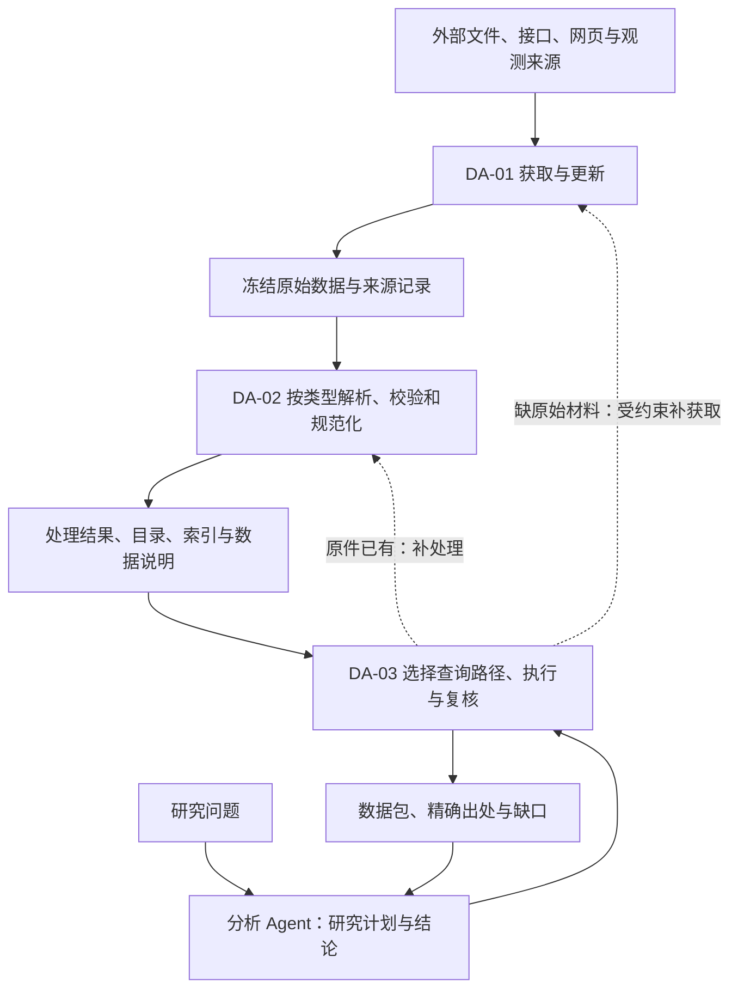
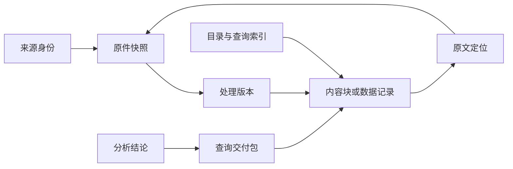

# Data Agent 与分析 Agent：数据能力框架设计

日期：2026-10-13 · 版本：讨论稿 v1 · **状态：待用户 review，功能开发暂停**。

本文整理已讨论的职责与建议设计，不新增业务范围授权，不宣称目标框架全部实现。公司、年份和单次实验属于验收案例，不成为通用规则。当前只保留 DA-01 获取与储存、DA-02 解析与索引、DA-03 查询与材料交付三个主 To-Do。

## 1. 这份设计要回答什么

目标：让分析 Agent 能取得足够、聚焦且可追溯的数据。数据缺失时有补充路径，数据错误时能定位到来源、处理、查询或分析环节。

开工前必须回答：

1. 获取、解析、存储、索引和查询各负责什么，如何交接？
2. 不同输入处理成什么，哪些不需要文档解析？
3. 原件、处理结果、索引、交付与分析引用怎样关联？
4. 多个子问题如何选择不同数据与执行方式？
5. 没有数据、存在冲突或来源不可访问时怎么办？
6. 谁审核、谁缓存，什么时候复用、更新或停止？

**状态约定：**“已有”指已核对源码中的局部机制；“有限验收”仅指指定案例；“建议设计”等待本轮 review；“待设计/验证”表示没有完整实现或证据。旧文档中的历史方案和旧运行结果不能自动升级为当前能力。

## 2. 第一层：职责边界

| 角色 | 负责什么 | 交付什么 |
|---|---|---|
| 分析 Agent | 拆解研究问题，提出证据需求；比较公司、竞对及不同报告观点；形成解释、假设、结论和观察建议 | 带引用的报告、图表、比较结果，以及补充数据请求 |
| Data Agent | 发现/获取数据；组织处理；选择数据源与查询方法；核对材料是否满足数据请求；补查与交付 | 数据、原文片段、必要上下文、精确出处、覆盖说明与缺口 |
| 程序执行层 | 下载、解析、SQL/检索执行、计算、版本保存、边界校验、资源控制与任务调度 | 可复核的工具结果和运行记录 |
| Codex | 实现与测试系统，独立核验原件、过程与交付 | 工程修复及验收判断；不代替运行 Agent 选材料、填答案 |

Data Agent 可以做明确口径的计算、格式整理及来源表述抽取；投资解释、研究假设与结论归分析 Agent。管理层解释要保留说话者，不能自动变成已证实的因果关系。

**监控的分工：**分析 Agent 提出观察对象与意义；Data Agent 按要求更新、记录观测值与变化；程序负责定时、失败恢复和通知。产品价格/库存是观测信号，不能直接等同产品好坏或需求强弱。端到端持续监控目前待设计/验证。

## 3. 能力关系：建设数据与使用数据分开

下面是目标职责图，不是现有调用链的完整实现声明。

- **数据建设路径：**获取 → 冻结原件 → 按类型处理 → 校验 → 注册可用内容与索引。
- **数据使用路径：**理解请求 → 读目录/数据说明 → 选工具 → 查询/阅读 → 复核 → 交付。
- 查询可以触发补建设，但不能默认每次重下或重解析全部原件。
- 存储、版本、身份和出处贯穿三个模块，不额外增加第四个主 To-Do。
- 模块划分不要求每个模块都有一个独立模型或部署服务；具体调度与部署方式待设计。

## 4. 第二层：获取哪些类别的数据

| 类别 | 例子 | 来源选择原则 | 当前边界 |
|---|---|---|---|
| 官方披露 | 财报、公告、业绩材料、电话会材料 | 官方披露系统或确认归属的官方渠道；区分原版和修订版 | SEC 与有限官网获取已有；全部类别取齐未验 |
| 专业接口数据 | 财务、估值、股价、K 线、成交量 | 适配任务的专业供应商；保留供应商、口径与版本，必要时对照披露 | FMP/行情没有已验收的统一接入 |
| 公司官方网页 | 产品、定价、技术文档、博客、发布动态 | 确认官方归属，保存时间和网页版本 | 有限 HTML 发现已有；全面覆盖未验 |
| 产品与经营观测 | 价格、库存、销量、交付时间、性能评测 | 可验证来源；保留型号、地区、渠道、采样方法等条件 | 通用接入与持续监控待设计 |
| 第三方观点材料 | 研究报告、行业评论、独立测试 | 保留作者、范围与方法；观点和事实分开 | 本轮仅定义边界，不承诺接入 |

来源不是一条绝对可信的排名。官方适合证明自身披露，专业接口适合标准化查询，其他一手观测可能适合价格等问题。分别记录来源适用性、处理质量与当前问题适配性，不用一个“可信”标签替代全部判断。

公司、证券、产品、业务分部是不同对象；需要明确身份及映射。来源规则、适配器和使用权限应版本化并显式选择，不因某个公司名称触发隐藏特例。公开可访问也不等于可无限抓取或再分发。

## 5. 输入类型、处理产物与查询方式

统一的是身份、语义、版本和引用，不是要求全部变成一种文件。

| 输入 | 必要处理 | 可消费产物 | 精确出处 | 主要查询方式 | 当前状态 |
|---|---|---|---|---|---|
| HTML | 正文/标题/段落/表格拆分，导航与原文映射 | 文档块、表格、目录；适用时抽取事实 | 冻结网页中的元素/锚点/字符区间或单元格 | 目录导航、文本搜索、读取；已提取事实可 SQL 查询 | 已有受限实现与案例 |
| PDF | 文字及版面提取，章节/跨页结构识别；必要时 OCR | 页/块、表格、目录与定位 | 原件版本、页码和区域 | 导航、搜索、按页/块读取 | 文字/页码/坐标已有；完整章节、复杂表格及扫描件覆盖不足 |
| PPT/PPTX | 幻灯片、对象、备注及图表处理 | 幻灯片内容和对象索引 | 文件版本、页和对象/区域 | 页/主题导航、搜索和读取 | 待设计/验证 |
| Markdown/文本 | 保留原始内容，识别标题和块 | 文档块与目录 | 版本、块及字符区间 | 导航、搜索和读取 | 通用接入未验；已有生成 Markdown 不等于任意输入支持 |
| 图像/扫描内容 | 转录或结构识别，绑定原图区域，核验 | 可引用文字或结构化字段 | 原图版本与区域 | 检索处理结果，必要时重新查看原图 | 指定图片案例已有；通用能力未验 |
| API JSON/XBRL | 验证字段、主体、期间、单位、口径；规范化 | 有类型的数据记录及字段说明 | 原始响应字段路径或披露元素/单元格 | 结构化条件查询与计算 | 有限 inline XBRL 财务路径已有；任意 JSON/API 未验 |
| CSV/数据库表 | 验证列、记录身份、时间和语义；保存可复现版本 | 规范化表、覆盖与字段说明 | 文件/数据版本、记录键和列 | 参数化 SQL 或接口查询 | 有内部 DuckDB 查询；外部任意表导入未验 |

电话会是材料种类，载体可能是 HTML、PDF、文字或音频；不能混作一个文件格式。音频转录能力本轮仅保留待设计范围。

结构化输入不需要重新走文档解析，但仍要校验。Markdown/JSON 可能是原始输入，也可能是转换结果。PDF 转 Markdown 等转换必须保留到原件的映射；仅有转换文本不算可追溯交付。

索引用来缩小读取范围，不代替证据。模型摘要可以辅助导航，但最终事实引用必须落到原文或原始数据字段。全文搜索、目录导航、SQL 各自解决不同问题；是否增加向量检索或 PageIndex 路线仍需另行评估，当前不预选。

## 6. 存储与关联设计

以下是建议的逻辑存储分层，不是立即迁库或增加服务的方案。

| 层 | 保存内容 | 版本与关联规则 |
|---|---|---|
| 原始层 | 文件、网页快照、API 响应；必要依赖资源；来源 URL/供应商和获取记录 | 原始字节冻结；内容指纹用于完整性和去重，不单独代替来源身份 |
| 处理层 | 文档块、表格、转录、规范化记录、质量检查 | 绑定原件版本、处理器/配置版本；重新处理生成新版本 |
| 目录与索引层 | 实体、材料/指标覆盖、数据说明、章节目录、原文定位与检索索引 | 绑定处理版本；可重建；不能指向不存在或不同版本的块 |
| 运行与交付层 | 查询范围、条件、工具结果、审核、选择记录、数据包及费用 | 冻结每次交付的来源/处理/索引版本；保留补查及修订关系 |

建议的可追溯关系：

关系至少保留：来源标识、原件版本/指纹、处理版本、索引版本、块/记录标识、原文定位、查询与交付包标识。这里是逻辑字段，最终字段名及跨版本迁移尚未冻结。

派生计算另外保存公式、操作数记录、单位/口径和精度。分析引用需定位到数据包内的具体证据项，不能只引用整个数据包或整份报告。

当前原件/JSON 类版本文件、文档索引和 DuckDB 查询已有。目标中的统一数据目录、所有格式映射、缓存生命周期与发布事务尚未完整设计。优先复用现有机制，是否需要独立对象存储/数据库服务由规模和运行要求决定，本轮不新增选型。

### 重复、冲突与时效

- 相同字节可复用存储，但不同来源仍保留独立来源记录。
- 同一事实在不同文件重复披露，保留多个出处及关联，查询不可重复计数。
- 不同年份材料的相似段落不能因文本相同直接删除。
- 重述、镜像、修订及冲突要显式关联；无法确定哪个适用时返回冲突，不静默选最新。
- 分别保存报告期间、公开/可得时间、获取时间、处理时间。未知公开时间不能由下载时间或 PDF 元数据替代。
- 质量状态应区分未处理、待核验、可按某策略消费和存在冲突；具体状态机与发布规则待设计。

## 7. Query 如何变成取数任务

研究拆解归分析 Agent；数据获取计划归 Data Agent。Data Agent 也可以直接接收用户的问题，其取材仍不得依赖 Codex 手选块。

建议流程：

1. 固定原问题、公司/对象、时间范围、截止日、来源政策及资源边界。范围不清或矛盾时明确处理，不默认替换公司或期间。
2. 拆成可核对的数据需求，保留每项与原问题的关系。
3. 先查小目录与覆盖，再获取相关字段说明、文档目录及工具能力。
4. 为每项选择结构化查询、文档检索/阅读、接口或补建设任务。
5. 模型提出类型化条件/动作；执行器编译参数化 SQL 或其他请求并执行。不是所有请求都变成 SQL。
6. 独立需求可并行；依赖前一步结果的任务顺序执行。各子任务继承原始范围。
7. 审核覆盖、口径、必要上下文及冗余；缺少补查，多余收窄；冻结交付。

目录应区分“原件存在”“已处理”“具体指标可查”“仅能原文读取”。字段说明包含语义、单位、时间口径、来源范围和支持操作，不能只有数据库列名。

**示意例，不是本轮实跑：**“比较两家公司两年收入并解释变化”。收入走结构化查询；单位/口径绑定原文；管理层解释走文档检索；不同来源矛盾时补查。Data 返回证据，分析 Agent 解释变化。预期不会默认遍历全部来源或把两份完整财报交给分析 Agent。

## 8. 缺数据时的处理与停止条件

| 诊断 | 动作 | 交付时如何表达 |
|---|---|---|
| 已有可用数据，当前未命中 | 调整查询/导航，补上下文；记录依据 | 本次查询未命中，不推断未披露 |
| 原件存在但未处理/处理失败 | 派发补处理；完成后注册新版本再查询 | 原件存在，尚不可直接消费 |
| 本地没有，接入来源可能有 | 在范围内获取、处理、校验 | 补充取得什么，或具体失败原因 |
| 需要新来源 | 依来源政策发现并核验；涉及新增权限/费用范围时遵循授权 | 候选来源与验证状态，不冒称已获得数据 |
| 来源冲突 | 核对主体、期间、口径和修订关系，保留各方 | 未解冲突与可支持的有限结论 |
| 无权限、访问受阻或能力不支持 | 保留诊断，尝试已允许的替代来源 | 阻塞/不支持，不是材料不存在 |
| 在明确范围中核查后仍无证据 | 保留已查范围和限制 | 未找到足够证据；“未披露”需另有覆盖依据 |

停止规则需设置总次数、时间/费用预算、失败类别及取消机制。连续动作没有新增有效信息时应停止或调整计划，不能无限重复。同一任务的补查/失败/未知费用计入同一预算，不拆账本绕过限制。具体阈值本轮不确定。

原问题和范围不能因补查而静默变化；必要扩展要记录理由，并依据授权执行或请求决定。新数据形成新版本/新交付包，旧结论的依据保持可追溯。

## 9. 谁审核：不同层各回答一个问题

| 审核层 | 回答的问题 | 不能据此声称什么 |
|---|---|---|
| 程序检查 | 格式、范围、引用、版本、单位约束是否满足？ | 字段合法不等于事实正确 |
| Data Agent 材料审核 | 交付是否满足数据请求，是否遗漏、冗余、口径不一致或缺必要上下文？ | 已交付材料自洽不等于原报告没有其他必需内容 |
| 分析 Agent 使用审核 | 证据是否足以支持当前分析，是否存在替代解释或新增证据需求？ | 数据齐全不等于结论一定正确 |
| Codex 独立验收 | 对照原件和预先定义的标准，检查整个系统效果 | 同一模型的自审不能代替独立验收 |

已有 Data 复核、范围/引用校验和有界补查。分析 Agent 真实消费及反馈闭环未整体验收。逻辑上需要两层业务审核，但是否使用独立模型调用、什么情况下省略重复审核、怎样独立检查遗漏，仍待设计；不机械对全部材料重复全文审阅。

分析 Agent 的补充请求建议包含：原研究问题、已有数据包引用、缺少什么、为什么需要、期望范围以及是否申请扩展。Data 据此交付增量数据及新的覆盖说明，保留原有包关系。

## 10. 谁缓存、如何复用

建议由 **Data 层统一管理持久数据与复用判断**。分析 Agent 保留研究上下文、使用过的数据包引用和必要片段，避免另建一套不同步的数据真相。

| 复用对象 | 复用条件 | 更新/失效条件 |
|---|---|---|
| 原件 | 来源策略允许复用且原版本完整 | 要求更新、来源变更或完整性失败 |
| 处理结果与索引 | 原件指纹、处理/索引版本与配置一致，质量状态适用 | 原件/处理器/配置变化或发现处理错误 |
| 查询结果包 | 语义范围、来源/数据版本、质量政策和新鲜度匹配 | 范围/版本/政策变化，或实时要求超期 |
| 未命中与失败记录 | 仅作带时效的诊断和限频依据 | 新数据进入、来源恢复或有效期结束后重新检查 |

相同文字不保证同一查询；不同文字也不直接判为可复用。缓存判定必须基于已解析范围与版本，具体键、有效期和失效传播待设计。历史查询固定快照；“最新”查询解析为明确版本后再执行。

分析 Agent 可以使用已收到且仍适用的数据包。需要补充时带已有包标识向 Data 请求；Data 先查现有原件/处理结果/交付，再补不足部分。再次提问不等于再次下载或再次调用模型。

**证据存档和缓存不同：**缓存可以淘汰，可复现交付引用的证据不能随缓存淘汰一起消失。保留期限、删除策略、外部来源许可和依赖数据包的生命周期尚待设计。

## 11. 如何定位错误

| 对照 | 可能定位的责任层 |
|---|---|
| 来源身份/原始响应与真实披露 | 来源不适用、供应商错误、旧版本或获取错误 |
| 冻结原件与处理结果 | 漏内容、错读数字、丢表头/单位、转换定位丢失 |
| 处理结果/索引与执行条件 | 索引映射、公司/期间/指标条件或查询执行错误 |
| 查询结果与最终数据包 | 选择遗漏、错误去重、审核放过不充分材料 |
| 数据包与分析结论 | 错误解释、未支持的推断或引用使用错误 |

以上是候选原因，不凭错误消息直接定根因。保留实际输入、工具参数、SQL/检索条件、来源版本、输出、审核理由与修订快照；不要求记录模型私有的内部思维链。修复共享机制后，用原问题及独立案例检验，不写公司答案特例。

## 12. 已有基础与尚未闭合的设计

| 主题 | 已有基础 | 尚未完成 |
|---|---|---|
| 获取 | SEC 按范围获取、有限官网模型发现、原件保存与缺口记录 | 任意公司/来源发现、完整覆盖、接口与监控 |
| 解析/定位 | HTML 块/表格/目录；PDF 文字/页码/坐标；指定图片补证 | PDF 复杂结构、PPT/任意 Markdown 与 API 数据通用覆盖 |
| 存储/版本 | 内容指纹、来源清单、版本文件、DuckDB 查询数据集 | 所有类型统一目录与版本关联、生命周期及发布策略 |
| 查询 | 小目录/数据说明、类型化条件、SQL、文档阅读、受限自主循环 | 任意问题/多类型计划、统一补建设编排及更广泛化 |
| 审核 | Data 证据复核、范围/引用契约、局部有界修订 | Analysis 真实消费反馈、跨范围缺漏评估 |
| 缓存 | 原件验证复用、冻结数据集和过程留底等局部基础 | 通用查询缓存、语义匹配、更新失效、分析增量复用 |

源码与范围依据：

- [公司获取、保存和复用](../src/uteki/infrastructure/document_sources/company_acquisition.py)
- [有限官方网页发现](../src/uteki/infrastructure/document_sources/official_discovery.py)
- [材料处理入口](../src/uteki/infrastructure/research_data/company_materialization.py)、[HTML 解析产物](../src/uteki/infrastructure/document_sources/parsed_package.py)
- [结构化数据集](../src/uteki/infrastructure/research_data/query_dataset.py)、[目录](../src/uteki/infrastructure/research_data/query_catalog.py)、[查询服务](../src/uteki/infrastructure/research_data/query_service.py)
- [自主查询](../src/uteki/agents/data_query/autonomous.py)、[交付复核](../src/uteki/agents/data_query/answer_handoff.py)、[补查循环](../src/uteki/agents/data_query/retrieval_cycle.py)
- [现有 Data/Analysis 边界与历史方案](DATA_QUERY_ANALYSIS_BOUNDARY.zh-CN.md)、[查询架构历史设计](DATA_AGENT_QUERY_ARCHITECTURE.zh-CN.md)
- [当前三项模块清单](DATA_AGENT_THREE_WORKSTREAMS.zh-CN.md)：案例、限制和旧任务归属以其记录为准。

## 13. 本轮 Review 与开工门槛

先 review 一个整体问题：**这份职责、数据关系及缺数反馈框架，是否准确表达我们要做的系统？** 不要求此时决定数据库品牌或逐份材料清单。

框架确认后，再在同一文档细化以下设计缺口；它们是三个主任务的设计项，不是新增执行队列：

| 归属 | 待明确的设计决策 | 通过条件 |
|---|---|---|
| DA-01 | 来源选择政策、身份、公开时间、补获取授权和更新规则 | 已有、未知、失败、未披露不会混淆；来源可核验 |
| DA-02 | 首期格式范围；处理产物；标识与定位；版本、质量和保留规则 | 每项交付能回到冻结原件的具体部分；索引可重建 |
| DA-03 | 查询/补查/交付契约；审核职责；缓存与失效；停止条件 | 正常、缺数、冲突、更新四类路径都有明确责任和终态 |

设计验收示例：文档问题能定位原段落；数值问题能核对单位和字段；混合问题能组合两类证据；缺数据能补取或说明限制；修改原件/处理器后旧证据仍可复现；同数据复用不重复计数。以上是拟议验收，未在本轮执行。

**本轮完成：**形成可 review 的框架稿，区分现状和建议；同步主入口。**本轮未做：**生产开发、新获取、模型调用或新的业务验收；本稿未经过新一轮 Claude 顾问审阅。**下一步：**用户 review 本稿的职责与数据关联，再决定设计细化，不自动开始实现。
