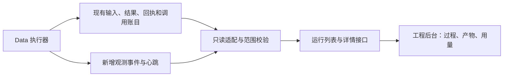

# Data Agent 执行监控与产物查看：技术方案 v0.1

日期：2026-10-06。状态：**用户 review 后确认开始，A 历史回看与 B 新运行实时监控已实现并完成离线工程验收**。

同日后续已交付：后台统一为 `/agent-results` 与 `/agent-runs`，结果和过程用根 Trace ID 关联，支持模型配置回看、真实小样本并排与独立人工评分。评分保存为独立版本绑定记录，不改变原产物。下文“页面只读”描述原 v0.1 的执行与产物边界；当前结果页可写人工评分，仍不能启动、重试或配置新执行。交付与核验见 [界面实施记录](FRONTEND_DESIGN.md#2026-10-06后台统一为运行结果与运行过程)。

用户最新推进顺序为：本轮收尾 → 讨论并做扎实 Data Agent 各部分 → 再推进 Analysis Agent。双模型自动评审、小输入成本控制和业务 function / skill 划分已记录为待讨论方向；具体方案和实验范围将在讨论后确定。详见 [当前待办](../TODO.md)。

本稿落实用户的要求：一次 Agent 执行既要有完整产物，也要能观察它如何得到产物。方案经 review 后按下列小步实现。后台面向工程人员，优先保证记录真实、关联清楚、问题可定位；沿用[工程后台职责](design/UTEKI_WORKSPACES_v1.zh-CN.md)和[界面基线](../skills/uteki-interface/references/style-guide.md)。

## 1. 要解决的问题与交付边界

制定方案时，`/data-workspace` 已能查看选定提取任务的材料、模型、Prompt、候选、规范化和部分审核。主 Agent 的计划、拒绝动作、工具结果、子任务和逐请求用量分散在文件中。工程人员难以回答：执行到哪里、为什么停下、哪个模型花了多少 Token、某条候选由哪一步生成。

第一版交付两种能力，必须明确区分：

| 能力 | 输入 | 可观察的结果 |
| --- | --- | --- |
| 历史运行回看 | 显式登记、固定哈希的真实运行及子产物 | 逐步回看输入、决定、执行结果、失败、子任务、产物和模型用量 |
| 新运行实时监控 | 已启用观测的 Data query / 单批 extraction 执行 | 本地执行开始后出现运行记录；界面增量更新当前阶段、已产生结果、调用状态和终态 |

第一版包含 Planner、已有 Worker 委派和 Extractor 的关联。query 内发生的 prepare / acquire / materialize 以程序阶段记录；不能只记模型步骤。单独 acquire / refresh 的完整内部追踪、独立内容核验和 Analysis 的统一接入后续增量完成。

启动仍使用现有显式 CLI / 执行入口。第一版页面只读，不提供启动、取消、重试、配置编辑、人工采纳、发布或自动调度。这里的“监控”指当前页面观察本地执行，不包含外部通知和全天候调度。Risk / Portfolio 标明未实现，不生成演示运行。

首条验收路径：**AMD 历史主运行 → 第 1、3 步的拒绝 → 第 5 步的提取子运行 → 输入材料与候选 → 返回父运行结束原因和总用量**。第二条路径用离线受控执行验证实时更新和进程中断，不为建设监控重新调用研究模型。

## 2. 已有基础与不能推断的内容

| 现有实现 | 本方案复用方式 | 边界 |
| --- | --- | --- |
| [Data 主循环](../src/uteki/agents/data_query/autonomous.py)的逐轮 input / decision / receipt / feedback、计划和结果 | 映射为步骤及输入输出引用 | 无效决定可能没有 decision.json，不能丢掉该步骤 |
| [模型决策适配器](../src/uteki/agents/data_query/autonomous_model.py)的 attempt 与 calls 引用 | 将逻辑决策、重试与实际调用关联 | 模型返回成功与决定通过校验分别记录 |
| [逐请求计费](../src/uteki/agents/runtime/call_costs.py) | 复用 call_id、start/end、用量、价格快照和耗时 | 累计 usage 和共享预算不是本次调用明细 |
| [ArtifactRef / ToolReceipt](../src/uteki/domain/research_data/run_artifacts.py)与 [artifact store](../src/uteki/infrastructure/research_data/run_artifacts.py) | 复用哈希、范围、上下游和完整内容分页 | 现有 ToolReceipt 没有工具起止时间 |
| [冻结产物读取](../apps/review_workbench/data/evaluation_artifacts.py)、[提取读取](../apps/review_workbench/data/direct_extraction_views.py)及现有详情页 | 复用登记、路径、哈希、范围门禁及原文/财务查看能力 | 当前完整加载会校验大文件和数据库，不适合每 2 秒调用一次 |

特别注意：现有提取登记中的 `amd-fy2023-main-agent-v2` 指向主运行第 5 步下的 **extraction-01 子目录**。新父运行目录必须单独登记，不能把现有名称当作父运行身份，也不能据目录名字自动建立父子关系。

历史缺失字段保留为空并注明“未记录”。不以文件修改时间补造工具耗时，不以最后一份文件推断进程仍在运行。只展示已保存的计划、决定及模型可见输出；reasoning Token 数不能还原未返回的内部思考。保存的应用层输入包也不能冒充完整供应商 HTTP 请求。

## 3. 技术选择

**在现有 Python 后端和 Review Workbench 内增量实现，不拆仓库、不更换前端框架。** 业务运行文件继续作为事实依据；新增轻量事件用于关联和及时展示。费用继续使用现有计费器。



这是已实现的数据读取关系。观测层不参与选材、推理、提取或采纳，不增加模型提示词，不另建 Agent 执行引擎。

| 选择 | 原因 |
| --- | --- |
| 先接真实历史记录，再补实时事件 | 尽早用已有真实过程验证展示和计量，避免先造日志平台 |
| 观测元数据与冻结业务目录分开 | 心跳、展示索引不得破坏历史 manifest |
| 新事件逐文件原子发布 | 避免读到半行日志或半个 JSON；第一版数据量可控 |
| 同源短轮询 | 复用现有 ThreadingHTTPServer；当前需求无需 WebSocket、消息队列或新数据库 |
| 不接外部遥测平台 | 先复用本地可检查的产物和成本记录；需要多机规模时再评估 |

### 3.1 最小对象契约

新增版本化观测契约，不直接把仅用于部分组件的 [AgentRunRecord](../src/uteki/domain/runs/models.py)当作所有运行已经统一的证明。现有业务契约和冻结文件不迁移。

| 对象 | 必需身份与关系 | 展示内容 |
| --- | --- | --- |
| Run | run_id、root_run_id、可空 parent_run_id / parent_step_id、kind、role、origin、输入/范围引用 | query / prepare / worker / extraction；真实模型或 scripted_fixture；业务原始状态与停止原因 |
| Step | step_id、run_id、ordinal、phase、输入/决定/回执/反馈引用 | 先进入规划，再在决定有效时执行动作；失败也保留 |
| ModelCall | 现有 call_id、run_id、可空 step_id、decision_index、attempt、业务角色、原始计费 stage、start/end 引用 | provider、请求模型、实际模型（如有）、推理档位、状态、用量、耗时、费用 |
| Artifact | run_id 内的 artifact_id 或具名文件 ID、kind、sha256、大小、范围、produced_by / consumed_by 引用 | 原文、表格块、计划、候选、规范化、证据包、诊断、最终结果和配置投影 |

Run 身份不能由公司、模型或标题充当。新运行生成唯一 ID；历史运行从明确登记获得稳定 ID。当前没有整次任务重试控制；未来接入时应使用新 Run 并保存 retry_of。已有执行器的单次模型重试仍属于同一步，但拥有不同 call_id。

模型输入、输出可能尚未产生或历史缺失，引用需携带 `available / pending / missing / corrupt / restricted`。大文件只保存引用，不复制到事件中。已存在 ArtifactRef 时沿用其身份；普通 JSON 文件只建立文件引用，不强制转换业务格式。

显式传递不可变观测上下文及 recorder，不通过共享可变“当前步骤”全局变量关联并发调用。关联字段只在宿主程序中流转，不进入模型输入。

### 3.2 执行状态、交付状态、质量与采纳分别显示

| 维度 | 例子 | 判定依据 |
| --- | --- | --- |
| 执行 | 运行中、已结束、失败、取消、终态未知 | 已记录的执行事件；历史结果只能证明已结束的部分 |
| 监控连接 | 更新正常、更新中断、历史回看 | 本地 writer 心跳；不由有没有新模型输出推断 |
| 交付 | 候选已生成、部分完成、保留缺口 | 原始 result、覆盖记录和 stop_reason |
| 内容质量 | 未评估、待核验、已有具名核验结果 | 保存的审核与覆盖范围 |
| 采纳 / 发布 | 候选、已采纳、未发布、未记录 | 已有明确记录；执行结束不改变这些状态 |

预算耗尽、步数上限、no_progress_limit 分别保留停止原因。`candidate_ready` 不翻译成“质量通过”。步骤的拒绝、工具失败、模型请求失败和父运行整体失败也不合并。模型调用尚未返回时，用量显示待返回；当前非流式计费器不能展示逐 Token 实时计数。

### 3.3 事件、原子写入与失联处理

已增加事件：`run.started / run.finished`、`step.started / step.action_started / step.finished`、`model_call.started / model_call.finished`、`artifact.published`。终态事件包含原始状态、结束原因和已封存 manifest 引用。复用已有提取回执只记录产物引用/复用，不产生新的模型调用。

公共字段：schema_version、event_id、root_run_id、run_id、seq、UTC 时间、关联的 step_id / call_id、状态和有限文件引用。事件时间用于展示；新步骤和调用耗时使用同一进程的单调时钟记录，不用 UTC 相减代替。

第一版每个根执行树由一个进程持有 recorder，父子运行共用该树的递增 seq；进程内用短锁保证序号和发布顺序。不同根运行使用不同事件目录。跨进程共同写同一执行树暂不支持，必须明确拒绝，不能依赖碰巧不冲突。事件 ID 按根运行和 seq 唯一；它表达发布顺序，不是并发动作的业务先后。

观测目录通过显式 `--observation-root` 配置，由 CLI 和工作台读取同一个位置；必须在业务输出/冻结数据目录之外。目录内按 root_run_id 保存安全 descriptor、events、heartbeat 和最终 manifest 引用。运行登记从 descriptor 重建，不维护一份所有进程竞争更新的全局 JSON。新本机观测目录不自动提交 Git。

事件先在同目录临时文件写完、flush / fsync，再原子发布到唯一文件名并拒绝覆盖。已发布事件不可变；heartbeat 是单独原子替换的小文件。序号分配和发布在同一短锁内完成，读取高水位只推进到连续、完整发布的事件；缺号或损坏显示观测故障，不直接跨过。停机、取消和异常尽力记录终态；强制终止可能只有开始记录。

观测故障在整棵执行树中锁存，禁止新的模型调用和业务动作，但允许已开始动作收尾、原始结果保存、客户端关闭和预算结算。使用独立的观测故障类型/停止门禁，不能被主循环当成普通无效决定继续执行。结束事件发布失败不跳过计费清理，清理后再报告故障；不自动重试模型。若开始事件失败发生在预算预约之后、供应商调用之前，仅在宿主可证实尚未发送时，由执行器按现有预算契约结束预约并记为本地阻断；已发送或不确定的请求不擅自记为零费用。观测页面始终不修改账本。

心跳每 5 秒更新；仅对尚无可信根运行终态的执行，超过 15 秒显示“监控更新中断，执行状态未知”，保留最后已知动作。心跳证明观测进程活跃，不证明任务有业务进展。已验证的终态及历史回看不会因心跳停止而降为未知。过期不写回业务失败，不推断远端请求取消，不自动释放预算或恢复任务。根运行结束事件在子任务、原始记录和必要清理收尾后发布；随后停止该树的心跳，不再新增执行事件。重新执行使用新 Run，第一版不做中断续跑。

现有业务 write_new / call write_record 直接写目标文件，可能被监控端读到一半。本次不全库更换写入机制：有发布事件的新文件只在写入结束后读取；未封存或部分失败文件明确待完成/损坏，不能把一次 JSON 解析失败当作运行成功或无数据。

### 3.4 Token、费用和耗时口径

- 用唯一 call_id 合并 start/end。历史回放中完整 end 优先；新运行仅使用当前高水位内事件已经发布的引用，磁盘上提前存在但尚未发布的 end 不进入本轮状态或计量。只 start 的请求显示已开始、结果及用量未知。相同 ID 的重复证据去重，内容冲突显示完整性问题，不悄悄挑一份。
- 逻辑决策数、实际调用尝试数、已取得用量的调用数分别记录。计费 start 代表适配器开始尝试，不保证请求已到供应商；预算拒绝在 call_id 创建前发生时是本地阻断，不伪造一次 API 请求。
- 父运行显示“本角色”和“含子运行”两种汇总；后者对整棵已明确关联的调用集合去重。未能可靠关联到步骤的历史调用留在“未关联调用”，仍可计入已证实所属运行的总数。
- `usage-*.json`、model-usage、父子 summary 和 shared_budget 不与逐调用记录相加。历史累计文件只用于交叉核对。
- 输入 + 输出为总 Token；缓存是输入的子集，reasoning 是输出的子集。缺失用量不记为 0；同时显示已知总量与未知调用数。
- 保存用量来源及可核验程度。当前部分供应商只有 SDK 归一化记录，可能无法区分供应商省略 usage 与 SDK 默认零值；此类历史零值显示“记录为 0，供应商用量未确认”，不计作已确认零消耗。新记录增加 `usage_presence=reported / absent / unknown` 和来源字段；适配器能证实供应商返回时才标 reported，无法证实时标 unknown，不能只靠 SDK 默认对象判断。AMD 的已核对原始 DeepSeek 用量仍按验收值展示。
- 费用使用该次保存价表的估算及口径；actual_billed_usd 为空就显示账单未知。不按今天的价格改写历史估算。共享预算可能包含别的运行，不显示成当前运行成本。
- 当前 call-end 写入先于预算结算，崩溃时可能出现有 usage 但 reservation 未结算。观测读取不修改预算账本；可证实的不一致作为诊断，不能自动结算或释放。
- Token 归属模型请求，不能全部归给其后执行的工具。步骤可汇总关联模型请求，但要注明包含规划/子调用的口径。
- 模型累计调用耗时可相加，但它不等于运行墙钟耗时。历史工具缺少计时，只显示顺序；新运行才展示有记录的规划/工具区间，父子并行区间不重复累加成总耗时。

## 4. 页面、交互和只读接口

新增 `/agent-runs` 为工程运行入口；保留 `/data-workspace` 和现有原文、财务、审核页面。旧根地址继续现有跳转，不在本轮重排公司列表或前台 Swiss C。导航增加工程运行入口；数据处理记录增加“查看所属运行”，只有已验证的关联才显示链接。

页面沿用中英双语、显式点击和原生滚动。页面关系：

```text
Agent 目录        运行列表                  所选运行
Data              任务 / 范围 / 时间         任务、公司、材料、期间、来源
Analysis*         执行 / 交付状态            执行状态 | 质量 | 采纳 | 最近更新
Risk**            本角色 / 总调用           过程 | 产物 | 用量 | 输入与配置
Portfolio**       停止原因                  步骤列表 → 选中步骤的输入/输出

* 限定原型，后续接入本入口；** 后端未实现。能力状态不冒充运行健康。
```

第一版 Data 可用；其他角色的目录说明来自已核实能力清单，不展示假任务。选择 Agent 使用直接列表。运行列表按明确登记范围筛选；无选择时提示选择一次运行，不自动选择第一家公司、最新期间或第一份产物。

- **过程**：默认顺序步骤列表，子任务可展开；新运行可切换有实际计时的时间视图。选择步骤后看“收到什么 → 模型返回什么 → 执行了什么 → 返回什么 → 反馈与下一步”。无效决定也占一行。大型输入按需展开，保留截断标记和完整内容入口。
- **产物**：类型、状态、数量、来源步骤、范围与版本；已建立查看页映射的候选可进入现有财务/原文能力。新运行未登记到旧 loader 前，在工程页查看受控候选/引用详情并标明财务入口尚未登记；显式导入、校验后才显示旧页链接，不直接拼接新 run_id。来自磁盘的完整产物与当时真正送给模型的有界预览分开。已选材料之外的内容不声称已读取。
- **用量**：按角色/模型汇总条形图和精确数字；逐调用表列输入、输出、缓存、推理、耗时、估算费用及未知项。点击调用回到步骤，点击步骤能看到它的调用。图不添加推测 Token 分配。
- **输入与配置**：任务、初始/当前 scope、来源快照、方法版本和可展示配置；有效 Prompt 如已保存可读，缺失不能仅凭名称还原。运行版本和来源保持显式，候选比较期间与任务年度分别显示。

轮询不重建整页、不打断当前步骤/产物的滚动与选择。运行中默认每 2 秒请求一次小响应；页面隐藏暂停，回到页面立即补读；一次请求未结束不叠加请求，失败退避至最多 30 秒并显示连接状态。只有所观察根运行已有可信终态，且该高水位尾页已读尽时才停止自动轮询，提供手动刷新；子运行 finished 不触发整个页面停更。以上参数已实现并做边界测试；尚未测量实际浏览器刷新时延，不宣称已达到规模性能指标。

拟增加以下同源 GET 接口，所有路径均为提案：

| 接口 | 返回与约束 |
| --- | --- |
| `/api/agent-runs?agent=data&cursor=…` | 有界分页列表，默认 50 条，上限 100；返回登记范围、状态和可用性 |
| `/api/agent-runs/{id}` | 运行详情、父子关系、计量完整性、revision 和资料能力声明 |
| `/api/agent-runs/{id}/events?after=…&limit=…` | 新运行增量事件，默认 100 条，上限 500；cursor 绑定根运行与观测版本 |
| `/api/agent-runs/{id}/steps/{step_id}` | 按需加载该步输入/决定/回执引用和调用列表 |
| `/api/agent-runs/{id}/artifacts/{artifact_id}?cursor=…` 或 `?browse=…` | 已登记且允许展示的内容；有界预览不超过 64 KiB，返回完整性、后续游标及可展开子项；browse 为服务端生成的受控子指针 token，与 cursor 互斥 |

接口只接受 ID / 校验后的 cursor 或 browse token，不接受任意文件路径。事件响应包含 `events、last_delivered_seq、high_watermark、next_cursor、has_more、root_terminal`；即使无新事件，也返回单独采样的 `heartbeat_at、server_now、connection_state`。一次分页周期固定高水位，只用这一范围内事件及引用构建状态和已知用量；heartbeat 不假装属于该 revision。客户端按 event_id 去重，只推进到 last_delivered_seq，读完尾页后才开启下一高水位，不能直接跳到 high_watermark。较早的同一事件流 cursor 可用于断线补读；只拒绝格式无效、跨运行、观测世代不符或不合法位置的 cursor。

产物 cursor 则绑定 owner run、artifact ID、hash、scope、子指针、展示投影版本和偏移。现有 ArtifactCursor 缺少 run_id，需加观测层封套，不能直接当作跨运行安全凭据。超大 JSON 单项命中 `item_too_large` 时，返回可展开的字段/数组子项 token；超大文本提供有界片段续读。UI 提供“展开子项 / 继续读取”，不反复请求停在原位的 cursor。受限字段不通过子指针重新暴露；不可预览二进制明确类型与可用查看入口，不能伪造文本完整预览。

新运行的当前状态从小事件和心跳读取；历史结果在显式导入时全量验证所登记 manifest 及列出文件，建立有界元数据索引。索引绑定登记版本、各层 manifest hash、adapter/投影版本，变化即失效；缺失/损坏的运行登记为可见缺口，不标完整通过。列表只声明“在某时按某范围核验”，不宣称缓存证明当前全部文件仍完整。打开详情时重新校验所读文件与引用 hash；失败使相关索引失效并显示完整性问题。大 Prompt、原文、DuckDB 和完整 artifact 不在每次轮询重新加载；不能直接把现有全量 loader 用作轮询。历史无实时事件的运行只提供有来源引用的回放步骤，能力字段声明 `live=false`，不伪造历史心跳与精确事件时间。

### 4.1 内容与路径边界

沿用“登记 Run → 受限根目录 → manifest / 已发布引用 → hash 与 scope”的读取链；拒绝绝对路径、穿越、符号链接、跨运行游标、未登记文件和错误哈希。历史登记只允许仓库中明确的 experiments / data 根；新运行必须由配置的观测根及允许的业务输出根建立关联，不能向浏览器暴露任意本机目录。

Manifest 证明文件身份，不证明文件适合展示。按产物类型建立字段白名单，屏蔽密钥、Authorization、私有 SEC 联系配置、credential_origin、预算账本绝对路径和其他运行的共享预算详情。拒绝 `.env` 和整目录裸下载。模型日志、JSON 和异常按文本转义；原始 HTML 复用受限原文预览，不能在工程页面作为可信脚本执行。

“完整产物”表示本次范围内所有可检查的业务产物及明确缺口；对受限配置提供安全投影和限制说明，不以泄露私有环境换取完整。原件、原始候选、错误和 manifest 不改写；缓存和展示索引可以删除重建。

## 5. 实现顺序与改动位置

### A. 历史运行回看——首个可交付增量

1. 定义最小读取契约；新增 `data/evaluation_views/agent-runs-v1.json`，显式固定父运行、子运行、manifest、scope、关系证据和已有查看页映射。增加显式导入脚本：只处理调用者选定的目录与 adapter，验证后生成新的登记，不扫描并自动采纳最新运行。
2. 在 `apps/review_workbench/data/agent_runs.py` 增加只读适配；第一版支持 company 层 manifest/result、autonomous query、batch 包装和 direct extraction 四层的具名映射，见下表。复用现有安全读取函数，按已有 attempt.calls 关联模型调用，不能只凭时间顺序猜配。历史记录中的其他机器绝对路径只作受限元数据，读取必须经过显式本地相对路径与 hash / scope 映射；缺失或歧义拒绝，不能直接打开该路径。
3. 新增 `pages/agent_runs.py`、局部 `agent_runs.css/js` 及 GET 路由，展示过程/产物/用量；必要时抽出共享安全读取函数，避免为了新页重写旧 loaders。
4. 接 AMD 主运行及提取子运行、已有现金流无进展样例，再以独立合成公司/期间检查范围隔离。旧页面链接必须指向对应子产物，不把父子同名当作身份相同。

出口：不运行模型即可走完第一条验收路径。此时只声明历史回看完成，实时监控仍未交付。

AMD 登记例：基准目录为 `experiments/architecture_baseline/2026-10-04-amd-tsmc-annual-v1/amd-fy2023-main-agent-v2`。以下各层 manifest 均已读取并独立计算 SHA256；显示层次不等于增加四个 Agent。

| 相对目录 | 格式及归属 | 固定 manifest SHA256 |
| --- | --- | --- |
| `.` | company manifest 为 company-agent-run-v1，result 为 company-agent-result-v1；新父 Run ID 建议加 `-parent` | `83a654f8a8d46fd62dc8e3cde6481b2a59bc2619f4e335a2f565c892d40d33b3` |
| `query` | autonomous-result-v2；属于同一个父 Run 的主循环 | `5cf9d4b22a6fd5ec53f9ed8d5c8b2971ff138c84d8e7f03c09db7d15b5a33197` |
| `query/turn-005/financial_extract` | extraction-batch-run-v1；父步骤回执指向此包装层，登记为该步骤的提取子 Run | `30ed99783f5f8ab30c63cd7372fbc46c7430a73fd64a2ddd9c7a80e1afb2055f` |
| `query/turn-005/financial_extract/extraction-01` | direct-extraction-run-v1；该子 Run 的模型与产物层，现有 `/extractions` 注册指向这里 | `a04cc57e50752a663570fd7cbf67e5bdcedcd4b3355daf8ed6d6da3822c89ccc` |

登记同时绑定 dataset `amd-annual-v2` 及其 manifest、公司 `sec-0000002488`、来源 `source-291485b98a75d8cfabe47571` 和来源 hash。父回执→batch、batch→direct、direct→既有查看页分别验证，不能跨层直接比较 hash。复用产物、review 和 Analysis 的后续消费是独立有类型关系，不自动算作本次新增子调用。

### B. 新运行实时监控——完成第一版目标

1. 在 `src/uteki/domain/runs/observation.py` 定义小型版本化契约；在 `src/uteki/agents/runtime/observation.py` 实现 recorder、原子发布和心跳。
2. [coordinator.py](../src/uteki/agents/data_query/coordinator.py)记录根运行和准备阶段；[autonomous.py](../src/uteki/agents/data_query/autonomous.py)记录规划、动作、回执、子任务关系；[financial_tasks.py](../src/uteki/infrastructure/research_data/financial_tasks.py)及 [extraction_batches.py](../src/uteki/infrastructure/research_data/extraction_batches.py)连接提取和复用。
3. 在现有 MeteredModel 外加可选观测上下文，发布同一个 call_id 的关联事件，复用现有价格和预算账本；在 artifact 完整保存后发布引用。另修正 SDK 缺用量时的默认零处理，见下方实现边界。独立 `agent extract / extract-batch` 作为显式根提取运行接入。
4. [CLI](../src/uteki/infrastructure/research_data/agent_cli.py)和工作台增加显式观测根配置；实现小响应轮询、分页、连接状态和停止更新。没有观测配置的旧入口继续执行，但不能被标成实时可监控。
5. 用 scripted_fixture 和假的模型传输响应验证正常、拒绝、子任务、取消、强制终止、预算阻断及记录失败；明确这些是工程验收，不是模型质量评测。

出口：CLI 已启动的受控 Data 运行能在页面及时出现并更新；结束后可从同一地址查看完整记录。第一版只有 A 和 B 都通过才称为“过程监控与可视化完成”。

### C. 后续独立增量

接已有 Data → 独立内容核验 → 限定 Analysis 的历史交接及新运行，再扩展人工问题/复核和同条件运行对比。Risk / Portfolio 在真实执行器出现后按同一契约接入。Token 优化在计量可信后另立实验，固定输入和质量验收；本方案不同时修改提取 Prompt、模型选择或业务完成条件。

## 6. 验收标准

| 场景 | 必须满足的可观察结果 |
| --- | --- |
| AMD 主运行回看 | 6 个父步骤，第 1、3 步拒绝且无有效 decision 仍展示；第 5 步可进入 1 个提取子运行；无 Worker 时不虚构 Worker |
| AMD 状态 | 结束原因、candidate_ready、semantic_completeness=not_evaluated、候选未采纳分别可见 |
| AMD 计量 | 7 个唯一调用；输入 105,812，输出 17,512；本角色 6 次、子提取 1 次；实际账单未知 |
| 重复与冲突 | 重复 start/end、父子摘要、累计 usage 不重计；冲突 call_id 和缺用量明确诊断 |
| 来源与范围 | 独立合成公司、不同期间、缺 scope、跨公司/材料产物分别通过正确隔离或明确拒绝，无业务默认值 |
| 输入与结果 | 输入预览和完整磁盘产物可区分；候选可回到本次原文与来源步骤；模型未返回/未保存的信息标缺失 |
| 新运行 | 开始、等待模型、工具执行、产物、结束逐项出现；前端每 2 秒拉取事件；本机 HTTP 已验证发布即能读取，实际浏览器刷新时延未做视觉验收 |
| 失联与故障 | 无可信终态时 heartbeat 过期显示更新中断；已完成超过 15 秒仍保持完成；仅 start / 半写文件 / 中断保留未知；预算阻断无伪造调用；观测故障不吞掉原始计费清理 |
| 分页与交互 | 固定高水位分页无遗漏重复，同流较早 cursor 可补读；跨运行/错误世代/产物 hash 变化的 cursor 拒绝；超大单项可展开和续读；轮询保留选择与阅读位置，根终态尾页读尽才停 |
| 安全与冻结 | 错误 hash、路径穿越、符号链接、私有字段、恶意 HTML 被正确处理；查看前后冻结产物哈希不变 |

AMD 数据来源：[父运行](../experiments/architecture_baseline/2026-10-04-amd-tsmc-annual-v1/amd-fy2023-main-agent-v2/result.json)、[步骤结果](../experiments/architecture_baseline/2026-10-04-amd-tsmc-annual-v1/amd-fy2023-main-agent-v2/query/result.json)、[模型汇总](../experiments/architecture_baseline/2026-10-04-amd-tsmc-annual-v1/amd-fy2023-main-agent-v2/model-usage.json)、[子提取](../experiments/architecture_baseline/2026-10-04-amd-tsmc-annual-v1/amd-fy2023-main-agent-v2/query/turn-005/financial_extract/extraction-01/result.json)。这些数字限定于该次运行，不包含此前材料选择和独立失败实验，不代表全年报成本。

测试以新增适配器/事件契约、现有 autonomous / worker / financial extraction、call_costs 和路由边界为主。UI 状态更新用局部交互测试检查；视觉 review 由用户完成。新运行实时能力先做离线工程验收；真实模型验收如另行需要，再明确模型、材料、调用上限和产物位置。本次方案与实现均未发起真实模型请求。

## 7. Review 结论与已确认的取舍

本轮已分别检查执行埋点、页面读取与验收边界；以下问题已纳入方案：父子运行同名误认、累计用量重复相加、没有工具计时却画耗时图、读取半写文件、heartbeat 影响冻结目录、manifest 误当公开许可、模型调用成功误当内容正确。

用户确认开始后，按以下三项取舍实施：

1. **实施顺序：A 历史回看 → B 新运行实时监控。** 首个交付能立即检查真实数据，但不会把 A 单独称为监控完成。
2. **工程结构：沿用现有 Python 工作台、小型事件文件和轮询。** 暂不承担新前端、队列服务、多机执行和外部遥测平台的维护成本。
3. **第一版只观察执行。** 启动/取消/重试、人工裁决和发布单独实现，避免把观察页面与有副作用的控制能力混在同一增量。

## 8. 实现记录与边界 · 2026-10-06

- 历史读取：[登记表](../data/evaluation_views/agent-runs-v1.json)、[导入器](../scripts/import_agent_run.py)、[适配器](../apps/review_workbench/data/agent_runs_history.py)。两条 AMD 运行按 parent → query → batch → direct 的真实引用连接。第一次读取校验冻结 manifest，选择产物时复核哈希；大内容分层展开、分页读取。旧业务文件未迁移。
- 实时记录：[契约](../src/uteki/domain/runs/observation.py)、[写入器](../src/uteki/agents/runtime/observation.py)、[读取器](../apps/review_workbench/data/agent_runs_live.py)。query 的 prepare/acquire/materialize、规划和动作，以及 Worker、提取及复用均已连接。CLI 必须显式指定观测目录；工作台另显式声明允许读取的业务输出根。
- 页面：[运行详情](../apps/review_workbench/pages/agent_runs.py)及[增量更新](../apps/review_workbench/static/js/agent_runs.js)。提供过程、产物、用量、配置四栏；轮询保留当前选择，暂停隐藏页请求，失联与真实终态分开。通过父运行地址查看子运行，产物身份仍保留子 owner。
- 本机 HTTP 已验证真实 AMD 页面及子步骤/产物；离线测试运行验证运行中步骤、已发布产物、固定高水位分页、断点补读、终态与旧 revision 隔离。该测试明确标为 scripted_fixture，0 次模型调用；测试记录已移出产品观测目录，未留下虚构研究运行。
- 最终定向回归：291 项 Python 检查、14 项 JavaScript 交互检查通过；覆盖历史/实时适配、页面、主循环、Worker、提取、计费、范围和现有路由。`git diff --check` 通过；既有 `experiments/` 与 `data/` 跟踪文件无差异，新增登记单独保存。
- 真实 AMD 计量为 7 次唯一调用、105,812 输入 Token、17,512 输出 Token。SDK 假传输检查真实适配调用链，但不是模型推理质量评测；页面视觉 review 尚未进行。

**实现边界：** 一个根执行树由单个进程记录，暂不支持多机共写。事件接口响应增量，但当前读取器仍会检查该运行的事件文件和小型调用记录；未验证超大运行的性能。产物展示使用允许字段投影，私有字段与本机路径不公开；不承诺展示每一种历史文件格式。历史工具耗时未记录时留空，模型未返回的内部思考不生成。

**计费边界：** 为避免把 SDK 自动补出的全零用量当作免费请求，无法确认供应商用量时记为 unknown；启用强制预算保护时，后续调用可能因此被阻断。已知未发送的请求释放预留额度，结束事件写入失败仍完成原始调用记录和预算结算。未更换价格、模型、提示词或供应商请求配置；实际账单仍为未知。

C 阶段的独立内容核验与 Analysis 接入、人工问题处理、运行对比和控制按钮均未实现。Risk / Portfolio 保持后端未实现状态。
