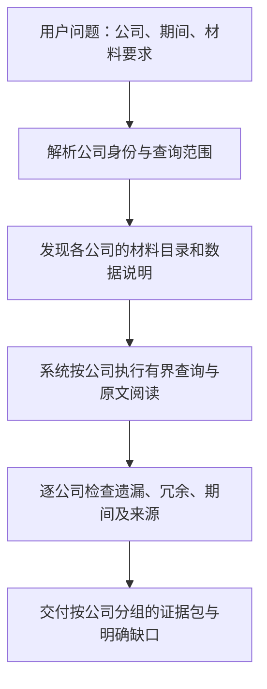

# Data Agent：夜间工作复盘与扩展验收

更新：2026-10-09。本文依据已封存运行、独立原文验收与当前代码整理。它更新下一步顺序，不改写历史运行。当前工程基线为 `0e79c44763458c0bfaead59a9d9a153b9825cf77`。

## 1. 现在完成到哪里

**已完成一个有限范围的独立闭环：两份既有 FY2025 HTML 10-K → 解析与数据说明 → 系统自主查询、阅读、选择 → 模型复核和补查/精简 → 带精确出处的冻结材料包。** 两家公司是 Microsoft 和 Alphabet。Codex 负责开发、测试和事后独立核验；真实运行没有由 Codex 预先指定业务章节、表格或参考答案。

这不是原八项待办全部完成，也不是“财报所有指标已经提取”。Analysis 的报告和业务图没有在本轮重新生成。PageIndex 做了源码路径研究，未接入其服务，也没有同输入的效果对照。

- [统一验收页](http://127.0.0.1:8769/docs/design/data-agent-acceptance/data-agent-evidence-v1/)
- [冻结交付说明、逐题证据与费用](../experiments/agent_design/2026-10-09-data-agent-completion-v1/DELIVERY.zh-CN.md)
- [准备层逐项核查](../experiments/agent_design/2026-10-09-data-agent-completion-v1/preparation-review/README.md)
- [原八项待办的完成边界](DATA_AGENT_EXTRACTION_TODO.zh-CN.md)

## 2. 具体做过哪些 action

| 行动 | 具体处理 | 可核对的结果 |
| --- | --- | --- |
| 核对运行实际材料 | 对齐公司、原件、解析版本、文件 hash；重新准备两份数据集 | Microsoft 1,401 块/85 表/102 条记录；Alphabet 1,338 块/185 表/111 条记录 |
| 修复原文读取 | 修正列表、表格脚注、上下文边界与 compact 表格交接 | 保留限定语和脚注，避免只读到项目符号或拉入下一无关章节 |
| 修复数据说明和期间 | 从实际原件/XBRL 的期间生成可查询目录，补充已有指标说明 | FY2025 年报内的 FY2024 比较列可被查询；没有假设所有财年都在 12 月结束 |
| 明确 Data 职责 | 系统交付选择过的原文和记录，不在该环节生成业务分析结论 | 探索时读过的材料与最终交付分开；Analysis 消费另验 |
| 完成自主查询循环 | Sonnet 查看小型数据说明、生成受约束查询、读原文、选材；系统模型复核后可补查或收窄 | 每题最多三个取材 attempt；每次请求、工具结果、交付、复核和费用留底 |
| 修复执行协议和网络恢复 | 缩小供应商原生 JSON 外壳，内部仍严格校验；加入有界临时故障重试 | 截断/格式错误不能进入工具执行；失败和未知费用不被抹掉 |
| 精确绑定出处 | 数值记录回到它自身的原表、单元格和字符范围；正文回到原块 | 原件 hash 不匹配时拒绝展示错误引用，不用另一个相似段落替代 |
| 修复查询过程导航 | 增加已读目录的完整分页、留存原文读取和记录出处导航 | 目录只是指针，不能被计为已经读过正文；真实复跑验证跨页读取 |
| 做真实内容验收 | 六个问题的系统运行后，独立回原件检查完整性、范围、冗余与引用 | 六题通过本轮限定验收；后续目录修复另跑微软原题通过 |
| 完成可查看与可接续交付 | 统一结果页、过程和原件入口；代码、公开产物与 Todo 推送；私密状态单独迁移 | Git 基线已推送；换目录生成配置及私密包恢复已检查，不等于另一台机器已安装好 |

2,739 块、270 表和 213 条记录是准备层数量。表格包含布局表；记录包含不同期间和重复披露位置。当前结构化记录实际涉及收入、营业利润、净利润、经营现金流、资本支出现金支付五类，不能把 213 条当作 213 个独立事实，更不能据此宣称三张主表完整提取。

## 3. 遇到的 bug、原因和解决路径

| 问题与影响 | 原因 | 解决路径与当前边界 |
| --- | --- | --- |
| 历史解析审查通过，但实际查询用的是另一版底稿 | 审查和运行的解析版本未对齐 | 重新准备并绑定原件、解析配置和 hash；在同一底稿上重验 |
| 列表只有符号、脚注少正文，导致材料丢限定条件 | HTML 中标记和正文分开，读取单块未保持阅读组 | 建立列表/脚注阅读组，修正上下文边界，回原 DOM 核验 |
| 明明存在 FY2024 记录，却在查询前被拒绝 | 数据目录只暴露了报告本年，遗漏比较期间 | 按实际记录期间构建目录并校验；这仍是同一份年报中的比较列 |
| 表格已按 compact 格式读到，交付时却因体积超限失败 | 阅读和交接要求的表格表示不一致 | 统一允许的表示及来源绑定；未实现任意裁切单元格子表 |
| JSON 请求遭 400 或得到截断/非协议内容 | 完整决策 schema 对供应商原生约束过复杂；输出可能未完成 | 使用小型原生 JSON 外壳，程序严格校验内部字段；拒绝截断、重复键和非法数值，不执行残缺工具指令 |
| 模型反复查找以前读过的材料，触发无进展停止 | 已读原文和完整目录不够可见，目录截断后无分页入口 | 增加 retained body、记录出处、完整目录快照和游标；57 项目录的后 24 项已在真实运行读到 |
| 复核要求删除冗余，却一直被当作“数据没找全” | 缺材料和修改交付混用同一问题类型 | 分离 missing_information 与 revision_requests；复核检查交付全文的相关性 |
| Google 业务题模型自审通过，但材料缺核心产品说明 | 只拿收入分类也能满足旧业务覆盖规则 | Codex 独立发现缺口，咨询 Opus；将“主要产品/服务/活动及分部归属”写成通用规则，重新跑原六题；没有写入 Google 特定答案 |
| 数字能对上，但可能链接到另一处同值文本 | 文本首次匹配不能证明该记录的真实出处 | 按原始 XBRL/DOM occurrence 绑定表格、单元格和字符位置；保留多个原始出现位置 |
| 网络失败/截断导致调用结果不完整，费用不明 | 供应商/网络响应与业务执行状态不同步 | 临时网络错误有界重试，工具不重放；业务失败不靠无限重试；保留 unknown 费用。顾问首答截断后补上下文取得完整审阅 |

修复的共同路径是：**保留失败 → 定位材料/契约/执行/模型决策中的具体环节 → 修改通用规则或程序 → 针对性工程检查 → 系统真实重跑 → 独立回原件核验。** 程序校验通过、模型自审通过和内容验收通过分别记录。

基础问题复现见[准备审查](../experiments/agent_design/2026-10-09-data-foundation-review-v1/README.zh-CN.md)；运行与迭代见[实施计划](../experiments/agent_design/2026-10-09-data-agent-completion-v1/PLAN.zh-CN.md)。AMD 周制财年适配、图片内容识别、所有财务指标覆盖等缺口没有被本轮修完。Google 的两处图像仅保留元信息，不宣称 OCR/视觉解析已完成。

## 4. 实际结果与代价

| 固定问题 | 最终原文规模 | 系统取材轮数 | 独立检查 |
| --- | --- | ---: | --- |
| Microsoft 主要业务 | 18 块 / 3,720 字符 | 2 | 通过当前问题范围 |
| Alphabet 主要业务 | 25 块 / 6,968 字符 | 2 | 通过当前问题范围 |
| Microsoft 两年总收入 | 3 块 / 957 字符 | 1 | 通过，含数值、单位和期间 |
| Alphabet 两年总收入 | 4 块 / 729 字符 | 1 | 通过，含数值、单位和期间 |
| Microsoft Cloud 口径区分 | 18 块 / 4,741 字符 | 2 | 区分 Cloud、报告分部、Azure 增长率等口径 |
| Alphabet 回购 | 10 块 / 2,273 字符 | 1 | 区分年度回购、年末额度与季度限定语 |

随后只对目录分页修复做一次微软业务针对性复跑：系统将第一轮 35 块自行收窄到 **19 块 / 3,738 字符**，独立检查通过。这不是六题全部按最后版本重跑，也不证明模型每次逐字一致。

“通过”表示能支持所问问题、范围和引用核对通过，且没有发现阻断交付的缺口。它不证明数学意义上的唯一最小材料集。完整原表仍可能带有未直接用于回答的行；部分支持性段落仍有进一步压缩空间。

本轮全部调试、探测、迭代、验收和顾问调用的已知费用估算 **$47.007462**，另有 **$1.244776 未知费用预留**。六题最终矩阵 $13.884824、目录针对性复跑 $2.217006 已包含在总额内，不重复相加。不是供应商实际账单，也不是以后每六题固定要花 $47。此前夜间“不设费用/token 人为上限”的授权适用于该轮闭环。

已做相关工程测试、原件定位/hash 拒绝检查，以及静态交付 22 个 HTML、2,638 个本地链接、2,517 个文件 hash 检查。没有把测试数量当作内容正确的证明；本轮未做浏览器视觉验收。

## 5. 多份材料的重复应该如何处理

目标不是“删掉所有重复文字”。原件保持原样；检索层避免重复计算和无谓交付，同时保留可检查的多个出处。

| 情况 | 处理原则 | 当前情况 |
| --- | --- | --- |
| 同一个文件重复下载或重复入库 | 按原件身份与内容 hash 复用；保留来源和获取记录 | 获取代码已有身份/hash 复用；扩展语料仍需真实回归 |
| 同一 DOM 位置被解析两次 | 属于解析 bug，应修复重复产物 | 当前两份原件已核对映射；新材料需要同样检查 |
| 同一报告不同位置重复披露 | 保留原始位置；交付选择足够的一处或必要多处，不重复累加 | 现有数值查询能识别等价候选；正文选择可以精简 |
| 两份年报重复披露同一年、同口径的事实 | 保留两个来源；匹配主体、期间、指标、单位、维度和会计口径后判定等价 | 代码有等价/冲突处理基础；独立 FY2024/FY2025 两份报告尚未端到端验收 |
| 后报修订前报、重述或改变统计口径 | 不当普通重复删除；保留版本、时间和差异；按明确查询政策选择或报告冲突 | 当前冲突可阻止计算；自动跨报告版本/重述政策尚未证明完成 |
| 不同公司出现相同词句或同值数字 | 不合并公司身份，不跨公司借证据 | 范围检查已存在；扩大混合材料库后还要测 |

必须分清三个时间：**报告所属财年、数据所描述期间、材料公开时间。** FY2025 年报里的 FY2024 收入，不代表已经获得 FY2024 年报。查询“当时披露多少”和“现在看到的重述值”可能需要不同材料；没有明确政策时不能悄悄选最新。

当前正文去重主要按同一来源与块身份处理，**不是跨年语义去重系统**。现有目录仍较粗；不能仅因加入更多材料就宣称检索质量保持不变。

## 6. 公司写在 query 中，系统目前能做到什么

当前底层已有注册公司名称/别名解析、稳定公司 ID、公司/来源/期间/截止日期约束，以及多家公司材料目录发现。未知或歧义名称不应落到第一个公司。查询执行器按显式范围执行，其他公司的材料不能填补当前公司的缺口。

但“整句自然语言 → 自动抽取公司和时间 → 消歧 → 选数据集 → 跨数据集查询 → 汇总交付”还没有作为完整多公司入口真实验收。目录发现能返回多个公司的候选数据集，不等于自动完成跨库查询。当前真实六题仍由调用者显式提供 dataset 和范围。

后续验收的目标路径如下，**不是已完成声明**：

单公司：只返回该公司的所需数据。多公司：每个请求公司都要有结果或明确缺口，不多出无关公司，不把缺一家伪装成完成。不同财年截止日、币种和口径必须保留，不能无说明强行当作同一期间。公司 A 的财报提到公司 B，不会因此变成 B 的自有披露。

只输入公司名称可以确定主体，但未必确定问题、期间或来源政策。缺少必要条件时，应使用调用者明确选择的查询配置，或返回缺少条件；不能隐式挑最新报告。

## 7. 新的验收顺序：一次增加一个主要变量

根据本次用户反馈，先验证同公司多年份及重复披露，再加材料类型和公司。这样失败时更容易定位是哪一个维度引入的问题。取代此前“先新公司保留验收”的优先级；保留验收没有取消。

| 顺序 / 稳定 ID | 范围与交付 | 核心验收 | 依赖 / 状态 |
| --- | --- | --- | --- |
| **E1 当前下一项** | Microsoft 独立 FY2024 + FY2025 10-K，同库解析与对照 | 原件不混、重复不双算、冲突不覆盖、报告年与数据年分开、截止时间生效 | 本轮基线完成；尚未执行。公司是显式试验输入，不是生产默认值 |
| E2 | 同公司加入 10-Q | 年度/单季/累计期间、单位和脚注正确；跨类型重复不会丢限定语 | 复用 E1 的身份和版本验收；待做 |
| E3 | 同公司多年份、多类型材料 | 原始披露/后续披露/修订版可区分；材料覆盖清单与缺口可查 | E1、E2；待做 |
| E4 | 增加公司；混合库中的单公司自然语言 query | 名称/别名/歧义处理；没有跨公司串数或借用证据；留出未参与调试公司 | 复用前述底稿和范围约束；待做 |
| E5 | 多公司、多年份、多类型 query | 每家公司有材料或缺口，比较期间/单位明确，证据分组 | E4 的主体识别和各公司源范围；待做 |
| E6 | 增加无关材料与材料总量 | 同题充分性不退化，无关交付受控；记录阅读量、调用次数、费用与耗时 | E1–E5 的固定评测；待做 |
| E7 后置 | 公司关系数据产品 | 竞争/供应/客户等关系的声明主体、业务范围、时间与具体证据可查 | 稳定公司身份及证据链；未实施 |

各关都先验原件与解析，再验数据说明，最后验取材。不能让模型最后答对掩盖前置材料缺陷。固定调试题之外还要留出题；独立参考答案不进入系统运行输入。

### E1 的具体交付与完成标准

输入：调用者显式指定 Microsoft、FY2024/FY2025 两份官方 10-K，以及查询的期间、截止时间和披露版本政策。系统负责发现/获取和准备原件，Codex 不替它选答案所在章节。

交付：两份原件清单与 hash、解析/目录/schema、跨报告重复与冲突检查、逐题独立材料包、完整过程快照和验收记录。

必须通过：

1. 两份年报身份与期间正确；重复获取不会制造另一份等价数据或重复计算。
2. 同一 FY2024 指标的两个披露位置都可追溯；等价值不双算，差异值不静默覆盖。
3. 分别问“FY2024 原年报披露”和“FY2025 年报中的 FY2024 比较值”，查询命中正确材料。
4. 指定在 FY2025 年报公开前的截止时间时，不返回未来材料。
5. 有覆盖缺口或矛盾时显式返回，材料包保留必要单位、脚注和来源，避免无关整份年报输入。
6. 系统独立完成查询、复核和修订，失败与修订均留底；独立评审不向运行输入补答案。

## 8. 公司 relations 的后续位置

这个方向合理，但应成为有证据、带时间与范围的数据产品。目前业务图中的 part_of / supports 等关系不是统一的公司竞对关系表。

建议未来记录：主体公司 ID、对象公司 ID 或对象类别、关系类型、业务/市场范围、声明者、来源 snapshot、原文块/字符位置、公开时间、适用时间、原文声明或分析推断、核验状态。不得把“A 在年报中将 B 列为某市场竞对”自动扩成“两家公司所有业务永久互为竞对”，也不能自动伪造 B 的对称声明。

本次只记录方向，不实施该分支。07 完整财务结构化、08 精编及09业务图的后续工作仍保留；在相应 Data 材料基础验收后，另由 Analysis 消费。06 PageIndex 实测暂缓，其他旧 10–16 的独立功能不因本表自动启动。

## 9. 当前代码核对入口

以下表示代码中存在的基础能力，不替代上述真实场景验收：

- [官方获取与 annual_filings_range](../src/uteki/infrastructure/document_sources/company_acquisition.py)：当前代码已经支持按显式年度报告日期区间选取；旧获取审查中的“不支持多年份选择”不能作为当前结论。没有因此宣称两份独立年度报告已完成端到端验收。
- [查询执行、等价记录与冲突](../src/uteki/infrastructure/research_data/query_service.py)：参数化查询、来源/公司限制、等价候选与冲突阻断。
- [多源输入](../src/uteki/infrastructure/research_data/query_inputs.py)与[数据集绑定](../src/uteki/infrastructure/research_data/query_dataset.py)：已有多源及公司绑定检查。
- [材料目录和公司别名](../src/uteki/interfaces/data_mcp/catalog.py)与[目录发现](../src/uteki/interfaces/data_mcp/service.py)：每个注册数据集当前绑定单公司，多公司发现分别返回候选；不自动合并或给版本排名。
- [业务图模型](../src/uteki/domain/business_map/models.py)：现有图内关系不等于独立公司关系数据库。

本次复盘只更新文档和优先级，没有新增材料下载、模型调用或扩展场景通过记录。
