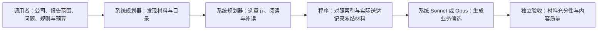

# 系统自主取材与业务提取

更新：2026-10-09。当前任务归属 TODO 09；本轮修复运行职责，不宣称业务图内容通过验收。

## 问题与原因

旧业务图实验的 Sonnet 确实负责生成与修订内容，但它接收了实验脚本预选的 Microsoft 103 块原文。Codex 参与了选段。不能将该结果称为“系统从任务开始独立完成”。

仓库已有 `CompanyDataCoordinator` 和 `AutonomousDataAgent`，支持官方源获取、解析、目录、搜索、分页阅读和按问题查询。缺口是旧业务提取入口直接接收 `--packet`，没有接入这条自主取材链。原件存在，不代表相关章节都进入了模型输入。

## 运行职责



B–E 已接通程序，完成离线模拟 API 的端到端检查；尚未完成真实模型验收。F 仍未完成闭环。Codex 负责代码、测试和独立审阅，不参与运行时选择章节、准备摘录、补写事实或提供标准答案。

## 新入口

`agent business` 接收 `BusinessTaskInput`。其中 `query` 沿用已有 `CompanyQueryInput`，但必须指定 `purpose: business_materials`。来源可以是系统准备好的完整数据集、完整 preparation run 或公司获取配置。外部输入没有章节 ID、block ID、选段边界或摘录正文的参数。

请求形状（尖括号内容须替换为本次明确配置）：

```json
{
  "query": {
    "question": "<本次公司的业务结构、产品服务及关系问题>",
    "purpose": "business_materials",
    "prepared_run": "<系统准备的完整报告运行目录>",
    "include_candidates": true,
    "limits": {"max_steps": 40, "observation_bytes": 60000}
  },
  "skill_path": "skills/uteki-business-diagrams/references/business-products-v1.md",
  "skill_sha256": "<选定规则文件的 SHA-256>",
  "max_material_bytes": 250000,
  "output_contract_version": "business-draft-v2",
  "wire_mode": "full"
}
```

```sh
PYTHONPATH=src .venv/bin/python -m uteki.infrastructure.research_data.query_cli agent business \
  --request /absolute/business-request.json \
  --root /absolute/uteki.beta \
  --workspace /absolute/source-store \
  --output /absolute/uteki.beta/output/new-business-run \
  --model-config /absolute/planner-config.json \
  --extractor-model-config /absolute/extractor-config.json \
  --credentials-root /absolute/uteki.beta \
  --observation-root /absolute/observations
```

规划器、提取器配置必须使用相同费用账本、上限、费用策略和累计请求次数。调用前校验模型配置；规则文件在规划开始前冻结。提取器目前支持注册的 AIHubMix Sonnet 5.5 / Opus 5.5，使用 adaptive、显式 effort、stream=true；没有自动重试或重置预算。原有未知费用继续占用额度。

## 工程检查与可查看产物

1. 规划器从实际目录取得节点，建立 `read_node` 任务。导航使用的 `information` 任务可以保留；普通回答或搜索命中不能替代整节点阅读。
2. 系统从原始索引重新推导每个节点应有的块。核对冻结结果、正文送达账本、公司、期间、来源、原件和索引指纹。仅存盘或送给 Worker 的正文不算规划器已经读过。
3. 同一报告多个节点保留各自范围、原始块 ID 与序号。不把不连续章节重新编号成连续小节，不截断材料来通过大小限制。
4. 生成新版 `runtime-indexed-sections-v1` 材料协议，交给已有业务提取器。历史 `complete_report_subsection` 输入保留用于重放，不作为新版自主验收输入。

| 产物 | 用途 |
|---|---|
| `selection/query/plan-*.json` 与每轮请求、工具记录 | 查看系统为何选材、如何阅读 |
| `materials/selection-report.json` | 原始问题、选择理由、节点、阅读范围与限制 |
| `materials/original.html`、`index.json`、`blocks.jsonl` | 核对原件和完整索引 |
| `materials/source_packet.json` | 实际交给提取器的材料 |
| `handoff.json`、`extraction-preflight.json` | 选材、材料、模型请求指纹与预算连接 |
| `extraction/business_map.json`、`evidence.html` | 候选与原文证据 |
| 根目录 `result.json`、`manifest.json` | 全阶段状态与文件校验 |

三种状态独立保留：`declared_materials_delivered` 表示已选正文确实送达；`selection_sufficiency: not_evaluated` 表示选材是否足以覆盖原问题尚未验收；`semantic_acceptance: not_evaluated` 表示业务内容尚未验收。不能用第一个状态替代后两者。

## 已测与限制

新增测试覆盖：两家合成公司、不同报告期、真实目录选取与两章阅读、漏块及假完整、正文预览未送达、跨来源与期间、删块后重编号、预算共享、规则冻结、原件和节点变动、参数错误在付费前拒绝。模拟 HTTP 贯通正式入口、规划器、阅读、材料交接和提取，计费统一记入同一本账。它是工程测试，不能当作 Sonnet 能力评测。

验证记录：`scripts/run_offline_checks.py` 的 Python 与 JavaScript 回归均通过；业务提取器、旧材料协议和新入口的定向测试通过。修正了一项旧网络测试的错误场景：建连失败属于可证明未发送，响应读取失败才保留未知费用。本轮没有更改费用结算逻辑，也没有真实模型调用或新增业务图内容。Claude 的新一轮顾问复核尚未调用。

当前网关仅支持同一 SEC inline HTML 10-K / 10-K/A 的多个节点；多报告合并、20-F、PDF、图像解释明确报缺口。表格原文保留，本任务不提取金融单元格。体积超限会停止，不缩小原任务或暗取第一来源。

尚需一次真实模型运行，检查系统是否会正确选择并补读相关章节；还需独立材料充分性检查和内容审阅后回到系统补读/修订。旧103块实验和新版目录范围不同，不能当成严格同输入 A/B。现有 Skill 的业务类型/属性边界问题也仍待另行统一。

下一步：在同一任务账本获准继续后，让系统只凭公司、报告范围和问题完成 Microsoft 实跑。随后对未在实现中使用的新公司验证。当前不关闭 TODO 09。
