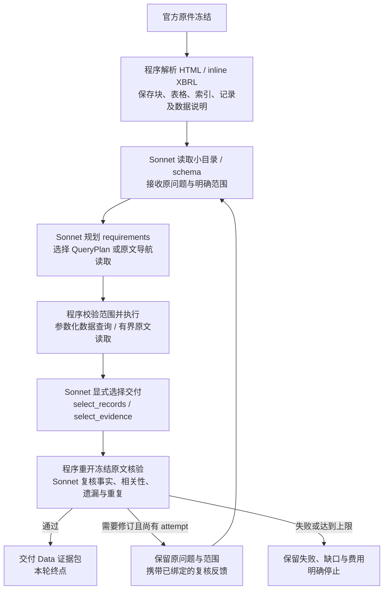

# Data → Analysis：运行边界与本轮修复

2026-10-09 更新。当前验收终点是 **系统 Data Agent 独立交付经过复核的相关原文与结构化记录**。Analysis 报告不在本轮执行。最新标准见 [Data 证据验收](DATA_AGENT_EVIDENCE_ACCEPTANCE.zh-CN.md)。工程闭环已经接通；各个真实问题是否通过，仍以该次运行结果和内容验收为准。

## 当前闭环：从冻结材料到可消费证据

例如，输入“获取 Microsoft FY2025 与 FY2024 的公司总收入”，另行明确公司、冻结来源、截止日及候选数据政策。系统先读小目录和数据说明，模型确定公司实体、收入指标和两个财年对应期间。程序执行查询；模型选择每年需要交付的记录，保留原文、单位、会计口径和精确引用。复核若发现遗漏或重复，系统在同一问题和范围内启动新 attempt，重新获取完整证据包。

这里的原件 HTML 解析、目录树、表格与 inline XBRL 基础记录由程序生成，不调用 LLM。查询决策与内容复核使用本轮配置中的 `claude-sonnet-5-5`，通过 AIHubMix 调用。图中的索引是系统已有索引，**没有接入 VectifyAI/PageIndex 服务**。图也不包含 Analysis 模型生成报告；已有交接代码不等于本轮执行过该阶段。

### QueryPlan 和交付选择的边界

- **QueryPlan 是受校验的结构化取数请求，不是模型编写的任意 SQL。** 数值条件包括实体、指标、期间和值类型，程序按固定查询代码绑定参数执行。公司、来源、截止日与候选政策继续约束查询。原文由来源目录、搜索和读取工具获取。
- **一个 query requirement 的条件固定。** 每次 query 动作必须与该 requirement 的完整 QueryPlan 和固定范围一致，不能只查其中一个年份来冒充完成全部条件。可声明多个 requirement 分步处理，也可在新的复核 attempt 中重新规划；原问题和执行范围不变。
- **检索过不等于最终交付。** `select_records` 选择本 requirement 已查到的 record evidence ID；每个声明条件至少保留一个命中。`select_evidence` 选择已经读到的同源正文块。覆盖选择保留审计记录，不删除原查询结果。必要的表头、单位和限定条件随证据保留；探索性正文和重复记录不能默认混入最终包。
- **复核不能自行改变题目。** 新 attempt 保留原问题、公司、来源与截止日，并验证前次 query、review、dataset 的冻结引用。程序重新构造复核输入，不能只相信 review 自述的范围。复核仍是模型判断，不替代用户内容验收。
- **Codex 不承担运行时取材。** Codex 实现工具、测试和监控。正式运行的来源导航、查询条件、正文/记录选择由系统 Agent 决定；调用者不传 Codex 手选章节、块 ID 或期望答案。

### 当前实现与可核对入口

链接使用仓库相对路径，便于另一台机器及 GitHub 上继续查看；`#L` 指向本次说明核对的代码行。

| 环节 | 实现及边界 |
|---|---|
| 程序准备材料 | [materialize_sources](../src/uteki/infrastructure/research_data/company_materialization.py#L302)；生成 dataset，manifest 记录 `model_calls: 0` |
| 小目录与数据说明 | [discover_catalog / probe_schema](../src/uteki/infrastructure/research_data/query_service.py#L510)；按显式 scope 返回可继续分页的数据说明 |
| 类型化取数 | [QueryPlan](../src/uteki/domain/research_data/agent_query.py#L27)、[参数化记录查询](../src/uteki/infrastructure/research_data/query_service.py#L217) |
| 显式交付与完成门槛 | [select_records](../src/uteki/agents/data_query/autonomous.py#L1144)、[完成检查](../src/uteki/agents/data_query/autonomous.py#L676)；方法约定保留在 [query Skill](../skills/data-agent/query/SKILL.md) |
| 重建原文和独立复核 | [prepare_review_packet](../src/uteki/agents/data_query/answer_handoff.py#L438)、[validate_assessment](../src/uteki/agents/data_query/answer_handoff.py#L625)；事实和交付正文都检查相关性 |
| 反馈绑定与有界补取 | [反馈来源验证](../src/uteki/agents/data_query/coordinator.py#L49)、[retrieval cycle](../src/uteki/agents/data_query/retrieval_cycle.py#L153)；显式 `max_attempts` 为 1–3，每次输出独立保存 |

费用沿用用户最新授权：本轮配置 `budget_policy=record_only`，没有美元硬上限，但所有角色继续使用同一费用账本，失败用量与未知预留不会清零。模型请求仍有输入、输出、超时与重试边界；review 阶段失败最多在新目录再试一次，复核不通过的取材最多达到配置的 attempt 数。账本记录估算和未知状态，不把未知计费写成零。配置依据见 [本轮配置生成器](../experiments/agent_design/2026-10-09-data-agent-completion-v1/make_configs.py)。

验证分层：离线测试已经覆盖显式选择、跨范围拒绝、精确引用、反馈来源绑定与恢复；冻结 Microsoft/Google 的确定性回放可把多处重复收入记录收窄到各年度一条并形成交接包。这验证工程边界，不证明模型一定会选对。真实 Sonnet 各题结果另见 [本轮运行目录](../experiments/agent_design/2026-10-09-data-agent-completion-v1/runs/)；本说明不宣称六题全部通过。

## 历史完整交接方案（当前验收只到Data证据包）

以下保留早前 Data → Analysis 方案。其 Analysis 执行与报告验收条目不是本轮关闭条件，不代表已通过真实模型验收。

让系统独立完成一个问题的取材和分析。调用者提供自然语言问题、公司、期间、允许来源范围及资源限制。Data Agent 根据资料目录/数据说明检索、读取和补充相关原文与数据，再交给使用 Claude 的 Analysis Agent，形成带引用的简短分析报告。

预处理可以完整解析原件并建立索引。查询阶段不默认把完整报告或完整章节送给模型。文字、表格、单位、表头和必要脚注仍须一并保留，不能以节省输入为由删掉语义必需内容。

## 职责边界

| 角色 | 负责 | 不应代替其他角色做的事 |
|---|---|---|
| 系统 Data Agent | 读目录和数据说明，决定来源/读取位置，检索原文/表格，补读，输出有来源的原始材料和候选事实 | 投资结论；把“检索命中”当成原文已读或问题已覆盖 |
| 系统复核角色 | 核对问题、候选事实和所选原文；报告遗漏、证据不足与矛盾 | 用全文兜底；替换原件；把局部证据冒充整文覆盖 |
| 系统 Analysis Agent（Claude） | 消费通过交接检查的原文和数据，形成归纳/假设及最终候选产物，保留事实引用 | 独立打开全部原件，换公司/期间，杜撰数字或引用 |
| 程序 | 执行工具、校验边界/来源/格式、控制输入与费用、记录日志、渲染模型产物 | 根据样例硬编码材料和业务答案 |
| Codex | 修改代码、启动测试、监控真实运行和费用、事后独立分析结果 | 运行中手选章节、给检索步骤填写答案、改写候选事实使其通过 |
| 用户 | 决定需要改变的目标、业务规则和重大方案取舍 | 常规网络/格式修复无需逐步确认 |

Codex 可以启动运行命令，但系统所需决策由运行程序和模型完成。系统运行不依赖本次 Codex 对话提供隐藏的选段、期望答案或业务修补。

## 数据交接

问题 → 有界目录/数据说明 → 系统选择来源、表或文档位置 → 读取必要原文 → 有界复核 → 原文/事实/精确出处/缺口 → Claude 分析 → 带引用报告。

证据包保留：原始问题和执行范围、来源与索引版本、原文块及表格、候选事实、原文引文、覆盖范围与未解决问题。引用必须指向具体块，来源整页 URL 仅作原件入口。

本轮新增的查询证据模式与历史全文复核模式区分。历史运行不改写；新入口使用有界模式。程序重新从冻结底稿核验内容，不能信任候选记录中的自报来源。引用核验与模型内容复核都不构成语义正确性的保证。

## 验收

1. 一次系统执行只输入问题及明确范围；没有 Codex 提供的节点、段落和预期答案。
2. 保留目录/数据说明和实际检索读取记录。模型输入、复核及交接包遵守各自大小限制；超限明确报错，不截断后假装完整。
3. Data 返回原文和必要上下文；Analysis 确实调用配置中的 Claude 模型。阶段日志显示实际模型、配置、用量、失败与产物。
4. Analysis 的事实性结论绑定交接事实和原文块，能查看真实引文。无证据、范围冲突、复核不通过时阻断，不发布伪成功报告。
5. 离线工程测试与真实模型内容验收分别记录。先交付小型报告；图和长报告是后续产物形态，不因本轮接线通过就视为已实现。

## 问题处理

有明确路径的网络、格式和接线缺陷由 Codex 修复通用程序后新建运行，保留失败记录。检索所需的补读由系统 Agent 决策。需要改变业务目标、证据范围或规则的实质问题，记录所在步骤、实际输入/输出和建议方案后反馈给用户。不能向系统注入 Codex 的具体业务纠错来冒充独立成功。
