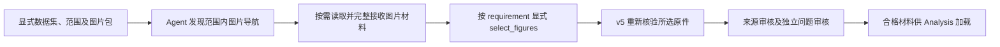

# 03-M3 图片按需消费 · 工程交付

2026-10-12 后续真实验收已完成：新重建材料，官方 DeepSeek，同题三次最终合格 3/3、首个取材合格 2/3、全链无纠错 1/3。旧失败、准备版本、源码快照和同一任务总账保留。详见[真实交付与范围](../experiments/agent_design/2026-10-12-m3-figure-query-v1/DELIVERY.zh-CN.md)。下方为工程阶段历史，不将离线检查追认为实跑。

2026-10-12。**工程链已接入并通过零 API 回归；真实原图、真实 Agent 内容质量与重复稳定性尚未验收。** 本轮先完成 R25–R29 五项根因修复、离线回归、提交并上传 `0319a2ed`，再按[冻结消费契约](FIGURE_QUERY_CONTRACT_V1.zh-CN.md)实施 03-M3。没有重新转录图片、没有使用 AiHubMix、没有重建账本或修改旧原件。

## 实际可执行行为

输入显式 frozen dataset、scope、`purpose=analysis_evidence` 和 `figure_bundle_ref={path,manifest_sha256}`。图片补充包必须是强 OCR 定位的 v3，并匹配 dataset；缺包不自动搜索实验目录或替换来源。



已实现的共同机制：

- scoped QueryDataPort 在导航和读取时校验公司、来源、cutoff、candidate 权限、manifest、原图和转录身份。目录只提供导航，不能代替阅读。
- Agent 记录当前角色实际收到的全部材料，支持有界分页；磁盘存在、截断预览或其他 worker 看过均不算当前角色完整阅读。只有同范围/同来源的 `source_evidence` 可选择图片；错误操作原子拒绝，不改旧选择。
- `selected-originals-v5` 单独封存所选图片。探索图片不会自动进入最终包；图片不会满足旧 HTML 正文或财务数值要求。合法仅图片材料可完成对应 source_evidence，不能因此伪造 read_node 完成。
- 最终原件重组重新打开冻结 Reader，只返回实际所选图片、精确原文字段与出处。双审分别检查图片真实性/支持/聚焦以及是否足以支持原问题；v5 必须使用 `delivered-sources-v2` 和 `independent-question-v2`，缺少或降级策略不能取得下游资格。
- 问题审核支持精确 `figure_text`、受限 `figure_field` 引用；拒绝跨图身份、改写引用、坐标或图例推算出的精确曲线点值。生成端、SDK projection、机械修订和保存后重验共用对应新 schema。
- 负面来源审核反馈可在原有有界修订内传回 Agent；恢复不能切换图片包。输出目录、workspace 和费用文件不得写进冻结图片材料；运行指纹包含实际新协议及消费依赖。
- 无图片包沿用 v4 输出；历史 v1/v2 图片 Reader 保持明确较弱状态，新 Query 图片接入不会把它们追认为 v3 强验证。

## 回归证据与边界

公开调用链案例使用独立合成双公司 SEC 原件，通过生产解析/索引构建 fixture，随后经真实 QueryDataPort → ScriptedPlanner 读取和选择 → 严格原件重组 → 两个 fixture reviewer → Analysis 材料加载。源码和门禁实际执行；planner/reviewer 是确定性 fixture，SDK 使用 MockTransport，**没有外部模型请求**。生产加载默认拒绝 fixture，测试显式 `allow_fixture=True` 才能检查结构；这个结果不能当作真实 Analysis 运行。

| 核验 | 结果及限制 |
|---|---|
| 27 模块定向整合 | 354 项通过，含旧消费、角色隔离、读取分页、范围/身份/篡改、交付、SDK projection、恢复与双审 |
| 最终双审政策及公开调用链 | 收口后 84 项通过；与整合有重叠，不累计成独立样本 |
| portable core | 最终 576 项 Python + 37 项 JavaScript 通过；固定清单不因本机缺材料静默删项 |
| 原两张业务图片 | 本机缺原图片包及对应 v5 datasets；未重放、未重新独立核验 |
| 模型效果/稳定性/费用 | 未真实执行，不能报告成功率或泛化；本轮新增 API 0 次，费用 $0 |

整合修正了两项共同边界：实际发送的空容器也应计为已读，否则完整图像材料永远不能完成消费；合法仅图片 source_evidence 的完成不应隐式依赖无关 HTML 正文。分别覆盖实际收到/未收到、空/非空、正文要求仍未完成及跨角色反例。测试 fixture 仍必须具有生产生成的 `index_id`，没有放宽原件身份验证。

复现核心检查：

```bash
.venv/bin/python -m unittest tests.unit.test_query_figures tests.unit.test_autonomous_figure_selection tests.unit.test_figure_handoff tests.unit.test_figure_query_input tests.unit.test_figure_query_pipeline tests.unit.test_record_review_model tests.unit.test_retrieval_cycle
.venv/bin/python scripts/run_offline_checks.py
```

## 当前 TODO 与下一验收

03-M3 保持部分完成。下一具体动作是迁移原 `output/figure-materials-20261012` 和对应 v5 datasets，重验 manifest/图片/原文/OCR 消费，再由 Codex 独立精读原图，冻结具体问题、必要/可选/冗余标准、重复次数、官方模型配置及任务预算，运行系统 Agent。参考答案、必需图 ID 和评测批评不得传入。

原 03-M2 在另一机器的材料通过记录继续保留，不能代替本机新消费者对原图的验证。当前图片生产入口仍使用被用户禁用的 AiHubMix；消费工程接入没有执行该入口。费用按真实任务沿用受约束记录，不清零、不分叉历史账本。E6-R5b、E6-R4、历史恢复、完整财务、扫描件及 E7 保持后置和各自未完成状态。
