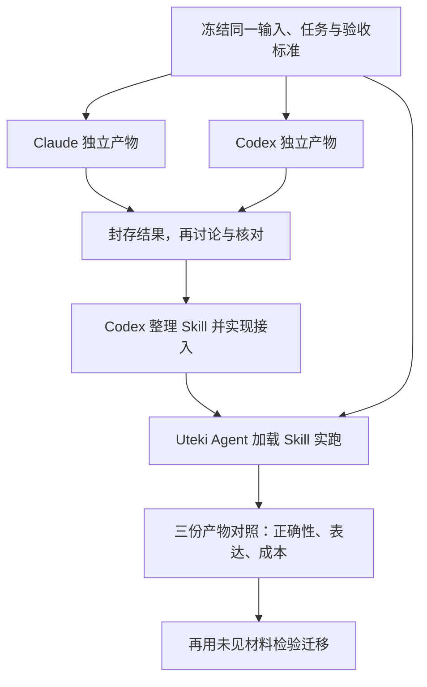

# 三方协作与复跑约定

用户于 2026-10-07 确认：**Claude 负责顾问工作，Codex 负责全部工程实现，Uteki Agent 负责实际执行并接受验收。** 本约定用于模型能力迭代；写下流程不代表三方已经实跑。

最新协作节奏：[单一当前重点规则](COLLABORATION_FOCUS.zh-CN.md)。每轮只展开一个当前行动，先明确输入、交付和验收；其余事项按优先级与依赖保存在 [TODO](../TODO.md)。下图是需要时采用的能力迭代方法，不表示每轮同时启动全部角色或付费运行。当前重点所需的独立核查可以并行，其他分支排队。

这份共享规则同步到全局和项目 AGENTS；本机 Claude 顾问在新请求中加载同一原文，旧请求保留当时的系统提示快照。顾问提示与 Uteki 数据提取提示分别管理，协作写作偏好不自动改写数据产物契约。

## 角色

| 参与者 | 负责的工作 | 可检查交付 |
|---|---|---|
| Claude | 独立完成同一任务；随后作为顾问提出设计、改进及验收建议 | 原始回答/产物、建议、理由与未确定项 |
| Codex | 独立完成同一任务；核实双方结果；承担全部开发、测试、修复、Skill 整理和系统接入 | 原始产物、实现、Skill 版本、检查与差异记录 |
| Uteki Agent | 在真实运行时加载明确 Skill，处理同一输入 | Trace、实际请求与配置、过程产物、最终结果及失败原因 |
| 用户 | 明确业务目标、判断阅读体验、裁定仍有分歧的业务取舍 | 反馈与采纳记录；不以顾问意见自动采纳数据 |

Claude 可以输出示例 JSON、Mermaid 或方案片段；由 Codex 核验、实现并集成。Uteki 执行数据任务，不接管仓库开发。

## 每轮冻结什么

每个 case 明确记录公司、材料/片段、期间、来源 hash、任务、共同输出契约、允许的数据和工具、费用边界以及评分标准。三方收到相同业务材料；原答案、评分和参考结论不进入执行输入。材料或契约改变时建立新版本，不混进原对照。

同时保存实际生效的系统指令、可见历史、Skill 内容/hash、模型 ID/供应商、思考设置、输出上限、工具/代码版本、重试次数、用量、耗时和费用。未知项写未知，不能补为零或默认值。Codex 桌面运行若没有独立 API 账单，就明确不可与供应商账单等同比较。

Claude 和 Codex 先独立产出并封存，再互评。已有顾问会话可能含旧答案：这种会话适合审阅，不满足独立对照条件。独立试跑需要相同、无答案的冻结上下文，并在共享记录中标明用途；当前共享服务尚未提供此类隔离执行入口，不得靠“请忽略旧答案”冒充隔离，也不能绕过现有私密记录与费用控制。

## 怎样沉淀 Skill

对照原文和用户目标，记录“哪个方法有效、在哪种情况下适用、如何核验”。只沉淀可迁移规则、输入/输出契约和工程检查。公司的固定答案、示例金额和评测预期留在评估侧。示例文件可以供开发者审阅，但同 case 的目标答案不能随 Skill reference 一起送进 Uteki 的执行请求。

Uteki 使用整理后的 Skill，再处理相同业务材料。保存真正发送给模型的内容及有效版本；文件存在、提示词提到 Skill 路径、程序回放 fixture 都不能代替实际加载和模型运行。

这个第三路是“同 case 学习后的复测”，不是与前两路完全等配置的模型 A/B。要证明 Skill 改进有效，可在需要时保持同一 Uteki 模型和输入，比较 Skill 前后版本；要证明方法可迁移，则用未参与整理的新材料。新增运行仍遵守当前费用范围，不默认无限重复。

## 如何对比

先验硬条件：来源和期间正确；无伪造事实；金额/单位/正负号正确；引用定位到对应片段；符合共同输出契约。硬错误不能靠美观或速度加分抵消。

再分别评估任务覆盖、结构清晰度、取证便利、未知/限制表达、耗时与费用。对文本和图形可匿名标为 A/B/C，先评分后揭示来源；尽量由未参与生成的评审上下文复核。Codex 同时作为作者和评审时要明确此限制，不能称完全独立裁判。模型建议不是事实证据，最终依据仍是原件与任务标准。

评分沿用项目的 Evaluation Protocol（已归档：`docs/EVALUATION_PROTOCOL.md`，恢复方法见[归档说明](REPOSITORY_RETENTION.zh-CN.md)） 及所选任务的具体验收，不发明一个覆盖所有任务的总分。原始结果、修订结果和失败分别保存；失败不能从比较表消失。工具/配置不等价时称方案比较，不将结果外推为纯模型能力排名。

## 本轮范围收敛 · 2026-10-07

用户最新明确先完成 **Uteki Agent + Claude** 的真实执行，对照已经认可表达方式的 Codex v2 参考产物。本轮不额外启动 Claude 独立第三路。上面的三方方法保留为需要时采用的完整评测方式，不作为每轮都要多次付费调用的要求。

本轮固定原文选段，参考答案留在评估侧。Agent 选择业务节点、关系与收入原表单元格；宿主加载 Skill、核原文、按单元格解析金额、校验期间和勾稽、生成可见图，并保留 Trace。参考产物不是同设置新跑出的模型 baseline，因此交付称“真实执行与参考对照”，不称严格模型 A/B。

## 首次落地案例与当前状态

首次落地任务已执行：**从明确冻结的财报业务小节和收入表，分别生成业务结构、收入结构及精确出处。** 使用原材料作为输入；现有手工候选仅在评估侧作待复核参考。参考 [业务与收入第二轮产物](../experiments/agent_design/2026-10-07-business-revenue-v2/README.zh-CN.md)。

可观察验收：业务图保留广告等经营活动；收入图不拆分合并披露；负调整和金额勾稽正确；点击节点/收入行能定位原文；Uteki 留有实际加载 Skill 的请求与运行记录。另选一份未参与 Skill 整理的材料检查迁移。上述标准不能取代对覆盖范围的核查。

当前有 Codex 手工审阅产物与 Skill v0.3 受限接入；没有同一冻结输入的三方独立实跑结果。Claude 前次顾问调用触发 4,096 token 输出上限且无正文，仍是失败记录；Uteki 的单次业务/收入 Skill v0.3 已真实加载并执行：1 次 Sonnet 5.5，估算 $0.179218。收入核验通过，业务图保留四项改进；[产物与复核](../experiments/agent_design/2026-10-07-agent-business-revenue-v1/README.zh-CN.md)已交付。v0.4 已用于后续 NVIDIA 真实请求，但原响应有格式问题，执行交付与工程恢复分开记录。这些历史产物不得追认为三方独立流程已经验收通过。

## 当前进展与下一步

原 [Sonnet / Opus 单次对照](../experiments/agent_design/2026-10-07-sonnet-opus-business-ab-v1/README.zh-CN.md)保持冻结。Opus 首次本地未交付，供应商控制台存在匹配成功与收费记录；补证不改写本地未知账本。新一次后台流式请求已交付，见[恢复后对照](../experiments/agent_design/2026-10-07-opus-stream-recovery-v1/README.zh-CN.md)。它除模型外还改变接收方式、等待上限及代码版本，只能称恢复后内容比较；不能据单次速度或成本推断总体优劣。

NVIDIA 使用相同系统入口、Sonnet 和冻结 Skill v0.4。第一次在响应头前断连；第二次用保留所有原文与表格的精简输入收到完整回答，因最外层 Markdown 围栏触发严格格式拒绝。原响应与失败不修改；去围栏的工程恢复另存，必须证明 JSON 内部字节未改、完整契约通过、零新增模型调用，并在图页说明。它不是模型原始格式一次通过，也不是人工改写业务答案。

1. NVIDIA [派生图及原文语义复核](../experiments/agent_design/2026-10-07-nvidia-business-revenue-v1/README.zh-CN.md)已完成。下一步收敛产品归组、直接引用、可机器读取的推断状态，以及正式流程的格式恢复边界。
2. Microsoft 先完成官方原件、业务/收入表与币种证据的离线输入准备，再作受限执行。
3. 推进底稿质量与 Query。NVIDIA 已见于早期人工参考，不称盲留出；公司和 Skill 同时变化，不能证明 Skill 单变量收益。完整三方或多次稳定性 benchmark 另定次数、评价和费用范围。
