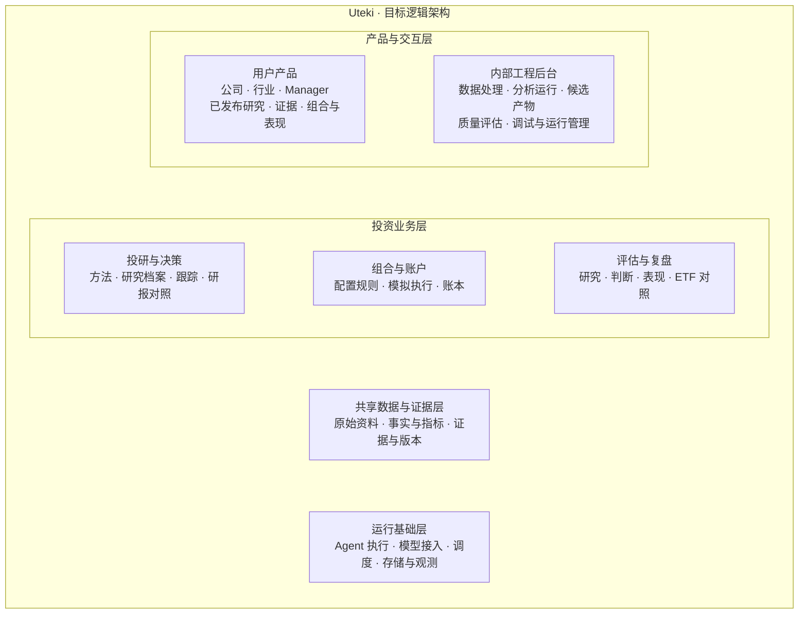
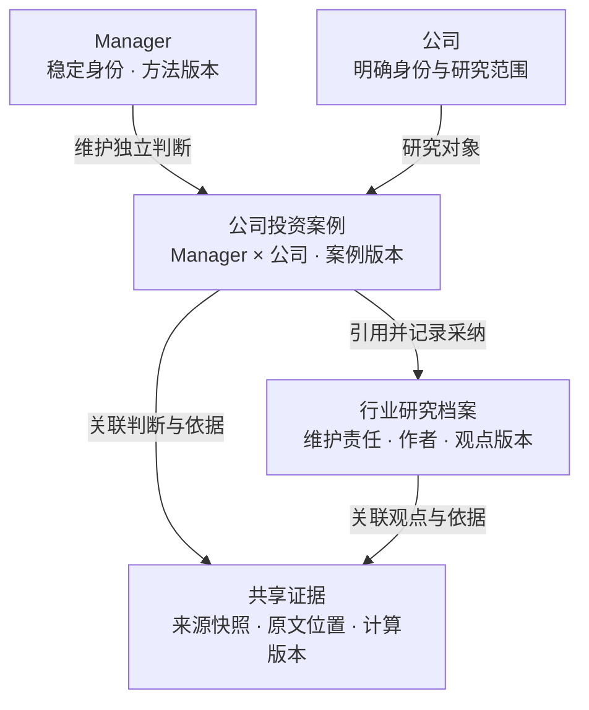

# Uteki：架构总览、实现对照与落地顺序

- 日期：2026-09-29。
- 用途：把已确认的目标放进统一系统地图，再以当前源码确定下一步。
- 目标依据：[目标架构与访谈共识](UTEKI_TARGET_ARCHITECTURE_2026-09-24.zh-CN.md)、[12 项议题的建议答案](UTEKI_ARCHITECTURE_PROPOSED_ANSWERS_2026-09-29.zh-CN.md)。已确认原则与具体设计建议仍分开管理。
- 审计范围：当前工作区的 `src/`、`scripts/`、`apps/`、`config/`、相关测试、入口与设计文档，包含未提交及未跟踪文件。源码位置按本次读取记录，后续修改可能移动行号。
- 验证边界：实现对照采用静态调用链检查；后续另执行一次本地年报准备与读取初始化，记录见第 7 节。未运行模型、抓取数据、启动服务或执行业务测试，没有核查实际服务器与后台进程。源码存在不等于运行通过，离线准备通过也不等于研究质量或投资能力验收。

**当前判断：Uteki 已有可复用的数据、证据、候选研究与档案管理能力；两位持续投资 manager、独立行业档案、模拟账户及投资表现评价尚未形成可核验的完整链路。**

后续真实运行及 Agent 角色状态见[Agent 现状与评估边界](UTEKI_AGENT_STATUS_2026-09-29.zh-CN.md)。下文最初静态审计与各次增量按历史保留，不能把初始“未运行模型”误读为后续六轮也未调用模型。

## 1. 系统总图：一套共享 manager 平台

图表达分层和职责归属；上下位置不是执行顺序，横向并列不是独立服务。首版采用模块化单体，服务和进程数量在部署阶段决定。



| 边界 | 归属与约定 |
| --- | --- |
| 投资责任 | Manager 持续维护独立研究、判断和组合决定；共享底层能力，各自保留方法与历史 |
| 研究责任 | 投研与决策管理公司案例、行业档案、估值假设、反证处理、跟踪与外部观点对照 |
| 资本核算 | 组合与账户用确定性代码校验规则、记录模拟成交并核算现金、股数及净值；模型不能直接改账 |
| 评价责任 | 读取冻结的研究、决策与账户记录，按事前声明的风格目标和 ETF 基准评价；不回写历史结论 |
| 事实责任 | 数据层保存来源、原文、口径、候选及采纳状态；管理层说法和研究者观点保留各自身份 |
| 运行责任 | 执行任务、保留状态与成本、处理失败；具体研究触发条件和投资规则来自业务层 |
| 内外访问 | 用户产品只读取正式发布内容及允许展示的证据；内部工程后台查看数据/分析过程、候选、评估与执行记录。接口与读取权限须落实隔离，当前尚未完成该实现验收 |
| 外部依赖 | 官方资料、行情与机构材料从数据边界进入；模型通过运行基础接入。提供方不属于 Uteki 内部 |
| 后续用户层 | 用户选择标准 manager、分配资产，另记加入时间和自身结果；当前不建设这层，不按用户复制标准 manager |

两位初始 manager 是长期价值型与阶段性进攻型。方法的区别包括研究问题、收益依据、估值、期限和进退条件；不只改变 prompt 或持有时长。行业研究提供共享支持，各 manager 自主采纳，没有强制统一观点的行业指挥层。

## 2. 核心对象：共同来源、独立判断、可追溯版本

以下关系图只展开研究对象，避免把账户、调度和所有证据字段挤进同一张图。箭头表示归属或引用关系，不表示工作流；对象名称是领域设计，尚未固定数据库表名。



公司入口按公司聚合案例；manager 入口按 manager 聚合相同案例。报告读取一个确定的案例版本，切换入口不复制记录。行业入口读取独立档案，各 manager 对行业观点的采纳保存在自己的案例中。

| 核心对象 | 谁负责维护 | 与其他对象的关系 |
| --- | --- | --- |
| Manager 与方法版本 | 研究方法与组织；组合政策由组合业务校验 | 标准 manager 身份稳定；方法、风险政策及运行配置分别版本化，方法升级不抹去旧记录 |
| 来源快照与证据 | 共享数据与证据 | 保留原文、公司、来源、语言地区、口径、公开时间和实际取得时间；修正形成新版本 |
| 行业档案 | 共享行业研究支持，明确维护责任与观点作者 | 独立维护研究范围、判断、风险和版本；公司案例引用指定版本并解释业务传导 |
| 公司投资案例 | 对应 manager，经案例管理能力发布 | 管理 thesis、factors、risks、估值及机会判断、反证和未知；关联证据、行业版本和方法版本 |
| 跟踪计划与复核记录 | 持续追踪与复核 | 公司案例和行业档案引用其版本；记录该检查什么、是否完成、什么变化触发重新判断 |
| 外部研报原文及来源版本 | 共享数据与证据 | 保存机构、作者、发布日期、覆盖、期限及全文或摘要状态；机构主张不自动成为已核实事实 |
| 外部研报对照记录 | 外部研报对照 | 引用报告和案例的具体版本，维护可比条件与分歧；各 manager 的采纳决定和处理理由保存在自身案例中 |
| 组合决策 | Manager 作出；组合业务保存并校验 | 引用具体案例及方法版本，记录目标比例、现金、调整和退出依据；目标比例与实际比例分开 |
| 模拟账户与账本 | 组合与账户 | 首版每位 manager 一个持续账户；记录订单、成交、资金、持仓、公司行动及净值，不随案例改写 |
| 评价记录 | 评估与复盘 | 引用冻结的决策、账户记录、风格目标和 ETF 基准；区分研究质量、预测兑现与投资结果 |

一个案例可以有多个 thesis，也可以保留冲突假设。一个 factor 或 risk 可以影响多个 thesis；一条证据可以支持某个判断、反对另一个判断，正反方向属于关联关系。已发布、已采纳、当前有效是不同状态。研究覆盖名单与持仓名单也分别维护。

## 3. 当前实现对照

“已有基础”表示找到了实现及调用路径；“部分”表示仍需接入目标业务；“未找到”仅限本次检查范围。以下都不代表线上验收。

| 能力 | 当前代码证据 | 与目标的主要差距 |
| --- | --- | --- |
| 官方材料与数据快照：已有基础 | `prepare/refresh → CompanyDataCoordinator.prepare → prepare_sources → materialize_sources`。见 [coordinator.py:120](../src/uteki/agents/data_query/coordinator.py#L120)、[company_materialization.py:234](../src/uteki/infrastructure/research_data/company_materialization.py#L234) | 产物仍是 candidate；SEC 身份、US GAAP inline 概念、USD 与 PDF 文本有明确适配限制；不代表所需研究范围已覆盖 |
| 证据查询与 Data Agent：已有基础 | `Coordinator.query → AutonomousDataAgent.run`；范围查询校验公司、来源、快照及截止，见 [query_service.py:420](../src/uteki/infrastructure/research_data/query_service.py#L420) | `evidence_ready` 仍明确 `semantic_completeness=not_evaluated`，见 [autonomous.py:414](../src/uteki/agents/data_query/autonomous.py#L414)。取得证据不等于完成语义审查或确认研究正确 |
| 研究档案与采纳：已有基础 | 工作台创建 `Store` 并接入操作；按公司、研究者、范围及主材料分采纳槽，保留替换冲突和历史。见 [research_archive.py:398](../src/uteki/agents/archive/research_archive.py#L398) | 当前主要是按材料组织的报告流，尚未接成跨材料持续维护的 manager 公司案例；GET archive/context API 仍硬编码 `alphabet`，见 [app.py:481](../apps/review_workbench/app.py#L481) |
| Thesis 与行业档案：部分／未找到 | `Hypothesis`、`AnnualRevision`、`preview_revision` 已有范围、正反证据和修订合同，见 [hypothesis_contract.py:26](../src/uteki/agents/archive/hypothesis_contract.py#L26) | 文件明确不负责持久化、采纳或证据核验；未找到目标产品接入。现有 industry 报告章节不等于独立行业档案 |
| 公司分析与两种 manager：部分 | `run_narrative` 可调用模型产出业务、行业、thesis、估值和跟踪章节，并作引用检查，见 [narrative_runner.py:15](../src/uteki/agents/analysis/narrative_runner.py#L15) | 结果仍需语义和内容复核；未找到两种方法实例、可复算估值版本、机会窗口与持续案例组成的完整链。部分实验仍固定 Alphabet 材料 |
| 反证研究：已有复核原语 | Team 模式实际调用 analyst、reviewer、analyst_revision；reviewer 独立取证，最终作者处理质疑。见 [analysis_comparison.py:90](../src/uteki/agents/analysis/analysis_comparison.py#L90) | 尚未接成目标 manager 的固定反证职责、行动触发与有效审阅复用；Single/Team 的预算不同，不能当作受控的风格优劣结论 |
| 专业机构研报对照：未找到专门链路 | 已有研究材料读取、引用与候选审核能力可复用 | 在检查范围未找到机构报告身份、可比条件、具体分歧与 manager 采纳组成的专门链路；需真实可读取材料验证，不能用合成报告算完成 |
| 工作台：部分，含原型 | `review_workbench` 接入研究档案和数据页面；`uteki_zero` 已有公司／manager 及组合界面 | `uteki_zero` 的权重、动作和收益来自示意内容；[zero.mjs:258](../apps/uteki_zero/zero.mjs#L258) 明确收益虚构、未接账户计算。产品页面存在不表示该业务可运行 |
| 模拟执行与账户：未找到完整链路 | 工作台也标记持仓未接入，见 [home_cards.py:55](../apps/review_workbench/pages/home_cards.py#L55) | 未找到订单、成交、结算、现金、股数、公司行动和每日净值的完整实现；独立账户与幂等恢复需建设 |
| 评价：已有研究评价基础，投资评价未找到 | `uteki-eval` 比较 `value/unit/period`，见 [evaluator.py:45](../src/uteki_eval/evaluator.py#L45)；另有研究实验与 benchmark 治理 | 抽取准确率、引用校验和研究 A/B 不等于收益、回撤、ETF 对照；尚未找到以真实账本为输入的投资评价链 |
| 持续运行：有任务和观测基础，闭环未找到 | CLI 已有单次 `agent refresh → coordinator.refresh → prepare`；工作台提供 HTTP 服务。见 [coordinator.py:176](../src/uteki/agents/data_query/coordinator.py#L176)、[app.py:739](../apps/review_workbench/app.py#L739) | 当前入口和源码未找到 company-updates watcher 的可调用实现，也未找到日频研究接账户及评价的完整链。`replay_task_session` 明确是工具重放验证，见 [task_progress.py:330](../src/uteki/infrastructure/research_data/task_progress.py#L330)；不能当作崩溃后任务接续 |
| 成本与预算：已有基础 | SQLite 预算组件支持事务、预留、结算和 `enforced/record_only`；见 [run_budget.py:31](../src/uteki/agents/runtime/run_budget.py#L31)、[run_budget.py:74](../src/uteki/agents/runtime/run_budget.py#L74) | 记录的是估算，`actual_billed_usd` 为空；流式计费未实现。这个 SQLite 账本用于模型预算，不是投资账户或持久任务队列 |

### 三个需要优先解决的具体边界

1. **公司范围贯穿入口。** 查询底层已校验范围，但档案 GET/context 接口仍写死 Alphabet。下一步必须将明确的公司输入贯穿页面、接口、归档与上下文；未知或缺失公司不能回退到试点。修正时用另一公司或独立合成数据验证，不自动扩大产品公司名单。
2. **资料时间不能直接变成成交时间证据。** 当前 materialization 使用披露日期作为 `available_at`，见 [company_materialization.py:276](../src/uteki/infrastructure/research_data/company_materialization.py#L276)。目标日频决策还需同时核验公开可得时刻、实际取得时刻、决策截止和市场时区。不能把今天补抓的旧材料补记为昨天已使用。
3. **技术完成与研究完成分别验收。** 数据 candidate、引用通过、报告采纳和界面示意分别保留实际状态；本轮未验证模型是否回答了关键投资问题，也未从任何测试数量推导完成比例。

审计中的“未找到”结论来自：入口枚举、相关调用链读取，以及 `src/scripts/apps/config/tests` 中的 manager、case、industry、thesis、archive、portfolio、order、settlement、dividend、drawdown、ETF、scheduler、watcher 等检索。研报对照另检索 institutional、sell-side、broker/external report 及中文同义词。结论不覆盖外部服务、其他 checkout 或被忽略的产物目录。历史 watcher 记录与当前源码状态有差异，本轮按当前可读源码记缺口，不从历史记录推断现有服务。

## 4. 建议落地顺序与验收

以下顺序细化目标文档的阶段 1～4，不替换仓库既有版本编号，不是本轮代码已交付的清单。两个方向可并行准备：研究样例与证据覆盖；确定性账本的规则及合成验收。但正式自主模拟依赖研究、时间边界和账户验收完成。

| 顺序 | 解决的问题与复用方式 | 可观察验收 | 仍不能据此证明 |
| --- | --- | --- | --- |
| 1. 一家公司、两份独立研究 | 复用数据快照、scoped query、archive、narrative 和 reviewer；明确案例、行业引用、方法与证据状态，修正入口公司范围 | 显式选择 GOOGL 与两位 manager，得到不同问题和判断的完整案例；业务、thesis、factors、risks、正反证据、估值及未知可读可追溯；同一版本在公司和 manager 入口一致；至少一项关键估值计算可复算 | 多公司适配、持续跟踪或投资有效 |
| 2. 新证据导致可解释的更新 | 接入 thesis 合同、行业档案、观察计划和 reviewer 的修订职责；补足任务状态、失败与重启恢复 | 一条新证据使一位 manager 发布新版本，另一位可有依据地维持；旧版本可还原；抓取失败不显示无变化，重跑不重复发布；实际日频任务连续留有检查记录 | 两种方法已分出优劣，或服务器长期可靠 |
| 3. 两个账户与 ETF 可复算 | 冻结模拟规则、行情范围、时间约束和基准；实现确定性订单、成交、账本及评价 | 一位 manager 买入，另一位可保持全现金；核对费用、结算、股数和净值，覆盖缺价、分红、拆股及重启重跑；与 ETF 在相同起点、可比口径下生成记录 | 盈利能力、最大损失保证或长期投资水平 |
| 4. 小规模明确公司池 | 按验证后的范围接入另一公司和相关行业；复用共享资料，保持独立判断；增加机会比较和共同风险研究 | 另一公司、不同来源和期间通过实际任务；没有跨公司证据替代；能解释为何选择 A、B 或现金，并报告覆盖、失败和成本 | 全指数、全行业覆盖或可无限扩张 |

阶段 1 同步验证一份实际可读取的外部机构报告：对齐时间、期限与范围，记录具体分歧和采纳理由。拿不到报告时独立研究可以继续，但机构对照能力保持未验收。

**下一次最小迭代建议：形成“GOOGL 公司案例 v0”的可审阅内容样例及对象映射。** 输入为明确公司、两个方法配置、来源版本及截止；输出为两份独立案例、一份限定范围的行业引用样例、正反证据和缺口清单。先看它是否回答用户的核心问题，再按验收需要连接或修改现有代码。本轮不调用模型或将示例判断作为真实研究成果。

## 5. 一个贯穿对象的简单 case

以下完全是假设场景，用于验收系统行为，不代表 GOOGL 当前披露、估值或投资建议。

**输入：**假设一份新官方材料上调资本开支指引。数据层保存新快照和实际取得时间；两个 manager 能读取同一份原文。

| 对象／角色 | 需要留下的内容 |
| --- | --- |
| 行业档案 | 新增供给、需求兑现和行业回报的关系；判断作者、正反依据、未知及版本 |
| 长期 manager 的公司案例 | 投入是否能带来持续现金回报、原估值对资本开支的敏感性；可维持，也可改变判断，须给出依据 |
| 进攻型 manager 的公司案例 | 未来数月的催化和价格预期是否改变、验证期限与失败条件；公司长期前景与当前机会分别判断 |
| 反证审阅 | 质疑投入增长能否转换成利润、哪些业务受影响、是否已有相反证据；manager 逐项记录处理理由 |
| 跟踪计划 | 需要补充什么资料、何时检查、到期未兑现怎样重新判断；由跟踪能力维护，案例引用 |
| 账户 | 只有正式决策通过规则校验后才可能产生模拟订单；研究更新本身不修改持仓，缺价也不能编造成交 |
| 评价 | 保存当时的预测、决策、证据和账户状态；后来的结果用于复盘，不改写当时的预测 |

验收重点是：同一材料可以产生两种有依据的判断；行业观点变化不强迫 manager 同步；每一条判断和每一次账户动作都能找到当时的依据与版本。

## 6. 尚需验证或冻结的事项

已确认的四层架构、共享 manager 平台、现金与集中持仓自主权、独立模拟账户、风格评价和方法升级原则不再重复询问。

| 类别 | 下一步处理 |
| --- | --- |
| 研究质量 | 用首份可审阅样例确认深度和问题覆盖；真实模型效果需另行运行并记录证据 |
| 数据覆盖 | 验证官方资料、行情、公司行动、交易日历及一份真实机构报告；保留来源和地区版本，缺口不编造 |
| 方法与范围 | 细化两份方法说明及首版行业专题，配置中显式指定；不把示例公司或行业写成通用默认值 |
| 模拟参数 | 初始资金、实际 ETF、费用、结算、时点及价格规则仍按建议稿待冻结；本轮未启用其中任何参数 |
| 运行条件 | 明确前期承载环境及后续服务器，验证重启、重试、备份恢复和任务不重复；不根据存在日志就声明可靠 |

架构审计轮仅更新设计文档。随后按用户“继续推进”完成了第 7 节的本地材料核验与离线准备；未修改业务代码、公司名单或正式运行配置，未启动交易、定时任务及部署。

## 7. 当前增量：FY2025 10-K 研究基线 v0

### 具体问题与输入边界

本次要验证：同一份年报能否支持两位 manager 形成有依据、能被质疑和更新的公司理解。第一步只建立年度研究基线；判断当期价格和短期机会所缺的信息明确交回数据能力补充。

| 项目 | 本次范围及状态 |
| --- | --- |
| 公司与证券 | 研究公司为 Alphabet；未来投资试点证券为 GOOGL。公司财务与证券价格分别标识，不将 GOOG 报价自动替换为 GOOGL |
| 主材料 | [既有 annual/materials.json](../experiments/analysis_comparison/codex-hypothesis-2025-2026-v0.1/annual/materials.json) 仅选择 FY2025 10-K；本地清单登记报告期末 2025-12-31、披露日及材料截止 2026-02-05 |
| 时间限制 | 清单只有日期精度，不能推导具体公开时刻或证明当时实际取得；本次属于历史材料研究，不是历史盲测，不生成过去的投资业绩 |
| 来源与索引 | 使用脚本显式锁定的 `alphabet-000165204426000018`、`didx-028173790917c679`、v0.1 索引；本地原件、冻结索引 manifest、3 个索引产物及 2 张引用图片的哈希和字节数核对一致 |
| 增补材料 | 首次年报限定研究不混入后续披露、旧答案、评估标准答案或其它材料；不足记缺口。扩充来源时另建明确版本 |
| Manager 方法 | 长期价值型与阶段性进攻型沿用已确认方向；真实双 manager 运行需显式记录各自方法、期限、问题和配置版本，不能把旧单研究员脚本直接算作两位 manager |
| 模型与费用 | 本次离线准备不调用模型。首次真实运行需明确 provider/model 或配置路径、共享预算及请求限制；旧脚本内置模型不自动成为本次选择 |

### 应交付的研究内容

阅读正文保持连贯，下面是质量检查问题，不要求将正文写成逐项问卷，不预填 thesis 或预设看多结论。

| 共同问题 | 初始案例应交付什么 |
| --- | --- |
| 公司怎样赚钱？ | 谁付钱、为何付钱、收入与主要成本来自哪里，业务和财务分部如何对应；披露不足的子业务不凭空分拆 |
| 回报可能来自哪里？ | 将 thesis 写成可被证据支持或推翻的因果解释，说明必要条件；区分事实、管理层展望和研究预测 |
| 最值得跟踪什么？ | 关键因素如何影响收入、利润或现金流；风险通过什么路径损害判断，每项关联实际证据及未知 |
| 相反解释是什么？ | 检查同一事实能否支持另一种解释、证据是否同源、管理层叙述有无反向材料；不足以判断时保留分歧 |
| 财务是否支持叙述？ | 关键数字关联原表、期间、币种及口径；至少一项有研究意义的财务计算可复算，并说明它不能证明什么 |
| 价值与价格如何判断？ | 先列出估值所需输入、方法和待验证假设；缺少报价或关键假设时保留“投资吸引力暂不可判断”，不强填目标价 |
| 何时需要改判断？ | 给出可观察的验证条件、反证条件和待补材料，供持续追踪能力生成观察计划；报告引用计划，不另建一套所有权 |

| 同一材料下的风格区别 | 长期价值型 | 阶段性进攻型 |
| --- | --- | --- |
| 核心追问 | 竞争优势、资本投入与现金回报能否在多年内维持？ | 哪个有依据的变化可能在数月内被验证，当前需要补什么才能判断机会？ |
| 时间表达 | 记录多年判断的关键条件及需要重新检验的事件 | 记录事件假设、验证窗口、失败或逾期条件；没有短期证据可以暂时没有机会判断 |
| 年报不足时 | 补历史资本回报、竞争及估值敏感性所需资料 | 补事件时间、后续经营变化、市场预期和相应时点行情；不能仅因年报偏正面就构造催化 |

共享的是来源；各自案例、假设和反证处理独立保存。首版样例可有相同结论，不以制造分歧证明多 manager 有效。

### 验收与本次实际检查

**内容验收：**关键事实可定位原文，重要判断能解释因果及反证，关键计算可复算，未知及缺口不被文字掩盖。引用格式通过后仍需独立内容审核。年报限定阶段可以交付有效研究基线，但不能据此将完整可行动案例验收为通过。

本次已执行：

```bash
PYTHONPATH=src .venv/bin/python scripts/run_annual_report_spike.py \
  --prepare-only \
  --output experiments/architecture_baseline/2026-09-29-fy2025-preflight-v1
```

命令正常退出，输出 `Prepared only; no model calls`。产物为 [preflight.json](../experiments/architecture_baseline/2026-09-29-fy2025-preflight-v1/preflight.json)、[manifest.json](../experiments/architecture_baseline/2026-09-29-fy2025-preflight-v1/manifest.json) 和输出结构；`api_calls=0`，未加载旧研究答案。这证明现有单年报实验能够完成本地准备和读取初始化；没有运行模型、生成新报告、验证双 manager 或计算投资收益。

该 manifest 保留原脚本的 `aihubmix/gpt-5.4-mini`、旧价格估算和单研究员问题，仅作为既有路径的离线检查记录。真实双 manager 试验必须新建显式配置，不能直接将这份预检当作已准备完毕的双 manager 执行入口。

当前已知输入缺口为：对应估值日且区分证券类别的行情、版本化估值假设、独立行业材料、后续披露与事件材料、真实机构研报。缺口按具体研究问题补充，不要求为第一份年度理解一次凑齐全部材料。

## 8. 距离目标：按可验证成果衡量

| 完成层次 | 当前判断 | 下一项必须取得的证据 |
| --- | --- | --- |
| 架构与规划可实施 | 主要边界、对象和阶段已明确，具体执行参数仍待冻结 | 后续用真实案例校验设计，随实现修订；不继续无边界扩大架构文档 |
| 第一份研究样例可用 | 材料与离线准备已核对；目标研究质量尚未验收 | 一次真实模型运行、来源及数值检查、独立内容复核，形成案例和剩余缺口 |
| 双 manager 自主运行 | 当前有分散原语，持续研究、案例、账户和评价尚未接通 | 多轮真实更新、独立判断、可复算模拟账本及 ETF 记录，失败与重启不重复记账 |
| 具备可信投资评价证据 | 尚未建立本轮目标的前向记录 | 在预定观察窗口内积累研究、预测、决策、收益与风险记录，并在多案例下分析与 ETF 的差距 |

近期关键路径：先让一份真实研究与反证达到内容标准，补齐行动所需输入后让一次决策进入可核对模拟账本，再验证第二位 manager 的独立性、新信息修订和持续日频运行。第二位 manager 的研究准备可以并行；这个实现顺序不改变双 manager 首版目标。

当前不提供无依据的整体完成百分比或日历工期。首条真实链运行后，依据数据缺口、模型质量、失败原因和实际工作量估算下一阶段。工程实现和长期投资效果有不同完成条件，几轮测试或短期盈利不能提前证明多年能力。

## 9. 新增方向：同一 manager 使用不同模型做对照

用户明确提出：同一 manager 针对同一问题比较不同模型，后续各环节可采用不同模型；例如“全部 DeepSeek”“全部 Claude 5.5”。本节接纳该能力方向，具体实验、路由和执行参数是设计建议，尚未运行。

### 方法身份、执行配置与实验分支

Manager 的投资方法与角色所用模型分别管理。同一方法版本可以关联多套模型执行配置；每套配置下的回答、证据读取、反证处理、成本和运行状态独立记录。

| 对象 | 定义与边界 |
| --- | --- |
| 标准 manager | 持续承担判断责任的业务身份，维护正式研究和一个正式模拟账户；不因对照增加而复制用户侧 manager |
| 方法版本 | 研究问题、收益依据、期限、估值和风险原则；比较模型时固定，不能同时改策略再把差异归因于模型 |
| 研究角色 | Manager 综合判断、业务研究、财务与估值、反证等职责；一个角色的模型可以在不同执行配置中不同 |
| 模型执行配置 | 明确角色对应的 provider、准确模型标识与可得版本、参数、prompt/skill 和工具适配版本；记录哪些供应方信息无法固定 |
| 实验分支 | 同一方法与一套执行配置的独立研究运行；不自动发布为正式案例，不互读本轮对照答案 |
| 实验模拟账户 | 仅在持续组合对照时建立，每个分支独立记账；一次研究问答不需要创建账户 |

全部 DeepSeek 或全部 Claude 5.5 指参加本次实验的所有模型角色采用相应配置。数据读取、计算器、订单校验和账户核算仍使用确定性程序，不因模型替换而变成模型自由计算。

两条实验轴分别登记：一条固定方法比较模型，另一条固定执行配置比较投资方法。日常 manager 共享带来源的线索沿用既有规则；受控模型试验在对照结束前隔离答案，已使用的既往共同研究需在各分支输入中一致披露。

### 一个相同问题的对照样例

试点问题建议为：**“根据 FY2025 10-K，应如何判断公司的资本投入能否转化为未来现金回报？哪些依据不足？”** 这是研究任务，不预设投入一定有回报或股价会上涨。

| 配置 | Manager 综合判断 | 业务与财务研究 | 反证 | 用途 |
| --- | --- | --- | --- | --- |
| A：全 DeepSeek | DeepSeek | DeepSeek | DeepSeek | 建立一种完整执行配置的结果 |
| B：全 Claude 5.5 | Claude 5.5 | Claude 5.5 | Claude 5.5 | 在相同方法、问题和材料下对照另一种配置 |
| C：单环节替换示例 | DeepSeek | DeepSeek | Claude 5.5 | 在 A 的基础上只替换反证环节，观察边际差异 |

表内模型名称按用户示例保留，不表示已验证发布、可用性或接入。DeepSeek 仍需明确型号，Claude 5.5 仍需明确 provider 与可调用标识。当前[模型工厂](../src/uteki/agents/runtime/model_factory.py)列出 openai、deepseek、aihubmix 路径；不能仅凭名字就认定某模型支持所需工具和结构化输出。用户随后明确优先采用关键任务用 SOTA、明确子任务用合适模型的混合配置，见第 10 节；全模型 A/B 保留为对照，不再作为先于混合配置的必要步骤。

### 怎样比较

冻结同一 manager 方法、问题、材料版本、信息截止、工具权限和评审标准；允许各模型自主选择阅读路径，实际读取与失败记录完整保留。核心指令保持一致，必要的供应方适配差异显式记录。不同模型的同样 token 数不等于相同成本。

效果优先阶段先比较研究质量、事实及计算错误、遗漏和反证处理，同时展示完成时间、重试、token 与费用估算；另设同费用或同时间预算的试验评估效率。存在 token、上下文或工具支持差异时报告限制，不把不完全相同条件描述为完全公平。

评价与被测试的研究流程分离：技术校验后，由独立内容复核按原文和统一标准检查。可隐藏答案的模型标签以减少评审偏好，但这不构成历史盲测，也不能消除模型的共同偏差。不能让各分支自行打分后直接宣布优胜；一题一次结果只用于发现问题，完整案例和重复运行后再评估稳定性。

### 延伸到投资与正式切换

持续对照时，各实验账户使用共同初始条件、证券范围、时间边界、市场数据及成交费用规则；订单、现金、持仓及净值分别保存。逾时按已冻结规则处理，不回填理想成交，不复制另一分支的事后较优仓位。研究质量与投资表现分别评价。

实验胜出不自动改写正式配置。正式切换保留 manager 身份、既有账户和历史，每次决策引用当时生效的方法及模型配置。单纯模型替换需要配置版本和验证记录；若实质改变投资方法或风险政策，按已确认的 U3 升级规则处理。禁止事后选择最佳实验收益拼成正式 manager 的连续业绩。

**当前执行选择：**用户随后确认网络环境先使用 DeepSeek 跑通、费用不限额。本轮采用账号实际可调用的 `deepseek-v4-pro` / high 规划角色与 `deepseek-flash` / low Worker；详见[真实运行记录](../experiments/architecture_baseline/2026-09-29-deepseek-mixed-v1/README.md)。这不代表已证明模型质量最优，也不把第 7 节的旧年报预检当作多模型成功证据。

## 10. 已确认的模型分工与本轮实际推进

用户明确：关键 reason／plan、研究计划和任务清单使用 SOTA；子任务使用性价比高且适合任务的模型。本次真实验收费用不限额，持续记账；SOTA 及子任务模型的具体供应方、型号和参数仍通过执行配置指定。

| 职责 | 配置原则 | 交付及校验 |
| --- | --- | --- |
| 研究问题、计划与任务清单 | SOTA | 定义研究范围、问题、依赖、完成条件、任务优先级和资源边界；保存可检查的计划与理由摘要 |
| 关键推理、假设、估值选择和最终判断 | SOTA | 综合证据、解释因果及不确定性，决定是否补充研究；重要结论直接核对其证据，不只依赖摘要 |
| 明确范围的证据检索、摘录、字段整理 | 合适的性价比模型 | 返回原文位置、口径、结果及缺口；便宜不是充分条件，先验证该类任务的质量 |
| 反证 | 限定范围的反向材料检索可用子任务模型；关键逻辑质疑及重要风险复核建议用 SOTA | 保留专门反证职责及独立审阅；不能仅因任务名叫 review 就判为简单任务 |
| 计算与账户规则 | 确定性程序 | 可复算的公式和输入、公司及期间范围、订单约束及账本一致性；模型更换不改核算规则 |

升级处理建议：子任务遇到来源或期间冲突、关键证据缺失、无法完成的复杂推断、重复失败或超出范围，返回规划角色重新分解、增加证据或改用更强模型。更强模型也无法补造缺失事实；失败与资料不足分别保存。SOTA 最终检查不能替代下层原文保真，因此关键证据支持直接重读。

执行配置与方法版本继续分离。全 SOTA、全某一模型及混合方案可以对照，但统一报告内容质量、缺口、延迟、重试和成本；尚未实测前，不宣称混合方案等质量或节省了某个比例。SOTA 是本次选定并评估的模型配置，不由系统静默追随“最新”模型而改变历史可比性。

### 当前代码能复用什么

- [model_factory.py:7](../src/uteki/agents/runtime/model_factory.py#L7) 与 [call_costs.py:48](../src/uteki/agents/runtime/call_costs.py#L48) 可以承接模型接入与分角色记录；切换模型时价格和实际调用记录必须一并匹配。
- [narrative_runner.py:28](../src/uteki/agents/analysis/narrative_runner.py#L28) 及 [analysis_comparison.py:69](../src/uteki/agents/analysis/analysis_comparison.py#L69) 有阶段执行边界，目前各阶段仍沿用同一配置；现状不是规划者动态委派子任务。
- [autonomous.py](../src/uteki/agents/data_query/autonomous.py) 已增加独立 Worker 委派、结果回传与主 Planner 恢复；当前用于受范围约束的取证任务。其模型适配还有额外限制，不能仅凭通用工厂就宣称某供应方已能用在 Planner。
- [task_plan.py:1](../src/uteki/domain/research_data/task_plan.py#L1) 能复用检索任务范围与依赖；研究委派还需明确预期交付、验收、资源和失败回传，不另起一个全功能调度框架作为前提。

### 这轮实际产出

已形成[GOOGL FY2025 资本投入研究样例](research_samples/GOOGL_FY2025_CAPITAL_RETURNS_V0.zh-CN.md)：规划与子任务交接、6 条原文证据、带原表坐标的现金流计算、两种投资风格的后续问题及缺口。

该研究样例在会话中读取锁定材料，并执行确定性计算；没有启动 Uteki 多模型流水线。发现旧索引遗漏现金流表旁的单位说明，已用同源原件单独核验并记录，旧索引未改写。样例及[计算记录](../experiments/architecture_baseline/2026-09-29-capital-returns-v0/calculations.json)可用于检查任务边界和交付质量，不能充当后续独立模型实验的预填结论。

### 已实现的第一个交接闭环

可观察行为：主 Planner 建立取证要求，调用 `delegate` 将其中一部分交给独立 Worker；Worker 返回带来源的候选结果或失败状态；原 Planner 恢复，核对来源后继续研究。此实现属于数据取证层，尚未覆盖投资 manager 的 thesis、估值判断及报告综合。

调用入口是现有 `CompanyDataCoordinator.query`，增加 `worker_model_config`；主角色继续使用 `model_config`。两份配置分别明确 provider、准确 model、输出上限、超时与重试；共享同一 `budget_ledger`、`budget_usd`、`budget_policy` 和 `max_requests_total`。金额策略为 `enforced` 时强制金额上限，`record_only` 只记账；请求上限为正整数时强制。SDK 隐式重试仍关闭，每次显式尝试都计入共享账本。

用户确认本次费用不限额，对应显式 `budget_usd: null`、`budget_policy: "record_only"`；`max_requests_total: null` 表示不另设跨任务请求额度。单任务总步数、每次输出长度、超时和无进展退出仍生效，避免卡住的任务持续运行。这些运行边界不代表金额预算。无限额度必须显式选择，不是默认值；账本保留预估费用、未知费用和调用数，历史有限额度不能静默改成无限额度。

```python
await coordinator.query(
    request,                     # 调用方明确选择 dataset/scope 或 company_config
    output=new_run_directory,    # 新的运行目录，不覆盖历史
    model_config=planning_model,
    worker_model_config=retrieval_model,
    credential_root=credential_directory,
)
```

主／子角色各自保存 prompt、配置哈希、调用、usage 和证据记录。当前 SDK 适配仍只接受已有凭据与价格登记支持的 provider/model；没有预设 SOTA 型号，也未声称已接入所有供应方。Worker 参数目前通过 Python 入口提供，命令行尚未增加该参数。

宿主固定子任务的原问题、当前 scope 和已存在的 requirements。Worker 不能改计划、扩大范围、采集、物化或递归委派。父子共享总决策步数与证据限额，Worker 另有每次任务步数和总时长限制；委派至少留一轮主角色恢复判断的余量。重复委派不重置无进展计数。

子任务的证据 ID、阅读覆盖和查询回执不直接合并到主角色。即使主角色读到了 Worker 摘要，也必须用自己的 scoped 工具核对来源，才能满足自己的完成条件。Worker 超时或失败回传明确状态；父任务取消时，子任务和父任务先保存可核验的结果与 manifest，再传播取消。这里沿用主角色保留控制权、把专家作为有限任务能力调用的组织方式，参见 [OpenAI orchestration 文档](https://developers.openai.com/api/docs/guides/agents/orchestration)。

离线实跑见 [Worker 委派样例](../experiments/architecture_baseline/2026-09-29-worker-delegation-v3/README.md)及[验证结果](../experiments/architecture_baseline/2026-09-29-worker-delegation-v3/verification.json)：独立 synthetic Acme 数据，主角色 5 次决策、Worker 3 次，共享上限 8 次；Worker 返回时父层 coverage 仍为空，父层随后自行读取正文并执行注册公式，完成取证条件。数据集未改变，manifest 校验通过，外部模型与网络调用均为 0。

复现命令（output 必须为新目录）：

```bash
PYTHONPATH=src:. .venv/bin/python scripts/run_worker_delegation_fixture.py --output <new-output-directory>
```

此前 v1 因 `FY2031` 无财政映射被拒；v2 的 `calendar 2031` 不在现有期间语法中，同样被拒。两次失败保留在对应目录。v3 使用明确支持的 `calendar year 2031`，没有改解析器或补隐式期间。这是当前期间输入能力的限制。

新增测试包括 scripted Worker 的隔离与异常边界，以及真实 SDK＋HTTP mock 的不同模型路由、共享费用账本与请求耗尽；它们都是离线工程验证。研究质量、SOTA 与性价比模型的任务适配、真实成本和延迟仍需使用明确模型配置运行后验收。下一步先完成这一真实取证验收，再把同样的角色配置原则接入研究计划与综合判断；不把当前 Data Agent 称作已完成的投资团队。

2026-09-29 集成回归：以下 14 个受影响测试模块共 174 项通过，涵盖已有单角色、分页、公司来源准备、新增双角色、显式无限额度及共享记账组件的其他调用方；没有发起真实模型请求。回归中的一处 SQLite 连接提示来自新增测试读取账本，已改为显式关闭，并单独复核该测试模块。

```bash
PYTHONPATH=src .venv/bin/python -m unittest tests.unit.test_autonomous_data_agent tests.unit.test_autonomous_worker tests.unit.test_autonomous_pagination tests.unit.test_autonomous_company_pipeline tests.unit.test_autonomous_model tests.unit.test_company_coordinator_model tests.unit.test_company_coordinator tests.unit.test_narrative_reliability tests.unit.test_call_costs tests.unit.test_data_query_agent tests.unit.test_data_query_model tests.unit.test_record_review_model tests.unit.test_scoped_data_query_agent tests.unit.test_scoped_query_cli
```

### DeepSeek 真实运行与反馈接口修正

**最新验收结论：六轮真实试跑后，完整双角色研究验收仍未通过。** 第五轮父层程序完成，但独立内容审阅发现用途分类遗漏；第六轮仍因重复动作停止。四项现金流数字与原文交付已有通过实例，不能据此宣称研究 manager 已完成。六轮合计 160 次调用，价格快照估算约 $3.15；完整记录与后续优先级见[本轮记录](../experiments/architecture_baseline/2026-09-29-deepseek-mixed-v1/README.md)。本轮已结束，无后台模型调用。

新增显式 DeepSeek thinking/effort 配置，两角色分别使用自己的超时，保留无隐式 SDK 重试与共享成本账本。真实运行冻结输入、源数据和代码哈希，不加载旧模型答案或评价参考。第一轮 36 次调用后失败，不能算闭环成功；完整记录保存在独立目录。

首轮暴露了三个执行接口问题：父层下一轮没有持续看到已有委派；大表已经存盘但目标正文没有出现在模型预览；完整但结构错误的输出直接结束执行。修正后，每轮提供紧凑委派记录、宿主完成检查和未读目标正文的精确 artifact 指针，读过的状态仍只在正文实际送达下一轮模型时提交。可见输出独立留存用于诊断，隐藏推理不落盘；完整非空但结构不符的输出允许在下一轮纠正，截断/过滤/空输出仍单独处理。

本次修正通过 114 项关联测试和 5 项新增合成反馈用例。真实重跑及独立内容核验的最新状态统一记录在[本轮验收记录](../experiments/architecture_baseline/2026-09-29-deepseek-mixed-v1/README.md)，不会以测试通过代替模型任务完成。

进一步的真实轨迹暴露出需要显式表达的完成条件：元数据引用、原文取证和整章覆盖是三种要求。新增 `source_evidence` 要求必须指定来源，只有本角色实际收到该来源的完整正文块才能满足；数值记录、引用 ID 和 Worker 摘要均不能替代。来源范围固定在创建要求时，后续物化不会把旧证据改写为新范围。原 `information` 继续仅检查元数据引用，`read_node` 继续用于整章覆盖。

每轮还保留有字节上限的已读原文，以及仅作导航的 `source_leads`，让模型直接使用已有正文入口。过大内容保留精确读取指针及遗漏状态；无效节点属于动作错误，不能冒充资料缺失。以上均是执行与证据合同，不自动证明引用内容支持投资 thesis。

## 11. 统一职责、任务与交付边界

本节根据本次连续讨论整理业务接口：沿用第 1 节四层逻辑架构，Manager 是投资业务中的方法实例；Data Agent、Analysis Agent 是责任边界及执行能力，不规定进程或模型数量。下表中的目标交付不表示所有字段已有生产 API；当前状态以源码与实际运行分别标注。

三条主责任：Data Agent 交付材料披露了什么、如何定位与核查；Analysis Agent 交付这些证据支持什么判断、依赖哪些假设；Manager 持续决定采纳什么判断、如何行动并承担对应投资责任。共同使用能力，各 Manager 的方法、研究记忆、案例、决策和账户分别保存。

### Data Agent：数据建设与问题取证

Data Agent 既接受明确公司和来源范围的数据准备/更新任务，也接受来自研究的具体数据问题。已有足够数据时直接查询；缺少处理结果时按授权范围补充。无需每次查询都重新下载或抽取。

| 能力 | 输入 | 产出 | 当前实现与验收 |
| --- | --- | --- | --- |
| 资料获取与版本管理 | 明确公司、资料类型/报告期、允许来源、信息截止、已有版本 | 原始资料快照、来源与时间、hash、取得失败或覆盖缺口 | prepare/refresh/reprocess 已有实现；有真实准备案例；持续服务未整体验收 |
| 解析、索引与候选抽取 | 来源快照、显式解析器/指标定义/抽取配置 | 文本与表格位置、候选指标、原文陈述、单位/期间/口径及证据链接 | 确定性处理与独立模型抽取模块已有；不同材料适配及完整抽取仍有限制 |
| 查询、阅读与披露数据计算 | 数据问题、公司/期间/来源范围、数据版本、候选访问策略 | 记录、原文上下文、精确引用、注册公式及操作数、可核查计算结果 | 已有真实单角色与双角色取证；双角色完整研究验收未通过 |
| 数据质量复核 | 候选数据、原文表头/单位/脚注、指标定义与上下文 | 数值/归属/期间核验、可比性/重叠/限定意见、冲突与未决项 | Record / Semantic Reviewer 有独立实测；尚未全面接入查询与事实采纳链 |
| 证据交付与补数反馈 | 问题要求、查询/读取结果、覆盖和复核记录 | 不可变证据包、逐项回答或缺口、源文访问引用、质量状态、运行记录 | 当前 bundle/artifact/scope 已实现；叙述回答 source_answer 新契约仅通过离线验证 |

管理层指引和机构预测必须保留作者、发表时间及预测期间；“某人说过 X”与“X 已经发生”分别表达。Data Agent 的文本回答用于说明披露内容及口径，不能把业务因果、未来收益或买卖判断作为共享事实。

缺口同样要保留原因：来源缺失、已有原件尚未处理、截至日尚不可得、搜索无字面命中、正文未读完、回答未形成、执行停滞分别记录。一次搜索没找到不能等价为“公司未披露”。当前 source_answer 中的期间类别仍是模型声明，不能仅凭该字段确认说话人或客观事实身份。

### Analysis Agent：证据解释与投资研究

Analysis Agent 通过数据接口取原文与上下文，可以持续补充提问；原文下载、解析和源数据修正归 Data Agent。Reviewer 发现数据问题时提出补数/纠错请求，不直接改写数据快照。

| 能力 | 输入 | 产出 | 当前实现与验收 |
| --- | --- | --- | --- |
| 研究规划 | Manager 方法与期限、公司/行业范围、研究问题、原有案例、新线索 | 待检验问题、假设、研究计划、数据需求及完成标准 | 数据取证计划已实现；投资研究计划尚未统一接入 Manager |
| 公司与行业研究 | 版本化证据包、公司背景、行业资料、已有观点 | 业务理解、thesis、影响因素、风险、因果解释、正反证据和未知 | 年报 narrative 与研究实验已有；持续公司案例/独立行业档案尚未形成完整链路 |
| 预测与估值 | 历史数据、明确假设与情景、估值方法、时间与币种一致的价格/股数 | 经营情景、可复算估值区间、敏感性、市场价格比较及适用条件 | 已有估值文字章节；完整可复算估值与 Manager 决策链待建设/验收 |
| 外部研报对照 | 指定版本的机构报告与自有研究、可比的截止/期限/范围 | 假设、证据和估值分歧，新增研究问题及采纳建议 | 尚未完成专门链路；机构声誉不自动构成自身结论的证明 |
| 反证审阅与修订 | 研究草稿、原始证据、研究方法和问题清单 | 有依据的质疑、遗漏、替代解释；作者处理理由及新版研究 | analyst/reviewer/revision 有实验实现；未成为所有 Manager 的稳定研究链 |
| 跟踪与更新 | 当前案例、观察指标、验证期限、新证据及价格变化 | 待检查事项、重审触发条件、判断变化和新版本提案 | 已有 watch 内容和修订合同；日频触发、持续运行与恢复未整体验收 |

假设及估值方法由 Analysis 负责，算术交给确定性计算工具；预测和情景计算始终标为研究产物，不回写为历史披露事实。行业研究可共享，但保留作者/版本；各 Manager 独立记录是否采纳。

当前 `AnnualNarrative` 为一个 thesis 段落加 business/industry/earnings/valuation/watch 五章；各章是含引用的段落。`Hypothesis/AnnualRevision` 虽已有稳定标识、正反证据和修订约束，仍是纯合同，尚未接入持续案例。Archive 有研究者隔离和采纳版本，但按主材料分槽，不能直接视为跨材料的公司投资案例。

### 数据与分析交接的三个对象

复用 [Data / Analysis 交接契约](DATA_ANALYSIS_AGENT_CONTRACT.zh-CN.md) 的方向，不另立第二套不兼容协议。该文件为较早的设计版本；其中人工采纳安排须按后续已确认的自主化阶段更新，不能解释为模拟交易逐笔审批。以下是目标业务语义与当前实现的映射说明，不是声明旧契约的所有接口均已接通。

| 对象 | 必须表达的内容 | 完成判断 |
| --- | --- | --- |
| 数据需求 | 公司/实体、问题和期间、信息截止、允许来源与版本、数据状态策略；关联的研究问题及为何需要 | 范围可以被验证；缺失/冲突的范围返回校验错误或明确缺口，不回退到示例公司/年份 |
| 数据证据包 | 回答/记录/计算、原文与来源定位、单位/期间/口径、来源类型、版本与时间、覆盖/缺口、候选/复核状态 | 原文可定位，计算可复核；引用有效、模型自报回答完整、独立内容验收分别记录 |
| 投资研究案例 | Manager/方法/公司/版本/期限/截止、业务、thesis、factors、risks、正反证据、假设与估值、反证处理、跟踪、未知 | 每条重要判断可回到依据与假设；缺失关键输入时保留未决状态，不强行生成可投资结论 |

证据包应允许 Analysis 继续访问相关原文，不能只交一段摘要。公司视角和 Manager 视角读取同一份 `Manager × 公司 × 案例版本`，不复制出两套研究。外部报告正文归来源管理，对报告观点的解释和采纳归分析/Manager。

### 其余系统部分的输入与产出

| 部分 | 输入 | 产出及责任 | 当前边界 |
| --- | --- | --- | --- |
| Manager 方法实例 | 自己的方法/风险约束、研究案例、其他机会、当前账户状态 | 接受/拒绝/保留判断的理由；买入、持有、减仓、退出或留现金的决策及目标比例 | 目标职责；持续实例尚未接成完整链路，研究更新不自动改变持仓 |
| 组合与账户 | 冻结决策、现有资金/持仓、行情与公司行动、模拟规则 | 规则校验、模拟订单/成交、现金/股数/净值和拒绝原因；确定性记账 | 完整链路待建设；只做多、无杠杆、允许现金，ETF 作为比较对象 |
| 评估与复盘 | 冻结输入/输出、独立核验依据、事前目标、决策/账户历史及基准 | 分别评价数据质量、研究质量、判断兑现与投资表现；归因和改进建议 | 已有部分数据/研究评估；完整投资表现与 ETF 评价未接通 |
| 用户产品 | 正式发布的资料、案例、决策、表现及获准展示的证据 | 公司/Manager/行业视角、正式分歧、更新与比例展示；保留重要假设、实质缺口和来源 | 已有工作台和原型；内部候选与过程产物不对外开放，接口隔离尚未验收；示意收益不等于真实模拟成绩 |
| 内部工程后台 | 数据准备/抽取记录、执行计划、候选回答/研究草稿、复核与评估记录、运行配置与日志 | 数据质量检查、分析过程诊断、版本对照、成本/失败观测、按权限发起任务及受控重跑 | 可复用现有检查能力；目前不能将开发工作台称为已隔离的对外产品与内部后台 |
| 运行基础 | 任务、角色配置、版本化 skill/prompt、模型与资源策略 | 执行状态、任务轨迹、用量/估算费用、异常与可核查产物 | 已有有界执行/计费/留档；生产调度与重启恢复不能由现有日志推定通过 |

### 一个限定案例

假设 GOOGL 的研究问题是“新增资本投入是否值得、当前价格是否合理”，以下用于解释分工，不是实际投资结论。

1. Data 交付指定期间的现金投入、现金流、披露用途、管理层指引及原文；未披露的 AI 独立回报保持未知。
2. Analysis 分析投入可能如何影响产能、收入、利润和现金回报，列出假设、反证和所缺数据；估值条件不齐时保留缺口。
3. 长期 Manager 关注多年现金回报与买入价格；阶段性进攻 Manager 关注事件、预期变化、兑现窗口和退出条件。两者使用共同数据，但独立形成案例与决定。
4. 账户系统按合格决策及规则进行模拟记账；评价系统以后用冻结记录检查当时研究和决策，而不改写历史。

以上编号仅解释案例交付。实际研究可以反复补数和修订，并非一次性按顺序执行的固定流水线。

下一步先用同一个真实问题验收“数据需求 → 证据包 → 研究案例”的交接，再验证第二位 Manager 的独立方法与判断；补齐案例需要的市场输入之后，才验收模拟账户和投资评价。

### 新增访问边界：工程后台与用户产品

用户确认数据处理及分析执行的中间产物应仅内部可见。已将工程后台补入产品与交互层；这不新增业务 Agent，也不改变 Data / Analysis / Manager 的责任。正式案例、引用依据、关键假设及实质不确定性仍对用户可读，Prompt、调用详情、草稿、抽取中间结果及原始错误记录归内部。

发布由已有案例/版本管理按治理规则执行，用户接口只读取明确发布版本和允许展示的字段。发布状态、内部采纳、研究有效性与访问范围分开；不把执行成功自动当作发布，也不新增逐笔人工审批。两种界面的分离还需要服务端权限、产物读取及下载路径隔离，不能只靠前端隐藏。

完整可见性表与工程后台输入/产出见[目标架构的用户产品与内部工程后台](UTEKI_TARGET_ARCHITECTURE_2026-09-24.zh-CN.md)。本轮为文档更新，没有修改页面或 API，没有实现/验证身份权限系统，也未发布服务。

限定静态核对确认：`review_workbench` 同一 Handler 提供研究报告、数据/查询过程、验收页及实验产物，归档列表 API 未按对外发布状态过滤，现有本机/同源写请求检查也不是用户/工程角色授权。`uteki_zero` 仍是静态示意内容，没有接入真实研究发布服务。因此当前可描述为混合的内部研究开发工作台与独立产品原型，不能称为已完成内外隔离；此判断不包含外部部署或网络暴露审计。

### 下一层设计：任务契约与功能交互

已形成[设计讨论入口](design/README.md)、[Agent 任务与交付契约](design/UTEKI_AGENT_CONTRACTS_v1.zh-CN.md)及[前台与工程后台功能交互稿](design/UTEKI_WORKSPACES_v1.zh-CN.md)。按最新反馈，本阶段不使用 `frontend-design`；先定义输入/输出/审阅、页面对象/动作/注意力，再决定实现切片。新增契约、路由和模型绑定示意均为提案；本轮未实现发布隔离、Skill 模型路由或持续任务恢复。
