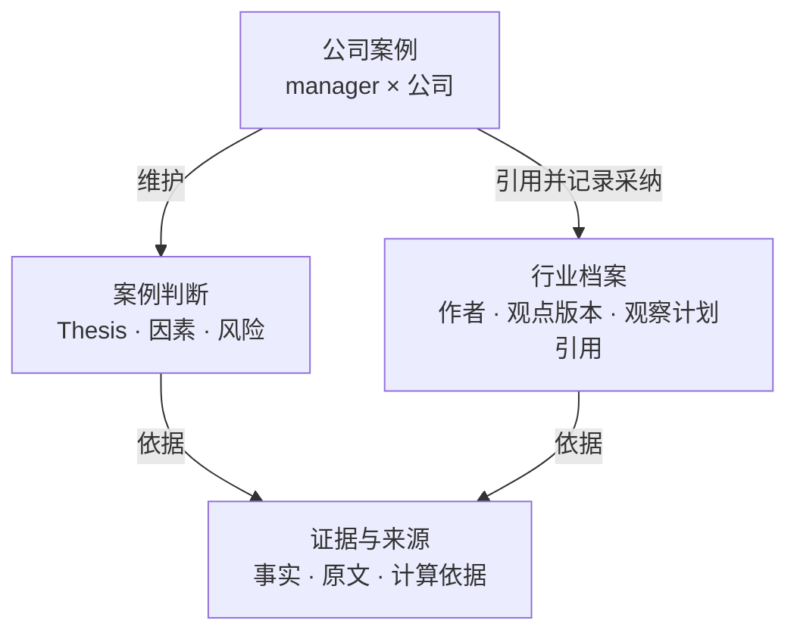
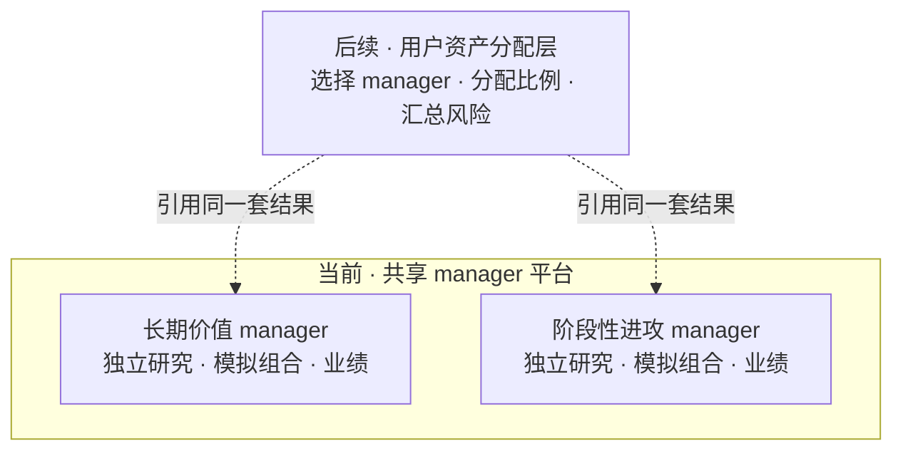
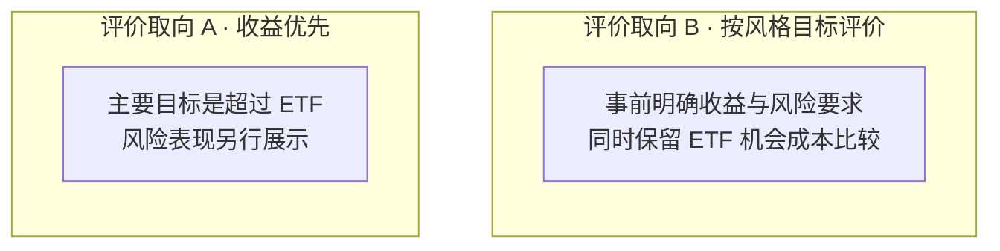

# Uteki：12 项架构议题的首版建议答案

- 日期：2026-09-29。
- 目的：先给一套完整、可讨论的答案，再筛出真正需要深入讨论的少数取舍。
- 状态：**建议稿，未自动升级为全部已确认的决策。** 已有共识沿用；新增方案可据反馈修订。
- 最近确认：用户同意 U1 的风格评价原则、明确 U2 为共享 manager 平台及后续用户分配层，并同意 U3 的方法升级规则；第 14 节记录正式结论。其余具体参数仍按各节的建议或待验证状态管理。
- 配套：[目标架构与已确认边界](UTEKI_TARGET_ARCHITECTURE_2026-09-24.zh-CN.md)。本文给出其第 8 节 12 项议题的建议答案，不覆盖旧规范中的其他任务。
- 后续已完成范围限定的静态源码对照，见 [架构总览、实现对照与落地顺序](UTEKI_ARCHITECTURE_IMPLEMENTATION_MAP_2026-09-29.zh-CN.md)。下文验收例仍是目标，不表示已经运行或通过；新增对照不将建议参数自动升级为已确认配置。

本文使用三种状态：**已确认**指会话中用户明确选择的原则；**建议采用**指本轮给出的具体默认方案；**待深入讨论**仅指会改变产品目标或责任边界的取舍。数据是否可得、模型是否有效、实现是否可靠另列为待验证事项。

首版沿用 GOOGL、长期价值与阶段性进攻两位 manager、共享证据和独立行业档案、独立模拟账户、个股多头无杠杆、允许现金及有依据的集中持仓、日频运行。文中的公司、行业、金额和时点是显式试点配置建议，不能成为通用接口的隐式默认值。

## 1. 研究成果与质量标准

**建议采用：以持续维护的研究档案为主，报告是指定版本的展示。**

公司案例固定回答：业务怎样赚钱、核心 thesis、关键因素与风险、正反证据、经营预测与估值情景、当前判断及适用条件、未知问题与追踪计划。进攻型另写清机会窗口、事件或经营催化、提前布局的假设、入场与退出条件。

行业档案回答：研究范围、产业环节与价值分配、供需与竞争、行业 thesis、共同风险、支持和反对证据、影响哪些公司业务，以及需要验证什么。建议 GOOGL 试点先选择“数字广告”和“云计算”两个行业专题，AI 作为跨专题因素；公司的其他重要业务、资产和风险仍需覆盖或显式标出研究缺口，不把两个专题当作整家公司。

研究质量按关键因果解释、反证处理、证据支持程度及计算复现判断，不按篇幅、引用数量或观点数量判断。发布时允许“不足以判断”，分别显示已知、假设和缺口。沿用前期由用户确认研究框架与假设的约定；另建议以首份研究样例确认内容质量标准，模拟交易保持自主。

**验收例：**面对资本开支上调，报告应解释投入用途、现金流影响、潜在回报、替代解释和未知。只有“看好 AI、长期利好”以及一串链接，不能认定为合格的深度研究。

## 2. 研究内容如何组织

**建议采用：共享来源与证据，独立维护行业观点和 manager 的公司案例。**

这是对象关系图，箭头不是执行顺序。Thesis、因素、风险和证据允许多对多关联；证据的正反方向属于它与具体判断的关系。风险关联到公司业务及传导机制，同一家公司可以关联多个行业。

来源快照、计算产物、观点和采纳记录分别保留身份与版本。行业研究负责人维护行业档案，观点注明作者；各 manager 引用具体版本并独立处理分歧。正式案例由案例管理能力发布；观察计划仍由持续追踪与复核能力维护，案例和行业档案引用其版本。

**验收例：**从“新增供给可能早于需求兑现”能查看原始材料、行业推断、对 Google Cloud 的影响假设、两位 manager 的不同采纳记录，以及每条判断当时的版本。来源更正后旧报告仍能还原。

## 3. 数据与证据底座

**建议采用：以明确来源清单采集一次，发布可追溯的研究数据供各 manager 使用。**

首版清单包括公司正式财报、业绩材料和重大公告、相关官方行业资料、日频价格与成交量、公司行动及市场日历。财务研究建议覆盖选定截止日前 5 个完整财年与最近 8 个季度；实际期间必须由显式配置和来源元数据确定，缺失则显示覆盖缺口。事件资料从初始案例所需范围及后续增量取得。

每份材料保留原文、来源、语言及地区版本、公开和取得时间、公司与期间、内容哈希及版本；结构化指标另记单位、币种、口径及原文位置。管理层展望按管理层说法记录，模型预测按假设记录。

沿用 Data Agent 与 Analysis Agent 边界：分析侧通过已发布的数据接口取数，缺口交回数据能力补充；模型不直接修改已发布事实。冲突先查期间、口径、合并范围及来源更正，无法解决则并列保留，不择取方便叙事的数字。

市场数据来源先做覆盖验证，再登记供应方；当前不编造一个已经可用的免费行情来源。缺价、停牌、取数失败和无更新是不同状态，无法满足模拟所需字段时不能编造成交。

**验收例：**同一指标出现两个数字，系统能解释口径差异，或明确显示未解决冲突；另一公司、不同期间和不存在的范围不会被 GOOGL 数据替代。

## 4. 外部机构研报对照

**建议采用：先保存自己的研究版本，再对照实际可获取的机构材料。**

首版从用户已有、公开可读取或已获授权的报告开始，不为填满对照表假定已购买机构数据库。报告登记机构、作者、日期、覆盖范围、全文或摘要状态；只有摘要时，只比较摘要能支持的主张。

对齐公司、信息截止、期限和口径后，比较业务解释、thesis、因素与风险、经营预测及估值假设。交付“分歧在哪里、为何不同、影响什么、下一步如何验证”；manager 独立选择采纳、保留或继续调查。已经提前看过机构材料的研究如实记录其影响。

没有可获取材料时，独立研究照常交付，对照部分显示资料缺口。首版对照能力完成验收，仍需至少一份真实可读取的报告跑通，不用合成报告冒充。

**验收例：**机构预测资本开支持续高位，应定位到现金流假设和估值影响，而非只对比两个目标价。

## 5. Manager 与 agent 的协作

**建议采用：稳定职责、按任务调用、带边界的上下文、独立研究状态。**

Manager 统筹问题和最终判断，按需调用业务与行业、财务与估值、专门反证研究。共享行业研究维护限定专题，优先处理已持仓关键风险、即将到期的判断及相关研究缺口，再处理新增探索；具体优先级及原因留痕。

任务输入明确公司或行业范围、manager 方法及版本、投资期限、信息截止、案例版本、问题、可用证据索引和完成条件。交付结论、证据引用、计算或分析文件、反证、缺口和完成状态；大材料通过索引和产物引用交接，不复制整个会话历史。运行基础提供持久任务身份、执行状态和失败恢复，业务含义冲突返回 manager。

建议在首次发布可行动案例、实质修改 thesis 或估值假设、拟新增或扩大风险敞口时执行反证审阅；相同案例与证据条件下可复用未过期的审阅。若重要新证据已出现，旧审阅不足以覆盖本次动作。执行此前明确的减仓或退出规则可记录依据，不要求重新跑完整研究。

反证没有投资观点的最终否决权；manager 必须处理重要质疑。反证任务失败或行动所需关键证据缺失时，不把流程失败写成“审阅通过”；相关新增风险动作暂缓，已有持仓按有效退出规则和当前可用事实处理。这里是建议的程序条件，不新增人工逐笔审批。

方法内的问题、证据选择和分析深度由 manager 自适应。已确认正式方法、风险政策及会影响方法的 prompt/skill 实质更改先作为新实验版本验证，再切换生效配置，首版由用户确认生效；不改写过去记录。日常研究、交易及方法内任务调整保持自主，详见 U3。

**验收例：**业务、财务、反证 agent 能针对同一份材料交付不同职责的产物；manager 的正式案例能定位到它实际使用的产物和质疑处理理由。

## 6. 从研究到投资判断

**建议采用：共同证据要求，两套方法说明，分别记录公司价值与当期机会。**

| 方法 | 首版建议 |
| --- | --- |
| 长期价值 | 围绕商业质量、资本回报、现金创造及买入价格；以现金流情景为主，业务差异大时分部估值，相对估值用于交叉检查。每份案例明确自己的 1～3 年或 3～5 年期限、价格条件、主要反证与失效条件 |
| 阶段性进攻 | 以基本面或事件变化为前提，解释价格可能重新反映什么、何时验证及剩余机会；趋势和成交量辅助择时。明确采用 1～3 个月或 3～6 个月窗口，提前布局的预测与已经发生的事实分开 |

每份可行动判断回答：为什么可能有回报、当前价格反映了什么、为什么此时行动或等待、可能损失来自哪里、何时兑现或停止等待。模型参数、概率和敏感性都有依据与版本；证据不足时不强行填出精确概率。

正常研究不确定性可以由 manager 明确承担；缺少来源、无法核实的关键计算或未知证券范围，不能用自信措辞补齐。发布阶段性研究与允许增加仓位分开管理。

**验收例：**投入计划上调是已披露信息，新增收入和回报率是预测。长期 manager 可以在证据支持下保持观点，进攻型可以选择等待；任何一方都不能把投入增长直接当作利润确定增长。

## 7. 持续追踪与更新

**建议采用：每日增量检查、重要变化深入复核、周期性查漏。**

每天对共享来源和各档案的观察计划执行检查：披露及更正、价格条件、证据有效性、事件进展和等待期限。相关变化触发业务、财务或反证任务；没有实质变化时记录检查完成，保留原研究版本。

建议每周检查一次观察范围是否遗漏，每次正式财报后复核经营预测、估值及核心 thesis。该频率是初版运行建议，随后依据遗漏率和工作量调整。行业档案更新向相关案例提出复核线索，各 manager 分别判断，发布自己的新版本。

状态区分已检查无变化、发现变化待复核、尚未检查、来源失败、等待资料、提出修订和已发布。每轮设置完成时限和失败状态，重要风险或行动失败在工作台突出显示；产品提醒功能不等于现在创建任何自动化任务。

**验收例：**没有新公告但短期事件期限已到，进攻型必须重新判断；长期案例可维持。来源取数失败则显示未完成检查，不能显示没有变化。

## 8. 组合与风险

**建议采用：manager 自主给出完整目标组合，确定性规则校验并记账。**

提案包括公司与现金比例、当前到目标的调整、案例版本、机会比较、风险情景和退出条件。首版只有 GOOGL 与现金，研究结论不自动强制持有；目标权重与模拟成交后的权重分别展示。

沿用允许全现金及有依据的集中持仓，不新增统一单股上限或所有风格共用的价格止损百分比。Manager 事前声明自己使用的风险和复核规则，说明集中度及可能的损失来源；实质改变风险政策单独版本化。回撤可触发复核，不能被描述为保证最大损失不超过某数字。

共同约束由程序检查：证券范围、只做多、无杠杆、资金及数量有效、订单不重复。扩大公司池后按收入来源、行业传导和共同因素分析风险，不能用股票数量替代分散程度，也不把多位 manager 的独立账户默认合成一个账户。

**验收例：**高集中度有明确机会与风险论证；现金比例和净值可以复算；假设压力损失与已发生亏损分开显示。风格是否达标的产品口径见 U1。

## 9. 模拟成交与账户

**2026-09-30 更新：S01～S08 均已确认，包含账户启动、执行时点、ETF 对照、模拟成本、现金计息、税前口径，以及允许碎股、仅使用已结算可用资金。数量精度、预留、结算、公司行动的具体执行契约仍需整理与验证，均未执行。** 决策依据见 [设计入口 S01～S08](design/README.md)。

| 项目 | 已确认政策与待验证实现建议（分别标注） |
| --- | --- |
| 本金与币种（已确认 10B） | 每位 manager 独立 100,000 美元，各自准备好后开始，不追加或提取；记录各自起点，另列共同区间比较。金额仅用于内部核算，用户看比例和收益 |
| 信息截止（已确认） | 每个适用交易日以 America/New_York 的 20:00 固化本轮已取得的资料；同时满足公开时间和实际取得时间不晚于截止。晚到材料进入后续版本 |
| 决策与订单（已确认） | 基于冻结快照完成研究，在下一正常交易时段开盘前 30 分钟截止并保存订单；逾时提案进入后续决策轮，不回填过去成交 |
| 成交时点（已确认） | 使用订单有效期内下一正常交易时段可核验的开盘参考价；只能在取得真实开盘数据且订单与资金检查通过后记为模拟成交。缺价、停牌或无有效开盘成交资料时保留未成交。未复权价格与公司行动核算的具体契约仍待验证 |
| 数量与资金（已确认 16B、17A；计算细节待验证） | 支持碎股主动订单；仅使用已结算且未被订单或付款义务占用的资金。执行建议：按显式证券支持范围与数量步长形成数量，预留成本并冻结预算；资金不足时按预先规则向下缩量，记录与目标差异，无可买数量则未成交。多个买单按冻结优先级处理；不能动用待结算卖出款，也不能丢弃公司行动产生的超出订单精度的权益 |
| 成本（已确认 13A） | 单边成交额 10 个基点，即 0.10%，作为佣金、价差和滑点的合并实验摩擦；并报告 0 和 25 个基点情景。这是已选实验参数，未经券商校准，不能重复另扣同一滑点；敏感性结果单列，不替换主账本 |
| 结算（已确认 17A；日历及分录待验证） | 卖出净款完成结算后才能用于买入，原有独立可用现金仍可使用。区分已结算、待结算应收、订单预留及买入付款占用；成交时预留转为付款义务或扣款，不能释放后再次支用或重复扣减。适用美股交易按 T+1 及所选结算日历处理，预计到期不替代结算记录 |
| 公司行动 | 按权益规则在除息时记录应收股利，支付时转现金；拆股同步调整持仓及未执行订单的数量与价格条件，保留原记录和调整记录。复杂行动在适配前显示缺口和暂定净值，不编造损益 |
| 估值 | 正常交易日用与当前股数和公司行动状态一致的可核验未复权收盘价计价；缺价可显示带陈旧标记的上一可用估值，受影响绩效标为暂定，旧价不能用来制造成交 |
| 现金收益（已确认 14A） | 主结果按纽约联储 EFFR 作模拟计息参考，单列 0% 利息对照。来源、公开可得时点、历史利率和计息公式须冻结；缺数据不得静默补零或用今天利率回填历史。此为模拟假设，不是券商收益承诺 |
| 税务口径（已确认 15A） | 统一税前，不计投资者个人资本利得税或股息预提税；未来税后场景按明确身份另建。主结果明确为扣模拟交易成本、计入参考现金收益、未扣投资者税负 |

开盘价加固定摩擦是模拟模型，不能等同于真实订单一定取得的成交价；实际执行存在时延和价格变化，见 [Investor.gov 执行说明](https://www.investor.gov/introduction-investing/investing-basics/how-stock-markets-work/executing-order)。适用美国证券的 T+1 原则参考 [SEC 投资者说明](https://www.investor.gov/introduction-investing/general-resources/news-alerts/alerts-bulletins/investor-bulletins/new-t1-settlement-cycle-what-investors-need-know-investor-bulletin)。具体市场、日历和数据覆盖仍须验证。

每日检查不承诺盘中止损或实时响应。目标价、止损价越过但未检查时，不按事后最有利价格补做成交。某订单被拒绝或过期，不改变 manager 原有提案的历史。

**验收例：**本轮才取得的公告即使描述过去事件，也不能形成过去成交；同一订单重复执行只产生一组账本变动；分红和复权价格不能重复贡献收益。

## 10. 效果评价与 A/B

**建议采用：四类评价并列，预登记基准与规则，先不合成单一总分。**

**已确认 U1：**按事前声明的风格目标评价收益和风险，完整展示与 ETF 的收益差距，暂不合成单一排行榜。收益略低但风险明显更低可以符合某种风格的目标，但需要在预定窗口及指标下检验，不能事后为跑输更换评价理由。

分别评价研究质量、事前预测与其兑现、决策依据和纪律、账户净值与风险。主要展示含分红扣实验交易成本的区间收益、相对基准收益、最大回撤、恢复时间、换手、现金比例及成本；模型与数据运营费用另外记录，后续按固定分摊规则补充成本后效果。

2026-09-30 已确认采用推荐方案：SPY 作为共同主 ETF 对照、QQQ 作为补充对照。SPY 对应 S&P 500，QQQ 对应 Nasdaq-100，身份依据其 [SPY 官方产品页](https://www.ssga.com/us/en/individual/etfs/state-street-spdr-sp-500-etf-trust-spy) 和 [QQQ 官方资料](https://www.invesco.com/qqq-etf/en/about.html)。基准身份已确定，尚未启动比较；两只基金均不进入 manager 的可投资资产。

按分别启动的已确认规则，每位 manager 配套基准须匹配该 manager 自身的初始资金、起点、币种和估值区间；两位 manager 间另列共同日历区间比较，不能直接横比不同起点的累计收益。数量与资金沿用已确认 16B、17A：ETF 对照同样支持碎股，只使用已结算可用资金。具体被动账户核算仍建议：在冻结的数量精度下初始买入；分红支付并成为可用资金后按下一可用开盘时点机械再投资，余款保持现金，采用相同交易成本和现金收益假设。再投资规则及精度尚待工程契约验证，不因已确认碎股而视为整体已验收。基金市价已经体现基金内部费用，不再额外扣同一基金费率。这一模拟总回报与基金官网使用其他再投资口径的回报分别标明，不能混用。

账户启用起点不等于首次买股：manager 选择现金的等待期同样计入评价，对照按冻结规则从账户启用后的首个有效成交窗口开始，不能等 manager 买入后才开始比较。共同主对照指同一个 ETF 品种，各 manager 配套自己的基准账户。共同区间按已有净值归一、重新计算区间指标，不重置账户或回填交易，也不宣称是相同初始持仓的受控 A/B；行情缺失明确标记，不能偷偷换用另一账户起点。

不因实际留现金或当期跑输而事后降低股票基准权重或更换主基准。建议再记录一个 GOOGL 买入持有诊断对照，用于理解单公司阶段择时及现金选择；它不替代 ETF 主比较。

每月查看运行和研究结果，每季度正式复盘；短期按案例冻结的机会窗口检查，长期按已选择的多年窗口持续积累，历史不足明确显示。未满一年的区间不靠年化放大业绩。单公司记录不验证跨公司选股能力。

两位 manager 同时改变方法和期限，属于完整方案比较。检测反证角色等单项能力时，另冻结同一任务、来源、截止、模型及预算，保留全部尝试并报告差异；共享或读取过观点的情况如实记录，不能称为盲测。必要时以预算不同的试验单独评价质量与成本，不混成同一控制变量结论。

后续用户补充了同一 manager 下的模型对照，并进一步确认优先采用混合配置：关键推理、研究计划与任务清单用 SOTA，明确子任务用性价比高且合适的模型。固定方法与问题后，仍可用全 DeepSeek、全 Claude 5.5 等作为对照，并做单环节替换。每套配置保留独立实验记录；持续组合比较使用实验账户，正式 manager 历史不受结果回写。模型名称目前是用户示例，准确型号、接入与预算尚待明确，详见[模型分工与实际样例](UTEKI_ARCHITECTURE_IMPLEMENTATION_MAP_2026-09-29.zh-CN.md#10-已确认的模型分工与本轮实际推进)。

**验收例：**一个 manager 在某窗口跑赢，应能区分价格暴露、现金时点、费用与已记录判断；不能凭一笔盈利认定其研究正确。跑输但风险较低时，依据已确认的 U1 原则及事前风格目标评价，而不是自动认定成功或失败。

## 11. 产品呈现与用户参与

**已确认 U2：先建设一套共享的 manager 平台，当前不展开用户侧服务。**每位 manager 持续维护自己的研究、决策、独立模拟账户及业绩；未来用户选择 manager 并分配资产，作为其上层能力接入。首版建议继续提供公司、行业、manager 三个研究入口，不将系统身份预设为“每位用户一套 manager”。

虚线表示后续能力对共享 manager 结果的引用，不代表已执行资产分配。普通用户增加不自动复制 manager 或重做研究；用户的分配比例、加入时间及组合结果属于用户层，不回写 manager 的模拟账户和历史。多个 manager 持有同一公司时，用户层以后需要汇总底层风险，用户收益也不能直接等同于 manager 的历史收益。

用户提出的个人定制服务保留为后续方向：若实质改变方法、约束或专属研究，建议建立独立的定制实例及记录，并引用明确的方法版本。标准 manager 的正常方法升级则保持原身份和历史连续性；二者分别处理，定制能力尚未进入首版范围。

**假设例：**未来用户甲采用长期 manager 70%、进攻型 30%，用户乙采用 30% 和 70%；二者引用同一套底层研究和模拟记录，自己的汇总配置分别保存。本例只说明对象归属，不建立实际用户账户或执行资金分配。

| 入口 | 默认首先呈现 |
| --- | --- |
| 公司 | 业务概览，各 manager 当前判断、期限及分歧，核心 thesis、因素与风险、证据、估值情景、未知和最近变化 |
| 行业 | 行业研究范围、观点作者、共同风险、正反证据、相关公司业务、待验证事项及更新时间 |
| Manager | 方法及版本、研究覆盖、独立组合与现金比例、持有理由、近期动作、ETF 比较及未完成研究 |

三个入口引用相同档案和账本。报告支持从重要判断展开到原文和计算，默认给用户解释分歧，不生成一个所有 manager 必须服从的共识评级。短期退出和长期看好同一公司可以并列显示。

首版在工作台集中呈现 thesis 失效、重要新风险、模拟成交或失败、数据与运行缺口，普通“检查完成且无变化”不形成醒目提醒。站外推送及其渠道后续按实际需要接入，本轮不发消息或创建自动化。

沿用前期用户确认研究框架与假设的约定，首份样例的质量验收方式仍为第 1 节建议；用户可提出纠错或补充问题，人工意见与系统原判断分别留痕。模拟交易无需逐笔人工批准，界面不把正常研究不确定性转成人工审批队列。

**验收例：**从 GOOGL 进入行业风险，再进入长期 manager 的采纳理由，看到的是相互引用的同一组版本；切换入口不会出现两份互相矛盾的当前记录。

## 12. 持续运行、部署与实施

**建议采用：单机模块化单体，研究执行可以异步，持久状态不依赖打开的聊天窗口。**

沿用仓库 [模块化单体规范](ARCHITECTURE.zh-CN.md) 和 Data/Analysis 分界。部署在一台持续在线的主机，前期开发机上验证，正式连续运行前迁到约定的常开环境；日后迁自有服务器。具体云资源、机器预算及凭证是在部署阶段核实的资源条件，本轮不购买或部署。

原始资料与不可变产物保存于持久文件或对象存储，沿用现有研究数据接口及已使用的 DuckDB 研究依赖。建议新增任务、案例索引与账户账本的事务存储采用单机 SQLite，明确数据库写入责任；agent 并发研究，账户变动由应用串行事务提交。仅在实际需要多主机写入或更高并发时重新评估部署和数据库。

SQLite WAL 的同机要求和单写入者限制见 [SQLite 官方文档](https://www.sqlite.org/wal.html)。这是技术候选，实施时需核实实际运行库版本、并发、备份与恢复；不能把研究查询快照当作交易账本，不能把数据库文件直接放到不适用的网络共享盘上。

任务保留身份、输入版本、状态、失败原因及重试记录。对账和成交写入使用幂等标识与事务，失败重跑不重复交易。凭证从运行环境接入，日志记录必要的研究和调用信息；研究执行不能读取评估答案或改写原始证据。

每日做一致性备份并演练恢复，日志记录更新时间、延迟、失败、token 和模型调用成本。先通过真实样例得到成本基线，再优化复用与调度；运行设置完成时限和循环停止条件，未完成任务明确返回缺口，不为满足预算伪装研究完成。

建议按四步交付：

1. **研究样例：**GOOGL 及选定行业档案的可追溯研究，两位 manager 的问题和反证记录通过人工内容验收。
2. **持续追踪：**新增资料、截止到期、抓取失败和重启恢复四种情况可以正确处理。
3. **模拟与评价：**至少完成一个有订单、成交或未成交、公司行动和基准核算的可复算例子，再开始真实日频前向记录。
4. **受控扩展：**明确增加公司名单，用独立公司与来源验证泛化，再验收跨公司资金配置和共同风险。

现有代码对上述目标的逐项覆盖审计是后续独立交付，不能由当前测试数量或文档存在推断已完成。

## 13. 一个贯穿各层的简单案例

**以下完全是假设案例，未声称存在相关新公告，也不构成 GOOGL 买卖判断。**

输入：在本轮截止前，系统取得一份公开材料，其中涉及相关云业务的算力投入计划增加，但未来需求和收入兑现速度没有足够证据。

| 位置 | 动作及可查看的产物 |
| --- | --- |
| 数据底座 | 保存原文及时间，区分已披露计划与未来预测；缺失的需求证据保留为空缺 |
| 行业档案 | 记录“投入与需求兑现存在时间差”的风险假设，列出替代解释及下一步观察条件 |
| 长期 manager | 分析长期资本回报和现金流，给出条件化价值判断；可以保持观点，也可以因证据变化修订 |
| 进攻型 manager | 检查未来几个月的机会、价格条件和验证节点；允许提前布局，也允许等待，均需依据 |
| 反证研究 | 检查是否低估需求兑现、效率改善或其他解释，并审查公司适用性 |
| 组合与模拟 | manager 决定目标比例或不操作；程序依据冻结规则检查资金、记录成交或明确未成交 |
| 产品与复盘 | 用户看到行业风险、两位 manager 的不同处理及历史变化；事后根据新证据核查原预测，保持原版本 |

成功意味着可以还原“知道什么、假设什么、为何行动、结果如何”。这套例子首先验收系统与研究表达；投资有效性仍需持续的真实前向记录。

## 14. 三个方向性问题的已确认答案

用户已回应三个问题：U1 同意建议，U2 明确先建设共享 manager 平台、后续由用户选择及分配，U3 同意建议。以下作为已确认的方向性决定；本文其他尚未明确确认的参数与具体实现仍保留建议或待验证状态。

| 编号 | 议题 | 已确认答案 | 对设计的影响 |
| --- | --- | --- | --- |
| U1 | 风格评价 | 按事前声明的风格目标评价收益和风险，完整展示对 ETF 的收益差距；暂不合成单一排行榜。不能事后用“风险较低”为任何跑输免责 | 风格目标、风险指标、比较页面与持续评价依据 |
| U2 | Manager 与用户的关系 | 先不展开用户侧服务；底层是一套共享 manager，各自维护研究、独立模拟账户及业绩。后续用户选择 manager 并分配资产；个人定制作为后续可能服务 | 标准 manager 记录与用户分配记录分开，用户数量不直接等于 manager 实例数；后续定制另界定独立实例与范围 |
| U3 | 方法自主进化 | 方法内自主研究和交易；实质方法升级先产生新实验版本，验证后切换，首版由用户确认生效。正常任务提问和研究深度变化不算方法升级 | 配置权限、实验与正式运行分离、历史可比性及人机职责 |

U1 的假设比较：同一个已登记观察窗口内，manager 净收益为 8%、最大回撤为 5%；ETF 净收益为 10%、最大回撤为 18%。数字仅说明评价取舍，不能凭这一组结果证明某方案更优，也不能据短期记录评价多年能力。

该比较图保留 U1 的取舍说明；用户已同意评价取向 B，并保留 ETF 机会成本比较。个股范围、现金、集中持仓自主权及 ETF 对照保持原共识。

## 15. 需要调查或实验的未知，不要求用户凭空决定

| 验证项 | 如何获得答案 | 未验证前如何表达 |
| --- | --- | --- |
| 行情及公司行动覆盖 | 用选定公司和 ETF 核对开盘/收盘、成交量、停牌、分红、拆股与日历，验证可得性和复算 | 数据缺口可能阻止模拟上线，不宣称已接通 |
| 机构材料可获取性 | 清点真正可读取的报告，完成一份对照；不足再说明具体缺口及采购选项 | 缺报告时保留对照覆盖缺口，不伪造完整机构观点 |
| 研究与反证有效性 | 冻结来源、问题和截止，用 GOOGL 及后续明确选定的独立公司进行真实模型内容验收 | 结构正确、引用存在或测试通过不等于研究有效 |
| 成本与现金假设 | 对已确认 0/10/25 基点情景、EFFR 参考计息主结果及 0% 利息对照进行核算验证 | 实验参数与现实条件分开；主结果与对照分别标识，说明税收未建模，不将零利息对照误列为主结果 |
| 日频与深度复核安排 | 回放真实更新与截止事件，衡量遗漏、误触发、延迟、质量和 token 成本 | 周期是建议配置，不宣称已最优 |
| 实现与部署差距 | 按本文验收逐项查代码、真实运行、重启及备份恢复，并验证数据库版本和运行条件 | 目标、已有设计、实现、运行验证分别列状态 |

本轮筛出的三个方向性问题已解决，下一步将已确认边界汇入系统总图与业务对象表，再准备第 1 项研究样例、数据覆盖和实现差距清单。具体实验参数随验证冻结；本文本身不触发模型运行、模拟交易、付费采购或部署。
