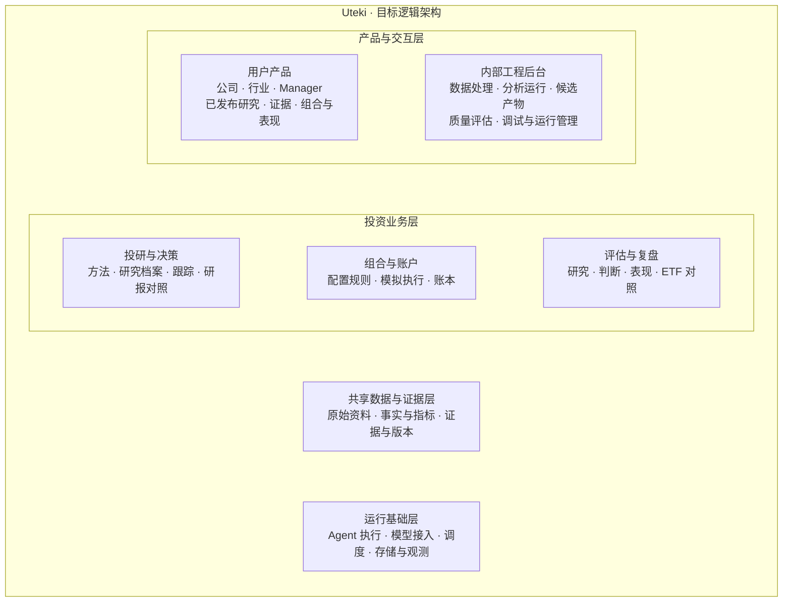
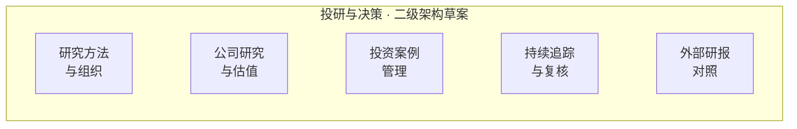
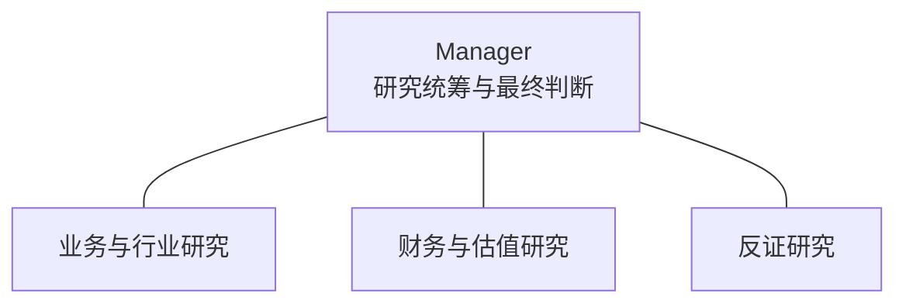
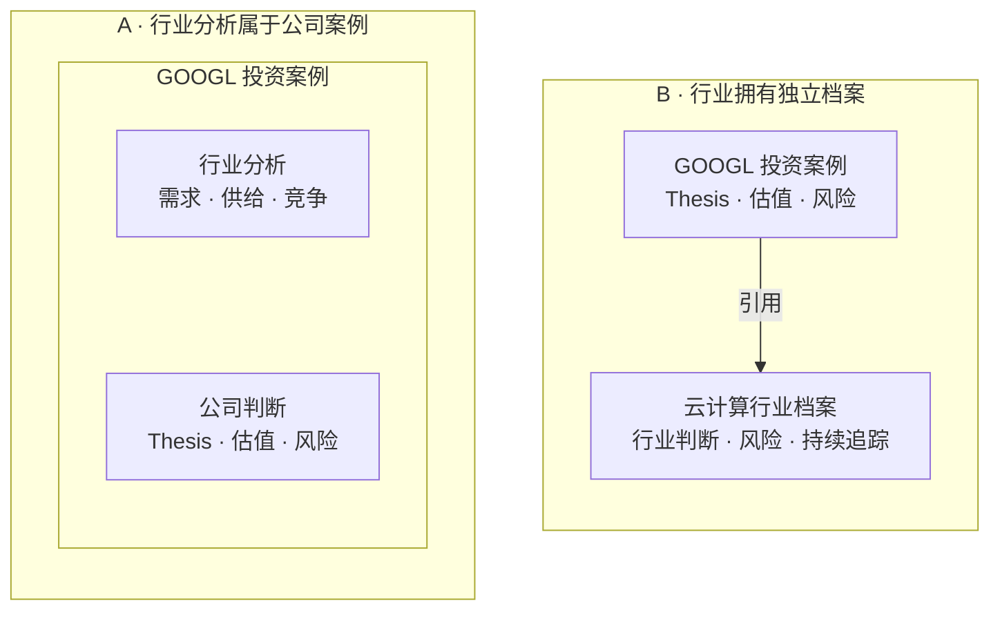
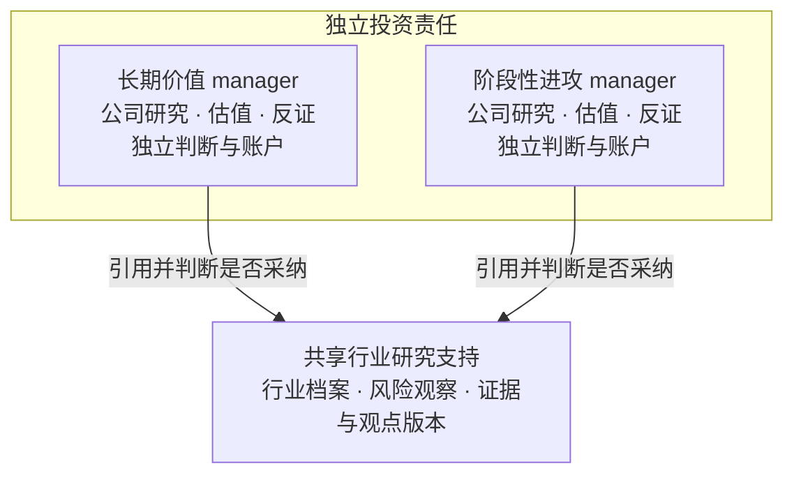
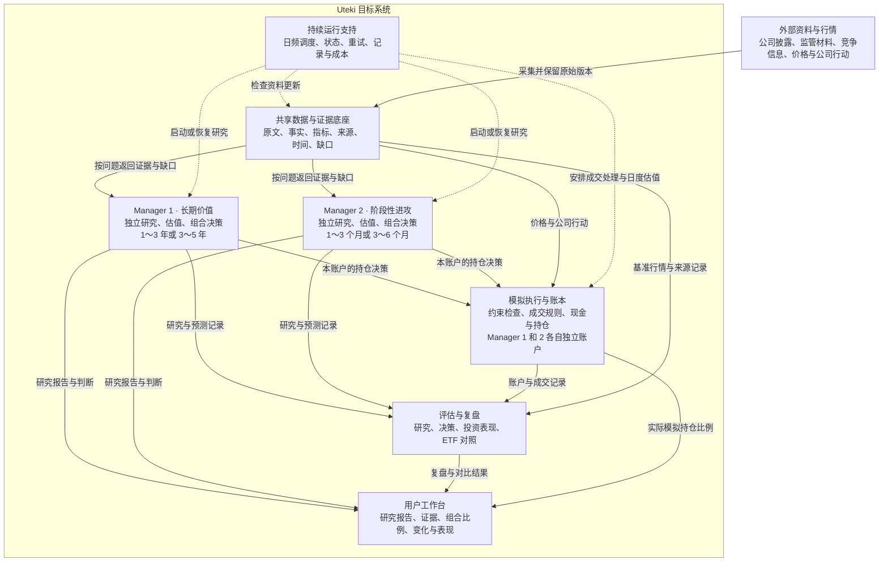

# Uteki 目标架构与阶段规划

- 日期：2026-09-24。
- 最近更新：2026-09-29，12 项议题已有配套建议答案；用户确认按风格目标评价、先建设共享 manager 平台及后续用户分配层、实质方法升级先实验验证再确认生效。本轮三个方向性问题已解决，其余具体参数仍为建议或待验证。
- 状态：产品边界来自本次访谈已确认的共识；下述模块划分、图和阶段验收为待逐块讨论的设计草案。
- 范围：公司研究、多风格投资团队、日频追踪、独立模拟组合及前向评估。
- 实现状态：本文描述目标。2026-09-29 已完成范围限定的静态源码对照，见 [架构总览、实现对照与落地顺序](UTEKI_ARCHITECTURE_IMPLEMENTATION_MAP_2026-09-29.zh-CN.md)；未据此声明模型、业务闭环或线上运行已验收。
- 首版：GOOGL、两位 manager；长期价值方向覆盖 1～3 年或 3～5 年，阶段性进攻方向覆盖 1～3 个月或 3～6 个月，跑通研究、追踪、模拟持仓与复盘。具体期限由方法和机会明确，不默认固定持有到期。

## 1. 系统架构及图的用途

系统架构是为了实现系统目标，对边界、核心组成、职责、协作方式和关键约束作出的重要设计决定。图用来展示这些决定，具体规则和验收写在文字中。

| 视图 | 回答的问题 | 展开顺序 |
| --- | --- | --- |
| 系统逻辑架构图 | Uteki 如何分层，核心子系统及职责归属是什么？ | 本文先给出 |
| 投研与决策二级架构图 | 研究子系统内部有哪些稳定能力，各自维护什么状态？ | 本轮展开 |
| 数据与证据图 | 原始材料如何支撑判断，如何追溯版本与时间？ | 随后 |
| Manager 内部协作图 | 投资方法如何变成问题、研究、估值和配置决定？ | 业务职责明确后 |
| 日频任务时序图 | 何时检查、复核、决策、成交，失败如何恢复？ | 冻结模拟规则时 |
| 部署图 | 哪些进程、数据和任务部署在自己的服务器？ | 明确运行条件后 |
| 实现对照表 | 哪些已实现、部分实现、待验证或待开发？ | 逐项核对代码后 |

每张图保持一个主要视角。架构图表达边界、组成与依赖，流程图表达事件、执行顺序和交付；需要连线时先说明关系含义。逻辑职责不等于独立进程、独立模型或独立服务。

讨论架构选择时，按用户要求优先用同一层级的并排对比图，并用同一个简单案例说明各方案如何组织研究及产出。明确共同能力、真正改变的边界和取舍，最后聚焦一个待选问题；假设案例与真实投资结论分开标注。

## 2. 已确认的产品边界

Uteki 是一个拥有不同投资方法的投资团队。各 manager 共享数据来源与证据能力，独立提出问题、形成判断、配置资本，并积累各自的记录。

| 主题 | 已确认要求 |
| --- | --- |
| 研究价值 | 深入解释公司业务、核心 thesis、factors、risks、正反证据、估值及投资吸引力；行业研究服务于公司理解和机会选择 |
| 行业研究组织 | 采用独立行业档案，由共享行业研究能力持续维护，支持查看行业风险；各 manager 自主采纳、独立决策；首版行业专题范围和维护规则继续细化 |
| 外部研究对照 | 支持与其他专业机构的研究报告比较；对照维度及其与研究修订、独立评估的关系见第 4 节提案 |
| 范围 | 先 GOOGL，再小规模明确公司名单，逐步扩展行业；优先面向 S&P 500、Nasdaq 100 范围，不默认全量覆盖 |
| 投资方法 | 共同重视公司研究、价值与证据；两位 manager 分别面向长期价值与阶段性进攻；短期交易必须有公司或行业变化及事件依据，趋势和成交量辅助择时，纯热度或价格趋势不能单独构成入场依据 |
| 短期布局时机 | 可依据公开证据在改善尚未完全兑现或事件发生前布局，也可等待确认后行动，由 manager 自主选择；已发生事实与待兑现预测分开，记录验证窗口及预测失败后的退出条件 |
| 期限 | 长期方向为 1～3 年或 3～5 年，短期方向为 1～3 个月或 3～6 个月；6 个月～1 年、5～10 年等保留扩展空间，不一次性启动所有组合 |
| 可投资资产 | 公司个股和现金；只做多，无杠杆；ETF 仅作比较对象 |
| 现金与集中度 | 允许且认可留现金，包括全现金；允许有依据的集中持仓，由 manager 在其明确约束内决定 |
| 账户 | 每位 manager 一个持续存在的独立模拟账户，按真实信息及市场价格依照模拟规则运行 |
| Manager 与用户 | 先建设一套共享 manager 平台；后续用户选择 manager 并分配资产，用户层不回写 manager 的研究与模拟业绩；个人定制作为后续可能服务 |
| 展示 | 用户选择风格，查看个股和现金比例、研究依据、调整及表现；模拟本金和数量核算留在内部 |
| 内外访问边界 | 产品用户查看正式发布的研究、决策、表现及对应证据；数据处理与分析过程产物只供内部工程/研究后台访问，不对产品用户开放 |
| 研究入口 | 公司视角查看各 manager 的报告、thesis 和分歧；manager 视角查看其研究的不同公司；两者读取同一组投资案例与版本；行业入口查看独立行业档案、风险和观点，并关联公司案例 |
| 团队线索共享 | 日常运行共享有来源的研究线索；各 manager 独立决定是否复核及采纳，保留原判断、外部影响和修订理由 |
| 反证研究 | 每位 manager 配置固定的反证研究职责，由专门 agent 寻找遗漏风险、证据缺口及相反解释；manager 保留最终判断权，记录接受或不接受质疑的理由 |
| 本金 | 固定初始金额，随后随盈亏演化；10 万美元是讨论中的示例，实际金额尚未冻结 |
| 人的角色 | 前期对系统提出的研究框架和假设作确认，逐步转为自主；模拟交易自主执行，无需逐笔人工批准；人工决定可作独立对照 |
| 更新 | 日频检查信息和价格；是否深入复核及是否交易由变化与研究需要决定 |
| 来源 | 官方原始资料优先、免费来源优先；付费数据在有明确缺口时评估 |
| 评价 | 从实际启动日起前向记录与模拟；历史资料用于研究，历史回测不作为首版前提 |
| 风格评价 | 按事前声明的收益与风险目标评价，同时保留 ETF 收益差距；暂不合成单一排行榜，不事后改变成功标准 |
| 方法演进 | 方法内研究与交易自主；实质投资方法或风险政策升级先建立新实验版本并验证，首版由用户确认生效，原 manager 历史连续保留 |
| 运行 | 需要持续运行，电脑关机不应影响目标运行方式；后续使用自己的服务器，前期承载环境待定 |
| 模型与费用 | 用户解决模型部分，现阶段效果优先；仍记录调用、成本和失败，支持后续优化 |

## 3. 系统逻辑架构

本图展示系统内部的层次与职责归属。按用户反馈，将 manager 实例、调度动作和逐项信息流从总图移出；此前的信息流视图保留于附录 A。

图中上下位置表示逻辑层次，横向并列表示同层职责；总图不表达任务执行顺序。产品通过业务接口使用系统能力，业务访问共享资料与证据；运行基础为所有上层提供执行和保存能力。这是逻辑划分，进程、服务与服务器数量在部署设计中决定。

| 层次 | 拥有的职责 | 关键边界 |
| --- | --- | --- |
| 产品与交互 | 用户产品组织正式研究、组合与表现；内部工程后台查看和管理数据/分析执行 | 两类工作空间及接口权限分开；用户端读取正式发布内容和选定证据，中间产物保留内部。投资规则不写在页面里 |
| 投资业务 | 投研与决策、组合与账户、评估与复盘 | 投研维护判断；组合管理资本与账本；评估读取冻结的研究、决策和账户记录，独立定义评价 |
| 共享数据与证据 | 资料、事实、指标、来源、口径与版本 | 共享资料不等于共享观点；manager 判断及组合账本归相应业务子系统 |
| 运行基础 | Agent 执行、模型接入、任务调度、物理存储及运行观测 | 提供执行机制；研究策略、复核条件、仓位规则由业务层定义 |

多位 manager 是投研与组合能力的不同策略实例，各自拥有研究状态和账户，不按人数增加顶层子系统。Agent 是承载研究与决策的一种执行方式，专业分工在子系统内部再展开。

外部数据来源和模型服务通过相应接入边界使用；它们的提供方不属于 Uteki 内部。后续系统边界图单独展示用户与外部依赖，部署图再描述服务器与进程。

### 用户产品与内部工程后台

新增工程师视角是访问与管理能力，不是新增投资 Agent。两种工作空间使用同一套业务与版本记录；同一位操作者可以同时拥有两种访问资格，但切换视角不应混淆对外发布状态。

| 工作空间 | 输入 | 能力及产出 |
| --- | --- | --- |
| 用户产品 | 指定公司/行业/Manager 的正式发布版本、获准展示的证据、组合与表现 | 阅读业务、thesis、factors、risks、估值、投资决定、比例及表现；查看来源、关键假设、实质缺口和更新时间 |
| 内部工程后台 | 原件/数据版本、准备与抽取记录、模型调用的输入和可见输出、候选研究、复核意见、执行与评估记录 | 定位数据与分析问题、检查中间产物、比较模型/方法版本、查看成本/延迟/失败；按权限发起任务、受控重跑和版本管理 |

后台可按数据、分析、评估、运行四个视角组织：数据视角查看获取/解析/抽取/归一化及来源；分析视角查看研究计划、委派、候选回答、草稿、审阅与修订；评估视角查看独立题目、复核与错误归因；运行视角查看模型配置、工具调用、超时、调用费用及任务状态。逻辑上分开，不要求四套后台服务。评测答案与评分不得因此进入被测 Agent 输入；模型隐藏推理不属于可见输出，也不新增其记录能力。

| 内容 | 用户产品 | 内部后台 |
| --- | --- | --- |
| 已发布研究、thesis、风险、估值及决策理由 | 可见 | 可核查版本及依据 |
| 正式结论引用的原文、定义、关键假设与实质不确定性 | 按来源可展示范围提供，保留追溯 | 可检查完整可访问上下文与证据质量 |
| 抽取中间 JSON、候选数据、SQL/查询计划、研究草稿与审阅逐轮记录 | 不开放 | 按权限可见 |
| Prompt/模型参数、调用输入与可见输出、失败栈、内部运行路径、token/成本 | 不开放 | 按权限查看并处理敏感字段；凭据不进入展示和产物 |
| 评测参考答案、逐题调试与试验分支 | 不开放 | 与生产研究和模型输入隔离管理 |

发布属于既有案例/版本管理的责任：内部候选产物按版本化业务规则形成正式发布版本，用户接口仅返回该版本允许公开的字段及关联证据。技术运行结束、引用校验通过、甚至内部采纳，都不自动赋予对外可见性。已发布、已采纳、当前有效与可见范围分别记录。

这些规则需要在服务端接口与数据读取处执行；仅隐藏页面按钮或切换前端标签不能构成隔离。用户接口不能通过更换 run/artifact ID、候选访问参数、下载链接或直达地址取得内部产物；工程权限也不意味着可以直接改写投资判断或账户历史。正式内容修订发布新版本，旧版本和发布记录保留；重跑失败不覆盖仍有效的已发布版本。研究失效、资料过期或关键缺口影响结论时，对外显示相应业务状态，原始错误日志留在后台。

这不是新增逐笔人工审批要求。发布由当前治理阶段的明确规则执行，可支持自主发布；工程后台提供操作入口、诊断和追溯，不代替 Manager 的投资判断。

当前为已确认的目标边界：现有 review_workbench 的数据与研究检查页面可作为内部后台基础，但不能据此宣称已完成用户/工程权限隔离。产品/API 访问控制及发布视图需要后续实现和验收，本轮只更新架构说明。

### 两个研究视角，共用同一组投资案例

用户已确认两个产品入口：

| 视角 | 组织方式 | 主要用途 |
| --- | --- | --- |
| 公司 | 在一家公司下查看覆盖它的各 manager 及其投资案例 | 对照报告、thesis、因素、风险、估值、机构分歧和更新情况 |
| Manager | 在一位 manager 下查看其研究的不同公司及对应投资案例 | 理解其方法如何应用于不同公司，查看研究覆盖、判断及跟踪情况 |

两种视角的交点是同一份 manager 对公司的投资案例。报告、判断和复核状态都定位到同一个案例及其版本；切换入口不复制研究记录。Manager 视角还可以关联其独立组合，但研究名单与持仓名单分别保存，研究一家公司不意味着持有它。

公司视角允许并排呈现不同 manager 的分歧，不自动合并成一个共识结论。对照时显示各自研究期限、信息截止和版本；更新时间不同可以并列阅读，但不能默认为同一信息条件下的评比。未建立案例或未完成研究的部分显示其实际覆盖状态。

### 子系统职责的后续展开

| 部分 | 主要产出 | 职责边界 |
| --- | --- | --- |
| 共享数据与证据 | 可定位原文、结构化事实、指标计算、版本化证据包、覆盖与缺口 | 不把某位 manager 的观点发布为全体共享的事实；修正发布新版本 |
| Manager 及研究团队 | 公司投资案例、情景估值、预测、追踪计划、独立组合决定 | 各自拥有假设与研究记忆；不能修改源数据、成交记录和历史净值 |
| 模拟执行与账本 | 规则校验、模拟订单与成交、现金、证券数量、净值及公司行动 | 以确定性程序核算；无资金、不可成交或输入不足时保留明确状态 |
| 评估与复盘 | 研究质量、预测兑现、决策质量、组合表现与固定基准比较 | 保留所有正式决策；评估答案和评分不能作为研究事实输入 |
| 用户产品 | 已发布公司研究、证据阅读、风格选择、组合比例、调整理由和对比 | 区分目标权重与已模拟成交后的权重，保留实质资料不足和业务状态；不暴露过程产物 |
| 内部工程后台 | 数据/分析过程、候选产物、质量评估、运行诊断和受控操作 | 以内部权限访问；操作沿用业务与版本规则，不直接改写已发布研究或账户历史 |
| 持续运行支持 | 任务状态、数据检查、增量更新、重试、版本、运行日志、调用成本 | 同一任务重跑不得重复记交易；抓取失败不能显示为没有变化 |

Manager 是承担投资责任的角色，可以组织业务研究、财务模型、估值和反证等 agent。职责数量不预设为模型实例数量。首次实现复用现有模块化单体的边界，是否拆服务由实际部署与运行需求决定。

## 4. 投研与决策子系统：二级架构提案

本节是 2026-09-29 的讨论稿。保持一级视图的边界，只展开一个子系统；不预设 agent 数量、独立服务数量或任务执行顺序。

建议划分五个并列能力模块，其中外部研报对照来自本轮新增需求：

| 内部能力 | 负责的问题 | 主要管理的对象 |
| --- | --- | --- |
| 研究方法与组织 | 按什么投资方法、围绕哪些问题、如何组织研究？ | 各 manager 的研究方法配置与版本、问题清单、研究范围、任务分工与方法选择；引用完整策略中的期限和约束 |
| 公司研究与估值 | 生意怎样运作、假设是否有证据支持、未来价值如何估计？ | 业务与竞争分析、证据解释、经营预测、财务及估值模型、情景、反证与分析产物版本 |
| 投资案例管理 | 某位 manager 当前对某家公司的完整投资判断是什么，依据是什么？ | manager 独立的 thesis、factors、risks、证据关联、研究层面的投资判断、当前有效版本、候选与历史修订；引用分析模型版本 |
| 持续追踪与复核 | 需要持续关注什么，原判断何时需要重新检验？ | 追踪计划、研究上的触发条件、资料覆盖状态、复核问题与记录、修订请求及未解决事项 |
| 外部研报对照 | 与专业机构相比，研究有哪些一致、分歧或遗漏，差异来自什么？ | 外部观点及依据、可比条件、逐项对照、分歧原因、待验证问题；关联各 manager 当时的案例版本 |

这五类能力供不同 manager 使用，各 manager 的方法配置、分析假设、案例和追踪状态分别保存。共用分析工具和方法实现，并不要求使用相同模型假设或给出相同判断。

### Manager 的方法配置与执行配置

Manager 是持续承担研究和投资责任的业务主体，拥有独立案例和账户。其身份保持稳定，投资方法、组合政策、研究组织与运行配置分别记录版本，供相应业务能力引用。本节提出配置边界，不创建新的顶层子系统。

| 配置范围 | 定义什么 | 负责使用与校验的部分 |
| --- | --- | --- |
| 系统共同要求 | 个股多头、无杠杆、ETF 仅作对照，以及来源可追溯、反证与未知保留、历史不回写等已确定规则 | 各业务边界共同执行；manager 的方法、prompt 或模型配置不能放宽 |
| 投资方法 | 收益来源、投资期限、研究范围、核心问题、证据标准、估值方法的选择原则、判断成立和失效条件的制定方式 | 投研与决策据此组织研究，组合决策使用其投资判断 |
| 组合政策 | 集中度、现金配置、仓位约束、资金分配及调整规则 | 组合与账户维护并校验；本轮不设置具体比例或上限，保留已确认的自主配置及全现金选择 |
| 研究组织 | 需要哪些专业职责，如何使用 skills、prompt 和工具，怎样质疑并整合研究 | 研究方法与组织定义业务分工；具体任务执行交给运行基础 |
| 运行配置 | 模型接入、执行参数、并发、停止条件和运行记录 | 运行基础实施；保持当前模型由用户解决、研究效果优先的原则 |

投资方法说明如何形成判断，投资案例保存某家公司实际形成的判断。例如，方法可以要求检查再投资回报及竞争优势；某家公司是否具有优势、未来增长假设是多少、什么证据会推翻判断，均在该公司的案例中明确。Skill 和 prompt 引用显式方法与公司任务，不内置样本公司结论。

用户随后明确提出同一 manager、同一问题使用不同模型做对照，以及按研究环节混合模型。模型执行配置与投资方法分别版本化；对照运行保存为独立实验分支，延伸到组合比较时各用独立实验模拟账户。标准 manager 的正式研究、账户及历史连续保留，不将实验优胜结果事后拼接为正式业绩。具体方案见[实现对照第 9 节](UTEKI_ARCHITECTURE_IMPLEMENTATION_MAP_2026-09-29.zh-CN.md#9-新增方向同一-manager-使用不同模型做对照)，不增加顶层子系统。

最新确认的优先配置为：关键推理、研究计划与任务清单使用 SOTA，子任务使用性价比高且适合该任务的模型。具体模型显式绑定并版本化；子任务交付可核对的证据和缺口，关键判断仍由 manager 负责。升级处理、关键反证配置和实际研究样例见[实现对照第 10 节](UTEKI_ARCHITECTURE_IMPLEMENTATION_MAP_2026-09-29.zh-CN.md#10-已确认的模型分工与本轮实际推进)。

### Manager 内部研究组织草案

**已确认：**反证研究是每位 manager 的固定职责，由专门 agent 承担，检查遗漏风险、证据缺口和相反解释。Manager 保留最终判断权，并记录接受、不接受或继续核查各项重要质疑的理由。固定职责不意味着每次日频检查都重跑完整审阅；具体触发条件和执行粒度后续确定。

在此基础上，建议首版采用以下职责划分。图只描述一位 manager 的研究组织，连线表示组织关系；执行顺序、agent 实例数、模型和进程数量分别设计。

| 职责 | 主要研究问题 | 交付及归属 |
| --- | --- | --- |
| Manager | 需要研究什么，哪些证据和解释应采纳，当前判断是什么？ | 组织任务、整合分析、处理质疑；形成其投资案例的判断及组合决策依据 |
| 业务与行业研究 | 公司如何赚钱、竞争优势是什么、行业及事件变化如何传导到公司？ | 业务和行业解释、因素与风险、催化及兑现条件、证据和待验证假设 |
| 财务与估值研究 | 经营变化如何影响财务与现金流，当前价格对应哪些预期？ | 财务分析、情景预测、估值与敏感性、输入和计算来源；估值区间不作为短期价格预测 |
| 反证研究 | 输入证据、因果解释和模型假设哪里可能错误，还有哪些解释及遗漏？ | 关联具体 thesis、证据或模型版本的质疑、相反证据、关键缺口和建议验证方式 |

业务与行业、财务与估值的合并分工属于首版提案，后续根据真实任务需要调整。两位 manager 可以复用职责实现，分别指定方法、期限、公司范围、信息截止和任务问题；分析假设、产物归属及采纳记录保持可追溯。具体任务由运行基础执行，调度不预设全员常驻。

专业研究产物可包含判断候选，正式 thesis 及修订仍由投资案例管理统一发布；追踪计划由持续追踪与复核维护，案例引用其版本。反证 agent 可以从共享证据底座检查来源并提出补充资料需求，质疑及 manager 的处理理由随案例保存。这里的独立是职责和审阅任务的分离，不代表统计上的独立证据或实测消除了模型偏差。

该组织对应既有研究方法与组织、公司研究与估值等能力。数据底座维护来源，组合与账户核算持仓及成交，评估与复盘检验历史结果，各自保持原职责。行业研究作为各 manager 可使用的共享研究能力，其已确认的组织原则及独立行业档案维护关系见下文。

### 行业研究 A/B 对比：研究内容放在哪里

两个方案都会研究行业，也都复用共享的行业资料、事实和证据。区别是是否给行业建立独立身份、判断版本和持续追踪记录。以下示意同一位 manager 的对象归属；方框内的嵌套表示包含，箭头表示引用关系，不表示执行顺序。为突出差异，图中省略两种方案共用的数据底座和其他公司分析内容。

**共同的假设案例：**公开资料出现“企业 AI 算力需求增长”的线索。此处仅用于解释系统设计，不代表已核实的当期行业事实或 GOOGL 投资结论。

| 对比项 | A：围绕公司研究行业 | B：独立行业档案关联公司 |
| --- | --- | --- |
| 研究问题 | 为理解 GOOGL，检查需求线索是否可信、Google Cloud 能否获得需求，以及收入能否覆盖新增投入 | 除公司问题外，单独维护行业需求、供给、竞争、约束与风险判断，再由 GOOGL 案例判断自身受益及估值影响 |
| 内容归属 | 分析保存在 GOOGL 案例的行业相关部分，供该公司判断使用 | 行业判断与追踪保存在云计算行业档案；公司影响、假设和投资决定保存在 GOOGL 案例 |
| 用户查看 | 打开 GOOGL，可见行业因素如何影响该公司的 thesis | 可以单独打开云计算行业档案，也可从 GOOGL 案例查看其引用的行业研究版本 |
| 新资料出现 | 更新共享资料后，相关公司案例分别判断是否复核及修订 | 更新共享资料后，行业档案与关联公司案例各自判断是否复核；行业观点更新不自动改变公司结论 |
| 首版取舍 | 先集中验证公司研究，维护的研究对象种类较少；跨公司行业观点主要分布在公司案例中 | 可以持续维护跨公司行业问题，同时需要明确行业边界、归属、版本及关联更新规则 |

A 不要求每家公司重新采集行业资料，也能复用带来源和条件的分析产物；是否建立独立行业档案与采集复用是两个决定。B 的行业档案属于现有投研能力中的研究对象，具体实现不因此预设为新增系统、服务或 agent。行业观点也需标明提出者或所属 manager；各 manager 决定如何采纳，保留分歧及处理理由。

随着明确选定的公司池扩展，B 的行业档案可以关联更多公司案例。该示例不新增任何公司，也不将需求增长直接等同于 Google Cloud 利润增长。行业报告的展示样式可另行设计，本轮选择聚焦是否独立、持续维护行业研究状态。

用户已确认采用 B 的组织原则：行业研究由共享能力持续维护独立档案，各 manager 自主采纳、独立决策。下列职责图保留这一共识，具体行业范围、维护规则和实现安排仍待细化；不据此推导全行业覆盖。

### 行业研究组织：已确认原则与待细化设计

行业是研究对象，manager 承担投资决策责任。已确认共享行业研究支持职责，围绕显式选定的行业问题维护档案、提出研究观点及风险线索；两位 manager 保持独立公司案例、方法和账户。行业研究支持接受 manager 的问题，也按已确定范围维护自己的行业观察计划。首版专题清单及维护任务规则尚未冻结。

下图展示职责及研究依赖；箭头表示 manager 引用行业研究，行业研究支持不形成对 manager 的投资指挥关系。图中省略共同的数据底座及已有其他业务能力。

| 责任 | 维护什么 | 怎样与其他部分协作 |
| --- | --- | --- |
| 行业研究支持 | 行业研究产物、供需与竞争问题、行业风险及其传导假设；每份档案指定维护责任及观察范围 | 通过共享底座获取来源，提交带作者、信息截止和版本的研究；组织后续更新与复核，接受不同 manager 的补充问题 |
| 各 manager 的公司研究 | 行业变化对公司具体业务、预测、估值及本次投资 thesis 的影响 | 引用特定行业研究版本，记录采纳、修正、保留分歧或待核查；一家公司可关联多个行业问题 |
| 反证研究 | 行业解释、公司传导及模型假设的反证和替代解释 | 可以检查引用的行业研究；manager 记录对质疑的处理，行业观点更新不自动覆盖公司判断 |
| 组合与账户中的风险分析 | 本账户持仓对已识别风险的共同暴露及情景影响 | 使用明确的持仓与研究输入形成组合分析，由对应 manager 决定配置；各账户分别分析，保留覆盖不足和估算条件 |

行业档案中原始事实引用数据底座，分析观点标明提出者或所属 manager；维护责任人负责内容更新与状态完整，不赋予其观点默认共识地位。同一行业可以呈现多个观点版本，各 manager 的采纳记录归自身公司案例。多个研究引用同一来源时保留共同来源标识，不能据此增加独立证据数量。

建议复用既有职责边界：研究方法与组织分配维护责任，公司研究与估值能力产生行业及公司分析；将投资案例管理的保存、关联和版本发布能力扩展到独立行业档案，同时保持公司案例与行业档案的对象定义分开；持续追踪与复核维护各自观察计划。以上为目标能力扩展，不预设新增服务、服务器或每个行业常驻一支 agent 团队。

首版围绕 GOOGL 已选业务所需的行业问题明确范围，再按研究需要扩展。行业与公司的关联说明具体业务或传导途径，不能仅凭一个行业标签认定公司全部业务承受相同风险。跨公司共同风险在公司池扩展后验收，风险判断不能通过无依据的评分相加变成组合损失估计。

**假设案例：云计算投入与需求兑现的时间差。**假设新的公开披露显示，所研究范围内的云计算企业提高算力投入计划。以下说明各职责怎样处理同一问题，不代表真实披露或当前投资结论：

| 位置 | 记录或研究什么 |
| --- | --- |
| 共享数据底座 | 保存实际披露范围、来源、期间、公开时间及版本；投入计划与已发生投入分别记录 |
| 行业档案 | 提出“新增供给可能早于需求兑现”的风险假设，列出正反证据、未知与观察条件；资本开支增加不直接等于产能过剩 |
| 长期 manager 的 GOOGL 案例 | 判断相关投入是否可能形成持续现金回报，什么证据会推翻长期判断 |
| 进攻型 manager 的 GOOGL 案例 | 判断投入与收入兑现的时间差是否影响本次 1～3 个月或 3～6 个月的交易机会；期限与预期变化分别说明 |
| 反证研究 | 检查需求更快兑现、效率提高等替代解释是否有依据，以及行业结论能否适用于 GOOGL 的相关业务 |
| 各自组合 | 显示本账户 GOOGL 持仓与该风险的关联及情景分析；单公司阶段不声称已验证跨公司分散效果 |

用户可从行业档案查看风险、证据与分歧，从公司案例查看风险的具体传导及各 manager 的判断，从 manager 视角查看其账户受到的影响。行业入口的具体页面内容和风险展示形式继续按已确认的组织原则展开。

### 投资方法需要明确的维度

| 维度 | 需要回答的问题 | 对系统行为的影响 |
| --- | --- | --- |
| 收益机制 | 预期回报来自经营增长、现金分配、经营修复、催化驱动的重新定价或其他什么机制？ | 决定核心 thesis 和需要检验的因果链；阶段性进攻以基本面或事件依据为前提，价格趋势不单独构成入场理由 |
| 期限与研究范围 | 在什么期限内观察投资结果，研究哪些已选公司或行业？ | 决定情景边界和资料需求；公司范围仍由显式选择约束 |
| 关键问题与证据标准 | 哪些问题必须回答，怎样验证假设、反证与未知？ | 决定研究重点和补充数据请求；各风格均保留共同的证据要求 |
| 估值与情景原则 | 什么方法适合该类业务，怎样检验价格隐含预期和敏感性？ | 指导模型选择；具体输入、公式和假设仍由案例记录 |
| 失效与复核原则 | 哪些变化值得重审，哪些证据足以否定原判断？ | 指导案例观察计划；具体条件按公司明确，未知不默认等于维持判断 |

投资期限、财务预测跨度和资料检查频率分别记录。日频检查适用于首版各 manager，长期投资方法也可以在关键假设被推翻时修订判断。相同期限允许多种方法，同一方法也可以用于不同期限。

### 两位 manager 的方向：长期价值与阶段性进攻

用户明确希望同时提供长期持有与短期捕捉阶段性爆发的投资选择。此前“质量复利”和“预期差与价值兑现”的候选搭配均偏中长期，不能完整表达这一需求，现按如下方向细化。这是目标方法提案，不代表已验证策略或当前 GOOGL 的投资结论。

| 对照项 | 长期价值型 | 阶段性进攻型 |
| --- | --- | --- |
| 目标期限 | 1～3 年或 3～5 年 | 1～3 个月或 3～6 个月 |
| 核心问题 | 公司能否持续创造每股价值，当前价格是否提供有吸引力的长期回报？ | 什么变化可能在这个窗口推动价格，已反映多少，机会是否仍有足够空间？ |
| 研究重点 | 竞争优势、增量资本回报、现金创造、资本配置及买入价格 | 有来源的公司或行业变化、事件及经营催化、价格隐含预期；价格趋势与成交量辅助择时 |
| 投资判断 | 长期经营前景、估值情景、持有理由及反证 | 有时间边界的交易 thesis、入场依据、行情确认条件、剩余机会与失效条件 |
| 退出原则提案 | 价值判断失效、价格透支前景，或资本存在更有吸引力的去处 | 阶段性机会兑现、判断或所采用的趋势条件失效、等待期限届满；具体获利与风险退出规则待制定 |

用户所说的“稳”和“冲”描述产品风格倾向。实际风险需要由持仓、估值、集中度、流动性及退出规则评估，不能仅依据持有期限判断。风险增加不保证收益按比例增加；方法目标应表述为在明确的风险约束内争取回报，而不是无约束的利润最大化。

双方共用公司资料、证据溯源与风险研究能力，问题优先级和行动依据可以不同。方法、期限及组合政策仍分别配置；两个完整方案的前向比较不能单独识别其中某一个因素的因果效果。

**已确认采用 A：基本面或事件驱动的阶段性进攻。**每笔交易必须有可追溯的公司或行业变化及事件依据，并解释其如何影响这家公司的经营、现金流、风险或价值；价格趋势和成交量辅助择时。仅有股价上涨、成交活跃或市场热度不满足入场依据。用户举出的海力士、三星用于说明机会形态，不据此扩展当前公司池或作历史收益归因。

建议每笔进攻型交易在决策时保存以下判断，供之后的复核使用：

1. 变化和影响：什么已经发生，哪些仍是假设；证据是什么，收益或风险变化为什么归属于这家公司。
2. 价格与预期：当前价格在何种假设下反映了多少改善，剩余机会是否有吸引力；价格隐含预期属于模型推断，保留方法、情景和未知。
3. 时间与验证：为什么可能在所选的 1～3 个月或 3～6 个月窗口产生影响，接下来能看到什么支持或反驳证据。
4. 行动与退出：什么条件下入场、兑现退出、判定失败或停止等待；结合组合政策判断潜在收益、损失和交易成本。

真实利好不自动构成买入机会，估值区间也不等于该时间窗口的价格预测。上述四项问题是设计提案，具体证据门槛和执行规则尚未冻结。

**已确认允许提前布局：**进攻型 manager 可以依据公开证据，在改善尚未完全兑现或预期事件发生前布局，也可以等待变化确认后行动，具体选择由 manager 自主作出。提前布局的依据必须区分已发生事实与待兑现预测，记录预期验证窗口以及预测失败后的退出条件；尚未发生的改善不能作为已确认事实。相关研究和决策按当时版本保存，后续兑现或失败不回写原预测。此项共识不预设具体仓位、证据阈值或固定止盈止损比例。

短期方向可能需要日频行情与成交量、相对板块表现、事件日历等补充输入，具体范围随方法确定；此处不声称已接入。价格或成交量不能直接证明特定资金流入。首版仍按日检查和决策，盘中触发的即时执行不在当前范围内；成交规则另行明确。

### 配置变化怎样保留可比性

方法、期限或组合政策实质变化时形成相应新版本，标明生效时间；更换模型、prompt 或 skills 也保留执行配置及实际变更内容。若 prompt 的改变实质改变研究方法，应同时更新方法版本。投资案例、研究结果和组合决定引用当时生效的配置，历史不会随新配置重新解释或重置。

方法约束内的公司问题、分析假设、研究分工和观察重点可以随证据调整并留痕。改变收益机制或风险政策应作为明确的方法或政策变更记录，避免用逐次小改动掩盖风格变化。独立评估读取这些变更，按实际方法与运行条件解释结果。

### 外部专业机构研报如何进入研究

对照的主要产出是有依据的差异和需要继续研究的问题。建议覆盖以下维度：

| 对照维度 | 要辨认的差异 |
| --- | --- |
| 业务理解与 thesis | 对商业模式、竞争优势和核心投资逻辑是否有不同解释 |
| Factors 与 risks | 各自关注了什么，是否遗漏重要驱动、风险或反证 |
| 证据与依据 | 主张由什么材料支持，是否独立核验，是否重复引用同一来源 |
| 经营预测与情景 | 对增长、利润、资本开支、现金流等采用哪些假设，差异为何产生 |
| 估值与研究结论 | 方法、期限、财务口径和假设如何导致价值范围及投资判断的差异 |

共享数据底座负责接入实际可获取的报告，保留原文、来源、发布与取得时间、覆盖范围。对照能力负责解释观点差异；报告中的预测、解释和目标价保留为外部主张，不因机构身份转成已确认事实。

比较时显式检查研究对象、信息截止、预测期间、投资期限及估值口径。无法对齐的部分标出条件差异或暂不可比；只有摘要或节选时，仅对实际可见内容作比较。

建议先冻结各 manager 的独立研究版本，再开展机构对照，并保留阅读前后的判断及引用记录。若某轮研究已经使用外部报告，明确记录其影响。各 manager 决定是否采纳以及为何修订，对照模块不自动覆盖投资案例；一致或多数意见不作为正确答案。

独立评估子系统可以使用这些冻结的预测与分歧，后续检查哪些假设得到兑现；评估同时说明信息条件、资料覆盖和外部研报使用情况，不将参考过的机构结论当作未见过的独立测试答案。机构研报对照评价研究内容，ETF 对照评价组合表现，两者各自保留。

### 核心业务对象：投资案例

一份投资案例表示“某位 manager 对某家公司的完整、持续维护的研究档案”。它聚合投资判断及其依据，保持稳定的案例身份。每个版本明确公司及相关证券、manager、策略版本、研究期限和信息截止；换用策略或补充资料时，保留此前研究所处的条件。

同一家公司可以对应多位 manager 的独立案例。案例可以在没有持仓时建立，退出持仓后也可继续跟踪；研究生命周期由明确的研究状态管理。研究报告从指定案例版本生成，用户查看历史报告时能定位到当时的判断和依据。

建议案例包含六类相互关联的内容。这是领域结构提案，尚未规定数据库字段或存储方式：

| 案例内容 | 要保留什么 |
| --- | --- |
| 业务理解 | 客户和付费者、产品与收入、现金生成机制、竞争优势、增长及资本配置的理解；区分共享事实和本 manager 的解释 |
| 投资论证 | 一条或多条 thesis、关键假设、factors、risks、成立与失效条件；允许多条论点解释不同价值来源，也允许竞争假设并存 |
| 证据与未知 | 支持、削弱或反驳具体判断的证据关联；反证研究提出的重要质疑及 manager 处理理由；资料冲突、未知、待验证问题；引用来源及版本，区分披露事实、管理层说法、计算结果与分析假设 |
| 预测、估值与研究判断 | 经营预测、情景和估值模型的版本、关键假设、价值范围、价格及其时点、当前投资吸引力与适用条件；引用可复算的模型产物 |
| 外部研报对照 | 机构观点、可比条件、与本案例的分歧、依据及报告版本、manager 采纳或保留的理由；关联对照前后的自身判断版本 |
| 追踪与修订 | 关联追踪计划与复核记录、需要观察的因素和证据、重新判断的条件、覆盖状态、修订内容及理由；保留已检查无变化、尚未完成检查、资料不足等不同状态 |

每条重要 thesis 应能关联到影响它的因素与风险、正反证据、相关预测或估值假设，以及仍需验证的问题。外部研报中的分歧也要定位到这些具体对象，才能说明分歧是否影响投资判断及后续研究重点。

对于阶段性进攻，案例还应区分“公司的长期价值判断”和“当前这笔交易的机会判断”。交易论证记录预期推动价格的机制、适用时间窗口、入场条件、获利退出条件、判断失效条件和等待期限；条件所需的证据及未知同时保留。长期看好一家公司与阶段性退出可以并存，短期交易失败也不能自动改称长期持有来延续原决策。具体交易、仓位和成交仍由组合与账户管理，并引用相应案例版本。

### 案例的归属与版本

案例管理负责组织当前研究状态、关联其依据并发布版本。共享资料和外部报告仍由数据底座管理；分析模型、机构对照结果及追踪复核记录由对应能力维护，案例引用它们的明确版本，形成可以复盘的研究快照。

一份案例有一个当前发布版本，可以同时存在研究草稿和待验证分支。发布版本允许包含多条 thesis 和未解决分歧。候选、采纳状态与研究有效性分别记录；当前发布版本遭遇重要反证、证据撤回或过期时，应标记待复核或失效，不能仅因没有新版本就继续显示为有效。

公司研究与估值交付分析产物和判断候选；持续复核交付检查记录与修订建议；外部研报对照交付分歧和待验证问题。最终研究更新通过案例管理发布，保留原判断、变更原因、采用的证据和当时的策略版本，避免分别维护互不一致的当前 thesis。前期人工确认与后期自主采纳按已明确的治理规则生效，旧版本继续保留。

### 机构分歧如何成为研究问题

架构验收示例，以下不代表当前 GOOGL 的实际研究结论：假设一份机构报告认为资本开支的高水平会持续得比某位 manager 预期更久。案例应同时保留该 manager 原先的假设、外部主张与可比条件、双方依据、可能受影响的现金流预测及估值，以及采纳、保留或待验证的理由。若仍无法判断，则关联需要补充的证据和追踪条件；形成新判断时发布新版本。

同一报告可以被两位 manager 分别对照，任何一方的修订都不会自动覆盖另一方的案例。此处的案例结构验收关注归属、依据及历史可追溯性，不评价哪个假设更可能兑现；该问题由后续证据和独立评估检验。

### 持续追踪与复核的职责提案

本轮进一步明确：共享资料的变化由数据底座发现，变化对某个投资案例的意义由该 manager 的研究能力判断。两位 manager 可以看到同一份新增资料，但各自的复核范围、结论和发布时间可以不同。

持续追踪与复核内部先划分三个逻辑职责：

| 职责 | 负责什么 | 归属边界 |
| --- | --- | --- |
| 研究观察计划 | 明确每个案例需要持续验证的问题、来源与现象、复核条件和覆盖要求 | 计划按案例归属，由持续追踪能力维护；案例引用其确定版本，不在两个产品视角中分别维护副本 |
| 变化影响判断 | 对照案例中的 thesis、factors、risks、估值假设和机构分歧，辨认新增资料或价格变化影响哪些研究问题 | 保存影响依据与待复核项；原始材料和来源变化记录归共享数据底座 |
| 复核组织与记录 | 确定需要重做哪些分析，记录维持判断、建议修订或资料不足等结果 | 分析工作调用研究与估值能力；正式判断通过案例管理发布；唤醒、重试和任务执行归运行基础 |

建议同时保留两类检查：共享来源和关键材料的基础更新检查，以及各 manager 围绕自身投资案例维护的观察计划。需要为未被现有 thesis 覆盖的新因素留出审视入口，并定期检查研究范围是否遗漏重要变化；具体完整复核周期尚未确定。

观察计划可以关联已知假设、未知问题或机构分歧。每个观察项说明影响哪个判断、准备看什么证据、什么变化需要复核，以及最近成功检查到的范围。公司行情变化可以触发投资吸引力的复核，并不自动表示公司经营发生变化；机构出现不同意见也不自动推翻本案例。

资料检查进度、研究复核进度、复核结论和版本采纳分别记录。至少能区分尚未检查、检查失败、等待补充资料、已复核且维持判断、建议修订和已发布更新。逐步执行、失败日志和候选修订仅在内部工程后台展示；用户的公司和 manager 视角展示正式内容及其更新时间、更新中、待复核或资料不足等相关业务状态。

用户已确认日常运行采用“共享有来源的研究线索，各 manager 独立判断”。一位 manager 发现新风险后，其他相关 manager 可以收到带来源、提出者、适用公司及时间的研究线索，由变化影响判断职责辨认它与自身案例的关系。

共享线索保留提出者的解释和待核验部分，接收方独立记录是否复核、是否采纳、保留意见及理由。正式修订仍进入接收方自己的案例版本，不能将发送方观点直接转成全体认可的事实，也不要求所有 manager 同步改变结论。

为解释分歧和后续比较，保留线索接触前后的案例版本及实际阅读情况。各 manager 保持决策责任独立，研究记录明确披露相互参考；日常协作结果不能声称是完全隔离、互未接触观点的独立实验。

### 与其他子系统的边界

- 共享数据与证据底座保存原始资料、事实及来源；本子系统保存对它们的解释、假设和判断，缺口通过数据请求补充。
- 组合与账户消费带时间、条件和依据的研究判断，结合资金、既有持仓和替代机会形成目标仓位及交易决定。
- 评估与复盘读取冻结的研究和决策记录。当前研究中的证据质疑、逻辑校验属于研究工作；独立评估另行检验历史判断及实际结果。
- 运行基础负责唤醒、模型调用、任务执行、重试和物理保存；是否需要复核、复核哪些问题由本子系统定义。

结构验收示例：明确选择 GOOGL 和两位 manager 后，可以从同一个来源底座读取材料，保存两套不同的问题、假设、估值及研究判断。一位 manager 的修订不会自动覆盖另一位的判断；每位 manager 的历史报告都能定位到当时的案例和证据版本。此处是目标验收示例，尚未执行。

证据的正反方向相对于具体 thesis 定义。同一证据允许被不同 manager 作出不同解释。管理层说法、来源披露事实、计算结果和分析假设应分别标记。

研究判断、目标仓位、交易提案和实际模拟成交分别保存。“好公司”并不直接决定仓位；没有足够资料也不能自动归类为完成研究后的继续持有。

投资风格至少描述：时间跨度、收益来源、研究问题与方法、估值方法、风险约束、建仓与退出条件。只改变持有期限或 prompt 的语气不足以定义两种方法。两位初始 manager 的长期价值与阶段性进攻方向已明确；短期采用基本面或事件依据为前提、趋势辅助择时，允许基于公开证据提前布局或等待确认，具体证据门槛、进退规则与风险政策仍待细化。

## 5. 一次日频运行的目标行为

以 GOOGL 为显式选定的输入，使用登记的来源范围、信息截止、manager 配置与各自账户快照：

1. 检查新增披露、原数据更正、行情和公司行动；采集一次供多个 manager 使用。
2. 将变化关联至各 manager 的问题、thesis、factors、risks、估值假设与持仓；经营信息或价格变化均可能触发复核。
3. 需要复核时检索证据、补资料和重新计算，保存判断为何改变或维持。已完成检查且无相关变化时保留已有研究版本。
4. 各 manager 独立生成正式决策和理由，包括不操作决定；重大缺口标记待补或阻塞。
5. 程序检查个股多头、无杠杆、可用资金、证券范围及 manager 登记的约束；满足规则的提案按约定时点模拟成交。
6. 更新各自账本、表现和工作台；冻结本轮信息、判断与动作，并记录失败、延迟和待处理任务。

必须保留信息公开可得时间、系统实际取得时间、决策时间和模拟成交时间。后来才取得的材料不得补写为当时已用依据。日频任务的具体时区、交易日历、截止时间和成交时间尚未冻结。

## 6. 不同对象如何共享和隔离

| 对象 | 共享范围 | 版本与归属 |
| --- | --- | --- |
| 原始资料及标准事实 | 全体 manager 可按权限和截止查询 | 公司、来源、期间、口径、公开与获取时间、原始版本 |
| 证据片段和计算 | 可复用，但须携带来源和计算条件 | 转换、公式与输入版本；人工或模型审核状态 |
| Thesis、估值、预测、追踪计划 | manager 自有；显式交叉复核时可引用 | manager、策略、运行、信息截止、原判断与修订理由 |
| 决策和目标组合 | 各 manager 独立 | 对应研究版本、账户快照、提案时间和有效条件 |
| 成交、现金和持仓 | 各模拟账户独立 | 执行规则版本、成交及公司行动记录，不按每次运行重置 |
| 人工意见与对照 | 单独记录 | 确认、修改与独立人工判断分别归因，保留系统原始记录 |
| 评估结果 | 可供用户比较与之后的版本改进 | 固定样本、窗口和基准，不能回写过去判断 |

共享同一个资料底座不要求每位 manager 检索完全相同的片段。对照实验若要测单一因素，需另外固定其余条件；同时改变期限和方法的两位 manager 首先是两种完整方案的比较。

## 7. 阶段规划与可观察验收

以下阶段名用于本轮目标规划，尚未映射到仓库已有 M0、v0.2 等版本编号，不代表覆盖原交付任务。

| 阶段 | 用户可观察的结果 | 核心验收 | 尚不能据此证明 |
| --- | --- | --- | --- |
| 1：GOOGL 深度研究 | 能读懂公司、thesis、因素、风险、正反证据和估值依据 | 关键判断追溯原文与数据，重要反证和未知可见，关键计算可复算；由人按研究问题复核 | 跨公司泛化或投资有效 |
| 2：两位 manager 持续追踪 | 相同底座产生各自研究，每日可见变化、复核理由及失败状态 | 研究状态独立；新增信息能触发相应复核；可保留分歧；无变化与未完成检查可区分 | 某一风格已优于另一风格 |
| 3：自主模拟与前向复盘 | 各自账户持续演化，用户查看比例、调整理由、表现与 ETF 对照 | 决策能关联当时证据和成交；现金、持仓、费用及公司行动可核对；重试不重复交易；符合多头、无杠杆等约束 | 短期记录证明多年投资能力，或少数成功交易证明进攻型方法可持续 |
| 4：小规模公司池 | 可比较其他公司与现金，并说明仓位和共同风险 | 明确名单与覆盖；另一家公司和不同来源也通过真实任务验收；记录缺口；组合有替代机会比较 | 全指数或全行业覆盖 |
| 5：逐步扩展 | 更多行业、期限和机会发现能力 | 按已验证质量、覆盖和运行成本扩张；新方法保留独立版本及观察记录 | 新行业自然继承旧行业研究能力 |

首版完成范围为阶段 1～3。持续运行、状态保存和恢复能力随阶段 2 接入，具体服务器环境单独确定。阶段 4 的公司数量和名单需明确选择。

单公司阶段的可投资对象是 GOOGL 和现金，可以记录选择及相对 ETF 表现；多股票机会比较、资金分配与共同风险能力在阶段 4 验收。短期 manager 未找到符合条件的机会时可以持续持有现金，不能为产生交易记录而强行买入；单公司试点也不能验证跨行业捕捉机会的能力。启动模拟前必须选定实际 ETF 基准及一致的收益口径。

## 8. 剩余讨论总清单与建议顺序

本清单回答还需要作哪些设计决定，序号用于后续逐项讨论，不是代码开发排期。已有原则只细化具体规则，不重复选择；不要求用户在本轮一次回答所有问题。

按用户要求，已先形成 [12 项议题的首版建议答案](UTEKI_ARCHITECTURE_PROPOSED_ANSWERS_2026-09-29.zh-CN.md)，包含具体默认方案、验收例、贯穿案例及过滤后的不确定问题。用户已确认筛出的三个方向性取舍，详见配套文档第 14 节；以下目录继续用作细化及验证索引，不将已经解决的问题重新列为待选。

已确认的基础包括：四层逻辑架构；共享证据；长期价值与阶段性进攻两位 manager；短期以基本面或事件依据为前提并允许自主提前布局；专门反证职责；共享行业研究维护独立档案、各 manager 自主采纳；公司、manager 与行业研究入口；个股多头、无杠杆、可留现金及有依据的集中持仓；独立自主模拟账户、比例展示、日频检查、前向评估和 ETF 对照；官方原始来源优先、效果优先、持续运行及未来自有服务器。此处是目标共识，不代表代码已实现。

| 编号 | 议题 | 真正需要讨论的部分 | 讨论后形成什么 |
| --- | --- | --- | --- |
| 1 | 首版研究产物与质量标准 | 公司和行业研究至少回答哪些问题，怎样才算深入、可验证；哪些未知可形成附条件判断，哪些导致暂不可判断；GOOGL 首版涉及哪些明确行业专题 | 一份公司案例样例、一份行业档案样例，以及正反验收案例 |
| 2 | 研究对象与关联 | thesis、factor、risk、evidence、估值和行业档案怎样关联；风险如何定位到公司业务；作者、维护责任、引用版本和历史怎样表达 | 领域对象关系图、档案最小结构、一个跨行业与公司判断的引用案例 |
| 3 | 数据与证据底座 | 首版必需来源及历史深度、行情与事件资料、口径及时间要求；冲突、更正、缺失、过期和抓取失败如何影响研究 | 来源覆盖表、证据契约、数据质量与缺口处理规则 |
| 4 | 外部专业研报对照 | 哪些机构和可获取材料纳入首版，拿不到完整材料如何处理；何时读取、比较哪些问题、怎样保留阅读前后的自身判断 | 一份真实可获取材料的对照样例、来源范围与公平比较规则 |
| 5 | Manager 与 agent 的工作约定 | 已有职责怎样变成任务，传入哪些上下文、交付什么；共享行业任务怎样排优先级；反证何时触发；方法、skills、prompt 改变时如何记录和验证 | 团队职责表、任务输入输出、上下文与方法版本规则 |
| 6 | 研究判断与行动条件 | 两种风格各自采用哪些估值和情景原则，何种证据支持入场或维持判断；催化、时间窗口、失效与退出怎样描述 | 两份方法说明与可复盘的决策样例，保留 manager 的自主判断范围 |
| 7 | 持续追踪与复核 | 日频检查中哪些变化触发深入研究，何时全面复核，行业修订如何关联公司；怎样记录失效、待补资料、失败及未检查状态 | 日频与事件复核流程、触发规则、状态及恢复示例 |
| 8 | 组合形成与风险 | manager 如何从公司判断形成仓位、加减仓与现金决定；需要事先声明哪些风险规则；如何识别行业及其他共同风险暴露 | 组合政策、决策依据与风险展示；不重开已确认的现金及集中持仓自主权 |
| 9 | 模拟成交与账户核算 | 固定初始金额、信息截止与决策/成交时点、交易日历、成交价格、费用滑点、现金收益、分红拆股、缺价与不可成交处理 | 可复算的账户与执行规则，以及一次完整模拟交易样例 |
| 10 | 效果评价与对照实验 | 实际 ETF、含分红和成本的收益口径、适配各自期限的观察窗口；研究、预测、决策、账户表现分别怎样验收；A/B 如何控制条件及披露共享研究影响 | 评价章程、基准登记和实验方案，明确单公司与短期记录的证明边界 |
| 11 | 产品呈现与用户参与 | 公司、行业、manager 页面各自优先呈现什么，怎样解释分歧和资料不足，哪些变化提示用户；前期研究框架确认如何落到交互；用户选择及分配层留在后续 | 共享 manager 平台的三个研究视角、使用案例和后续用户层边界 |
| 12 | 持续运行、部署与实施 | 前期运行环境及未来服务器、持久化备份、任务恢复与重复执行、成本和运行观测；现有代码对应哪些目标，按什么顺序交付验收 | 部署图、实现差距表、逐阶段交付和运行验收清单 |

建议先讨论 1～4，明确研究要达到什么标准以及依据从哪里来；随后讨论 5～7，让职责成为可以持续运行的研究工作；8～10 在正式启动模拟和评价前冻结；11 可以与研究样例同步讨论，12 随范围明确逐步落实。技术选择由具体输入输出、运行条件和已有代码约束，不提前要求用户挑选数据库、框架或模型供应方。

评价目标、共享 manager 平台与后续用户分配层、方法自主进化已得到本轮确认。系统总图、业务对象表和静态实现差距已整理至 [架构总览与实现对照](UTEKI_ARCHITECTURE_IMPLEMENTATION_MAP_2026-09-29.zh-CN.md)。下一步以公司案例样例确认研究深度及证据覆盖，再按阶段连接现有实现。具体参数按建议稿和验证结果冻结；出现会改变已确认边界的新取舍时，再配合图和案例深入讨论。

## 9. 与已有文档的关系

本次核对了 [架构规范](ARCHITECTURE.zh-CN.md)、[Agent 职责与投资闭环提案](AGENT_SYSTEM_DESIGN.zh-CN.md) 和 [投资与评估章程](INVESTMENT_EVALUATION_CHARTER.zh-CN.md)。沿用职责边界、版本化证据、研究与组合决策分离、账本可核对和评估独立的原则。

本次共识明确了多风格、允许全现金、ETF 仅作对照和独立自主模拟账户。旧文档中“偏向充分投资”、单一长期风格、真实账户以及可选被动基金等较早或较宽的表述，不能直接用来推导当前首版范围。旧的中英文规范尚未在本轮改写；后续逐块评审定稿时统一更新，避免两套目标并行。

本轮仅新增设计草案，未修改产品代码、公司列表或既有运行配置，未启动模型调用、定时运行、部署或交易。

## 附录 A. 业务信息流视图

此图保留用于后续讨论信息流，不作为总体架构图。实线表示主要资料、决策和结果流；虚线表示任务调度。图中的账户属于同一模拟执行系统，但状态相互独立。

以下交互仍需在相应子系统的流程视图中展开：用户通过产品选择公司与 manager、查看正式研究及证据；内部操作者通过后台发起研究，按当前治理规则处理候选与发布；manager 向数据底座提交补充请求，读取其本账户的现金和持仓快照；manager 之间需要时交叉复核，并记录实际读取的对方意见。
