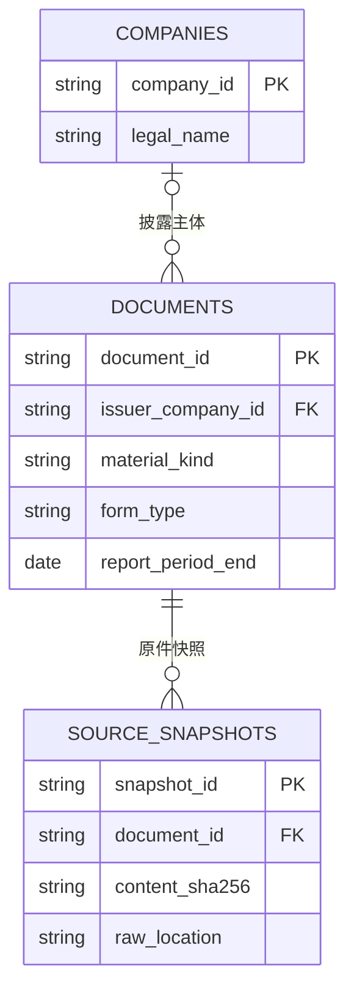

# Uteki 数据实体模型 v0.1

2026-09-30 · **评审稿，尚未冻结为 v1，也未迁移数据库。**

这版解决一个具体问题：系统如何把“哪个公司、什么期间、哪类材料”转换成可核验的原件与事实，并在材料增加、修订或重新解析后保持历史引用有效。

输入是明确的公司集合、材料类型、期间、信息截止及来源政策；输出是固定的材料/快照/解析版本清单、事实与证据，以及覆盖缺口。行业按用户要求只保留公司 tag 与查询入口，不展开分类体系。Manager、投资账户、正式报告表和交易数据不在本轮建模范围。

**多公司是首版基础约束。** 单公司查询只是 `company_list` 含一个元素的情况；首个实体模型、目录接入与验收必须同时覆盖至少两家公司，不能把多公司留作后续扩展。每家公司的身份、材料、事实归属和覆盖缺口独立核对，共同研报允许关联多家公司。

**建议先看第 1 节关系图与双公司案例、第 3 节身份变化案例、第 7 节真实例子，最后看第 10 节评审结论。** 字段表是最小逻辑契约，尚非可直接执行的完整 SQL DDL。

## 1. 核心关系



- **公司 Company：主体是谁。** 一个公司可以有多种名称、多个证券代码。公司目录中存在该主体，不等于它已加入持续研究或可投资名单。
- **材料 Document：哪一次具体披露、哪一个原始语言/地区版本。** 官方公司披露必须有已核验的 `issuer_company_id`；外部机构研报不强行归到其研究对象名下，所以主图允许披露主体为空。
- **原件快照 SourceSnapshot：我们取得的哪一份具体内容。** 保存原始字节、哈希与可得时间依据；变化后旧内容保留。

外部研报研究了哪些公司、8-K 的附件属于哪份公告、修订稿修改哪份原稿，通过第 4 节的小关联表表达。主图不把所有辅助关系画在一起。

解析与事实的追溯关系单独看：


箭头表示“追溯到”，不是运行顺序，也不表示事实和证据只能一对一。

### 两家公司就必须成立的最小案例

公司目录同时存在 Alphabet 和 Microsoft。以下材料 ID 为关系示意；共同研报是假设案例，不表示已经获取该报告。

| 材料 | 披露主体 `issuer_company_id` | 研究对象关联 | 存储与归属 |
| --- | --- | --- | --- |
| A：Alphabet 年报 | Alphabet 的公司 ID | 无需重复登记 issuer | 材料和快照归到这次披露；其中提及 Microsoft 不改变披露主体 |
| B：Microsoft 年报 | Microsoft 的公司 ID | 无需重复登记 issuer | 与 A 分别登记，年份或表单类型相同也不合并 |
| C：外部机构对比两家公司的研报 | 空，机构来源记在材料元数据中 | 两条 `subject` 关联，分别指向两家公司 | 一个 Document 及其快照链，供两家公司研究复用；不复制为两份公司年报 |

查询两家公司各自的年报，应得到 A、B；允许外部研报的研究查询可以共同引用 C。同一快照被两家公司匹配时，原件可只读取一次，但必须保留两条公司匹配关系。C 中的数字与陈述逐条核验主体；同名“营收”不能覆盖另一家公司的事实，比较陈述保留涉及的双方，不自动拆成两条独立事实。

若 B 获取失败，结果保留 Alphabet 的材料和 Microsoft 的缺口；C 不能补成 Microsoft 自身年报的覆盖。跨公司对比逐项检查双方期间、单位、口径与证据是否齐备，不能因为一家公司成功就宣称比较已完成。

## 2. 公司资料与三张主表的字段

### 2.1 companies：公司主体与完整公司档案

**公司档案范围已获用户同意作为首版基线，后续按实际缺项补充。** 原版四行只描述了公司身份主键和维护字段；下面补齐名称、symbol、官网等资料及存储分工。范围确认不代表数据库已实施或字段已填全。用户或 Agent 读取公司档案时，应能一次取得这些资料及缺口，不必自行逐表拼接。

#### 首版公司档案应包含什么

| 信息 | 字段/示意 | 首版处理与存储归属 |
| --- | --- | --- |
| 稳定身份 | `company_id` | 必需；companies 主键，不用名称或 symbol 作主键 |
| 正式公司名称 | `legal_name` | 必需；companies 保存已核验名称，原语言保留 |
| 展示名称、中文名、简称、旧名 | `names[]`：名称、语言、名称类型 | company_aliases；每个语言可明确选择展示名。翻译名标明来源/译名属性，不伪装成法定名称 |
| 股票代码与市场 | `symbols[]`：symbol、market/namespace、有效期间 | company_identifiers 中的 ticker 记录；一个公司允许多个代码，代码必须带市场，不能只留一个 symbol 字符串 |
| 监管身份 | `identifiers[]`：CIK 等类型、命名空间、值 | company_identifiers；先接入已有且核验的标识，不假定其他注册号已支持 |
| 公司官网 | `websites[]`，kind=`corporate` | 新增配套关系 company_websites；允许多语言/地区入口，保留官方归属依据 |
| 投资者关系入口 | `websites[]`，kind=`investor_relations` | 与普通官网分别登记；用于发现披露资料，不能从主页 URL 猜 IR 地址 |
| 官方新闻入口 | `websites[]`，kind=`newsroom` | 有官方来源时登记；具体采集能力、资料覆盖另验 |
| 公司业务简介 | `business_descriptions[]`：语言、简介、来源 | companies 的有类型多语言资料字段；描述业务，不包含某位 Manager 的 thesis、评级或买卖判断 |
| 注册地 | `incorporation_jurisdiction`：国家/地区、行政区 | companies 的可空资料字段；与总部地点分开，不据此推断主要业务市场或收入来源 |
| 总部地点 | `headquarters`：国家/地区、行政区、城市 | companies 的可空资料字段；不强制收集完整街道地址 |
| 注册成立日期 | `incorporation_date`＋日期精度 | 可选资料；仅存来源支持的精度，不把品牌创立或前身公司成立日期混用 |
| 行业标签 | `tags[]`：提供方、标签、版本、有效时间 | 沿用 company_tags；本轮只预留，不展开行业体系 |
| 财年与报告币种 | `reporting_context_refs[]` | 返回来源已核验的报告日历/币种依据；具体材料、期间与事实口径仍是判断依据，不设置永久不变的公司默认币种/12 月年末 |
| 核验与更新依据 | 各项来源、核验状态、观察/生效时间，档案版本引用 | 名称、官网、简介等分别可追溯；某个字段核验通过不等于整份档案或材料已 ready |

这里的 `names[] / symbols[] / websites[]` 是**读取公司档案时的组合字段**，不要求全部塞进 companies 的一行。逻辑上它们都属于公司资料；物理上，一对多、需保留历史的信息通过 company_id 关联。后续完整 DDL 再确定有类型资料字段的列/JSON 组织，不用一个无约束 `extra_info` 承担全部信息。

#### companies 主表的职责

| 字段组 | 约束/含义 |
| --- | --- |
| `company_id` | 主键，稳定、不可复用；不以名称或股票代码生成身份 |
| `legal_name` | 已核验的法定/官方名称；显示名变化不改变公司 ID |
| `incorporation_jurisdiction / headquarters / incorporation_date` | 当前核验的基础资料，可空；日期另带精度，地点有明确结构 |
| `business_descriptions` | 按语言保留简介及来源；自行整理/翻译标明生成方式和核验结果，不冒充官方原文 |
| `identity_source_ref` | 身份核验依据，如监管公司记录、现有来源清单 |
| `profile_version_ref` | 指向不可变公司资料版本，保存本次字段值、逐字段来源/状态和时间依据；修订后保留旧版本 |
| `created_at / updated_at` | Uteki 记录维护时间；不用于推断财报公开时间 |

公司档案返回当前视图和 `profile_version_ref`，并固定本次所用名称、标识、官网等关联记录的版本/引用。每项资料至少保留来源引用、`observed_at`、核验状态；可证明生效期间时另存 `valid_from/to`，不能把观察时间当成真实生效时间。历史研究读取其冻结版本，不能用今天的官网、名称或简介覆盖当时输入。

既有 `sec-0001652044` 等公司 ID 可继续保留；本轮不为了统一格式重写全部历史引用。CIK、证券代码及名称映射见第 4 节。名称或地址变化通常保持 company_id；兼并、拆分、新法人等须核验主体关系，不能简单按改名覆盖。

#### 资料缺失与边界

- 建立公司目录所需最小条件是已核验的 company_id、正式名称与身份依据。官网、IR、代码等列入首版补齐清单，但缺少时明确返回 unknown/not_found/conflict 等状态，不虚构值，也不把名单外未上市公司自动排除。
- 当任务明确依赖某项资料，例如从 IR 入口采集，入口未核验就保留该任务缺口。公司能登记、官网能访问、必需财报齐备、事实核验完成分别判断。
- CEO、员工数、营收、市值、股价等带时间属性的数据沿事实/行情契约返回，可供公司档案组合展示；不把它们做成无日期、无来源的公司静态属性。Logo 可后续作为展示资源接入，本轮不影响数据建模验收。

**当前实现核对：** 现有 GOOGL、MSFT 的 manifest.company 只有 `company_id、symbol、cik、name、market` 五个字段。上述官网、IR、多语言简介及档案版本是本轮设计补充，尚未采集或迁移，不能当成现有数据。

### 2.2 documents：材料

材料目录需要回答：**这是什么材料、由谁披露/发布、研究哪些公司、覆盖哪个期间、何时公开、从哪里找到，以及与其他材料有什么关系。** 本节补齐材料档案；原件字节、解析内容与处理状态仍通过各自实体关联。

| 字段 | 约束/含义 |
| --- | --- |
| `document_id` | 主键；一份具体披露及语言/地区版的稳定 ID |
| `issuer_company_id` | 外键 → companies；公司自己的官方披露必填，外部多公司研报可空 |
| `publisher` | 发布/出品方的名称、来源标识和核验依据；外部研报不能只留空 issuer 而丢掉出品机构。已登记的机构可关联其 ID，不强制将其加入研究名单 |
| `source_system / source_native_key` | 来源命名空间及原生材料标识；SEC 主文件与附件须可区分 |
| `source_class / classification_ref` | 如官方公司披露、外部机构研究、第三方转录；分类有依据，供来源政策筛选，不把“官方”直接等同内容已核验 |
| `title` | 原始标题 |
| `material_kind` | 内容类别，如监管申报、业绩新闻稿、电话会、机构研报 |
| `form_type` | SEC 表单类型，如 10-K、10-Q、8-K、10-K/A；非表单材料可空 |
| `contributors` | 来源明确署名的作者/分析师及角色，可空；不用模型猜作者，也不把管理层发言人自动当成材料作者 |
| `source_language / source_region / source_edition` | 原始语言、地区与版本身份；未知显式记录，不能猜测或静默合并 |
| `report_period_start / report_period_end` | 报告期间，按来源解析；不适用或未知可空并附原因 |
| `fiscal_year / fiscal_quarter` | 适用时保存经来源核验的财年/季度；不是从日期年份直接推算 |
| `published_time` | 此具体披露的公开/提交时间及精度，带依据 |
| `event_time` | 材料明确对应的事件时间，如电话会时间；适用时保存，不能代替文字稿自身的公开时间 |
| `canonical_source_url` | 来源定位；URL 不是全局主键 |
| `metadata_version_ref` | 不可变的材料元数据版本，保存字段来源、核验状态、登记/更正时间及相关公司/修订关联引用；历史任务固定所用版本 |
| `created_at / updated_at` | Uteki 材料目录记录维护时间；与公开、取得、事件时间分开 |

`publisher`、`contributors` 等是有类型的逻辑字段组，物理列或配套表在 DDL 阶段落实。本轮不新增独立的机构研究服务或作者管理系统。

材料自然身份约束建议为 `(source_system, source_native_key, source_language, source_region, source_edition)`；来源适配器必须明确生成规则。若原生编号仅在某个公司、发布机构或申报内唯一，生成键必须包括该命名空间，不能把两家公司相同的本地文件名合并。无法确认材料是否重复时保留冲突/待核验，不能选第一份。网站没有稳定 ID 时由登记服务分配身份并保存 URL 映射，不用标题或正文哈希冒充材料身份。

**不使用 `(company_id, form_type, year)` 作为唯一键。** 同期多次 8-K、修订稿、不同语言/地区版都可能合法存在。

#### 材料档案如何组合返回

| 需要看到的信息 | 从哪里取得 | 使用规则 |
| --- | --- | --- |
| 披露公司、研究对象、被提及公司 | documents.issuer_company_id＋document_companies | 分别返回 issuer/subject/mentioned 角色，不合并成一个含混的 company_id |
| 原稿、修订稿、附件关系 | document_relations | 能找到对应对象及依据；附件缺失保留缺口，修订稿不自动成为原稿的完整替代 |
| 原件文件、格式、大小、哈希 | source_snapshots | 每个引用绑定具体快照；目录标题或 URL 不能代替实际原件 |
| 正文、表格、页码、可检索内容 | parse_runs＋source_blocks | 返回所选解析版本及实际能力；能读正文不证明表格、图表、附件均已覆盖 |
| 获取、解析、核验情况 | 获取回执、parse_runs、Review 等记录 | 分别显示状态、问题与对应版本；不使用 documents.status=ready 概括全部环节 |

原始标题若需中文/英文展示，另存带来源与生成方式的译标题；翻译标题或自动摘要不改变材料的原始语言/地区身份。更正录错的标题、日期或公司归属，创建新元数据版本并保留旧版本；若核验发现误把两份独立材料合并，记录拆分映射和受影响引用，不能悄悄让旧 document_id 改指另一份披露。

元数据版本记录目录字段及关联的修订；字段纠错时 document_id 和未变化的原件快照保持不变，不额外增加一层材料身份。

#### 用两家公司检查材料记录

下表年报的 ID、公司及期间来自现有冻结来源；“共同研报”为明确的合成案例。正式材料 ID 和新元数据字段尚未迁移。

| 记录 | 披露公司 / 研究对象 | 类型 | 材料期间 | 来源与日期 |
| --- | --- | --- | --- | --- |
| googl-2025-10k | issuer=Alphabet | 监管申报 / 10-K | 2025-01-01～2025-12-31，FY2025 | 现有来源为 SEC；来源清单 available_at=2026-02-05 |
| msft-2025-10k | issuer=Microsoft | 监管申报 / 10-K | 2024-07-01～2025-06-30，FY2025 | 现有来源为 SEC；来源清单 available_at=2025-07-30 |
| synthetic-report-ab | issuer 为空；两条 subject 分别关联双方 | 外部机构研究；form_type 为空 | 假设原文未指定统一报告期，则“不适用” | 发布方为合成的研究机构 R；真实接入时必须核验出处与公开时间 |

这里 SEC 表示取得披露的来源系统，公司才是年报申报主体；研报研究的公司不等于出品机构。现有 `available_at` 只是冻结来源中已记录的时间字段，本轮不将其自动补成全部新时间字段的证据。年度/季度按原始口径保存，共同研报不能因为涉及两家公司就借用其中一家财年。

材料报告期描述该材料自己的期间；其中列示的历史比较数、预测或截至某日的数据，分别保留在事实期间中。原始材料未明确统一报告期时，允许 unknown/not_applicable 并保留理由，不能用发布日期年份补齐。若查询明确要求 FY2025 年报，该共同研报不匹配；查询两家公司的机构研究时，才按 subject 关系及来源政策检索。

**登记与缺口：** 发现一份有可核验身份的材料，即可登记目录，尚未下载时没有成功 Snapshot，尚未解析时没有成功 ParseRun。若仅根据研究范围预期某年应该有材料，但尚未找到具体披露，则保留公司＋期间＋材料类型的覆盖缺口，不凭空生成“已存在材料”。年报登记必需核验披露公司；外部研究必需保留发布方，研究对象未核验前不进入对应公司的正式检索范围。

本轮核对的现有 sources.json 已混合保存 company_id、form、period_end、URL、原件哈希和位置、index 信息及 candidate 状态。这里是把这些职责拆清并补齐出版信息的设计，尚未实现新的材料档案接口。

### 2.3 source_snapshots：原件快照

**原件快照保存“这一次实际取得的文件内容”。** HTML、PDF、图片等原始文件保存在文件/对象存储中，数据库保存身份、位置、哈希、格式与时间依据。解析后的文字、表格及模型输出另存，不覆盖原始字节。

| 字段 | 约束/含义 |
| --- | --- |
| `snapshot_id` | 主键，标识一份不可变原件内容记录 |
| `document_id` | 外键 → documents |
| `content_sha256` | 原始字节的内容哈希；文本规范化哈希另存，不混用 |
| `raw_location` | 文件/对象存储位置，读取时校验哈希 |
| `mime_type / byte_size` | 实际验证的文件格式与字节数；响应声明格式另留回执，格式冲突须诊断 |
| `retrieved_at` | 取得原件的实际时间，带时区 |
| `available_time / availability_basis` | 这份内容何时可被使用及依据：来源公开记录、提交记录，或只能证明取得时已存在 |
| `acquisition_receipt_ref` | 本次成功取得内容的回执；重复检查/下载通过后续回执关联同一快照，不覆盖首次取得依据 |

同一内容再次下载可以复用原件和快照，另存抓取回执。若内容 A → B → A，回执仍须保留时间顺序，不能因哈希重复抹掉中间变化。字节级去重不能合并不同来源、语言或地区身份。

获取回执的最小字段为 `receipt_id、document_id、snapshot_id（成功时）、observed_at、result、时间依据`，每次观察独立记录。失败不得产生可用快照或写成 unchanged；Snapshot 的首次 `retrieved_at` 不因重复获取而覆盖。观察到的变化顺序不自动等于网页真实发布/替换的时间顺序。

网页更新后，不能把新增内容的 `available_time` 自动设成材料最早的 `published_time`。无法证实它更早已公开时，只能采用有依据的保守时间并记录限制；晚取得不等于晚公开，也不能据此证明早已公开。

#### 获取回执与文件完整性

回执还保存本次 `requested_url / resolved_url`、获取方式/工具版本、开始/结束时间、响应状态及必要响应元数据、失败原因、接收字节数/哈希和校验结果。不把 HTTP 200 当成取得目标材料的充分证据：错误页、错误公司文件、被截断的下载须保留失败/不匹配记录；可留诊断文件，但不作为可研究原件发布。

返回 unchanged 必须有可核验依据。304 只能关联已存在且完整的快照；本地原件缺失时保留缺口，不能靠 304 生成成功 Snapshot。失败的重试与历史成功回执并存；不会使历史原件或引用消失。

文件迁移到服务器或对象存储后，更新位置映射并校验哈希，内容相同则 snapshot_id 保持不变。不同公司或材料恰好取得相同字节时，可以复用底层文件，但各自的 Document、Snapshot 归属和来源回执独立保留。共同研报已经是同一 Document 时，双方共享其同一快照。

HTML 引用的图片、附属文件并不自动包含在 HTML 字节中。资源清单应区分“发现引用”“原件已取得”“内容已处理”，成功取得的资源保存位置、哈希与来源回执；图片文字、图表理解是否完成由解析产物说明。具有独立披露身份的附件仍按 Document 及 attachment_of 管理，不能仅当作页面图片吞并。

## 3. 哪些变化创建什么记录

| 发生的事 | 记录变化 | 旧引用 |
| --- | --- | --- |
| 公司改显示名或新增已核验别名 | 公司 ID 不变；追加名称映射/变更依据 | 仍能解析原主体 |
| 材料标题、日期或关联录入错误后更正 | 材料身份及未变化的原件不变；创建新元数据版本 | 旧任务仍可还原当时使用的字段和关联 |
| 同一 URL 下载到相同字节 | 复用快照，追加获取回执 | 不变 |
| 同一网页正文发生变化 | 同一 Document 下记录新 Snapshot | 仍指向旧快照 |
| 正式发布 10-K/A | 新 Document、新 Snapshot；以 `amends` 指向原 10-K | 原年报不被覆盖 |
| 8-K 包含业绩附件 | 附件有独立 Document/Snapshot，以 `attachment_of` 指向 8-K | 每个引用可回到具体附件 |
| 官方另发中文/英文或地区版 | 分别建 Document；明确时可关联 `translation_of` | 原始语言/地区保留 |
| 原件未变，升级 parser 重跑 | Snapshot 不变，新 ParseRun | 旧块定位仍可还原 |
| 模型改写提取结果 | 原事实不覆盖；新结果版本绑定提取运行和原证据 | 审阅仍绑定其原目标版本 |

**本版不再增加 document_family、document_version 两层。** 一个 Document 就是一份具体披露版本，修订关系已足够表达当前需求。

## 4. 必要辅助关系

这些是主表的配套映射，不代表新增 Agent 或服务。

| 关系 | 最小字段/约束 | 解决什么问题 |
| --- | --- | --- |
| `company_identifiers` | identifier_id PK；company_id FK；type、namespace、value、valid_from/to、来源依据 | CIK、股票代码等外部标识；证券代码至少区分市场，保留有效期；禁止重叠有效期内把同一受控标识归给不同主体 |
| `company_aliases` | alias_id PK；company_id FK；name、normalized_name、language、alias_kind、display_preference、valid_from/to、来源依据 | 中文名、简称、历史名、内部译名；同公司/语言/适用时段的首选展示名须唯一且显式指定。别名允许跨主体歧义，查到多个主体要返回候选，不能取第一项 |
| `company_websites` | website_id PK；company_id FK；kind、url、language、region、valid_from/to、来源依据/核验状态；每次变更保留版本 | 官网、IR、新闻入口；同一公司可有多个语言/地区地址，同一 URL 也可能承担多个入口职责，不因域名相同就推断公司归属 |
| `document_companies` | document_id FK＋company_id FK＋role，组合作唯一键；role 为 subject/mentioned，附关系依据 | 一份外部研报研究多家公司，只保存一份原件；不重复 documents 的 issuer 关系 |
| `document_relations` | document_id FK＋related_document_id FK＋relation，组合作唯一键 | 子件 → 父件 attachment_of；新披露 → 原披露 amends；语言版 → 对应版 translation_of；拒绝自指及同类关系循环 |
| `company_tags`（预留） | company_id FK、标签命名空间/值、来源与版本、有效时间 | 行业仅按 tag 预留，暂不接入或设计分类体系 |

声明某材料提及公司，不会让它成为该公司的自身披露覆盖。附件关系不能绕过来源政策或截止日；8-K 正文取得而关键附件失败时，覆盖结果必须保留附件缺口。

这里的标识映射仅用于找到公司，不替代将来的证券、股类和交易标的建模。同一公司多个代码可以映射到同一 company_id，仍须保留各代码身份，不能因此合并不同证券。

## 5. 解析产物、事实和核验怎样接入

解析先产生可定位的正文/表格，再由提取与核验形成有公司归属、期间和口径的事实。本轮沿用现有 SourceBlock、ResearchRecord、SourceAnswer 及 Review 契约，补齐运行和引用边界。

### 5.1 parse_runs：一次解析及其产物

| 字段组 | 必须回答的问题 |
| --- | --- |
| `parse_run_id / snapshot_id / input_sha256` | 哪次运行处理了哪份原件？快照归属与输入哈希须一致 |
| `parser_name / parser_version / code_version / config_hash / output_schema_version` | 按什么程序和配置解析？相同输入复用还必须匹配这些版本；实际重跑另建运行 |
| `started_at / finished_at / execution_status / error` | 执行是否结束，因何失败？状态与内容覆盖分别保存 |
| `artifacts_manifest_ref` | 产物清单及各文件位置、字节数、哈希、schema：目录索引、正文块、表格结构、资源清单等，按本次实际产出列示 |
| `coverage / capabilities / diagnostics` | 正文、表格、图片、附属资源分别处理到哪里；实际支持什么检索/读取；哪些页、章节或资源缺失/有歧义及原因 |
| `model_run_ref`（适用时） | 使用 OCR/模型步骤时记录其具体引擎或 provider/model、prompt/Skill 与配置版本；确定性解析无需虚构 LLM 运行 |

`execution_status` 表示运行结束情况；`coverage` 分别标识各类内容的 complete/partial/unsupported/unknown/not_applicable 及依据。声明 complete 必须有适用的完整性检查和范围，不能用“程序正常退出”“有若干块”或“没有诊断”推导。未找到匹配词、没有抽出数字与原文未披露分别记录。

原件未变而 parser 升级：保留 Snapshot，创建新 ParseRun 及产物；旧证据仍绑定旧运行中的块。解析产物写完并校验后才发布清单；失败运行可以保留诊断/中间文件，其 partial 产物只能在明确范围和政策下使用，不能自动替代已选的完整产物。

### 5.2 source_blocks：正文、表格和原文位置

| 字段组 | 含义与约束 |
| --- | --- |
| `parse_run_id / block_id / ordinal / type` | `(parse_run_id, block_id)` 唯一；块类型、原文顺序明确，块 ID 不保证跨解析版本稳定 |
| `text / text_hash` | 解析得到的文字及哈希；规范化规则随 parser 记录，原始 HTML/PDF 仍由 Snapshot 保存 |
| `source_locator` | 按格式保存 DOM 路径/原始锚点、PDF 页及坐标等适用定位；`reported_page` 与文件物理页号分开，未知不猜测 |
| `table`（适用时） | 原始单元格文字、行列位置、rowspan/colspan，保留表头、行名、单位、脚注等上下文引用；仅拼接文本不够确定数字对应的公司/期间 |
| `asset_refs / extraction_method`（适用时） | 图片/资源的已验证引用，以及直接文本、OCR、模型转录等获得方式；图片描述或 OCR 输出标明生成方式与核验状态 |
| `section_refs / context_refs` | 章节或阅读组合中引用的块和规则版本；目录范围可能缺失，不能因此删除原有正文块 |

数据库保存可建立外键的块身份和定位行，全文/表格可留在冻结文件中并由产物清单校验。证据引用至少固定 snapshot＋parse_run＋block；进一步定位某单元格时，同时保留必要的公司列头、期间、单位和脚注。读取上下文可以组合多个块，不能改写其身份和原文。

原文块属于材料/解析版本，一份共同研报的同一表格可以包含两家公司；事实所属公司在提取时逐条核验。两家公司材料中的相同 block_id，或同一材料不同 ParseRun 的相同 block_id，都不是同一个引用。

### 5.3 事实、证据与核验

| 对象 | 本版固定的引用边界 |
| --- | --- |
| 数值事实 | 保留 record_id、entity_id、指标、事实自身期间、数值/单位、口径/维度、actual/guidance、来源和证据；明确所属 company_id。entity_id 可表示公司本体或分部，非公司本体实体须有来源核验的所属公司映射及适用期间；未核实归属标 unresolved，不进入该公司的正式事实范围 |
| 叙述陈述 | 保留 answer/claim 版本、归属、时间属性、限定语、逐字引文和来源；管理层预期不升级为实际结果 |
| 证据 | 一条事实可有多条证据；一条证据可指向多个原文块。锚点绑定 snapshot＋parse_run＋block，另保留原件定位和 quote/hash；表格标题、单位、脚注可成为必要证据 |
| 处理运行 | 事实/陈述记录提取运行、工具或模型、prompt/Skill/配置版本及输出哈希；确定性提取不虚构模型信息 |
| Review | 绑定受审对象 ID＋内容哈希、问题/范围和审阅规则版本；程序检查与内容核验分别记录 |
| Adoption | 独立绑定采纳对象及版本、目标基线、政策/理由；不修改旧事实，不等于 Manager 采纳观点 |

关系落库时用关联表落实事实 ↔ 证据、证据 ↔ 原文块的外键，不能只在 JSON 中塞未经核对的 ID 列表。复合引用必须验证 parse 属于该 snapshot、block 属于该 parse；跨文档证据可以组成证据包，但不能把其他公司的出处当作目标公司自身覆盖。

事实的所属公司不能仅从材料的 issuer 推断，多公司材料尤其如此。对叙述中的主体也须明确归属；本轮暂不扩写分部/子实体的完整 DDL，但来源映射与时间范围属于必需输入。

**不要增加一个含混的 `status=ready` 表示全部完成。** 获取结果、解析结果、事实核验、共享基线采纳、研究报告发布是不同状态。一条事实可以本题内容核验通过、源记录仍为 candidate、尚未全局采纳。

事实正式物理表的完整 DDL、公式结果存储、报告引用和任务调度表本轮不扩写；它们须遵守上述版本与来源关系。

### 5.4 Data 证据核验：输入、过程、输出

这里核验的是“候选事实/陈述是否忠实于来源、是否回答原问题”。`supported` 表示选定证据支持这条表述；管理层指引仍是有归属的预期，不因核验通过就变成已实现结果。投资 thesis、估值及行动判断由研究审阅另行处理。

#### 输入：冻结的审阅包

| 输入 | 内容与作用 |
| --- | --- |
| 原问题与范围 | 原始问题、逐项要求、公司/实体、事实期间、来源政策、信息截止和 candidate 使用政策；避免只审作者自己列出的完成项 |
| 待核验对象 | 每条事实/陈述的 ID、版本/内容哈希、公司、指标/表述、期间、数值/单位、维度/口径、actual/guidance 等属性；附现有证据与提取运行引用 |
| 来源内容 | 固定 Document/元数据版本、Snapshot、ParseRun；候选对应的原文、表格、标题、列头、单位、脚注及必要上下文；可回到原件核对解析是否失真 |
| 指标/计算约定 | 指标定义、单位/倍率/符号规范、适用维度；涉及推导结果时附输入记录版本、公式/实现版本及确定性重算结果。约定解释存储规则，不能代替原文证据 |
| 已知缺口与规则 | 解析覆盖、未读图像/附件、冲突来源、上下文限制；本次核验规则版本、模型/prompt/工具配置及输出 schema |

完整性判断依赖提供的范围。局部记录核验可使用有明确边界的证据包；要判断原问题是否有遗漏，须提供足够的章节/材料正文和覆盖说明。超出输入容量应明确失败或重新规划有覆盖依据的分段核验，不静默截断再声称完成。

#### 过程：程序检查 → 内容核验 → 审阅结果校验

| 步骤 | 执行者 | 检查与结果 |
| --- | --- | --- |
| 1. 固定并检查输入 | 程序 | 核对文件/记录哈希、公司/来源/截止、引用关系、候选是否等于选定数据版本。非法范围、文件变更或引文不存在先返回错误，不交给模型猜测修复 |
| 2. 核对原文支撑 | 独立 Reviewer 模型调用 | 对照原文逐项检查公司及合并/分部范围、指标语义、事实期间、数值、单位/倍率/符号、actual/guidance 和限定语。表格要核对行列和脚注，不只搜索相同数字 |
| 3. 检查问题是否答全 | Reviewer | 依据原问题检查遗漏、完整枚举、正反/限制性表述和来源覆盖；所给数字都正确也可能仍未回答问题。未读图像或附件可能影响答案时返回缺口 |
| 4. 校验 Reviewer 输出 | 程序 | 受审对象不得漏审/重复，结论符合 schema，引文必须来自指定来源块且逐字存在，结果绑定输入版本；按核验契约要求各字段附必要依据。此处只能保证协议/来源约束，不能靠引文命中证明语义正确 |
| 5. 决定用途并封存 | 确定性规则 | 保存逐条评估、总体覆盖、缺口及运行信息；仅在当前任务适用条件满足时供下游使用，Review 不自行改写事实或全局采纳 |
| 6. 处理未通过项 | Data 负责人/后续修订流程 | 数字或归属错误则生成新候选版本，缺证据则补资料/扩上下文，解析失真则修复解析；随后按新输入复审。不能只改结论为 supported，也不能用重试次数或多个模型投票代替证据 |

建议实现以固定流程和明确 prompt/schema 为基础；内容核验是 Data 的一种能力，不要求每一步新建独立 Agent。需要补证据时再交给已有 Data 规划/取证能力。当前任务核验器是单次模型审阅，不具备上述自动补采/修订循环，见下面现状边界。

#### 输出：可逐条复查的核验记录

每条记录建议保存：对象 ID/版本、字段级检查、总体结论、原因、证据及精确定位、未解决问题、核验范围和规则/运行引用。数值记录至少检查指标、期间、值/单位/倍率/符号、公司/维度、限定语；叙述记录检查主体、含义、时间属性及限定条件。

- `supported`：所需字段得到证据支持；保存对应依据。
- `contradicted`：至少一个字段与来源矛盾；指出冲突字段和原文，不直接覆盖原记录。
- `insufficient_evidence`：证据不足以决定；列出需要补充的具体内容，不能当作错误或未披露。

另保存任务级 `question_coverage`、逐项 requirement 判断、逐来源内容是否足够、`missing_information / limitations` 及 `analysis_eligible`。运行失败/超时是执行结果，不能伪装成上述内容判断。记录可受支持而任务仍不完整；当前任务通过也不等于整家公司数据齐全或共享基线已采纳。

按已确认原则，适用核验通过的新事实可进入共享数据底座供其他 Manager 复用；采纳记录须绑定这条事实的版本、核验范围及限制。单次问题的 review 结果不能省掉该记录或自动覆盖旧基线，Manager 的投资观点继续独立。

#### 真实例子：2024 年经营现金流

本例复用已保存的 [review 输入](../../experiments/architecture_baseline/2026-09-30-data-handoff-v1/e2e-02/data-review/input.json)、[模型响应](../../experiments/architecture_baseline/2026-09-30-data-handoff-v1/e2e-02/data-review/response.json)和[程序结果](../../experiments/architecture_baseline/2026-09-30-data-handoff-v1/e2e-02/data-review/result.json)，本轮没有再次调用模型。

| 项目 | 本例内容 |
| --- | --- |
| 候选输入 | record_id=`obs-1ee7bb58b50f03e0f72b12e6`；Alphabet 合并经营现金流，2024 全年，actual，125,299,000,000 USD |
| 原文依据 | GOOGL FY2025 10-K 的现金流量表；第 774 块中 2024 列对应 `125,299`，第 773 块为 `(in millions)`，结合表头、报告主体与币种依据核对 |
| 内容核验 | 审阅响应对 fact_id=`ev-04e89c6663a5772b619b0611` 返回 supported；理由说明 2024、合并口径、百万单位与归一化金额相符 |
| 总体结果 | 此次输入 7 条事实、6 项要求及 1 份材料的 1,338 个索引块；结果 reviewed、analysis_eligible=true；源数据 adoption=unchanged_candidate，仅供同范围本题使用 |

这个例子的响应只显式引用了行名和数字，理由提及年份、单位但未分别引用对应列头/单位块。现有程序允许这种输出；不能因此声称已落实上述更严格的逐字段证据门槛。今后应把这些支撑一并保存，减少人工复查时重新寻找上下文的负担。

#### 当前代码具有什么能力

- [Record Review](../../src/uteki/infrastructure/research_data/record_review.py) 给选定数值记录组装表格、附近正文/适用附注、原件 HTML 片段及指标定义；其[输出契约](../../src/uteki/domain/research_data/record_review.py)已有五项字段检查。当前适配器要求每条记录只有一个已定位 inline evidence，跨附注完整性仍有边界；字段检查结构也不等于字段语义已由程序证明。
- [任务级内容核验 answer_handoff](../../src/uteki/agents/data_query/answer_handoff.py)重放受限查询、对齐原记录和引文，向独立模型交付原问题、候选、要求、所选来源的完整索引文本/表格及未读图片说明；一次审阅返回 JSON。Reviewer 没有自行搜索、读新文件或网络补采工具。完整索引文本不等于完整 PDF/HTML 多模态内容。
- 任务级输出校验会检查每条事实/要求/来源恰好覆盖一次、引用存在及范围一致；全部通过且无程序/查询缺口才放行。下游重验 manifest 和 scope，当前用途为 `reviewed_for_this_task_only`，不自动全局 adoption。
- **待补齐：** 两条核验路径尚未统一；任务级 packet 未附 Record Review 的 metric_definitions，也未输出其五项字段检查。逐字段引用要求、原件与解析的语义保真核验、自动修订复审、计算结果适配，以及跨公司真实效果仍需独立实现/验收。已有 schema/哈希/引文检查和一次成功任务不能替代这些验收。

人工 review 时，按同一记录并排查看“候选值/陈述—原文与上下文—核验结论及依据”，优先处理冲突、缺证据、模型提取/口径转换和影响核心判断的项，再抽查已支持项。人工意见也绑定对象版本，区分人工已审与仅模型已审；这是一项后台交互要求，当前以保存的文件和可读验收样本核对，尚非已交付的正式后台页面。

## 6. 时间、筛选与索引

### 日期规则

1. 年月日保存为 DATE；可从日期按年/月筛选，不另维护三份容易不一致的字段。
2. `published_time / available_time` 是逻辑字段组：日期＋可选带时区精确时间＋精度（date/timestamp/unknown）＋来源依据。仅有日期不补 00:00；精确时刻需明确时区。最终列名在 SQL 设计时展开。
3. 财年标签通过该公司的来源日历映射；事实期间独立于材料报告期。8-K 或新闻稿不强行填完整财年，未知与不适用分别记录。
4. 日级截止可以作日期级比较；日内截止遇当日只有日期精度的资料，标记无法确定，不默认为已经公开。
5. 历史公开信息研究按对应内容版本的可得时间；复盘当时 Uteki 实际用过什么，则读取当时冻结任务清单。两种模式不能混成一次“最新”查询。

### 查询契约示意，尚未实现

```json
{
  "company_list": ["sec-0001652044", "sec-0000789019"],
  "material_filter": {
    "form_types": ["10-K"],
    "period_basis": "issuer_fiscal",
    "fiscal_years": [2025]
  },
  "knowledge_cutoff": "2026-02-05",
  "cutoff_precision": "date"
}
```

这个请求是“列出两家公司 FY2025 年报”，不是声明它们覆盖同一个自然年。财务对比另需明确期间对齐规则；查某事实期间也不能简单只取该年材料，因为下一年报告可能有比较数或重述。

名称输入先解析成已核验公司 ID。行业列表只作为标签筛选入口，解析成明确公司列表后复用查询；同时传公司与标签时，合并方式应显式表达，不能暗自决定交集或并集。行业具体参数与接入本轮保持预留。

查询先从数据库筛选材料，再固定 `(company_id, matched_company_role, match_basis_ref, document_id, metadata_version_ref, snapshot_id, parse_run_id)` 清单和各哈希、时间依据，最后在这些材料里读正文/查事实。`matched_company_role` 为 issuer/subject/mentioned，由主表或关联表核验；**官方披露覆盖只计 issuer**，其余关系只提供研究上下文。标签、材料元数据/关联、资料及解析版本的后续变化不得静默进入已冻结任务。

目录保留所有符合截止条件的内容版本；若执行任务只选一个 Snapshot，必须明确版本策略和可核验的替换顺序。无法确定哪个内容版本当时有效时，返回版本冲突，不能按哈希、文件修改时间或最近一次取得时间任意挑选。ParseRun 同样由显式解析版本策略固定，不静默换成后来重跑的产物。

建议候选索引为 `documents(issuer_company_id, form_type, report_period_end)`、名称规范化索引、标识 namespace/value 索引，以及 snapshots(document_id)。**这是索引设计候选，不是性能验收结果。** 外键列、发布时间筛选和标签索引按实际查询计划补齐；不先为每个字段建立索引。

输出必须区分：未知公司、身份歧义、材料缺失、晚于截止、获取失败、未解析、解析失败、未核验。不能把这些统一写成“未披露”。

**覆盖结果按请求中的每家公司分别返回。** 每项保留 `company_id`、请求期间/类型、匹配材料与缺口；没有结果的公司也不能从响应中消失。缺少公司输入或身份未解析时返回校验错误；已核验公司缺材料时返回明确缺口，不回退到第一家公司或其他公司的数据。调换 `company_list` 的顺序可以改变展示顺序，不能改变各公司的材料、事实或缺口。

## 7. 用现有真实数据检验关系

以下只是读取现有冻结数据，不新增研究名单或模型运行。

| 公司 ID | 公司 | 当前代码 | 真实来源 |
| --- | --- | --- | --- |
| sec-0001652044 | Alphabet Inc. | GOOGL | [公司清单](../../data/company_workspace/extraction_ab_v1/corpus/googl/dataset/manifest.json) |
| sec-0000789019 | Microsoft Corporation | MSFT | [公司清单](../../data/company_workspace/extraction_ab_v1/corpus/msft/dataset/manifest.json) |

| 现有 source_snapshot_id | form | 材料报告期末 | 当前来源可得日 |
| --- | --- | --- | --- |
| googl-2025-10k | 10-K | 2025-12-31 | 2026-02-05 |
| googl-2025q3-10q | 10-Q | 2025-09-30 | 2025-10-30 |
| msft-2025-10k | 10-K | 2025-06-30 | 2025-07-30 |

来源：[GOOGL 材料清单](../../data/company_workspace/extraction_ab_v1/corpus/googl/dataset/sources.json)、[MSFT 材料清单](../../data/company_workspace/extraction_ab_v1/corpus/msft/dataset/sources.json)。MSFT 的 FY2025 来源映射是 **2024-07-01 至 2025-06-30**。

GOOGL 2025 年报中，实际保存了一条 2024 经营现金流记录：

```json
{
  "record_id": "obs-1ee7bb58b50f03e0f72b12e6",
  "entity_id": "sec-0001652044",
  "metric_id": "operating_cash_flow",
  "period": {"kind": "year", "start": "2024-01-01", "end": "2024-12-31"},
  "value_kind": "actual",
  "value_decimal": "125299000000",
  "unit": "USD",
  "accounting_basis": "reported_consolidated",
  "source_snapshot_id": "googl-2025-10k",
  "evidence_ids": ["ev-595bfccd9052e2692625ffbe"],
  "status": "candidate"
}
```

这是[真实记录](../../data/company_workspace/extraction_ab_v1/corpus/googl/dataset/records.json)的字段节选；[证据](../../data/company_workspace/extraction_ab_v1/corpus/googl/dataset/evidence.json)指向 p52 的 `block-000774-67c9365e`，原值 `125,299`，原表单位为百万美元。[原文块文件](../../data/company_workspace/extraction_ab_v1/corpus/googl/dataset/indexes/googl-2025-10k/blocks.jsonl)第 772 行是标题、773 行是单位、774 行是完整现金流量表。该来源记录的可得日是 2026-02-05，**不能由此认定市场直到这一天才首次知道 2024 数字**；其他更早披露需独立来源支持。

现有 sources 中虽有 document_id，但它与 source_snapshot_id 值相同。上述新 Document/Snapshot/ParseRun 分层不能冒充已实现；迁移时建立显式 legacy ID 映射并核验，旧文件和引用保持不变。

### 原件和解析产物的实物核对

本次只读检查了两个冻结数据包，原件哈希及各自 `index.json / blocks.jsonl / assets.json` 的清单哈希均匹配。下表为现存文件统计，不代表新的 parser、数据库或完整内容验收已经通过。

| 材料 | 原件 | 解析文件中实际记录 | 已知限制 |
| --- | --- | --- | --- |
| GOOGL 2025 10-K | [HTML](../../data/company_workspace/extraction_ab_v1/corpus/googl/dataset/raw/googl-2025-10k.html)，2,616,499 字节 | 1,338 个块；其中 185 个 table、622 个 paragraph、2 个 image | [资源清单](../../data/company_workspace/extraction_ab_v1/corpus/googl/dataset/indexes/googl-2025-10k/assets.json)记录 2 个图片引用，未提供其已归档字节/哈希或内容识别完成证明；无索引诊断也不等于内容齐全 |
| MSFT 2025 10-K | [HTML](../../data/company_workspace/extraction_ab_v1/corpus/msft/dataset/raw/msft-2025-10k.html)，8,158,179 字节 | 1,401 个块；其中 85 个 table、687 个 paragraph | [索引](../../data/company_workspace/extraction_ab_v1/corpus/msft/dataset/indexes/msft-2025-10k/index.json)有 4 条 item_heading_ambiguous 错误：Part I Item 1B/2、Part II Item 9/9B 未发布章节范围；不能直接推断相应正文不存在 |

块数量包含布局表格和标题候选等；185 个 table 不等于 185 张财务报表。两个样本的索引都记录 parser=`sec-source-blocks-v0.1.6`、schema=`document-index-v0.1`，当前产物状态为 candidate；现有 index_id 也不能未经映射就当作完整 ParseRun 运行记录。

GOOGL 第 773 个原文块的真实字段节选如下，它保存的是单位行：

```json
{
  "block_id": "block-000773-cb5b3af4",
  "ordinal": 773,
  "type": "heading_candidate",
  "text": "(in millions)",
  "reported_page": 52,
  "dom_path": "/html/body/div[837]/span"
}
```

第 772 块保存现金流量表标题，第 774 块保存含行列的表格。后者 row=19、column=9 的单元格原文为 `125,299`；结合对应的 2024 列头、单位行以及适用的公司/币种依据，才能核验前述 2024 年经营现金流事实。单元格位置采用该解析文件的从 0 开始的编号，不是财务指标或永久证据 ID。这里展示的是解析结构及证据映射，不宣称该事实由本轮模型新提取。

## 8. 存储职责和迁移边界

| 存储 | 当前事实 | 目标建议 |
| --- | --- | --- |
| 公司/材料目录 | 公司在 manifest JSON；sources JSON 与 DuckDB 表并存 | 统一 PostgreSQL 主数据和关系； JSON 为带版本导出 |
| 原件及冻结产物 | 本地 raw/、index.json、blocks.jsonl | 当前可继续文件存储，服务器阶段可换对象存储；数据库保存位置/哈希 |
| 事实与证据 | JSON 与 DuckDB 同批生成、冻结；正文从文件读取 | 核验后的运行时目录/事实关系由主库管理，保留历史产物；具体事实表沿既有契约分阶段接入 |
| 离线分析 | 每个冻结 dataset 的 DuckDB | 可继续作分析投影；不能与业务主库各自修改同一事实 |

PostgreSQL 为本稿建议选型，用于主外键、事务和多任务并发；文件存储保留原件。参考：[关系约束](https://www.postgresql.org/docs/18/ddl-constraints.html)、[并发控制](https://www.postgresql.org/docs/current/mvcc-intro.html)。本轮没有启动数据库、迁移数据或承诺某一容量。

**统一的是公司/材料目录及查询契约，文件可以按公司分目录保存。** 一次双公司请求必须能定位两个已选冻结数据包；不能依赖进程内的“当前公司”或默认数据包。现有单个 dataset 的查询入口不等于已实现跨数据包查询。

迁移保留旧 ID 时，引用采用“冻结数据包身份＋本地记录 ID”，再映射到主库全局 ID；冻结包身份绑定 manifest 及内容哈希，不能仅用可移动的目录名。事实、证据、source 和 block 的旧 ID 都不假设在不同数据包间唯一。新主库引用必须继续核对所属公司、快照及解析版本，不能靠加了命名空间就免除归属核验。

写入顺序要求：先写入并校验不可变文件，再事务提交其数据库引用；中途失败不能发布可研究状态。来源完整性/附属材料清单单独检查，不能因一行 Document 存在就宣称材料齐备。

行业按用户要求预留 company tag。TradingView 官方确有 Sector/Industry，说明其采用 FactSet 分类；分类获取与接入均未验证，本稿不将其写成已接通的数据源。[官方说明](https://www.tradingview.com/support/solutions/43000724300-sector-industry/)

迁移分步：首步同时登记现有 GOOGL、MSFT 的公司与材料目录，验证同一次请求能分别路由到两个冻结数据包；再接原件/解析版本引用；最后按已有事实契约接入统一事实与核验关系。每一步保留旧版本，比较新旧查询的来源、期间、值与缺口，不一次替换所有存储。除真实双公司样本外，还用独立合成双公司数据验证 ID 冲突、缺材料及输入顺序变化；示例公司不进入共享实现的默认值。

## 9. 本模型将怎样验收

以下是模型/实现的验收要求，**本轮只进行了文档和真实样本映射检查，尚未执行新数据库验收。**

| 案例 | 应观察到的结果 |
| --- | --- |
| 同一次请求查询两家公司，随后调换输入顺序 | 都返回两家公司的独立材料与事实；公司顺序不改变内容、归属和缺口 |
| 两家公司存在同名指标、相同本地记录/块 ID | 保留各自数值、期间和证据；引用经冻结包/解析版本定位，不覆盖或串到另一家公司 |
| 一家公司齐备，另一家公司缺指定期间的年报 | 返回前者结果与后者明确缺口；不漏掉失败公司，不用共同研报或另一家材料补齐；受影响的比较项保持不完整 |
| 公司输入缺失、未知或名称歧义 | 校验错误或返回待消歧候选；不能默认当前公司、第一家公司或现有唯一数据包 |
| 已核验名称/代码的多个写法 | 指向同一公司 ID，保留映射依据；歧义不任取第一项 |
| 两家公司分别有多个代码、语言名称和官网/IR | 一次读取各自完整公司档案，所有关联均绑定正确 company_id；不因同名、同域名或输入顺序串公司 |
| 一家公司无中文名、另一家公司无核验官网 | 各自返回对应资料缺口；不借用另一家字段，也不把内部译名标为官方中文名称 |
| 公司官网、名称或基础资料更新 | 当前视图指向新资料版本；历史任务仍能还原原字段、关联和来源；未知资料不填示例值 |
| GOOGL FY2025 10-K 与 Q3 10-Q | 类型、报告期和公开时间分别筛选，不能串材料 |
| 两家公司来源目录都有同名文件或同一本地编号 | 以来源适配器核验的命名空间区分材料，不按文件名去重 |
| 两份年报与一份共同研报 | 区分来源系统、披露公司、出品机构及研究对象；共同研报不冒充任一公司的年报期间或官方覆盖 |
| 材料已发现、下载失败；或仅有预期覆盖要求 | 前者有材料目录和失败回执，后者只有覆盖缺口；都不产生成功原件或解析状态 |
| 材料标题、日期或主体元数据纠错 | 新建元数据版本；历史任务还原当时字段及关联，受影响引用可追溯 |
| GOOGL 2025 年报中的 2024 数字 | 事实期间仍为 2024，不因来源是 2025 年报而改写 |
| GOOGL 与 MSFT 同为 FY2025 | 保留各自日历，未经对齐不冒充同一期间比较 |
| 10-K/A 与旧 10-K；未来披露 | 修订关系可见；截止前不能用未来修订；不默认抹掉原稿 |
| 同 URL 更新、重复获取、parser 重跑 | 分别改变正确层级，旧证据仍定位到原内容 |
| 200 错误页、截断下载、原件丢失时返回 304 | 保留失败/缺口及依据，不发布成功原件；历史成功回执不被失败重试覆盖 |
| 文件从本地迁到对象存储 | 位置可变，原件字节/哈希相同；旧 snapshot_id 和引用仍有效 |
| 正文可读但章节范围有歧义或图片未处理 | 返回已处理内容及具体覆盖缺口，不把程序退出成功解释为整份材料完整 |
| parser 重跑后复用了相同 block_id 字符串 | 旧证据仍读取旧 ParseRun 及块；不自动指向新版本 |
| 共同表格中 A 公司数值可读、B 公司单元格失败 | A 可形成有依据的候选；B 保留缺口；不由同表、同单位或材料关联补造 B 的事实 |
| 8-K 正文有、关键附件缺失 | 返回附件缺口，不宣称整套材料已 ready |
| 一份研报涉及两家公司并包含双方事实 | 文件只存一次，保留双方匹配关系；仅查询 A 自身事实时不返回 B 的事实；不冒充任何一家自己的官方披露 |
| 英文/中文及地区版 | 保留独立来源身份；内部翻译不伪装成官方原件 |
| 只有日期的公开时间遇日内 cutoff | 明示时间精度不足，不伪造时刻 |
| 本题已review、共享基线未adopt | 两种状态均能准确表达，不相互覆盖 |
| 某年没材料/抓取失败/无匹配词 | 分别返回缺口，不统一归因为未披露 |

## 10. 评审与定稿边界

已确认方向：多公司是首版基础，至少以两家公司共同验收；公司与材料按实体关联；历史版本与证据可追溯；明确公司/期间/来源；行业暂按 tag 预留；当前先出设计再 review。表名、辅助关系、索引和 PostgreSQL 分工是本稿工程建议，等待本轮评审，不视为已经实施。

本轮评审进度：公司档案的首版范围已确认，允许后续按实际缺项补充；材料档案、原件/回执、解析运行与原文块已补齐字段和验收条件。两个真实样本的哈希和块结构已只读核对，图片资源证明与 MSFT 章节歧义仍有明确限制，未改写冻结产物。第 5.4 节进一步展开事实与证据核验的输入、过程、输出及真实例子，区分已运行的任务核验和未接通的逐字段证据/自动修订能力。接下来核对跨公司查询如何消费这些实体，再落实存储接入；不将局部设计或文件校验通过扩大为整份模型已冻结。

修订稿的处理作为工程建议：材料发现返回截止内的原稿及修订关系，冻结取证范围保留必要披露链；不能把局部修订自动当作完整替代。界面是否折叠原稿以后再讨论，不作为本次实体模型的确认门槛。

本稿经过两项独立检查：实体关系/版本边界审阅，以及真实样例与现有文件核对。修正了三处契约缺口：重复内容回退时的获取回执顺序、分部事实所属公司的核验、冻结材料清单中的公司匹配角色。补齐后尚未发现阻碍本轮评审的关系冲突；这不等于用户已通过评审或新数据库已通过测试。

评审顺序：先看核心实体及身份变化规则，再检查日期和真实例子，最后确定存储职责与实施顺序。通过后冻结 v1，再补可执行 schema、迁移映射与定向验收；不以文档定稿代替工程或模型验收。后续若发现确需业务取舍的新问题，按固定编号选项提出；不把普通字段实现选择转交用户。

## 核对依据

- [既定数据与共享规则](README.md)、[Agent 契约](UTEKI_AGENT_CONTRACTS_v1.zh-CN.md)。
- [当前数据库表定义](../../src/uteki/infrastructure/research_data/query_dataset.py)、[原件/JSON/DuckDB 生成](../../src/uteki/infrastructure/research_data/company_materialization.py)。
- [当前读取方式](../../src/uteki/infrastructure/research_data/query_service.py)、[事实契约](../../src/uteki/domain/research_data/query_contract.py)。
- [真实数据产物](data-agent-acceptance/README.zh-CN.md)、[召回验收及公司/期间查询缺口](data-agent-acceptance/retrieval-acceptance-2026-09-30.zh-CN.md)。
