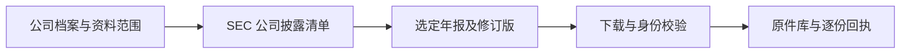

# 公司财报自动获取 v1

2026-10-04。当前主线先验收：**配置公司后，Uteki 自己发现并下载官方财报，全程不依赖 Codex、搜索对话或模型。** DeepSeek 提取在这一前置能力通过后继续。

## 问题与交付

已有 `prepare_sources()` 能读取 SEC 清单并下载原件，但入口把下载和解析连在一起；每次强制访问股票代码总表，未使用已知 CIK。年度选择主要围绕 10-K，缺少台积电的 20-F 与多年度初始化。本次人工找到 URL 后下载，只证明单份原件可获得，不能代表系统已经自主获取。

本次复用同一获取函数，补独立 `agent acquire` 入口。



| 部分 | 实际行为 |
|---|---|
| 输入 | symbol、市场、CIK、年报类型、报告期末范围、披露截止日、获取策略；运行环境提供 SEC 联系身份 |
| 身份 | 有 CIK 时直接查该公司 submissions，仍核对返回的 CIK、symbol、市场 |
| 发现 | 读取 recent 及范围相关的历史 submissions；由 accession 和 primaryDocument 生成地址，无需逐年填写 URL |
| 选择 | 10-K / 20-F 及各自修订版；报告期末与披露日期分别过滤，不以修订版替代缺失的原始年报 |
| 下载 | 有限请求、超时和重试；403 不连续重试；遵守 Retry-After，过长等待留作后续恢复 |
| 校验 | HTTP 状态、实收长度；inline HTML 中的公司 CIK、类型、报告期；拒绝错误页、冲突和明确截断 |
| 保存 | 原子保存内容哈希命名的原件；逐份回执与最终运行清单，不覆盖旧版本 |
| 再运行 | 再查披露清单以发现新申报；reuse_verified 重新核验并复用原件，补缺失项；revalidate 重新下载以检查内容修订 |
| 输出 | 每份文件的地址、期间、披露日、下载/复用/失败状态、哈希、路径及校验记录；模型调用数为 0 |

AMD / TSMC 配置筛选 **2023-01-01 起的报告期末、截至 2026-10-04 已披露**的年报，不把 AMD 周制财年转换为自然年。具体公司与日期只在显式版本化配置中。

`completed` 表示所选范围的目录检查和选中原件获取完成，不等于财务数据已提取或金融语义已核验。缺期间、缺历史目录、同 accession 元数据冲突都会保留缺口。

## 执行与查看

服务环境设置 `UTEKI_SEC_USER_AGENT` 为应用名称和真实联系邮箱，或保存到私有 `.env`。CLI 按显式参数、环境变量、非空公司配置、本地 `.env` 的顺序读取；可用 `--settings-root` 指定配置目录。本机已恢复用户 2026-09-24 提供的 SEC 联系身份，`.env` 被 Git 忽略且权限为 600，后续运行无需重复填写。获取清单记录配置来源，不回显请求头。

```bash
PYTHONPATH=src:. .venv/bin/python -m uteki.infrastructure.research_data.query_cli agent acquire \
  --config config/company_sources/amd-annual-v1.json \
  --workspace data/company_workspace/official-filings

PYTHONPATH=src:. .venv/bin/python -m uteki.infrastructure.research_data.query_cli agent acquire \
  --config config/company_sources/tsmc-annual-v1.json \
  --workspace data/company_workspace/official-filings
```

当前两家公司顺序执行，共用原件存储，结果按公司归属。完整成功退出 0，有缺口或无法核验退出 2；不需要模型配置和 API key。

### 输入公司并自动解析

`acquire / prepare / refresh` 新增 `--company` 与 `--company-catalog`。目录绑定公司 ID、CIK、symbol、别名、来源配置路径及 SHA256；公司名称只是选择条件，资料类型、期间、截止日仍来自已选定的版本化配置。当前登记 AMD、Advanced Micro Devices、TSM、TSMC、台积电；尚未登记的名称会报错，不会自动猜测身份或任务范围。

```bash
PYTHONPATH=src:. .venv/bin/python -m uteki.infrastructure.research_data.query_cli agent prepare \
  --company 台积电 --company-catalog config/company_sources/annual-pilot-catalog-v1.json \
  --workspace /tmp/uteki-official-sources --output /tmp/tsmc-prepared-001

PYTHONPATH=src:. .venv/bin/python -m uteki.infrastructure.research_data.query_cli agent refresh \
  --company 台积电 --company-catalog config/company_sources/annual-pilot-catalog-v1.json \
  --workspace /tmp/uteki-official-sources --previous /tmp/tsmc-prepared-001 \
  --output /tmp/tsmc-refreshed-001
```

`prepare` 在发现、下载后自动生成原文块、HTML 表格结构、来源索引和 DuckDB。`stage_coverage` 分开记录原件字节核验、正文块/表格数量、数值候选及未执行的金融语义核验。`refresh` 内容与解析实现未变时复用已核验数据集，同时保留原解析缺口；不会在重复运行时将缺口消掉。

当前通用 inline 数值适配器仍限 US GAAP、USD 和完整月份期间。AMD 周制年度和台积电 IFRS/TWD 不在其完整支持范围内；正文可用和 0 records 可以同时成立。后续 DeepSeek 直接抽取另有 v0.5 日期与币种协议，须单独验收。20-F 的 Item 目录识别仍有缺口，按全文块搜索/阅读可用，不宣称每一章节已正确归类。

### 失败后的恢复

服务端 `Retry-After` 保存为 URL 绑定的冷却回执，新运行在期限前明确返回 deferred。原件损坏时不覆盖旧字节；成功重新下载的副本保存到本次 `recovered` 目录，新回执引用有效副本并记录旧损坏位置。后续可复用有效副本，但仍保留历史损坏提示。该恢复不等于历史运行已经重新通过完整性检查。

- `sources/objects/{sha256}.bin`：原始字节。
- `sources/objects/recovered/{run_id}/{sha256}.bin`：保留损坏历史后的有效恢复副本。
- `request-cooldowns/{url_sha256}/*.json`：跨运行的请求等待期限。
- `source-runs/{run_id}/receipts/{source_id}.json`：每份核验原件的回执，进程在最终清单前中断也可复用。
- `source-runs/{run_id}/manifest.json`：公司、范围、目录、逐份状态、HTTP 记录、缺口。

清单中 `selected_filings` 是本次要获取的文件；`documents` 只含本次接受或重新核验复用的文件；`discovery` 另外保留不能当作财报的响应和失败。

## 验收状态和边界

最新增量：公司名称入口已在全新库跑通发现、下载、正文/表格解析和再次检查复用，AMD 4 份、TSMC 3 份全部通过原件核验；财务记录仍为 0，解析状态明确 `prepared_with_gaps`。152 项定向工程检查通过，详情见[完整链路验收](../../experiments/architecture_baseline/2026-10-04-prepare-chain-v1/README.md)。下列 123 项与首次下载数据保留为较早阶段记录。

123 项聚焦工程检查通过，覆盖独立双公司、10-K/20-F、修订版、历史档案、周制期末、错误公司/日期/类型、HTTP 200 错误页、206/长度不符、403/429/超时、断点恢复、历史不覆盖及私有配置读取。工程测试使用合成响应，下面的真实验收另有独立回执。

正式新入口已完成 AMD / TSMC 真实下载：AMD 三份 10-K 和一份修订版、TSMC 三份 20-F，全部直接从 SEC 获取且通过身份门禁；共 9 次 HTTP 请求，模型调用 0。再运行两家公司各 1 次清单请求，七份原件全部核验后复用，最终状态均为 completed。

首轮结果保留了范围外文件日期误记缺口的问题，修复任务表单范围后新运行零缺口。此前人工请求出现过的 403 与本次成功记录分别保留；不将网络成功唯一归因于请求身份变化。详见[真实下载验收](../../experiments/architecture_baseline/2026-10-04-report-acquisition-v1/README.md)。

当前限制：严格门禁只支持现代 SEC inline HTML，PDF 与非 inline 年报明确报不支持；没有把官方 IR 年报镜像接成自动后备来源。后台按钮、定时运行、多进程共享限速及服务器出口验收尚未接入。文件身份/外壳校验不保证每个段落和财务语义正确。

历史 benchmark 配置及其哈希保持原样；缺 `filing_selection` 的旧配置用于新运行时需另建显式范围版本，不再隐式选择最新年报。

## 依据与下一步

SEC 提供 submissions 接口、归档结构及自动访问要求：[API 文档](https://www.sec.gov/search-filings/edgar-application-programming-interfaces)、[归档结构](https://www.sec.gov/search-filings/edgar-search-assistance/accessing-edgar-data)、[访问说明](https://www.sec.gov/about/developer-resources)。合规请求身份不保证某个出口立即解除 403。

1. 将已验证的获取入口接入后台任务，保持公司、范围、原件和逐份状态可查看。
2. 在七份真实原件上继续 DeepSeek 提取、Codex Review 和实际产物查看。
3. 分别验收服务器出口、持续更新、官方 IR 后备与共享限速。
