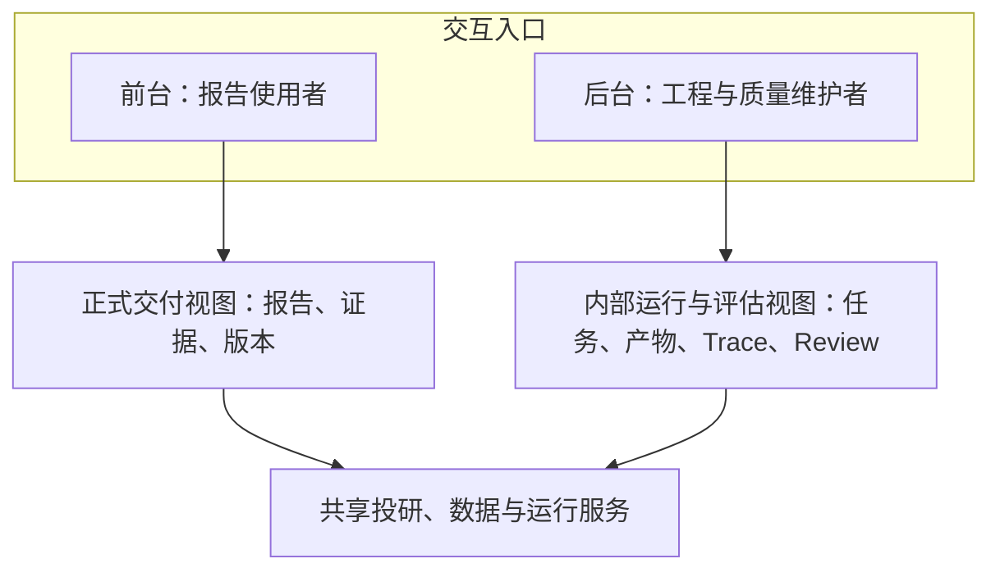

# Uteki 前台与工程后台：功能和交互草案 v1

日期：2026-09-29；边界补充：2026-10-01。状态：前后台职责已再次明确，模块划分及建设顺序仍为提案；已有局部只读产物查看页，没有实现统一生产后台、权限或发布隔离。
本稿只定义核心问题、信息架构、动作和状态；不定义颜色、字号、动效，也不包含 HTML。

2026-10-06 用户再次明确：后台以工程侧观察各 Agent 的运行过程与产物为核心，允许界面朴素，数据工作台仅为子模块。本轮已核对源码与实际历史结果，见[Agent 清单、后台缺口与首条验收路径](../CODE_OVERVIEW.zh-CN.md)。Data 是当前实现最完整的主线，限定 Analysis 已有真实运行，Risk / Portfolio 尚无可执行后端 Agent；下文旧日期的现状描述不代替此次盘点。统一工程入口尚未实现。
后续实施稿：[Data Agent 执行监控与产物查看技术方案 v0.1](../DATA_AGENT_OBSERVABILITY_PLAN.zh-CN.md)。按用户要求先共同 review，再分步实现历史回看和新运行实时监控；新增事件、接口和页面尚未交付。

依据：[总体架构与实现对照](../UTEKI_ARCHITECTURE_IMPLEMENTATION_MAP_2026-09-29.zh-CN.md)、[界面功能约定](../../skills/uteki-interface/references/style-guide.md)。最新用户反馈优先。
范围：保留现有公司名单，不新增覆盖对象；下文 GOOGL 和两位 Manager 仅用于明确交互对象，线框内容全部为虚构示意，不是研究结论或收益记录。

2026-09-30：用户要求将功能稿制作到 Figma。已有 [Figma 部分交互稿](https://www.figma.com/design/0SogEfR3y4xLDl9YB5RbOQ)，包含前台 10 屏、后台 9 屏及点击路径；尚有已知交互缺口与 2 个空框架，因 Starter MCP 调用额度耗尽无法继续修改。具体范围、未完成修正及验证边界见[续接记录](figma/uteki-v1/README.md)。下文职责和规则继续作为目标契约，不能用部分设计稿证明已全部满足。

## 0. 2026-10-01：后台的完整职责与建设边界

### 已明确的前后台分工

用户再次明确：前台面向个人、机构等报告使用者，交付可独立阅读的报告；后台面向系统工程和研究质量维护，关注运行、输入、输出、执行过程、Trace、监控及人工 review/评测。新闻或材料监控、抓取、解析、提取与内部研究过程都归后台。后台覆盖完整投研系统，Data 是当前先接通的局部能力。

前台仍保留理解投资判断所需的正式证据、原文、反证、假设、信息截止及实质缺口。原始监控事件只有经过研究、审阅和既定发布规则形成正式更新后，才进入报告或已发布变化；技术抓取失败本身不作为读者的新闻流，但若导致依据过期或结论待复核，对读者的影响须体现。

前后台使用同一套投研与数据服务，依据可见性分别读取内容。后台记录可观察的执行事实：计划/任务状态、工具输入输出、模型可见输出、父子任务、异常、耗时及已记录的用量；不以“Trace”承诺能读取模型未提供的内部推理。后台能力不要求所有步骤变成 Agent：定时任务、抓取器、解析器、数据库操作也属于可追踪对象。



此图表达目标职责边界，不表示两个独立服务、权限系统或部署已完成。当前 `review_workbench` 仍混有研究阅读与工程页面，隐藏菜单也不能替代服务端可见性控制。

### 建议的六个后台能力模块

这是系统能力分组，尚非确认后的菜单或页面布局。第 5 节已有 E0～E7 视图可在这些分组内复用，不另建一套平行后台。

| 模块 | 需要回答的问题 | 应查看的对象和产物 | 本次核对的现状 |
| --- | --- | --- | --- |
| 运行总览与监控 | 什么正在执行、什么卡住、影响谁，监控多久没取得新资料？ | 任务队列、材料/新闻监控事件、最近检查/成功时间、延迟、失败、影响的公司/研究、后续触发关系 | 尚无覆盖所有角色与监控任务的统一总览；不能用手动登记的历史运行推断实时健康 |
| 任务与 Trace | 本次输入是什么，调用了什么，父子任务怎样交接，为何结束？ | 请求/scope、输入版本、主/子运行、步骤、工具输入输出、异常、耗时/用量、输出引用 | Data 保存了部分真实执行产物；当前评估页只接入一次历史运行的主角色步骤，Worker 独立回放和跨角色统一接入未完成 |
| 材料与产物 | 一份材料最后变成哪些块、事实、证据或报告，丢了什么？ | 原件快照、文本/表格块、候选数据、证据包、研究稿、Review、发布版本及来源关系 | `/evaluation` 已连接两家公司的冻结 Data 产物；其他研究产物尚未统一纳入该入口 |
| 人工 Review 与问题处理 | 哪一项对/错/不足，有何原文依据，修订后是否解决？ | 目标运行/产物版本、字段或段落定位、判定、依据、严重程度、处理意见、修订与复核历史 | 本页只能读已保存模型核验；新 Data 产物的人工问题/裁决持久化和修订关联尚未接通。旧研究 archive 的标注不能当作统一能力 |
| 评测与实验 | 某个模型、Prompt、Skill 或实现到底改善了多少？ | 冻结样本集与标准、逐题结果、自动检查/模型评分/人工判断、失败样本、兼容运行对比、成本与耗时 | 有离线及真实实验产物；尚无统一评测表与跨运行对照入口。单次 review 通过不能证明泛化效果 |
| 配置、版本与交付 | 用了哪套代码/模型/Prompt/Skill，什么内部产物最终对外可见？ | 已冻结的配置和方法版本、适用 scope、数据/研究/发布版本、可见字段、发布预览与审计 | 各运行部分已有配置/哈希，archive 有局部版本能力；统一配置管理、发布接口和运行控制未接通 |

运行完成、内容正确、人工验收和正式发布分别呈现。缺少费用、时延或 Trace 时显示缺失，不填零、不由文件修改时间猜测，也不把工具调用成功计作答案正确。

### 每项能力共用的最小对象关系（提案）

| 对象 | 身份与最小关联 | 人工查看的意义 |
| --- | --- | --- |
| Task 任务 | 任务 ID、明确目标、类型、来源触发、公司列表/材料/期间/截止等范围；Manager/案例仅在实际归属已知时填写 | 明确到底要解决什么；多公司任务保留所有主体，共享 Data 不强绑某位 Manager |
| Run 运行 | 每次尝试独立 ID、任务 ID、实际配置/输入版本、起止/状态/结束原因；显式父子或重试关联 | 区分同一任务的不同尝试；历史实验缺少关联时如实标记，不按目录邻近拼接 |
| Step 执行步骤 | Run ID、步骤 ID、执行者/工具、输入/输出引用、错误/用量及实际时间（若已记录） | 还原系统可观察的动作与交接；子运行结束不自动表示父任务达标 |
| Artifact 产物 | 产物 ID、类型、版本/hash、所属来源/运行、上游引用、适用范围和缺口 | 从一条数值或一句结论回到原件、解析版本和生成过程；复用现有 ArtifactRef/manifest |
| Review / Finding | 被审运行及产物版本、精确位置、标准、人工/模型/程序来源、判定、依据、处理与复核记录 | 让“发现错误—修订—复核”能追踪；原文、原答案和旧判定保持历史 |
| Evaluation 评测 | 样本集/问题/标准版本、被测运行及配置、逐项评分/缺失与汇总范围、独立参考答案的隔离记录 | 形成可比较的评测表；参考答案不进入被测 Agent 的输入 |

这些对象是对现有任务文件、ToolReceipt、ArtifactRef、manifest、review 和 archive 的统一读取/关联要求；本轮不新建数据库实体或迁移文件。费用按可验证的调用归属计数，避免父子运行聚合重复计费。

Review 解决某次产物的具体问题；评测回答一类能力在固定条件下的表现。两者复用来源和定位，但分别记录用途。已用于修订的样本和反馈属于开发数据，不能再标为未见独立测试；独立评测失败不隐去，新增运行不能覆盖旧结果。

“打表”建议至少一行对应一个**被评样本 × 一次运行 × 一项标准**，包括公司/材料范围、输入与输出引用、期望结果或评分规则、观察结果、结论及证据、评分来源、复核人/版本。准确性、证据支持、遗漏、成本、时延分别展示；没有标准答案的研究推理用明确 rubric 和理由，不能凭单个总分判定投资能力。

### 第一条验收路径与分期（待选）

示例为人工核验财务单位，不改变现有真实记录：打开固定公司/材料 → 原始表格及单位 → 候选值及换算 → 已保存模型核验；若人工发现单位不支持，则给准确字段/版本记录“证据不足”及原文依据 → 新修订运行输出新版本 → 复核后追加判定。验收时旧运行和原值仍可回看，另一公司的数据与问题不受影响，任何评测结果都不直接改写正式报告。

当前只完成上述路径的查看部分。建议建设顺序先形成统一后台入口与对象关系，并完成 Data 人工 review/评测最小闭环，再接入 Analysis、Reviewer、Manager 和持续监控的真实产物。不是以单家公司或单个 Data 页代替整个后台。

首期是否同时接入“从后台触发/取消/重试运行”尚待用户选择：

- **A（推荐）：先观察与评估。** 统一查看已有运行/产物，保存人工问题和复核结果；重跑沿现有明确配置入口执行，后台引用新运行。随后接运行控制。
- **B：首期同时做运行控制。** 在 A 基础上增加有范围的启动、取消和重试；一并实现真实运行状态、持久化、重复操作控制、错误反馈与历史关联。

该选择只决定建设顺序，不改变后台的最终职责。取消如何处置子任务、重试/续跑的输入与配置政策等具体语义，只在选定运行控制阶段提出选项确认；未确认前不实现可操作按钮。既有“常规任务自主运行”规则保持，不新增逐任务人工审批。

## 1. 本稿的判断与建议

- 已确认核心交付是报告，用户应能直接阅读完整判断与依据，无需先向 Agent 提问。内部持续案例承载研究状态，对外报告对应固定发布版本；目录、引文、比较和变化摘要服务于报告阅读。
- 2026-09-30 已确认：首次核心研究与审阅完成才发布，此前显示“研究中”；重要新证据出现后保留旧报告，标注“结论待复核”、受影响部分及截止，新版完成后更新。公司报告负责“是否买”，组合报告负责“买多少”，两者相互关联。完整决策记录见[设计入口](README.md)。
- 最新结构：公司与 Manager 是双入口。公司目录按 Manager 分组，Manager 目录按公司分组；点击具体报告后进入共享阅读页。每个公司／Manager 组合可有一份主报告和多份专题，各报告独立拥有版本；目录不预先替用户选一位作者。
- 后台首页优先回答“哪些失败、缺口或 review 发现阻断交付”，不把完整日志直接铺满首页。
- 公司与 Manager 多对多，覆盖关系 `(manager_id, company_id)` 可在报告发布前存在。每份 `report_id` 唯一关联一个公司和一个 Manager；`report_version` 属于具体报告。跨入口读取同一 report_id 与版本，个人已读状态共享；其他专题保持独立。
- 行业保留独立入口，用于查看共同风险与不同判断；公司页展示相关行业影响，避免用户每次离开案例寻找上下文。
- 用户可读正式证据、关键假设、反证和实质缺口；原始抽取、Prompt、工具过程和研究草稿属于内部后台。
- 内部采纳、研究是否有效、执行是否成功、是否对外发布分别显示；“运行成功”不能自动变成“研究已发布”。
- 工程页面中的发布操作拟调用目标版本管理与发布政策能力，当前尚未接通；不新增每份报告、每笔模拟决策都必须人工审批的规则。
- 以下页面、路由和视图契约是建议；当前 `review_workbench` 混合多类功能，`uteki_zero` 仍为静态示意，不能声称已完成隔离。

## 2. 工作区与导航约定

### 使用者视角与注意力

以下是功能草案的并列说明，不代表页面布局已经确认或实现。前台由研究报告使用者阅读，后台由工程与研究质量维护者检查交付；Manager 是研究责任主体和可查看对象，不因此增加一套需要用户扮演 Agent 的界面。

| 视角 | 打开时首先要判断 | 首先看什么 | 进一步查看 | 可操作范围 |
| --- | --- | --- | --- | --- |
| 前台：使用研究报告 | 这家公司是什么业务、这位 Manager 的判断是什么、依据及限制是什么？ | 公司、Manager、报告版本/截止与有效状态，业务及 thesis 导读，完整报告 | 因素和风险的正反证据、估值假设、版本变化、其他 Manager 报告及关联行业研究 | 选择对象、阅读、比较、打开原文与返回；个人阅读状态独立保存 |
| 后台：维护研究交付 | 哪个案例尚未完成，卡在资料、数据核验、研究、审阅还是发布？ | 影响的案例、实际阶段、缺口或失败原因、责任任务、最近动作及可继续条件 | 输入资料与版本、数据记录、研究计划/候选、审阅发现、修订差异、模型配置与运行产物 | 按授权记录问题、创建有范围的新尝试/修订、检查固定发布预览；具体操作权限及自动生效政策仍待确认 |

前台的“报告结论待复核”和后台的“某条数据内容核验未通过”表达不同责任。前台说明对投资判断的实际影响；后台保留定位和修复所需的过程。不能把读者必须理解的反证、未知或限制一并藏入后台。

| 入口 | 主要对象 | 一级内容 | 默认落点建议 |
| --- | --- | --- | --- |
| 用户产品 / Research | 公司、Manager、行业 | 正式报告、变化导读、Manager 研究与模拟账户、行业档案 | 所选公司的研究目录，按 Manager 分组；Manager 入口按公司分组 |
| 工程后台 / Engineering | 案例、任务、运行、产物 | 工作队列、数据、分析、评估、运行 | 异常和待 review 工作队列 |

- 保持单窗口；一级入口、左侧对象和内容标签用明确点击切换。滚轮、触控板只做原生阅读滚动，不更换对象或版本。
- 页面位置编码入口对象、报告 ID、公司、Manager、报告版本和条目；返回时恢复原标签、阅读位置与焦点，不因新结果到达自动跳走。
- 长文和证据在正文区域阅读；并排比较不强迫两份长文同步滚动。普通阅读不用悬浮提示承载必要内容。
- 中文 / English 切换保留选择和阅读状态；正文保留原语言及来源版本，未有译文则明确标记，不静默换另一地区材料。
- 已读、留待查看和个人笔记是用户状态，独立于 review、采纳及案例版本；个人备注不自动进入 Manager 的研究事实。
- 首版不承诺跨设备同步：实现前明确显示本机保存；若接入服务端，保存反馈区分保存中、已保存、失败和版本冲突。
- 打开任何页面只读取已有产物，不隐式启动研究、模型调用、交易、重跑或发布。
- 本阶段不设必须经过的 Agent 对话入口，不要求用户编排研究任务。两位 Manager 的比较直接读取正式报告字段；若需要新的分歧解释，先在内部形成有引用、可审阅的产物，再对外发布。

## 3. 页面读取的产物契约

这里的“视图契约”是已有或目标产物的可见字段映射，不要求再建一套平行存储。标记“建议”的契约尚未接成产品接口。

| 编号 | 契约与最低内容 | 当前边界 |
| --- | --- | --- |
| P1 | 正式研究报告及版本：报告 ID、主报告/专题、公司、Manager、方法版本、期限、报告版本、信息截止、完整可读正文、业务、thesis、因素/风险、估值、决定引用、缺口 | 建议；结构化内容支持目录、证据和比较；现有 `AnnualNarrative` 只有带引用的单 thesis 与五章，不能等同完整案例 |
| P2 | 已发布变化：事件 ID、关联案例与版本、影响的 thesis/因素、前后判断、原因、实质性与未解决状态 | 建议；同一事件跨入口不复制，也不因多个引用重复计数 |
| P3 | 正式证据视图：来源、发布/可用日期、引用原文、定位、支持或反对的结论、版本及核验限制 | 建议；复用已有 evidence/citation/source 定位，需明确对外允许字段 |
| P4 | Manager 视图：方法及版本、研究案例引用、模拟持仓权重/现金比例、决策引用、归一化表现、基准与样本期 | 建议；用户端不展示隐藏名义资金；方法实例、模型配置、用户资产分配是不同对象 |
| P5 | 行业档案：行业专题与版本、提出者、thesis/风险、证据、未知、相关公司、各 Manager 的采纳与分歧 | 建议；共享观点有归属，不强制成为所有 Manager 的结论 |
| P6 | 发布清单：发布 ID、固定案例版本、证据可见集、可见字段、发布时间、状态及替代版本 | 建议；内部 `adopted` 不替代发布状态；用户接口据此选择内容 |
| I1 | Data run：请求及 scope、requirements、decision/tool trace、artifact manifest、evidence bundle、回答/缺口、结束原因 | 已有执行产物和限定真实 query/content-review 交接，当前页可查看相应事实与主角色步骤；不同执行链字段仍有差异，跨公司模型效果、Worker 完整回放和完整报告尚未验收 |
| I2 | Analysis run：输入证据与上下文版本、可见模型输出、报告候选、引用/数值检查、修复记录、usage | 现有 narrative runner 可产出；结构检查通过不代表语义或投资质量通过 |
| I3 | Review 与修订：发现 ID、目标版本/结论、依据、严重程度、处理意见、修订引用与复核状态 | 部分报告已有 review 产物；统一发现到修订的关联是建议 |
| I4 | 版本与发布管理：候选、父版本、差异、采纳决定、发布预览和发布清单 | archive 已有候选/采纳/版本；跨材料公司案例与外部发布接口待接通 |
| I5 | 评估记录：冻结输入、被评对象及版本、标准、执行范围、证据、结果、限制 | 存在实验记录；独立评估、研究 reviewer 与宿主完成检查须分别标识 |
| I6 | 任务运行：任务 ID、角色/配置版本、run ID、尝试关系、开始/结束、状态、费用口径、错误、产物引用 | 部分已有；持续调度、可靠恢复、统一工作队列仍待验证 |

## 4. 用户视图：主要问题、排序和动作

以下 `/app/...` 为建议路由；表中“查看”均留在当前工作台，可回到原选择。

| 屏幕与路由 | 用户问题与主对象 | 信息排序建议 | 读取契约 | 主动作及反馈 |
| --- | --- | --- | --- | --- |
| U0 公司注意事项摘要 `/app/companies?view=attention` | 报告有哪些重要变化？对象是正式报告关联的变化 | 核心判断或依据变化；实质反证/资料不足；Manager 仍在复核的事项；其他新变化。同级按发生时间 | P2、P1、P6 | 阅读对应报告；可标记已读/留待查看，立即展示保存状态，不消除未解决风险 |
| U1 公司目录 `/app/companies/:company?view=research` | 谁在研究这家公司，有哪些报告及变化？ | 公司身份；按 Manager 分组的主报告/专题目录；一句话判断、更新时间、有效状态；可筛选 Manager | P1、P2、P6 | 打开明确 report_id 与版本；返回恢复分组筛选与原行位置；报告份数不重复计算版本 |
| U1-R 报告阅读 `/app/reports/:report` | 公司做什么？这位 Manager 为什么看好/不看好，什么会推翻判断？ | 当前版本与截止时间；业务与核心 thesis；变化；因素/风险与正反证据；估值/决定；未知及观察计划 | P1、P2、P3、P6 | 查看因素、对比 Manager、查看版本；每次选择明确显示公司、Manager 和版本 |
| U2 Manager 对比 `/app/companies/:company/compare` | 两位 Manager 对同一公司的分歧在哪里？ | 方法/期限/截止差异；关键事实与假设；thesis、风险、估值、行动差异；共同缺口 | P1、P4、P6 | 选择两份已发布版本；点击分歧进入对应案例或证据，保持比较对象 |
| U3 Manager `/app/managers/:manager` | 这位 Manager 如何研究、持有什么、为何调整，表现能说明什么？ | 方法与约束；按公司分组的主报告/专题目录；研究变化；持仓权重/现金比例与动作；归一化风险收益及 ETF 差距 | P4、P1、P2、P6 | 打开同一个公司案例或模拟决策；查看统计口径，不展示隐藏名义资金，不提供用户资金分配操作 |
| U4 行业 `/app/industries/:industry` | 行业共同机会与风险是什么，如何影响我看的公司？ | 档案版本与提出者；关键变化/风险；证据及未知；相关公司与 Manager 采纳分歧 | P5、P3、P6 | 查看行业判断、关联公司及正式分歧；返回原行业位置，不修改公司案例 |
| U5 证据阅读 `/app/evidence/:reference` | 这条结论依据什么，原文实际说到哪里？ | 被支持/反对的结论；引用原文及上下文；来源身份/时间；限制与其他关联 | P3、P6 | 展开原文上下文、返回因素；笔记独立保存，不将“看过”变成“证据已验证” |

排序按对当前判断的影响和未解决状态，不用模型置信度、情绪、涨跌幅单独决定优先级；分类依据必须可查看，阈值随策略明确。
首次查看某公司先给出业务与 thesis 定位，再说明需注意的变化；回访仍在同一公司工作区，突出“相对此案例上次阅读版本，哪些判断改变”。
上次阅读版本按用户与案例记录，不改写 Manager 的研究基线；若无阅读记录则明确按首次查看展示，不猜测用户已知背景。
注意事项是进入判断及其证据的索引，不发展成脱离公司和 thesis 的消息流；没有新变化仍能直接阅读完整案例。
Manager 对比不自动选赢家，不把短期经理与长期经理的目标或估值数字简单平均；期限和截止不同首先说明可比性限制。
同一公司只有一位 Manager 已发布时，展示另一位“尚未发布”；不借用其内部草稿补齐比较栏。
正式案例存在实质缺口时，缺口放在受影响结论旁；不能为了前台简洁只保留利好和已完成部分。

### 用户功能线框：公司案例 → Manager 对比 → 证据阅读

```text
+--------------------------------------------------------------------------------+
| Uteki  公司 Companies | Manager | 行业 Industries         中文 / English          |
| 报告导读：1 项风险 Manager 正在复核（虚构演示，不代表真实研究）                    |
+------------------+-------------------------------------------------------------+
| 现有公司名单     | GOOGL / Manager A / 案例 v2（演示）/ 截止时间                |
| > GOOGL          | [总论] [因素与风险] [估值] [变化] [对比 Manager]              |
| 其他原有对象     | 主问题：新增投入何时带来回报？                                |
|                  | Thesis T1（假设） | 正向证据 E1 | 反向证据 E2                 |
|                  | 实质缺口：现有资料不足以判断某项投入回报                      |
|                  | [打开 E2] [查看 v1 → v2 的正式变化]                           |
+------------------+-------------------------------------------------------------+
| 点击“对比”       | A：长期，v2，截止…      | B：阶段性事件，v1，截止…           |
|                  | 分歧：何时可能兑现？    | 先列期限/假设差异，再进入证据      |
| 点击“打开 E2”    | 返回因素 T1 | 引用原文与上下文 | 来源/日期/核验限制          |
|                  | 正文原生滚动；[保存个人笔记] → 保存中 / 已保存 / 失败         |
+--------------------------------------------------------------------------------+
```

“对比”和“证据”表示当前内容区的可返回视图，不要求同时展开三张页面；切换不重复创建案例、事件或未读状态。

## 5. 工程后台：工作队列与逐层诊断

默认排序建议：阻断发布/关键任务失败；重要未处理 review 发现；待复核候选；到期未完成任务；其余成功运行。
每项显示“影响哪个案例、缺什么、最后一次动作及下一步”，同一问题的多次重试合并显示，展开才看尝试记录。
研究案例可沿 `case → task → run → artifact` 查看；采集、新闻监控、解析、共享 Data 和独立评估也可直接从 `task → run → artifact` 进入，不要求存在案例或 Manager。多公司任务保留明确的公司集合与材料主体，按实际依赖关联零个、一个或多个案例；行业任务仅在已有实际行业档案时关联该档案，不伪造上级归属。
没有完整统一任务契约的旧实验显示“历史独立实验”，保留已知入口，不推测其父任务或 Manager。

| 屏幕与建议路由 | 工程问题与信息顺序 | 读取契约 | 主动作与结果反馈 |
| --- | --- | --- | --- |
| E0 工作队列 `/engineering/queue` | 哪些问题阻断交付？按影响、未解决状态、等待时间排序，显示关联对象与负责角色 | I3、I6、I4 | 打开具体任务/发现；筛选不是解决，记录处理意见后显示保存与版本状态 |
| E1 Data run `/engineering/data/runs/:run` | 请求了什么、读到了什么、还缺什么？scope/requirements → 结果和缺口 → 证据/引用 → 工具过程 | I1、I6 | 查看对应原文与候选；创建问题记录或指定范围的重跑任务；返回新 task/run 引用，不覆盖旧运行 |
| E2 Analysis run `/engineering/analysis/runs/:run` | 哪些证据形成哪些判断？公司/Manager/方法/输入版本 → 报告候选 → 正反证据/假设 → 检查结果 → 可见模型输出 | I2、I1、I6 | 打开 review、对照证据或创建修订任务；显示候选状态，不能把完成检查当语义通过 |
| E3 Review `/engineering/reviews/:review` | 哪条结论哪里有问题？未解决实质发现 → 定位结论/证据 → 修改建议 → 接受/不接受理由 | I3、I2、I5 | 记录接受/拒绝/待验证及理由，发起有范围的修订；保存发现版本，处理状态与验证结论分开 |
| E4 版本 `/engineering/cases/:case/versions/:version` | 新版本改了什么，是否处理了发现？父子版本 → 结论/证据差异 → 发现处理与剩余缺口 → 采纳记录 | I4、I3、I2 | 查看 diff、按既定治理执行采纳或继续修订；新版本不可改写历史模型产物 |
| E5 发布预览 `/engineering/publications/:publication/preview` | 用户究竟会看到什么？固定案例版本 → 用户字段与证据 → 显示的缺口 → 发布状态与替代关系 | P6、I4、P1、P3 | 目标能力：生成预览、查看发布条件；授权发布返回 ID/版本，失败保持原发布版本；当前统一发布接口未接通 |
| E6 评估 `/engineering/evaluations/:evaluation` | 评了谁、怎么评、证据是什么？评估目的/对象 → 输入与标准 → 实际执行覆盖 → 发现/限制 → 结果 | I5、I6 | 读单题与产物、对比兼容运行；另建评估任务，不用改评分或补跑覆盖原历史记录 |
| E7 运行 `/engineering/tasks/:task/runs/:run` | 任务为何成功/停下，如何继续？结束原因/未满足要求 → 角色及配置 → 尝试与费用 → 产物目录/可见调用记录 | I6、I1/I2 | 查看日志和脱敏配置；创建新尝试或取消运行仅在运行控制能力接通时开放，返回真实状态 |

数据页的“找到引用”“读过正文”“形成回答”“语义充分”分别呈现；只有候选、文件已存盘或 Worker 完成，不代表父任务已完成。
2026-09-30 已确认的数据规则在 E1 的展示建议如下，尚未接入产品接口：

| 后台数据区域 | 要显示的内容 | 避免的误读 |
| --- | --- | --- |
| 资料覆盖 | 必需材料清单、已取得/可读/缺失、公司与期间、来源及披露时间、版本 | 文件已下载不等于资料 ready，资料 ready 不等于记录已核验 |
| 核心财务包 | 指标定义、数值、单位、期间、口径与原文位置；缺项明确列出 | 只列营收、利润等名称不等于口径一致或数据齐全 |
| 分层核验 | 程序检查结果；是否需内容核验及触发原因；核验结果与未解决问题 | 程序通过不替代模型提取、口径转换及核心判断数据所需的内容核验 |
| 按需补充与共享 | 请求来自哪个研究任务、新事实及原文、核验状态、供共享读取的版本、被哪些任务引用 | 共享数据不等于其他 Manager 已采纳观点，不静默更新既有任务的冻结输入 |

Review 可以由专门 Agent 产生；工程师可诊断与记录处理，但最终投资判断仍属于 Manager。独立效果评估不替 Manager 批准交易。
Data/Analysis/Review 的新任务在发起前显示问题、scope、版本及执行配置；能力尚未接通时显示未接通，不能提供假成功按钮。
实质方法升级继续沿用已确认的实验验证和首版确认规则；此处的普通研究修订、review 与发布预览不扩大审批范围。

### 后台功能线框：Data run → Analysis run → review → 新版本 → 发布预览

```text
+--------------------------------------------------------------------------------+
| 工程后台  [工作队列] [数据] [分析] [评估] [运行]                                  |
+----------------------+---------------------------------------------------------+
| 异常与待 review      | GOOGL / Manager A / case C1（虚构演示）                  |
| > 发现 F1 待处理     | task T2 > Analysis run R2 > 报告候选 V2                 |
|   数据任务未完成     | 输入：Data run R1 / evidence bundle B1 / 截止…          |
|   候选待复核         | [结论与引用] [Review] [可见输出] [产物与运行]            |
|                      | F1：某句推断超出引用支持范围（示意）                    |
|                      | [定位结论] [打开源文] [记录处理理由] [创建修订任务]      |
+----------------------+---------------------------------------------------------+
| Data run R1          | 要求 / 已交付证据 / 明确缺口 / source 与 block 定位      |
| Review F1            | 原结论 → 指出的问题 → 处理理由 → 待验证的修改            |
| 新版本 V3            | 父版本 V2 | 改动及引用 | F1 是否已验证 | 剩余缺口       |
| 发布预览 P1          | 用户可见：结论、证据、实质缺口                           |
|                      | 内部保留：候选、Prompt、工具过程、原始可见输出、费用     |
|                      | 固定 V3 生成预览；按既定规则发布后返回发布 ID            |
+--------------------------------------------------------------------------------+
```

以上是可逐项打开的对象关系与阅读顺序；每个 run 独立留档，不把串联线框当作已经实现的自动流水线。

## 6. 状态、反馈和注意力规则

| 状态 | 用户视图的表达 | 后台的表达与下一步 |
| --- | --- | --- |
| 加载中 | 保留当前公司/Manager/版本选择，显示目标内容正在加载；不先塞另一对象或最新版本 | 保留目标 task/run，单独显示产物读取状态，迟到响应不能替换当前选择 |
| 空 / 尚未覆盖 | 公司没有已发布案例、Manager 没有研究或行业尚未覆盖分别表达；不填虚构结论 | 没有任务、没有运行、运行没有产物分别表达；若能力接通可创建明确范围的任务 |
| 未发布 | 首次研究未完成显示“研究中”，不展示阶段性草稿；已有旧版则继续显示，重要新证据影响判断时标注“结论待复核”、受影响部分和截止 | 显示候选、内部采纳和发布状态；可查看原因及固定版本预览 |
| 过期 / 待更新 | 显示实际截止时间、到期观察项及影响范围；不把“今天没有更新”写成没有变化 | 显示迟到任务、来源可用性和最后成功时间；过期阈值来自明确计划，不以页面打开时间推断 |
| 资料不足 | 在受影响 thesis/估值旁说明缺什么、何时可验证以及结论限制 | 分开来源缺失、未处理、未读完、回答缺失、引用不符、执行停滞，指向具体 requirement |
| 首次资料准备 | 首份正式报告未完成时显示“研究中”；发布报告中说明实际公开历史不足及其判断限制 | 区分未公开、获取失败、解析失败、已可读及覆盖缺口；已就绪部分可供内部研究，资料 ready 与研究/审阅完成分别显示 |
| 加载或执行失败 | 保留可用的正式旧版本；提示本次更新/来源访问失败，不声称研究否定或事件消失 | 显示失败 stage、已保存产物、可继续条件；新尝试保留与前次关联 |
| 保存失败 / 冲突 | 未保存笔记仍留在当前会话；提供重试/复制，不显示已同步 | 显示当前版本和冲突内容，重新载入后复核；不得静默覆盖他人或 Agent 的新版本 |
| 无新变化 | 仅当相关检查实际完成且无新增影响时显示；已读不等于此状态 | 同时给出覆盖范围、截至时间和执行结果，不用成功状态抹去未解决缺口 |
| 样本不足 | Manager 收益/风险或行业判断不足时显示实际区间与覆盖，不画虚构收益曲线 | 评估显示实际执行题数、条件及限制；一次开发试跑不充当正式 benchmark 覆盖 |

所有屏幕继承上述加载、失败和保存规则；各屏幕另有以下必须明确的边界状态。

| 屏幕 | 空、未发布或覆盖不足时的具体表达 |
| --- | --- |
| U0 注意事项 | 区分“检查完成无新影响”和“尚未完成检查”；已读但未解决的失效/缺口仍在对应类别中 |
| U1 公司案例 | 首次研究未完成保留公司与 Manager 身份并显示“研究中”；旧版待复核时保留正文，标注截止和受影响的具体判断 |
| U2 Manager 对比 | 一侧未发布则留空并说明；期限、来源或截止不一致时标注，不能自动补成一致输入 |
| U3 Manager | 研究覆盖为空、账户未启动、无持仓和收益样本不足分别表达；现金不是数据缺失 |
| U4 行业 | 未形成行业档案、没有公司引用及 Manager 尚未采纳分别表达；来源更新不冒充观点已更新 |
| U5 证据 | 引用不存在、原文不可读取、只有摘录、核验失败分别说明；保留受影响结论的定位 |
| E0 工作队列 | 区分队列为空、过滤后为空、队列读取失败；读取失败不能显示“所有任务正常” |
| E1 Data run | requirement 无回答、正文未完整交付、只有候选记录分别标明；保留失败前已验证产物 |
| E2 Analysis run | 无报告、只有草稿、引用失败、语义未审分别标明；输入版本过期不自动重写结果 |
| E3 Review | 未运行 reviewer、没有发现、发现已处理但未复核分别标明；无发现不自动证明结论正确 |
| E4 版本 | 首个版本没有父版本 diff；并发修订冲突展示共同基线；采纳失败保留原有效版本 |
| E5 发布预览 | 未生成预览、版本已变化、条件未满足、发布失败分别表达；过期预览不能发布新版本 |
| E6 评估 | 未执行、部分执行、执行失败、样本不足分别表达；缺失项保留为未评，不默认通过 |
| E7 运行 | 未开始、运行中、取消请求中、已取消、已结束分别表达；无法查询时状态未知，不猜测仍在运行 |

同一事件在公司、Manager、行业关联页引用同一个 event ID；是否已读可以共享，受影响的各案例复核状态仍分别维护。
新运行成功只更新关联任务状态；发现是否已解决须有复核记录，新案例是否可对外显示须由发布状态决定。
后台中的原始模型“可见输出”指返回给应用的正文、结构化回答和工具调用结果；不采集或展示隐藏推理。
凭据、令牌和连接密钥不属于任何页面内容或产物导出；配置与错误采用脱敏显示，必要定位使用内部引用。

## 7. 服务端可见性与发布边界

- 用户读取面按发布清单固定版本并采用可见字段白名单；页面、JSON 接口、下载和原文引用访问遵循同一范围。
- 用户可以查看判断依据与实质缺口，不可通过修改 URL 或产物 ID 读取未发布案例、内部候选和运行目录。
- 内部后台需要独立授权能力；当前本机绑定、同源 POST 检查和隐藏导航不能证明该隔离已实现。
- Manager 模拟账户的隐藏名义资金只可供授权后台诊断；用户接口只返回持仓权重、现金比例及归一化表现，不能将原账户金额发给前端再隐藏。
- 原文公开可访问不等于所有内部加工结果可公开；P3 提供所需来源上下文，I1 保留完整抽取及工具过程。
- 发布预览使用与用户端一致的字段映射；发布固定版本，后续修订先产生新候选，不在原发布内容上直接改写。
- 核心研究与审阅完成后仍存在的投资不确定性可在正式报告中表达；必需研究尚未完成不能借“有缺口”提前发布。已发布报告的待复核状态与影响范围应及时可见，不能为了通过发布把 unknown 删除。

## 8. 首轮验收和后续顺序

1. 用明确标注的虚构 GOOGL 报告检查 U1：无需对话、无需切换辅助视图，完整报告正文即交代核心判断、正反证据、估值条件与未知。再检查可选的 U2 → U5：两入口指向同一报告版本，分歧有归属，返回保留位置，阅读和比较不触发模型调用。
2. 检查注意力管理：同一来源同一事项的三条更新合并提示，不重复催看；同源但不同事项仍分别保留；风险已读后仍显示未解决。
3. 检查首次阅读先有业务与 thesis 背景、回访可看版本变化；新更新到达不抢当前阅读焦点、不自动切版本或滚动位置。
4. 用冻结的内部样例设计 E1 → E2 → E3 → E4 → E5：每条发现可回到原结论/引用，修订产生新版本，预览不包含 raw 过程。
5. 检查未发布、旧版本、资料不足和保存失败的反馈；页面读取不得发起模型调用或修改正式研究状态。
6. 接入真实产物时先核对契约与服务端可见性，再验证任务控制、发布与持久保存；不能以静态线框完成代替这些验收。

本轮仅完成文档提案，未制作生产 UI、未运行模型、未做浏览器验证。优先讨论：公司工作区摘要按判断影响排序、后台按阻断与 review 排序是否合适；其余路径先作为可调整的默认方案。
