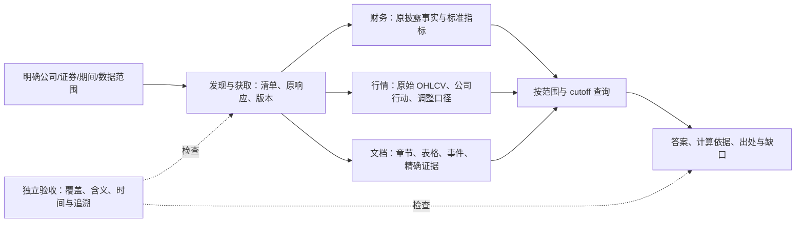

# 美股研究数据源：选型、稳定获取与处理边界

核查日期：2026-10-12。范围：美股为主，包括在美上市外国发行人；其他市场为扩展项。

本文记录 DS-01 调研时点。后续 [DS-02 覆盖与验收讨论稿](2026-10-12-ds02-financial-coverage-contract.zh-CN.md)已整理；用户已确认首批非金融企业、5 个已完成财年＋20 个财季、全部附注定量事实可查询。免费来源只读获取检查和 Snowball 接口核查见该稿第 9–10 节；当前行动以 [TODO](../../TODO.md) 为准。

状态：**DS-01 调研完成，数据源尚未选定，供应商尚未实测。开发和真实模型执行继续暂停。** 本轮查阅官方披露渠道、产品文档、定价及接口说明，并核查现有代码。没有开通账户、购买数据、调用付费接口或启动模型。文档可访问不等于数据 API 在本机可用，更不等于连续运行稳定。

## 1. 当前建议与具体业务例子

建议采用三条主干：**SEC 与公司 IR 保存披露原件；专业供应商提供结构化财务；专门行情供应商提供价格、成交量和公司行动。** 公司博客、产品页和外部信息补充解释。原始披露、供应商标准化与我们的计算结果分别保存。

例如用户问：“微软过去五个财年的收入、分部增长、经营现金流和资本开支怎样变化？最近一年的变化，是否与管理层披露的业务原因一致？”这是拟议验收案例，尚未真实执行。它需要：

| 需要回答什么 | 首选获取方式 | 得到什么 | 如何判定足够 |
|---|---|---|---|
| 收入、现金流、资本开支及财年日期 | 结构化财务 API，核对原报表 | 可 SQL 查询的事实记录 | 每个指标/期间/单位/口径明确，数值可以回到具体原表 |
| 分部收入与历史口径变化 | 供应商公司专属系列或原件 iXBRL/表格 | 分部事实及版本关系 | 不把不同版本分部直接拼接，不猜测缺失映射 |
| 变化的解释 | 10-K/10-Q 的 MD&A、IR 发布稿、电话会 | 带说话者、日期和精确出处的论述 | 区分管理层解释、我们的推断和缺少证据 |
| 如需计算估值或股价回报 | 证券身份、行情、股数、分红/拆股 | 时间对齐的价格与计算结果 | 使用明确交易日和股数口径，回报是否含分红明确 |

若另问“截至某历史日期，当时已经知道什么”，必须增加**当时可得版本**约束。现在下载到的最新重列财务、最新复权历史价，不能直接冒充历史当时可得数据。

“完整”应先定义成某公司集合、报告期间、报表/附注/分部/KPI 清单及版本范围内的完整。拿到三张主表，不代表拿到全部财务披露；保存整份文档，也不代表其全部事实已经可 SQL 查询。

## 2. 数据源地图

一手/二手、专业性、稳定性是不同维度。专业供应商可以高质量加工一手材料；公司自己的宣传虽是一手表达，其效果主张仍需独立验证。

| 类别与优先级 | 主要来源、信息 | 获取方式 | 获取后的处理与边界 |
|---|---|---|---|
| 核心：定期披露 | SEC 10-K、10-Q、修订 /A；业务、财务、MD&A、风险、附注 | Submissions 查发现；按 accession 取原 HTML/iXBRL/XML 及附件 | 原件归档；财务事实入库；论述保留章节/表格/精确证据。季度是 **10-Q** |
| 核心：重大事件 | SEC 8-K 及 exhibits；业绩发布、收购、融资、合同等 | 申报索引与完整附件清单 | 建事件记录；保留 filed/furnished 状态。正文可能只是索引，不能漏取附件 |
| 核心：外国发行人 | SEC 20-F、6-K，适用时 40-F | 同 SEC 发现与原件链路 | 显式区分 US GAAP/IFRS、币种和报告制度，不强套 10-Q 规则 |
| 核心：公司 IR | Annual report、股东信、业绩新闻稿、slides、webcast/audio、电话会 | 官方 IR 索引、公告页、附件、可用 feed | 对应 SEC 版本；annual report 可能重复或新增内容。转录需绑定音频和时间；指引、non-GAAP 与实际值分开 |
| 核心：专业财务数据 | 标准三表、as-reported、分部、KPI、重列/PIT | 正式 API、批量文件或许可云交付 | 保留供应商字段及原值，再映射统一指标；可回溯程度逐条验收 |
| 核心：行情与证券身份 | OHLCV、分红、拆股、证券更名、上市/退市、交易日历 | 专门行情 API；历史回补 + 增量 | 以证券为对象；原始价、拆股复权和含分红回报分开，不静默混用 feed |
| 扩充：产品与技术 | 公司博客、产品页、价格页、技术文档、release notes | 官方 sitemap/feed/API，逐站索引与快照 | 形成带版本的产品/价格/事件记录；保留地区、语言、SKU、计费单位和 GA/preview 状态 |
| 扩充：治理、持股、融资 | DEF 14A、Forms 3/4/5、13D/G、13F、S-1/S-3/424B 等 | SEC 表单与 XML/附件 | 治理/所有权/交易事件；13F 不是实时交易或完整仓位，内部人变化需读交易代码和脚注 |
| 扩充：基准和宏观 | 正式指数、BLS、BEA、FRED/ALFRED | 官方或许可 API/批量 | 指数和 ETF 分开；宏观保留发布/修订 vintage，价格/总收益指数口径明确 |
| 扩充：监管与知识产权 | FTC、DOJ、Federal Register、USPTO | 官方案件索引、API/批量、原文件 | 提案/生效、指控/裁决、申请/授权分别标记，专利不直接证明商业成功 |
| 扩充：外部验证 | 同行、客户、供应商自己的披露；专业行业调查 | 原发布者材料或授权数据 | 保留发布者与观察范围，别人的说法不变成目标公司声明；样本/方法/期间必需 |
| 后续：预期与资讯 | 分析师一致预期、Reuters 等新闻、行业付费数据 | 专业供应商 API/内容许可 | 预期、管理层指引、实际值分别建模；新闻按原创采访/调查或转述识别来源性质 |

范围依据：[SEC 投资者检索指南](https://www.investor.gov/introduction-investing/getting-started/researching-investments/using-edgar-research-investments)、[10-K](https://www.sec.gov/files/form10-k.pdf)、[10-Q](https://www.sec.gov/files/form10-q.pdf)、[8-K](https://www.sec.gov/files/form8-k.pdf)、[20-F](https://www.sec.gov/files/form20-f.pdf)、[6-K](https://www.sec.gov/files/form6-k.pdf)。治理/持股边界参考 [SEC 内部人数据](https://www.sec.gov/data-research/sec-markets-data/insider-transactions-data-sets)、[13F FAQ](https://www.sec.gov/rules-regulations/staff-guidance/frequently-asked-questions-about-form-13f)。

公司入口样本：[Microsoft annual report](https://www.microsoft.com/investor/reports/ar25/index.html)、[Alphabet IR](https://abc.xyz/investor/)、[Microsoft Blog](https://blogs.microsoft.com/)、[Google Blog](https://blog.google/)、[Azure 文档](https://learn.microsoft.com/en-us/azure/)、[Azure 价格](https://azure.microsoft.com/en-us/pricing/)、[Google Cloud 价格](https://cloud.google.com/pricing)、[Cloud release notes](https://docs.cloud.google.com/release-notes)。这些是入口样本，尚未验收跨站完整覆盖。Cloud release notes 有官方 feed 和 BigQuery 入口，也仍需核查产品专属历史范围。

宏观/监管入口：[BLS API](https://www.bls.gov/developers/api_faqs.htm)、[BEA API](https://apps.bea.gov/api/signup/)、[FRED API](https://fred.stlouisfed.org/docs/api/fred/)、[ALFRED](https://alfred.stlouisfed.org/help)、[FTC](https://www.ftc.gov/legal-library)、[DOJ](https://www.justice.gov/atr/antitrust-case-filings)、[Federal Register API](https://www.federalregister.gov/developers/documentation/api/v1)、[USPTO API](https://data.uspto.gov/apis/bulk-data/search)。USPTO 当前涉及账户/API key，不能当作匿名公开下载。新闻有正式内容交付，例如 [Reuters Connect](https://reutersagency.com/content-delivery-platforms/reuters-connect/)，具体金融新闻 API 和价格仍待询价。

其他市场扩展为 A 股、港股、台股、欧洲、日本的当地官方披露、专业财务和本地行情。**本轮未核查这些市场的具体接口、价格、授权和稳定性，不据此宣称全球覆盖。**

## 3. 财务供应商：可直接获取，但覆盖与追溯必须逐项核对

专业性以下按官方产品定位比较，不是独立准确率排名。公开价格以 2026-10-12 为准，单位 USD；个人使用和产品/多用户使用分别看。

| 来源 | 数据及专业性 | 获取与追溯 | 公开价格 | 关键待验收项 |
|---|---|---|---|---|
| SEC 原始数据 | 一手披露；标准标签与原件 | JSON、原件 iXBRL、批量；accession 能回到申报 | 免费；有解析和运维成本 | 聚合 Companyfacts 只覆盖标准 taxonomy、整实体事实；自定义标签、维度/分部、附注不能指望一个接口补齐 |
| Daloopa | 二手专业提取；公司专属系列、KPI、taxonomy；原披露/标准化/单季度和重列信息 | API v3、批量 CSV、更新通知及云交付；产品强调数值引用链接 | API/Core/Premium 询价；免费 3 个 data sheets 不等于免费完整 API | 每值出处能否在授权环境中重开；分部/附注具体覆盖；严格任意历史 cutoff；datapoint 额度 |
| S&P Capital IQ Financials | 二手专业财务；standardized 与 as-reported、分部/附注；PIT 产品 | API、数据馈送、云和桌面；原披露与标准数据关联能力 | 询价 | 购买包是否同时含 API、原披露、PIT 和精确引用；覆盖与 SLA |
| S&P Compustat | 二手专业标准化历史和 PIT | 许可数据交付 | 询价 | 与 Capital IQ Financials 是不同产品；不能默认包括相同附注/as-reported 能力 |
| FactSet Fundamentals | 二手专业财务；三表、每股、比率、分部；PIT API | 版本化 API/SDK、异步批量；Report Builder 有原始/重列选项 | 询价 | 原件级与逐值定位权限；公司 KPI/附注完整性；具体产品组合和 SLA |
| FMP | 二手聚合；三表、as-reported、产品/地区收入 | REST JSON/CSV、bulk；申报/接受日期及申报链接 | 个人年付折合 **19 / 49 / 99 每月**；商业 Enterprise 询价 | 申报链接不等于原表单元格定位；严格 PIT、修订历史、特殊附注和字段准确性待验 |

依据：[SEC API](https://www.sec.gov/search-filings/edgar-application-programming-interfaces)、[Daloopa API](https://www.daloopa.com/products/api)、[API 与 MCP](https://docs.daloopa.com/docs/api-vs-mcp)、[Daloopa plans](https://daloopa.com/plans)、[S&P fundamental data](https://www.spglobal.com/market-intelligence/en/solutions/products/fundamental-data)、[S&P delivery](https://www.spglobal.com/market-intelligence/en/solutions/data-delivery)、[FactSet Fundamentals 官方 SDK](https://github.com/factset/enterprise-sdk/blob/main/code/python/FactSetFundamentals/v2/README.md)、[FactSet PIT API](https://github.com/factset/enterprise-sdk/blob/main/code/python/FactSetFundamentals/v2/docs/FundamentalsPointInTimeApi.md)、[Report Builder](https://github.com/factset/enterprise-sdk/blob/main/code/python/FactSetFundamentalsReportBuilder/v1/README.md)、[FMP 文档](https://site.financialmodelingprep.com/documentation)、[个人价格](https://site.financialmodelingprep.com/pricing-plans)、[商业价格](https://site.financialmodelingprep.com/pricing-plans?planType=commercial)。FMP 此处是年付折合价，未核验月付结算，不把页面划线价当成月付已验证价格。

**推荐候选而非采购决定：** 对“公司专属 KPI + 精确原文追溯”，先考察 Daloopa；对“广泛标准化 + 严格历史时点”，对照 S&P 或 FactSet；FMP 是较低公开订阅门槛的候选，但不能用价格替代完整性/PIT 验收。按效果 > 成功率 >> 费用，先淘汰无法回答业务问题或无法追溯的来源，再比较价格。

## 4. 行情：先明确日线与收益口径

以日线研究为首批候选范围，是否需要分钟/实时数据仍待业务契约确认。无需为了“有 K 线”先买全部实时权限。

| 来源 | 范围与口径 | 公开价格 | 稳定获取依据与缺口 |
|---|---|---|---|
| Massive（原 Polygon） | 美股聚合 OHLCV、证券目录、公司行动；bars 的 adjusted 是**拆股复权** | 个人 Basic 免费/2 年；Starter **29/月**/5 年；Developer **79/月**/10 年；Advanced **199/月**/更长历史与实时 | 正式 REST、分页、文件/stream 产品；需验证订阅范围、修订和退市历史。分红需要单独处理 |
| Tiingo EOD | 日线原始/调整价格、divCash、splitFactor；调整考虑拆股和分红 | Starter 免费；Power **30/月** | 日期范围 API、回补、公司行动；文档有收盘后更新/晚间修正。需验退市/更名、修订历史和本机访问 |
| Alpaca | 股票/ETF 历史；必须显式选择 feed 与 adjustment | Basic 免费；Algo Trader Plus **99/月** | 正式 REST/stream；免费实时 **IEX**，付费可含全美交易所；免费历史 SIP 有最近 15 分钟限制。IEX 不代表全市场成交量 |
| Nasdaq Data Link / 交易所产品 | 官方交易所来源及许可数据集、参考/指数等 | 按数据集和权限询价 | 取决于具体产品；交易所单场所 feed 与全市场 SIP 是不同范围 |

来源：[Massive pricing](https://massive.com/pricing)、[bars 与调整参数](https://massive.com/docs/rest/stocks/aggregates/custom-bars)、[公司行动](https://www.massive.com/docs/rest/stocks/corporate-actions/dividends)、[证券目录](https://massive.com/docs/rest/stocks/tickers/all-tickers)、[Tiingo pricing](https://www.tiingo.com/pricing)、[Tiingo EOD](https://www.tiingo.com/documentation/end-of-day)、[Alpaca 权限与限额](https://docs.alpaca.markets/us/docs/about-market-data-api)、[Alpaca bars](https://docs.alpaca.markets/us/reference/stockbars)、[Nasdaq API](https://www.nasdaq.com/products/data/data-link/api)。价格是公开个人档，不能当作产品对外展示报价。

推荐先在 Tiingo EOD 与 Massive 中比较日线覆盖和口径；确需盘中分析时才比较 SIP 分钟/实时权限。基准指数另选价格/总收益/净总收益及币种，不能把 ETF 当成指数原始值。

## 5. 能否稳定获取：有正式主干，但连续稳定尚未实测

稳定获取要同时成立六件事：**发现完整、接口可用、授权足够、时间及时、失败可补、版本可重放**。HTTP 成功但只返回最近一页、遗漏附件或旧权限之外的字段，也不是业务上的成功。

| 来源 | 可以建立稳定链路的依据 | 风险与具体处理 | 本轮证据级别 |
|---|---|---|---|
| SEC | 无 key 的正式 JSON 接口；历史尾文件、原件索引；夜间批量 | 联系身份与共享限流；增量发现后按索引核对附件；429/临时错误尊重冷却，403/权限类错误明确报缺口 | 官方文档 + 项目曾真实获取指定 10-K；未测连续运行可用率 |
| Daloopa | 正式 API、更新/重列机制；文档 120 请求/分钟 | 请求额度与 datapoint 消耗都查；人工审核可能改变 fundamental_id；历史版本不覆盖；webhook 开通条件需确认 | 产品/接口文档，未实测 |
| S&P / FactSet | 专业数据馈送/API、PIT 产品、批量交付 | 具体包的限流、延迟、纠错、退役通知和 SLA 在订阅中确认；不能由品牌推定零错误 | 官方产品/SDK，未实测 |
| FMP | REST/bulk、公开更新周期、付费限额 | 财务可能在 SEC 披露后分钟至小时更新；bulk 日更；Endpoint/权限变动需监控；Enterprise 页面标 99.9% SLA，不能扩展到个人档 | 官方价格/周期/条款，未实测 |
| 专业行情 | 时间窗口回补、分页、公司行动、正式 feed | stream 中断后补取；迟到交易与历史修订留版；区分休市/无合格交易/停牌/抓取缺口；源缺失不填零 | 官方文档，未实测 |
| IR/博客/产品官网 | 站点索引、部分 feed/sitemap/官方 API | 逐站入口契约；页面改版/JS/附件迁移；feed 不一定含所有子站；定期索引对账、原件快照、覆盖清单 | 部分入口查阅 + 代码现有有限发现；未验全站完整 |
| 宏观官方 API | 固定系列、日期区间、许可接口；部分 vintage | 修订与发布时间分别保存；发布频率与限制按 API 设，不统一当作每日更新 | 官方文档，未实测 |

依据：[SEC 访问要求](https://www.sec.gov/about/webmaster-frequently-asked-questions)的最高 10 请求/秒不是 SLA；[SEC RSS](https://www.sec.gov/files/about/secrss.shtml)用于通知，不替代完整历史清单。[Daloopa 限流](https://docs.daloopa.com/docs/rate-limits)、[用量](https://docs.daloopa.com/docs/checking-consumption)、[身份与重列](https://docs.daloopa.com/docs/fundamental-uniqueness-restatements)、[webhook](https://docs.daloopa.com/docs/webhook)及[管理 webhook](https://docs.daloopa.com/docs/managing-your-webhooks)共同核对；开通方式仍待确认。[FMP 更新周期](https://site.financialmodelingprep.com/developer/docs/cycle-times)、[Enterprise SLA](https://site.financialmodelingprep.com/pricing-plans?planType=commercial)、[服务条款](https://site.financialmodelingprep.com/terms-of-service)。

FRED 默认查询当前可得数据。回测要显式使用 [real-time period](https://fred.stlouisfed.org/docs/api/fred/realtime_period.html) 与 [vintage dates](https://fred.stlouisfed.org/docs/api/fred/series_vintagedates.html)，不能把最新修订当成历史已经知道的数字。

**拟议稳定性验证，未运行、未冻结：** 先完成历史回补，再连续观察 10 个交易日的增量与修订。业务清单必须提前冻结，逐项记录应有/已取/缺失/失败/晚到/修订和恢复时间；10 天也不能证明长期稳定。至少包含分页和历史尾文件、原件附件、重复取数、429 冷却/断点恢复、分红拆股、更名/退市、财务重列与 cutoff 隔离。披露延迟、EOD 最终化和站点监视频率分别定阈值，不能用统一“当天抓到”代替验收。

备用源可以配置，但必须保留切换事件、来源及口径差异。不能在主源失败时静默换源、拿最新值补历史值，或把缺失填成零。稳定性应该由可见缺口和恢复能力支持，而不是通过隐藏失败制造成功率。

## 6. 获取后怎么处理

以下是**拟议边界**，不是已经完成的生产系统：

| 层 | 必需输入/输出 | 责任边界 |
|---|---|---|
| 身份与来源 | issuer/company、CIK；证券及有效日期、share class、ticker、exchange；来源目录、授权范围 | CIK 是发行人身份，不能唯一表示证券。多类股/ADR/更名需要独立关系，不用 ticker 永久标识 |
| 获取与归档 | 预期文件/数据清单；原响应或许可内快照、hash、请求范围、分页、发布时间/获取时间、失败日志 | 完整下载与覆盖验收分开；商业数据历史保留方式遵循实际订阅权限 |
| 财务规范化 | 原披露事实 + 标准财务记录 + unmapped/conflict/unsupported | 时点/期间、单位/币种、维度、会计准则、GAAP/non-GAAP、原始/重列明确；同比口径变化显式标记 |
| 行情规范化 | raw OHLCV + feed + session + corporate actions + adjustment/version | America/New_York 交易日与 UTC 时间、夏令时和提前收市；调整价保留计算口径，不重复复权 |
| 文档处理 | source → section/table/span；事件/说法附日期、主体、说话者 | 业务解释按需读原文；动态价格/产品页保留地区、语言、版本。不能把整个文档 URL 当作逐条精确证据 |
| SQL 与证据 | 显式公司/证券/期间/cutoff/来源选择；事实及计算 lineage | 查询读已验收数据；保持单位和期间一致；实际、预测、指引分开。SQL 不负责猜未映射指标或修复原始数据 |
| 独立验收 | 原件、提前冻结的业务清单、预期边界 | 覆盖、正确、引用存在且支持结论、无额外错误、稳定和费用分别验；模型自审不代替原件核验 |

每条财务事实至少保留：公司、指标原名与标准 ID、值、单位、期间起止/时点、维度、原/重列版本、来源、申报/发布时间、供应商处理或可得时间（若提供）、本机获取时间、精确证据。缺少历史可得时间就明确无法证明严格 PIT，不能用 fetched_at 凭空补足历史。

供应商返回相同数字，不意味着相同含义。单季度与累计九个月不能直接拼接；股数/每股与金额不能互换；重列和重复披露不能相加。派生季度、毛利率、自由现金流、估值等，保留公式、输入记录 ID 与口径，不能覆盖披露事实。原披露值与标准化值允许并存且解释差异。

具体订阅需要匹配本项目的 SQL 存储、LLM 读取、多用户展示、导出和停订后历史留存。个人价格不能直接估算这些权限；开放 SDK 的代码许可也不是数据许可。按实际订单确认，不从网站通用条款推定所有付费 API 的使用范围。参考 [Daloopa terms](https://daloopa.com/terms-of-use)、[S&P licensing](https://www.spglobal.com/en/licensing-terms-and-conditions)、[FMP commercial](https://site.financialmodelingprep.com/pricing-plans?planType=commercial)、[Nasdaq terms](https://data.nasdaq.com/terms)。

## 7. 当前项目已经具备什么、缺什么

本轮核对的是当前源码；下列状态不能自动扩展到任何供应商或任意公司。

| 能力 | 当前观察 | 缺口 |
|---|---|---|
| 公司身份与获取 | [company_registry.py](../../src/uteki/infrastructure/document_sources/company_registry.py) 是显式本地登记目录；[company_acquisition.py](../../src/uteki/infrastructure/document_sources/company_acquisition.py) 支持范围、截止日、原件 hash、冷却/Retry-After | 不是全市场证券主数据；官网发现明确报 `official_source_coverage_not_exhaustive`，不能称完整官网监控 |
| 材料准备 | [company_materialization.py](../../src/uteki/infrastructure/research_data/company_materialization.py) 确定性建材料并映射少量标准指标 | 既有完整两份 10-K 的准备不等于完整财务语义；大量事实仍未映射，需来源和覆盖契约 |
| 入库与 Query | [query_dataset.py](../../src/uteki/infrastructure/research_data/query_dataset.py) 有 observations/sources/evidence/metric_definitions；[query_service.py](../../src/uteki/infrastructure/research_data/query_service.py) 有受约束只读查询及缺口状态 | 可以复用范围与证据边界；供应商 adapter、完整指标/维度/修订、市场行情链路尚未在本轮核验，不能称已接入 |
| 运行与验收 | 03-M3、E6-R4 新批次有有限真实验收，见原 [TODO](../../TODO.md) 和对应交付 | 指定题通过不代表完整财务可查询；历史原包丢失项仍未完成 |

这次调整的依据是：当前最大的缺口包含**结构化覆盖与含义**，因此先选源并定义覆盖，再决定哪些财务处理可以采购、哪些必须自己实现。并不要求重建已有安全 Query 和证据机制。

## 8. 如何协作：先冻结交接接口，再分工

这是拟议职责，尚未分配实施人、开始开发或确定具体供应商。旧 [并行修复任务卡](../PARALLEL_FIX_ASSIGNMENTS_2026-10-12.zh-CN.md) 属于此前缺陷修复草案，保留但暂不启动；它不替代本次数据主线。

| 职责 | 可以独立做什么 | 必须交接什么 | 依赖 |
|---|---|---|---|
| A 数据源与获取 | 每来源的发现、权限、补取、限流、清单与失败诊断 | 带身份/时间/版本的原数据包、覆盖清单、可重放获取记录 | 先冻结来源/业务覆盖契约 |
| B 结构化处理 | 财务与行情各自 adapter、字段/单位/维度/版本校验 | 原事实、标准记录、映射规则版本、精确证据、明确未支持项 | A 的冻结原包；共用身份与 provenance 契约 |
| C SQL 与证据 | 显式范围查询、cutoff、计算、证据展开 | 可查看结果、选用范围、输入 lineage 与缺口 | B 的已冻结记录 schema；可先用独立 fixture 验工程边界 |
| D 验收与整合 | 提前定义业务覆盖、独立精读原件、追溯与稳定性验收 | 原问题逐项判断、遗漏/多余、错误机制、执行与费用证据 | gold 与运行 Agent 隔离；只验冻结版本，不事后放宽 |

效率来自减少相互等待和语义返工：先共同确定身份、时间、单位、版本、缺口和证据字段；A/B 按来源独立推进，C 依据冻结接口做工程验证，D 提前准备标准并最后独立验收。正式联跑由主控统一版本、权限和预算，避免各路使用不同来源/数据包后混合统计成功率。确定性 fixture 通过与真实 API/Agent 执行分别记录。

## 9. 当前路线与紧接着的动作

| ID | 阶段 / 交付物 | 状态与依赖 |
|---|---|---|
| DS-01 | 美股数据源、价格、稳定获取与处理边界调研 | **本轮完成；当前位置。供应商未实测、未采购** |
| DS-02 | 首批覆盖与来源契约：公司/证券、年份、三表/分部/附注/KPI、PIT/行情口径；候选验收矩阵 | **下一具体 To-Do**；基于 DS-01，讨论后冻结，不提前把候选当选定 |
| DS-03 | 候选数据样本获取与连续稳定性验证 | 待 DS-02；所需试用/权限/采购另行落实。测覆盖、追溯、更新、修订与恢复 |
| DS-04 | 分工与最小链路实现 | 待 DS-02 的接口和 DS-03 的来源证据；材料/入库/SQL/验收各司其职 |
| DS-05 | 完整财务可查询、可追溯的业务验收 | 待 DS-04；逐项覆盖和精确出处通过，不用测试数量代替内容正确 |
| 既有 03-M3/E6-R4 | 新批次指定题有限通过 | 保留原结论，不扩展成任意材料/完整财务支持 |
| 既有 E6-R5b、R2–R7、E7 | 缺陷修复与关系扩展 | 暂置；按新主线的实际阻塞关系再排，不因原队列自动启动 |
| R22-H 等历史缺包项 | 历史原包回归 | 未完成；不由新来源成功关闭 |

下一动作是 **DS-02：把“完整财务”拆成可检查的首批覆盖表，并给候选供应商同一份获取/验收问题清单**。先确定必须满足的效果和追溯，再决定试哪一家、采购哪些数据、哪些处理仍由我们承担。本轮结论用于讨论与选型，不构成数据源实测通过或采购授权。
