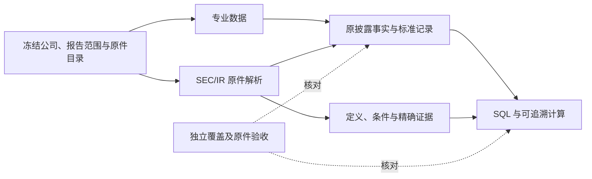

# DS-02：完整财务覆盖与验收契约（讨论稿）

日期：2026-10-12。版本：讨论稿 v0.2（本轮补齐三项待确认建议，未冻结）。前置：[DS-01 数据源调研](2026-10-12-data-sources-selection.zh-CN.md)。

**当前位置：DS-02 范围梳理已形成草案，尚未整份冻结。** 本轮只整理范围和验收，不开发、不购买、不注册、不调用付费数据 API 或模型。供应商能力沿用 DS-01 的官方资料调研，未实测；本轮另核对 SEC 接口/表单与非 GAAP 指引、发行人原件，并由两个只读子 Agent 独立检查覆盖和验收遗漏。

## 1. 已确认、建议与待落实

| 决策 | 状态 | 范围 |
|---|---|---|
| 市场 | 用户已确认 | 美股为主，其他市场列扩展项 |
| 行业 | 用户本轮已确认 | 首批非金融企业；银行、保险、REIT 等另设契约，不套普通企业模板 |
| 附注 | 用户本轮已确认 | **选定报告范围内，全部财务附注披露的定量事实可查询，分阶段实现**；文字限定条件和原文保留 |
| 历史跨度 | 用户本轮已确认 | 最近 5 个已完成财年 + 最近 20 个财季，按明确截止日；不足历史的公司明确缺口 |
| 报告制度 | 建议，待讨论 | 首个验证组使用非金融 US GAAP 发行人；IFRS/20-F/6-K 不由该组推定通过，仍属于美股总体来源范围内的单独扩展 |
| 公司与材料 | 待落实 | 建议 Microsoft、Alphabet、Costco 三家验收材料组；业务范围与精确原件包分两步冻结，均待确认，不改变产品公司列表 |
| 供应商 | 未选定 | 按同一覆盖与追溯清单比较，不因供应商未返回而缩小业务范围 |

“完整财务”的目标定义为：**在冻结的公司、期间、披露文件和版本范围内，财务主表、财务附注、分部及约定财务补充披露都有完整目录；所有披露的定量财务事实可以按原含义查询；解释、条件和出处可以随结果展开；未披露与处理缺口明确区分。**

完整不要求每家公司存在相同字段。公司没有单列某个指标时，不能自行造一个值；公司专属事实可以保留原指标和维度进行查询，不必先强行映射成跨公司标准指标。跨公司比较只采用已核验含义一致的指标。

### 1.1 本轮提交确认的三项建议（全部待用户确认）

以下是可供确认的提案。沿用已确认的非金融、全部附注定量事实、5 个已完成财年＋20 个财季；本轮不冻结、不开发，不将来源网页查阅当成样本包获取或内容验收。

**建议 A：首批报告制度。** US GAAP 非金融企业，以发行人合并财务为主，采用 10-K、10-Q、相关 /A、财务补充 8-K 及公司官方 IR 原件。分部、股类及附注中的其他实体维度按原披露保留，不能强行都变成合并值。IFRS/20-F/6-K、银行/保险/REIT 仍列扩展，首批通过不外推。

10-Q 对应前三财季；Q4 无须独立 10-Q。只有兼容的可加流量可从全年减前三季累计取得 Q4，标记派生；EPS、比率和加权平均股数不机械相减。[SEC 10-Q](https://www.sec.gov/files/form10-q.pdf)

**建议 B：三家材料组，先小包验证，再补全历史。**

| 材料组 | 拟议首轮固定历史小包 | 主要区分作用 |
|---|---|---|
| Microsoft | FY2025 10-K + FY2025 Q3 10-Q（2025-03-31）+ FY2024 10-K 及必要引用依赖；相应年度/Q3业绩发布包 | 衔接既有材料，非自然年；分部、合同/递延收入、现金与非现金资本投入等按原件清单验收 |
| Alphabet | FY2025 10-K + FY2025 Q3 10-Q（2025-09-30）+ FY2024 10-K 及必要引用依赖；相应年度/Q3业绩发布包 | 自然年、多个股类、公司特有财务口径；不拿同名指标默认跨公司可比 |
| Costco | FY2025 10-K + FY2025 Q3 10-Q（2025-05-11）+ FY2024 10-K 及必要引用依赖；相应年度/Q3业绩发布包 | 独立零售案例，存货、租赁、会员费等；52/53 周财年与不等长财季 |

这是一组明确的历史验证材料，**不称截至今天的最新财报**。三家各三个基础定期报告，附件/引用与版本对照另计；确切文件总数由目录核验决定。此前两家公司在另一批次的成绩不追认为本次通过，Costco 原件和 gold 不参与通用规则调试后再作独立迁移验收；若因失败修正规则，保留其原失败并将修后执行标为回归。

本轮查到的候选原件入口：[Microsoft FY2025 年报](https://www.microsoft.com/investor/reports/ar25/index.html)、[Microsoft Q3 10-Q](https://www.sec.gov/Archives/edgar/data/789019/000095017025061046/msft-20250331.htm)、[Alphabet FY2025 10-K 索引](https://www.sec.gov/Archives/edgar/data/1652044/000165204426000018/0001652044-26-000018-index.html)、[Alphabet Q3 10-Q 索引](https://www.sec.gov/Archives/edgar/data/1652044/000165204425000091/0001652044-25-000091-index.htm)、[Costco FY2025 10-K](https://www.sec.gov/Archives/edgar/data/909832/000090983225000101/cost-20250831.htm)、[Costco Q3 10-Q](https://www.sec.gov/Archives/edgar/data/909832/000090983225000033/cost-20250511.htm)。入口定位不代表原件及全部附件已经获取或验收。

Costco FY2025 年报披露 2023 为 53 周，2024/2025 为 52 周；Q3 披露单季 12 周、累计 36 周。该事实支持选择它检查期间语义，不证明现有程序已处理正确。[Costco 年报](https://s201.q4cdn.com/287523651/files/doc_financials/2025/ar/COST-Annual-Report-2025.pdf)、[Q3 原件](https://www.sec.gov/Archives/edgar/data/909832/000090983225000033/cost-20250511.htm)

版本材料组建议使用 **Microsoft FY2024 原报 + 2024-12-03 财务 recast 8-K 及 Exhibit 99.1**，配合变更前后两个明确 cutoff。该 8-K 明确是分部报告调整，不是错误更正重列；后者保留真实对照验收项，不能用 recast 代替。若三家历史中没有真实更正案例，在 DS-03 追加一个仅用于版本验收的非金融案例，先明确纳入范围，不偷换为 synthetic 通过。[Microsoft 8-K](https://www.sec.gov/Archives/edgar/data/789019/000095017024132722/msft-20241203.htm)

最终历史目标仍为三家各 5 个已完成财年＋20 个已结束财季，**建议数据 cutoff 为 2026-10-12 08:00 北京时间（2026-10-12T00:00:00Z）**。按各自财年日历产生期间清单；截至该时点未公开的报告标记待披露，取得失败另标，不能向前滚动替换、补造数值或取 cutoff 之后的版本。待披露不算解析失败，但不得声称已有相应数据。首轮历史小包通过不能代替整个五年范围通过。

期间窗口用于选择报告与核心历史查询；**选定报告内的全部附注事实仍保留**，包括更早比较期、未来债务到期桶和承诺范围，不能再用五年窗口过滤它们。完整主表/附注包括原件实际呈现的所有比较列，核心目标与额外披露期间分别标记。补充事件筛查从目标窗口最早期间起点至 cutoff，并追取必要的前序定义/版本依赖。

**建议 C：财务补充披露按下表纳入，不只抓三张主表。**

| 材料类别 | 首批建议范围 | 如何界定完成 |
|---|---|---|
| SEC 8-K 与附件 | 业绩发布/更新；融资债务/契约、收购处置、重组减值、回购分红、财务不可靠/更正和口径变化等财务内容；相应 9.01 附件和引用 | 筛查窗口内全部 8-K，按内容纳入并记录排除理由；2.02/4.02/8.01 等只是发现线索，不用 item 白名单当全量分母 |
| 公司官方 IR | 季度/年度业绩新闻稿、财务补充表、earnings slides、investor day 财务部分、正式文字版 prepared remarks，以及财务更新/版本说明；annual report 独有财务部分 | 按这些发布类别独立建立全量目录，跨 SEC/IR 对账；重复文件保留来源关系、事实不重复加总，不能只挑现有工具可读的文件 |
| 补充包内财务事实 | 全部实际金额、股数/每股、财务比率/增长、公司财务 KPI、non-GAAP 调节和财务指引 | 原值、定义、范围/条件、期间、版本和出处齐全；实际、指引、备考和供应商预测分开 |
| 财务解释 | 管理层对收入、利润、现金流、资本投入、债务等变化的解释，以及计算口径 | 原文可检索并与事实关联；原因是公司表述还是分析推断分别标记 |
| 非财务运营量 | 附注中的定量披露全部保留；附注外用户/会员/门店/销量等保留解释上下文，独立 SQL 运营指标列 X02 | 同店销售增长等营收增长口径属于财务事实；不能只按单位是否有货币、是否“相关”推定类别。争议指标在离线覆盖清单逐项归类 |
| 音频、完整电话会 Q&A | 首批列扩展；若公司已发布正式 prepared remarks 文字版则按上项纳入 | 音频/第三方转录不冒充原件文字；后续另定转录与说话者验收，不声称覆盖所有口头指引 |
| 产品博客/产品页、卖方预期、行情和雪盈账户 | 独立扩展 | 不计入首批完整财务通过；若约定 IR 财务发布页链接到财务更新，按内容及发布类别纳入，不能因路径名是 blog 就漏掉 |

8-K 2.02 的业绩发布可能主要在附件，且 filed/furnished 状态应分别记录；不是所有财务内容都只在 2.02。[SEC 8-K](https://www.sec.gov/files/form8-k.pdf)。附注外结构化范围的上述边界同时适用于 F08/X02；主表与全部财务附注的定量目标不收窄。收购附件内被收购主体和 pro forma 数据保留各自身份/假设，不并入发行人实际合并报表冒充实际。

若原件只给 non-GAAP 定义/数值而没有完整调节、或指引说明不能提供调节，则保留该披露与限制；禁止自行补造。其“披露事实取得”与“可以复核计算”分别验收，不把发行人未提供误记为解析失败，也不宣称已经验证其调整正确。

**两个冻结关口：** 用户确认后，DS-02 冻结报告制度、公司组、时间规则、材料类别、验收义务及待验边界；DS-03 获取后再冻结精确 accession、附件/引用清单、原件 hash、版本关系、问题/gold/重复次数与费用/稳定性观察规则。供应商选择、接口许可和采购仍待 DS-03 前落实，不把范围批准当成购买或开发授权；真实评测必须使用已冻结材料包。两个关口状态分开记录。

v0.2 修订记录：补充本节建议，独立只读审阅指出期间窗口/事实窗口、补充文件分母、recast 与错误重列、两次冻结及运营 KPI 边界，均已显式纳入；原有三项已确认范围及历史未完成项不变。

## 2. 用一个业务问题检验目标

拟议问题：“查看某公司五年财务和最近季度变化，解释现金流与利润为什么不同、资本投入和债务压力怎样、分部是否发生口径变化。”输入是显式公司、报告期间、截止日、来源政策与版本视图，不传参考答案。

应能看到：完整报表或选定指标结果、单季度/YTD 标记、债务/租赁/资本投入等附注事实、相关会计口径与管理层解释、原表行列/原文证据，以及缺口。对无法可靠标准化或计算的项目，返回原披露值和限制；若原含义也无法确定，明确不可查询，不将其计为完成。

这是验收问题设计，未运行，未准备具体答案。实际问题集及 gold 在 DS-03 取得原件并独立精读后、真实评测前冻结，评测答案不进入运行 Agent。

## 3. 必须覆盖的数据

优先级说明：**必需**进入总体完成条件；**条件必需**表示所选原件一旦披露就必须覆盖，并非可选；**扩展**不计入首批通过范围。下面列出检查主题，具体全量披露事实清单由原件目录确定，不能只以供应商已有字段定义分母。

| ID | 数据类别 | 必需覆盖 | 首选取得方式 | 自行处理与验收重点 |
|---|---|---|---|---|
| F00 | 身份、日历、披露与版本（必需） | 报告实体/合并范围、会计准则、币种、财年日期、期间/时点、申报/公开时间、原披露/修订/重列、审计状态 | SEC 元数据 + 专业供应商元数据 | 报告清单、附件/引用依赖、原件 hash、版本关系；不以 ticker 代替发行人/证券身份 |
| F01 | 利润表（必需） | 所有披露行、比较期间、小计/总计；收入、成本、费用、营业/税前/净利润、终止经营和归属等按实际披露 | 专业 as-reported + standardized | 原行名与标准映射分别保留；符号、合并/归属、持续/终止经营不能混用 |
| F02 | 资产负债表（必需） | 所有披露行及比较时点；现金投资、应收、存货、固定资产、商誉无形资产、税项、债务租赁、其他负债与权益 | 专业 as-reported + standardized | 流动/非流动、限制性现金、非控股/特殊权益分类、期末时点明确 |
| F03 | 现金流量表（必需） | 全部经营/投资/融资明细与调整项；现金资本开支、收购、投资买卖、债务、分红回购、汇率及现金调节 | 专业完整现金流数据 | 季度累计与单季度分开；购置资产现金、非现金新增、租赁偿付分别识别，不合成不明口径 Capex |
| F04 | 综合收益与权益变动（必需） | 综合收益/OCI 各项及税后等口径；权益各组成的期初、变化、期末及比较期间 | 专业原披露明细，有覆盖才采用 | 按原件独立或合并呈现方式识别，不要求机械五个独立文件；不能以“三表齐全”替代此项 |
| F05 | 股数、每股、股份支付与资本回报（必需/条件必需） | 基本/稀释 EPS、加权平均股数、期末流通股、股类；SBC、回购金额/股数、分红、授权与执行 | 专业原披露/附注 | EPS、加权平均与期末股数分开；回购授权不是已执行金额；股份/金额/每股单位独立 |
| F06 | 分部、产品、地区及收入拆分（条件必需） | 原披露维度、分部收入/利润/资产等；合并值调节与抵销；定义、重组及历史 recast | 专业公司系列/分部数据 | 补缺的 iXBRL/原表；不能把地区/产品相加或拼成公司没披露的交叉矩阵；不同分部利润定义不可默认可比 |
| F07 | 全部财务附注定量事实（条件必需） | 所选附注全部财务数值表和正文中的定量事实；金额、股数、比例、区间、数量及到期/条件关系 | 专业附注明细优先 | 未覆盖项解析原件；必须带维度、条件、期间及出处。存了原表/原文但事实不可查仍是缺口 |
| F08 | non-GAAP、财务 KPI 和指引（条件必需） | 公司在所选财务披露中的调整后指标、调节表、公司特有财务 KPI、前瞻金额/范围和定义 | 有定义/版本/出处的专业数据 | 指标定义与调整项目、统计范围、定义变动；actual、guidance、estimate 分开，不能拿预测补实际 |
| F09 | 财务解释和可靠性背景（必需/条件必需） | 会计政策/估计变化、流动性、债务限制、承诺或有事项、期后事件；审计意见、相关控制披露和财务变化解释 | 原件为依据；专业数据可帮助索引 | 进入可检索证据层并绑定事实；不要求全部文字变标量，不把管理层说法当作独立证明 |
| F10 | 派生查询与计算（首批约定公式必需） | 可加流量的单季/Q4、TTM、同比与利润率等；FCF/净债务等采用显式选定定义 | 披露事实为输入，由我们计算 | 输入记录、版本、公式及限制可追溯；不覆盖披露值，分母缺失/为零/口径不合时明确不能算 |
| X01 | 行情、估值、指数 | 价格、公司行动、证券身份、估值及回报 | 专门行情/参考数据供应商 | 独立契约，属于 DS-01 后续数据链，不拿财务契约通过代替其验收 |
| X02 | 运营 KPI、产品、博客及外部研究 | 用户数、流量、门店、产品功能、价格、市场规模等非财务内容 | 官方原件/专业行业来源 | 定义为独立业务数据扩展；与财务密切相关且已进入 F08 的金额类 KPI 不因此删除 |
| X03 | 卖方一致预期、特殊行业及其他准则 | Analyst consensus、银行/保险/REIT、IFRS 等 | 对应专业产品/适配规则 | 另定范围与验收，未实现不宣称支持 |

报表范围依据：[SEC 10-K 阅读说明](https://www.sec.gov/files/reada10k.pdf)明确财务报表及附注；[Microsoft FY2025 年报](https://www.microsoft.com/investor/reports/ar25/index.html)提供综合收益、权益变动及附注的实际例子。本契约的历史跨度是产品范围提案，不是由旧版阅读说明中的历史披露要求推导。

### F07 附注检查目录

以下是主题检查清单，**不是固定数值字段表，也不是“关键附注以外可以不管”**。原件存在未列主题时仍纳入覆盖。

| 主题 | 要保留的典型事实与上下文 |
|---|---|
| 收入与合同 | 收入拆分、合同资产/负债、递延收入、剩余履约义务；确认政策、时间与限制 |
| 现金、投资、公允价值及衍生品 | 限制性现金、投资类别/期限/计量、公允价值层级、衍生品敞口及相关条件 |
| 应收、信用损失、存货 | 分类、准备/减值、变化及会计方法 |
| 固定资产与资本投入 | 类别、账面价值/累计折旧、折旧、现金购置、非现金新增、资本化软件等原披露项目 |
| 租赁 | 经营/融资租赁资产和负债、期限、付款/到期表、利率及非现金新增 |
| 债务与流动性 | 债务类别、金额、利率/区间、期限、到期表、额度、抵押/契约等条件 |
| 并购、商誉、无形资产与减值 | 对价、分配、账面变化、摊销/减值、或有对价及重要限定 |
| 所得税 | 当期/递延税、税率调节、亏损结转、不确定税项及地域/期间 |
| 股份支付、EPS、权益与资本回报 | 奖励类型、SBC、未确认费用、股数/稀释、回购/分红、权益变化 |
| 员工福利/养老金 | 若披露，保留义务、资产、费用、假设、供款等及其期间 |
| 分部、地区及集中度 | 实际披露维度、客户集中度、调节/抵销、定义与变更 |
| 承诺、或有事项、关联方与期后事项 | 金额/区间、日期、状态与条件；“最多/至少/约/可能”不能变成无条件精确实际值 |
| 终止经营、重组及其他实际附注 | 分离范围、金额/费用及关联期间；新主题以原件目录补入 |

“定量事实”包括正文中有财务含义的数值和关系，不是只抓表格；也不是把页码、电话号码、文件编号等任意数字当财务数据。区间上下界、比较符号、约数和不确定性要保存，不能擅自取中点。到期表须保留债务/付款项目、时间桶及金额关系；利率须保留适用项目和生效条件。

## 4. 专业数据与自行解析的边界

**取得方式不是验收等级。** 专业 API 返回值也要原件核对；原件自行解析成功也不自动证明完整。任何来源都有同一业务覆盖和追溯门槛。

| 类别 | 推荐取得方式 | 我们必须负责 | 专业源不足时 |
|---|---|---|---|
| 主表及常用财务指标 | 直接专业 as-reported 与 standardized | 范围、期间/单位、原行覆盖、映射/差异及精确证据 | 通过原 iXBRL/原表补缺并标记来源；缺失仍计缺口 |
| 分部、附注、公司专属财务 KPI | 优先专业公司系列/附注产品 | 定义、维度、口径/重列关系、覆盖对账 | 解析原件中未提供的事实与条件；不把同名系列强行合并 |
| 财务政策、解释、限制、事件 | 自行解析/读取原文；专业可提供入口 | 主体、说话者、时间、原文与事实关系 | 保留可读证据；不能靠数值字段补写解释 |
| 公式与跨期计算 | 采用核验后的事实计算 | 显式公式、可比性、输入 lineage、错误诊断 | 输入不足就报缺口，不调用模型猜数或静默拼源 |
| 原件及披露目录 | SEC/公司 IR 直接获取 | 独立于供应商的覆盖目录、附件、版本及许可内重放 | 取得失败单列；采购数据不替代目录职责 |

专业数据候选和价格继续见 DS-01，本轮不重新排名或采购。优先利用原件 iXBRL/XML 中的事实、context、unit、维度与原表；普通 HTML/PDF 处理表格及文字，图片/OCR 仅用于图片内容。是否使用模型及预算在执行阶段单独记录，本轮没有调用。

[SEC CompanyFacts API](https://www.sec.gov/search-filings/edgar-application-programming-interfaces)聚合非自定义 taxonomy、整申报实体事实，不能作为自定义分部与全部附注覆盖的证明。不能用“SEC 有结构化数据”推定本次所有事实都可以直接取得。

## 5. 数据含义、时间和版本的必要规则

1. **三层分开。** 原披露事实保留原指标/数值/单位/维度；标准化记录带定义和映射版本；派生记录带公式与全部输入。供应商标准化重分类不是公司披露变动，不能覆盖原值。
2. **单季度、YTD、全年、时点分开。** 只对可加流量，在同定义、币种、合并范围、兼容版本及连续期间下相减。Q4 可从 FY−9M 派生并标记 derived；EPS、比率、加权平均股数不能机械相减，资产负债余额也不能相减当单季余额。[10-Q 表单](https://www.sec.gov/files/form10-q.pdf)覆盖前三财季，不要求第四财季另报 10-Q。
3. **自然年不替代财年。** 使用原披露起止日/时点、财季及周数；短期间、财年变更、52/53 周情况必须保留并判断可比性。不足五年历史不填假值，不将最新财年当所有公司的同一年度。
4. **全部附注定量事实具有上下文。** 原始行/列/正文锚点、单位、时间、维度及条件必需；原件未说明的信息留未知。自定义指标允许原名查询，未经验证不用于标准跨公司比较。
5. **版本不覆盖。** 原报、修订、历史 recast/重列及供应商处理版分别保存。选“原披露”与“当前可得重列”必须明确；不同版本拼接需显式可比性依据。仅看到 /A 不能认定数值重列。
6. **两类历史时点分开。** 依据冻结原件和可核验公开时间回答“当时已公开什么”是首批必要边界；精确证明“供应商在那个时刻已经提供什么”还需供应商历史可得/PIT 数据和精度验证。没有证据时不承诺任意历史时刻回测；fetched_at 不能补造历史可得时间。
7. **non-GAAP 和财务 KPI 保留公司定义。** 例如披露 FCF、系统按显式公式算的 FCF、供应商标准 FCF 分别标记。调节表完整取得；原件未给调节或条件时明确缺口，不自行补造。SEC 指出 FCF 没有统一定义，具体财务指标不可仅按名称视为可比。[SEC 非 GAAP 指引](https://www.sec.gov/rules-regulations/staff-guidance/corporation-finance-interpretations/non-gaap-financial-measures)
8. **不静默兜底。** 来源缺项、单位未知、维度不兼容、冲突或映射失败时显式报缺口。备用来源的使用与选择规则可见，不能重复披露求和、跨公司取数或用零补缺。

## 6. 怎么验收

### 先有两份独立清单

- **业务覆盖清单**：F00–F10 对应的公司、期间、主题、版本和必需查询能力。先定业务义务，再选供应商。
- **原件披露目录**：冻结报告、附件/引用、全部财务主表及附注、定量事实和必要条件。独立核验后，与专业返回、自行解析和入库结果对账。

目录是离线验收依据，不是提前替运行 Agent 选答案片段。生产 Agent 根据用户任务自行发现、查询和读取；gold、精确必需证据及评分批评不传入运行上下文。

| 验收项 | 明确通过条件 | 不通过/仍有缺口的例子 |
|---|---|---|
| 获取覆盖 | 冻结范围所有报告、相关版本、财务附件及引用依赖取得，来源 hash/清单可核验 | 只下主 HTML；历史分页/附件漏取；来源不可用写成空结果 |
| 定量覆盖 | 全部义务对账；所有实际披露的范围内定量事实可按原含义查询，限定范围阶段单列 | 只验证收到的字段；附注只存原表不可查；正文金额遗漏；删 unmapped 后缩小分母 |
| 数值与含义 | 实体、原指标/标准映射、期间、维度、币种/单位、符号、精度、版本、限定条件正确 | million/thousand 错、YTD 当季度、授权当执行、范围取中点、不同分部口径混合 |
| 精确追溯 | 每采用值能定位原表行列/上下文或页码片段；原值、条件和转换规则可重新核对 | 整份报告链接；引用存在却支持另一期间/单位；XBRL fact 未绑定正确 context |
| 时间/版本 | 原报和后续版本隔离；指定 cutoff 不用未来披露；同原输入/数据版本查询可重放 | 最新重列冒充当时值；混合版本；用本机下载日期冒充历史供应商可得时间 |
| SQL/计算 | 显式范围、确定记录选择、公式和输入 lineage；单季/TTM 及可比性检查正确 | 重复记录加总、跨公司、EPS 相减、缺必要输入却算出结果 |
| 定性支持 | 政策、定义、管理层解释和审计相关判断有精确依据，事实与推断分开 | 只给数字便声称原因成立；原件没有的解释由模型补写 |
| 缺口和额外内容 | 缺口分类清楚；返回部分答案时说明不足；不加入错误事实或无关正文掩盖遗漏 | 缺字段认定未披露；冲突静默挑一条；泛泛长文替代必要信息 |
| 获取恢复 | 在冻结观察窗口及历史事件回补中，分页/重复/冷却/断点/更新/修订可核查 | HTTP 200 即成功；同事实重复入库；修订覆盖历史；未恢复空洞隐藏 |

**验收底线建议：** 声称某个冻结数据包“完整通过”前，该范围内全部必需项均通过，不能用可选材料、平均准确率或价格抵消遗漏。允许分阶段交付，并明确哪些类别、公司和期间通过；未映射、冲突、获取失败和尚未结构化仍计缺口。不能把抽样 100% 当作全集 100%。数值误差只接受原件披露精度或显式转换可解释的差异，不设统一宽松百分比。

会计勾稽是辅助检查：按原报表组成核对资产/负债/权益、现金调节、权益变化、分部调节等，考虑原件的特殊权益、汇率和舍入。勾稽通过不证明每个事实或其证据正确，不能代替逐项原件核验。

### 每项覆盖至少分开四个状态

| 状态轴 | 拟议状态与判定 |
|---|---|
| 获取 | 已取得 / 获取失败 / 权限不足 / 未发现，保留原因与请求范围 |
| 披露 | 已披露 / 原件范围内未披露 / 有依据的不适用 / 未核验；没有原件不能判未披露 |
| 结构化 | 可查询 / 尚未处理 / 专业源不覆盖 / 未映射或不支持 / 冲突；“供应商没给”不影响原件披露判定 |
| 验收 | 已核验通过 / 失败 / 待核验；行存在、SQL 成功不等于内容正确 |

这些是讨论中的业务状态，不是本轮已经增加的代码枚举。不适用与未披露仍保留在覆盖表并说明证据；它们不能用来隐藏已披露却未处理的事实。

## 7. 真实验收样本与阶段交付

建议至少三个具有不同区分作用的真实材料组，确切原件仍待冻结：

| 样本作用 | 候选与检查点 |
|---|---|
| 标准报表与非自然年 | Microsoft 的年度 + 对应季度；主表全部行、财年、时点/流量、季度/YTD、现金和股数 |
| 独立行业/复杂附注 | 建议 Costco：存货、租赁、会员费和 52/53 周等实际披露；确切目录按原件核验，不追认既有科技案例为独立行业验收 |
| 真实版本变化 | 建议 Microsoft FY2024 原报/2024-12-03 recast 对照及两个 cutoff；错误更正重列另用真实配对，未找到时保留待验，不以 /A 或 recast 代替 |

另覆盖 non-GAAP/公司专属财务 KPI 与含区间/限定条件的正文事实；需要原件实际存在后才能列为已覆盖。Alphabet 可作为候选，不能提前认定某年度满足所有版本/边界样本。

工程负例包括同值不同单位/期间、不同公司或股类、重复等价披露、专业缺字段但原件有值、权限失败、429/分页中断、未来重列、缺少条件、非加性指标计算。这些 fixture 仅证明程序边界，不替代真实原件和 Agent 验收。

拟议稳定获取观察：历史回补 + 连续 10 个交易日增量；单独报告晚到、修订、失败/恢复、覆盖和费用。窗口没发生财报发布或重列时，该事件保持未验，使用真实历史事件补测；人工故障注入不算自然故障率。延迟阈值按所选数据源及数据类型冻结，本轮不冒称已有长期稳定证据。

| 阶段 | 可交付什么 | 阶段通过后的称呼 |
|---|---|---|
| DS-04-A | 身份、报告/事实目录、原件版本和缺口清单 | 范围内披露取得/目录通过，不代表定量可查询 |
| DS-04-B | 主表全部行，综合收益/权益变动，股数/EPS 与约定基本计算 | 完整主表查询通过，全部财务目标仍未完成 |
| DS-04-C | 分部与全部财务附注定量事实；先最新材料组再扩展到历史范围 | 已验材料组的附注/维度查询通过，未验历史保持缺口 |
| DS-04-D | 所选财务补充披露的 non-GAAP/KPI/指引、定义/解释证据、版本联查 | 财务内容链路形成，需 DS-05 整体核验 |
| DS-05 | 全冻结历史范围与全部必需类别的覆盖/含义/追溯/查询验收 | 仅在冻结范围内称完整财务通过；更大公司集合和长期稳定另验 |

以上是依赖与验收次序，不是启动授权或实施分工。A/B/C 可在冻结来源/身份/证据接口后做独立支持工作；原件 gold 始终与生产运行隔离。先形成最新报告的小阶段不删减最终全附注目标。

## 8. DS-02 何时可以冻结

整份契约冻结前须明确：历史跨度与截止日、首批报告制度/公司组、所选 SEC/IR 财务披露边界、主表与附注全量事实清单的生成/独立复核规则、非 GAAP/财务 KPI 口径、版本/cutoff 能力边界、供应商同一问题清单及验收样本规则。供应商和数据尚未实测，不把契约冻结写成数据通过。

当前已确认非金融首批、全部附注定量事实目标，以及 5 个已完成财年 + 20 个财季；其余提案见第 1 节。本轮交付是可讨论草案，**下一具体动作是确定首批报告制度/材料组和财务补充披露边界，形成 DS-02 冻结版**。之后才进入 DS-03 样本获取，不提前开发或采购。

| 路线 ID | 最新状态 |
|---|---|
| DS-01 | 来源调研完成；供应商未实测 |
| DS-02 | **草案完成，讨论中，整份未冻结；当前位置** |
| DS-03 | 样本/稳定性验证待契约冻结及权限落实 |
| DS-04 | 分阶段实现待来源验证与接口冻结，未开始 |
| DS-05 | 完整财务业务验收待实现 |
| 既有 03-M3/E6-R4 | 指定题新批次有限完成，原边界保持 |
| E6-R5b、R2–R7、E7 / 历史缺包项 | 暂置 / 缺包回归未完成，不被本草案关闭 |

## 9. 用户提出的四类免费来源：获取检查

核查日期同上。这里只做少量免费只读请求，不构成完整数据包、生产接入或稳定性验收。四类来源可组成“公司披露 + 宏观背景”的官方基础；**FRED/BLS/美联储不是公司的标准化财务供应商，不能补齐公司分部和财务附注。**

| 来源 | 能取得什么 / 正式要求 | 本轮实际证据 | 对 DS-02 的作用 |
|---|---|---|---|
| SEC EDGAR | 披露索引、原件和标准 XBRL 聚合；免费、无 Key，有联系身份和限流要求 | Microsoft CompanyFacts 与 Submissions 均 HTTP 200、JSON 可解析 | 公司财务基础；自定义/分部/全附注仍需原件解析或专业源 |
| FRED/ALFRED | 宏观时间序列及 vintage；正式 FRED API 要注册免费 Key | 网页检索可读 GDP 系列及元数据；本机不带 Key 的 observations 请求 20 秒读取超时，带 Key 请求未测 | 宏观扩展，可标准化获取；不替代公司财务 |
| BLS | 就业、CPI/PPI、工资等；公开 v1，注册 v2 提高限额和功能 | 本机 v2 与正确无 Key v1 的 CPI 请求均 HTTP 403；v1 返回 Access Denied，未取得 JSON 数据 | 官方渠道存在，当前本机 API 可用性未通过；不能据空结果判断系列不存在 |
| 美联储 Board | 公开利率表、政策资料、FOMC 日历/声明；公开网页/文件无 Key | FOMC 日历 HTTP 200；H.15 利率页面 HTTP 200，含数据表；全量 XML/历史包未下载核验 | 宏观数值与政策文档分开处理；各地区联储需分别核查 |

SEC 示例请求仅用明确的 Microsoft CIK 做连通性小样，不作为生产默认公司：

- `https://data.sec.gov/api/xbrl/companyfacts/CIK0000789019.json`：4,881,196 bytes；565 个概念（含 dei/us-gaap），不是 565 条财务事实，也不代表全部财务完整。
- `https://data.sec.gov/submissions/CIK0000789019.json`：185,250 bytes；最近索引 1,002 项、历史尾文件入口 2 个；尚未据此完成全部历史及附件补取。
- 无 Key CPI 探测：`https://api.bls.gov/publicAPI/v1/timeseries/data/CUUR0000SA0`。改用官方 v1 是区分版本/注册因素的诊断，仍 403，不能简单断言免费 Key 会解决。
- 美联储公开入口：[FOMC](https://www.federalreserve.gov/monetarypolicy/fomccalendars.htm)、[H.15 利率表](https://www.federalreserve.gov/releases/H15/default.htm)。本轮只核验可读及内容标志，未逐值验证/入库。

初次沙箱请求在 DNS 解析阶段全部失败；获准的联网只读检查产生上表结果。这一环境差异不等于上游服务故障。FRED 的超时也没有证据归因于缺 Key；Key 要求由正式文档独立确认，真实带 Key 验证仍待进行。

官方依据：[SEC API](https://www.sec.gov/search-filings/edgar-application-programming-interfaces)、[FRED Key 要求](https://fred.stlouisfed.org/docs/api/api_key.html)、[BLS v1](https://www.bls.gov/developers/api_signature.htm)、[BLS FAQ](https://www.bls.gov/developers/api_faqs.htm)、[GDP 系列及原发布者](https://fred.stlouisfed.org/series/GDP)。BLS 官方 FAQ 列未注册 25 次/日、注册 500 次/日及注册续期要求；本轮没注册或使用 Key。FRED 聚合不同发布者数据，应保留 series 的原来源、单位、频率、季调/年化与 revision vintage。

**稳定性选型的新证据：** 美联储于 2026-07-16 公告，将于 **2026-11-09 当周移除 DDP 的 Build Your Package 功能**，并为 DDP 最终退役做准备；建议使用 FRED 或发布页面 XML。不能把它误写成整个 DDP 已于 11 月 9 日关闭。首批接入选型应优先正式替代路径，不依赖将移除的自定义页面流程。[美联储公告](https://www.federalreserve.gov/feeds/h15.html)

“美联储”不是一个统一的无 Key API：Board 的公开文件与 FOMC 资料可无 Key，而圣路易斯联储的 FRED API 要 Key；其他地区联储须按具体产品核查。数据可免费访问也不意味着 FRED 所有第三方系列具有相同再发布权限，保留原来源和 series notes。

本轮结论：SEC 结构化入口和 Board 公开页面有实际可读证据；FRED 正式接口待免费 Key 后验证；BLS 当前访问障碍未定位。推荐把这些作为免费官方底座继续选型，专业源是否必要由 F00–F10 覆盖/追溯对账决定，而非先假定全部购买或全部自行解析。

## 10. Snowball Securities（雪盈证券）接口核查

用户已确认所指服务为 **雪盈证券 Snowball Securities**，不是雪球或 Snowball Analytics。此前同名服务的区分是排查记录；后续按雪盈官方 Open API 核查，不混用其他服务的能力。

### 文档确认的范围

| 数据或能力 | 官方接口证据 | 对当前任务的意义 |
|---|---|---|
| 持仓 | `get_position_list`；持仓数量、均价、市场价、已实现盈亏 | 可作为后续个人组合数据；持仓里的市场价字段不等于完整行情订阅/历史 K 线 |
| 账户资金 | `get_balance`；账户净值、现金、可用资金、保证金等 | 是用户证券账户资产，不是上市公司资产负债表 |
| 订单、成交 | 订单查询/成交查询，并支持下单、撤单 | 后续账户扩展；本轮没有认证或执行账户操作 |
| 证券基础信息 | `get_security_detail`；所查 HTTP 文档列 symbol、tick_size、lot_size | 交易规则元数据，不据此认定具备公司基本面库 |
| 行情、历史 K 线 | 官方 SDK FAQ 写明暂未提供行情 API；提到已订阅 IB 行情可通过 TWS API 获取 | TWS 是另一个接口路径，需独立核查账户兼容、订阅、权限与历史覆盖；本轮未验证 |
| 公司报表、分部、全部财务附注、财务历史版本 | 所查官方 HTTP 文档和 SDK 方法列表未列对应接口 | 暂不能承担 DS-02 完整财务主源；不推断账户专属/后续产品绝对没有这些能力 |

依据：[官方 HTTP API](https://snowballsecurities.github.io/api.html)、[官方 SDK README](https://github.com/snowballsecurities/snbpy)、[SDK 方法列表](https://snbpy-doc.readthedocs.io/zh-cn/latest/api/index.html)、[行情 FAQ](https://snbpy-doc.readthedocs.io/zh-cn/latest/faq.html)。这是文档范围核查，**不是账户接口实测或稳定性通过**。

### 获取、权限与稳定性边界

官方 SDK README 要求雪盈账户、账户 ID 和申请所得密钥；列出测试环境与正式环境，正式服务器为 `https://openapi.snbsecurities.com`。旧 HTTP 页面示例使用不同域名，旧 Python 页面仍写 1.0.0；README 列 1.0.7 / 2025-04-15 更新。它们存在文档版本差异，不能复制旧例地址就认定当前账户配置正确；README 所列版本也不等于本轮验证了最新安装包。[SDK README](https://github.com/snowballsecurities/snbpy)

权限文档列账户 API 授权，以及账户和 IP 共享的 100 次/秒限制；本轮没有验证实际账户规则。所查文档未给出可据以确认的统一 API 价格、长期可用性 SLA 或历史数据覆盖承诺，价格不能填为免费，文档存在不能写成稳定获取通过。[权限与限制](https://snbpy-doc.readthedocs.io/zh-cn/latest/gettingstarted/limit.html)

### 既有接口与当前主线

本轮在当前仓库代码/文档、`.env`/示例变量、进程变量名、Codex 配置、已安装插件元数据及当前可用工具中，未找到雪盈/Snowball 对应项；本机常见 Claude Desktop/Cursor 配置路径未找到配置文件。这只说明本轮检查范围内尚未定位，不能推定其他机器、账户或客户端没有已有 API。没有展示或发送密钥，也没有生成/重置 token。

**选型结论：** 雪盈列为后续账户/组合数据扩展候选。当前完整财务仍按 SEC 原件 + 结构化事实 + 经覆盖/追溯验收的专业源确定；行情单独选源。已有雪盈配置的位置可后续定位，不作为 DS-02 财务范围冻结的阻塞。主线下一步仍是确定首批报告制度、材料组和财务补充披露边界；开发继续暂停。
