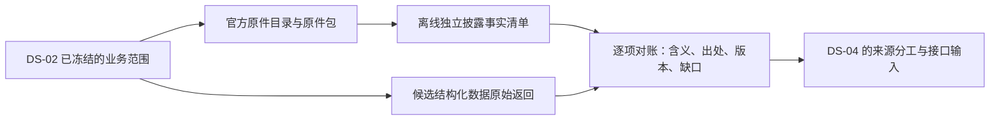

# DS-03：原件目录、候选来源、获取与验收方案（讨论稿 v0.1）

日期：2026-10-12。前置：[DS-02 冻结契约 v1.0](2026-10-12-ds02-financial-coverage-contract.v1.zh-CN.md)、[DS-01 来源调研](2026-10-12-data-sources-selection.zh-CN.md)。

**状态：方案已整理，待用户确认；原件包获取、供应商试用和稳定性观察均未执行，开发继续暂停。** 本轮仅查阅官方文档、核对本地入口并更新方案/TODO/交接。候选入口不是已取得原件，供应商文档不是实测，独立审阅意见不是验收结果。没有注册、采购、联系供应商、数据 API 获取、安装 SDK、模型调用或提交代码。

## 1. 当前要解决的问题

先回答：在已冻结的范围内，原件能否取得完整、哪些财务事实可直接从专业源取得、哪些仍需自行处理，以及证据和版本能否核对。DS-03 交付来源证据与缺口清单，供 DS-04 决定实现边界；SQL/Agent 能力在后续验收。

具体例子：取得 Microsoft FY2025 年报、Q3 和 FY2024 年报及财务补充披露；独立列出现金资本投入、非现金资产新增、租赁偿付等原披露事实，再对照供应商是否分别提供数值、含义、期间、单位和精确出处。不能因为供应商只有一个 Capex 字段，就把其他披露从完整性分母中删除。这是验证设计，尚未产生本批次答案。

图中 DS-03 获取/核验步骤均为拟议；本轮只交付方案。

## 2. 原件目录：先 P0 小包，再 P1 历史

沿用截止日 `2026-10-12T00:00:00Z`（北京时间 2026-10-12 08:00），US GAAP 非金融、10-K/10-Q 体系。报告内所有比较列、附注中的更早期间和未来到期桶完整保留。下表日期为待按原件核验的材料定位，不替代 accession、文件清单和原件 hash。

### P0：三家各三个基础报告，共九份；附件和版本另计

| 公司 / CIK | FY2025 10-K 报告期末 | FY2025 Q3 10-Q 报告期末 | FY2024 10-K 报告期末 | 重点检查 |
|---|---|---|---|---|
| Microsoft / 789019 | 2025-06-30 | 2025-03-31 | 2024-06-30 | 非自然年、分部 recast、现金与非现金资本投入 |
| Alphabet / 1652044 | 2025-12-31 | 2025-09-30 | 2024-12-31 | 股类、分部、公司特有财务口径 |
| Costco / 909832 | 2025-08-31 | 2025-05-11 | 2024-09-01 | 52/53 周、非等长季度、存货与租赁 |

已定位的官方候选入口，实际包仍待获取：

- Microsoft：[FY2025 年报](https://www.microsoft.com/investor/reports/ar25/index.html)、[Q3 10-Q](https://www.sec.gov/Archives/edgar/data/789019/000095017025061046/msft-20250331.htm)、[FY2024 年报入口](https://www.microsoft.com/investor/reports/ar24/)。年报的 SEC 申报索引/精确文件另核验。
- Alphabet：[FY2025 10-K 索引](https://www.sec.gov/Archives/edgar/data/1652044/000165204426000018/0001652044-26-000018-index.html)、[Q3 10-Q 索引](https://www.sec.gov/Archives/edgar/data/1652044/000165204425000091/0001652044-25-000091-index.htm)；FY2024 精确申报和 IR 对照件从官方目录补齐。
- Costco：[FY2025 10-K](https://www.sec.gov/Archives/edgar/data/909832/000090983225000101/cost-20250831.htm)、[Q3 10-Q](https://www.sec.gov/Archives/edgar/data/909832/000090983225000033/cost-20250511.htm)、[历年年报入口](https://investor.costco.com/financials/annual-reports-and-proxy-statements/default.aspx)。

每家公司还必须列下列关联材料；不以九份主文件当成完整包：

| 材料类别 | 纳入/获取规则 | 目录检查 |
|---|---|---|
| 定期报告原件及结构化附件 | 主 HTML/iXBRL、适用的 XBRL instance/context/unit、taxonomy/schema/linkbase；报告内全部财务表和附注 | EDGAR 索引逐文件登记；其他附件也登记，按内容说明纳入/排除理由 |
| 相应年度与 Q3 业绩包 | 8-K、业绩发布和财务表、官方演示材料、文字版 prepared remarks、non-GAAP 调节/指引及定义 | SEC 与官方 IR 互查；同内容不同载体保留来源关系，不重复计事实 |
| 必要引用与专有 annual report 财务内容 | 引用的前序定义/财务资料、独有财务附件、影响事实理解的版本说明 | 引用依赖追取；无法取得明确缺口，不能只保存跳转链接 |
| 修订与 recast | 相关 /A、财务更新、Microsoft FY2024 原报 + 2024-12-03 recast 8-K/Exhibit 99.1 | 原列报和后续列报分开；依据公开时间冻结前/后两个 cutoff |
| 真实错误更正版本对 | 先核查三家范围内是否存在；没有则提出仅用于版本验收的非金融案例，明确公司/文件范围后再纳入 | Microsoft recast 不是错误更正。无真实原件时保持未验，不用合成样例关闭 |

[Microsoft recast 8-K](https://www.sec.gov/Archives/edgar/data/789019/000095017024132722/msft-20241203.htm)仅作版本入口。具体附件、披露时间和两次 cutoff 待原件核验，不能把收录时间当公开时间。

### P1：补全三家五年/二十季的历史目录与原件

按每家公司真实财年日历分别列最近五个已完成财年和二十个已结束财季。二十季不等于二十份 10-Q；FY/Q1/Q2/Q3、单季/YTD、派生 Q4 分开。已结束但截至 cutoff 未公开的期间标待披露，不向前替换。

从目标窗口最早期间起点至 cutoff 检查全部 8-K，再按财务内容筛选；检查约定的官方 IR 财务类别和必要前序引用。不是 Item 白名单，也不是仅按网页路径是否包含 blog 筛选。已纳入报告内的全部附注定量披露不受核心历史窗口再次过滤。

P1 的文件目录和取得情况可以先完成；全量事实清单未审完的报告保持“事实覆盖待验”。P0 成功不代替 P1 完整通过。公司组不修改产品公司列表。

### 每份原件应记录的目录信息

| 类别 | 必备记录 |
|---|---|
| 身份与范围 | 稳定文档 ID、发行人/CIK、报告实体、form/accession、报告期、时点/期间、实际财历 |
| 来源与时间 | 官方 URL、实际取得 URL、SEC accepted/filing、可核验公开时间及其时区/精度、fetched_at；时间未知明确留空及原因 |
| 原件完整性 | 原始字节、SHA-256、类型/大小、索引关系、父文档、附件/引用、纳入/排除依据 |
| 版本与状态 | filed/furnished、original/amended/recast/error-correction 及证据、替代/关联关系；取得失败/待披露/不适用分别记录 |
| 独立核验 | 文件取得、目录核验、事实清单、供应商覆盖、语义核对各自状态，不共用一个“成功”标记 |

原始字节不经清洗再算原件 hash；IR 镜像和 SEC 原件分别保存，关联重复事实。哈希仅证明保存的字节身份，不单独证明正确或完整。

## 3. 候选来源：每类验证什么

优先次序以质量/可追溯能力为主，受真实权限约束；以下没有采购决定，也没有供应商实测结果。

| 来源 | 定位与专业性 | 获取方式 | 费用/权限与稳定性边界 | 本批次要验证 |
|---|---|---|---|---|
| SEC EDGAR | 一手披露与版本基准；CompanyFacts 是部分结构化事实入口 | Submissions/历史分页 + EDGAR 索引；原申报/附件；CompanyFacts JSON | 免费、无 Key，须声明请求身份并遵守公平访问；官方存在接口不等于本批次稳定通过 | 目录完整、原件可取、版本/时间、结构化事实实际覆盖 |
| 公司官方 IR | 一手业绩包、财务补充及专有年报内容 | 官方页面、HTML/PDF/下载附件、发布归档；与 SEC 互查 | 公开页面通常可读；页面/托管站可能变化，许可与自动获取限制逐站核查 | SEC 没有的材料、财务定义/调节、必要引用、原件与版本可重取 |
| Daloopa | 二手专业整理，公司专有财务系列/附注明细优先候选 | API v3 JSON、批量 CSV/Excel；API Key 认证 | 商业询价、按授权/用量；免费 Data Sheets 不代表免费 API；权限未核验 | 公司特有事实、精确原文引用、区间/条件、original/restated 与系列标识变化 |
| S&P Capital IQ Financials | 二手专业标准化 + as-reported、分部/附注明细、PIT 候选 | 已授权 API/数据交付/桌面导出，实际套餐确认后选入口 | 询价、产品/接口/存储使用权限待确认；不把 Compustat 当同一产品 | 全行原披露与标准映射、原币/维度、PIT 时间语义、逐值出处 |
| FactSet Fundamentals / Report Builder | 二手专业财务、分部、PIT；报告构建为另一个产品/权限 | 对应已授权 API 或导出；固定端点版本/参数 | 商业授权；两个产品权限分别核验 | 标准化与原披露覆盖、版本/PIT、报告币种与原件出处 |
| FMP | 二手基础财务获取对照，不能预设全部附注覆盖 | 授权套餐可用的 REST JSON/CSV 或报告导出；固定 endpoint/版本 | 订阅 + Key；季度历史、批量、展示/再分发按套餐核验；本轮不报价为固定成本 | 三表全行/历史深度、as-reported、季度含义、修订与证据限制 |

依据：[SEC API](https://www.sec.gov/search-filings/edgar-application-programming-interfaces)、[开发者资源](https://www.sec.gov/about/developer-resources)、[Daloopa API 说明](https://docs.daloopa.com/docs/api-vs-mcp)、[版本规则](https://docs.daloopa.com/docs/fundamental-uniqueness-restatements)、[S&P 官方产品](https://www.spglobal.com/market-intelligence/en/solutions/products/fundamental-data)、[FactSet Fundamentals 官方 SDK 文档](https://github.com/factset/enterprise-sdk/blob/main/code/python/FactSetFundamentals/v2/README.md)、[Report Builder 文档](https://github.com/factset/enterprise-sdk/blob/main/code/python/FactSetFundamentalsReportBuilder/v1/README.md)、[FMP 文档](https://site.financialmodelingprep.com/documentation)与[套餐](https://site.financialmodelingprep.com/pricing-plans)。价格/权限须以执行时账户和正式报价为准。

建议专业试验顺序：先核查合法既有权限；权限相当时优先 Daloopa 的公司专有系列/引用，再选 S&P 或 FactSet 对照标准化与 PIT，FMP 作基础财务补充对照。无需为了排名把所有供应商买一遍。没有权限的列“未测”，免费原件工作可独立推进；专业来源选择仍保持未完成，不能因此默认全部自建解析。

三个必须显式处理的风险：

1. SEC CompanyFacts 聚合非自定义 taxonomy、整申报实体事实，不能凭其返回宣称分部、自定义标签和全部附注齐全。
2. Daloopa 文档描述原披露/重列两类记录以及可能变化的 fundamental ID；不据此推定任意历史 cutoff 的全部中间版本都可还原。保存每轮原始返回与标识，不自动将最大 ID 作为原披露真值。
3. FactSet Report Builder 文档默认 `RESTATED`、`LOCAL`（证券定价币种）；原披露测试须显式选相应报告状态和 `RPT` 等报告币种参数。公开披露 PIT 与供应商首次实际可用时间 PIT 分开，供应商不能证明的时间不补造。

FRED/BLS/美联储为宏观扩展；行情、共识、产品/博客、雪盈账户也不在 DS-03 财务主包验收中，继续保留 DS-01 的扩展选项。

## 4. 获取后怎么处理：仅取证与核验，不开发

用户确认本方案后，建议先启动 P0，P1 接在 P0 检查后；持续观察单独记录。下列动作仍待授权执行：

| 顺序 | 动作与输出 | 边界 |
|---|---|---|
| 1 | 用 SEC Submissions（含历史分页）/申报索引和 IR 归档交叉列文件，冻结 P0 精确 accession/附件/引用/版本目录 | 尚未取得先标候选；无材料时不填 hash/假装已冻结原件 |
| 2 | 既有只读 HTTP 工具或人工下载取得原件，保存原始字节和请求/响应记录，检查文件真实类型、完整性、关联依赖 | 不写新获取器/解析器；现有 `prepare_m0_source.py` 是无网络导入工具，不当作 SEC 下载入口 |
| 3 | 独立精读 P0 全部财务主表、附注和所选财务补充，建立全量披露事实与上下文清单；事实/原表精确锚点与单位/维度/条件分开记 | 清单是离线验收依据；不是替生产 Agent 选章节、填数值或准备答案包 |
| 4 | 有明确权限的专业源按同公司/报告/期间/版本取得原始返回、参数、用量；逐项对照原件，记录覆盖与冲突 | 使用现有只读入口/导出，不写适配器；套餐不支持或费用不明的请求不执行 |
| 5 | 封存目录、原件 hash、来源比较、缺口、重取记录；再按 P1 同规则补历史目录/原件，逐报告标明事实审阅进度 | 不能把 P1 文件已取写成全部事实已验；任何新案例先明确范围 |
| 6 | 运行另包的稳定性观察，输出未观察/失败/恢复，提出 DS-04 数据取得、补缺、存储和 SQL 的责任划分 | 不启动生产入库、SQL、模型或 Agent；工具缺失记录未实施 |

获取配置建议：SEC 全部执行实例合计最高 2 请求/秒，低于官方合计 10 请求/秒限制；沿用已提供的真实联系身份，执行时核对本机私密配置，不再询问同一个邮箱、不将其写入公开方案。其他源按授权限额。依据：[SEC 请求身份与访问说明](https://www.sec.gov/about/webmaster-frequently-asked-questions)。

每个逻辑请求最多一次临时网络重试，限连接/超时/断流、429、临时服务错误；遵守 Retry-After，若等待超过已冻运行窗口则留待下一检查。权限错误、内容缺失、非法格式不当临时网络错误反复重试。保存每次失败、部分字节和实际费用；不能拼接不同请求残稿为一份原件。

原件、供应商原始返回、离线验收清单分别保存。任何清洗、标准化、OCR、表格解析、结构化入库、SQL 服务、新 SDK 接入和 Agent 工具均留 DS-04。本阶段只能通过现有只读工具/人工核对给出覆盖证据，不将“未来能解析”算已覆盖。

## 5. 验收：分母、重复次数与稳定性建议

以下为待确认的方案参数，正式执行前版本化封存。目录先冻结预期文档 ID；取得后绑定原件 hash；独立事实清单/问题/参考答案审阅后，在对应对账或后续真实评测前冻结。没有原件时不制造答案。

### 5.1 静态原件与结构化数据重取

- P0 每份纳入原件建议 **三轮独立远程请求**，保留时间、URL、状态码、实际字节/hash、缓存与失败/恢复记录；复制本地文件不算重取。P1 新增历史文件先取得一次，P0 重复文件不反复计数。
- 结构化源同一固定请求范围建议 **三轮独立获取**，仅限明确包含的权限/用量；没有权限或未知增量费用则未测，不为凑次数消费。记录数据版本与返回差异，不要求动态接口字节完全相同。
- 静态原件字节变化先封存两版并查原因；导航/动态 IR 页面更新本身不是事实错误。三轮都能取得也只证明这三个时点，不证明长期可用。

### 5.2 稳定获取观察：另包、另 cutoff

建议在批准后连续观察 **十个美股交易日**；冻结对应交易所日历、起止日期和每个来源的检查时段，窗口内周末也保留检查槽位。初始建议每天北京时间 **09:00、21:00** 各检查一次。用已有工具/人工检查；不能在没有实际记录时追认为连续监测。

这不是更新 DS-02 cutoff。观察窗口中的新披露/接口变动只进入稳定性记录，不混入冻结历史包或其参考答案。

| 观察项 | 拟议研究用途标准 | 不能据此宣称 |
|---|---|---|
| 检查槽位 | 全部计划槽位都有成功/失败/未执行记录；未执行必须披露 | 日志存在等于来源正常 |
| 固定历史文件 | 各槽位重取指定代表文件，记录首次成功率及有界恢复；出现失败时最迟首次失败后 24 小时恢复才通过该项 | “重试后都成功”即无失败；代表文件等于全部文档可用 |
| 新财务披露 | 从独立可核验官方公开时刻到发现/完整取得，目标 ≤24 小时；发现延迟和下载延迟分别报告 | 交易级实时性或供应商 SLA；没有事件也算低延迟通过 |
| 修订/重列 | 观察到则保存原/新版本和首次可用时间；另用真实历史版本对核验还原能力 | 历史版本核验等于实时修订捕获，或两类版本等于任意 PIT |
| 异常 | 自然失败/恢复和人工工程故障分开；本轮不新开发故障注入 | 未观察故障等于故障恢复已验 |

无新披露、无自然修订/故障时，相应项标“未观察”，不将十天窗口写成长期稳定。逐源列观察样本量和首成功/恢复/未执行分母；未执行槽位不从分母删除。若不能维持既定时段，修改后续观察版本并保留旧缺口。

### 5.3 内容与追溯验收

| 检查 | 通过条件 | 不通过/未完成如何处理 |
|---|---|---|
| 文件包 | 全部冻结应取文档、财务附件/引用均取得并可打开，hash/身份/时间/关系核验；待披露和不适用有依据并单列 | 获取失败是文件缺口；P0 文件通过不称五年完成 |
| 事实分母 | 独立原件全量清单覆盖主表全部行/比较列、OCI/权益、分部、全部附注表格和正文定量事实、所选补充披露及必要条件 | 未审阅事实不能按供应商字段数替代；P1 未审报告保留待验 |
| 逐项含义 | 所采纳的每条事实数值、单位/币种、期间/时点、实体/维度、限定条件及状态与原件一致；报表精度/四舍五入可解释 | 缺失、未映射、错误、冲突单列；其他项得分不抵消必需缺口 |
| 精确出处 | 每条采纳事实能定位原件表行/列或正文精确片段，上下文可展开；供应商自身引用能力单独评价 | 仅 filing 链接不是逐值引用；人工补出处不冒充供应商能力 |
| 版本/PIT | 原披露、recast、真正错误更正分别核验；历史 cutoff 无未来信息，供应商可用时间与官方公开时间分别有证据 | 中间版本未知则能力受限；没有真错误更正样例就保持未验 |
| 期间与派生 | 单季/YTD、时点、周数、报告币种明确；不得将 EPS/加权股数/比率做 FY−9M | DS-03 核对源语义，不称派生 SQL 已实现；计算公式执行前另冻 |
| 来源采用 | 每类事实分别列直接可取/需自行处理/未知，注明许可、费用、追溯和版本缺口 | 供应商可部分采用，不能因“三表齐全”认定完整主源 |

实际未披露与获取/处理缺口严格分开。财务补充的 actual/guidance/pro forma/estimate 各自标记；缺少公司未披露的 non-GAAP 调节保留限制，不发明调节。被收购主体与发行人合并范围不能混用。F09 解释按证据关联，不要求变为标量；F10 公式/生产查询在 DS-04/DS-05 验收。

离线问题主题拟覆盖：完整主表与附注覆盖、现金流与利润差异、资本投入/债务到期和条件、分部 recast、non-GAAP 调节与指引、Costco 期间/股数/EPS 边界。实际题目和原件答案在取得并精读后、对应评测前冻结；不向生产 Agent 传参考答案、必需块清单、人工选章或评测批评。Costco 保留独立迁移位置，若失败后修规则，修后标回归而非独立首次通过。

## 6. 可查看交付物、协作与完成边界

建议交付一个有摘要入口的验证包，包含：P0/P1 文档目录与原件 hash；原始文件及来源返回；独立事实覆盖清单；逐来源覆盖/语义/出处/版本/费用对照；三轮重取与十日观察；缺口和 DS-04 责任边界。包尚未创建，具体存放位置与权限在执行前确定；供应商响应、凭证/身份和受限内容留本机私密区，公开交接只写可公开摘要和包身份。

协作建议仍是阶段分工：原件目录/获取与供应商权限核查可独立并行；统一身份/期间/版本规则后才能对账。Codex 独立精读原件并维护验收分母；任何供应商自称覆盖或模型自审不替代原件核验。专业来源筛选需要同一冻结材料/请求范围；离线 gold 与生产运行上下文隔离。实现分工等 DS-03 证据齐备后在 DS-04 讨论。

| 子项 | 本阶段完成条件 | 当前 |
|---|---|---|
| DS-03-P0 | 九份报告及关联财务包取得、独立事实清单/版本对照、可访问来源对账与重取记录 | 方案待确认；未执行 |
| DS-03-P1 | 三家五年/二十季及约定财务补充的目录/原件；逐报告全量事实审阅进度和覆盖对账 | 未执行；P0 小包不代替此项 |
| DS-03-S | 十交易日真实观察、延迟/失败/恢复/未观察记录 | 未开始；真实错误更正也未验 |
| DS-03 总体 | 明确哪些原件/事实已覆盖、哪些需补缺、哪些来源可采用及许可/成本；必需未验项保留，足以提出 DS-04 边界 | 未完成；部分来源/阶段通过单独交付，不勾完总体 |

## 7. 提交用户确认的执行建议

1. **次序与范围**：按 DS-02 的 P0 九份报告＋关联财务包/版本对先做，随后补 P1 五年/二十季。不删全部附注目标；真实错误更正案例无现成来源时先提出具体范围再纳入。
2. **来源与权限**：SEC/IR 为原件基准；专业源按既有合法权限试验，权限相当优先 Daloopa → S&P 或 FactSet → FMP。初始只用免费公开源和明确无新增收费的已有权限；不注册/采购/联系供应商。若均无专业权限，该部分保持未测，再讨论可审阅的试用/采购方案。
3. **验证参数**：P0 三轮远程重取，P1 新增文件一次取得；有权限的专业固定范围三轮；十交易日独立观察、每日两次、研究用途取得/恢复目标 24 小时。首次与恢复结果分开，历史 cutoff 不变，缺口不抵消。

批准后先封存执行方案/来源权限/观察起止时间与资源规则，再取得材料；原件 hash 和事实/问题清单在有真实材料后分别冻结。采购/接口未知费用不从旧模型预算中默认支出；逐源记请求/流量/计费单位/实际增量费用及人工耗时，未知明确保留。本阶段建议零模型调用，不自动启动开发或真实 Agent 评测。

**下一具体行动：用户确认 DS-03 方案后，冻结 P0 获取规则并核查既有专业来源权限，再按约定只读取得原件。** DS-04 实现、DS-05 SQL/Agent 整体验收未开始；E6/E7 与历史缺包队列继续暂置。
