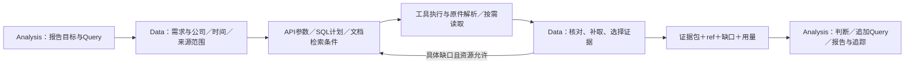

# Query 按需取材：技术路径与验证方案

2026-10-12 · DS-04 / Query取材方案 · v0.2 **讨论稿，未冻结、未开发、未实跑**。在v0.1的文档取材方案上扩展：从专业价值投资报告与持续追踪倒推，重点验证**公司 × 数据/材料 × 时间**下的解析、保存、获取与检索质量。先判断路径是否成立，查明已有能力的局限，不把候选方案先当结论。

**产品目标与职责**：Analysis Agent围绕研究目标提出和调整Query，解释证据、比较假设，形成报告并判断新信息如何影响原判断；Data Agent理解每个Query的信息需求，选择数据类型和允许来源，生成API参数、结构化查询计划或文档检索条件，补取、核对后返回数值/计算依据、必要原文、精确ref、冲突/缺口与用量。10-K解析结果是其中一种数据供给。确定性适配器/解析器/计算工具由Data Agent调用；无需模型重读JSON，不等于API取数不属于Data Agent。上述是目标架构，完整报告及追踪链路尚未验收。

**从一个报告判断开始（示意）**：“利润增长是否转化为现金流，差异是否可持续？”Analysis提出两期或多期利润/经营现金流、营运资金与非现金项目、管理层解释及反面证据等Query。Data取得结构化数值、调节表和解释片段，保留可比口径与ref；Analysis再判断解释是否成立、还需问什么。首轮只验证这个规模的报告片段，尚未选公司/冻结问题；拿到数据不单独证明报告专业性。

## 0. 先解决公司、材料和时间如何对齐

| 维度 | 解析与保存必须保留什么 | 检索/交付须避免的问题 |
|---|---|---|
| 公司/对象 | 稳定发行人ID；合并/分部/产品/地区层级；来源作者与陈述对象分开 | 名称或代码混淆；分部值当合并值；竞对或分析师陈述变成公司自述 |
| 数据/材料 | 来源类别、原件ID/URL/hash、章节/块/单元格/图片/问答关系；数值的指标、单位、维度与定义 | 相同数字误当同一事实；转载/重复披露相加；表头/脚注丢失；GAAP与非GAAP混用 |
| 时间/版本 | 事实时点或期间、报告覆盖期间及所载比较期、财年日历、实际/指引、公开时间、获取时间、原始/修订版本及关联 | 财季混成自然季；单季混累计；报告年份代替事实期间；获取时间代替公开时间；后续重列或未来材料污染历史判断 |

**建议保存三个互相关联的层次**：①不可变原件/版本及材料目录、获取/解析/覆盖状态；②保真文档块与结构化事实，保留原口径，标准映射另记规则和状态；③每个Query实际选用的证据包，以及报告判断→Query→证据/计算输入→原件版本关系。第三层只保存实际依赖，不先构建全公司知识图谱。检索索引是可重建的辅助层，摘要不替代原件。

一个原件版本可供多个Query复用；解析器升级产生新的解析版本和关联，不覆盖旧ref。事实合并须核对公司、指标、期间、单位、维度和披露版本，冲突保留；缓存复用也要核对范围、版本和新鲜度。文件夹用于组织，正确性依赖显式元数据与关系。旧字段能否承载这些约束需逐项核查，不能由文件数量或Schema存在推定完成。

## 1. 从问题倒推解析，而非先选工具

| 场景 Query（示意，不是已冻结试题） | 必须交付的内容 | 为什么这样解析才能支撑 Query |
|---|---|---|
| 收入同比多少？ | 两期数值、财年/财季、币种、口径和出处 | XBRL保留fact/context/unit/维度，表格保留行列和多级表头；已有数值走SQL，缺项读原表，不能猜期间或算术 |
| 增长为什么放缓？ | 解释、期间、条件；实际与指引分开 | 段落保留章节、前后关系和定位，不按固定字数切断条件。按需阅读时判断观点类型，不要求提前全文模型抽取 |
| 未来几年的租赁付款是多少？ | 年度桶、租赁类型、单位和脚注 | 保留单元格/合并表头、续表及注释关系；跨页/远处脚注关联未确认时留缺口，不能靠相邻位置猜 |
| 披露了哪些产品/业务构成？ | 定义、完整相关列表、层级和例外 | 保留列表层级及引导句，区分产品/分部/收入分类；全列举读全列表，单项取该项和必要定义 |
| 电话会、Blog或竞对如何解释同一变化？ | 各自陈述、作者/说话者、对象、日期和分歧 | 保留问答关联、来源身份与版本；竞对观点不改成目标公司自述，转载关联原件但不混同 |
| 有没有披露某项信息？ | 正面出处，或检查范围及未覆盖项 | 保留材料目录与阅读/解析状态；检索未命中不证明未披露，检查不完整则“未找到/待核验” |

统一保留 `原件/版本/hash → 章节 → 原始块 → 单元格/图片/说话轮次`。**预览只定位，原始块不可改写，交付单元按Query组装必要原文和上下文**。图片保留资产/图注/页面关系，必要且没有文本替代时识读；解析错误不当成“没有披露”。

## 2. 定位、补读和停止（建议流程）

此图为建议职责及执行路径，包含尚未实现或验收的能力。Analysis提供目标、Query及业务范围，不预写答案、检索词或答案块；Data完成数据需求到具体获取动作的转换。关键范围不明确时澄清，不默认替换公司/期间。

1. **选路与定位**：先筛公司/来源/截止日/版本，再按事实期间及材料可能覆盖的期间定位。下一年度报告可能含所查年度的比较数据，不能要求报告年份等于事实期间；覆盖未知不能直接当不相关。结构化路径生成接口Schema允许的请求参数或受约束查询计划，工具校验、分页、执行并保存原始返回；文档路径生成原文语言检索词、同义表达和子问题。混合Query分别取数值与解释并对齐口径。目录与全文检索互补，小批返回ID/标题/预览；BM25及[SQLite FTS5](https://www.sqlite.org/fts5.html#the_bm25_function)为候选，未选定。覆盖不同解释，避免只搜支持预设结论的词。
2. **补读**：新读取对应一个缺口或冲突；补定义、期间、单位、列表续项、表头/脚注或完整问答，必要时查同范围其他章节/材料。分页正文须实际送到模型；未知关联先核对，预览和磁盘保存不算已读。
3. **精简**：等价出处优选充分且紧凑者；修订/冲突保留。探索原文存档，运行输入只保留问题、需求/缺口、证据指针和本轮必需正文，按需重读；最终投影选中证据，摘要不替代原文。
4. **停止**：需求都有支持、条件完整且冲突状态明确时，提出交付，仍须独立验收。连续三次无新位置/证据/有效缺口推进，或达到事前冻结的步数/时间/token/费用上限则返回部分结果及原因；无进展不等于充分，超预算不截掉必需条件。

**追踪是同一路径的后续应用**：按报告关注项检查来源更新；区别新报告、新事实、旧期间重列、解释/指引变化、无变化和获取失败。Data返回变化、版本与影响到的已有证据依赖；Analysis判断是否改变结论。历史报告保留当时可知范围，新版本另存。此闭环尚待设计核查与实测，不恢复旧watch任务或自动安排运行。

## 3. 当前路径、局限与改路径的判据（本轮重点）

已核对现有`analysis_evidence`链路：模型需求/决策→本地结构化查询或目录/字面搜索/读取→已读及同范围校验→显式选记录/块交付；每次模型决策接收状态快照。已有只读DuckDB/注册计算、原件/hash、表格网格、阅读上下文组、受限电话会适配、有限图片读取及运行护栏可复用。还存在有准备配置时的SEC定期申报获取/物化回调，以及消费经审阅Data交接的受限Analysis入口。以下不把有限接口推定为完整多源/报告能力：

| 已观察的机制/局限 | 路径风险与下一项判别检查（未执行） |
|---|---|
| 本地结构化查询与受限SEC获取已有；专业源未实测 | 不能推定任意API请求生成或多类型源路由已完成；用“纯取数/纯原文/混合/无权限或缺项”检查选路、参数、分页、口径与缺口 |
| 已有范围/截止日/快照约束及原件定位 | 多公司、不同财年、跨材料重复与修订仍须组合检查；保持同Query，只改变公司/期间/版本/截止日，验证范围与证据随之正确变化 |
| SEC目录为Part/Item；search按字面短语、来源顺序 | 隐含表达、跨语种、无明显标题可能漏定位；同原件对照现有导航与“全文排序＋查询改写”。持续语义漏检才评估其他检索方法，包括向量 |
| `read`扩展完整列表/表格/问答；整组可能很大 | 找对内容仍低信噪比；检查目标行/段是否能连同必要条件安全投影。投影未验前保留整组、报告限制，不静默裁表 |
| 附近脚注关联有限；PDF入口仅坐标文本，电话会规则受限 | 解析遗漏/错关联会令后续检索无解；先对照原件定位最早偏差。PDF复杂页再小样考察Docling等，不把解析问题归咎检索 |
| 有字节上限、近期正文重呈现和单次调用usage | 无向量也可能因多轮导航、重复正文更耗时/耗token；测Query级峰值/累计输入，决定状态与读取策略；“轻”尚未由效果实测证明 |
| `select_evidence`检查范围/已读；completion标`semantic_completeness=not_evaluated` | 机械通过可能仍遗漏或多选；独立按原件核验每项信息。充分性不能由自审或引用存在证明 |
| 受限Analysis可引用handoff事实、返回待补请求；另有年报阅读实验 | 尚不证明自主多Query、专业报告或持续追踪闭环；核查真实数据交接后，分析能否使用证据、发现缺口、补问并修正原判断 |

**诊断顺序**：从报告需要支持的判断倒推信息需求，再沿“范围/来源→获取→解析/保存→定位→补读/交付→分析使用”找最早偏差。材料没取得、解析丢脚注、版本选错、候选漏检、交付遗漏和分析推断过度分别归责。某个Query已充分而报告仍差，检查分析/问题规划；原件包含但解析丢失，修解析层。基线与候选用同原件/问题/模型；先诊断路径，不提前采购、安装全部工具或承诺某路线更优。

## 4. 验收：先充分，再精简

建议先以一个报告判断串联多类型Query，再用六类问题检查文档细节。材料规模逐步扩为同公司多期→同公司混合材料/修订→多公司不同财年；每步另列新增干扰，不一次铺满全部组合。后续执行前冻结报告片段的目标/必需判断、原件、数据问题/允许的等价补问、必需事实/上下文、可选与冗余标准、等价出处、重复次数及报告级/Query级资源上限；gold不传Agent。本轮未构建或执行该包，报告标准尚未冻结。

分别设计两种增长：**必需信息不变、增加其他公司/年份/重复材料**，看是否抗干扰且避免随全文增长加载上下文；**问题范围扩大、增加必需信息**，看是否充分覆盖并按实际需要增加读取。前者不能用更多无关正文维持通过，后者不能为固定token目标删掉必要证据。全部组合按风险逐步选代表边界，不直接穷举。

| 维度 | 验收方式 |
|---|---|
| 解析与保存 | 原件对照：公司/期间/单位/维度、表头/脚注/续表/问答及版本准确；旧ref可复现，重复取得不重复算，升级不覆盖历史。明确未解析和不支持项 |
| 公司×材料×时间下的选路与检索 | 检查必要信息及等价出处是否进入候选、是否实际读到；相同Query在不同公司/期间/截止日返回正确范围。混入其他公司、重复材料、后续重列与未来材料，错误混用为零；不靠人工选答案块 |
| 信息充分与真实性 | 必需事实及条件覆盖100%，公司/期间/单位/版本/出处无错；缺口如实报告，可选不抵遗漏，部分交付不算完整通过 |
| 信噪比 | 按原文范围独立标注；有效占比＝必需及必要上下文token/最终原文token，另报可选/无关/重复占比，必要条件不当噪声 |
| 上下文消耗 | 分别报最终证据、单次输入峰值、Query级及报告级全链累计输入token（含规划/预览/正文/重呈现/修订/审核），以及唯一原文token、调用数/耗时/费用。观察多Query复用与材料增长后的开销。以实际输入/usage计，估算标方法，缺失不记零 |
| 报告使用与追踪 | 独立检查片段的关键判断是否有充分依据，事实/管理层观点/分析假设分开，反证与未知不隐藏；ref能定位实际证据，计算可回放。新披露后能指出变化与受影响判断，历史截止日不泄漏后续信息。数据通过不抵分析失败；片段通过不等于整份专业报告验收 |
| 路径是否成立 | 先排解析/范围错误，逐题比较基线和候选的充分性、重复成功率、冗余与上下文；噪声阈值/token上限事前冻结，不因效果差事后放宽，不用平均成绩掩盖失败类型 |

**当前场景/停止点**：[业务契约v1.0](2026-10-12-profit-cashflow-contract.v1.zh-CN.md)、[目录v1](2026-10-12-profit-cashflow-source-directory.v1.zh-CN.md)和[原包](2026-10-12-profit-cashflow-originals-acceptance.v1.zh-CN.md)保持；[最小文本核验](2026-10-12-profit-cashflow-text-review.v1.zh-CN.md)已完成。本轮[Q01协议候选v1](2026-10-12-profit-cashflow-query01-contract.v1.zh-CN.md)明确微软三年截至T0的输入、9基础事实/14计算、条件/ref/缺口和业务验收；解释驱动/完整调节/可持续性是后续Query。只处理HTML正文/表格/脚注，不扩PPT/XLSX/图片；前文多格式属后续候选。最小开发材料已就绪，下一对照现有接口复用/缺口；本轮仅文档，无开发或实跑。运行模型/次数/资源/信噪比测量细则另冻；gold不得传执行Agent，DS-02与历史未完成项不变。

源码：[原文结构](../../src/uteki/domain/documents/models.py#L32) · [结构化查询](../../src/uteki/infrastructure/research_data/query_service.py#L55) · [受限获取](../../src/uteki/agents/data_query/coordinator.py#L646) · [搜索/读取](../../src/uteki/agents/reading/document_reader.py#L64) · [阅读关联](../../src/uteki/agents/reading/reading_groups.py#L138) · [电话会](../../src/uteki/infrastructure/document_sources/earnings.py#L17) · [选块](../../src/uteki/agents/data_query/selection_contract.py#L12) · [运行状态](../../src/uteki/agents/data_query/autonomous.py#L943) · [PDF](../../src/uteki/infrastructure/research_data/company_materialization.py#L108) · [审核](../../src/uteki/agents/data_query/question_coverage_review.py#L1) · [受限Analysis交接](../../src/uteki/agents/analysis/data_consumer.py#L16)。接口存在不证明场景已验收。
