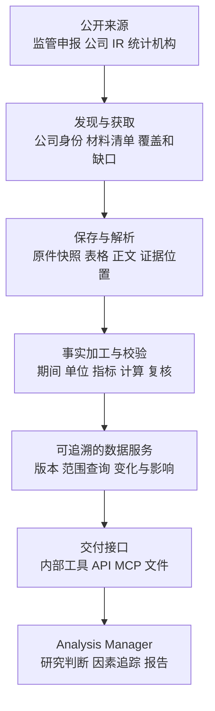

# Uteki 数据服务能力对照

本研究用于确定 Uteki 如何把公开材料加工成可靠的投研数据服务。对照对象是 Daloopa、Quartr、FRED 与 ALFRED、SEC EDGAR，以及公司投资者关系网站（IR）。这些对象处于不同层次，不能直接当作同类供应商排名。

结论是：公开披露材料的采集、结构化、规范化、检索和更新值得自主实现；同等服务质量需要通过准确性、覆盖、追溯、历史重现和故障恢复来验收。MCP 与 API 是服务出口，本身不能证明数据质量。Daloopa 官方也明确列出 MCP 工具到 REST API 的映射。[接口关系](https://docs.daloopa.com/docs/api-vs-mcp)

核对日期：2026 年 10 月 4 日。本轮进行了公开文档研究和当前代码静态核对，没有调用付费数据账号、运行真实模型评测或修改产品代码。下文分别标明公开事实、工程建议和本地现状；供应商内部未公开的算法保持未知。

## 对照对象各自解决什么

| 对象 | 已公开的职责 | Uteki 值得学习的部分 |
| --- | --- | --- |
| SEC EDGAR | 提供原始申报、申报历史和部分 XBRL 财务事实 | 发行人身份、申报版本、文档发现、财务标记的适用范围。[API 文档](https://www.sec.gov/search-filings/edgar-application-programming-interfaces) |
| 公司 IR | 公司发布财报、演示材料、管理层说明及部分电话会原文与录音 | 一次事件的多种原件、披露时间、管理层陈述与事实的区分。[Alphabet 电话会实例](https://abc.xyz/investor/events/event-details/2025/2025-Q3-Earnings-Call-2025-4OI4Bac_Q9/default.aspx) |
| Daloopa | 将披露内容加工成指标序列、财务数据表及可追溯数据 | 单位与期间、原始指标与标准指标、计算链、复核与纠错。[数据表](https://docs.daloopa.com/docs/data-sheets) |
| Quartr | 将公司事件与文档、音频、文字稿关联，并持续补充和修订 | 公司—事件—材料结构、不同材料独立更新、文字稿版本。[数据模型](https://quartr.com/docs/data-overview) |
| FRED 与 ALFRED | 组织经济时间序列，并提供历史时点的数据版本查询 | 观测期间与当时可知版本的区分、单位、频率和数据修订。[历史时点](https://fred.stlouisfed.org/docs/api/fred/realtime_period.html) |
| Claude 金融工作流 | 调用数据工具，结合分析方法和计算工具生成模型、点评及报告 | 数据服务与分析任务的接口，以及结果引用和复核要求。[财报更新参考流程](https://github.com/anthropics/financial-services/blob/574ed3624aebd0418c7e96cd101262f30210ab26/plugins/agent-plugins/earnings-reviewer/agents/earnings-reviewer.md) |

公开原料存在很大交集，但不代表所有信息都能从原料中恢复。没有公开的券商预测、专有研究和授权实时行情，不能通过重新整理公开财报生成等价事实。覆盖更多地区、及时取得材料、校正转写和长期维护口径，也会形成持续成本。

## 已经能看清的处理机制

### 财务事实的加工

Daloopa 同时保留披露口径和用于分析的处理结果。累计数据与单季度数据不同，财务季度、自然季度和期末日期也不同。季度推导和单位缩放是两种处理，不能混为一次“清洗”。[季度与单位](https://docs.daloopa.com/docs/understanding-units-quarterization)

同一事实可能先有自动提取记录，再出现人工创建或复核记录，因此记录 ID 会变化；公司后续重述又是另一条维度。原始披露和重述不应被当作重复数据丢弃。其当前记录选择规则不等于完整的历史快照服务。[记录与重述](https://docs.daloopa.com/docs/fundamental-uniqueness-restatements)

**工程建议：** Uteki 保留原文中的指标名称、数值、期间和单位；另存规范化结果、转换公式、输入证据及处理版本。区分公司重述、我们提取错误的纠正、以及指标分类调整。

### 事件与材料的加工

Quartr 的公司、事件和内容分别建模。财报事件可以先存在，报告、音频和文字稿随后到齐。会后文字稿先发布 raw 版，再补带姓名、职务和所属公司的 edited 版；无法核实说话人时允许留空。该文字稿接口公开的范围仍限英语。[事件](https://quartr.com/docs/datasets/events) · [文字稿结构](https://quartr.com/docs/datasets/earnings-call-transcripts)

直播协议还表示时间位置、置信度、无法听清的内容、中断和结束，而不是只返回不断增长的一段文本。[直播协议](https://quartr.com/docs/datasets/live-earnings-call-transcripts)

**工程建议：** 第一阶段先做好会后的事件材料包，再扩展直播。报告必须引用一个固定材料版本。Quartr 的 MCP 阅读工具会自动选择事件的最佳现有文字稿，即使传入旧文档 ID，也未必返回该历史稿；这个行为适合最新研究，却不能直接满足我们的旧报告重现目标。[MCP 阅读规则](https://mcp.quartr.com/docs#read_transcript)

### 更新与恢复

Quartr 的文档变化不一定改变所属事件的更新时间，增量同步需要逐种资源记录进度；通知不保证顺序，并建议用周期性查询补漏。[同步规则](https://quartr.com/docs/rest-api/fetching-data) · [通知行为](https://quartr.com/docs/webhooks/getting-started)

Daloopa 则公开区分新增数据、模型更新，以及数值、标签、序列归属的纠错。其文档新增通知目前为美国范围 Beta，失败不会自动重发，需要通过文档目录回补。[更新与纠错](https://docs.daloopa.com/docs/webhook)

**工程建议：** 通知负责提醒检查，数据目录负责确认完整性。重复通知不得产生重复记录；乱序通知不能覆盖较新版本；网络失败不能被解释为“没有变化”。

### 历史时点查询

FRED 数据接口区分观测日期与版本有效时间，并提供修订日期列表。ALFRED 的关键价值在于回答“当时能看到什么”，而不仅是今天对过去的最新估计。[数据返回](https://fred.stlouisfed.org/docs/api/fred/series_observations.html) · [修订日期](https://fred.stlouisfed.org/docs/api/fred/series_vintagedates.html)

**工程建议：** Uteki 分别记录材料所描述的期间、公开披露时间、系统取得时间和系统修订时间。历史研究可以选择“截止当时公开的信息”或“当时本系统已取得的信息”，两者不能混称。学习该机制不意味着复制 FRED 数据库；其 MCP 当前对缓存与归档有限制。[服务条款](https://fred.stlouisfed.org/legal/)

## 建议的 Uteki 服务结构

下面是我们的设计推导，不是供应商内部架构的复原。

Data Agent 可负责任务理解、来源发现和获取计划；确定性的归一化、计算、版本保存和约束检查由服务执行。分析 Manager 在已说明范围和缺口的数据上形成判断。

SQL 是查询已结构化数据的一种执行方式。材料发现、读取原文、时间戳定位和补抓任务不必强行变成 SQL。API 与 MCP 应调用同一套业务能力，并返回相同范围下的事实、证据和缺口。

## Uteki 当前具备什么

以下基于本轮读取的当前代码和已有运行归档。代码存在、历史运行通过、服务持续稳定，是三种不同证据；本轮没有重新执行这些运行。

| 能力 | 当前证据 | 距离可靠服务的缺口 |
| --- | --- | --- |
| 公司识别与材料获取 | 已有公司目录、身份校验、SEC 与显式配置的官方材料入口；AMD、TSMC 的最新归档分别获取了 4 份、3 份材料，并验证刷新复用。[获取验收](/Users/bytedance/Documents/ChatGPT/uteki/experiments/architecture_baseline/2026-10-04-prepare-chain-v1/README.md:28) | 公司需先登记；任意公司自动登记、长期运行和多进程限速仍未验收。 |
| 原件与解析 | 保存原件和 hash；HTML 形成正文块、表格和引用，PDF 文本保留页码与位置。[解析实现](/Users/bytedance/Documents/ChatGPT/uteki/src/uteki/infrastructure/research_data/company_materialization.py:85) | 图片内容、OCR、PDF 表格未验收；部分材料存在章节识别缺口。解析出表格节点不等于识别出完整财务报表。 |
| 财务事实加工 | 已有有限 US-GAAP 指标映射、直接提取协议及确定性规范化。[指标范围](/Users/bytedance/Documents/ChatGPT/uteki/src/uteki/infrastructure/research_data/company_materialization.py:52) · [规范化](/Users/bytedance/Documents/ChatGPT/uteki/src/uteki/infrastructure/research_data/direct_normalization.py:60) | 最新 AMD、TSMC 准备结果的财务候选记录均为 0；周制财年、IFRS、TWD 等仍有适配缺口。不能把获取验收当作提取验收。 |
| 查询与计算 | 冻结数据集校验、只读查询、公司/来源/截止时间范围，以及受控的利润率、同比等计算。[查询实现](/Users/bytedance/Documents/ChatGPT/uteki/src/uteki/infrastructure/research_data/query_service.py:33) · [计算契约](/Users/bytedance/Documents/ChatGPT/uteki/src/uteki/domain/research_data/query_contract.py:204) | 查询以单个数据集为边界；跨数据集路由和可比口径对齐尚未接通。字面正文搜索不等于完整的语义检索。 |
| 证据与复核 | 事实包含期间、单位、限定和证据；交付检查引用、缺口及复核状态。[交付检查](/Users/bytedance/Documents/ChatGPT/uteki/src/uteki/agents/data_query/answer_handoff.py:363) | 来源定位正确仍需核验数值含义；任务内复核不等于全库数据获得认证。 |
| 版本与更新 | prepare / refresh / reprocess 产生冻结数据集，可核验复用未变产物。[协调器](/Users/bytedance/Documents/ChatGPT/uteki/src/uteki/agents/data_query/coordinator.py:129) | 当前核查不能确认独立持续调度已上线；财务候选事实的采纳与报告采纳不能混为一件事。 |
| 运行稳定性 | 有真实查询、复核和交付归档，也保留失败证据。[提取运行记录](/Users/bytedance/Documents/ChatGPT/uteki/experiments/architecture_baseline/2026-10-04-amd-tsmc-annual-v1/README.md:11) | 最新年度提取 v2 在证据编号验证时被拒绝，尚未进入提取；v3 短引用协议仅通过离线检查。多公司重复运行的稳定性未完成验收。 |

因此，当前可以确认我们已经有取得材料、固定版本、限定范围和组织证据的基础。最应优先补齐的是：从实际原件持续产出经过独立核验的财务事实。新增一个 MCP 包装层不会解决这项缺口。

## 同等质量如何验收

以下是建议标准，尚未作为已通过的产品验收。

| 能力 | 可观察的验收例 |
| --- | --- |
| 覆盖 | 明确列出选定公司、期间应有的材料；缺少电话会就显示缺少，不用其他公司或其他季度代替。 |
| 事实准确 | 用独立人工核对集检查主体、指标、数值、币种、单位、期间、分部和限定条件；逐字段统计正确率与召回，不只检查 JSON 合法。 |
| 口径一致 | 季度与累计分开，GAAP 与 Non-GAAP 分开；不能可靠映射的指标保留原名和冲突。 |
| 证据有效 | 每个交付数字能回到具体原文位置；派生数字可展开公式及输入；摘要引用确实支持其含义。 |
| 历史可重现 | 新版本到达后，旧报告仍能打开当时引用；最新查询显示修订原因和受影响的记录。 |
| 更新可靠 | 重复、乱序、漏送、断网后恢复的最终数据与全量核对结果一致；缺口不被静默清除。 |
| 多公司适用 | 使用不同财年、会计准则、币种和文件形式的材料；保留未参与开发的公司案例。 |
| 服务可用 | 记录从公开披露到可查询的延迟、失败率、单份成本和人工复核用时；在测量基线后制定时效目标。 |

不预先宣称达到某个商业数据商的准确率或时效。先公开测试集范围、人工标注依据、错误类型和未覆盖情况，再讨论是否达到同等质量。试点中的串公司、错期间、伪造引用必须作为阻断问题；有限测试通过仍不等于全市场无错。

## 第一条完整实例

建议先用已取得原件的一家公司的一个历史财报事件，冻结公司、期间、材料清单及截止时间。示例中的公司只属于显式选定的验收输入，不能成为服务默认值。

1. **原料到达：** 财报公告先到，正式申报与电话会晚到；显示每类材料的状态。
2. **事实形成：** 提取实际收入、经营利润和关键分部指标，同时保留口径与引用。管理层指引独立标记，一致预期缺失就明确缺失。
3. **计算与复核：** 计算所需增长率或利润率，输出公式；遇到缺前期、期间不一致或单位冲突时不强行给数。
4. **修订发生：** 加入一个明确标注的合成纠错场景，验证新版本、旧报告引用和影响清单。不能把注入的事件描述为公司真实重述。
5. **重复验收：** 换另一家公司及不同期间，保持协议不变，检查是否依赖首家公司特例。

交付物应包含原件目录、可追溯事实表、计算结果、变化记录和缺口清单；最后再验证内部调用与 API/MCP 返回一致。第一轮无需复刻全球覆盖和实时转写。

## 推进顺序

1. **先完成事实质量样本。** 复用现有正式输入与独立对照，先使一份年度报告的合并主表形成可核对事实，再验证另一家公司。沿用当前运行范围、预算和执行授权；本研究不启动新模型调用。
2. **再完成财报事件包。** 在事实样本之上加入公告、正式申报、演示材料和会后文字稿；分别交付原件、便于阅读的精编材料及结构化事实，精编稿不能替代原件。
3. **补充变化与恢复。** 验证缺失材料补齐、提取纠错、公司重述、重复与乱序通知，确认旧报告可重现。之后再确定持续监控的时效目标。
4. **增加宏观查询和统一出口。** 借鉴 FRED 的序列、单位、频率及历史版本模型；内部工具、API、MCP 复用同一查询和证据能力。优先连接高质量原始序列，无需先建设全球宏观数据库。

全球公司覆盖、实时音频转写和大规模人工质检是后续扩展项。专有预测、独家研究等公开原件中不存在的内容，单列为外部数据需求，不用推断数值冒充来源事实。

## 本轮研究的边界

公开文档足以帮助我们定义外部行为和验收条件，但没有公开完整 OCR/ASR 模型、实体匹配算法、质检阈值、人工审核比例、数据库实现和实际错误分布。不能把以上服务流程描述成已还原其内部代码。

SEC 的 CompanyFacts 主要聚合标准 taxonomy、适用于整个申报主体的事实，不是全部自定义指标和分部数据的现成数据库。公司 IR 可以补充原件，但不保证各公司都有同样完整的电话会或结构化资料。[SEC 范围](https://www.sec.gov/search-filings/edgar-application-programming-interfaces)
