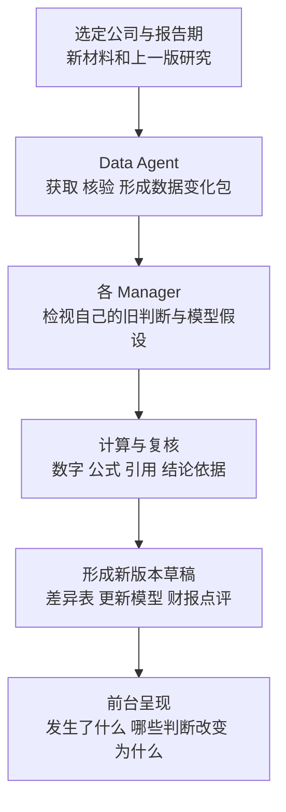

# Uteki 财报更新链路草案

2026 年 10 月 4 日。用于对齐财报更新的输入、职责和前台产物。以 Anthropic 的公开工作流为能力参照，进一步连接 Uteki 已有的公司、Manager、报告和关注点。本页是设计草案，没有接入数据供应商或执行真实研究。

用户已明确：暂停 Quartr 体验和供应商扩展调查，先推进财报更新，再看数据层；Daloopa 可作为接入选项，数据能力保留自主实现和其他来源。参考方法不等于当前 Uteki 已达到相同质量。

## 从一次更新看完整过程

Anthropic 的 Earnings Reviewer 以公司代码和报告期为入口，交付更新后的模型、财报点评草稿及差异表，过程中读取全文、检查模型、保留出处。这里借鉴的是工作流和产物要求，尚未运行其模板。[官方固定版本](https://github.com/anthropics/financial-services/blob/574ed3624aebd0418c7e96cd101262f30210ab26/plugins/agent-plugins/earnings-reviewer/agents/earnings-reviewer.md)

这里的模型指财务预测与估值模型。同一家公司可以把共同的事实包交给多个 Manager。各 Manager 的判断、模型假设和报告版本分别保存，不把他们的观点合并成公司的唯一结论。

## 每一步负责什么

| 阶段 | 需要什么 | 应交付什么 | 主要责任 |
| --- | --- | --- | --- |
| 确认范围 | 公司身份、财务期间、信息截止时间、来源范围；本次涉及的 Manager 与旧报告版本 | 本次材料清单与研究基线 | 任务协调；业务范围必须显式 |
| 获取和处理 | 财报公告、正式申报、电话会等；如接入 Daloopa，则读取其对应指标与引用 | 实际值、管理层指引、原文证据、版本、缺口 | Data Agent 与确定性数据服务 |
| 形成差异 | 可比较的上期/去年同期数据、旧模型预测；有授权来源时才包含一致预期 | 分别列示期间变化、实际与旧预测差异、指引变化、历史重述 | 数据层计算，Manager 确认比较口径 |
| 解释影响 | 差异包、全文、该 Manager 的投资逻辑与模型 | 哪条旧判断得到支持、被反驳、仍待验证；哪些假设需要修改及理由 | Analysis Manager |
| 计算和复核 | 拟修改的假设、公式、证据和原模型 | 可核对的变更与检查结果；未解决的问题 | 确定性计算检查与独立内容复核 |
| 形成版本 | 通过必要检查的本次产物 | 差异表、更新模型、财报点评草稿；可返回旧版 | 报告与模型归档；沿用明确的采纳流程 |

没有旧研究基线时，应进入首次覆盖分支。已有旧报告但缺少财务模型时，可以继续更新研究判断，同时标明模型部分未具备；不能伪造上一版判断或预测来制造变化。

## 数据层这次必须说清楚的内容

业务上先定义一份“财报数据变化包”，供现有能力组织交付；这不是要求新增一套通用框架或立即修改协议。

- **身份与时间：** 哪家公司、什么财务期间、何时披露、取得哪一版材料。
- **实际数字：** 数值、币种、单位、主体/分部、会计口径、原始位置。
- **各类预期：** 管理层指引、Manager 自己的预测、市场一致预期分别记录。缺哪类就标明缺口。
- **变化：** 新增事实、重述、数据纠错分开；差异计算保留两端证据和公式。
- **材料与限制：** 原件、便于阅读的精编稿、结构化事实分别交付；哪些材料和字段仍未取得明确列出。

Daloopa 的公开工具提供公司与指标发现、期间数据、文档检索和内容读取，可以成为取数入口。即使使用它，我们仍需固定本次范围、核对比较口径并把数据接到自己的研究基线上。本轮没有确认账号权限，也不假设某个 Daloopa 接口包办一致预期或所有公司 KPI。[Daloopa 工具与接口](https://docs.daloopa.com/docs/api-vs-mcp)

## Uteki 可以做得更深的部分

这里的深化是产品建议，不是已实现能力，也不声称其他产品没有。

1. **旧判断与新证据逐条连接。** 每条变化回到某个 Manager、某份报告里的具体观点，而不止生成新财报摘要。
2. **展示判断改变的原因。** 保留旧结论、新结论、证据和仍然不确定的部分。一个数字变好不自动等于整个投资逻辑得到验证。
3. **把未解决的问题带到下一次。** 明确下一项待观察指标、需要的材料与复查条件；未建立执行任务时只叫待跟踪问题。
4. **解释多位 Manager 的分歧。** 他们共享哪些事实、在哪些假设或估值方法上不同，分别追溯来源。

示意情景：新财报出现利润率改善，同时资本开支提高。数据层说明这两项变化及口径；Manager 判断它们对盈利质量、现金流和原有投资逻辑的影响。不能把“利润率改善”直接包装成买入信号。此处没有使用真实公司的财务数字。

## 前台最后看到什么

| 位置 | 用户看到的内容 |
| --- | --- |
| 公司动态 | 本次财报事件、已到材料、数据缺口、各 Manager 是否已有新产出 |
| 公司报告 | 按 Manager 进入其明确报告与版本，阅读本次变化和相关证据 |
| Manager 概览 | 该 Manager 新完成的研究事项、受影响公司及待跟踪问题 |
| 报告正文 | 本次结论、差异表、关键驱动、模型与估值变化、风险及证据 |
| 机构 Portfolio | 研究更新不自动改变持仓；只有独立记录并采纳的投资决策才进入对应展示 |

继续沿用既有实体归属和列表加内容结构。数据来源不成为前台一级导航，Agent 执行细节也不占据报告的主阅读区。

## 第一轮验收与下一步

第一轮只检查一条可见链路：选择明确公司和报告期 → 得到可追溯的财报变化 → 对照一位 Manager 的旧判断 → 形成可阅读的新版本草稿。尚未取得的来源、缺失的模型和未完成的检查，都要保留为缺口。

验收时逐项核对：公司与期间不串用；实际值、指引和预期不混同；差异可重算；结论有支持证据；旧版本可以重现；研究产出没有暗改持仓。

下一步先一起过“数据变化包”的一份具体输入输出，再讨论数据层怎样提供。瑞士风格试稿独立并行，不改变这条业务链路或当前产品版本。
