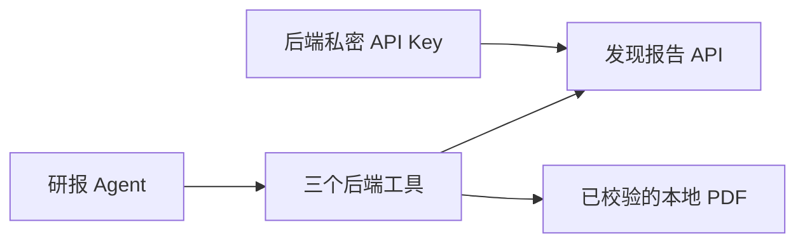

# 发现报告后端接入 v1

2026-10-08。**Uteki 的专用研报 Agent 已通过后端 API Key 调用发现报告；真实模型完成搜索、片段读取及缓存 PDF 获取。** 这次不再由 Codex 临时脚本代替模型选工具。

## 当前可以怎样用

输入明确的机构、报告发表日期范围及研究问题。宿主加载账号 Key，构造专用 `UtekiInvestmentReports` Agent。模型只能使用三个注册工具，不能传 Key、文件路径或任意 URL。调用入口为 `python -m uteki.interfaces.investment_reports.cli`；安装本项目后也会注册 `uteki-reports`。



图中连接已实现。现有财报 Query、产品页面入口和 PDF 页读取未接入。

## 真实验收

输入：机构“摩根士丹利台湾&亚洲”，发表日期 2026-05-01 至 2026-05-31，明确允许报告 ID 5429854。问题要求搜索“半导体分销商”、读取 AI 片段、取得缓存原件，并报告真实缺口。

| 实际动作 | 结果 |
|---|---|
| 模型调用 search_reports | 命中《半导体分销商：AI持续推动更强劲的前景》，2026-05-19 |
| 模型调用 get_paragraphs | 3 个片段、平台页码 1/5/9，空白摘要被标记为空 |
| 模型调用 download_pdf | SHA256 校验后复用 9,844,517 字节 PDF；新下载尝试 0 |
| 模型回答 | 正确区分片段读取、原件获取与未完成的全文阅读；没有编造额度 |

实际请求模型为 AIHubMix `claude-sonnet-5-5`；3 次模型请求估算 $0.036926。Claude Opus 顾问第 15 轮估算 $0.374356，本任务合计 **$0.411282**，低于 $3。模型真实上游身份未经独立确认；费用为本地估算，非账单。发现报告剩余额度未知，本次没有申请新 PDF 下载。

[去敏运行回执](BACKEND-RECEIPT.json)包含输入范围、实现/Skill 哈希、工具参数、状态和费用。[模型原始结果](../../../tmp/fxbaogao/backend-v1/agent-run-01/result.json)与[完整调用对话](../../../tmp/fxbaogao/backend-v1/agent-run-01/conversation.json)仅保存在本机忽略目录；模型记录包括部分研报摘录，不发布到公开页面。

## 后端约束

- Key 从环境变量或宿主明确指定的私密文件加载。本机为项目根 `.env.fxbaogao`，不依赖 Codex 登录，不交给模型或前端。
- 搜索必须有关键词和宿主选定的日期、机构。读取/下载 ID 必须先在这个范围内搜索取得；搜索页有遗漏或无命中不能等于全库无报告。
- PDF 下载默认上限为 0。宿主明确启用后才可新增下载；尝试记录在请求地址前原子预留，跨进程及重启保留，不因失败退回。未知尝试需要核对后才能继续。
- 缓存按报告 ID、SHA256 与字节数复核；损坏时明确报错，不自动重下。已选原件可由宿主按历史回执的 SHA256 导入，模型没有导入路径工具。
- AK 仅用于固定 API 域；PDF 仅允许官方 HTTPS 下载域，不携带 AK，禁止自动重定向。工具错误不输出原始响应、地址或凭据。
- 工具记录开始、参数及结果。任务结束后阻止新外部请求；已发送网络请求无法撤回，不保证瞬时终止。

12 项定向检查通过，覆盖缺范围/密钥、另一机构与期间、越界、业务错误、空白摘要、坏缓存、失败后预算保留、并发、取消和真实 SDK 包装调用。真实模型另行验收，不把这些合成检查算作模型研究质量。运行文本产物扫描未发现两类账号密钥或签名下载地址。PDF 仅做字节/包装校验；内容真实性与语义需独立复核。

## 宿主调用示例

范围文件必须显式包含 `provider`、`start_date`、`end_date`、`org_names` 和 `report_ids`。`report_ids: []` 明确允许范围搜索所得材料；日期与机构仍必填。机构按接口实际署名精确匹配，尚未提供机构别名自动映射。

在仓库根运行以下已选样例；路径仅为本次实验配置，不是系统默认业务范围：

```sh
PYTHONPATH=src .venv/bin/python -m uteki.interfaces.investment_reports.cli \
  --scope tmp/fxbaogao/backend-v1/scope.json \
  --workspace tmp/fxbaogao/backend-v1/cache \
  --credential-file .env.fxbaogao --max-downloads 0 \
  agent --question-file tmp/fxbaogao/backend-v1/question.txt \
  --output tmp/fxbaogao/backend-v1/CHOOSE-NEW-RUN \
  --skill skills/uteki-investment-reports/SKILL.md \
  --provider aihubmix --model claude-sonnet-5-5 \
  --model-credentials-root . \
  --model-budget tmp/fxbaogao/backend-v1/model-budget.sqlite \
  --model-budget-usd 2.625644
```

`CHOOSE-NEW-RUN` 必须替换为新的运行目录；沿用同一模型预算文件，不因复跑重建预算。2.625644 是本任务扣除已发生顾问费用后的预算上限，不是系统通用价格或额度。工具链仅需项目 data 依赖；模型 Agent 另需 analysis 依赖，沿用本项目已安装环境。

下一步：为这个 Agent 加入限定页码的 PDF 读取工具，再验收带原文依据的单篇精读。另保留 IR-02 账户余额核对，不把“不能查询余额”误写成不能执行缓存精读。
