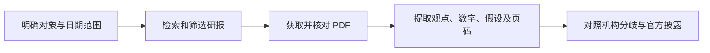

# 发现报告：投资研报能力调研

2026-10-08。结论：可作为研报材料入口；接入方法已查清，真实报告访问尚待授权。当前没有证据支持“覆盖所有投行的所有报告”。

## 三种接入如何选择

| 入口 | 用途 | 本轮状态 |
|---|---|---|
| Skill | 指导 AI 如何组织检索、阅读与研究 | 已读官方流程，形成自己的候选方法 |
| CLI | 脚本搜索与下载 | 已读文档，未安装 |
| MCP | 客户端调用工具 | 已读文档及公开源码，未连接 |

建议先验收一条最短的“搜索—原件—带页码结果”，再决定生产系统采用 API 或 MCP。接入入口本身不能证明研究内容可靠。[官方接入说明](https://www.fxbaogao.com/agent-interface)

上图是拟议能力流程，业务链路尚未实跑。本轮实际执行仅包括公开资料核查和授权 state 获取。

## 机构覆盖证据

- [摩根士丹利样例](https://www.fxbaogao.com/detail/5429854)：公开页面可见《半导体分销商：AI持续推动更强劲的前景》，2026-05-19，机构标为“摩根士丹利台湾&亚洲”，可见英文正文与分析师署名。尚未下载 PDF。
- [摩根大通目录样例](https://www.fxbaogao.com/archives/tag/deep?page=388)：目录列出 2026-04-16 的季度预览，报告 ID 5363866；详情抓取失败，仅证明存在目录记录。
- 检索可能混入以投行为发行人的证券文件或提及投行的会议记录。后续须核对发布机构与报告类型。

## 技术核查与差异

[本地 MCP 源码](https://github.com/fxbaogao/fxbaogao-mcp/blob/master/src/fxbaogao_mcp/server.py)声明 search_reports、get_paragraphs、get_pdf_url、download_pdf。搜索限制 1–10 页。静态审查未见完整业务码校验、限流退避及 PDF 内容校验；因此这些须由接入层验证。远程 MCP 与本地源码的一致性未验证。

[API 参考](https://github.com/fxbaogao/fxbaogao-deep-research/blob/main/references/api-usage.md)的时间参数表与示例有差异。实测还发现 state 接口返回纯文本数字串，初次按 JSON 对象解析失败；已按真实响应生成授权链接。未兑换 API Key，未检索或下载付费材料。

## 沉淀与验收

[候选 Skill](../../../skills/uteki-investment-reports/SKILL.md)已将材料身份、证据定位、预测/事实区分及覆盖缺口纳入研究方法。它是仓库内草案，尚未安装为客户端技能，尚未接入 Uteki Agent，也未经模型实跑验收。基础格式与引用检查通过；完整 Skill 校验器因缺 PyYAML 未成功执行。

本轮没有额外外部模型 API 调用，也没有会员购买或报告下载。用户已确认高级 VIP；实际额度、报告权限和费用仍待账户授权后核对。

完整路线及下一步见 [TODO](TODO.md)。当前位置 IR-02：等待用户在官网完成授权，再进行单篇最小验收。
