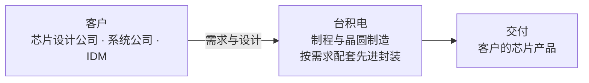
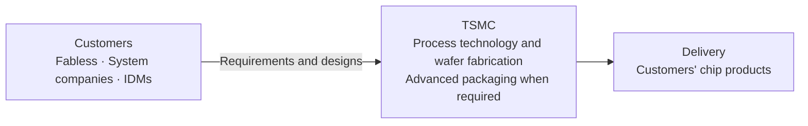

# 台积电 2025 年报图表优化 · 第一轮 / TSMC 2025 chart review · iteration 1

日期：2026-10-06。范围：现金桥与业务图；只改表达，使用已选定官网英文年报。当前是供人工评审的呈现样本，不是新的 Data Agent 提取结果，也未登记到正式后台或自动采纳。

## 输入与可观察目标

- 原分享页：https://chatgpt.com/s/cx_6ac3cfc486fc8191bc9cf8a9b10670bb
- 原六图文件：`/Users/bytedance/.codex/visualizations/2026/10/05/01a10b6e-8e94-7353-9fb6-6af4a1f79090/tsmc-2025-report.html`，保持不变。
- 新现金对照：`/Users/bytedance/.codex/visualizations/2026/09/24/01a0d22e-d4d3-7393-b6ee-3026394d63c9/tsmc-cash-bridge-review.html`。
- [冻结材料身份](../../experiments/architecture_baseline/2026-10-05-filing-brief-method-v1/pilot-source/source-manifest.json)：官网英文完整年报，区别于 SEC 20-F 与中文版；SHA256 `3fb7ae4ad972aa2bc6e45bb36635152ad89d52f4a7165f389bcb94eeb54a6abd`。
- 验收问题：读者能否沿现金变动解释期初如何达到期末？能否从业务图识别谁付费、台积电提供什么以及客户得到什么？视觉可读性留给用户评审。

## 现金图 / Cash bridge

原图各项均从零开始，属于正负条形图。新版按期初余额累加经营、投资、筹资及汇率变动，最后连接期末余额；使用同一组原始数值生成两种表达。对照模式复现原图的从零起算方式，不是原页面的像素复制。

显示单位为 **十亿新台币 / NT$ billion**；详情保留原文的 **千新台币 / NT$ thousands** 整数。中间端点是计算桥接值，不是年内某日实际余额。

| 项目 / Item | 原文整数 / NT$ thousands | 新图起点 / NT$ billion | 新图终点 / NT$ billion |
| --- | ---: | ---: | ---: |
| 期初 / Opening | 2,127,627,043 | 0 | 2,127.627043 |
| 经营 / Operating | 2,274,975,625 | 2,127.627043 | 4,402.602668 |
| 投资 / Investing | -1,144,393,407 | 4,402.602668 | 3,258.209261 |
| 筹资 / Financing | -440,344,692 | 3,258.209261 | 2,817.864569 |
| 汇率 / FX | -50,008,167 | 2,817.864569 | 2,767.856402 |
| 期末 / Closing | 2,767,856,402 | 0 | 2,767.856402 |

合并口径；全年净增加 640,229,359 千新台币。现金勾稽以整数计算，显示时才换算及四舍五入。投资净流出不能替代资本开支，筹资净流出不能替代股利，现金净增加不能替代自由现金流。

Consolidated scope. Net increase: NT$ 640,229,359 thousand. Reconciliation uses exact integers before conversion and display rounding. Net investing outflow is not capex; net financing outflow is not dividends; the increase in cash is not free cash flow.

来源：[英文官网年报 §6.1.3](https://investor.tsmc.com/sites/ir/annual-report/2025/2025%20TSMC%20Annual%20Report.E.pdf#page=68)，PDF 第 68 页、印刷第 132 页的 Consolidated 表；不混用同页 Unconsolidated 表。

## 业务图 / Business map

问题：谁为台积电的什么服务付费？先讲交易关系，将现金变动放在上面的独立图中，不用资金再投入的回环改变主图阅读顺序。

**台积电以提供这些代工服务取得收入。** 这里是业务简化示意；收入确认条件与时点不能从箭头推定。台积电不以自有品牌芯片与客户竞争；IDM 指兼具芯片设计与制造能力的公司。先进封装是按需求提供的服务，不代表所有订单均使用。

**TSMC earns revenue by providing these foundry services.** This is a simplified business map, not a diagram of revenue-recognition conditions or timing. TSMC does not compete with customers through own-brand chip products. IDM means integrated device manufacturer. Advanced packaging is provided when needed, not for every order.

来源与核对范围：

- [§2.1 公司概况](https://investor.tsmc.com/sites/ir/annual-report/2025/2025%20TSMC%20Annual%20Report.E.pdf#page=10)：PDF 第 10 页／印刷第 16 页，纯晶圆代工与不竞争原则。
- [§5.1.1 业务范围](https://investor.tsmc.com/sites/ir/annual-report/2025/2025%20TSMC%20Annual%20Report.E.pdf#page=52)：PDF 第 52 页／印刷第 100 页，制程、制造及配套服务。
- [§5.4.1 客户服务](https://investor.tsmc.com/sites/ir/annual-report/2025/2025%20TSMC%20Annual%20Report.E.pdf#page=59)：PDF 第 59 页／印刷第 114 页，客户类别及服务链。

## 后续可复用的候选方法

1. 一图回答一个明确问题，再选图形；不预设报告必须有几张图。
2. 金额、比率、占比分别保留期间、单位、合并范围与分母。
3. 存量用余额条，变动用连接前后余额的浮动条；子集不画成并列独立份额。
4. 来源陈述、计算结果和分析推断分别表达。业务箭头不冒充会计确认时序或已验证的因果。
5. 数值与口径可自动检查；是否帮助理解由实际阅读任务验收。

这些是候选规则，待本轮图形 review 后再决定如何进入 Uteki 的材料精编 Skill。当前未调用模型，未改变 Skill 运行绑定，未改变数据采纳状态。核对范围仅涵盖上述章节，不代表全文或所有附注已经审核。
