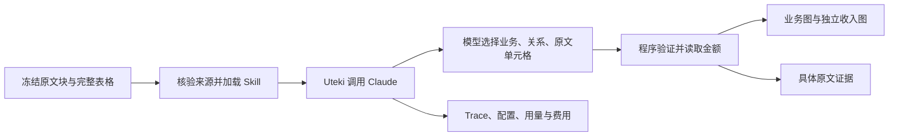

# Uteki Agent + Claude：业务与收入真实执行

目标：把用户认可的业务/收入分图方法，接到系统自己的执行能力。本轮使用同一 Alphabet FY2025 原件的选定章节与收入表；参考答案仅用于后续评价。



## 运行边界

- 显式选择公司、document、期间、Skill、模型、effort、输出上限和费用上限。无默认公司、默认报告或金额答案。
- 78 个原文块、1 张完整表；保留两年并明确请求 2025。不代表全报告自动获取、全报告覆盖或通用材料解析已完成。
- 实际系统能力在 `src/uteki/agents/business_map/product_run.py`。它加载 Skill、调用原生 Messages 适配器、验证并生成候选。当前为受限单次提取能力，不包含自主获取或多步修复循环。
- Claude 的工作是理解和选择。模型不提交金额；程序按原表 cell 解析，核对年度列、单位、币种、正负号、总额与小计。
- 采用 Sonnet 5.5，adaptive thinking、high effort、stream=false、输出最多 16,000 tokens、不重试。temperature/top_p/top_k/seed 不发送；这不是确定性保证。
- Skill 主文件进入实际请求；案例答案和 references 中的参考案例文件不发送。执行按 hash 保存当前内容，而不是仅记录路径。
- Claude 顾问对话是另一个用途。它的历史失败和累计额度不重置。本次执行使用另行明确的单次范围。

## 本次输入与验收

- [冻结输入及范围说明](input/README.zh-CN.md)
- [验收标准](evaluation/acceptance.zh-CN.md)
- [调用前费用预检](preflight-v2.json)

预检不加载密钥、不访问外网、不调用模型。费用使用项目保存的价格快照做保守预留；最终用量来自响应，费用仍为估算，不是供应商账单。

## 显式入口

从项目根目录运行：

```bash
PYTHONPATH=src .venv/bin/python scripts/run_business_revenue_agent.py \
  --root . \
  --packet experiments/agent_design/2026-10-07-agent-business-revenue-v1/run-01/source_packet.json \
  --skill experiments/agent_design/2026-10-07-agent-business-revenue-v1/run-01/skill.md \
  --company-id alphabet --document-id sec-0001652044-26-000018 \
  --period-end 2025-12-31 --model claude-sonnet-5-5 --effort high \
  --max-tokens 16000 --timeout-seconds 300 \
  --preflight-output /tmp/uteki-business-revenue-replay-preflight.json
```

实际调用还需显式 `--execute`、新的 `--output`、`--observation-root` 和已经授权的 `--budget-limit-usd`。现有后台观察根为 `data/agent_observability/local`，允许读取 `experiments` 中的新运行。不会凭预检自动付费。

输出保存 source_packet、skill、schema、request、configuration、response、model-calls、draft、validation、business_map、revenue、evidence 和 result。模型只返回可见输出；隐藏思考不作为日志或证据发布。失败保留实际请求、回执、费用与停止原因，不创建成功图冒充结果。

## 本次真实结果

[查看真实业务图与复核](http://127.0.0.1:8769/docs/design/data-agent-acceptance/agent-business-revenue-v1/?view=business) · [收入图](http://127.0.0.1:8769/docs/design/data-agent-acceptance/agent-business-revenue-v1/?view=revenue) · [运行过程](http://127.0.0.1:8765/agent-runs?agent=data&run=run-ac090fecb2c84b8bacc9cd4d60a0bada) · [运行结果](http://127.0.0.1:8765/agent-results?agent=data&run=run-ac090fecb2c84b8bacc9cd4d60a0bada)

用户确认继续后，按独立 $0.50 单次范围执行。实际 1 次请求、0 重试；原 $2 顾问会话未改动。

| 项目 | 实际记录 |
|---|---|
| Trace | `run-ac090fecb2c84b8bacc9cd4d60a0bada` |
| 请求 / 返回模型 ID | `claude-sonnet-5-5` / `claude-sonnet-5-5`（供应商回传 ID） |
| 调用时间 | 2026-10-07 14:19:24–14:20:17，中国时间；约 53.22 秒 |
| HTTP / 结束原因 | 200 / `end_turn` |
| Token | 输入 45,669；输出 8,788；缓存读取 0，供应商未提供单独的思考 token 细分 |
| 费用 | 估算 **$0.179218**；预留 $0.43256 已结算，无未知费用、无在途请求；不是供应商账单 |
| 产物 | 13 个业务节点、14 条关系、2 张收入图、50 个证据片段、4 项未知 |
| 原始状态 | candidate；程序校验通过，封存时语义未评估 |
| 后续复核 | 收入金额与原文核对通过；业务粒度、部分声明引用、标题口径和一条推断关系需改善 |

[完整语义复核](evaluation/independent-review.zh-CN.md)独立于原始运行保存，不覆盖原件。页面显示 5 项通过、4 项需改善；这是具体验收项，不是综合质量分。业务中新增 Google 层级、AI 研发支持关系有合理依据；Search、YouTube 等则仍在详情清单，未形成参考中的独立节点。不能称已达到 v2 的同等产品级表达。

程序读取原表金额、模型选择单元格的分工已真实跑通。图页的 SVG/Mermaid、13 个本地链接目标与 87 个证据片段链接已检查；页面/结果/过程 6 个 HTTP 地址返回 200。工作台现在显示 `business_map.json` 与 `revenue.json`。未做浏览器视觉验收，用户判断新图是否清楚。

## 版本和复现边界

本次实际加载的是 v0.3，原文、Skill 和请求保存在 `run-01/`；其 hash 与 `preflight-v2` 相符。`run-01/result.json` 绑定三个原始产物的 hash。图页/后续评价单独记录各自版本，不改原始状态或自动采纳。

当前仓库 Skill 已将通用缺口沉淀为 v0.4 候选：具名业务身份、逐项声明证据、推断关系处理与收入图标题。**v0.4 尚未实跑**，不能沿用 v0.3 成绩。上面的预检命令使用本次冻结 `run-01/skill.md`，只重建请求，不发送模型；相同请求不保证相同模型输出。新一轮应另立明确范围、配置和费用记录。

## 下一步顺序

1. 对 v0.4 做下一次受控复跑，检查这四项差距是否收敛；不人工补答案冒充模型改善。
2. 再用 NVIDIA 等另一份材料验收迁移。整份材料的解析覆盖仍单独核验。
3. 需要比较稳定性时，再定义重复次数、任务及评分口径。
