# Aster FY2024 合成业务图

**已交付 Mermaid 与实际 SVG。** 这是合成评测公司 `aster`，文档 `aster-2024`，期末 `2024-12-31`。三个段落就是本轮全部材料；不是现实公司或真实年报。所有事实整理保持 `candidate`。

[查看实际 SVG](business-map.svg) · [Mermaid 源码](business-map.mmd) · [完整三段原文](source.html) · [BusinessMap](business_map.json) · [节点 ID 映射](id-map.json) · [核验结果](verification.json)

## 为什么采用这种表达

问题是：公司有哪些报告分部，Services 内有哪些组，以及同一基础设施支持谁。采用向下展开的归属图，加两条带文字的共享支持虚线。六个节点足够直接阅读，不必拆成多个视图。

本次不选金字塔。原文没有高低等级、战略优先级或财务权重。节点按相同字体、留白和线粗规则排版，宽度只适应标签；大小、面积、位置和排序均不表示收入或重要性。

实线的“报告中列示／包含”用于从父到子阅读。JSON 仍保留 `reported_under`、`part_of` 的子→父方向。虚线“支持”保持提供方→被支持方。Identity Infrastructure 只存在一个业务 ID，未归到任何一个分部。

## 事实、赚钱方式与证据

| 节点 | 原文支持的身份或范围 | 收费方式与财务限制 | 证据 |
|---|---|---|---|
| Aster | 公司，报告两个分部 | 未给整体收费方式或数值 | [p1](source.html#p1) |
| Devices | 报告分部 | 未给具体产品、客户或收费方式 | [p1](source.html#p1) |
| Services | 报告分部，包含两个商业组 | 只明确下述两组的合并收入披露 | [p1](source.html#p1)、[p2](source.html#p2) |
| Subscriptions | Services 内的组 | 不能从名称补出收费周期、套餐或独立收入 | [p2](source.html#p2) |
| App Platform | Services 内的组 | 未给抽成或交易费；与订阅只有合并收入披露 | [p2](source.html#p2) |
| Identity Infrastructure | 共享支持组件，明确不是报告分部 | 未给组织归属、收费方式或收入 | [p3](source.html#p3) |

两个分部的报告关系均由 p1 支持；两个 Services 包含关系均由 p2 支持；两条共享支持关系均由 p3 支持。图上保留这些证据编号。没有把支持关系改成归属关系，没有把合并收入拆分或复制相加。

## 定位、哈希与交付检查

`source.html` 是根据用户消息生成的本地阅读视图，新增 p1/p2/p3 锚点；不是官方原始 HTML。`input.txt` 仅用一个换行连接三段原词句，不带末尾换行。每段 SHA-256 对象是该段精确 UTF-8 字节，不含编号、HTML 或末尾换行；没有归一化原文。完整输入与 HTML 的哈希另行保存，二者不混用。

- `p1`：`622ec4e08a2c21eaa2fda68bfeb094ff22376ef6fb9637ee6046b48cc6f1f5b4`
- `p2`：`8c348836bb2c37b4ddb67f0f4c46e990c4b4dec7aaeb3387957923ce75b3160b`
- `p3`：`61a236981e45616dfb4071f163b3743e92ad7817788d300f79ab87fb604b47f5`

已实际检查：现有 `business_map_from_dict` 契约、3 个唯一原文锚点及引文哈希、6 个稳定节点与 6 条关系、实际 SVG 的 6 个节点和 6 条边映射；共享组件只保留一次且两个支持关系都在。Mermaid 采用本地现有工具和 strict 配置。第一次沙箱内浏览器未启动；获准启动本地渲染器后生成成功。没有模型 API、外部资料查询或仓库修改。

满足本次产物交付：有可见 SVG、Mermaid、原文精确入口、事实及关系数据、ID 映射和验证记录。未做浏览器视觉检查，未获得用户视觉认可，未调用 Claude，也不声称生产 Agent 已绑定此 Skill。加载的 Skill 版本与文件哈希见 `business_map.json` 的 metadata。

## 缺口与下一步

全部三段已读完。用户输入未给具体客户、收费安排、收入金额、单位、财务权重、披露日期或共享组件的组织归属；除 p2 明说“只有合并收入”外，不把这些局部缺口称为完整报告没有披露。当前无证据定位缺口。

下一步：用户核对本图能否清楚区分报告归属与共享支持；如需回答如何赚钱，再提供对应收费说明，不能由布局或名称补齐。
