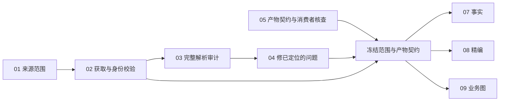

# TODO 05：产物契约核查与 07 / 08 / 09 的交付边界

2026-10-07；离线源码与历史小样核查，无模型调用，无生产契约变更。

**结论：02、03、05 可以并行准备；04 只能修已由 03 定位的问题。07、08、09 使用的新底稿和契约须先冻结。05 目前是部分实现，08 的正式精编契约/执行器是明确缺口，09 的自动内容覆盖验收是当前质量阻塞。**

本目录没有另造五套数据文件。沿用现有底稿、事实、精编、业务图三类加工产物的既有模型；下述是它们共同必须回答的验收问题，而不是已上线的统一 API。

## 用一个小例子说明

AMD FY2023 10-K 第 3 页原文列出四个报告分部，并说明 Data Center “主要包括”若干产品。完成后应能看到：事实记录保留报告分部身份；精编用短段落保留“主要包括”及 All Other 不是报告分部的限制；业务图出现相应节点、报告关系与精确引文。三份产物均能回到同一原文块，空白字段标明未处理还是原文未提供。当前真实小样见 [原验收页](../../../../docs/design/data-agent-acceptance/first-iteration-v1/index.html)。其中精编及 AMD 业务图是人工组装设计例，不是 Agent 新运行。

## 共用验收约定（建议冻结，不声称已全部实现）

| 问题 | 每份产物必须给出 | 检查责任 |
|---|---|---|
| 处理了什么 | 显式公司、材料版本/hash、期间/披露上下文、截止日；整份/章节/表格范围；输入块清单 | 程序拒绝缺失、混公司、混版本；材料选择仍须有内容覆盖检查 |
| 输出了什么 | 原有类型与版本、稳定条目 ID、值/文本/对象关系；详细属性的阶段范围 | 现有 Schema；图阶段的空属性不能解释为未披露 |
| 依据在哪里 | 声明→原文片段；数值连同表头、行名、单位、期间与脚注；原件 hash 与块/单元格定位 | 程序查归属和原文包含；内容审阅查引文是否支持整项主张 |
| 哪些没做 | 逐章节/内容单元处置、噪声理由、未读/不支持/待补上下文；不能用空结果证明没披露 | 程序核对清单完整，模型/审阅核对遗漏；两者不可混合为一个通过 |
| 什么状态 | 执行成功、格式、证据定位、语义支持、覆盖、采用分别记录；partial / candidate 保留 | 发布页和消费者显示实际状态；成功调用不等于内容通过 |
| 能否复查 | 源文/规则/Schema/config hashes，实际请求与响应、工具步骤、费用、修订父子关系 | 系统留档；Codex 在运行结束后评估，不能中途补参考答案 |

“稳定可复现”验收是相同冻结材料与版本下，关键事实、关系、证据和缺口稳定；不承诺自然语言逐字一致。重复运行数量及费用另在实际任务预检中冻结。

## 三种加工产物分别交付什么

| TODO | 可查看的产物 | 必须通过 | 已有实现与缺口 |
|---|---|---|---|
| 07 结构化事实 | 可读数值/事实表及原始数值、单位、规范化结果、期间/主体/口径、逐条证据、缺口 | 指定范围的关键指标×期间×维度清单有结果或解释；值/符号/尺度/期间/主体无关键错误；不能把 unsupported 映射成 0 或换另一公司 | `DirectExtraction` → 规范化 `ResearchRecord` 已有；源头优先 iXBRL 分支仅显式 calendar / USD 等受限能力，不能直接外推 AMD/NVIDIA 非日历财年及 TSMC 多币种/准则 |
| 08 财报精编 | 人可读文档、同一组内容项 ID、中英文字段、句/声明级证据、章节覆盖与压缩理由、重要限定及缺口 | 不增加无依据事实；财务值与范围一致；管理层说法保留归属；所有重要披露有保留/合并/压缩/未完成处置 | 仅候选文字契约和 6 块人工 partial 小样；尚无正式 typed contract、生产执行器和模型真实整章验收。需在 05 冻结最小生产契约后开跑 |
| 09 业务图 | 完整可看 Mermaid 图+源码、业务/产品节点、类型、关系依据、详细属性与证据；收入图单独 | 范围内重要对象、关系、必要限定不遗漏；整体/云子集不混同；无依据关系保留待定；全部对象能在图或明确缺口中找到 | `business-draft-v2`、BusinessMap v0.2、统一 Mermaid 已有；块处置只证明每块填了状态，不能证明块内所有对象均被识别；当前独立 Microsoft 运行语义未通过 |

详细产品、客户、收费属性仍属 09 的完整目标；现阶段 graph-only 通过只完成子阶段。竞争关系若进入 09，必须保留说话方、业务范围、日期、点名/类别/推断区分；现有 RelationshipKind 不支持 competition，不能硬塞 part_of/supports。

## 02—05 依赖与并行

02 可核查获取能力和已有原件；03 可先审已有冻结报告；05 可立即核查已有消费者和小样。04 对已确认的问题滚动修复，不必等五份报告所有诊断完成，但修复后须复验涉及的底稿并发布新版本。07/08/09 可以在各自所需的材料与契约冻结后并行真实运行；不能使用“还在改”的共享底稿进行可比性验收。

## 建议的最小契约变更（留给主线确认后实施）

1. **08：新增一个真实可执行的 FilingBrief 契约。** 从 `skills/data-agent/brief/references/output-contract.md` 收敛：范围、内容项、证据引用、覆盖处置、质量状态；中英文共享条目 ID。不要把 `filing-brief-example-v1` 设计小样直接当生产 Schema。生成器先产物后审阅，有界修订，现有 Trace/预算基础设施复用。
2. **09：给已有 `block_disposition` 增加内容覆盖核对产物或旁路记录。** 记录源文中识别的对象/主张/关系、原文引文、输出对象 ID、未纳入理由。覆盖清单从原文生成，参考答案仅进入运行后评价。不要把“清单齐”直接等价于“语义无遗漏”。
3. **09：明确 extraction stage。** 在 manifest/范围声明区分 graph_only / graph_with_attributes；现有 [] 不应同时表示未运行、未发现、材料未披露。先用现有 metadata / manifest 描述，再视消费者需要版本化 typed 字段；不要破坏历史 v2 产物。
4. **07：显式财年、准则、币种支持。** 原有事实契约字段已足够表达大部分值，不先重建统一事实 JSON。优先校验/扩展明确的 period/currency/context adapter，并对不可支持项保留原值与缺口。
5. **共有状态：** 复用现有 result/validation/review manifest，补覆盖状态；避免每个产物自行创造“pass”且语义不同。版本/hash 必须能追溯到实际请求，不能把后来 Skill 冒充本次输入。

## 真实小样索引与核查证据

详见 [sample-check.json](sample-check.json)，它记录本轮实际检查、文件 hashes 和结果。检查只覆盖列出的小样及引用绑定，不是五公司端到端通过率。

- AMD 真实来源与五类小样：[product-samples.json](../../2026-10-07-data-foundation-v1/product-samples.json)。底稿/数值是历史真实材料及候选；精编/业务图为人工设计例。期间 2023-12-30；source `source-291485b98a75d8cfabe47571`。
- AMD/TSMC 标准底稿契约与导出：[parser-contract-v1](../../2026-10-07-parser-contract-v1/README.zh-CN.md)。旧版历史包，不能替代最新版解析核验。
- Microsoft 系统 Agent 独立运行修订候选：[business_map.json](../../2026-10-07-microsoft-agent-independent-v1/self-review-01/revision/business_map.json)，原文103块；52节点53关系。字段/引用校验通过与后续语义不合格并存，不冒称成功业务验收。
- 精编候选内容约定：[output-contract.md](../../../../skills/data-agent/brief/references/output-contract.md)。该文件自己明确不是生产 API。
- 事实生产模型：[direct_extraction.py](../../../../src/uteki/domain/research_data/direct_extraction.py) / [query_contract.py](../../../../src/uteki/domain/research_data/query_contract.py)。
- 业务生产模型与展示：[product_contract.py](../../../../src/uteki/agents/business_map/product_contract.py) / [models.py](../../../../src/uteki/domain/business_map/models.py) / [business_map_view.py](../../../../src/uteki/presentation/business_map_view.py)。

**05 状态：部分完成。** 本分支完成源码/消费者对账、验收边界与小样核查；未实现新精编契约、覆盖清单或五公司新运行，不将整项勾完。
