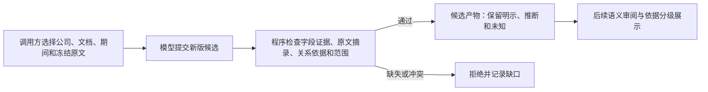

# 通用业务规则：逐项证据、关系依据与未知语义

本轮已完成 **新版输出契约、执行接入、Skill v0.5 和离线验收**。没有调用模型，没有修改既有冻结产物。新版可执行、可校验；旧图页暂不支持新版依据分级，遇到新版会明确拒绝展示。真实提取质量、顾问审阅和新版图形展示尚未验收。

## 一个具体行为

合成输入：Orion 提供工具和支持服务。模型拟输出“工具业务属于 Orion”。

| 模型提交的内容 | 系统行为 |
|---|---|
| 工具节点的名称、描述和产品项分别绑定原文摘录；关系声明 `explicit`，提供出处和说明 | 接收为候选；保留逐字段引用和关系依据。通过程序校验不等于事实已采纳 |
| 给节点加一项客户，但没有为这项客户绑定证据 | 拒绝，报告字段证据覆盖缺口；不从其他字段或其他公司补证据 |
| 摘录中有原文没有的文字，或引用输入包以外的块 | 拒绝；不自动改写引文 |
| 归属只是推断，填写 `derived`、前提摘录和推断说明 | 保留为有明确推断标记的候选；仍需语义复核 |
| 归属尚未确定，填写 `unknown` 并记录两个端点的未决问题 | 保留未知；消费端不能当作肯定或否定事实 |
| 没有工具与某个市场的关系记录 | 保持“未记录/未知”，不能推断工具是独立业务、互斥或不属于该市场 |

这些行为已用 Orion、Lyra 两个独立合成范围测试，不依赖任何真实公司的节点名、期望金额或修补规则。

## 新契约与复用边界

执行契约为 `business-revenue-draft-v2`，物化结果为 `business-map-v0.2`。完整输出结构见 [output-schema-v2.json](output-schema-v2.json)。主要新增项如下：

| 字段 | 用途与校验 |
|---|---|
| `relationships[].basis` | 必填 `explicit`、`derived` 或 `unknown`；不会把缺失依据自动补成明示 |
| `relationships[].rationale` | 必填非空说明；推断须说明前提与推理步骤，这部分语义由审阅核实 |
| `relationships[].excerpts` | 明示/推断关系必有摘录；摘录块与该边的证据集合一致，摘录能在冻结块中找到 |
| `businesses[].claim_evidence` | 按 `field` 与 `item_index` 定位名称、描述、每项产品/客户和明确赚钱方式；不能漏项、重复或指向未声明项 |
| `claim_evidence[].excerpts` | 每项声明有具体摘录；摘录块也属于节点证据。名称/描述的 `item_index` 为 `null`，列表项从 `0` 开始 |
| `relationship_absence` | 固定为 `unknown`，明确未记录关系不等于独立或无关系 |
| 新版领域证据的 `company_id` / `document_id` | 必须与 BusinessMap 范围一致；不接受另一公司/文档的证据 |

摘录只规范化空白，不替模型更换词句。主张的实际文本保存在原字段中，证据通过字段指针关联；没有第二份可静默修改的重复主张文本。`unknown` 关系必须在 `unknowns` 中留下包含两个端点的具体问题，且不能采纳为已确认关系。没有必要枚举所有不存在的边，也不会为补成树而添加父节点。

业务与收入仍分开。收入金额继续由原表单元格读取；期间、单位、分母与勾稽规则未变。本轮没有实现行业适配器。以后如需适配，应由调用方显式选择并保存版本/范围；不允许把某个公司的答案、数量或关系修补植入通用代码。

## 版本兼容与展示保护

- 旧 `ProductDraft` 的 JSON Schema 保持原样；旧草稿继续按旧契约读取。新 `prepare` 默认 v2，manifest 保存 `output_contract_version`。新执行如果收到旧格式，明确拒绝，不静默降级。
- 只有为核对/恢复旧请求时，调用方才显式选择 `contract_version="business-revenue-draft-v1"`。已验证使用旧 Skill/输入和该选项可逐字复建冻结 Sonnet 请求。
- 历史域版本允许列表为：`0.1`、`0.1-pilot`、`0.1-candidate`、`0.2-candidate`、`0.3-candidate`、`m0-review-business-map-v1`、`business-map-v0.1`。新版为 `business-map-v0.2`。其他版本拒绝，不能用任意版本绕过新校验。
- 旧边的缺失 `basis` 在领域内保留未分级状态，旧序列化不补新字段；不能解释成原文明示。已核对 15 份既有业务图可读。
- Agent 图页入口、共用 Mermaid 边生成器及旧工作台层级函数目前都显式拒绝 v0.2，提示需要依据分级渲染器。旧版显示保持可用；本轮没有把新版产物伪装为旧图。主线后续接入展示时，应分别呈现明示、推断和未决关系。
- NVIDIA 已冻结格式恢复产物通过原 helper 的完整核对：源文件、原回答、格式变换、费用引用与重物化产物一致。未覆盖任何旧文件，没有新增模型调用或重复计算源费用。

## 实现与验收

主要实现：

- [领域模型](../../../src/uteki/domain/business_map/models.py)：新版逐项证据、关系依据、范围和版本校验，旧版本读取兼容。
- [执行输出契约](../../../src/uteki/agents/business_map/product_contract.py)：保留旧 Schema，增加 v2 字段、摘录匹配、覆盖与缺口检查。
- [执行入口](../../../src/uteki/agents/business_map/product_run.py)：默认 v2、冻结版本、严格匹配回答版本、保存候选产物。实现指纹包含域模型；输入表达压缩工作另行记录，不属于本规则的效果证据。
- [Skill v0.5](../../../skills/uteki-business-diagrams/SKILL.md)：通用输出指引与已实现/未验证边界。既有 v0.3/v0.4 快照不变。
- [新规则测试](../../../tests/unit/test_business_rules_v2.py)：两家合成公司、缺失范围、跨公司/文档/期间、缺声明引用、摘录伪造、推断、未知、无关系与旧 Schema 兼容。

实际完成的离线检查：

1. 业务领域/Agent、业务收入契约/runner、新规则及旧工作台相关测试通过（88 项）。HTTP 均为离线替身，没有真实请求。
2. 实验页内容与生成逻辑检查通过（17 项），包含新版拒绝展示、旧图保持可用与原有引用检查。未做浏览器视觉审查。
3. 冻结 Sonnet 请求字节一致；15 份历史图可读；NVIDIA 既有 derived 产物完整复核通过。
4. skill-creator 的 `quick_validate.py` 已尝试运行，但项目 Python 与本机附带 Python 均缺 `PyYAML`，该检查未执行完成；没有为此安装依赖。主 Skill 的 frontmatter、版本、链接与新指引已人工核对，不能记为官方校验器通过。

## 仍未证明的部分与下一步

原文里出现某句，不代表它充分支持该字段或关系。程序不能据此证明业务归组正确、摘录完整、主张没有遗漏限定词，或图覆盖了整份报告。新 Skill 尚未做真实模型实验，也没有本轮 Claude 顾问确认。旧产品合同、旧 pipeline 的提示版本与新版单次业务/收入 runner 是不同入口，不能混称全部 Data Agent 都已切换。

优先下一步：

1. 在一份明确选择的其他公司输入上做新版离线预检，保留实际 Skill/schema/request 指纹及容量/预算结果。
2. 为新版关系依据和逐项声明接入可检查的展示与查询，继续保持未知语义；再做授权范围内的单次真实执行。
3. 根据原文独立审阅输出，与旧版参考区分配置变化；确认规则确实改善质量后，再推进通用验收。
