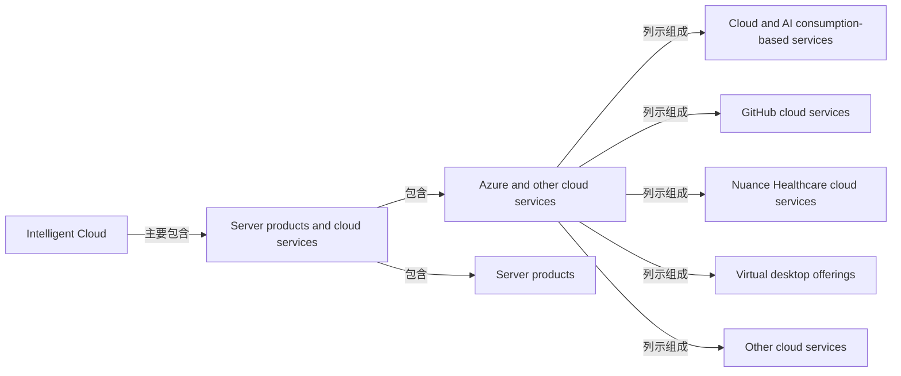

# Microsoft 业务图：原文与实际输入审计

结论：本次业务图未达到完整业务结构交付标准。问题同时来自范围过窄、旧稿修订锁定结构、业务整体与服务子集混用，以及验收偏重字段而没有验证关系覆盖。不能归因于模型本身能力差，也不能靠重新排版解决。

## 1. 原文与实际请求

官方 FY2025 10-K 已完整保存在本地，无需重新下载。来源、原件指纹及本次检查见 verification.json。Codex 对照原始 HTML、索引与实际请求检查：旧请求中的30块与原文一致，未发现所选段落被截断或漏传。其中26块为 Intelligent Cloud 小节、4块为身份背景。其他两个分部只有名称，没有业务内容，且请求明确禁止扩展。

已准备新 clean-source-packet.json：103块，其中101块连续覆盖 OPERATING SEGMENTS 至 HUMAN CAPITAL RESOURCES 之前的全部文字，加2块身份信息。连续区间与原件逐字核对（忽略空白）一致。覆盖三个经营分部，不宣称覆盖微软所有产品、整份10-K或最新官网内容。原文指向的 Note 18 尚未纳入；财务分部勾稽仍需另读。

本次不调用模型；新材料是已准备的下一轮输入，不是新模型结果。

## 2. 我们实际要求 Claude 做了什么

Claude 是这次系统 Agent 的底层执行模型，并非另有一份独立 Claude 全报告输入。

- complete-candidate-v3/request.json 的 system 包含完整 Skill，Skill 又嵌入 run-02/response.txt 的旧答案。
- skill.md 第109行要求保留12个节点、名称和分类，禁止重构；第111行要求删除 GitHub / Nuance 整体归属边，并把云服务子集留在文字详情；第114行保留 Azure AI、Foundry、Security 既有节点。
- 初始系统指令说不要用旧答案，后面的修订指令却要求保留旧答案，存在冲突。
- 最后的 accepted-candidate-v1 只调用模型修两项字段，实际输入是旧字段及4块原文。文件夹中复制的 Skill 不能当作该调用实际加载的证明。

因此12节点、8关系变成12节点、6关系；删错边是合理的，但没有建立能表达正确子集的节点。旧的 Azure AI 等未知关系也被继承。不能把这一轮当作独立重提取或通用能力评测。

## 3. Codex 阅读原文后的具体判断

| 对象 | 原文位置 | 判断与应有表达 |
|---|---|---|
| Azure and other cloud services | block 120 | 报告列示的云服务组合，包含按消费计费的云与AI服务、GitHub云服务、Nuance Healthcare云服务、虚拟桌面及其他云服务。不是单个产品。 |
| Azure | block 127；120 | 原文定义为综合云服务集合，能力清单包含AI。旧数据中已有 Azure → 云服务组关系，页面横向滚动使其不易看到；不是模型完全漏掉 Azure。 |
| Azure AI | block 128；127 | 应作为Azure相关AI产品能力来理解。将其连到Azure可作为有上下文依据的推断候选，而非要求出现逐字“part of”才允许分析。正式层级仍需审阅。 |
| Azure AI Foundry | block 128 | 原文名称是 Foundry，不是 Factory。它是开发者设计、定制和管理AI应用与智能体的统一平台。与Azure AI在同段，适合作为AI产品组合中的平台候选；具体从属边需标推断，不能冒称财报逐字披露。 |
| GitHub | block 130 | 面向开发者的协作平台，含云端与本地部署产品。整体不等于仅云端。 |
| GitHub cloud services | block 120；130 | 原文已明确列入云服务组，应作为有独立范围的服务子集表达，并关联GitHub整体。把它只写进products_services会丢掉读者关心的图上关系。 |
| Nuance Healthcare cloud services | block 120；130 | 同样需要区分整体与云端子集；本地部署产品的财务归属不能猜。 |
| Azure Security | block 134 | 原文明称Our Azure Security offerings，描述云安全及SIEM。应进行具名产品/品牌关系分析，不因在Competition标题下便视为无归属或无关业务。 |

上述Azure AI/Foundry层级属于Codex阅读建议，不是已经采纳的模型关系。不能仅因为同段就推出所有权；应检查产品定义、上下文、同名关系与反证，必要时用与期间一致的官方文档补证。

### 云服务组的可直接确认部分

这只是原文118/120的报告列示结构核对图，不是完整微软业务图。不能把AI消费收入类别直接等同于Azure AI产品平台，也不能把GitHub整体改名为其云服务。

## 4. 修正后的方法与验收

1. 先读完整业务章节，得到公司—分部—业务/产品的整体理解；明确收入分类、产品平台和品牌的不同维度。
2. 干净重提取：只传原文、通用规则和契约，不传旧答案，不固定节点数，不带Codex参考图。允许根据原文拆分“整体/服务子集”，保持同一对象身份与交叉关系。
3. 对每个重要具名对象检查关系覆盖。无边必须说明是没读到、没分析清楚还是材料确实不能证明；不能列unknown就算交付完成。上下文支持的关系可标derived，并写出前提及限制。
4. 分别验收字段准确、对象完整、关系完整、图上可见。逐字段引文通过不能代替后三项。核对GitHub等服务子集没有被误当成整体。
5. 渲染继续使用固定Mermaid基线；不把绘图问题与分析问题混成一次修复。新产物保留新Trace与输入指纹，旧版本不覆盖。

当前位置：原文/请求审计完成；新版输入已核验；干净重提取尚未执行。下一项是用新输入重建候选并对照本审阅，不是继续修旧12节点。
