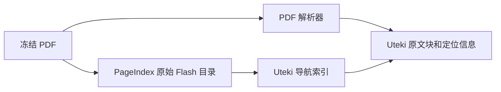

# PageIndex 复用决定与验证边界

核查日期：2026-10-07。本文是代码与官方文档的只读评审，不是集成验收。

**建议：Uteki 保留任务调度、模型调用、预算、日志和证据身份。SEC HTML 继续使用现有解析器；真实 PDF 按需试用 PageIndex 的目录生成组件。先固定解析产物与消费契约，再决定是否接入。**

状态约定：**已有**指在当前代码中确认；**拟议**指尚未实现的接入；**未测试**指没有运行集成或验证实际效果。

## 1. 核查版本与来源

- PageIndex 固定提交：[`6d23caf416858f2ca136840305d1f479a86f6ef7`](https://github.com/VectifyAI/PageIndex/commit/6d23caf416858f2ca136840305d1f479a86f6ef7)，提交日期 2026-10-01。
- 该提交的包元数据声明版本 `0.2.10`、Alpha、MIT。[包配置](https://github.com/VectifyAI/PageIndex/blob/6d23caf416858f2ca136840305d1f479a86f6ef7/pyproject.toml)、[许可证](https://github.com/VectifyAI/PageIndex/blob/6d23caf416858f2ca136840305d1f479a86f6ef7/LICENSE)。
- 当前开源代码已有本地索引、检索工具和 Agent 问答；“开源只有索引”不符合此版本。
- 在线文档可能落后于代码。例如本次提交统一了树字段；接入应固定代码版本，不能仅照旧文档样例映射字段。

## 2. 接入范围

| 路径 | 已有依据 | 决定与剩余工作 |
|---|---|---|
| SEC HTML | Uteki 已有原文块、表格、出处、法律目录及 outline/search/read | **现在沿用**。需要更细目录或摘要时，在自有块上增补；不为接入 PageIndex 把 HTML 转成 PDF |
| 真实 PDF | PageIndex Flash 可生成页范围目录 | **拟议按需接入**。先确认 PDF 解析块和定位格式，再验证目录到块的映射 |
| 全量 PageIndex SDK | 自带索引模型调用、存储和 Agent 循环 | **当前不作为默认路径**。后续若采用，必须显式统一预算、日志、重试及证据范围 |

Uteki 已有代码：[文档对象](/Users/rain/Documents/ChatGPT/uteki.beta/src/uteki/domain/documents/models.py)、[索引产物生成](/Users/rain/Documents/ChatGPT/uteki.beta/src/uteki/infrastructure/document_sources/index_artifacts.py)、[读取工具](/Users/rain/Documents/ChatGPT/uteki.beta/src/uteki/agents/reading/document_reader.py)。现有文字搜索是按来源顺序的字面短语匹配，不是相关性检索。

## 3. 最小 PDF 组件复用

候选入口：

```python
page_index_flash(pdf, summary=False, optimize=False)
```

**代码确认**：这个组合不执行摘要和模型扩展调用；基础目录来自文字层、版面、标题和可信书签。**未测试**：尚未在 Uteki 的真实 PDF 上验证解析质量、运行耗时或映射效果。[Flash API](https://github.com/VectifyAI/PageIndex/blob/6d23caf416858f2ca136840305d1f479a86f6ef7/pageindex/flash/api.py)

主要输出是文档名称、标题、目录来源及 `structure` 树。节点包括 `title`、`node_id`、`start_index`、`end_index`、`nodes`。页范围从 1 起始，含首尾，指 PDF 物理页。节点 ID 是遍历编号，不能作为跨重建的稳定事实身份。

这个公开入口**不是完整的 PDF 解析包接口**。内部虽然产生版面块与几何信息，返回的公开目录没有稳定的段落、表格单元格和 bbox 对象集合；内部页文本也会在返回前移除。[内部解析流程](https://github.com/VectifyAI/PageIndex/blob/6d23caf416858f2ca136840305d1f479a86f6ef7/pageindex/flash/main.py)

拟议关系：



必须补齐的边界：

- 目录指向自有来源版本及块集合；一页对应多个块是正常情况。
- 精确证据仍须定位到支持结论的片段或单元格。定位不清时返回缺口。
- 印刷页码与 PDF 物理页码分别保存，不能混用。
- 无文字层不等于无内容；需要明确 OCR 状态。
- Flash 无法得到层级结构时可能退化为逐页目录。管理入口会拒绝超过 10 个节点的此类结果；直接调用组件时也必须检查诊断，不能静默接受为成功。
- 固定版本、输入与配置有助于重建核验；不因此承诺解析语义正确或目录覆盖完整。

## 4. 为什么暂不接入整套执行流程

| 已核实行为 | 对 Uteki 的影响 |
|---|---|
| `submit_document()` 的 Flash 路径启用摘要，之后生成文档说明 | 仅关闭 optimize 并不能关闭模型调用 |
| 索引辅助函数经 LiteLLM 调用，外层最多尝试 10 次，并使用 `drop_params=True` | 必须另行核验请求参数、每次费用和重试策略；下层 `max_retries=0` 不会关闭外层循环 |
| 摘要默认并发 64，扩展最高默认并发 32，两条路径可能重叠 | 不能直接沿用为 Uteki 的逐次预算控制 |
| 原生 Messages 问答使用 Anthropic `tool_runner`，默认最多 10 轮 | 会引入另一套 Agent 循环、系统指导和自动缓存配置 |

源码：[索引入口](https://github.com/VectifyAI/PageIndex/blob/6d23caf416858f2ca136840305d1f479a86f6ef7/pageindex/local_api.py#L237)、[模型调用与重试](https://github.com/VectifyAI/PageIndex/blob/6d23caf416858f2ca136840305d1f479a86f6ef7/pageindex/utils.py#L166)、[摘要调度](https://github.com/VectifyAI/PageIndex/blob/6d23caf416858f2ca136840305d1f479a86f6ef7/pageindex/utils.py#L819)、[Messages 执行](https://github.com/VectifyAI/PageIndex/blob/6d23caf416858f2ca136840305d1f479a86f6ef7/pageindex/local_chat.py#L1363)。

PageIndex 的原生 Messages 接口允许传入模型、`base_url`、密钥和请求参数，因此**接口上可以配置 AIHubMix**。本次没有验证 PageIndex 与 AIHubMix 的实际兼容性，也没有因此改变 Uteki 的模型路径。[协议和连接参数](https://github.com/VectifyAI/PageIndex/blob/6d23caf416858f2ca136840305d1f479a86f6ef7/pageindex/client.py#L1766)

## 5. 片段证据与范围

- 本地 PageIndex 引用止于页；Cloud 有块引用和 bbox，但旧文档可能没有块信息。不能把本地目录页范围称为已完成的片段级证据。[官方引用说明](https://docs.pageindex.ai/sdk/agents#citations)
- 自有 Agent 集成的 `document_context()` 是提示，不强制工具范围；当前内置本地 chat 的 `doc_id` 路径另有工具层 allowlist。Uteki 应明确强制自身公司、期间和快照范围。[集成说明](https://docs.pageindex.ai/sdk/agents#choose-documents-or-a-folder)、[本地范围注入](https://github.com/VectifyAI/PageIndex/blob/6d23caf416858f2ca136840305d1f479a86f6ef7/pageindex/local_chat.py#L637)
- 摘要和索引可以进入加工血缘，但不能独立替代原文根证据。
- 关键词补搜与树导航都不能证明信息不存在。缺口应说明查过的版本、范围、方法及未完成覆盖。

## 6. Uteki 的 Sonnet 运行时缺口

**已有**：冻结实验和咨询脚本已成功使用 AIHubMix 原生 Messages，保存请求配置、预算、用量及回答。该事实不等于共享 Data Query 运行时已支持同一配置。[原生实验入口](/Users/rain/Documents/ChatGPT/uteki.beta/experiments/model_comparison/2026-10-07-explicit-single-trial-v1/run_once.py:83)

**当前共享路径**：

- AIHubMix 仍由 `OpenAIChatCompletionsModel` 驱动。[model_factory](/Users/rain/Documents/ChatGPT/uteki.beta/src/uteki/agents/runtime/model_factory.py:7)
- `SdkQueryPlanner` 固定 `temperature=0`，未设置 Sonnet adaptive/high。[查询规划器](/Users/rain/Documents/ChatGPT/uteki.beta/src/uteki/agents/data_query/model.py:32)
- `SdkAutonomousPlanner` 的显式 effort 只允许 DeepSeek；AIHubMix 没有走已验证的原生 Sonnet 参数路径。[自主规划器](/Users/rain/Documents/ChatGPT/uteki.beta/src/uteki/agents/data_query/autonomous_model.py:145)

因此，直接将模型 ID 改为 Sonnet 或 Opus，不足以构成原生配置接入。

**拟议**：先接入受 Uteki 预算和日志控制的原生 Messages 单步规划适配，工具仍由 Uteki 执行。需验证决策解析、停止原因、错误、未知用量及来源范围。单次给模型准备好的证据包回答可以先做，但必须标为“预选材料回答”，不能冒充模型自主检索验收。

## 7. 下一步

1. 用现有真实 SEC HTML 固定解析对象、阅读投影及消费方法；把模型精编文档另列为加工产物。
2. 补齐共享 Sonnet 原生规划适配后，再跑自主查询案例；保留与预选证据回答的区别。
3. 业务确有 PDF 材料时，单独验证 Flash 目录与自有证据块映射，再决定是否纳入正式流程。
