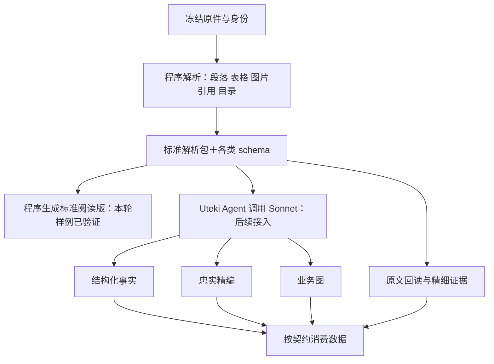

# 先定义财报解析产物，再做真实查询

2026-10-07。已完成现有解析器审计、一次 Opus 5.5 顾问评审，以及 AMD 10-K / TSMC 20-F 的真实解析包与重复导出检查。本轮新增的是实验出口与标准文档样例，尚未替换生产 `prepare`，也未运行新的模型问答案例。

**结论：先固定“原件 → 原文对象 → 标准阅读文档”的契约。结构化事实、精编文档和业务图在这份基础上加工，分别有自己的业务契约。Uteki 继续负责 Agent、模型调用、预算、工具、运行日志和证据。**

[AMD 标准阅读样例](examples/amd-fy2023-10k/document.html) · [TSMC 标准阅读样例](examples/tsmc-fy2023-20f/document.html) · [Claude 原回答](runs/opus55/answer.md) · [完整请求](context-request.md) · [调用前 Codex 草案](codex-baseline.md)

## 1. 财报到底解析成什么

以下是职责关系图，不代表所有后续产品已经完成。本轮实验落实的是上方的解析包及标准阅读版。

“数据类型”有两种含义，需要分别定义：

- **原文类型**：标题候选、段落、列表项、表格、图片引用、页标记、其他块。它们回答“材料原来写了什么、在哪里”。
- **业务产品**：事实、精编、业务图、导航索引、问题证据包。它们回答“加工之后是什么、怎样使用”。JSON、SQL、HTML 是这些产品的载体，不各自成为一种独立事实。

### 已生成的标准解析包

每份样例有 15 个文件。七份机器对象 schema 与对应内容一同导出；HTML 由块与目录确定性渲染。

| 文件 | 对象与字段 | 消费规则 |
|---|---|---|
| `source.json` | company_id、document_id、source_snapshot_id、source_url、raw_sha256、form_type、report_period_end、available_at、parser/export version、index_id、状态及定位约定 | 先核对主体、材料、版本；报告截止日不代替每个事实的期间 |
| `blocks.jsonl` | 每行一个 SourceBlock：block_id、ordinal、type、text、text_hash、source_anchor、dom_path、reported_page、style_signature、table、image_asset_id、layout_role | 按 ordinal 读；text 已规范化空白，不等于原 HTML 字节 |
| `index.json` | document/part/item 父子节点、标题、起止块、源锚点、页码、diagnostics | 导航后回读原块；不能把有节点理解为全部内容已覆盖 |
| `anchors.json` | 原 HTML anchor、DOM 路径、可空的 target_block_id | 目标已解析则回到块；未知保持空，不补指向 |
| `toc.json` | 原目录候选：part/item、编号、标题、源 anchor、页码、ordinal | 候选与已解析目录分开；冲突仍在诊断中 |
| `assets.json` | 图片引用、alt、DOM；metadata_only、bytes_not_included、OCR/vision not_run | 本包不含图像理解结果，不默认下载外链 |
| `document.html` | 来源、限制、法定目录、诊断、所有原文块及表格 | 阅读投影；块/单元格锚点使用原对象身份 |
| `schemas/*.schema.json` | source、blocks、index、anchors、toc、assets、manifest 的 JSON Schema | JSONL schema 针对一行；除类型校验外还需检查跨对象身份与关系 |
| `manifest.json` | package_id、source_identity_sha256、解析/导出版本、运行依赖和实现 hash、所有内容文件 hash/字节数 | 固定包身份；manifest 不包含自身递归 hash，验证记录另保存 manifest hash |

实际例子：[来源对象](examples/amd-fy2023-10k/source.json)、[原文块 schema](examples/amd-fy2023-10k/schemas/blocks.schema.json)、[目录 schema](examples/amd-fy2023-10k/schemas/index.schema.json)、[完整包清单](examples/amd-fy2023-10k/manifest.json)。

### 表格必须保留什么

`table` 内含 `row_count / column_count / cells[]`。每格保留 `text / row / column / rowspan / colspan / is_header`。行列从 0 起，合并格保留原始跨度。

这里保存的是原表结构。`is_header=true` 仅表示原 HTML 的 `th`，不等于已判断年度、币种或财务指标。布局表仍可能存在；外层块与嵌套表可能包含重叠文字。不能遍历全部表格求和，也不能用全部文字长度计算原文覆盖率。

字段类型规范之外，后续业务加工才定义“这个数属于什么主体、期间、单位、口径，以及表头/脚注如何限定它”。图片、远处脚注、跨表续接等尚未覆盖的能力保留缺口。

### 定位规则

完整引用需要来源/包身份，再加 `block_id`；表格精确到 `row / column`，文字可用 `char_start / char_end`。字符位置针对规范化块文字的 Unicode code point，从 0 起、末端不含。`reported_page` 是源文件的报告页标，不是 PDF 物理页。

`document.html#block-…` 和格子的 `#block-…--r…-c…` 只是这些对象的可点击显示。最终证据仍读取原文块及其 source/index/hash。不要只保存本机 HTML 路径或只保存整份报告 URL。

已有 `SourceLocator` 能表达字符区间、单元格、DOM、PDF 页和 bbox；本轮未新增公共 `read_source(cell)` 操作。当前 `outline/search/read/context/evidence` 工具在已有数据集上运行；新实验包还没有替换生产数据集接口。[证据定位契约](../../../src/uteki/domain/research_data/evidence_package.py)

## 2. 两种文档，各自怎样标准化

| 要求 | 标准原文阅读版：本轮已生成 | 财报精编：契约草案 |
|---|---|---|
| 谁生成内容 | 程序原样投影已解析块 | 模型忠实选择与压缩披露内容 |
| 结构 | 来源/限制 → 法定目录与诊断 → 原块顺序 | 固定八章；每章覆盖状态、陈述、表图引用、缺口、出处 |
| 标题 | 明确标识 heading_candidate，不能伪装成确认目录 | 使用版本模板的 section_id，标题可中英呈现 |
| 表格 | HTML 保留合并格、每格文字及坐标 | 引用原表或已校验事实，不让模型编造图表数值 |
| 中英文 | 当前保留源语言正文，说明文字双语 | 中英文共用 statement_id 和证据，各自检查忠实性 |
| 稳定目标 | 固定包和渲染实现，文件字节一致 | 固定字段、章节和显示规则；模型重跑另测事实与覆盖波动 |

精编固定八章沿用已有业务约定：材料身份与范围、业务与收入来源、分部与经营指标、财务表现与资金情况、管理层解释、风险与重大事项、重要会计政策与附注、材料缺口。

缺内容的章节显示“未覆盖 / 在指定范围和方法下未找到 / 解析待解决”等真实状态，不为了填模板编内容。不能把“未读到”写成“公司未披露”。

精编中的陈述性质与表达方式分开：例如“管理层归因”是一种性质；它既可原文引用，也可忠实转述或翻译。精编默认不加入研究推断。投资结论继续属于 Analysis Agent。

完整字段与模板见 [COMPACT_REPORT.zh-CN.md](COMPACT_REPORT.zh-CN.md)。这是拟议契约，尚未完成生产执行器。本轮的标准阅读 HTML 不冒充模型精编结果。

## 3. 其余产品复用什么 schema

| 产品 | 当前基础 | 要固定的业务含义和增量 |
|---|---|---|
| 结构化事实 | [ResearchRecord](../../../src/uteki/domain/research_data/query_contract.py)、原始提取候选、明确选择的 adapter | 主体/指标/实际期间/值关系/单位/口径/维度/来源。当前 ResearchRecord 的 status 是 candidate；引用它不自动变成已核验事实 |
| 计算值 | [ComputedScalar 与 provenance](../../../src/uteki/domain/research_data/evidence_package.py) | 公式、操作数记录、结果及显示精度。它不是所有事实的通用模型 |
| 精编文档 | 复用证据包/运行工件/范围契约，新增明确的精编内容契约 | AnnualNarrative 当前含 thesis、valuation、inference，不能原样当精编 schema |
| 公司业务图 | [BusinessMap](../../../src/uteki/domain/business_map/models.py) | 业务、产品/服务、客户、赚钱方式、关系、未知、证据和审核状态；仍需衔接当前块级证据与主流程 |
| 导航索引 | [DocumentIndex](../../../src/uteki/domain/documents/models.py) | 原法定目录与未来语义主题分开；模型摘要是导航产物，不单独当根证据 |
| 查询证据包 | [EvidencePackage](../../../src/uteki/domain/research_data/evidence_package.py) | 已选范围、source_companies、源工件、派生关系、覆盖与缺口；semantic_completeness 当前明确为 not_evaluated |

每类产品维护版本化 schema。各实例引用 schema 及输入/执行身份。模型还需读到字段语义和具体访问方式；仅导出 JSON Schema 不能保证准确消费。优先扩充现有 `get_data_schema`、typed query、DocumentReader，正式接入时再测试消费者，不在本轮虚构统一接口已完成。

## 4. 本轮真实验收结果

| 项目 | AMD FY2023 10-K | TSMC FY2023 20-F |
|---|---:|---:|
| 原文块 | 1,184 | 1,929 |
| HTML 表格（含布局表） | 76 | 506 |
| 单元格 | 7,429 | 67,764 |
| 导出文件 | 15 | 15 |
| 两个不同目录完整导出 | 全部文件字节相同 | 全部文件字节相同 |
| HTML 中块顺序/单元格文字/合并关系 | 与包内容一致 | 与包内容一致 |
| 法定目录 | 4 part / 23 item；仍有 8 条诊断 | 3 part / 0 item；item_unresolved error |

已执行 5 项合成验收测试，包括隐藏 XBRL、Unicode/空白、嵌套表、合并格、转义、另一主体与期间、10 组无效或冲突范围、输入/包篡改、已有输出拒绝覆盖。另一次独立审阅核对了两个真实样例的完整单元格跨度无重叠/越界，以及 6 种范围负例明确拒绝。

[实际验证记录](verification.json)固定了输入、输出 hash、Python/lxml/libxml2/Pydantic 版本和实现 hash。包文件不含执行时间或本机绝对路径。调用方必须选择公司、来源、期间和支持版本；未知 scope/version 直接拒绝。

**通过的是“包内部一致”和“当前环境重复导出一致”。尚未证明源材料完整、表格业务语义正确、任意报告通用或跨运行环境字节一致。** TSMC 的目录完整性没有通过。AMD 的锚点冲突仍需核查。图片仅引用，未 OCR；没有浏览器视觉验收。

后续需增强：独立解析包验证时再次检查全部 anchor 目标；将完整表格跨度占用检查纳入常规验证器；按版本化原文对照样本检查遗漏与定位。当前构建时已验证 anchor 目标，两个真实样例完整跨度另行检查通过；不为这些增强重写已经冻结的本轮输出。

### 如何证明没有“稳定地错”

- **结构门禁**：schema、身份、引用、范围、hash、格坐标合法。
- **来源门禁**：独立对照原 HTML 中的段落/表格/限定条件；法定目录缺失与冲突不能被重复性成功掩盖。规则需要支持相应 form 及版本，不能简单要求每份文档都出现同一套 Item。
- **业务门禁**：给每项任务建立明确的应提字段、证据清单、期间/单位/口径反例。计算恒等式只用于语义适用且口径一致的值，不能任意相加。
- **模型稳定性**：同一冻结输入重复运行，先比较关键事实与证据支持、覆盖和缺口，再比较措辞。不同但同样有效的证据位置应核验等价性，不能只因 locator 不同就判事实错误。
- **发布门禁**：结构有效的候选包可以保留缺口供进一步阅读；不得自动发布成“内容已完整核验”。采用后的产物固定版本，后续消费复用该版本。

本轮没有报告准确率或完整率，因为尚无覆盖整份两报告的独立标准答案。schema 和 hash 都不能单独证明语义正确。

## 5. PageIndex 接在哪里

**当前 SEC HTML 沿用自有解析器，借鉴树导航方法。真实 PDF 后续可只复用固定版本的 `page_index_flash(pdf, summary=False, optimize=False)` 生成目录候选。**

Flash 返回 PDF 标题树及物理页范围，不提供本项目需要的完整稳定段落块、表格单元格集合。它不能替代本轮的解析定义。目录映射到 Uteki 原文块后，再通过同一证据机制使用。

不接其整套 `submit_document/chat`，因为会增加另一套模型调用、重试、并发、缓存与执行循环。需要模型做摘要或导航时，仍由 Uteki 显式调用 Sonnet/Opus。

这是固定源码的接入判断，尚未在本项目安装或实际运行 PageIndex。[详细取舍与来源](PAGEINDEX.zh-CN.md) · [固定版本 Flash API](https://github.com/VectifyAI/PageIndex/blob/6d23caf416858f2ca136840305d1f479a86f6ef7/pageindex/flash/api.py)

补充：Uteki 已有基础 PDF bbox 文本解析路径，但对表格、图片和 OCR 明确未验收；不能把这个基础等同于 PDF 解析包已达到 HTML 的能力。

## 6. Claude 回答：采纳与修正

Opus 5.5 赞同先定义解析层。采纳它强调的：规范序列化、全局引用带包身份、阅读 HTML 只是投影、结构有效与内容完整分别判定、增加独立正确性检查。

原回答保留不改。以下建议经过源码和业务边界复核后作修正：

| 原回答 | 审核结果 |
|---|---|
| 用 DOM 路径前缀建立 containment，并隐藏内层或外层重复文字 | DOM 包含不证明文字完全冗余。外层还可能有独有文字。可以以后增加包含关系帮助导航，但本轮保留规范块，不做未经验证的去重，不报告简单叶块覆盖率 |
| narrative 上只加四个字段即可成为精编 | 当前 AnnualNarrative 是分析输出，含估值与推断。精编需要独立内容约束，复用 EvidencePackage/运行记录，而非套用分析职责 |
| 精编包含 inference，cell locator 是新增能力 | 忠实精编不默认加入研究推断；SourceLocator 已有 cell/字符坐标。本轮不重复造定位类型 |
| 结构化事实以 ComputedScalar / adapter 表示 | 原文提取、ResearchRecord、注册计算是不同来源。ComputedScalar 只表示计算结果；事实也可能由模型提取后校验 |
| package_id 仅由原文 hash 与解析/导出参数生成 | 本轮包身份额外绑定显式来源/公司/期间、实际文件及运行实现，避免忽略身份或实现变化 |
| assets 要包内相对文件路径 | 本轮只保留图片引用，不能编一个不存在的本地文件路径。显式标记字节未包含 |
| 模型重跑 locator 必须完全相同 | 数值、单位、期间、含义及支持关系优先；不同有效引用需核对，不能把文本或位置变化自动算错误 |
| Uteki 是否已有 PDF 解析未知 | 源码已有基础 bbox 文本路径，图片/表格/OCR 不完整；已在上节补充 |

## 7. 本次真实顾问调用

| 字段 | 记录 |
|---|---|
| 渠道 / 模型 | AIHubMix / claude-opus-5-5 |
| 开始时间 | 2026-10-07 03:15:14，Asia/Shanghai |
| 配置 | adaptive thinking、high effort、max_tokens=16000、stream=false、300 秒超时、重试 0 |
| 未发送 | temperature、top_p、top_k、seed、缓存控制、工具 |
| HTTP / 结束 | 200 / end_turn |
| 输入 / 总输出 token | 4,798 / 7,884；输出包含平台返回的 3,026 thinking tokens |
| 缓存 | 读写均 0 |
| 耗时 | 113.24 秒 |
| 公开价估算 | **$0.176872** = 输入 $0.019192 + 输出 $0.157680 |

价格来自 [AIHubMix Opus 5.5 页面](https://preview.aihubmix.com/model/claude-opus-5-5)，本轮重新核对输入 $4/M、输出 $20/M。未核对账户账单。模型名称是平台回执声明，不是底层权重的独立验证。

冻结请求、配置和依赖验证通过；只有一次调用，账本无未知或在途请求。[调用核验](consultation-verification.json) · [平台回执](runs/opus55/receipt.json)。这是顾问评审，不是模型自主执行财报解析或检索测试。

## 8. 后续顺序

1. **立即下一步：把这份解析包契约接入系统现有 prepare 与消费入口。** 保留已有 schema 的兼容边界、诊断及历史快照；补来源对照与目录问题，先不宣称通用 20-F 完整。
2. **随后：接入 Sonnet 原生 Messages 的共享运行时，再跑按契约消费的真实数值/业务案例。** 当前原生调用已在实验跑通，但通用 planner 仍是另一种适配和参数；仅换模型名不构成完整接入。循环、预算、配置快照和工具日志仍在 Uteki。
3. **再扩展：真实章节精编与业务图，分别定义评测；有真实 PDF 需求后验证 PageIndex Flash 组件。** 保留同一原文根证据，多次模型运行比较语义与覆盖，不强求新调用逐字相同。
