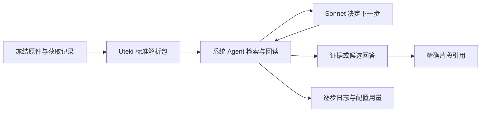

# 标准解析包与系统 Agent 实测

2026-10-07。本轮将已确认的解析输出接入正式准备流程，并用系统 Agent 顺序运行两项真实任务。模型为 AIHubMix `claude-sonnet-5-5`，不是脚本代填步骤。Codex 只负责准备显式输入和事后独立核验。

## 已实现的链路

这条链路已实际运行。PageIndex 未安装或接管执行；沿用现有目录与原文读取工具。解析为本地程序，Sonnet 用于查询决策、引文选择及业务回答。

## 标准输出

正式 HTML 解析包使用 `uteki-parsed-document-v1`。`sources.json.parsed_package` 登记包、版本、阅读文档及 manifest 哈希。兼容原有块与索引接口。

| 文件 | 含义与消费方式 |
|---|---|
| `source.json` | 公司、原件、报告期间、可知日期及版本身份 |
| `blocks.jsonl` | 正文块、表格单元格与源定位；原文回读及精确引用 |
| `index.json` / `toc.json` | 源范围与目录导航；导航本身不算事实证据 |
| `anchors.json` | 正文及单元格到稳定 HTML 锚点的映射 |
| `assets.json` | 原图等资源说明；当前不代表图片已读或已 OCR |
| `document.html` | 由同一块和单元格生成的标准阅读版，保留表格跨度与内部链接 |
| `schemas/*.json` | 上述七种机器数据的 Schema，说明字段与约束 |
| `manifest.json` | 所有内容文件哈希、版本、实现及运行环境指纹 |

标准阅读版呈现已解析原文。精编报告需要另一份语义契约和模型验收，不能把阅读 HTML 当作精编。

| 正式包 | 正文块 | HTML 表格节点 | 单元格 | 重建一致性 |
|---|---:|---:|---:|---|
| AMD FY2023 10-K | 1,184 | 76 | 7,429 | 15/15 文件逐字节一致 |
| TSMC FY2023 20-F | 1,929 | 506 | 67,764 | 15/15 文件逐字节一致 |

表格节点数包含版式表格，不等于财务报表数。核验覆盖包哈希、来源身份、HTML 内部锚点和临时目录重建；没有宣称全部财务语义或正文完整性通过。见 [包核验](review/package-verification.json)。

- [AMD 标准阅读版](prepare-amd/dataset/indexes/source-291485b98a75d8cfabe47571/document.html)
- [TSMC 标准阅读版](prepare-tsmc/dataset/indexes/source-6719837a8d24b2b7df359f29/document.html)

## 两项真实任务

两项均使用新 AMD prepared_run，只选择 `source-291485b98a75d8cfabe47571`，原件 SHA256 为 `47955f5d3d309e40c53ac7243dc955c8c1b594605fa938db1b5c411aaf2aa808`。截止日为原获取记录的 2026-10-04。模型看不到 [独立参考答案](review/oracle.json)。

| 运行 | 实际结果 | 请求数 | 公开价估算 USD |
|---|---|---:|---:|
| `cashflow-source` | 失败留档：XML 工具标记污染 JSON，连续无进展后停止 | 3 | 0.082440 |
| `cashflow-source-r2` | 返回现金流目标行、年度标题和单位原文 | 17 | 0.684902 |
| `business-source` | 返回四个可报告分部、产品及 All Other 的归属，有逐项引文 | 12 | 0.490530 |
| **累计** | 两项成功任务及首次失败，沿用同一账本 | **32** | **1.257872** |

共享预算为 2 USD，累计请求上限 40。计费输入包括每一步的系统说明、Schema、规范、状态与已读取材料，不能拿这些多步骤总额与一次小段提取直接比较。估算不是供应商账单。

独立复算：596,551 input tokens、6,477 output tokens、缓存 0；输入估算 1.193102 USD，占总额约 95%。32 个请求的完整发送字节哈希与配置指纹已逐一重建核对，账本全部结算，无未知成本；见 [费用核验](review/cost-verification.json)。这只能核对我们发送和网关返回的记录，不能验证网关内部路由、重试或模型权重。

两次成功运行的 29 次调用中：2 次 JSON 格式失败、3 次本地契约失败、5 次缺 `requirement_ids` 被宿主拒绝、1 次重复目录读取、18 次当前流程有用步骤。11 次失败/重复估算 0.426400 USD，占两轮费用的 36.3%。现金流正文共 2,038 字符，却分成 1,000 + 1,000 + 38 三次读取，说明分页也有优化空间。这是日志归因，不代表改动后已证实能省去相同费用。见 [协议审查](review/protocol-review.json)。

现金流结果保留原行 `1,667 / 3,565 / 3,521`，以及截至 2023-12-30、2022-12-31、2021-12-25 的列头和 `(In millions)`。这些是证据摘录；本例没有将数据写入数值库，也没有执行 SQL 或计算变动。主体和期间来自显式范围，不替换为自然年边界。

业务回答列出 Data Center、Client、Gaming、Embedded 及各自产品，并按原文说明 All Other 不是可报告分部。系统状态 `evidence_ready` 表示引用检查通过；语义验收另见 [答案对照核验](review/answer-verification.json)，不会自动发布为已采纳事实。

工作台结果与过程：

| 任务 | 结果 | 过程 |
|---|---|---|
| 现金流证据 | [查看](http://127.0.0.1:8765/agent-results?agent=data&run=run-18a2073770c349d39c259b269437f69c) | [步骤与调用](http://127.0.0.1:8765/agent-runs?agent=data&run=run-18a2073770c349d39c259b269437f69c&tab=process) |
| 业务分部 | [查看](http://127.0.0.1:8765/agent-results?agent=data&run=run-513f028ea7bc4a438a8b40fba4e5056b) | [步骤与调用](http://127.0.0.1:8765/agent-runs?agent=data&run=run-513f028ea7bc4a438a8b40fba4e5056b&tab=process) |
| 首次失败 | [查看](http://127.0.0.1:8765/agent-results?agent=data&run=run-3da2bf878d924f40864d2ba7a9a64ebe) | [步骤与调用](http://127.0.0.1:8765/agent-runs?agent=data&run=run-3da2bf878d924f40864d2ba7a9a64ebe&tab=process) |

## 配置、协议与稳定性

本轮显式发送 `thinking.type=adaptive`、`output_config.effort=high`、`max_tokens=8192`、`stream=false`。请求超时 180 秒，隐藏重试为 0。不发送 temperature、top_p、top_k、seed 或 `between_tools`。每次调用保存配置快照、请求与提示词指纹、可见输出、响应 ID、返回模型与原始用量；不落盘隐藏思考。

首次失败后只明确了决策协议：当前请求不提供模型可直接调用的工具；模型用一个 JSON 对象提交动作，Uteki 执行。原始返回不截取、不清洗。首次失败保留；修复后的两项仍发生了格式或缺字段纠正。这说明本轮实现可完成任务，但尚不能声称稳定无错或输出完全相同。

当前为“提示词约束 + 宿主 Schema 校验”。没有启用供应商原生 JSON Schema。原生结构化输出值得下一轮试验，但现有完整决策 Schema 超过官方复杂度限制，需先裁剪只读任务的传输结构；AIHubMix 还可能降级，必须记录降级信号。参考 [Claude 官方约束](https://platform.claude.com/docs/en/build-with-claude/structured-outputs) 和 [AIHubMix 结构化输出](https://docs.aihubmix.com/cn/api/Structured-Output)。

固定原件和版本可得到确定的解析字节。固定模型配置只能提高实验可比较性，不能承诺供应商内部路由或模型输出确定性。本轮两种任务各一份成功运行，不是重复稳定性 benchmark。

## 冻结记录与验证

- `inputs/manifest.json`：首轮输入、价格、依赖及源码指纹。`freeze_inputs.py` 只生成显式案例输入，不读取评审答案。
- `inputs/repair-1-code.json`：修正协议后的执行版本。模型、问题、材料及共享账本不变。
- `prepare-amd/`、`prepare-tsmc/`：独立新产物及原获取记录关联；旧快照未改动。
- `runs/`：三个冻结运行，包含失败、每次决策、工具回执、证据与用量。
- `review/`：独立参考答案、解析包复核、实际答案复核、费用及协议审查；这些文件未送入模型。
- 重放入口的 role/form 非字符串校验在实测运行启动后又加了一项前置拒绝；最终代码指纹单独记录，不冒称旧运行使用了该补丁。

离线检查覆盖确定性包、跨公司/期间与缺失范围、重放与旧 prepared_run 兼容、原生适配与实际 SDK Runner、费用未知/截断/并发取消等相关边界。真实工作台通过接口确认三次运行已登记，未做浏览器外观检查。

## 后续优先级

1. 缩小每一步的决策 Schema，消除可避免的格式/缺字段调用；再以同一小任务重复运行，比较成功率、语义一致性、耗时和总成本。
2. 补齐数据业务能力：明确支持周制财年与 IFRS 的适配方案，再验收真正的结构化数值提取与查询。当前 AMD 和 TSMC 新数值库均为 0 条支持记录，这个缺口没有被原文读取成功覆盖。
3. 接入财报精编的独立契约和验收。TSMC Item 目录、图片读取及后续 PDF PageIndex 导航仍单独保留为未完成工作。
