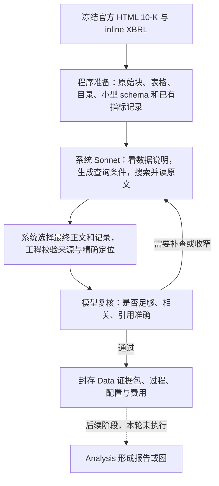

# Data Agent：本轮交付说明

当前重点是：**让系统独立把一个问题变成小而足够的原始证据包，并让每条数据能回到具体原文。** 第四轮六题已经完成系统自主取材、模型复核和 Codex 独立原文验收。已读目录分页修复后的微软业务原题也通过独立验收，统一页面与费用已封存。

例如，问“Microsoft FY2025 与 FY2024 的公司总收入是多少”，系统应自行找到损益表，返回两个年度的数值、单位和期间，再带上可核对的原始表格及具体单元格。调用者提供公司、报告范围和问题，不需要替它指定章节或表格。

## 原材料已经被处理成什么

准备层用程序解析 HTML 和文档内已有的 inline XBRL 标记，不依赖 LLM 重新抄写整份财报。两份冻结材料合计 **2,739 个原始块、270 张表格（含布局表）、213 条现有指标记录**。

| 冻结材料 | 原始块 | 表格 | 已有指标记录 |
| --- | ---: | ---: | ---: |
| Microsoft FY2025 10-K | 1,401 | 85 | 102 |
| Alphabet FY2025 10-K | 1,338 | 185 | 111 |

原始块保留正文、表格、出处和定位。目录帮助按章节寻找材料；小型 schema 说明有哪些公司、来源、期间、指标和可用查询条件。当前实际记录覆盖收入、营业利润、净利润、经营现金流、资本支出现金支付五类。**213 条不是 213 个独立指标**：包含多个期间和原件内重复披露，仍是候选记录，不能因此称财报全部结构化提取完成。

详细核查见 [准备层说明](preparation-review/README.md)。输入固定到公司、报告、snapshot、来源政策和截止日期；范围缺失或不支持时报告缺口，不自动换公司、换年度或用样例补值。

## 系统实际负责哪些工作

系统使用 AIHubMix 的 Sonnet 5.5 做查询决策和内容复核。它先看目录和数据说明，再决定查哪些记录、搜索哪些内容、读哪些原文，并显式选择最终交付。查询是受约束的 QueryPlan 和参数化执行，不是任意 SQL。探索过程中读过的内容，不自动全部混入最终答案。

工程层负责核对范围、原件 hash、字段、引用和选材边界。数值引用可以保留字符范围及原始单元格；正文保持可定位的原始块。模型复核可要求补查或删除冗余，系统在新 attempt 中继续；每题最多三个 attempt，网络和复核重试也有界。历史失败、部分产物及未知费用预留均保留。

Codex 的职责是开发、测试、监控和封存后的独立验收。它不在真实运行前替系统指定业务章节、表格或预期答案。独立评估资料放在 `evaluation-only/`，不作为系统输入。模型复核通过与独立内容验收分别记录。

## 这次验证哪六类问题

| 问题 | 交付原文 | 自主取材轮数 | 独立验收 | 已知费用估算 |
| --- | ---: | ---: | --- | ---: |
| Microsoft 业务 | 18 块 / 3,720 字符 | 2 | [通过及边界](evaluation-only/msft-business-v4-review.md) | $3.522 |
| Alphabet 业务 | 25 块 / 6,968 字符 | 2 | [通过及边界](evaluation-only/googl-business-v4-review.md) | $2.790 |
| Microsoft 两年收入 | 3 块 / 957 字符 | 1 | [通过及边界](evaluation-only/msft-revenue-v4-review.md) | $0.717 |
| Alphabet 两年收入 | 4 块 / 729 字符 | 1 | [通过及边界](evaluation-only/googl-revenue-v4-review.md) | $0.640 |
| Microsoft Cloud 口径 | 18 块 / 4,741 字符 | 2 | [通过及边界](evaluation-only/msft-cloud-v4-review.md) | $5.225 |
| Alphabet 回购 | 10 块 / 2,273 字符 | 1 | [通过及边界](evaluation-only/googl-buyback-v4-review.md) | $0.991 |

原问题见 [六题清单](cases.json)。**[打开统一验收页面](http://127.0.0.1:8769/docs/design/data-agent-acceptance/data-agent-evidence-v1/)**，包含原六题和一次目录分页针对性复跑。每行可查看最终原文、逐步过程和独立评估。 上表包含每题内的修订与复核调用；Microsoft 业务另有一次未知费用预留，未计作零。费用采用冻结公开价表估算，不是供应商账单。六题的独立验收另有逐题文件，用户视觉验收仍未执行。

## 导航修复与费用

六题矩阵使用 v13 业务覆盖规则。随后针对曾触发重复查找的目录缺口，补上 v14 分页快照，并用同一微软业务原题新跑 `msft-business-r6`。最终 **19 块 / 3,738 字符**，两轮交付后独立验收通过；首次过宽的 35 块由系统自行精简。真实日志记录了 57 项已读目录的后 24 项翻页，没有将目录当正文阅读，也没有触发无进展终止。[针对性复跑验收](evaluation-only/msft-business-navigation-v1-review.md)。这不是将旧六题改写成 v14 全矩阵，也不证明所有未来运行逐字稳定。

| 费用范围 | 已知估算 |
| --- | ---: |
| 第四轮六题，含各自自动修订与复核 | $13.884824 |
| 目录分页修复后的针对性复跑 | $2.217006 |
| 本轮全部调试、探测和验收调用 | $46.617866 |
| Claude 顾问，含首次截断回复 | $0.389596 |
| **本轮累计已知估算** | **$47.007462** |

前两行是本轮调用总额的子集，不再相加。另有 **$1.244776 未知费用预留**，不代表已扣款，也没有清零；所有在途调用已结束。以上使用冻结公开价表估算，供应商实际账单未取得。[账本汇总](validation/cost-summary.json)保留计费口径，迁移副本没有重复记账。

准备核查、工程测试、真实模型复核、Codex 独立原件检查分开保留。相关工程检查通过；目录修复额外完成 87 项受影响测试，包含合成的多源/跨范围/旧游标边界。原件预览完成 HTTP 字符/单元格定位与错 hash 拒绝检查。未进行本轮浏览器视觉验收。

## 边界与下一步

本轮范围是 Microsoft、Alphabet 的冻结 FY2025 HTML 10-K，以及其中可核对的比较期间。它不代表 PDF/OCR、10-Q、8-K、20-F 或任意新公司均已验收。准备层记录有限；不支持的财务概念仍需新增明确适用的适配和验证。

PageIndex 是目录检索的参考方向，**其服务尚未接入，本轮也没有与 PageIndex 做效果对照**。当前实现使用本系统的冻结目录、数据说明和取材工具。Analysis 报告、业务图和更广泛官方来源获取，不在本轮六题完成声明内。

最终表格可能保留原表中的其他行，因为目前按完整原始表格交付；这不等于已经实现任意单元格子表生成。引用精确定位也不等于模型输出逐字可复现，或本轮已对所有页面做视觉验收。

紧接着的一项：**用用户另给、未参与调试的公司与问题做保留验收。** 随后才扩展资料格式、财务提取范围及 Analysis 消费；本轮不提前宣称这些已完成。

## 查看与换机接续

- [本轮 README](README.md)：查看单题产物、生成新配置、执行真实重跑及私密文件边界。
- [换机交接](../../../docs/MACHINE_HANDOFF.zh-CN.md)：依赖、运行入口、密钥和私密账本迁移。
- [异地仓库根目录验证](validation/replay-config-v3-relocation.json)：已在 `/private/tmp` 的另一目录实际生成六份配置并逐份校验；这验证路径搬迁，不代表另一台机器已安装依赖。

新机器应从自身仓库位置生成**新配置、新输出目录**。旧冻结 JSON 内的绝对路径不能直接复用，也不要修改历史 JSON 来伪装重放成功。API key 只留本机 `.env`；费用账本和私密 Claude 会话单独迁移。公开财报、代码、普通配置、过程和验收材料按仓库交付；未迁移的旧账本不能解释为历史费用为零。
