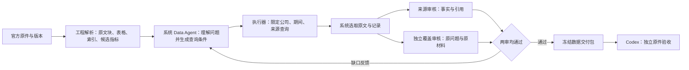

# E1 受限评测交付：独立材料验收与模型对照

这轮验的是 Data Agent 是否交付足够且聚焦的原始材料，不是让它生成分析报告。**7道冻结题都有通过的阶段结果；E1-04的Sonnet、Qwen、DeepSeek受控对照已经完成。三路材料均独立3/3，Sonnet/DeepSeek流程通过，Qwen流程未放行。**

最关键的变化是 E1-06：独立问题审核先指出 Azure 自身定义缺口，再把缺口交回系统，系统自主补入原件 block 127，最终独立 7/7、聚焦及流程通过。Codex 没有把该块位置或参考答案提供给运行模型。E1-04 旧基线与 E1-05 的流程通过包含取材后补审恢复；E1-06 也从旧查询恢复后修订，不能把这些恢复结果称为七题在同一实现下从零一次成功。严格最小材料目标仍未达到。

## 这轮实际做了什么

| 工作 | 结果与边界 |
|---|---|
| 系统发现、获取两份年度原件 | Microsoft FY2024、FY2025 官方 SEC HTML 10-K；身份、日期、raw hash均保存。Codex未替运行Agent选语义章节 |
| 重复获取验证 | 第二次获取复用两份已核验原件，不新增重复对象 |
| 工程解析与准备检查 | 2,951原文块、204候选指标出现记录；48组跨报告同指标/期间，29组值相同、19组不同。保留版本，不简单相加或覆盖 |
| Codex独立评测基准 | 7题在各自运行前冻结；独立回读原件、邻段、原始数值/XBRL期间、可替代来源。答案隔离，不交给运行模型 |
| 真实系统基线 | 见下表；成功、失败、恢复及全部调用分别保存。系统自行搜索、读取和选择 |
| 独立内容评审 | 逐题判断必需项、遗漏、冗余、出处；模型自审放行不等于验收通过 |
| 费用与模型准备 | 同一强制账本计入失败和未知；冻结实现后串行完成E1-04三路对照，账本/收据核对一致，保留内容与流程结果差别 |
| 可读交付 | 问题、实际给了什么、够不够、缺什么、多什么放在页面主体，日志折叠；原文按块定位 |

7题的可读交付见 [验收页 v3](../../../docs/design/data-agent-acceptance/e1-evidence-benchmark-v3/index.html)（[原机本地服务](http://127.0.0.1:8769/docs/design/data-agent-acceptance/e1-evidence-benchmark-v3/)）。页面已生成，HTTP200、86个链接/锚点检查通过；三模型可读交付见[比较页](../../../docs/design/data-agent-acceptance/e1-model-comparison-v1/index.html)（[本机入口](http://127.0.0.1:8769/docs/design/data-agent-acceptance/e1-model-comparison-v1/)），HTTP200及4个链接检查通过，没有进行视觉审查。完整结论和独立审阅入口列在下方。

## 当前逐题结果

| 题 | 问题 | 实际独立结论 | 已知估算USD |
|---|---|---|---:|
| E1-01 | FY2024原年报总收入 | 3/3；出处/期间正确。整表附带767字符待压缩 | 0.700380 |
| E1-02 | FY2025报告中的FY2024比较数 | 3/3；原件版本区分正确。整表附带777字符待压缩 | 0.765630 |
| E1-03 | 两份原件同年总收入核对 | 3/3；两个出处保留，不把它们相加。整表附带1,544字符 | 1.092950 |
| E1-04 | 截至2024-08-01可得材料 | 内容3/3，全过程没有未来报告正文；原r2审核失败，单独恢复后成功 | r2及恢复0.790512；此前失败r1另0.527150 |
| E1-05 | 三分部及核心业务 | 原版核心4/4、聚焦失败；系统自主删除490字符历史段，独立4/4及聚焦通过，复用相同17块材料补审成功。仍有320字符块内说明可压缩 | 三轮累计2.493072 |
| E1-06 | Cloud、IC、Azure口径与指标 | 双审恢复r2：2次attempt，系统新增Azure自身定义原文，独立7/7、聚焦/流程通过；第一attempt复用旧r4取材，第二attempt自主补查。旧r3/r4与Opus漏项记录仍保留 | 最新双审恢复1.934868；含全部失败、修订、Opus与probe累计16.410434 |
| E1-07 | 分部口径重列跨年对照 | r2一轮ready且独立4/4；6条记录分别限定来源，保留原年报/后年比较口径。附表仍有767字符非目标内容 | r2为1.714248；含失败r1累计4.601018 |

本轮调用已结束，最终记录为 **344次请求，已知估算$28.4473026834 + 未知预留$0.0358508674 = 总承诺$28.4831535508**。其中2次unknown保留，零在途，账本与收据核对一致。上述逐题表是模型对照前的累计$27.381146；新对照另加，不漏算旧失败。历史费用保持可追溯：

| 费用节点 | 本次已知增加USD | 累计已知USD | 说明 |
| --- | ---: | ---: | --- |
| 273次已结算调用 | — | 25.167836 | 已逐reservation核对结束收据一致 |
| 独立审核机械协议修复probe | 0.081852 | 25.249688 | 274次；当时未知/在途均0 |
| E1-06 双审恢复r1 | 0.196590 | 25.446278 | Q语义已发现缺口，但问题subject非原问题精确子串，严格协议拒绝；保留失败 |
| E1-06 双审恢复r2 | 1.934868 | 27.381146 | 先复核原r4材料，再自主补查；2次attempt，最终独立通过 |
| E1-04 Sonnet 新运行r3 | 0.683916 | 28.065062 | 9次调用，独立3/3，流程通过 |
| E1-04 Qwen 新运行r1 | 0.2480091834 | 28.3130711834 | 30次调用；另保留0.0358508674未知预留；内容3/3、流程未通过 |
| E1-04 DeepSeek 新运行r1 | 0.1342315 | 28.4473026834 | 9次调用，独立3/3，流程通过 |

用户总授权100美元，同一账本目前分段释放到40美元。失败与恢复不重新获得额度；实际供应商账单尚未对账。双审费用包含来源审核和独立问题审核，统计须同时读取 `usage` 与 `question_usage` 或共享账本，不能漏算第二审核角色。

## 三模型对照：同一道题，材料与流程分开判断

三路使用同一E1-04问题、冻结数据和程序/Skill版本，planner与worker一起替换；来源审核固定Sonnet high。本组固定为planner、worker、来源reviewer三个角色，没有启用E1-06可选的独立问题审核。Qwen的误拒绝没有在这次比较中被修复，也不能把这组费用与双审恢复费用直接比较。它是小范围混合系统对照，不是所有参数相同的底模排名。

| 取材角色 | 渠道 / 推理 | 独立材料 | 系统流程 | 原文字符 | 调用 / 请求窗口 | 已知估算USD | 未知预留USD |
| --- | --- | --- | --- | ---: | --- | ---: | ---: |
| Sonnet `claude-sonnet-5-5` | AIHubMix / high | 3/3 | 一轮通过 | 947 | 9 / 46.162秒 | 0.683916 | 0 |
| Qwen `qwen3.8-flash` | AIHubMix / low | 3/3 | attempts_exhausted | 1,123 | 30 / 1,590.476秒 | 0.2480091834 | 0.0358508674 |
| DeepSeek `deepseek-flash` | 官方 / low | 3/3 | 一轮通过 | 947 | 9 / 38.450秒 | 0.1342315 | 0 |

planner/worker显式输出上限均为8192，固定来源reviewer为12000；不同模型的推理token与采样协议不是相同语义。质量、错误次数、缓存/推理用量及provider计价分别保留。费用只覆盖在已有冻结材料上的取材与固定来源审核，不包含从零获取/解析全部财报或Analysis报告生成。请求窗口包含失败/重试，是此轮实际起止范围，不是纯模型推理延迟或稳定性能基准。

这道题中，DeepSeek以较低估算费用交付了与Sonnet同等覆盖、相同正文范围的材料。可作为后续复杂题的低成本候选，不能据此改成“所有任务都比Sonnet好”。Qwen虽材料够用，但额外30次调用、约26.5分钟和两次未知计费，流程仍失败，不把较低单价包装成最好方案。

Sonnet/DeepSeek各947字符＝112必需＋68必要上下文＋767整表附带。Qwen的1,123字符＝112必需＋116必要上下文＋128无关过渡报告模板＋767整表附带；比前两路多176字符，未提高所需答案覆盖。三者均符合原冻结整块标准，**都未达到严格最小材料目标**。

### 最终正文很短，为什么仍有大量API输入

947字符是最终交付正文，不是全程API输入。实际8次取材调用保留的provider原字段为：

- DeepSeek：`prompt_tokens=211489`，`completion_tokens=4424`；其中 `reasoning_tokens=3374` 已包含在completion中，不能再相加。
- Sonnet：`input_tokens=298301`，`output_tokens=2070`。

以上只计各自8次取材，固定来源审核另计；不同provider字段不合并成一个假定同口径的token总量。目录、schema、工具结果及历史上下文会多次发送，最终审核packet也约99KB，因此不能用交付字符数推断调用输入或费用。

后续可以减少重复上下文和传输开销，同时保留可核验的过程快照；这项优化本轮尚未完成。降本不能删除回答问题所必需的证据，也不能把缓存/推理token重复计价。

## 发现的问题，以及解决路径

1. **获取被网络环境阻断。** SEC在本机代理下返回fake-IP；默认公开地址检查正确拒绝。新增显式可信本机代理模式，目标仍限定SEC、TLS验证与跳转检查保留。真实获取及重复复用已验证。
2. **模型输出协议例子含糊。** load_skill外层载荷类型和requirement字段互斥表达不足。修正通用形状例子和字段矩阵，保留严格拒绝，不替模型修内容。E1-03随后未发生同类失败；一次样例不能证明稳定。
3. **资料截止日被误当观察期间。** 只允许与不可变scope相符、明确标注资料可得日的子句。普通日期、冲突年份、未支持期间仍拒绝。合成数据和真实E1-04验证通过。
4. **允许查询的来源被误当必须交付的来源。** scope是允许范围，当前包明确列出应审来源。未来来源可以有排除元数据，不能强制补读正文。保留原失败，复用相同query恢复审核成功。
5. **模型漏交逐块审核。** 新提示列明当前需要审核的全部块身份；诊断输出缺少的已知身份和额外数量，不放宽校验。随后真实E1-05补审已正常交付逐块审核；复杂题继续检验。
6. **模型自审没有去掉多余整段。** 加入通用逐块删除测试：删后还能充分回答就应剔除；背景有帮助不等于必需。不可分割块的局部冗余单列，不为了短而漏材料。新真实修订已由系统自行删除490字符整段历史；后续审核只争议44字符过渡句，独立按原冻结标准允许，通用规则收紧后同一材料补审通过。
7. **复杂查询循环收敛失败。** E1-06重复读取目录尾页，又把“禁止推算”膨胀成要求原文证明“未披露”。停止保护正常留下失败，最终未交付。完整日志确认停止保护正确：末次检索是旧命中，目录尾页也已读过。问题在输入仍提示“省略4条”，却没告诉模型这4条此前已看；新未读线索还会被首8条旧线索挤出。已补充持久已读状态和未读线索优先，保留3次空转保护。r3因此完成交付，但独立验收随后发现缺失一个概念自身定义；这属于语义覆盖问题，和目录循环分开记录。
8. **语义上把组合归属当作概念定义。** r3/r4已解释财务组合包含Azure，却没有Azure平台自身定义。继续增加提示仍没有解决；Opus读同一作者计划也沿用了替换后的对象。于是单独审核只接收原问题、来源身份、已选完整正文，不接作者requirements/facts/旧评语。首个Sonnet小probe正确发现定义缺口，但把对应指标误扩成独立金额，还要求原文直接写出最终关系。v2把定义、限定口径的已披露指标、供分析使用的原始前提分开；结构化records/XBRL期间用机械字段保留，避免把元数据丢掉造成假缺失。第二次probe误将定义标为complete+qualified_disclosure，严格校验成功拒绝；一次通用协议修复只反馈组合规则、不注入主体或答案，最终只保留真实定义缺口。3次probe分别$0.071164、$0.074890、$0.081852。随后把两审接入生产恢复链路：材料审核和原问题审核分别冻结，程序只在两者均通过时放行，缺口返回系统自主修订。首次完整双审的语义判断已正确，但模型把问题subject改写成非原文连续子串，host严格拒绝。通用机械修订因此补充原问题引用规则，每次问题审核最多一次、不指定答案或段落。本次两个attempt各发生一次机械修订，全部计费。最新r2第一attempt复核旧r4材料并返回定义缺口；第二attempt由系统自主搜索、读取并新增Azure定义原文，独立7/7及聚焦/流程均通过。此轮证明受限案例的真实自主补材闭环，不证明所有问题都不会漏项。
9. **预算上调后冻结查询无法恢复。** 原比较把预算额度视为不可变模型配置。现在只允许同一账本已记录授权的单调升额；核对完整授权链、实际余额上限，其余范围/模型/请求限制保持一致。只读恢复，不新建额度、不改变旧query。
10. **多版本同期间记录在过宽查询中冲突。** E1-07 r1已取得正确对照内容，但查询仍同时打开两版报告，冲突状态阻止放行。修正通用来源限定后，系统r2自行提出两条各绑定单份来源的查询，交付六条记录和重列说明；实际SQL和返回范围均核对，独立4/4通过，没有选择最新值覆盖历史。
11. **不同模型费用展示可能掩盖计费口径。** 汇总现按provider/model/stage/cost_basis分组，保留缓存与推理原始字段，不把缓存或推理再次加到总token，成本只读取原收据。Qwen的缓存折扣估算与DeepSeek全价保守估算分开标记。适配及本轮真实对照均已完成。Qwen保留两次未知预留，DeepSeek保守全价估算与缓存口径单列，不能把估算误作供应商实际账单。
12. **审核器对结构化期间元数据提出了额外正文要求（尚未修复）。** Qwen第二轮材料已提供经原件XBRL核验的财年起止；固定Sonnet审核仍要求正文显式出现起日。原冻结标准允许已验证记录元数据，因此独立内容3/3但系统流程失败。原状态保留，未替系统事后放行。后续应修正审核契约对证据类型的表达并新跑验证；本轮对照期间不临时改程序或gold。

## E1-06 到底补了什么，还多了什么

独立审查确认：第一阶段保留旧r4的9块材料，系统收到缺口后自己检索并新增Azure定义段，最终10块；原9块未被Codex改写。新增段给出平台用途和IaaS/PaaS消费驱动，恰好补齐原标准缺失的一项。

最终原文2,914字符：直接必需1,538、段内支持和短上下文272、客户收益描述178、整表附带926。至少后两类1,104字符仍有精简空间，272字符中也有可选服务例子。当前按冻结整块粒度通过，因为再删整块会丢必需内容；**这不是严格最小材料已完成**。review packet为129,531字节，不能当作原文字符数或API token数。

本次20次调用、$1.934868：第一阶段3次/$0.254988，第二阶段17次/$1.679880。旧r4成本、前次失败和更早试验另行计入总账，不把恢复成本伪装成从零取材成本。

## 不同材料中的重复，如何处理

同一原件重复获取复用已核验对象。不同年份报告必须保留独立身份，即使其中某个数值完全相同。两个报告中的FY2024总收入，是一个经济事实的两个披露出处，不是两个可相加的收入。

如果同期间、同指标数值不同，系统保留差异并标注歧义，不能默认取最新覆盖旧值。E1-07专门检验分部口径重列的解释材料。整篇文本的语义相似去重尚未完成，也不以相同raw hash或不同raw hash直接推断经济事实相同/不同。

## 验收边界

7题是有意义的小评测集，不是全公司全任务证明。Codex阅读的是对应问题所需章节、相邻内容及替代出处，没有逐句穷尽所有财务披露。评审者有历史摘要暴露，不称完全盲审。字符统计不是token统计，packet磁盘字节也不是实际HTTP请求字节。整块/整表粒度的旧冻结标准保持原样；更严格的最小材料目标单列，不事后改标准让结果通过。

本轮只有一道题的三模型新对照，没有多次重复统计或复杂问题上的总体模型排名。本轮没有10-Q、OCR、多公司混合库、新公司保留验收或完整财务结构化证明。

此前手工回放观察到旧冻结 query 的 reading-group 工具规范 v0.2 与当前 v0.4 已变化；这不是已确认的当前测试失败。旧运行应保留对应实现复现，不能把当前合成专项回归通过写成所有历史运行兼容。旧冻结产物继续原样保存。七题v3统一页面已经生成；私密状态包已导出，校验与本机空目录恢复通过，账本逐字节一致；原机配置预检通过。模型对照文字与费用汇总已完成；Git提交及另一台机器的安装/真实运行，按实际交接状态记录，不提前声称成功。

## 当前行动与队列

当前E1受限评测交付完成，本轮调用已经停止。E1-06自主补材闭环及E1-04三模型对照已有可核查结果。**下一个具体To-Do是E2：同公司10-Q扩展，尚未启动。** E1的期间元数据审核误报、严格最小材料、多题模型稳定性仍作为限制保留；“本轮交付完成”不等于这些问题已修好。

后续有序队列：E2同公司10-Q → E3多类型/年份/版本 → E4混合库单公司与新公司保留验收 → E5多公司 → E6规模与费用 → E7公司关系。原07完整财务提取、08精编、09业务图仍保留，06暂缓。

## 本轮链路与职责

图中的双审核已接入，并已在 E1-06 恢复运行中触发系统自主补材，达到该题冻结标准。其迁移性与稳定性仍需后续问题检验。Codex 的标准只用于右侧事后验收，不回流成系统答案。Analysis生成报告不属于本轮执行范围。

## 可核查入口

- [E1-06 独立逐项验收](evaluation-only/reviews/E1-06-sonnet-question-audit-r2/README.zh-CN.md)：7项、原文、聚焦和恢复成本的完整核对。
- [E1-04 Qwen 独立验收](evaluation-only/reviews/E1-04-qwen-r1/README.zh-CN.md)：内容够用、流程未放行与未知费用分别说明。
- [E1-04 DeepSeek 独立验收](evaluation-only/reviews/E1-04-deepseek-r1/README.zh-CN.md)：原文、期间、截止日与费用均单独核对。
- [E1-04 Sonnet 新基线验收](evaluation-only/reviews/E1-04-sonnet-r3/README.zh-CN.md)：包含全过程截止日期审计，且明确表格冗余仍未消除。
- [E1-06 双审恢复 r2 运行结果](runs/E1-06-sonnet-question-audit-r2/result.json)：可区分复用旧查询与新自主补查两个 attempt。
- [E1-05 系统删冗余及补审链](evaluation-only/reviews/E1-05-sonnet-focus-recovery-r1/recovery-chain.json)：独立内容通过与当时流程状态分别保留。
- [E1-04 旧取材与补审链](evaluation-only/reviews/E1-04-sonnet-r2/recovery-chain.json)：不能把补审当成重新取材。
- [来源限定与双审核工程核查](preparation/integration-verification.md)：199项相关检查及后续30项聚焦检查；它们是工程验证，不代替真实题目验收。
