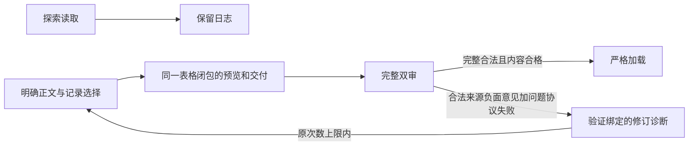

> 公开交付副本：结果、历史失败、限制和费用沿用下列原文。完整执行记录、原件、模型输入输出与账本保留在本机，不随本次 Git 提交；本公开副本及脚本不能单独复现私密运行。原文中的私密证据链接已改为文字标识，公开入口链接保留。
> 原文：`DELIVERY.zh-CN.md`；SHA-256：`f5347b8ee503bf9745ce0561bee1dd474c99ca52ff99e569628b8ea8abaa3823`。本副本未修改原冻结文件。

# E6-R3 · 正文交付边界与审核恢复

E6-R3 已完成约定机制修复与原标准回归：原失败受控恢复、S1/S3 各一次从零真实执行均通过。沿用原输入与原标准，先看效果，再看成功率，最后看费用。

## 根因与修复

原 R3-S1 并未明确选择产品拆分正文。它选择的四条记录均来自两张公司整体收入表，但 query requirement 的探索 read_context 全文默认进入交付，造成选择预览与最终正文不一致。`selected-originals-v4` 把最终正文通道改为所选记录原文及必要原子表格上下文、显式 source_evidence 和明确 read_node 正文；query 上的探索记录只留在审计日志。预览与组装共用冻结 table_context 闭包，跨公司同块 ID 不混用。v1–v3 原行为保留。

第二个根因是修订反馈与完整审核资格绑定。来源审核合法指出冗余，问题审核两次丢公司限定而形成重复 requested identity；联合 assessment 为空，原 loop 直接终止。新 `source-only-revision-v1` 只传重新验证并绑定原 packet/query/dataset/manifest 的来源负面意见和可复算协议错误，使用原 max_attempts 内下一轮自主检索。它不提供完整审核资格，仍需新一轮原文和完整双审才能进入 Analysis。传输、取消、计费、关闭失败、无修订需求或不合法来源审核不走这一路。

## 原标准与实际结果

问题仍要求截止 2026-02-06、Microsoft/Alphabet 所选 FY2025 10-K、各自 FY2025/FY2024 整体收入、精确日期/USD/单位/可定位原文。不得展开分部、计算增长或混用财年。重复正文不能被正确金额抵消；等价原件允许，不用唯一表格 ID 充当标准。

| 案例 | 效果与交付 | 缺了什么/多了什么 | 新增费用 |
|---|---|---|---:|
| 原 R3-S1 受控审核回归 | 第二轮真实取材、4/4、7 块2表、预览/SDK完整正文/双审/严格加载均通过 | 最终无缺失，无多余业务正文；原首稿639字符产品正文冗余仍失败 | 12请求 / $0.1766502 |
| S1 从零 | 首轮取材4/4、7块2表；一次问题审核格式修订后完整双审/严格加载通过 | 无缺失，无多余业务正文；完整原表FY2023及成本/EPS结构按原标准允许 | 13请求 / $0.1597773 |
| S3 从零 | 首轮4/4、7块2表，完整双审/严格加载通过，无恢复 | 无缺失，无多余业务正文；未用旧MSFT或Salesforce替代目标来源 | 12请求 / $0.1624146 |

本轮实际已交付四项如下，原表单位均为百万美元，规范数值为 USD。财年日期来自绑定原 fact 的 XBRL context，未从标题猜测；精确原表与字段核验见各例独立验收。

| 公司/财年 | 原财年起止日期 | 收入（百万USD） |
|---|---|---:|
| Microsoft FY2025 | 2024-07-01 → 2025-06-30 | 281,724 |
| Microsoft FY2024 | 2023-07-01 → 2024-06-30 | 245,122 |
| Alphabet FY2025 | 2025-01-01 → 2025-12-31 | 402,836 |
| Alphabet FY2024 | 2024-01-01 → 2024-12-31 | 350,018 |

受控回归首轮复用原 query 与原失败审核原稿（零新增模型调用）；仅第二轮全链真实执行。它证明原阻断可以有界恢复，不能称新鲜首轮成功，也不覆盖旧 V2 的失败分母。原九次 V2 仍8/9、无恢复0/9。

严格从零样本仅 **2次：内容2/2、最终合格交付2/2、无恢复1/2**。原失败受控回归另列，不混入新鲜分母。三例新增 **37次 / $0.4988421**，全部settled，0新增unknown/在途；原712行和两笔旧unknown全额预留保持。共享当前749请求，已知$9.6231432＋旧预留$0.1004304＝占用$9.7235736，原$13/1000上限保持。费用核对逐次start/end、SDK、usage×冻结价格和原账本一致。

## 检查与证据

83项受影响离线检查通过（1项历史私密夹具不可用而跳过）；独立 v4 6项与 source-only 14项含在相关覆盖内，不能相加作业务验收分母。22份历史审核输入逐字段原样重建，16份原合格交付仍严格加载。原例只切换交付版本，13→7块、四原件事实保持4/4；原两非法问题审核稿仍拒绝。

- [运行前方案](PLAN.zh-CN.md)
- 原机制零API重放（本机私密证据）
- 独立原例逐块验收（本机私密证据）
- 独立S1逐块验收（本机私密证据）
- 独立S3逐块验收（本机私密证据）
- 三例独立验收汇总（本机私密证据）
- 历史兼容（本机私密证据）
- 执行冻结（本机私密证据）
- 原例费用核对（本机私密证据）
- 最终逐次费用核对（本机私密证据）

费用继承原 $13/1000 共享账本，本轮 $3 预警，不清零旧预留。费用为冻结列表价×完整用量的估算，未核对供应商账单。顾问会话仍不可用，未绕过共享服务；Codex 对照原件独立验收。

## 当前边界

本轮每个真实案例一次，是机制回归，不能证明长期稳定、新题/新公司泛化或材料规模的单独因果。完整财务、任意格式/图片、真实 Analysis 和 E7关系仍未验收。下一具体 To-Do 为 **E6-V3**：先冻结 v4 下三档重复次数与原验收标准，再进行新的重复性验证。E7后置，因为本轮机制回归没有关闭稳定性缺口。S1的requested_subject逐字协议错误在一次修订后恢复，V2 R1-S1的跨requirement联合选择问题仍是独立待查机制；不把修复正文泄漏称为修复全部模型协议失误。
