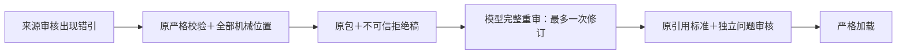

> 公开交付副本：结果、历史失败、限制和费用沿用下列原文。完整执行记录、原件、模型输入输出与账本保留在本机，不随本次 Git 提交；本公开副本及脚本不能单独复现私密运行。原文中的私密证据链接已改为文字标识，公开入口链接保留。
> 原文：`DELIVERY.zh-CN.md`；SHA-256：`be3508280083976ded2a3b4f6dd801cca42509a2bf9a664e00990a6071250980`。本副本未修改原冻结文件。

# E6-R1：来源审核引用错误的根因修复与验收

**本轮机制修复与约定验收完成。两份原失败稿经真实模型修订均通过，原题 S3 从零执行也通过。** 原严格引用与四项业务标准未放宽；原 E6-V1 的失败仍是失败，九次历史分母不改。下一当前行动 E6-R2：重复等价表选择与恢复费用。

## 现象、根因证据与修复

R3-S3 原材料四项收入正确，第一份来源审核的 3 个引用把独立单位标题归到相邻利润表，第二份的 5 个引用给原文黏连年份增加空格。两个实际模型输入都包含完整原文字面 text、块身份和连续引用规则。排除“原文未交付”“投影改写”“没有引用规则”；首次模型内部错误原因仍不能由单例证明。

确认的工程根因是**严格校验与有界修订之间丢失了错误上下文**：校验将具体错引压成通用 ValueError，第二次只有 stage/error_type，没有拒绝稿或具体引用位置，形成无状态重审。独立零 API 反事实仅改变错误引用、保持事实/判决/覆盖不动时，两份均可通过，支持阻断属于引用协议而非金额或材料不足；手写反事实只用于诊断，未传真实模型。

通用修复在共同审核责任层：

- 明确每个 quote 属于单个原文块；相邻 caption、语义表组、结构化 cells 和格式化年份不替代那个块的 text。
- 保持 `_quote` 原严格判据；收集所有无效引用，给出类型、草稿字段路径与其自己所引原块 text 路径。未查找或推荐“正确邻块”。
- 一次有界修订携带原包、明确不可信的拒绝稿和机械位置，由模型重新给完整审核；不提供替代 quote、金额、公司答案或目标 verdict。
- 来源审核仍最多两次逻辑调用。内部修订后禁止外层再审；外层第2次关闭内部修订。既有有限网络重试另留日志和费用，不混成协议修订。
- 首末稿、修订输入与最终响应封存；加载重建输入绑定，并检查修订标记与完整历史相互一致。独立审查发现“删除全部修订文件后重封存仍可加载”的缺口，已修复且原反例拒绝。

实现：[块引用诊断](../../../src/uteki/agents/data_query/answer_handoff.py#L926)、[修订输入与历史绑定](../../../src/uteki/agents/data_query/answer_handoff.py#L1037)、[执行边界](../../../src/uteki/agents/data_query/retrieval_cycle.py#L352)。这不是静默纠正文稿，也不是更换模型或增加内容重试。

## 原失败回放与真实结果

原问题保持 E6-Q1：以 2026-02-06 为可得截止，只据 Microsoft/Alphabet FY2025 10-K，分别提供各自 FY2025/FY2024 公司整体收入，保留财年、精确起止日期、币种/单位及原文；不混财历、不合并金额、不展开分部。

| 本轮执行 | 必需覆盖 / 范围真实性出处 / 实际读取 / 聚焦 | 双审与实际加载 | 请求 / 估算费用 | 原始产物 |
|---|---|---|---|---|
| 原稿1：错块引用的真实模型恢复 | 4/4，三轴及完整阅读通过；8原块/2收入表，保留30字导航页眉 | 通过；来源1次、问题1次，无协议重修 | 2 / $0.0200301 | 来源新稿（本机私密证据） · 完整结果（本机私密证据） |
| 原稿2：原文空格改写的真实模型恢复 | 4/4，三轴及完整阅读通过；同原8块/2收入表 | 通过；来源1次、问题1次，无协议重修 | 2 / $0.0196347 | 来源新稿（本机私密证据） · 完整结果（本机私密证据） |
| 同题 S3 完整材料从零执行 | 4/4，三轴及完整阅读通过；7块/2收入表，未交付导航页眉 | 通过；13次自主决策＋双审，无协议修订 | 15 / $0.1927491 | 执行结果（本机私密证据） · 来源审核（本机私密证据） |

前两项是固定拒绝稿的审核恢复实验，未重新检索，不称从零自主基线。模型实际修订输入逐字等于旧拒绝稿＋旧原包＋机械位置；没有接触评测参考答案或离线手写正确稿。第三项从全材料库自主发现、查询、阅读、选材，无初始语义块选择/旧审核反馈。全部实际原件逐题独立验收，而非接受模型的“通过”自评。

| 公司 | 财年 / 精确期间 | 本轮正确收入（USD million） | 原文定位 |
|---|---|---:|---|
| Microsoft | FY2025 / 2024-07-01—2025-06-30 | 281,724 | 合并利润表 Total revenue，DOM /html/body/div[150]/table |
| Microsoft | FY2024 / 2023-07-01—2024-06-30 | 245,122 | 同表 FY2024 列 |
| Alphabet | FY2025 / 2025-01-01—2025-12-31 | 402,836 | 合并利润表 Revenues，DOM /html/body/div[816]/table |
| Alphabet | FY2024 / 2024-01-01—2024-12-31 | 350,018 | 同表 FY2024 列 |

原单位、inline XBRL entity/context/期间/scale、DOM 与引用 text 均独立复核。原子利润表保留 FY2023 对照、费用/EPS 行属于原标准允许背景，不算额外提取任务；两恢复稿的30字页眉作为冗余显式保留。四项必需不能用可选材料或格式得分抵消。

逐轴原件独立验收与真实输入隔离（本机私密证据）。原 review-01（本机私密证据） 与 review-02（本机私密证据） 保持字节不变，修复后仍分别被原严格标准拒绝并报告3/5个机械错引。

## 独立边界与历史兼容

独立离线验收包含另一来源、不同财年和 caption/table 分块的10个合成边界：同源错块、空格改写、未知源/块、跨来源替代、图片、非连续拼接继续拒绝；合法短/拆分精确引文及旧可选字段缺省通过。八份历史成功来源审核保持原序列化与 eligible；八项执行/封存检查覆盖第二稿仍错、网络异常、输入大小上限、外层关闭追加修订和重封存篡改。工程定向检查全部通过，补充全删三件修订历史反例由独立审查再验拒绝。

这些是合成协议回归，**不是新的独立公司真实模型内容评测**。新鲜执行仍是同一已知题，不能把修复复验称长期稳定性或完整多公司泛化。实际精确文字暴露证明模型收到原件，不证明其一定正确理解每段。

独立协议验收（本机私密证据） · 定向检查（本机私密证据） · 最终冻结/原例/加载绑定核验（本机私密证据）

## 费用与环境故障保留

首次沙箱执行发生 APIConnectionError：一次请求加配置内一次网络重试均无正文，未产生模型修订结果。沙箱内只读连接核验无法解析官方域名，获准联网环境可达。旧日志不足以证明未发出，不核销为零：两笔 unknown 各$0.0502152，共 **$0.1004304** 全额预留。按既有有限恢复授权，另冻 v2 网络恢复记录后仅恢复该基础设施失败项一次；旧失败封存不改，也不替换内容失败。

本轮共 **21 次调用**：19 settled 估算 **$0.2324139**，2 unknown 预留 **$0.1004304**，新增总占用 **$0.3328443**。原共享账本累计499次，已知$6.1476372＋未知预留$0.1004304＝**$6.2480676**，在途0；USD13硬上限、1000请求护栏、原授权与478历史ID全部保留。价格按冻结无缓存折扣峰值价逐调用重算，未核验供应商实际账单。

独立费用对账（本机私密证据） · 网络恢复与费用保留记录（本机私密证据）。v1/v2冻结均保留，v1无可用模型正文；v2绑定最终通用实现及固定三步骤。未修改旧E6-V1输入、原标准、原执行或其8/9统计。本轮未使用AIHubMix，未调用旧机Claude窗口或声称Claude参与实测。

**下一项 E6-R2：** 对照两个 S1 首稿的已读/未读反例，定位记录选择、交付正文与聚焦判断之间的最早偏差，通用修复后按原标准验证重复表和恢复费用。该项尚未实施；E7、第二规模问题、更多格式、完整财务包与 Analysis 仍保留在[主 TODO](../../../TODO.md)。
