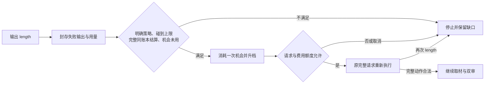

# E6-R4：有界输出容量恢复 · 2026-10-12

本轮通用机制、三次新批次压力验收及一次正常容量控制完成：全部独立交付通过。历史 V3 R3-S1 原包缺失，原输入重验仍未完成。以下仅报告本次冻结的新批次，不追认旧包恢复。

## 问题、根因与修复

原机制能正确拒绝 `finish_reason=length` 的残稿、记录费用并停止，却没有显式、有界的容量恢复通道。输出容量不足与网络故障应有不同的状态和额度。官方接口的 length 也可能涉及上下文限制，所以仅凭异常不批准恢复；本轮还要求完整报告用量、output_tokens 精确碰到当前上限、唯一调用终态及同账本已结算金额一致。[官方接口说明](https://api-docs.deepseek.com/api/create-chat-completion/)

[实施前冻结契约](PLAN.zh-CN.md)采用可选 `output_capacity_recovery`：仅官方 DeepSeek `deepseek-flash`；目标严格大于基础容量、最高 16384，每个 Planner/Worker 实例最多升档一次。先封存失败输出、用量和结算，再准入新的完整请求。输入、模型、提示词、Schema、推理强度不变，只改变 max_tokens；不拼接、不传入残稿。升档后容量保持，再次截断就停止。

同一 decision 的网络重试总数不因升档重置。预算不足、请求次数用尽或取消不增加派发，也不退还已经消耗的恢复机会。未配置时维持旧停止行为和原冻结配置字段。审核/分析及财务提取入口明确拒绝这个未支持的配置，含绕过 Coordinator 的公开入口，防止静默忽略。实现没有公司特例或财务答案。

工程回归 183 项通过，另有独立验收器 10 项边界检查；两组用途不同。SDK MockHTTP 覆盖真实 16384 请求参数、原输入一致、重复 length、unknown/错配结算、预算/次数上限、网络复合、封存故障及取消。既有财务测试依赖旧提示词版本名称，在原 HEAD 上也失败；改为核对当前版本及实际提取指令，原业务断言保留。工程检查不代表真实业务能力或长期稳定性。

## 冻结的新批次

输入为 Microsoft、Alphabet 两份完整 FY2025 10-K HTML，2,739 块、270 张 HTML 表、213 条已映射记录；没有人工准备语义章节包。问题、原件 SHA、dataset/scope、角色配置、私密标准 hash 和确切实现字节在第一次调用前封存。四项标准由 Codex 从原 HTML 金额、发行人 context、日期、USD unit/scale 独立构建，未传入运行 Agent 或审核模型。整份财务映射和任意格式支持不在本题通过范围。

[原问题](question.v1.json)：截至 2026-02-06，仅所选两份 FY2025 10-K，提供两家公司 FY2025/FY2024 公司整体收入、准确财年起止日、币种、单位和可定位原文；不计算增长、不合并公司金额、不展开分部分析。

| 公司 / 财年 | 收入（百万 USD） | 原件准确期间 |
|---|---:|---|
| Microsoft FY2025 | 281,724 | 2024-07-01 至 2025-06-30 |
| Microsoft FY2024 | 245,122 | 2023-07-01 至 2024-06-30 |
| Alphabet FY2025 | 402,836 | 2025-01-01 至 2025-12-31 |
| Alphabet FY2024 | 350,018 | 2024-01-01 至 2024-12-31 |

出处：[Microsoft 原 10-K](https://www.sec.gov/Archives/edgar/data/789019/000095017025100235/msft-20250630.htm)、[Alphabet 原 10-K](https://www.sec.gov/Archives/edgar/data/1652044/000165204426000018/goog-20251231.htm)。私密标准保留每项多个等价原文位置，不强制唯一块；运行 Agent 自主查询、阅读和选择。

## 真实执行：先效果，再成功率和费用

| 槽位 | 设置与真实结果 | 独立内容 / 完整交付 | 调用 / 新增估算 USD |
|---|---|---|---:|
| R1 | 人为 256→8192，一次恢复 | 4/4；全文实际输入、投影、原件、聚焦、双审及严格加载通过 | 14 / 0.1916973 |
| R2 | 人为 256→8192，一次恢复 | 4/4；全部通过 | 12 / 0.1547763 |
| R3 | 人为 256→8192，一次恢复 | 4/4；全部通过；采用另一处等价原表 | 15 / 0.2121885 |
| C1 | 正常 8192，允许升至16384；未触发升档 | 4/4；全部通过，正常容量兼容 | 15 / 0.2303961 |
| B1 | 256，无恢复；完整首决策，未执行动作 | 单决策诊断，不计业务成功 | 1 / 0.0061878 |
| B2 | 256，无恢复；length 后严格停止 | 单决策诊断，不计业务失败率 | 1 / 0.0064698 |
| B3 | 256，无恢复；完整首决策，未执行动作 | 单决策诊断，不计业务成功 | 1 / 0.0063858 |

三次压力运行固定次数且从零执行，失败不替换；均首个取材 attempt 和首次双审完成，无格式/业务纠错、无网络重试，但都发生一次容量恢复。正常控制 C1 无恢复也通过。四份交付均七块、两张原表、必要标题/单位上下文，缺失 0、重复等价表 0、无额外业务分析正文。完整原表内部非目标行作为不可切碎的出处保留，未另做分部分析。R1/R2 使用 Alphabet 收入附注的等价总额；R3/C1 使用主利润表，四项值及精确期间一致。

B 组用对应 R 组已封存的首输入，先验证原运行 manifest，再派发一次隔离决策。它们没有执行工具或继续业务链路；模型输出有波动，不能把它们与三次完整压力运行当作严格成功率 A/B。

R1 初版检查误把已冻结公开 Skill 中合法的 `independent_acceptance` 字段说明当作金标准泄漏，使输入绑定、正文/投影检查级联失败。旧 `R1.json` 原样保留；checker-v2 区分普通字段与私密标准标记，原输入 hash、调用 hash、完整阅读、私密金标准隔离门禁保留，增加正/负例检查。`R1.checker-v2.json` 是同一原运行的零 API 复核，不是重跑，也没有修改业务标准或运行版本。

本轮新增 **59 请求 / $0.8081016**，含三个 length 失败、所有正常调用、三条 B 诊断及双审。继承 M3 原 82 / $0.8480571 后，共 **141 / $1.6561587**，unknown/inflight/held=0，$3/200 硬上限未变。逐笔结算与 end 记录一致；独立比较旧迁移包确认原 82 条账本记录及配置未变、没有分叉。本轮金额按冻结价格估算，供应商账单未核对；不称整个项目所有历史费用已恢复。

## 证据与接续

公开入口：[prepare.py](prepare.py)、[run.py](run.py)、[evaluate_run.py](evaluate_run.py)。本机私密批次 `output/e6-r4-capacity-20261012-r1` 保留全原件、标准、实现快照、逐请求诊断、失败和验收；共享费用继续写入原 M3 `costs.sqlite`，没有创建 E6 新账本。运行参数禁止覆盖已有槽位；材料和标准漂移时拒绝继续。

原 E6-V3 包、R3-S1 历史回归仍未执行。三次人为低容量成功不证明历史 8192 失败已修复、不证明长期稳定或任意材料泛化。C1 未自然截断，仅说明正常容量兼容；8192→16384 的真实业务恢复不能追认，当前仅有 SDK MockHTTP 工程证据。Worker 恢复为工程边界验证，本题四轮由 Planner 自主完成。原 Claude 共享私密会话不可用，本轮未调用或宣称参与顾问评审。

本机独立报告：[R1 修正检查](../../../output/e6-r4-capacity-20261012-r1/evaluation-only/R1.checker-v2.json)、[R2](../../../output/e6-r4-capacity-20261012-r1/evaluation-only/R2.json)、[R3](../../../output/e6-r4-capacity-20261012-r1/evaluation-only/R3.json)、[C1](../../../output/e6-r4-capacity-20261012-r1/evaluation-only/C1.json)、[账本继承核验](../../../output/e6-r4-capacity-20261012-r1/evaluation-only/ledger-audit.v1.json)。这些私密证据不进 Git，换机需要另行迁移。

当前位置：本轮容量机制有限验收完成，历史回归保持未完成。下一具体 To-Do 是 E6-R5b：记录 ID 引用/分组与动作归属的共同契约及原标准回归；历史包缺口继续保留。
