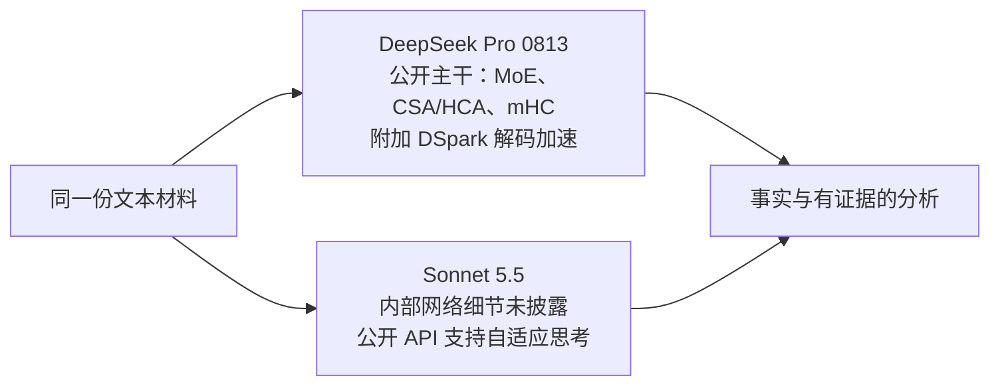

# DeepSeek V4 Pro 与 Claude Sonnet 5.5：架构、实测与成本

更新：2026-10-07（北京时间）。这是同一份 AMD 财报节选的单样本比较，供后续选型讨论。

**DeepSeek 提高单次输出上限后成功交付，六个提取值均正确。Sonnet 同样提取正确，耗时更短、输出用量更少。本次可以比较交付效率，不能据此宣布通用能力排名。**

## 1. 模型本身的技术架构

| 维度 | DeepSeek V4 Pro | Claude Sonnet 5.5 | 对项目的意义 |
|---|---|---|---|
| 本次接入 | DeepSeek 官方，`deepseek-v4-pro` | AIHubMix，`claude-sonnet-5-5` | 模型和接入渠道都需记录 |
| 版本身份 | 官方文档当前将别名映射到 V4-Pro-0813；响应仍只返回别名 | 请求与响应均为 `claude-sonnet-5-5` | 响应名称不是底层权重指纹 |
| 主体网络 | MoE（混合专家：每个 token 只激活部分专家） | 已查官方资料未披露是 MoE 还是 Dense | 不能编造 Sonnet 的网络结构 |
| 参数量 | 公开 V4-Pro 主干约 1.6 万亿总参数、490 亿激活参数；0813 沿用主干并附加 DSpark | 已查官方资料未披露 | 参数量不能直接替代任务质量评测 |
| 注意力结构 | CSA + HCA：压缩稀疏注意力与重度压缩注意力 | 已查官方资料未披露 | DeepSeek 公开了降低长上下文计算开销的机制 |
| 层间连接与加速 | mHC 约束层间连接；0813 增加 DSpark 推测解码 | 相应内部细节未披露 | DSpark 是解码加速模块，不能解释成另一个业务 Agent |
| 推理控制（API 层） | 可选择思考模式及推理力度；本次明确为 enabled / high | 官方提供 Adaptive thinking；本次经过 AIHubMix，未显式指定力度 | 相同任务不等于相同推理计算量 |
| 上下文 / 最大输出 | 官方当前 1M / 384K token | 官方标准 1M / 128K；批处理 beta 可 300K | 这些是平台能力上限；本次实际限制远低于上限 |
| 输入与输出 | 当前官方 Pro 为文本输入、文本输出，不支持视觉 | 官方支持文本和图像输入、文本输出 | 扫描件能力另行测试，本轮只测文本 |
| 权重与部署 | 发布权重，MIT 许可，可研究自部署 | 未公开可下载权重；公开接入以 API 和云托管为主 | 本轮没有测自部署费用或性能 |

DeepSeek 的主干结构和参数来自 [V4-Pro 官方模型卡](https://huggingface.co/deepseek-ai/DeepSeek-V4-Pro)；0813 的继承关系与 DSpark 来自 [0813 官方模型卡](https://huggingface.co/deepseek-ai/DeepSeek-V4-Pro-0813)。该仓库的 Safetensors 侧栏另显示约 1.7T，不能与主干参数混用，也没有逐张量核算其差额。

Sonnet 的公开边界依据 [Anthropic 透明度页面](https://www.anthropic.com/transparency)和 [Sonnet 5.5 官方规格](https://platform.claude.com/docs/en/models/sonnet-5-5/overview)。官方直连接口的默认推理力度，不能直接当作本次 AIHubMix 转换后的实际配置。DeepSeek 当前版本、上下文和模态依据 [官方 API 规格](https://api-docs.deepseek.com/quick_start/pricing/)。

图只表达输入、模型边界与输出，不是内部逐层网络图。**本次 Sonnet 更快，不能据此归因于某种未公开的内部架构。**

## 2. 同材料实测明细

任务：从 AMD FY2023 年报的 5 个冻结片段，提取 2023 / 2022 年经营、投资、融资现金流共 6 条；用不超过 250 个中文字解释经营现金流变化；列出至少 2 项材料限制。输入是约 10 KB 的节选，不是整本年报，也不是完整分析 Agent。

| 项目 | Sonnet 5.5 | DeepSeek 首次 | DeepSeek 补跑 |
|---|---:|---:|---:|
| 输出上限 | 4,000 | 4,000 | 24,000 |
| 推理设置 | 渠道默认，力度未显式指定 | enabled / high | enabled / high |
| 输入 token | 5,131 | 4,028 | 4,028 |
| 输出 token（含推理） | 1,963 | 4,000 | 15,745 |
| 渠道报告的推理 token² | 570 | 4,000 | 14,541 |
| 输出减推理 token | 1,393 | 0 | 1,204 |
| 输入缓存命中 | 未报告 | 0 | 3,968 |
| 耗时 | 13.90 秒 | 40.99 秒 | 138.42 秒 |
| 结束原因 | stop | length：触及上限 | stop |
| 可见结果 | 6 个事实、3 条分析、3 条限制 | 无可见结果 | 6 个事实、2 条分析、3 条限制 |
| 结构与引用校验 | 通过 | 不通过：未交付 | 通过 |
| 按高峰、无缓存价估算 | $0.029892 | $0.02115696 | $0.06766716 |
| 按时段与已报告缓存估算 | $0.029892¹ | $0.01057848 | $0.031301996 |

¹ Sonnet 没有报告输入缓存分项，按普通输入价计算；未读取渠道账单。DeepSeek 两次都发生在 UTC 非高峰时段，补跑输入有明确的缓存命中计数。所有美元值均为按公开价计算的估算，**不是已确认扣款**。

² 补充核验：570 是 AIHubMix 返回的 `reasoning_tokens` 分项，尚未找到其对 Claude 原生字段的明确映射规范，不能据此断言模型实际内部思考量相差约 25 倍。[Anthropic 原生规则](https://platform.claude.com/docs/en/build-with-claude/thinking-steering-and-cost)明确：完整推理计入计费输出，显示的思考摘要不等于完整推理用量。此规则不能自动证明网关分项映射正确。本表保留实际返回值；思考设置和渠道口径都是未控制变量。

同一段文字经不同模型的 tokenizer 切分后，token 数可能不同。`输出减推理`只是供应商用量字段的差值，不是独立测量的页面文字 token 数。

补跑只改变输出上限及超时（90 → 180 秒）。材料、提示、范围和 high 设置不变。单次调用、不自动重试，不将参考答案传入请求。原来的失败样本保留。本轮配置不是等计算量实验，且两个成功配置均只有一个样本。

- [打开两个成功结果的对比](http://127.0.0.1:8765/agent-results?agent=data&run=amd-cash-flow-small-20261006-sonnet&compare=amd-cash-flow-small-20261007-deepseek-24k)
- [DeepSeek 补跑过程](http://127.0.0.1:8765/agent-runs?agent=data&run=amd-cash-flow-small-20261007-deepseek-24k)
- [补跑配置](run-001/configuration.json)、[响应与用量](run-001/execution/01-deepseek/response-metadata.json)、[补跑结果](run-001/execution/01-deepseek/parsed.json)
- [原始材料](../2026-10-06-sonnet-deepseek-small-v1/prepared/packet.json)、[Sonnet 原始结果](../2026-10-06-sonnet-deepseek-small-v1/run-001/01-sonnet/parsed.json)

## 3. 成本口径

截至 2026-10-07，价格单位为美元 / 百万 token：

| 渠道 / 型号 | 普通输入 | 缓存读取 | 输出（含推理） |
|---|---:|---:|---:|
| DeepSeek 官方 Pro，高峰 | 1.32 | 0.044 | 3.96 |
| DeepSeek 官方 Pro，非高峰 | 0.66 | 0.022 | 1.98 |
| AIHubMix Sonnet 5.5 | 2 | 0.2 | 10 |
| AIHubMix Pro **0813**，高峰 | 1.3944 | 0.0465 | 4.1832 |
| AIHubMix Pro **0813**，非高峰 | 0.6918 | 0.0231 | 2.0754 |

来源：[DeepSeek 官方价格](https://api-docs.deepseek.com/quick_start/pricing/)、[AIHubMix Sonnet](https://aihubmix.com/model/claude-sonnet-5-5)、[AIHubMix Pro 0813](https://aihubmix.com/model/deepseek-v4-pro-0813)。AIHubMix 无日期的 [Pro 入口](https://aihubmix.com/model/deepseek-v4-pro)标为 0423 旧版，不能直接按同名比较。对于 0813 的普通输入和输出，所列 AIHubMix 高峰价比官方高 5.64%，非高峰价高约 4.82%；两家的时段规则也需分别检查。

单次调用费用 =（未缓存输入 × 输入价 + 缓存命中 × 缓存读价 + 全部输出 × 输出价）÷ 1,000,000。

如启用缓存写入，须另按写入类别计费，不能再把这部分重复算作普通输入。AIHubMix Sonnet 5 分钟缓存写入为 $2.5 / M、1 小时为 $4 / M。这里的实验没有显式配置缓存写入、内置搜索或批处理，未计这些产品的费用。

DeepSeek 补跑按非高峰、缓存命中计算：

`(60 × 0.66 + 3968 × 0.022 + 15745 × 1.98) / 1,000,000 = $0.031301996`

| 要回答的问题 | 按时段 / 已报告缓存估算 | 保守高峰无缓存估算 |
|---|---:|---:|
| Sonnet 成功一次 | $0.029892 | $0.029892 |
| DeepSeek 成功那一次 | $0.031301996 | $0.06766716 |
| DeepSeek 含首次失败的累计 | $0.041880476 | $0.08882412 |
| 本轮全部三次调用 | $0.071772476 | $0.11871612 |

因此，本样本中 **DeepSeek 的每 token 单价更低，但它用了更多推理 token；成功一次的时段/缓存估算仍比 Sonnet 高约 4.7%，耗时约为 10 倍。** 这是特定材料和配置的结果，不能外推所有任务。预算账本继续保留更保守的 $0.11871612，不改写历史账本。

## 4. “一个分析任务”大概多少钱

完整分析任务尚未实测，不能把这个短分析冒充整篇研究报告。先使用可核查的用量预算：**所有步骤累计输入 50,000 token、输出 10,000 token（已经包含推理）**，不使用输入缓存。这个数字是情景假设，不是模型完成任务所需的保证。

| 假设情景 | DeepSeek 官方 | Sonnet 经 AIHubMix |
|---|---:|---:|
| 累计 50k 输入 + 10k 输出 | $0.0528～$0.1056（非高峰～高峰） | $0.20 |
| 累计 100k 输入 + 20k 输出 | $0.1056～$0.2112 | $0.40 |
| 在第一种情景上增加 2 次 Sonnet 评审，每次 10k 输入 + 2k 输出 | $0.1328～$0.1856 | $0.28 |

这些数字仅回答“消耗这些 token 要多少钱”。实际需要的用量由材料长度、步骤数、推理力度、重复上下文、失败与返工决定。本轮 DeepSeek 小样本已经消耗 15,745 输出 token，说明给它假设 10k 输出未必足以完成。工具、检索、OCR、存储、基础设施与人工复核成本不在此表内。

最后一行是费用情景，没有调用这两次评审，也不代表两个不同评测模型。**本次裁判使用当前 Codex 会话及一个独立上下文；未另调 Sonnet/DeepSeek 评测 API。Codex 会话额度的美元成本不可见，不能记成零。**

## 5. Codex 原文复核

独立上下文只收到相同原文及匿名结果 A/B，未收到模型标签、成本或参考答案；另一个 Codex 上下文复核了分析及限制。评审完成后揭示：A 为 DeepSeek 补跑，B 为 Sonnet。它们属于 Codex 自动评审，不是两个不同模型家族，也不是人工金标。

| 评审维度（每项 0～5） | DeepSeek 补跑 | Sonnet | 具体依据 |
|---|---:|---:|---|
| 事实正确 | 5 | 5 | 6 条事实均正确，包括负号、单位、财年期末 |
| 引用 | 5 | 5 | block、行列、原文引文均对应材料 |
| 分析 | 3 | 4 | Sonnet 明确分开当年构成与同比变化；DeepSeek 的“主因”及末句容易将当期现金占用混作同比原因，舍入差额也未注明 |
| 限制陈述 | 3 | 3 | 两者都有过宽表述，具体问题不同 |

六条事实如下，单位均为百万美元：

| 年份 | 经营现金流 | 投资现金流 | 筹资现金流 | 两模型结果 |
|---|---:|---:|---:|---|
| 2023 | 1,667 | -1,423 | -1,146 | 全部吻合 |
| 2022 | 3,565 | 1,999 | -3,264 | 全部吻合 |

两项值得修订的问题：

- **DeepSeek 的限制 1：**“无法判断……2023 年投资流出用途”过强。给定表 r27、r28、r32 已列出设备、短期投资及收购支出。未提供的是更详细背景及持续性，不能说完全不知道用途。
- **Sonnet 的限制 2、3：**不能全面评估偿债能力、未来趋势是合理的，但“无法判断流动性影响”及笼统质疑可比口径过宽。表 r43～45 已提供现金变化与余额，同一张表也支持按披露口径比较。

两者的同比总额和约 53.2% 降幅都正确。表内可以精确拆为：净利润差额 -466、非现金调整差额 -229、经营资产负债变动差额 -1,203，合计 -1,898 百万美元。此拆分解释会计金额变化，不等于完整业务因果。存货现金占用从 -1,401 改善到 -580，不能把当期备货直接说成同比恶化。

本轮我更偏好 **Sonnet 的分析组织和交付效率**，但两者的提取准确性在这六个值上没有差别，分析与限制都还需要修订。没有修改两份原始输出，也没有把自动评分写成后台人工评分。

证据：[匿名评审全文](codex-review/review.md)、[逐项检查与评分](codex-review/review.json)、[模型映射与原始结果哈希](comparison.json)。结构校验、原文审阅和本地接口检查均完成；33 项相关离线检查通过。后台候选状态不因本次自动评审而变成已采纳。

## 6. 下一步

1. 先审阅本次六条事实、分析措辞、缺失信息和费用，决定是否将 Sonnet 作为下一轮基线。
2. 再补少量跨公司、跨财报类型的冻结小样本，保持题目和评分标准一致；测每个配置的正确率、延迟和每个合格结果成本。
3. 确定任务边界和预算后，再测试完整分析 Agent。便宜模型预处理及双模型裁判是后续候选方案，本次没有运行或验证。
