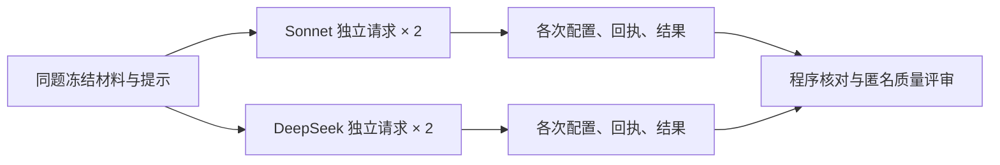

# 小任务质量与重复稳定性试验

本轮比较两套明确配置在同一份 AMD FY2023 冻结材料上的交付，不作通用模型排名。真实结果及限制见 [RESULTS.zh-CN.md](RESULTS.zh-CN.md)。每个任务分别调用两个模型各两次，总计最多八次；一次一个请求，无自动重试、续写或模型修复。

## 先固定什么

- 任务一：核对两个财年的经营、投资、融资净现金流，给出六条带原文定位的事实及短说明。
- 任务二：提取两个经营现金流数值，计算同比变化，并在 250 个中文字内解释资料支持的变化及缺口。
- 两项使用同五个来源块，各有独立题目、输入哈希和评分规则。同题输入和系统提示在模型、重复之间完全一致。新调用没有前次答案或对话历史。
- 隐藏参考项来自原始 HTML / inline XBRL 与文本索引核对，独立存储，不进入模型请求。它们由代理核验，尚非人工审核的标准答案。
- [plan.json](plan.json) 在首个请求前固定任务、顺序、配置哈希和评分；[execution-pin.json](execution-pin.json) 固定计划与执行代码。共享预算为 1.50 美元估算上限，全部八次保守预留约 0.94 美元；它不是供应商账单上限。

## 采样参数的实际边界

| 参数 | Sonnet 5.5 / AIHubMix 原生接口 | DeepSeek V4 Pro / 官方接口 |
|---|---|---|
| 思考模式 / 力度 | adaptive / high，明确发送 | enabled / low，明确发送 |
| Temperature | 不发送；模型不接受非默认值 | 不发送；思考模式忽略此参数 |
| Top-P | 不发送；模型不接受非默认值 | 0.95，明确发送 |
| Top-K | 不发送；模型不接受非默认值 | 不发送；该 API 未列出此控制 |
| Seed | 不发送；没有已核实可用的控制 | 不发送；没有已核实可用的控制 |
| 输出上限 | 8,000 | 16,000 |
| 超时 / 重试 / 并发 | 180 秒 / 0 / 1 | 180 秒 / 0 / 1 |

参数限制核对于 2026-10-07：[Claude 官方规格](https://platform.claude.com/docs/en/models/sonnet-5-5/overview)、[DeepSeek 思考模式](https://api-docs.deepseek.com/guides/thinking_mode/)、[DeepSeek 请求规格](https://api-docs.deepseek.com/api/create-chat-completion/)。DeepSeek 的思考模式 Top-P 有效范围为 0.95–1.0，低于 0.95 会钳制到 0.95。AIHubMix 原生请求格式参考[渠道说明](https://aihubmix.com/blog/claude-opus-4-7-new-parameters-guide)。固定请求并不保证逐字复现；请求被接受也不等于供应商回显证实每项参数生效。

这是两套实际服务配置的对照。high 与 low 不等同；输出上限、协议、分词、渠道和缓存也不同。不能把结果差异全部归因于某一个采样参数或底层模型架构。模型别名、实际返回模型名及运行环境均记录，但未锁定供应商内部权重版本和硬件。

## 怎样判断结果

程序检查正确数值、符号、期间、单位、行列、引文、重复或漏项、长度限制和指定变化值。然后由隐藏模型身份的 Codex 评审检查分析及缺口是否有依据，按预登记五维规则打分。代理评分与人工评分分开保存；两个模型说法一致不代表正确。

重复性分三层：原文逐字一致；规范化格式及排列后的一致；事实字段一致。说明文字的语义质量由独立盲评检查，不能用文本哈希代替。两次重复只能发现本轮波动，不能估计总体稳定率或统计显著性。

## 哪些过程文件相同

- 原件与选材可以共享；同题 `request.json` 内容一致是比较前提。新一轮每次都在自己的目录保存一份。
- `http-request.json` 是实际接口正文。两种 API 的封装不同，同一配置重复时正文应相同。
- 配置快照、开始时间、响应 ID、用量、结束原因及可见输出每次独立生成。验证结果文件可能相同，因为使用同一检查程序；不代表复制模型回答。
- 当前过程展示的是受控单次模型请求，没有工具循环或自主选材，也没有保存模型的私有推理正文。不能把统一的单步骤页面当作相同的内部推理过程。

## 运行与复查入口

`run_case.py --ordinal N` 只执行一个预登记序号。执行文件和材料哈希必须匹配；前序失败、未知用量、未结束请求或超过输入目标会阻止后续派发。所有请求共用一个账本和独占锁，不能通过新输出目录重置本轮预算。

`evaluate.py --benchmark <本目录> --output <新文件>` 只读检查已保存结果，不调用模型。`register_trial.py` 将每个已结束尝试登记到工作台，拒绝覆盖旧 Trace。失败、无效结果和未执行项都保留，不能只展示成功样本。

后续优先增加独立公司 / 20-F 材料与不同任务；本轮两题共用 AMD 同一小节，不代表跨公司或完整报告能力。
